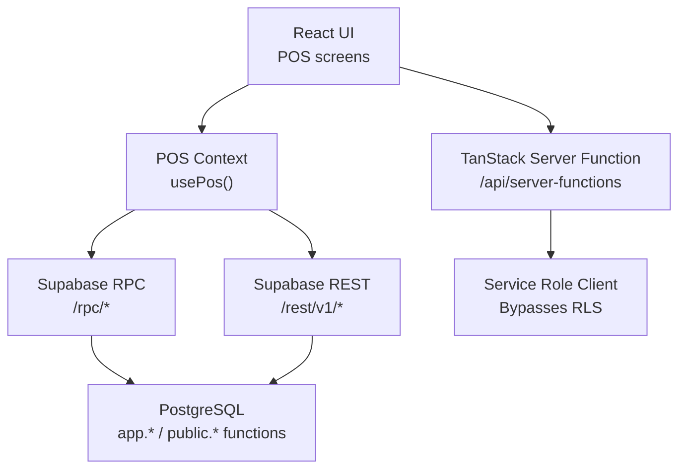
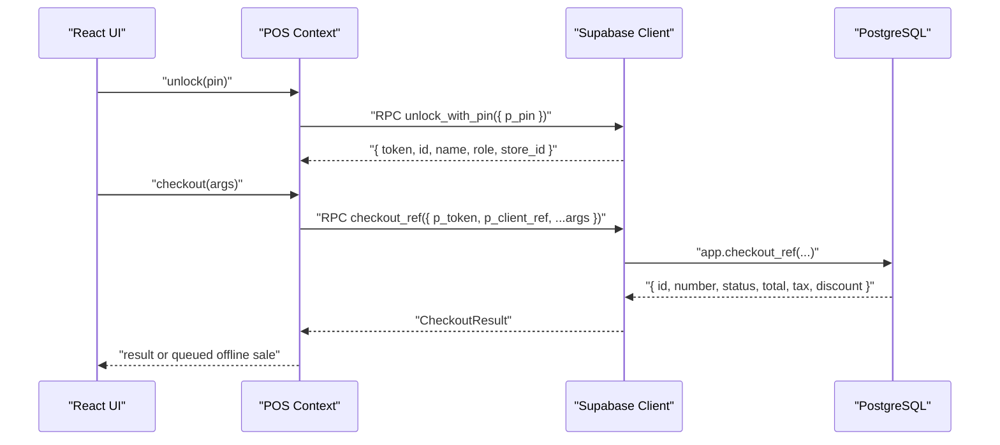
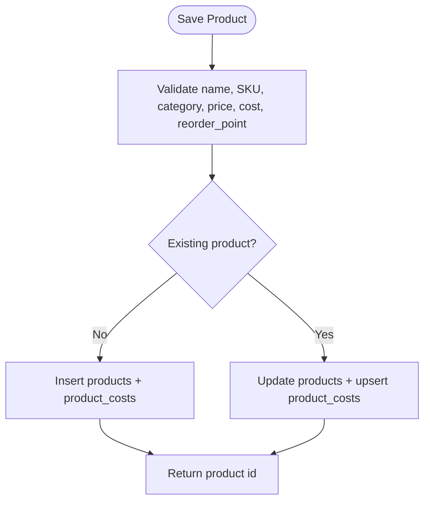
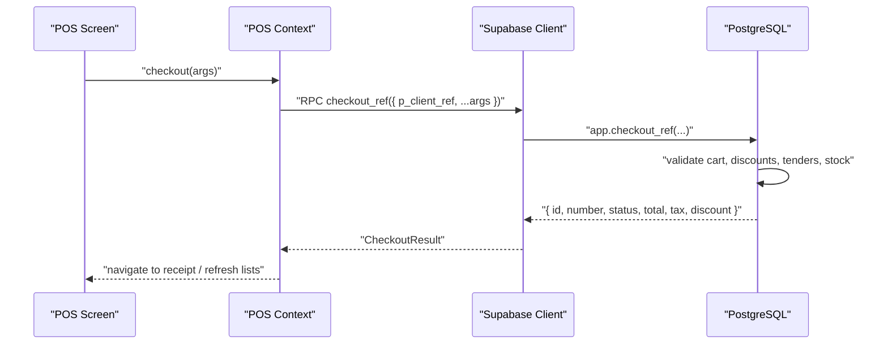
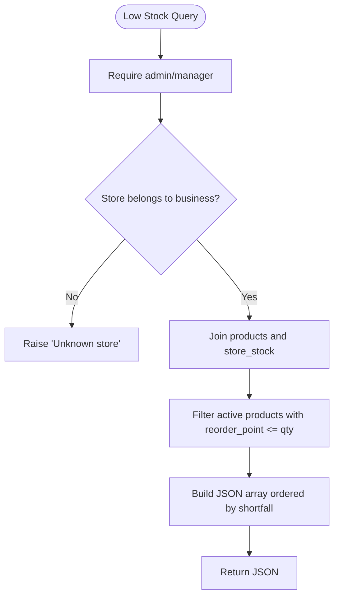
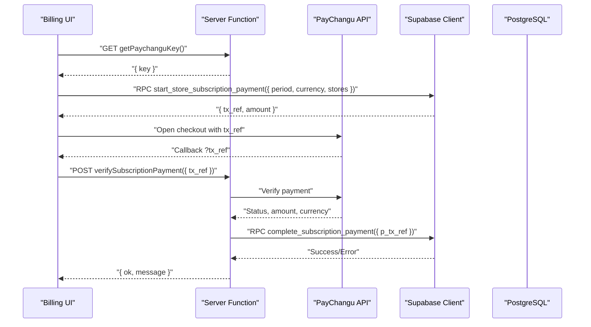
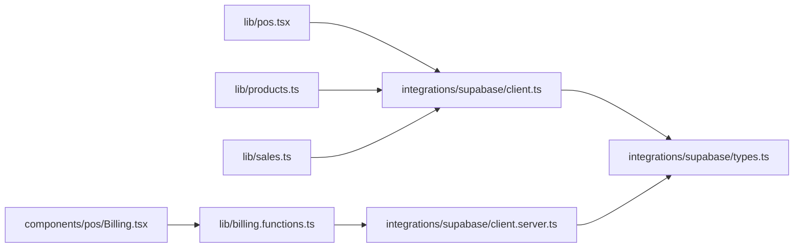

# API Reference

<cite>
**Referenced Files in This Document**
- [pos.tsx](file://src/lib/pos.tsx)
- [products.ts](file://src/lib/products.ts)
- [sales.ts](file://src/lib/sales.ts)
- [billing.functions.ts](file://src/lib/billing.functions.ts)
- [Billing.tsx](file://src/components/pos/Billing.tsx)
- [client.ts](file://src/integrations/supabase/client.ts)
- [client.server.ts](file://src/integrations/supabase/client.server.ts)
- [auth-middleware.ts](file://src/integrations/supabase/auth-middleware.ts)
- [types.ts](file://src/integrations/supabase/types.ts)
- [20261007084733_2ed95314-f75e-4843-977b-23f9e6359a48.sql](file://supabase/migrations/20261007084733_2ed95314-f75e-4843-977b-23f9e6359a48.sql)
- [20261009210500_retail_operations.sql](file://supabase/migrations/20261009210500_retail_operations.sql)
- [20261011090000_sales_summary.sql](file://supabase/migrations/20261011090000_sales_summary.sql)
- [20261008090000_security_hardening.sql](file://supabase/migrations/20261008090000_security_hardening.sql)
</cite>

## Table of Contents
1. [Introduction](#introduction)
2. [Project Structure](#project-structure)
3. [Core Components](#core-components)
4. [Architecture Overview](#architecture-overview)
5. [Detailed Component Analysis](#detailed-component-analysis)
6. [Dependency Analysis](#dependency-analysis)
7. [Performance Considerations](#performance-considerations)
8. [Troubleshooting Guide](#troubleshooting-guide)
9. [Conclusion](#conclusion)

## Introduction
This document describes the Supabase RPC functions and REST endpoints exposed by the Storq POS system. It covers product operations, sales processing, inventory management, billing, and reporting. For each endpoint it specifies HTTP methods, URL patterns, request/response schemas, authentication requirements, validation rules, error behavior, and real-time update strategies. It also includes client integration examples for the React frontend, plus guidance on rate limiting, error handling, and retry strategies.

The system uses:
- Supabase RPC functions for business logic, invoked through a secure POS context that attaches a staff session token.
- Supabase REST tables for read-heavy data such as products, stock, sales, and subscription state.
- TanStack Server Functions for server-only billing operations.
- Row Level Security (RLS) policies to enforce tenant isolation.

## Project Structure
Storq exposes its backend surface through three layers:
- Client-side hooks and utilities call Supabase RPC or REST APIs.
- Server-side TanStack Server Functions perform trusted operations such as payment verification.
- PostgreSQL functions implement business rules, validation, and transactional writes.

**Diagram sources**
- [pos.tsx:220-228](file://src/lib/pos.tsx#L220-L228)
- [client.ts:57-84](file://src/integrations/supabase/client.ts#L57-L84)
- [client.server.ts:35-72](file://src/integrations/supabase/client.server.ts#L35-L72)
- [20261009210500_retail_operations.sql:62-100](file://supabase/migrations/20261009210500_retail_operations.sql#L62-L100)

**Section sources**
- [pos.tsx:115-228](file://src/lib/pos.tsx#L115-L228)
- [client.ts:1-95](file://src/integrations/supabase/client.ts#L1-L95)
- [client.server.ts:1-72](file://src/integrations/supabase/client.server.ts#L1-L72)

## Core Components
- POS Context (`usePos`): Provides authenticated RPC calls, checkout orchestration, offline queueing, money formatting, role checks, and cache invalidation.
- Product Hooks: Read-only catalog and stock queries with optional cost joins.
- Sales Hooks: Paginated sales lists, summaries via RPC, and export helpers.
- Billing Server Functions: Payment key retrieval and subscription payment verification.
- Billing UI: Subscription purchase flow using a third-party payment provider.

Key responsibilities:
- Authentication is handled by staff PIN unlock and session tokens passed to every RPC.
- Business logic is centralized in PostgreSQL functions behind `require_staff`.
- Data reads use RLS-enabled REST endpoints; writes go through RPCs.

**Section sources**
- [pos.tsx:28-84](file://src/lib/pos.tsx#L28-L84)
- [products.ts:8-53](file://src/lib/products.ts#L8-L53)
- [sales.ts:5-73](file://src/lib/sales.ts#L5-L73)
- [billing.functions.ts:1-54](file://src/lib/billing.functions.ts#L1-L54)
- [Billing.tsx:54-139](file://src/components/pos/Billing.tsx#L54-L139)

## Architecture Overview
The POS client authenticates staff via PIN, obtains a short-lived session token, and then calls RPC functions with `p_token`. The server validates the token, enforces roles, and executes business logic. REST reads are filtered by RLS policies tied to the authenticated user’s business.

**Diagram sources**
- [pos.tsx:194-228](file://src/lib/pos.tsx#L194-L228)
- [pos.tsx:275-307](file://src/lib/pos.tsx#L275-L307)
- [20261009210500_retail_operations.sql:290-320](file://supabase/migrations/20261009210500_retail_operations.sql#L290-L320)

## Detailed Component Analysis

### Authentication and Session Management
- Unlock: Staff enter a PIN to obtain a session token used for subsequent RPC calls.
- Lock: Clears the local session and optionally invalidates the server token.
- Token injection: Every RPC call automatically includes `p_token`.

Authentication requirements:
- All write RPCs require a valid staff session token and appropriate roles.
- Read REST endpoints rely on Supabase auth and RLS policies.

Error handling:
- Locked sessions clear local state and prompt re-authentication.
- SQL internals and policy errors are masked into user-friendly messages.

**Section sources**
- [pos.tsx:194-228](file://src/lib/pos.tsx#L194-L228)
- [20261007084733_2ed95314-f75e-4843-977b-23f9e6359a48.sql:165-180](file://supabase/migrations/20261007084733_2ed95314-f75e-4843-977b-23f9e6359a48.sql#L165-L180)

### Product Operations
RPC: `save_product`
- Purpose: Create or update a product and its buying cost; supports reorder point.
- Method: Supabase RPC
- URL pattern: `/rpc/save_product`
- Authentication: Required staff token with admin or manager role.
- Request schema:
  - `p_token`: uuid
  - `p_id`: uuid | null
  - `p_name`: text (required, trimmed, max 200 chars, no control characters)
  - `p_sku`: text | null (max 64 chars, allowed characters limited)
  - `p_category`: text | null (max 120 chars)
  - `p_price`: numeric (0 to 1,000,000,000)
  - `p_cost`: numeric | null (0 to 1,000,000,000)
  - `p_active`: boolean
  - `p_reorder_point`: numeric | null (0 to 1,000,000)
- Response: product id (uuid)
- Validation rules: Enforced in function body; returns descriptive error messages on failure.
- Error response format: Postgres exception message, masked by client into generic or access-denied messages.

REST: Products and costs
- Endpoints:
  - GET `/rest/v1/products`
  - GET `/rest/v1/product_costs` (admin/manager only due to RLS)
- Authentication: Supabase auth; RLS restricts rows to current business.
- Response schemas: See generated types for `products` and `product_costs`.

Client usage:
- Catalog loading uses `useProducts`, which fetches products and optionally joins costs.
- Quick add calls `save_product` with full parameter set to avoid overload ambiguity.

**Diagram sources**
- [20261009210500_retail_operations.sql:62-100](file://supabase/migrations/20261009210500_retail_operations.sql#L62-L100)

**Section sources**
- [20261009210500_retail_operations.sql:62-100](file://supabase/migrations/20261009210500_retail_operations.sql#L62-L100)
- [products.ts:22-53](file://src/lib/products.ts#L22-L53)
- [QuickAddItem.tsx:53-84](file://src/components/pos/QuickAddItem.tsx#L53-L84)
- [types.ts:392-432](file://src/integrations/supabase/types.ts#L392-L432)

### Sales Processing
RPC: `checkout`
- Purpose: Create a sale or layby, validate cart, compute totals/tax/discounts, check stock, record payments, and move inventory.
- Method: Supabase RPC
- URL pattern: `/rpc/checkout`
- Authentication: Required staff token with admin, manager, or cashier role.
- Request schema:
  - `p_token`: uuid
  - `p_store`: uuid
  - `p_kind`: "sale" | "layby"
  - `p_items`: jsonb array of `{ product_id, qty }` (max 500 lines, positive quantities, unique per product)
  - `p_payment`: numeric | default 0 (0 to 10,000,000,000)
  - `p_method`: "cash" | "card" | "mobile" | null
  - `p_customer_name`: text (max 120 chars, no control characters)
  - `p_customer_phone`: text | null (6-32 chars, digits and symbols)
  - `p_note`: text | null (max 500 chars)
  - `p_tenders`: jsonb array of `{ method, amount }` (max 10 entries, positive amounts)
  - `p_discounts`: jsonb array of `{ product_id, amount }` (non-negative, cannot exceed gross)
  - `p_override_pin`: text | null (4-8 digits; required if cashier exceeds discount cap)
- Response: JSON with `id`, `number`, `status`, `total`, `tax`, `discount`.
- Validation rules:
  - Cart must be non-empty and well-formed.
  - Store must belong to business; cashier store assignment enforced.
  - Discounts capped at 10% per line/cart unless manager PIN provided.
  - Stock checked before completing non-approval sales.
  - Tender sums validated against total; cash overpayment allowed within limits.
- Error response format: Descriptive business exceptions; client masks SQL internals.

RPC: `checkout_ref`
- Purpose: Idempotent checkout using a client-generated reference; prevents duplicate sales.
- Method: Supabase RPC
- URL pattern: `/rpc/checkout_ref`
- Authentication: Same as `checkout`.
- Request schema: Adds `p_client_ref` (uuid).
- Response: Same as `checkout`; may include `duplicate: true` when reference already exists.

REST: Sales list and details
- Endpoints:
  - GET `/rest/v1/sales`
  - GET `/rest/v1/sale_items`
- Authentication: Supabase auth; RLS scoped to business.
- Response schemas: See generated types for `sales` and `sale_items`.

Client usage:
- `useSales` fetches paginated sales with optional item joins.
- `useSalesSummary` calls `sales_summary` RPC for exact KPI totals.
- Offline checkout queues failed network calls and retries periodically.

**Diagram sources**
- [pos.tsx:275-307](file://src/lib/pos.tsx#L275-L307)
- [20261009210500_retail_operations.sql:108-287](file://supabase/migrations/20261009210500_retail_operations.sql#L108-L287)
- [20261009210500_retail_operations.sql:290-320](file://supabase/migrations/20261009210500_retail_operations.sql#L290-L320)

**Section sources**
- [20261009210500_retail_operations.sql:108-320](file://supabase/migrations/20261009210500_retail_operations.sql#L108-L320)
- [sales.ts:37-73](file://src/lib/sales.ts#L37-L73)
- [sales.ts:126-148](file://src/lib/sales.ts#L126-L148)
- [pos.tsx:275-307](file://src/lib/pos.tsx#L275-L307)

### Inventory Management
RPC: `adjust_stock`
- Purpose: Manually adjust store-level stock quantity.
- Method: Supabase RPC
- URL pattern: `/rpc/adjust_stock`
- Authentication: Admin or manager.
- Request schema:
  - `p_token`: uuid
  - `p_store`: uuid
  - `p_product`: uuid
  - `p_delta`: numeric
- Response: void
- Validation: Store must exist and belong to business.

RPC: `low_stock`
- Purpose: List active products at or below their reorder point for a store.
- Method: Supabase RPC
- URL pattern: `/rpc/low_stock`
- Authentication: Admin or manager.
- Request schema:
  - `p_token`: uuid
  - `p_store`: uuid
- Response: JSON array of low-stock items with product details and shortfall.

REST: Stock levels
- Endpoint: GET `/rest/v1/store_stock`
- Authentication: Supabase auth; RLS scoped to business stores.
- Response: Array of `{ store_id, product_id, qty }`.

Client usage:
- `useStock` fetches store stock maps; can poll live for till accuracy.

**Diagram sources**
- [20261009210500_retail_operations.sql:503-527](file://supabase/migrations/20261009210500_retail_operations.sql#L503-L527)

**Section sources**
- [20261007084733_2ed95314-f75e-4843-977b-23f9e6359a48.sql:233-241](file://supabase/migrations/20261007084733_2ed95314-f75e-4843-977b-23f9e6359a48.sql#L233-L241)
- [20261009210500_retail_operations.sql:503-527](file://supabase/migrations/20261009210500_retail_operations.sql#L503-L527)
- [products.ts:82-106](file://src/lib/products.ts#L82-L106)

### Billing and Subscriptions
Server Function: `getPaychanguKey`
- Method: GET
- URL pattern: TanStack Server Function route
- Purpose: Returns the configured PayChangu public key.
- Authentication: Server-side only; environment variable required.
- Response: `{ key: string }`

Server Function: `verifySubscriptionPayment`
- Method: POST
- URL pattern: TanStack Server Function route
- Purpose: Verifies a PayChangu payment and activates subscription via RPC.
- Authentication: Server-side only; requires secret key and service role client.
- Request schema:
  - `tx_ref`: string (min 6, max 80)
- Response:
  - `{ ok: boolean, message: string }`
- Behavior:
  - Checks stored payment record.
  - Calls PayChangu API to verify success and amount/currency match.
  - Invokes `complete_subscription_payment` RPC on success.

RPC: `start_store_subscription_payment`
- Purpose: Creates a payment intent for subscription upgrade/renewal.
- Method: Supabase RPC
- URL pattern: `/rpc/start_store_subscription_payment`
- Authentication: Admin or manager.
- Request schema:
  - `p_period`: "monthly" | "yearly"
  - `p_currency`: "MWK" | "USD"
  - `p_stores`: number
- Response: Payment initiation payload including `tx_ref` and `amount`.

Client usage:
- Billing UI orchestrates payment flow, invokes server functions, and handles callback URLs.

**Diagram sources**
- [billing.functions.ts:4-53](file://src/lib/billing.functions.ts#L4-L53)
- [Billing.tsx:94-139](file://src/components/pos/Billing.tsx#L94-L139)

**Section sources**
- [billing.functions.ts:1-54](file://src/lib/billing.functions.ts#L1-L54)
- [Billing.tsx:54-139](file://src/components/pos/Billing.tsx#L54-L139)

### Reporting and Aggregates
RPC: `sales_summary`
- Purpose: Compute net revenue, collected, transactions, pending, and refunds for a date range and optional store.
- Method: Supabase RPC
- URL pattern: `/rpc/sales_summary`
- Authentication: Admin, manager, or cashier.
- Request schema:
  - `p_token`: uuid
  - `p_store`: uuid | null
  - `p_from`: timestamptz
  - `p_to`: timestamptz
- Response: JSON with fields `revenue`, `collected`, `transactions`, `pending`, `refunds`.

Client usage:
- `useSalesSummary` wraps this RPC and normalizes values for dashboard cards.

**Section sources**
- [20261011090000_sales_summary.sql:14-57](file://supabase/migrations/20261011090000_sales_summary.sql#L14-L57)
- [sales.ts:126-148](file://src/lib/sales.ts#L126-L148)

### Real-Time Subscriptions
Real-time updates are not implemented via explicit subscriptions in the analyzed files. Instead, the application uses:
- Explicit cache invalidation keys (for example, `SALE_TOUCHED`) after mutations.
- Polling intervals for sensitive views like stock on the till.
- Long-lived query caches with stale times tuned per domain.

Recommendation:
- If real-time is needed, subscribe to relevant channels and invalidate corresponding query keys.

**Section sources**
- [products.ts:82-106](file://src/lib/products.ts#L82-L106)
- [pos.tsx:309-345](file://src/lib/pos.tsx#L309-L345)

## Dependency Analysis
The following diagram shows how client modules depend on Supabase clients and server functions.

**Diagram sources**
- [pos.tsx:1-27](file://src/lib/pos.tsx#L1-L27)
- [products.ts:1-5](file://src/lib/products.ts#L1-L5)
- [sales.ts:1-3](file://src/lib/sales.ts#L1-L3)
- [Billing.tsx:1-10](file://src/components/pos/Billing.tsx#L1-L10)
- [billing.functions.ts:1-5](file://src/lib/billing.functions.ts#L1-L5)
- [client.ts:1-5](file://src/integrations/supabase/client.ts#L1-L5)
- [client.server.ts:1-6](file://src/integrations/supabase/client.server.ts#L1-L6)
- [types.ts:1-8](file://src/integrations/supabase/types.ts#L1-L8)

**Section sources**
- [pos.tsx:1-27](file://src/lib/pos.tsx#L1-L27)
- [products.ts:1-5](file://src/lib/products.ts#L1-L5)
- [sales.ts:1-3](file://src/lib/sales.ts#L1-L3)
- [billing.functions.ts:1-5](file://src/lib/billing.functions.ts#L1-L5)
- [client.ts:1-95](file://src/integrations/supabase/client.ts#L1-L95)
- [client.server.ts:1-72](file://src/integrations/supabase/client.server.ts#L1-L72)
- [types.ts:1-8](file://src/integrations/supabase/types.ts#L1-L8)

## Performance Considerations
- Use RPC for aggregations and complex writes to minimize client-side computation and reduce payload sizes.
- Cache catalogs and stock with long stale times; invalidate explicitly on changes.
- Page large lists instead of loading entire periods.
- Avoid unnecessary refetches by separating pure derived state from query keys.
- Prefer server-side exports for large CSV/PDF generation.

[No sources needed since this section provides general guidance]

## Troubleshooting Guide
Common issues and resolutions:
- Locked session: Occurs when staff session expires or is invalidated; the client clears local state and prompts re-authentication.
- Access denied: Indicates RLS policy violation or insufficient role; ensure correct staff role and business scoping.
- Network errors during checkout: The POS queues offline sales and retries periodically; failed items show retry/discard options.
- Invalid parameters: RPCs return descriptive business errors; client masks SQL internals to prevent leaking database structure.

Operational tips:
- Verify environment variables for Supabase URL and keys.
- Confirm staff PIN setup and active status.
- Check store assignments for cashiers.
- Review discount overrides and manager PIN enforcement.

**Section sources**
- [pos.tsx:93-104](file://src/lib/pos.tsx#L93-L104)
- [pos.tsx:220-228](file://src/lib/pos.tsx#L220-L228)
- [pos.tsx:309-345](file://src/lib/pos.tsx#L309-L345)

## Conclusion
Storq’s API surface centers on secure, role-gated RPC functions for critical business operations and RLS-scoped REST endpoints for reading data. The POS context abstracts authentication, error masking, offline queuing, and cache invalidation. Billing integrates server-only functions with a third-party payment provider. By following the documented schemas, validation rules, and error behaviors, frontend integrations can reliably implement product management, sales processing, inventory control, and billing workflows.

[No sources needed since this section summarizes without analyzing specific files]