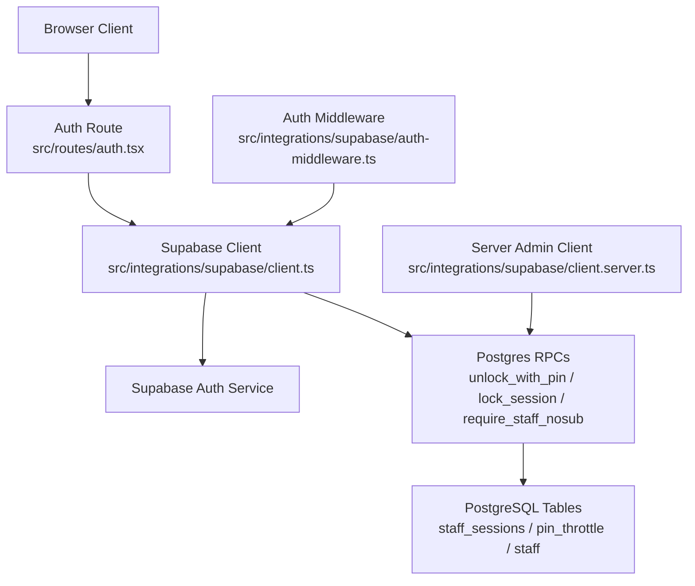
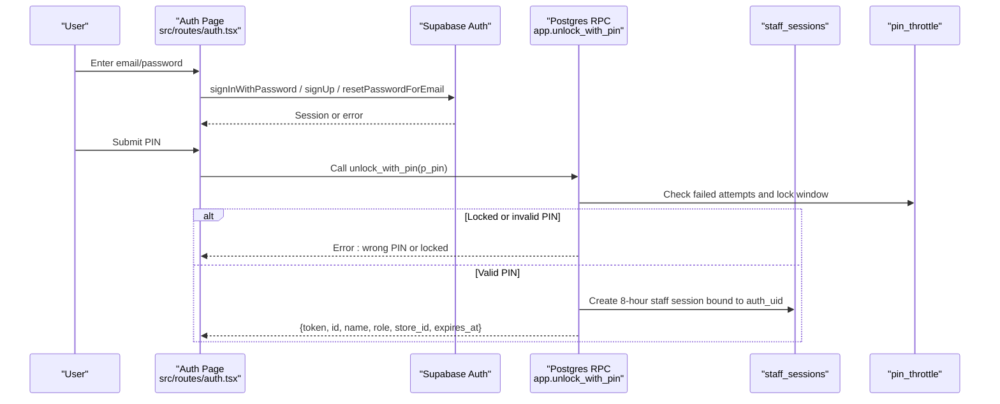
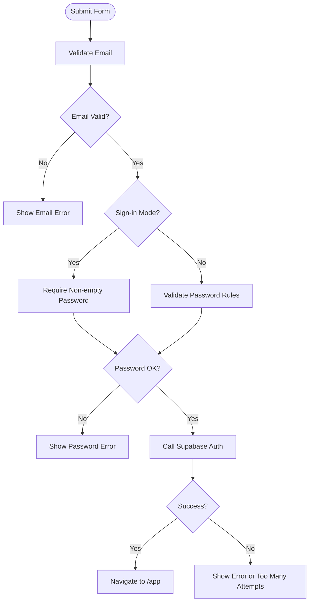
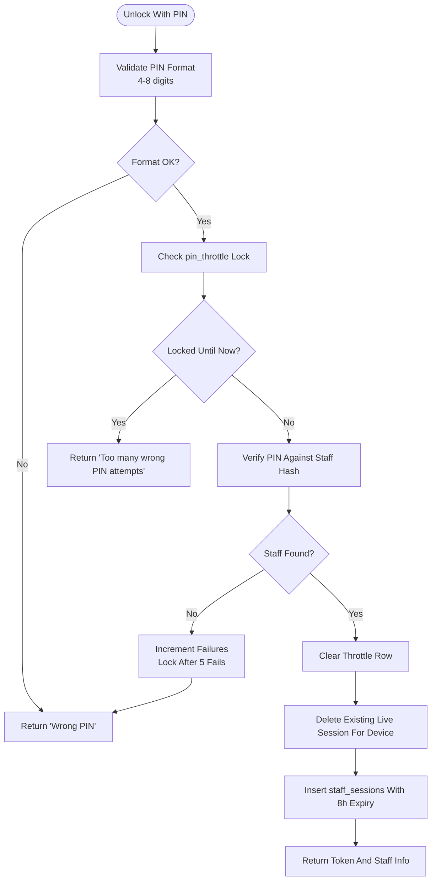
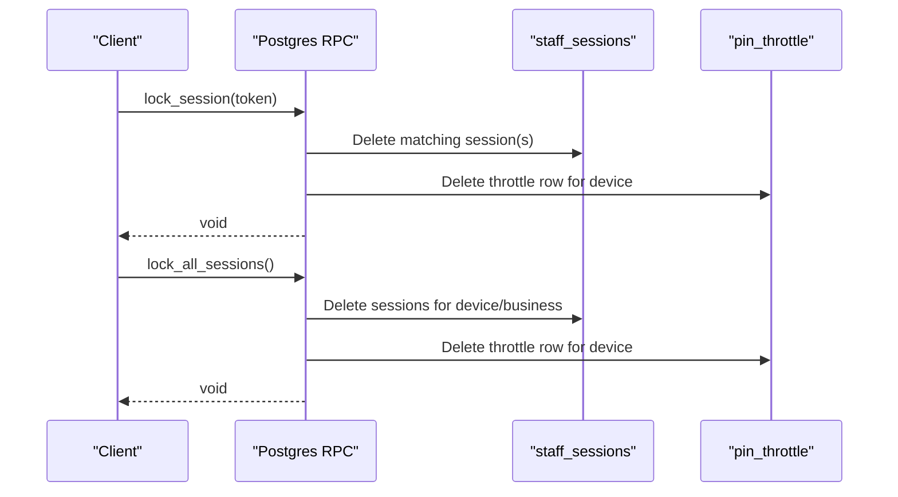
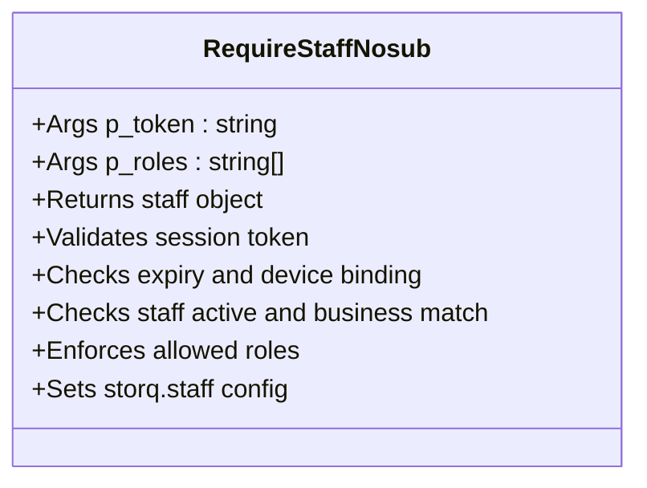
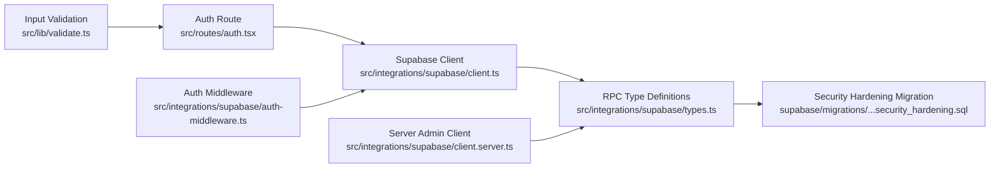

# Authentication Endpoints

<cite>
**Referenced Files in This Document**   
- [auth.tsx](file://src/routes/auth.tsx)
- [client.ts](file://src/integrations/supabase/client.ts)
- [client.server.ts](file://src/integrations/supabase/client.server.ts)
- [auth-middleware.ts](file://src/integrations/supabase/auth-middleware.ts)
- [types.ts](file://src/integrations/supabase/types.ts)
- [validate.ts](file://src/lib/validate.ts)
- [20261007084733_2ed95314-f75e-4843-977b-23f9e6359a48.sql](file://supabase/migrations/20261007084733_2ed95314-f75e-4843-977b-23f9e6359a48.sql)
- [20261008090000_security_hardening.sql](file://supabase/migrations/20261008090000_security_hardening.sql)
</cite>

## Table of Contents
1. [Introduction](#introduction)
2. [Project Structure](#project-structure)
3. [Core Components](#core-components)
4. [Architecture Overview](#architecture-overview)
5. [Detailed Component Analysis](#detailed-component-analysis)
6. [Dependency Analysis](#dependency-analysis)
7. [Performance Considerations](#performance-considerations)
8. [Troubleshooting Guide](#troubleshooting-guide)
9. [Conclusion](#conclusion)

## Introduction
This document describes the authentication-related flows exposed by the application: user registration, email/password sign-in, password reset, PIN-based staff authentication, and session management. The system uses Supabase Auth for account-level identity and Postgres RPCs for business-level staff sessions. There is no custom REST API server; authentication endpoints are implemented through:
- A React route that calls Supabase Auth for email/password operations.
- Supabase PostgREST RPC functions invoked by client code for PIN unlock, session locking, and staff authorization.

The documentation therefore specifies logical HTTP-style contracts, request/response schemas, validation rules, error behavior, rate limiting, session expiration, and security best practices.

## Project Structure
Authentication spans three layers:
- Frontend route: handles UI state, input validation, and calls to Supabase Auth.
- Supabase clients: browser and server clients that send authenticated requests with proper headers.
- Database layer: Postgres RPCs enforce PIN validation, throttling, device-bound sessions, and role checks.

**Diagram sources**
- [auth.tsx:1-266](file://src/routes/auth.tsx#L1-L266)
- [client.ts:1-96](file://src/integrations/supabase/client.ts#L1-L96)
- [client.server.ts:1-73](file://src/integrations/supabase/client.server.ts#L1-L73)
- [auth-middleware.ts:1-106](file://src/integrations/supabase/auth-middleware.ts#L1-L106)
- [20261008090000_security_hardening.sql:218-291](file://supabase/migrations/20261008090000_security_hardening.sql#L218-L291)

**Section sources**
- [auth.tsx:1-266](file://src/routes/auth.tsx#L1-L266)
- [client.ts:1-96](file://src/integrations/supabase/client.ts#L1-L96)
- [client.server.ts:1-73](file://src/integrations/supabase/client.server.ts#L1-L73)
- [auth-middleware.ts:1-106](file://src/integrations/supabase/auth-middleware.ts#L1-L106)

## Core Components
- Email/password authentication is handled by the `/auth` route using Supabase Auth methods for sign-in, sign-up, password reset, and password update.
- Staff PIN authentication is performed via a Postgres RPC `app.unlock_with_pin`, which validates the PIN, enforces throttling, creates a short-lived staff session bound to the signed-in device, and returns a staff token.
- Session management includes locking a single staff session and clearing all sessions for the current device login.
- Role enforcement for protected operations uses `public.require_staff_nosub`, which validates an active staff session tied to the requesting device and required roles.

**Section sources**
- [auth.tsx:45-107](file://src/routes/auth.tsx#L45-L107)
- [20261008090000_security_hardening.sql:218-291](file://supabase/migrations/20261008090000_security_hardening.sql#L218-L291)
- [types.ts:1257-1422](file://src/integrations/supabase/types.ts#L1257-L1422)

## Architecture Overview
The authentication architecture separates two concerns:
- Account identity: managed by Supabase Auth (email/password).
- Business access: managed by Postgres RPCs that issue short-lived staff tokens after successful PIN verification.

**Diagram sources**
- [auth.tsx:45-107](file://src/routes/auth.tsx#L45-L107)
- [20261008090000_security_hardening.sql:218-291](file://supabase/migrations/20261008090000_security_hardening.sql#L218-L291)

## Detailed Component Analysis

### Email/Password Authentication Flow
The `/auth` route supports four modes:
- Sign in: email + password.
- Sign up: email + password with optional redirect.
- Forgot password: send reset link.
- Recover password: set new password after recovery link.

Validation rules applied before calling Supabase Auth:
- Email: trimmed, non-empty, maximum length, safe characters only, valid email pattern.
- Password: non-empty for sign-in mode; minimum length, maximum length, no control characters, must include at least one letter and one digit.

Typical request/response behavior:
- Sign-in: POST-like call to Supabase Auth with email and password. On success, navigate to `/app`. On failure, show error message.
- Sign-up: POST-like call to Supabase Auth with email and password. If a session exists, navigate to `/app`; otherwise show confirmation state.
- Reset: POST-like call to Supabase Auth with email and redirect URL. Show confirmation state.
- Update password: PUT-like call to Supabase Auth with new password. On success, navigate to `/app`.

Error handling:
- Rate-limit errors from Supabase Auth are normalized into a user-friendly “too many attempts” message.
- Other errors are surfaced as-is.

**Diagram sources**
- [auth.tsx:45-107](file://src/routes/auth.tsx#L45-L107)
- [validate.ts:64-82](file://src/lib/validate.ts#L64-L82)

**Section sources**
- [auth.tsx:1-266](file://src/routes/auth.tsx#L1-L266)
- [validate.ts:64-82](file://src/lib/validate.ts#L64-L82)

### PIN-Based Staff Authentication
PIN authentication is not a direct REST endpoint but a Postgres RPC called by the client. The contract is:

- Logical operation: Unlock staff session with PIN.
- Invocation method: RPC call to `app.unlock_with_pin`.
- Required context: The caller must be signed in to Supabase Auth so the database can resolve `auth.uid()` and business context.

Request schema:
- Parameter: `p_pin` — string containing only digits, length between 4 and 8.

Response schema on success:
- `token`: UUID staff session token.
- `id`: Staff ID.
- `name`: Staff name.
- `role`: Staff role (`admin`, `manager`, or `cashier`).
- `store_id`: Store ID associated with the staff member.
- `expires_at`: Timestamp indicating session expiry.

Validation and security rules:
- PIN format: exactly 4–8 digits.
- Throttling: after repeated wrong attempts, the account/device pair is locked for a calculated period.
- Device binding: the created staff session is bound to the signed-in device’s `auth_uid`.
- Single active session per device: unlocking again replaces any existing live session for that device.
- Expiration: default staff session lifetime is 8 hours.

Error responses:
- Wrong PIN: indicates incorrect PIN or missing PIN.
- Locked: too many wrong PIN attempts; response includes remaining lock time in minutes.
- Not signed in: caller lacks Supabase Auth session.
- No business: caller has no business context.

**Diagram sources**
- [20261008090000_security_hardening.sql:218-291](file://supabase/migrations/20261008090000_security_hardening.sql#L218-L291)

**Section sources**
- [20261008090000_security_hardening.sql:218-291](file://supabase/migrations/20261008090000_security_hardening.sql#L218-L291)
- [types.ts:1422-1422](file://src/integrations/supabase/types.ts#L1422-L1422)

### Session Management
Two primary session-management RPCs are defined:

- Lock a specific staff session:
  - Operation: Remove a staff session by token, optionally scoped to the current device or business.
  - Also clears PIN throttle data for the current device.

- Lock all sessions:
  - Operation: Remove all staff sessions for the current device login and clear PIN throttle data.

These RPCs are used for logout, security resets, and cleanup when staff are deactivated.

**Diagram sources**
- [20261008090000_security_hardening.sql:272-291](file://supabase/migrations/20261008090000_security_hardening.sql#L272-L291)
- [types.ts:1257-1257](file://src/integrations/supabase/types.ts#L1257-L1257)

**Section sources**
- [20261008090000_security_hardening.sql:272-291](file://supabase/migrations/20261008090000_security_hardening.sql#L272-L291)
- [types.ts:1257-1257](file://src/integrations/supabase/types.ts#L1257-L1257)

### Staff Authorization Using Session Tokens
Protected operations use `public.require_staff_nosub` to validate a staff session:

- Input:
  - `p_token`: UUID staff session token.
  - `p_roles`: Array of allowed roles.

- Behavior:
  - Validates that the token exists, is not expired, belongs to the same device login (`auth_uid`), refers to an active staff member, and belongs to the current business.
  - Checks that the staff role is included in the allowed roles.
  - Sets a session configuration value identifying the staff member.
  - Returns staff details if authorized.

- Errors:
  - “Locked: enter your PIN again” when the session is invalid or expired.
  - Role-based error when the staff role is not permitted.

**Diagram sources**
- [20261008090000_security_hardening.sql:258-270](file://supabase/migrations/20261008090000_security_hardening.sql#L258-L270)
- [types.ts:1313-1313](file://src/integrations/supabase/types.ts#L1313-L1313)

**Section sources**
- [20261008090000_security_hardening.sql:258-270](file://supabase/migrations/20261008090000_security_hardening.sql#L258-L270)
- [types.ts:1313-1313](file://src/integrations/supabase/types.ts#L1313-L1313)

### Legacy PIN Unlock Contract
An older migration defines a simpler `unlock_with_pin` function without throttling or device binding. It still demonstrates the expected staff session response shape:

- Response fields:
  - `token`
  - `id`
  - `name`
  - `role`
  - `store_id`

This legacy contract should not be assumed to include throttling or device-bound sessions.

**Section sources**
- [20261007084733_2ed95314-f75e-4843-977b-23f9e6359a48.sql:165-175](file://supabase/migrations/20261007084733_2ed95314-f75e-4843-977b-23f9e6359a48.sql#L165-L175)

## Dependency Analysis
Authentication depends on:
- Supabase Auth for account creation, login, and password recovery.
- Supabase client libraries for sending authenticated requests.
- Postgres RPCs for business-level staff authentication and authorization.
- Validation utilities for consistent input constraints.

**Diagram sources**
- [validate.ts:1-147](file://src/lib/validate.ts#L1-L147)
- [auth.tsx:1-266](file://src/routes/auth.tsx#L1-L266)
- [client.ts:1-96](file://src/integrations/supabase/client.ts#L1-L96)
- [client.server.ts:1-73](file://src/integrations/supabase/client.server.ts#L1-L73)
- [auth-middleware.ts:1-106](file://src/integrations/supabase/auth-middleware.ts#L1-L106)
- [types.ts:1257-1422](file://src/integrations/supabase/types.ts#L1257-L1422)
- [20261008090000_security_hardening.sql:1-760](file://supabase/migrations/20261008090000_security_hardening.sql#L1-L760)

**Section sources**
- [validate.ts:1-147](file://src/lib/validate.ts#L1-L147)
- [auth.tsx:1-266](file://src/routes/auth.tsx#L1-L266)
- [client.ts:1-96](file://src/integrations/supabase/client.ts#L1-L96)
- [client.server.ts:1-73](file://src/integrations/supabase/client.server.ts#L1-L73)
- [auth-middleware.ts:1-106](file://src/integrations/supabase/auth-middleware.ts#L1-L106)
- [types.ts:1257-1422](file://src/integrations/supabase/types.ts#L1257-L1422)
- [20261008090000_security_hardening.sql:1-760](file://supabase/migrations/20261008090000_security_hardening.sql#L1-L760)

## Performance Considerations
- PIN throttling reduces brute-force risk by locking after repeated failures; clients should respect the returned lock duration and avoid rapid retries.
- Staff sessions have a fixed 8-hour lifetime, reducing long-lived credential exposure.
- Device binding prevents reusing a staff session token across different device logins.
- Input validation occurs both in the browser and in Postgres RPCs, minimizing unnecessary round trips while maintaining strong server-side guarantees.

[No sources needed since this section provides general guidance]

## Troubleshooting Guide
Common authentication issues and their likely causes:

- Wrong PIN:
  - Cause: Incorrect PIN or missing PIN parameter.
  - Action: Ask the user to re-enter the PIN. Do not expose whether the PIN exists.

- Too many wrong PIN attempts:
  - Cause: PIN attempt throttle triggered.
  - Action: Display the remaining lock time and disable further PIN submission until the lock expires.

- Locked: enter your PIN again:
  - Cause: Expired or invalid staff session, or role mismatch.
  - Action: Prompt the user to unlock again with PIN.

- Unauthorized or invalid token:
  - Cause: Missing, malformed, or invalid Bearer token in middleware-protected routes.
  - Action: Re-authenticate the user and refresh the token.

- Rate limit exceeded:
  - Cause: Supabase Auth rate limiting during sign-in, sign-up, or password reset.
  - Action: Show a friendly “too many attempts” message and delay retry.

- Missing environment variables:
  - Cause: Supabase URL or keys not configured.
  - Action: Configure `SUPABASE_URL`, `SUPABASE_PUBLISHABLE_KEY`, and `SUPABASE_SERVICE_ROLE_KEY` as required by the client and middleware.

**Section sources**
- [auth.tsx:97-107](file://src/routes/auth.tsx#L97-L107)
- [auth-middleware.ts:49-95](file://src/integrations/supabase/auth-middleware.ts#L49-L95)
- [client.ts:57-83](file://src/integrations/supabase/client.ts#L57-L83)
- [client.server.ts:35-58](file://src/integrations/supabase/client.server.ts#L35-L58)
- [20261008090000_security_hardening.sql:228-244](file://supabase/migrations/20261008090000_security_hardening.sql#L228-L244)

## Conclusion
The application implements authentication through Supabase Auth for accounts and Postgres RPCs for business-level staff sessions. Email/password flows are validated on the client and enforced by Supabase Auth. PIN-based staff authentication adds device-bound, short-lived sessions with server-side throttling and role checks. Clients should treat these as logical HTTP-style contracts even though they are implemented via Supabase Auth and PostgREST RPCs. Security best practices include strict input validation, throttling, device binding, limited session lifetimes, and explicit role enforcement.

[No sources needed since this section summarizes without analyzing specific files]