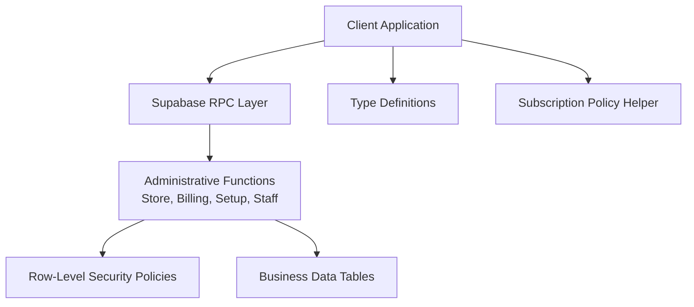
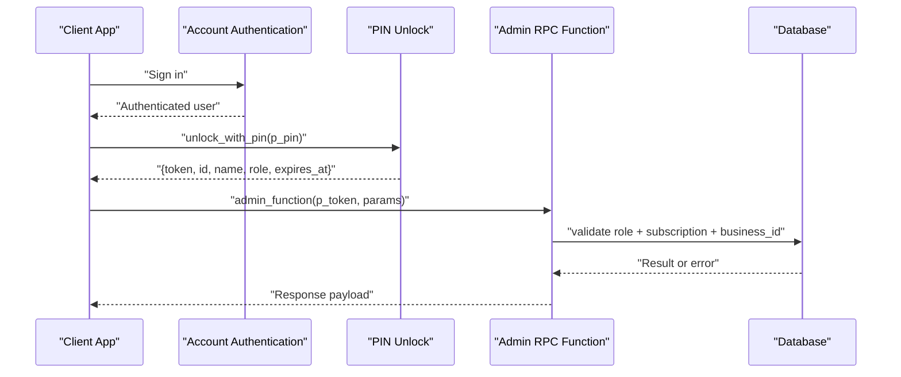
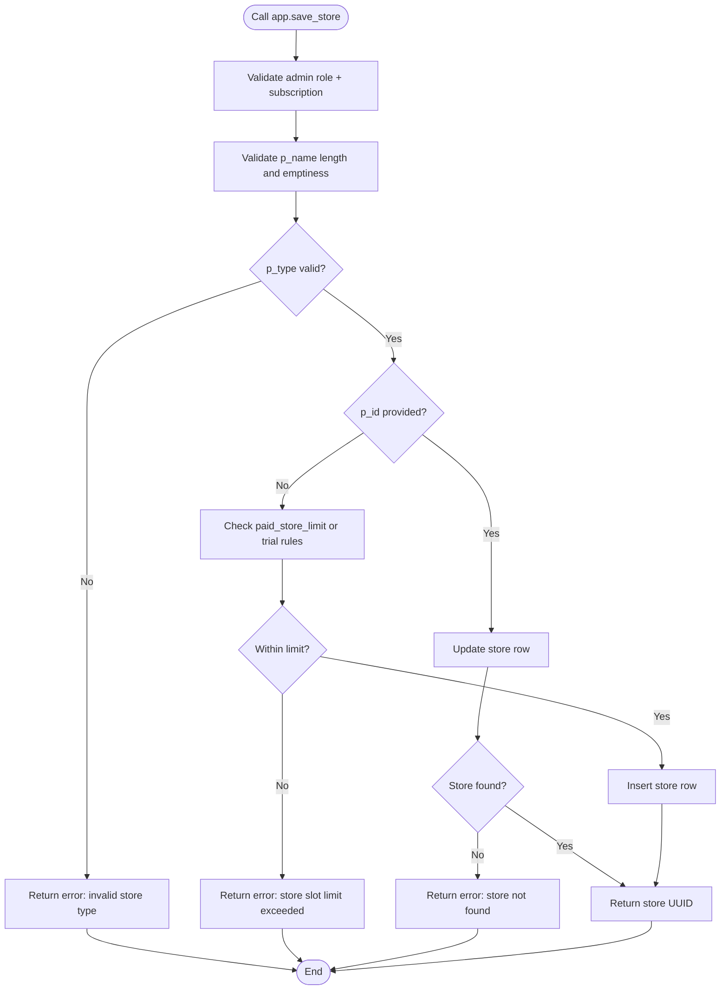
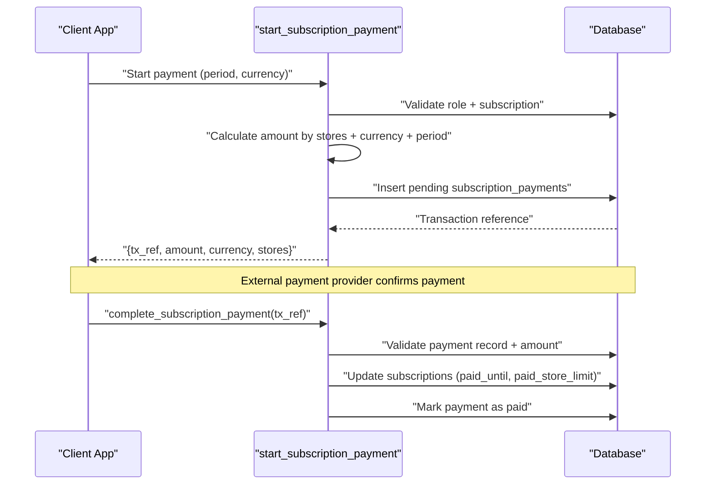
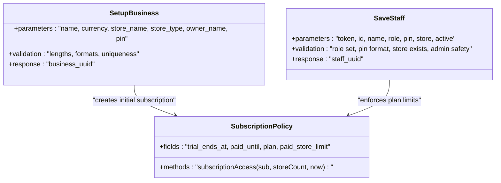
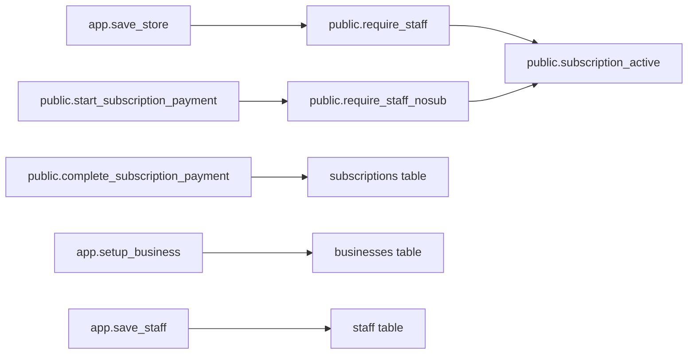

# Business Administration Endpoints

<cite>
**Referenced Files in This Document**
- [README.md](file://README.md)
- [20261007100137_bfc24679-e05e-498f-ab87-694d79f3fe3f.sql](file://supabase/migrations/20261007100137_bfc24679-e05e-498f-ab87-694d79f3fe3f.sql)
- [20261007101232_afb8cd47-dc5e-4816-83f7-1b530d9194b9.sql](file://supabase/migrations/20261007101232_afb8cd47-dc5e-4816-83f7-1b530d9194b9.sql)
- [20261007115041_3e857134-c53a-47c9-a33f-3db16cc13962.sql](file://supabase/migrations/20261007115041_3e857134-c53a-47c9-a33f-3db16cc13962.sql)
- [20261008090000_security_hardening.sql](file://supabase/migrations/20261008090000_security_hardening.sql)
- [subscription-policy.ts](file://src/lib/subscription-policy.ts)
- [billing.functions.ts](file://src/lib/billing.functions.ts)
- [types.ts](file://src/integrations/supabase/types.ts)
</cite>

## Table of Contents
1. [Introduction](#introduction)
2. [Project Structure](#project-structure)
3. [Core Components](#core-components)
4. [Architecture Overview](#architecture-overview)
5. [Detailed Component Analysis](#detailed-component-analysis)
6. [Dependency Analysis](#dependency-analysis)
7. [Performance Considerations](#performance-considerations)
8. [Troubleshooting Guide](#troubleshooting-guide)
9. [Conclusion](#conclusion)

## Introduction
This document describes the business administration surface for the application, focusing on administrative operations for store management, subscription billing, reporting access, and system configuration. The system is a multi-tenant retail point-of-sale platform where each business is isolated by `business_id`. Administrative endpoints are implemented as server-side functions exposed through a secure RPC layer rather than traditional REST controllers. Clients authenticate with an account, unlock a staff session using a PIN, and then call administrative functions with a short-lived staff token. Authorization is enforced both at the function level (required roles) and at the database level (row-level security policies).

The project’s purpose includes single-store and multi-store operations, layby support, and two store modes: direct sales and approval-based invoicing. Billing uses subscription plans with monthly or yearly periods and currency-specific pricing. Trial and paid tiers control store capacity and feature availability.

**Section sources**
- [README.md:1-26](file://README.md#L1-L26)

## Project Structure
The repository is a frontend-first application backed by Supabase. Administrative capabilities are primarily defined in database migrations and enforced by server-side functions. The client integrates with these functions via RPC calls and type definitions.

**Diagram sources**
- [20261008090000_security_hardening.sql:715-759](file://supabase/migrations/20261008090000_security_hardening.sql#L715-L759)
- [types.ts:1220-1408](file://src/integrations/supabase/types.ts#L1220-L1408)
- [subscription-policy.ts:1-22](file://src/lib/subscription-policy.ts#L1-L22)

**Section sources**
- [20261008090000_security_hardening.sql:715-759](file://supabase/migrations/20261008090000_security_hardening.sql#L715-L759)
- [types.ts:1220-1408](file://src/integrations/supabase/types.ts#L1220-L1408)
- [subscription-policy.ts:1-22](file://src/lib/subscription-policy.ts#L1-L22)

## Core Components
- Store Management: Creating and updating stores under a business, enforcing role and subscription constraints.
- Subscription Billing: Starting payments, calculating amounts, validating plan parameters, and completing payments to update subscription state.
- Reporting Access: Read access to reports and financial data is gated by role and active subscription; managers and admins can view sensitive metrics.
- System Configuration: Initial business setup, staff creation and management, and policy enforcement for names, currencies, and PINs.

Key implementation patterns:
- All writes go through RPC functions; tables are read-only for clients.
- Role checks use `require_staff` or `require_staff_nosub`, requiring admin or manager roles for administrative actions.
- Multi-tenancy is enforced by `business_id` filters and RLS policies.
- Subscription state controls feature availability and capacity limits.

**Section sources**
- [20261008090000_security_hardening.sql:302-327](file://supabase/migrations/20261008090000_security_hardening.sql#L302-L327)
- [20261007115041_3e857134-c53a-47c9-a33f-3db16cc13962.sql:16-55](file://supabase/migrations/20261007115041_3e857134-c53a-47c9-a33f-3db16cc13962.sql#L16-L55)
- [20261008090000_security_hardening.sql:373-393](file://supabase/migrations/20261008090000_security_hardening.sql#L373-L393)

## Architecture Overview
Administrative operations follow a consistent flow:
1. Client authenticates user account.
2. Client unlocks a staff session with a PIN to obtain a staff token bound to the device.
3. Client calls administrative RPC functions with the staff token.
4. Server validates role, subscription status, and business isolation.
5. Server performs input validation and updates data within RLS boundaries.

**Diagram sources**
- [20261008090000_security_hardening.sql:218-270](file://supabase/migrations/20261008090000_security_hardening.sql#L218-L270)
- [20261008090000_security_hardening.sql:715-759](file://supabase/migrations/20261008090000_security_hardening.sql#L715-L759)

## Detailed Component Analysis

### Store Management Endpoints
Administrative store operations are exposed via RPC functions that require an admin role and enforce subscription constraints.

- Function: `app.save_store`
  - Method: RPC call
  - Authorization: Admin role required; subscription must be active; business isolation enforced.
  - Parameters:
    - `p_token`: Staff session token from PIN unlock.
    - `p_id`: Optional existing store ID for updates.
    - `p_name`: Store name; required, trimmed, max length 120 characters.
    - `p_type`: Store mode; must be one of `direct` or `approval`.
  - Validation Rules:
    - Name cannot be empty or exceed 120 characters.
    - Type must be exactly `direct` or `approval`.
    - If creating a new store:
      - Paid subscriptions check against `paid_store_limit`.
      - Trial allows only one store unless paid.
    - If updating:
      - Store must belong to the current business.
  - Response:
    - Returns the store UUID.
  - Error Conditions:
    - Missing subscription.
    - Invalid name or type.
    - Exceeded paid store limit.
    - Expired trial.
    - Store not found during update.

**Diagram sources**
- [20261008090000_security_hardening.sql:302-327](file://supabase/migrations/20261008090000_security_hardening.sql#L302-L327)

**Section sources**
- [20261008090000_security_hardening.sql:302-327](file://supabase/migrations/20261008090000_security_hardening.sql#L302-L327)

### Subscription Billing Endpoints
Billing operations manage subscription payment initiation and completion, with strict parameter validation and amount calculation.

- Function: `public.start_subscription_payment`
  - Method: RPC call
  - Authorization: Admin or Manager role required.
  - Parameters:
    - `p_token`: Staff session token.
    - `p_period`: Plan period; must be `monthly` or `yearly`.
    - `p_currency`: Currency code; must be `MWK` or `USD`.
  - Validation Rules:
    - Period and currency must match allowed values.
    - Amount calculated based on number of stores and currency-specific base rates.
    - Yearly plans apply an 85% discount factor over monthly totals.
  - Response:
    - JSON object containing:
      - `tx_ref`: Transaction reference string prefixed with `storq-`.
      - `amount`: Calculated amount.
      - `currency`: Selected currency.
      - `stores`: Number of stores covered by the plan.
  - Error Conditions:
    - Invalid plan parameters.
    - Missing subscription record.

- Function: `public.complete_subscription_payment`
  - Method: RPC call
  - Authorization: Service role only (server-side callback).
  - Parameters:
    - `p_tx_ref`: Transaction reference returned by start payment.
  - Validation Rules:
    - Payment record must exist and be pending.
    - Stores count between 1 and 1000.
    - Amount must match expected formula for selected period and currency.
  - Processing Logic:
    - Updates subscription `paid_until` and `paid_store_limit`.
    - Applies prorated extension based on existing paid slots.
    - Marks payment as paid with timestamp.
  - Response:
    - Void; side effects applied to subscription and payment records.

**Diagram sources**
- [20261007101232_afb8cd47-dc5e-4816-83f7-1b530d9194b9.sql:29-42](file://supabase/migrations/20261007101232_afb8cd47-dc5e-4816-83f7-1b530d9194b9.sql#L29-L42)
- [20261007115041_3e857134-c53a-47c9-a33f-3db16cc13962.sql:65-82](file://supabase/migrations/20261007115041_3e857134-c53a-47c9-a33f-3db16cc13962.sql#L65-L82)

**Section sources**
- [20261007101232_afb8cd47-dc5e-4816-83f7-1b530d9194b9.sql:29-42](file://supabase/migrations/20261007101232_afb8cd47-dc5e-4816-83f7-1b530d9194b9.sql#L29-L42)
- [20261007115041_3e857134-c53a-47c9-a33f-3db16cc13962.sql:65-82](file://supabase/migrations/20261007115041_3e857134-c53a-47c9-a33f-3db16cc13962.sql#L65-L82)

### Reporting Access and Data Isolation
Reporting endpoints are not explicitly listed as separate RPCs in the referenced files, but read access to reports and financial data is controlled by:
- Role requirements: Managers and admins can view sensitive metrics such as costs and refunds.
- Subscription activity: Some administrative reads may be blocked if the subscription is inactive or store limit exceeded.
- Row-level security policies: Ensure clients can only see data belonging to their `business_id`.

Recommendations for reporting endpoints:
- Use RPC functions that return aggregated report data filtered by `business_id`.
- Require admin or manager roles for sensitive reports.
- Enforce subscription activity checks before returning financial summaries.

**Section sources**
- [20261008090000_security_hardening.sql:142-168](file://supabase/migrations/20261008090000_security_hardening.sql#L142-L168)
- [20261008090000_security_hardening.sql:293-300](file://supabase/migrations/20261008090000_security_hardening.sql#L293-L300)

### System Configuration Endpoints
System configuration includes initial business setup and staff management.

- Function: `app.setup_business`
  - Method: RPC call
  - Authorization: Requires authenticated user; no staff token needed for initial setup.
  - Parameters:
    - `p_name`: Business name; required, max length 200 characters.
    - `p_currency`: Currency symbol; optional, max length 4 characters.
    - `p_store_name`: Initial store name; required, max length 120 characters.
    - `p_store_type`: Store mode; must be `direct` or `approval`.
    - `p_owner_name`: Owner name; required, max length 100 characters.
    - `p_pin`: Owner PIN; required, 4 to 8 digits.
  - Validation Rules:
    - Prevents duplicate business setup per account.
    - Validates lengths and formats for all text fields.
    - Ensures PIN format and uniqueness constraints.
  - Response:
    - Returns business UUID after creating business, store, and admin staff.

- Function: `app.save_staff`
  - Method: RPC call
  - Authorization: Admin role required; subscription constraints apply for free plan staff PIN limits.
  - Parameters:
    - `p_token`: Staff session token.
    - `p_id`: Optional existing staff ID for updates.
    - `p_name`: Staff name; required, max length 100 characters.
    - `p_role`: Role; must be `admin`, `manager`, or `cashier`.
    - `p_pin`: PIN; required for creation, 4 to 8 digits; unique within business.
    - `p_store`: Optional store assignment; must belong to business.
    - `p_active`: Boolean indicating active status.
  - Validation Rules:
    - Prevents demoting or deactivating the last active admin.
    - Enforces free plan staff PIN limit (three active staff PINs).
    - Validates PIN uniqueness and format.
  - Response:
    - Returns staff UUID.

**Diagram sources**
- [20261008090000_security_hardening.sql:373-393](file://supabase/migrations/20261008090000_security_hardening.sql#L373-L393)
- [20261008090000_security_hardening.sql:329-371](file://supabase/migrations/20261008090000_security_hardening.sql#L329-L371)
- [subscription-policy.ts:1-22](file://src/lib/subscription-policy.ts#L1-L22)

**Section sources**
- [20261008090000_security_hardening.sql:373-393](file://supabase/migrations/20261008090000_security_hardening.sql#L373-L393)
- [20261008090000_security_hardening.sql:329-371](file://supabase/migrations/20261008090000_security_hardening.sql#L329-L371)
- [subscription-policy.ts:1-22](file://src/lib/subscription-policy.ts#L1-L22)

## Dependency Analysis
Administrative functions depend on shared utilities for authentication, role resolution, and subscription checks.

**Diagram sources**
- [20261008090000_security_hardening.sql:302-327](file://supabase/migrations/20261008090000_security_hardening.sql#L302-L327)
- [20261007101232_afb8cd47-dc5e-4816-83f7-1b530d9194b9.sql:1-10](file://supabase/migrations/20261007101232_afb8cd47-dc5e-4816-83f7-1b530d9194b9.sql#L1-L10)
- [20261007115041_3e857134-c53a-47c9-a33f-3db16cc13962.sql:65-82](file://supabase/migrations/20261007115041_3e857134-c53a-47c9-a33f-3db16cc13962.sql#L65-L82)

**Section sources**
- [20261008090000_security_hardening.sql:302-327](file://supabase/migrations/20261008090000_security_hardening.sql#L302-L327)
- [20261007101232_afb8cd47-dc5e-4816-83f7-1b530d9194b9.sql:1-10](file://supabase/migrations/20261007101232_afb8cd47-dc5e-4816-83f7-1b530d9194b9.sql#L1-L10)
- [20261007115041_3e857134-c53a-47c9-a33f-3db16cc13962.sql:65-82](file://supabase/migrations/20261007115041_3e857134-c53a-47c9-a33f-3db16cc13962.sql#L65-L82)

## Performance Considerations
- RPC functions perform server-side validation and calculations, reducing client-side complexity and improving consistency.
- Row-level security policies minimize data exposure and reduce query overhead by filtering at the database level.
- Subscription checks are centralized in functions like `subscription_active`, ensuring consistent behavior across administrative operations.
- Avoid excessive nested queries in reporting endpoints; consider materialized views or pre-aggregated tables for large datasets.

[No sources needed since this section provides general guidance]

## Troubleshooting Guide
Common issues and resolutions:
- Wrong PIN attempts:
  - Throttling locks the device login temporarily after repeated failures.
  - Resolution: Wait for lockout duration or clear throttle state via lock helpers.
- Invalid store type or name:
  - Ensure store type is exactly `direct` or `approval`; trim and validate name length.
- Subscription missing or expired:
  - Administrative operations require an active subscription; renew via billing.
- Payment amount mismatch:
  - Verify currency and period selection; ensure amount matches expected formula.
- Role authorization errors:
  - Confirm staff role is admin or manager for administrative actions.

**Section sources**
- [20261008090000_security_hardening.sql:218-270](file://supabase/migrations/20261008090000_security_hardening.sql#L218-L270)
- [20261008090000_security_hardening.sql:302-327](file://supabase/migrations/20261008090000_security_hardening.sql#L302-L327)
- [20261007115041_3e857134-c53a-47c9-a33f-3db16cc13962.sql:65-82](file://supabase/migrations/20261007115041_3e857134-c53a-47c9-a33f-3db16cc13962.sql#L65-L82)

## Conclusion
The business administration surface is implemented as secure RPC functions with strong validation, role-based authorization, and multi-tenant data isolation. Store management, subscription billing, and system configuration are governed by explicit rules and constraints. Reporting access is controlled by roles and subscription status. For robust administration, always validate inputs server-side, enforce RLS policies, and handle subscription lifecycle events carefully.

[No sources needed since this section summarizes without analyzing specific files]