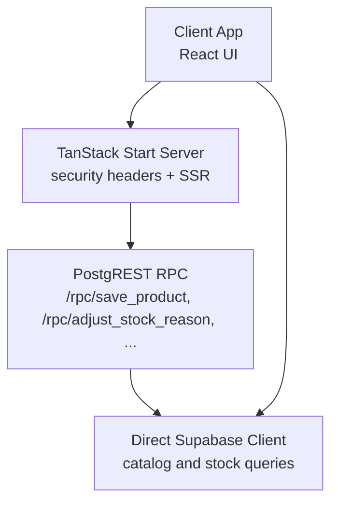
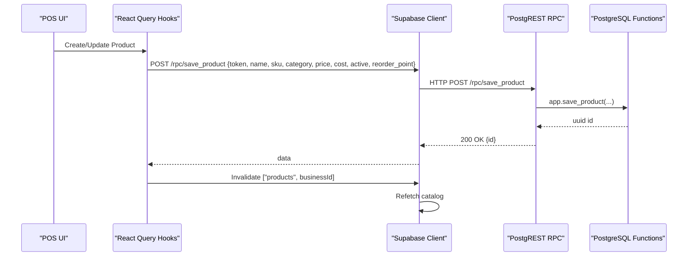
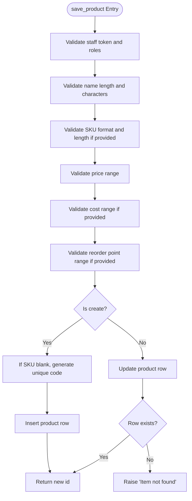
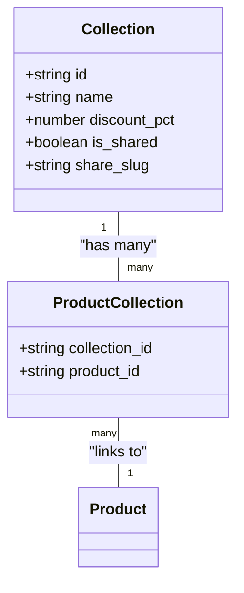
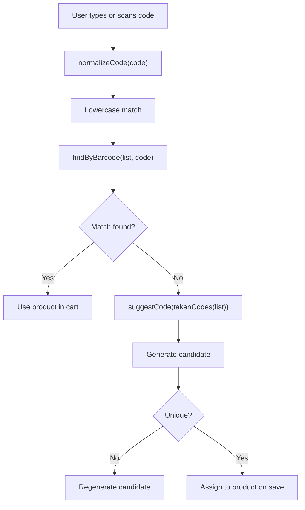
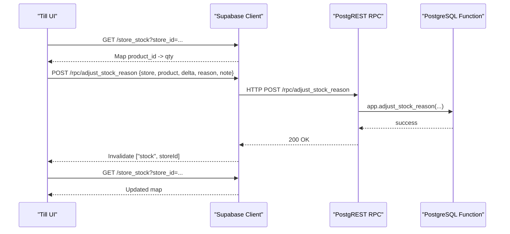
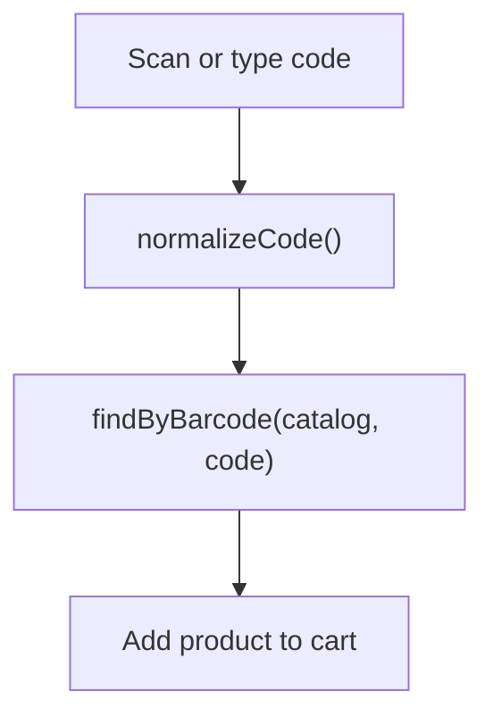
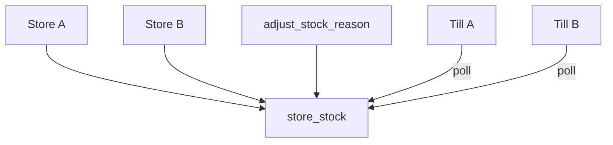
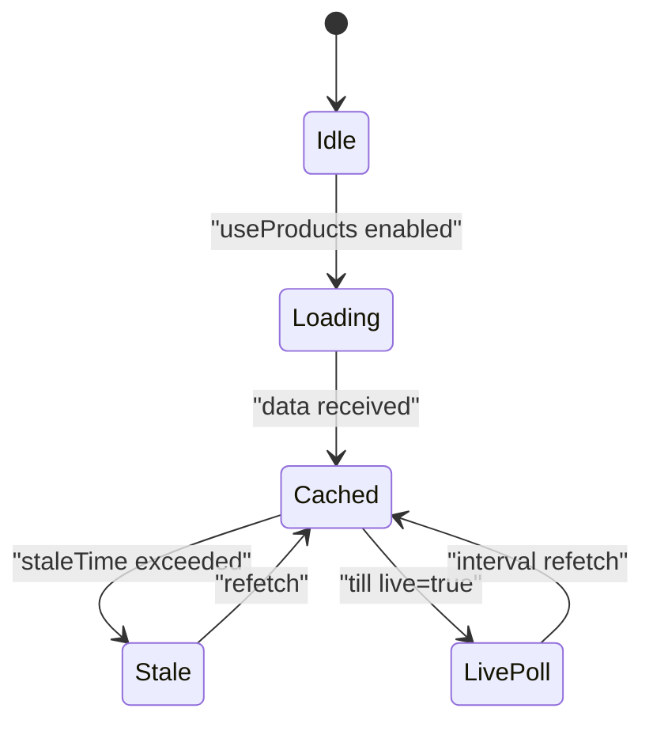
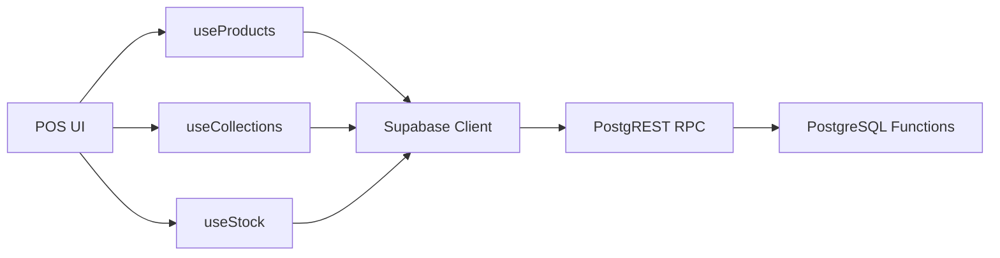

# Product Management Endpoints

<cite>
**Referenced Files in This Document**
- [server.ts](file://src/server.ts)
- [products.ts](file://src/lib/products.ts)
- [collections.ts](file://src/lib/collections.ts)
- [item-codes.ts](file://src/lib/item-codes.ts)
- [20261007084733_2ed95314-f75e-4843-977b-23f9e6359a48.sql](file://supabase/migrations/20261007084733_2ed95314-f75e-4843-977b-23f9e6359a48.sql)
- [20261007094440_7f9e1944-d2b6-4ff8-9a15d298e414.sql](file://supabase/migrations/20261007094440_7f9e1944-d2b6-4ff8-9a15d298e414.sql)
- [20261008090000_security_hardening.sql](file://supabase/migrations/20261008090000_security_hardening.sql)
- [20261009210500_retail_operations.sql](file://supabase/migrations/20261009210500_retail_operations.sql)
- [20261011100000_item_codes.sql](file://supabase/migrations/20261011100000_item_codes.sql)
- [20261011110000_drop_legacy_save_product_overload.sql](file://supabase/migrations/20261011110000_drop_legacy_save_product_overload.sql)
- [20261011130000_stock_absolute_set.sql](file://supabase/migrations/20261011130000_stock_absolute_set.sql)
</cite>

## Table of Contents
1. [Introduction](#introduction)
2. [Project Structure](#project-structure)
3. [Core Components](#core-components)
4. [Architecture Overview](#architecture-overview)
5. [Detailed Component Analysis](#detailed-component-analysis)
6. [Dependency Analysis](#dependency-analysis)
7. [Performance Considerations](#performance-considerations)
8. [Troubleshooting Guide](#troubleshooting-guide)
9. [Conclusion](#conclusion)

## Introduction
This document describes the product and inventory management endpoints exposed by the application through PostgREST RPC functions, along with client-side behavior for barcode scanning, item codes, collections, and stock synchronization across stores. It specifies:
- HTTP methods and URL patterns for product, category, collection, and item code operations
- Request/response schemas and validation rules
- Barcode scanning integration and QR generation
- Bulk operations and query parameters for filtering, searching, and pagination
- Inventory synchronization across multiple stores and offline-first considerations

The system uses a TanStack Start server that forwards requests to Supabase via PostgREST. Business logic is implemented as PostgreSQL functions (RPC), while the frontend caches catalogs and stock locally for fast, offline-friendly POS workflows.

## Project Structure
At runtime, the server entry point applies security headers and routes all non-seo requests to the framework handler. Data access and business logic are centralized in Supabase migrations and functions. The frontend provides React Query hooks for products, collections, and stock, plus utilities for item code normalization and QR payloads.

**Diagram sources**
- [server.ts:135-152](file://src/server.ts#L135-L152)
- [20261009210500_retail_operations.sql:97-100](file://supabase/migrations/20261009210500_retail_operations.sql#L97-L100)
- [products.ts:22-52](file://src/lib/products.ts#L22-L52)

**Section sources**
- [server.ts:1-154](file://src/server.ts#L1-L154)

## Core Components
- Products: CRUD via `app.save_product`, read via direct table access, barcode lookup via normalized SKU.
- Item Codes: Auto-generated unique codes, normalization, collision avoidance, QR payload format.
- Collections: Shared product groupings with discounts; membership managed via RPCs.
- Stock: Per-store quantities updated via reason-based adjustment; live polling on till screens.

Key responsibilities:
- Validation and authorization occur in PostgreSQL functions.
- Frontend caching ensures low-latency scanning and search.
- Barcode scanning resolves items using normalized SKUs against cached catalog.

**Section sources**
- [products.ts:8-17](file://src/lib/products.ts#L8-L17)
- [item-codes.ts:1-13](file://src/lib/item-codes.ts#L1-L13)
- [collections.ts:6-13](file://src/lib/collections.ts#L6-L13)
- [products.ts:82-106](file://src/lib/products.ts#L82-L106)

## Architecture Overview
The API surface is primarily RPC-based through PostgREST. Clients call RPC endpoints with JSON bodies containing token-authenticated parameters. Direct table reads are used for listing and querying catalogs and stock.

**Diagram sources**
- [20261009210500_retail_operations.sql:97-100](file://supabase/migrations/20261009210500_retail_operations.sql#L97-L100)
- [20261011100000_item_codes.sql:78-123](file://supabase/migrations/20261011100000_item_codes.sql#L78-L123)
- [products.ts:22-52](file://src/lib/products.ts#L22-L52)

## Detailed Component Analysis

### Product Operations
Endpoints:
- Create or update product: `POST /rpc/save_product`
- Read products: `GET /products`
- Read stock per store: `GET /store_stock?store_id={id}`

HTTP method and URL pattern:
- `POST /rpc/save_product`
- `GET /products`
- `GET /store_stock`

Request schema for `save_product`:
- `p_token`: UUID (authenticated staff session)
- `p_id`: UUID | null (null for create)
- `p_name`: text (required, trimmed, max 200 chars, no control characters or angle brackets)
- `p_sku`: text | null (optional; allowed chars: letters, numbers, spaces, `.`, `_`, `-`; max 64)
- `p_category`: text | null (max 120 chars)
- `p_price`: numeric (required; between 0 and 1,000,000,000)
- `p_cost`: numeric | null (between 0 and 1,000,000,000)
- `p_active`: boolean (default true)
- `p_reorder_point`: numeric | null (between 0 and 1,000,000)

Response schema:
- Returns product `id` (UUID).

Validation rules:
- Name required, length and character constraints enforced.
- SKU optional but constrained when provided; uniqueness enforced per business via lowercased, trimmed index.
- Price and cost bounded ranges.
- Reorder point bounded range.
- Authorization requires admin or manager role.

Barcode scanning integration:
- Scanned input is normalized (trim, collapse spaces, case-insensitive) and matched against cached product list by SKU.
- QR payload contains the normalized code string so scanners and typed inputs resolve identically.

Bulk operations:
- No dedicated bulk endpoint is present. Bulk creation should be implemented as repeated calls to `save_product` with proper error handling and retries.

Query parameters and filters:
- `GET /products`: returns product fields including `id`, `name`, `sku`, `category`, `price`, `active`, `reorder_point`. Ordering by name is applied by the client hook.
- `GET /store_stock?store_id={uuid}`: returns product-to-quantity mapping for a specific store.

Examples:
- Product creation: send `p_id=null`, provide `p_name`, `p_price`, optionally `p_sku`, `p_category`, `p_cost`, `p_active`, `p_reorder_point`. If `p_sku` is blank, an auto-generated code is assigned.
- Product update: send existing `p_id` and desired fields; clearing `p_sku` keeps the current code.
- Stock adjustment: see Stock Adjustments section below.

**Diagram sources**
- [20261008090000_security_hardening.sql:398-416](file://supabase/migrations/20261008090000_security_hardening.sql#L398-L416)
- [20261011100000_item_codes.sql:78-123](file://supabase/migrations/20261011100000_item_codes.sql#L78-L123)

**Section sources**
- [20261008090000_security_hardening.sql:398-416](file://supabase/migrations/20261008090000_security_hardening.sql#L398-L416)
- [20261009210500_retail_operations.sql:61-100](file://supabase/migrations/20261009210500_retail_operations.sql#L61-L100)
- [20261011100000_item_codes.sql:78-123](file://supabase/migrations/20261011100000_item_codes.sql#L78-L123)
- [products.ts:22-64](file://src/lib/products.ts#L22-L64)

### Category Handling
Categories are stored as a free-text field on products. There is no dedicated category CRUD endpoint. Categories are validated by length constraints when saving products.

- Field: `category` (text | null)
- Constraint: max 120 characters
- Usage: part of product schema returned by `GET /products`

**Section sources**
- [20261008090000_security_hardening.sql:408-408](file://supabase/migrations/20261008090000_security_hardening.sql#L408-L408)
- [products.ts:8-17](file://src/lib/products.ts#L8-L17)

### Collection Operations
Collections group products and can apply discounts. Membership is managed via RPCs.

Endpoints:
- Upsert collection: `POST /rpc/save_collection`
- Delete collection: `POST /rpc/delete_collection`
- Set collection products: `POST /rpc/set_collection_products`
- Set product collections: `POST /rpc/set_product_collections`
- Get shared collection by slug: `POST /rpc/get_shared_collection`

Request schemas:
- `save_collection(p_token, p_id?, p_name, p_discount_pct, p_shared?)`
- `delete_collection(p_token, p_id)`
- `set_collection_products(p_token, p_collection, p_products[])`
- `set_product_collections(p_token, p_product, p_collections[])`
- `get_shared_collection(p_slug)`

Response schemas:
- `save_collection`: returns collection `id`
- Others: void or JSON depending on function

Authorization:
- Admin or manager roles required for mutations.

Shared access:
- Collections may be shared via a slug; clients can compute share URLs.

**Diagram sources**
- [20261007094440_7f9e1944-d2b6-4ff8-9a15d298e414.sql:1-24](file://supabase/migrations/20261007094440_7f9e1944-d2b6-4ff8-9a15d298e414.sql#L1-L24)
- [collections.ts:6-13](file://src/lib/collections.ts#L6-L13)

**Section sources**
- [20261007094440_7f9e1944-d2b6-4ff8-9a15d298e414.sql:1-88](file://supabase/migrations/20261007094440_7f9e1944-d2b6-4ff8-9a15d298e414.sql#L1-L88)
- [collections.ts:15-55](file://src/lib/collections.ts#L15-L55)

### Item Code Management
Item codes are single identifiers per product, stored in `products.sku`. They support:
- Auto-generation when blank
- Normalization (trim, space-collapse, case-insensitive matching)
- Collision avoidance and unique enforcement per business
- QR payload generation for labels

Key behaviors:
- Auto prefix and alphabet defined; generator produces collision-resistant candidates.
- Taken-code detection and clash finding over cached lists.
- QR payload equals normalized code string.

**Diagram sources**
- [item-codes.ts:21-83](file://src/lib/item-codes.ts#L21-L83)
- [products.ts:54-64](file://src/lib/products.ts#L54-L64)

**Section sources**
- [item-codes.ts:1-84](file://src/lib/item-codes.ts#L1-L84)
- [20261011100000_item_codes.sql:71-76](file://supabase/migrations/20261011100000_item_codes.sql#L71-L76)

### Stock Adjustments
Stock is tracked per store. Adjustments use a reason-based RPC to ensure auditability and correctness.

Endpoint:
- `POST /rpc/adjust_stock_reason`

Request schema:
- `p_token`: UUID
- `p_store`: UUID (store identifier)
- `p_product`: UUID
- `p_delta`: numeric (absolute change; positive adds, negative removes)
- `p_reason`: text
- `p_note`: text | null

Behavior:
- Reads current quantity from `store_stock` under lock semantics and applies absolute delta.
- Prevents negative stock where applicable.
- Requires appropriate staff roles.

Live stock updates:
- The till screen polls stock every 30 seconds when `live=true` to reflect changes from other tills or imports.

**Diagram sources**
- [20261011130000_stock_absolute_set.sql:8-17](file://supabase/migrations/20261011130000_stock_absolute_set.sql#L8-L17)
- [products.ts:82-106](file://src/lib/products.ts#L82-L106)

**Section sources**
- [20261011130000_stock_absolute_set.sql:8-17](file://supabase/migrations/20261011130000_stock_absolute_set.sql#L8-L17)
- [products.ts:82-106](file://src/lib/products.ts#L82-L106)

### Barcode Scanning Integration
- Input normalization: trim whitespace, collapse internal runs of spaces, case-insensitive comparison.
- Resolution path: scan or type code → normalize → exact match against cached product list by SKU.
- QR payload: normalized code string, ensuring scanner gun and camera produce identical matches.

**Diagram sources**
- [item-codes.ts:21-24](file://src/lib/item-codes.ts#L21-L24)
- [products.ts:54-64](file://src/lib/products.ts#L54-L64)

**Section sources**
- [item-codes.ts:21-83](file://src/lib/item-codes.ts#L21-L83)
- [products.ts:54-64](file://src/lib/products.ts#L54-L64)

### Bulk Operations
There is no dedicated bulk endpoint. Recommended approach:
- Iterate over items and call `POST /rpc/save_product` for each.
- Group writes and handle partial failures with retry logic.
- For large datasets, consider batching at the client and respecting rate limits.

[No sources needed since this section provides general guidance]

### Query Parameters for Filtering, Searching, and Pagination
- Products listing: `GET /products` returns ordered-by-name results; client-side filtering and search operate on the cached catalog.
- Stock listing: `GET /store_stock?store_id={uuid}` returns per-product quantities for a store.
- Pagination: Not explicitly implemented in the referenced hooks; implement client-side pagination over the fetched arrays.

**Section sources**
- [products.ts:22-52](file://src/lib/products.ts#L22-L52)
- [products.ts:82-106](file://src/lib/products.ts#L82-L106)

### Examples

- Product creation:
  - Method: `POST /rpc/save_product`
  - Body: `{ p_token, p_id: null, p_name, p_price, p_sku?: string, p_category?: string, p_cost?: number, p_active?: boolean, p_reorder_point?: number }`
  - Behavior: If `p_sku` is blank, an auto-generated unique code is assigned.

- Product update:
  - Method: `POST /rpc/save_product`
  - Body: `{ p_token, p_id, p_name?, p_sku?, p_category?, p_price?, p_cost?, p_active?, p_reorder_point? }`
  - Behavior: Clearing `p_sku` retains the existing code.

- Stock adjustment:
  - Method: `POST /rpc/adjust_stock_reason`
  - Body: `{ p_token, p_store, p_product, p_delta, p_reason, p_note? }`
  - Behavior: Applies absolute delta to store stock with audit metadata.

- Barcode generation:
  - Payload: normalized code string via `qrPayload(code)`.
  - Usage: print QR label; scanner or camera yields the same normalized code.

**Section sources**
- [20261011100000_item_codes.sql:78-123](file://supabase/migrations/20261011100000_item_codes.sql#L78-L123)
- [item-codes.ts:76-83](file://src/lib/item-codes.ts#L76-L83)
- [products.ts:82-106](file://src/lib/products.ts#L82-L106)

### Inventory Synchronization Across Multiple Stores
- Each store has its own stock entries in `store_stock`.
- Adjustments are reason-based and atomic, preventing inconsistent states.
- Till screens poll stock periodically (`refetchInterval`) to reflect changes from other devices or imports.

**Diagram sources**
- [products.ts:82-106](file://src/lib/products.ts#L82-L106)
- [20261011130000_stock_absolute_set.sql:8-17](file://supabase/migrations/20261011130000_stock_absolute_set.sql#L8-L17)

**Section sources**
- [products.ts:82-106](file://src/lib/products.ts#L82-L106)
- [20261011130000_stock_absolute_set.sql:8-17](file://supabase/migrations/20261011130000_stock_absolute_set.sql#L8-L17)

### Offline-First Considerations
- Catalog caching: The product catalog is kept in memory with a long stale time to avoid network latency during scanning and search.
- Stock caching: Stock maps are cached per store; live mode enables periodic refetching on the till.
- Invalidation: Writes invalidate relevant query keys to refresh local state.

**Diagram sources**
- [products.ts:22-52](file://src/lib/products.ts#L22-L52)
- [products.ts:82-106](file://src/lib/products.ts#L82-L106)

**Section sources**
- [products.ts:22-52](file://src/lib/products.ts#L22-L52)
- [products.ts:82-106](file://src/lib/products.ts#L82-L106)

## Dependency Analysis
The following diagram shows how components depend on each other and on database functions.

**Diagram sources**
- [products.ts:22-52](file://src/lib/products.ts#L22-L52)
- [collections.ts:15-39](file://src/lib/collections.ts#L15-L39)
- [products.ts:82-106](file://src/lib/products.ts#L82-L106)
- [20261009210500_retail_operations.sql:97-100](file://supabase/migrations/20261009210500_retail_operations.sql#L97-L100)

**Section sources**
- [products.ts:22-52](file://src/lib/products.ts#L22-L52)
- [collections.ts:15-39](file://src/lib/collections.ts#L15-L39)
- [products.ts:82-106](file://src/lib/products.ts#L82-L106)

## Performance Considerations
- Catalog caching reduces network calls and improves scanning speed.
- Stock polling is disabled except on till screens to minimize overhead.
- Avoid unnecessary refetches by invalidating only affected query keys after writes.
- Keep request payloads minimal and validate early on the client to reduce round trips.

[No sources needed since this section provides general guidance]

## Troubleshooting Guide
Common issues and resolutions:
- Duplicate item code:
  - Cause: Attempting to assign a code already used by another product within the same business.
  - Resolution: Use a different code or let the system auto-generate one.
- Invalid product data:
  - Cause: Name too long, unsupported characters, out-of-range price/cost/reorder point.
  - Resolution: Correct input according to validation rules.
- Unknown collection or product:
  - Cause: Referencing IDs outside the current business context.
  - Resolution: Ensure IDs belong to the authenticated business.
- Stock mismatch on till:
  - Cause: Stale cache due to external changes (imports, other tills).
  - Resolution: Enable live polling on till screens or manually trigger refetch.

**Section sources**
- [20261011100000_item_codes.sql:106-123](file://supabase/migrations/20261011100000_item_codes.sql#L106-L123)
- [20261008090000_security_hardening.sql:398-416](file://supabase/migrations/20261008090000_security_hardening.sql#L398-L416)
- [20261007094440_7f9e1944-d2b6-4ff8-9a15d298e414.sql:65-85](file://supabase/migrations/20261007094440_7f9e1944-d2b6-4ff8-9a15d298e414.sql#L65-L85)
- [products.ts:82-106](file://src/lib/products.ts#L82-L106)

## Conclusion
The product and inventory management API centers around robust PostgreSQL functions accessed via PostgREST RPCs, with strong validation and authorization. The frontend complements these endpoints with efficient caching, barcode scanning normalization, and per-store stock synchronization. Collections enable grouped pricing and sharing, while item codes ensure consistent labeling and scanning across devices. For multi-store environments, reason-based stock adjustments and live polling maintain accurate inventory visibility.

[No sources needed since this section summarizes without analyzing specific files]