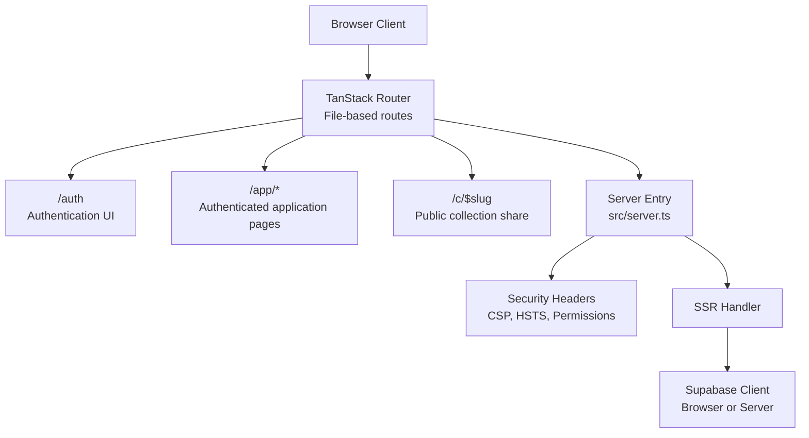
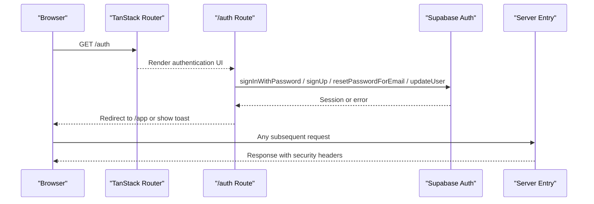
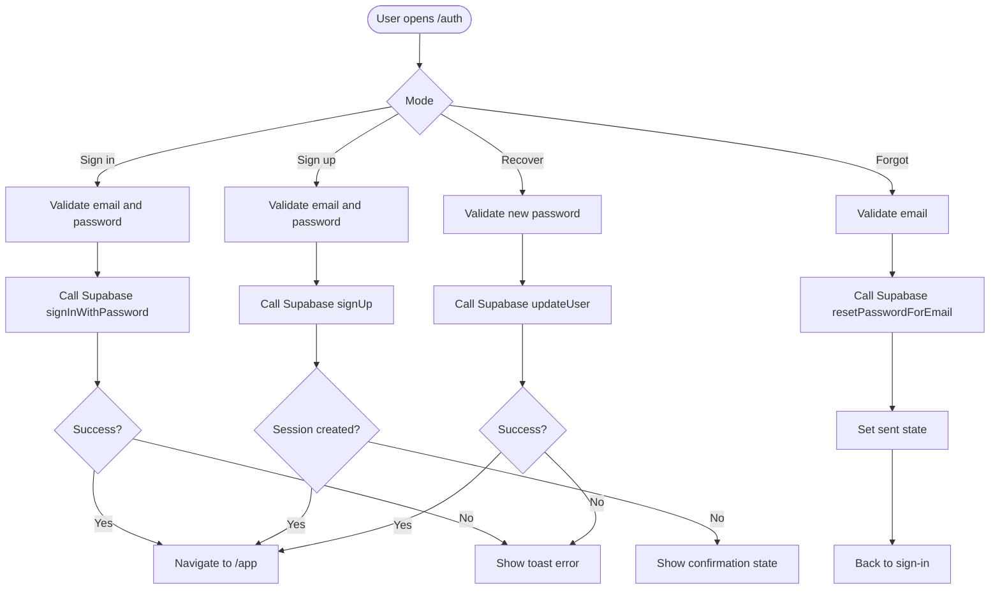
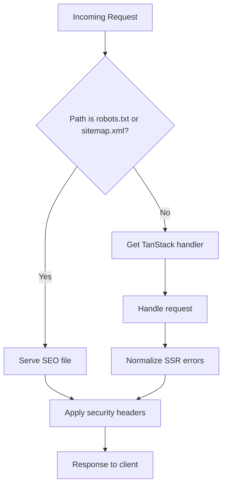
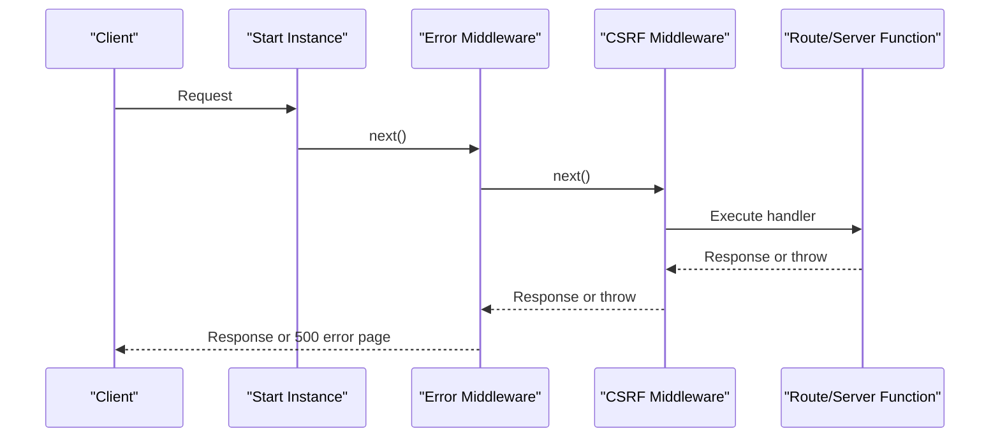
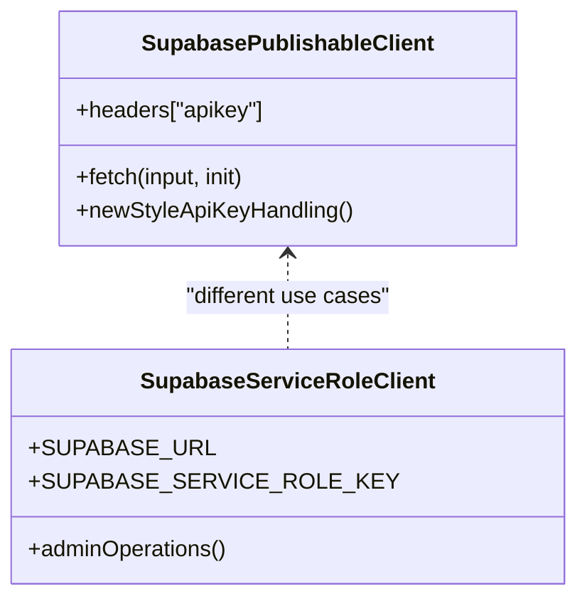
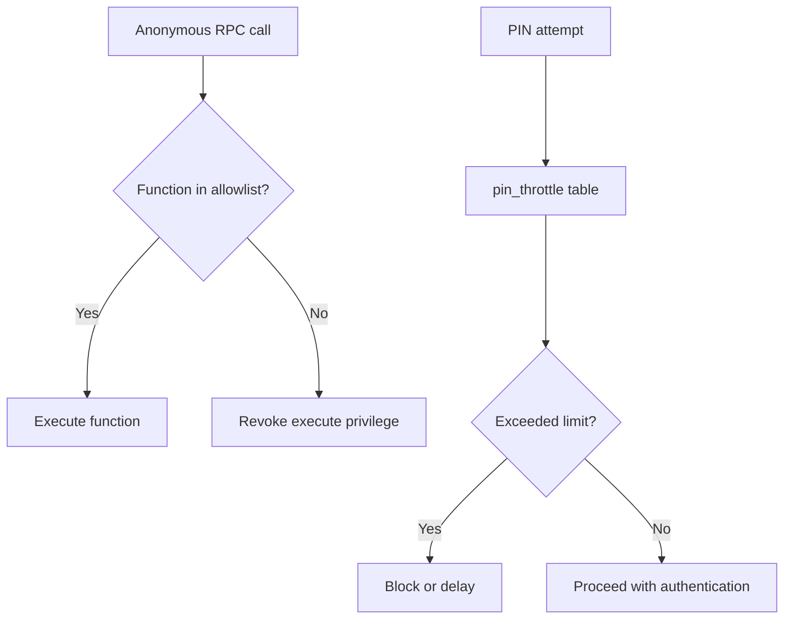
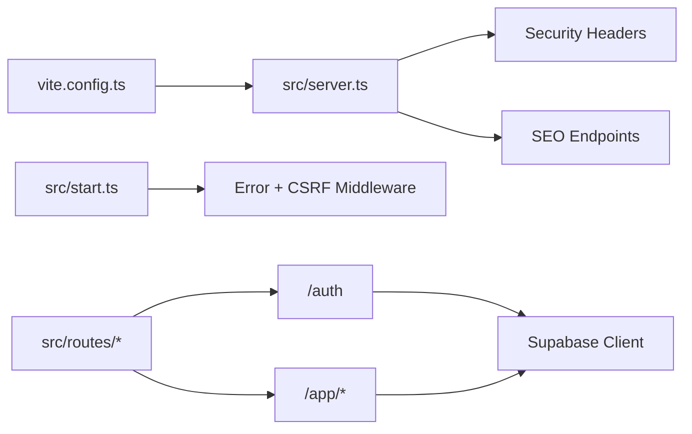

# REST Endpoints

<cite>
**Referenced Files in This Document**   
- [README.md](file://README.md)
- [src/server.ts](file://src/server.ts)
- [src/start.ts](file://src/start.ts)
- [vite.config.ts](file://vite.config.ts)
- [src/routeTree.gen.ts](file://src/routeTree.gen.ts)
- [src/routes/README.md](file://src/routes/README.md)
- [src/routes/auth.tsx](file://src/routes/auth.tsx)
- [src/integrations/supabase/auth-middleware.ts](file://src/integrations/supabase/auth-middleware.ts)
- [src/integrations/supabase/client.server.ts](file://src/integrations/supabase/client.server.ts)
- [supabase/migrations/20261008090000_security_hardening.sql](file://supabase/migrations/20261008090000_security_hardening.sql)
</cite>

## Table of Contents
1. [Introduction](#introduction)
2. [Project Structure](#project-structure)
3. [Core Components](#core-components)
4. [Architecture Overview](#architecture-overview)
5. [Detailed Component Analysis](#detailed-component-analysis)
6. [Dependency Analysis](#dependency-analysis)
7. [Performance Considerations](#performance-considerations)
8. [Troubleshooting Guide](#troubleshooting-guide)
9. [Conclusion](#conclusion)

## Introduction
This document describes the REST API surface exposed by the Storq POS application as implemented in this repository. The application is a TanStack Start web app that primarily renders pages and calls Supabase from the browser or server functions. It does not expose a traditional public REST API controller layer; instead, it exposes:

- Web routes for authentication and application pages.
- A single server entry that wraps responses with security headers and error handling.
- Server-side helpers for Supabase access.
- Database-level RPC functions protected by Row Level Security and migration-based lockdowns.

The most relevant “API-like” behavior documented here is user authentication through the `/auth` page and the general request/response lifecycle handled by the server entry.

**Section sources**
- [README.md:1-26](file://README.md#L1-L26)
- [src/routeTree.gen.ts:160-183](file://src/routeTree.gen.ts#L160-L183)

## Project Structure
Storq uses file-based routing under `src/routes`. The generated route tree shows the main URL paths, including `/`, `/auth`, `/c/$slug`, and authenticated routes under `/app/*`. There is no explicit REST controller directory; business logic lives in route components and library modules, while data access goes through Supabase clients.

**Diagram sources**
- [src/routeTree.gen.ts:160-183](file://src/routeTree.gen.ts#L160-L183)
- [src/server.ts:21-51](file://src/server.ts#L21-L51)
- [src/server.ts:135-153](file://src/server.ts#L135-L153)

**Section sources**
- [src/routes/README.md:1-22](file://src/routes/README.md#L1-L22)
- [src/routeTree.gen.ts:160-183](file://src/routeTree.gen.ts#L160-L183)

## Core Components
- Authentication UI route: `/auth` handles sign-in, sign-up, password reset, and password update flows using Supabase authentication.
- Server entry: Wraps all responses with security headers, SEO files, and error normalization.
- CSRF middleware: Protects server functions against cross-site request forgery.
- Supabase client helpers: Provide service-role and publishable-key clients for database operations.
- Security hardening migrations: Restrict anonymous RPC access and add PIN brute-force throttling at the database level.

Key responsibilities:
- `/auth`: User-facing authentication workflow.
- `server.ts`: Global response security and error handling.
- `start.ts`: Request middleware pipeline for errors and CSRF protection.
- `auth-middleware.ts` and `client.server.ts`: Supabase integration patterns.
- Security migration: Database-level protections for RPC and PIN attempts.

**Section sources**
- [src/routes/auth.tsx:13-107](file://src/routes/auth.tsx#L13-L107)
- [src/server.ts:21-51](file://src/server.ts#L21-L51)
- [src/server.ts:135-153](file://src/server.ts#L135-L153)
- [src/start.ts:5-29](file://src/start.ts#L5-L29)
- [src/integrations/supabase/auth-middleware.ts:1-38](file://src/integrations/supabase/auth-middleware.ts#L1-L38)
- [src/integrations/supabase/client.server.ts:1-38](file://src/integrations/supabase/client.server.ts#L1-L38)
- [supabase/migrations/20261008090000_security_hardening.sql:1-27](file://supabase/migrations/20261008090000_security_hardening.sql#L1-L27)

## Architecture Overview
The application follows a client-driven architecture:

- The browser loads routes defined by TanStack Start.
- The `/auth` route performs authentication via Supabase’s JavaScript SDK.
- The server entry applies security headers to every response and normalizes SSR errors.
- Server functions are protected by CSRF middleware.
- Database access uses Supabase clients configured for either user-authenticated queries (RLS) or admin operations (service role).

**Diagram sources**
- [src/routes/auth.tsx:45-107](file://src/routes/auth.tsx#L45-L107)
- [src/server.ts:135-153](file://src/server.ts#L135-L153)

## Detailed Component Analysis

### Authentication Endpoint Surface
There is no explicit REST endpoint definition for authentication; authentication is performed through the `/auth` route using Supabase’s client SDK. The effective API-like interactions are:

- Sign in
  - Method: Client-side call initiated from `/auth`.
  - URL pattern: `/auth` (UI route).
  - Request schema: Email and password fields validated client-side before calling Supabase.
  - Response: Redirect to `/app` on success; otherwise display an error toast.
  - Authentication: None required to reach `/auth`; successful sign-in creates a session.
  - Validation rules:
    - Email must be valid and within configured limits.
    - Password is required for sign-in; strength validation applies for sign-up and password recovery.
  - Error handling: Rate-limit messages are normalized into user-friendly text.

- Sign up
  - Method: Client-side call initiated from `/auth`.
  - URL pattern: `/auth` (UI route).
  - Request schema: Email and password fields.
  - Response: If session exists, redirect to `/app`; otherwise set confirmation state.
  - Authentication: None required.
  - Validation rules:
    - Email validated.
    - Password validated for strength.

- Password reset
  - Method: Client-side call initiated from `/auth`.
  - URL pattern: `/auth` (UI route).
  - Request schema: Email field.
  - Response: Set sent state indicating reset email was dispatched.
  - Authentication: None required.
  - Validation rules:
    - Email validated.

- Update password
  - Method: Client-side call initiated from `/auth`.
  - URL pattern: `/auth` (UI route).
  - Request schema: New password field.
  - Response: Success toast and redirect to `/app`.
  - Authentication: Requires active session during recovery flow.
  - Validation rules:
    - Password validated for strength.

**Diagram sources**
- [src/routes/auth.tsx:45-107](file://src/routes/auth.tsx#L45-L107)

**Section sources**
- [src/routes/auth.tsx:13-107](file://src/routes/auth.tsx#L13-L107)

### Server Entry and Security Headers
The server entry centralizes response wrapping:

- Security headers:
  - Content-Security-Policy restricts scripts, styles, fonts, images, and connections to Supabase hosts.
  - X-Content-Type-Options prevents MIME sniffing.
  - X-Frame-Options denies framing.
  - Referrer-Policy limits referrer information.
  - Permissions-Policy disables sensitive device features except camera when allowed.
  - Cross-Origin-Opener-Policy isolates browsing contexts.
  - Strict-Transport-Security enabled when served over HTTPS.

- SEO endpoints:
  - `/robots.txt` and `/sitemap.xml` are served directly with appropriate content types and cache headers.

- Error normalization:
  - SSR errors swallowed by h3 are detected and converted into HTML error pages.

**Diagram sources**
- [src/server.ts:21-51](file://src/server.ts#L21-L51)
- [src/server.ts:103-133](file://src/server.ts#L103-L133)
- [src/server.ts:70-94](file://src/server.ts#L70-L94)
- [src/server.ts:135-153](file://src/server.ts#L135-L153)

**Section sources**
- [src/server.ts:21-51](file://src/server.ts#L21-L51)
- [src/server.ts:70-94](file://src/server.ts#L70-L94)
- [src/server.ts:103-133](file://src/server.ts#L103-L133)
- [src/server.ts:135-153](file://src/server.ts#L135-L153)

### Request Middleware and CSRF Protection
The Start instance configures two request middleware:

- Error middleware:
  - Catches non-status errors and returns a 500 HTML error page.
  - Preserves status-code errors for proper HTTP semantics.

- CSRF middleware:
  - Applied to server functions to prevent cross-site request forgery.

**Diagram sources**
- [src/start.ts:5-29](file://src/start.ts#L5-L29)

**Section sources**
- [src/start.ts:5-29](file://src/start.ts#L5-L29)

### Supabase Integration Patterns
- Publishable key client:
  - Used for user-authenticated queries with Row Level Security enforced.
  - Adds `apikey` header and strips invalid bearer tokens for new-style keys.

- Service-role client:
  - Bypasses RLS for admin operations in server functions and server routes only.
  - Uses environment variables for URL and service role key.

**Diagram sources**
- [src/integrations/supabase/auth-middleware.ts:11-31](file://src/integrations/supabase/auth-middleware.ts#L11-L31)
- [src/integrations/supabase/client.server.ts:35-38](file://src/integrations/supabase/client.server.ts#L35-L38)

**Section sources**
- [src/integrations/supabase/auth-middleware.ts:1-38](file://src/integrations/supabase/auth-middleware.ts#L1-L38)
- [src/integrations/supabase/client.server.ts:1-38](file://src/integrations/supabase/client.server.ts#L1-L38)

### Database-Level Security and Rate Limiting
Migrations enforce:

- Anonymous RPC lockdown:
  - Only explicitly allowed functions remain executable by anonymous users.
  - All other functions revoke anonymous execution privileges.

- PIN attempt throttle:
  - Introduces a table for tracking PIN attempts per business and per signed-in device.
  - Supports brute-force mitigation at the database layer.

**Diagram sources**
- [supabase/migrations/20261008090000_security_hardening.sql:1-27](file://supabase/migrations/20261008090000_security_hardening.sql#L1-L27)

**Section sources**
- [supabase/migrations/20261008090000_security_hardening.sql:1-27](file://supabase/migrations/20261008090000_security_hardening.sql#L1-L27)

## Dependency Analysis
The runtime dependency chain is:

- Vite configuration points TanStack Start’s server entry to `src/server.ts`.
- `src/server.ts` wraps all responses with security headers and SEO handling.
- `src/start.ts` registers error and CSRF middleware.
- Routes are defined by files under `src/routes`, with `/auth` handling authentication.
- Supabase clients are used by routes and server functions for data access.

**Diagram sources**
- [vite.config.ts:9-14](file://vite.config.ts#L9-L14)
- [src/server.ts:135-153](file://src/server.ts#L135-L153)
- [src/start.ts:27-29](file://src/start.ts#L27-L29)
- [src/routeTree.gen.ts:160-183](file://src/routeTree.gen.ts#L160-L183)

**Section sources**
- [vite.config.ts:9-14](file://vite.config.ts#L9-L14)
- [src/server.ts:135-153](file://src/server.ts#L135-L153)
- [src/start.ts:27-29](file://src/start.ts#L27-L29)
- [src/routeTree.gen.ts:160-183](file://src/routeTree.gen.ts#L160-L183)

## Performance Considerations
- Dependency optimization:
  - Vite pre-bundles libraries such as Supabase, React Query, jsPDF, and Recharts to avoid mid-session reloads.
- Warmup:
  - The Vite server warms router and component modules to reduce first-navigation latency.
- CSP and security headers:
  - Minimal allowed origins reduce unnecessary network checks and improve security posture.

[No sources needed since this section provides general guidance]

## Troubleshooting Guide
Common issues and handling:

- Authentication rate limits:
  - The `/auth` route normalizes rate-limit messages into user-friendly toasts.
- SSR errors:
  - The server entry detects h3-swallowed errors and returns a standardized HTML error page.
- Global errors:
  - The Start error middleware catches unexpected errors and returns a 500 HTML response.

Recommendations:
- Inspect browser console and network logs for Supabase auth errors.
- Review server logs for normalized SSR errors.
- Ensure environment variables for Supabase URL and keys are correctly configured.

**Section sources**
- [src/routes/auth.tsx:97-107](file://src/routes/auth.tsx#L97-L107)
- [src/server.ts:70-94](file://src/server.ts#L70-L94)
- [src/start.ts:5-18](file://src/start.ts#L5-L18)

## Conclusion
Storq POS does not expose a conventional REST API controller layer. Its primary external-facing behaviors are:

- Web routes for authentication and application pages.
- A server entry that enforces security headers and error normalization.
- Supabase-based authentication and data access.
- Database-level protections for RPC and PIN attempts.

For consumers integrating with Storq, treat `/auth` as the authentication entry point and rely on Supabase clients for data operations. Always respect the security headers, handle rate-limit messages gracefully, and ensure environment configuration is correct for reliable operation.

[No sources needed since this section summarizes without analyzing specific files]