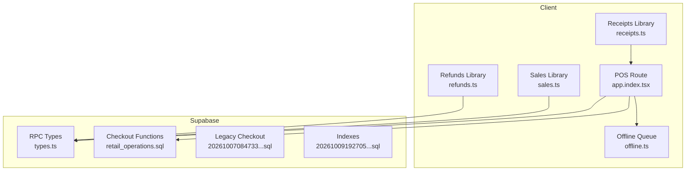
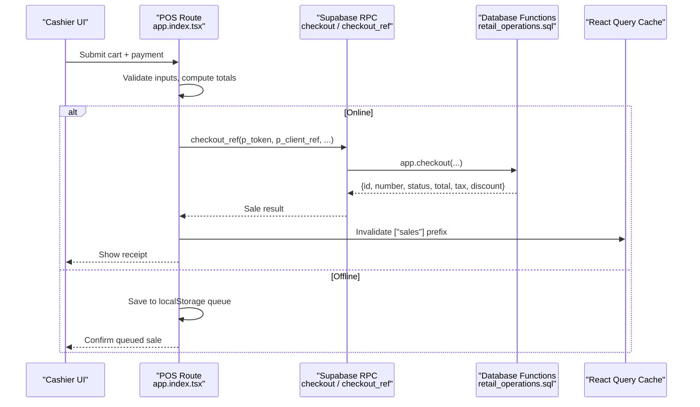
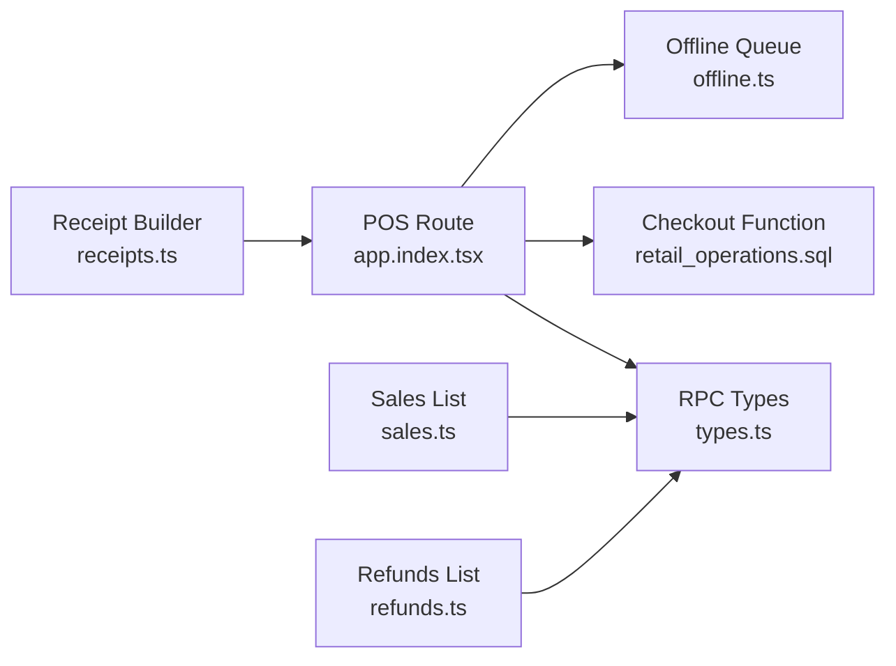

# Sales & Transactions Endpoints

<cite>
**Referenced Files in This Document**
- [sales.ts](file://src/lib/sales.ts)
- [receipts.ts](file://src/lib/receipts.ts)
- [refunds.ts](file://src/lib/refunds.ts)
- [offline.ts](file://src/lib/offline.ts)
- [app.index.tsx](file://src/routes/_authenticated/app.index.tsx)
- [types.ts](file://src/integrations/supabase/types.ts)
- [20261007084733_2ed95314-f75e-4843-977b-23f9e6359a48.sql](file://supabase/migrations/20261007084733_2ed95314-f75e-4843-977b-23f9e6359a48.sql)
- [20261007092354_1daf7bc8-d22a-46ae-a571-1e6c509ed166.sql](file://supabase/migrations/20261007092354_1daf7bc8-d22a-46ae-a571-1e6c509ed166.sql)
- [20261009192705_c04f3a80-e05e-498f-ab87-694d79f3fe3f.sql](file://supabase/migrations/20261009192705_c04f3a80-e05e-498f-ab87-694d79f3fe3f.sql)
- [20261009210500_retail_operations.sql](file://supabase/migrations/20261009210500_retail_operations.sql)
</cite>

## Table of Contents
1. [Introduction](#introduction)
2. [Project Structure](#project-structure)
3. [Core Components](#core-components)
4. [Architecture Overview](#architecture-overview)
5. [Detailed Component Analysis](#detailed-component-analysis)
6. [Dependency Analysis](#dependency-analysis)
7. [Performance Considerations](#performance-considerations)
8. [Troubleshooting Guide](#troubleshooting-guide)
9. [Conclusion](#conclusion)

## Introduction
This document describes the sales and transaction processing surface exposed by the application. The system uses Supabase RPC functions as its backend API for point-of-sale operations, including sale creation, split payments, layby management, invoice approval, refunds, receipt generation, and transaction history. It also documents offline queuing, real-time updates, multi-store handling, and audit trail requirements.

The primary client-facing entry points are:
- Sale creation through `checkout` and idempotent `checkout_ref`.
- Layby payment and cancellation.
- Invoice review for approval stores.
- Refund processing.
- Transaction listing, summaries, and exports.
- Receipt text and HTML generation with printing support.

## Project Structure
Sales-related functionality is implemented across client libraries, UI routes, and server-side database functions:

**Diagram sources**
- [app.index.tsx:297-332](file://src/routes/_authenticated/app.index.tsx#L297-L332)
- [types.ts:1178-1206](file://src/integrations/supabase/types.ts#L1178-L1206)
- [20261009210500_retail_operations.sql:240-439](file://supabase/migrations/20261009210500_retail_operations.sql#L240-L439)
- [20261007084733_2ed95314-f75e-4843-977b-23f9e6359a48.sql:250-379](file://supabase/migrations/20261007084733_2ed95314-f75e-4843-977b-23f9e6359a48.sql#L250-L379)
- [20261009192705_c04f3a80-e05e-498f-ab87-694d79f3fe3f.sql:1-23](file://supabase/migrations/20261009192705_c04f3a80-e05e-498f-ab87-694d79f3fe3f.sql#L1-L23)

**Section sources**
- [app.index.tsx:297-332](file://src/routes/_authenticated/app.index.tsx#L297-L332)
- [types.ts:1178-1206](file://src/integrations/supabase/types.ts#L1178-L1206)
- [20261009210500_retail_operations.sql:240-439](file://supabase/migrations/20261009210500_retail_operations.sql#L240-L439)
- [20261007084733_2ed95314-f75e-4843-977b-23f9e6359a48.sql:250-379](file://supabase/migrations/20261007084733_2ed95314-f75e-4843-977b-23f9e6359a48.sql#L250-L379)
- [20261009192705_c04f3a80-e05e-498f-ab87-694d79f3fe3f.sql:1-23](file://supabase/migrations/20261009192705_c04f3a80-e05e-498f-ab87-694d79f3fe3f.sql#L1-L23)

## Core Components
- Sale creation and payment: `checkout` and `checkout_ref` RPC endpoints.
- Layby lifecycle: open, partial payments, completion, and cancellation.
- Approval workflow: invoice review with optional split tenders.
- Refunds: itemized refund recording and status transitions.
- Transaction history: paginated lists, summaries, and exports.
- Receipts: plain-text and thermal-printable HTML generation.
- Offline queue: local persistence and retry semantics.

Key responsibilities:
- Client libraries define data models and query patterns for sales, refunds, and receipts.
- Database functions enforce business rules, validation, stock movement, and audit fields.
- UI orchestrates checkout flows, offline fallback, and receipt printing.

**Section sources**
- [sales.ts:5-35](file://src/lib/sales.ts#L5-L35)
- [refunds.ts:4-24](file://src/lib/refunds.ts#L4-L24)
- [receipts.ts:10-32](file://src/lib/receipts.ts#L10-L32)
- [offline.ts:62-92](file://src/lib/offline.ts#L62-L92)
- [types.ts:1178-1206](file://src/integrations/supabase/types.ts#L1178-L1206)
- [20261009210500_retail_operations.sql:240-439](file://supabase/migrations/20261009210500_retail_operations.sql#L240-L439)

## Architecture Overview
The POS route calls Supabase RPC functions to perform sales. When offline, it queues the operation locally and retries when connectivity returns. Successful writes invalidate cached queries so other devices see updated totals and rows.

**Diagram sources**
- [app.index.tsx:297-332](file://src/routes/_authenticated/app.index.tsx#L297-L332)
- [types.ts:1192-1206](file://src/integrations/supabase/types.ts#L1192-L1206)
- [20261009210500_retail_operations.sql:289-320](file://supabase/migrations/20261009210500_retail_operations.sql#L289-L320)
- [offline.ts:71-81](file://src/lib/offline.ts#L71-L81)

## Detailed Component Analysis

### Sale Creation Endpoints

#### Endpoint: checkout
- Purpose: Create a sale (or layby/open invoice), validate items, compute totals, move stock, record payment(s), and return sale metadata.
- Invocation: Supabase RPC function `checkout`.
- Authentication: Requires staff token; roles admin, manager, or cashier.
- Parameters:
  - `p_token`: Staff authentication token.
  - `p_store`: Store identifier.
  - `p_kind`: `"sale"` or `"layby"`.
  - `p_items`: Array of `{ product_id, qty }`.
  - `p_payment`: Amount paid now.
  - `p_method`: Payment method string (`cash`, `card`, `mobile`).
  - `p_customer_name`: Optional customer name.
  - `p_customer_phone`: Optional phone number.
  - `p_note`: Optional note.
  - `p_tenders`: Optional array of split tender objects `{ method, amount }`.
  - `p_discounts`: Optional array of per-product discounts `{ product_id, amount }`.
  - `p_override_pin`: Optional override PIN for restricted actions.
- Response: JSON containing `id`, `number`, `status`, `total`, `tax`, `discount`.

Validation and business rules:
- Store must exist and belong to the caller’s business.
- Cashiers may be restricted to their assigned store.
- Cart must not be empty; items must resolve to active products in the business.
- For layby, customer name is required.
- Total is computed from product prices and quantities.
- Payment is clamped between zero and total.
- Store type determines initial status:
  - Approval stores create pending invoices.
  - Layby creates an open layby.
  - Regular sales complete immediately.
- Stock is decremented unless pending approval.
- Payments are recorded when applicable.
- Layby completes automatically if fully paid.

Split payments and overpayment:
- Multiple tenders are supported; more than one tender sets `payment_method` to `"split"`.
- Overpayment on cash can be handled by adjusting tender amounts before recording payments.

Discounts:
- Per-item discounts are applied during line insertion and capped at line value.
- Discounts are stored per sale item and included in sale totals.

Audit fields:
- `business_id`, `store_id`, `created_by`, `approved_by`, `approved_at`, `shift_id` are persisted where applicable.

Complexity considerations:
- Item iteration and per-line cost/discount computation occur server-side.
- Stock movement and payment inserts are performed within a single transactional scope.

Error handling:
- Raises exceptions for unknown store, invalid items, missing references, insufficient stock, and invalid tender formats.

**Section sources**
- [types.ts:1178-1191](file://src/integrations/supabase/types.ts#L1178-L1191)
- [20261009210500_retail_operations.sql:240-287](file://supabase/migrations/20261009210500_retail_operations.sql#L240-L287)
- [20261007084733_2ed95314-f75e-4843-977b-23f9e6359a48.sql:250-290](file://supabase/migrations/20261007084733_2ed95314-f75e-4843-977b-23f9e6359a48.sql#L250-L290)

#### Endpoint: checkout_ref
- Purpose: Idempotent sale creation using a client-generated reference to prevent duplicate submissions.
- Invocation: Supabase RPC function `checkout_ref`.
- Additional parameters:
  - `p_client_ref`: Unique UUID generated by the client.
- Behavior:
  - Uses advisory lock keyed by `p_client_ref` to serialize retries.
  - If a sale with the same reference exists under the same business, returns the existing sale with a `duplicate` flag.
  - Otherwise delegates to `app.checkout` and attaches `client_ref` to the created sale.

Use cases:
- Retry-safe checkout after network failures.
- Offline queue replay with guaranteed uniqueness.

**Section sources**
- [types.ts:1192-1206](file://src/integrations/supabase/types.ts#L1192-L1206)
- [20261009210500_retail_operations.sql:289-320](file://supabase/migrations/20261009210500_retail_operations.sql#L289-L320)

### Payment Processing and Split Tenders

Payment flow:
- Single payment: recorded via `p_payment` and `p_method`.
- Split payments: provided via `p_tenders`; each tender has `method` and `amount`.
- Method resolution:
  - Multiple tenders set `payment_method` to `"split"`.
  - Single tender uses that method.
  - Fallback defaults to `"cash"` when unspecified.

Validation:
- Tender methods must be one of `cash`, `card`, `mobile`.
- Tender amounts must be numeric, positive, and formatted correctly.
- Sum of tenders must cover the invoice total (overpayment allowed for change).
- Maximum number of tenders is enforced.

Overpayment handling:
- Excess cash is removed from the cash tender before recording payments to avoid double-counting change.

**Section sources**
- [20261009210500_retail_operations.sql:240-287](file://supabase/migrations/20261009210500_retail_operations.sql#L240-L287)
- [20261009210500_retail_operations.sql:351-382](file://supabase/migrations/20261009210500_retail_operations.sql#L351-L382)

### Receipt Generation

Receipt model:
- Includes invoice number, kind, status, business/store names, cashier, date, lines, subtotal, tax, tax rate, tax inclusivity, discount, total, payment method, paid amount, change, optional tenders, customer details, and notes.

Outputs:
- Plain-text receipt suitable for SMS/WhatsApp sharing.
- Thermal-printable HTML optimized for 80mm rolls.
- Printing helper opens a sized window and triggers print.
- Download helper saves a `.txt` file.

Security:
- All user-supplied values are escaped to prevent injection into HTML output.

**Section sources**
- [receipts.ts:10-32](file://src/lib/receipts.ts#L10-L32)
- [receipts.ts:60-74](file://src/lib/receipts.ts#L60-L74)
- [receipts.ts:84-125](file://src/lib/receipts.ts#L84-L125)
- [receipts.ts:127-202](file://src/lib/receipts.ts#L127-L202)
- [receipts.ts:217-240](file://src/lib/receipts.ts#L217-L240)

### Transaction History and Reporting

Sales list:
- Fetches recent sales with optional filters for store, statuses, and time range.
- Supports fetching nested sale items for detail views.

Summaries:
- Server-side aggregation computes revenue, collected, transactions, pending, and refunds for a period.

Pagination:
- Paginated endpoint returns page rows and exact total count without loading entire periods.

Exports:
- Lazy export fetches up to a bounded limit for CSV/PDF generation.

Real-time updates:
- Writes to sales invalidate the cache prefix so other devices refresh within a short stale window.

**Section sources**
- [sales.ts:37-73](file://src/lib/sales.ts#L37-L73)
- [sales.ts:126-148](file://src/lib/sales.ts#L126-L148)
- [sales.ts:156-181](file://src/lib/sales.ts#L156-L181)
- [sales.ts:200-216](file://src/lib/sales.ts#L200-L216)

### Refunds

Refund model:
- Contains refund header and itemized refund lines with restock flags and product links.

Querying:
- Lists refunds with optional filters for store, time range, and parent sale.

Status constraints:
- Defines which sale statuses are refundable and counted in reports.

**Section sources**
- [refunds.ts:4-24](file://src/lib/refunds.ts#L4-L24)
- [refunds.ts:26-52](file://src/lib/refunds.ts#L26-L52)
- [refunds.ts:54-56](file://src/lib/refunds.ts#L54-L56)

### Offline Queuing and Synchronization

Queue model:
- Each queued sale includes a reference, timestamp, total, store ID, and serialized arguments.

Persistence:
- Queue stored in browser local storage keyed by user ID.
- Reference data caching persists safe, non-role-gated data for instant POS startup.

Network error detection:
- Utility identifies common network failure messages to decide whether to queue.

Retry behavior:
- On successful online checkout, the UI clears the cart and shows receipt.
- On offline, the UI confirms the sale was queued and displays expected change.

**Section sources**
- [offline.ts:62-92](file://src/lib/offline.ts#L62-L92)
- [offline.ts:15-55](file://src/lib/offline.ts#L15-L55)
- [app.index.tsx:297-332](file://src/routes/_authenticated/app.index.tsx#L297-L332)

### Multi-Store Handling

Store scoping:
- Checkout validates store existence and ownership.
- Cashiers may be restricted to their assigned store.
- Sales and refunds include `store_id` for filtering and reporting.

Indexing:
- Indexes optimize queries by store and business identifiers.

**Section sources**
- [20261007084733_2ed95314-f75e-4843-977b-23f9e6359a48.sql:257-260](file://supabase/migrations/20261007084733_2ed95314-f75e-4843-977b-23f9e6359a48.sql#L257-L260)
- [20261009192705_c04f3a80-e05e-498f-ab87-694d79f3fe3f.sql:1-23](file://supabase/migrations/20261009192705_c04f3a80-e05e-498f-ab87-694d79f3fe3f.sql#L1-L23)

### Audit Trail Requirements

Audit fields:
- `business_id`, `store_id`, `created_by`, `approved_by`, `approved_at`, `shift_id`.
- Refunds include `staff_id` and reason.

Approval workflow:
- Approval stores create invoices awaiting review.
- Review enforces role checks and prevents self-approval unless admin.

Stock movements:
- Stock changes are executed through internal functions tied to sales and transfers, ensuring traceability.

**Section sources**
- [20261009210500_retail_operations.sql:245-250](file://supabase/migrations/20261009210500_retail_operations.sql#L245-L250)
- [20261009210500_retail_operations.sql:325-402](file://supabase/migrations/20261009210500_retail_operations.sql#L325-L402)
- [refunds.ts:4-24](file://src/lib/refunds.ts#L4-L24)

## Dependency Analysis

**Diagram sources**
- [app.index.tsx:297-332](file://src/routes/_authenticated/app.index.tsx#L297-L332)
- [types.ts:1178-1206](file://src/integrations/supabase/types.ts#L1178-L1206)
- [20261009210500_retail_operations.sql:240-439](file://supabase/migrations/20261009210500_retail_operations.sql#L240-L439)
- [offline.ts:62-92](file://src/lib/offline.ts#L62-L92)
- [sales.ts:37-73](file://src/lib/sales.ts#L37-L73)
- [refunds.ts:26-52](file://src/lib/refunds.ts#L26-L52)
- [receipts.ts:217-240](file://src/lib/receipts.ts#L217-L240)

**Section sources**
- [app.index.tsx:297-332](file://src/routes/_authenticated/app.index.tsx#L297-L332)
- [types.ts:1178-1206](file://src/integrations/supabase/types.ts#L1178-L1206)
- [20261009210500_retail_operations.sql:240-439](file://supabase/migrations/20261009210500_retail_operations.sql#L240-L439)
- [offline.ts:62-92](file://src/lib/offline.ts#L62-L92)
- [sales.ts:37-73](file://src/lib/sales.ts#L37-L73)
- [refunds.ts:26-52](file://src/lib/refunds.ts#L26-L52)
- [receipts.ts:217-240](file://src/lib/receipts.ts#L217-L240)

## Performance Considerations
- Server-side aggregation for sales summaries avoids loading full datasets into the browser.
- Pagination provides exact counts without scanning entire periods.
- Stale times balance freshness with reduced re-fetching:
  - Sales lists and summaries use short staleness windows.
  - Cost snapshots and staff dictionaries persist longer.
- Local caching of reference data enables instant POS startup.
- Advisory locks prevent duplicate sale submissions during retries.
- Database indexes optimize queries by store, business, and timestamps.

[No sources needed since this section provides general guidance]

## Troubleshooting Guide

Common issues and resolutions:
- Unknown store or unauthorized store access:
  - Ensure the selected store belongs to the caller’s business and the cashier is assigned appropriately.
- Empty cart or invalid items:
  - Verify all items exist in the active catalogue and have positive quantities.
- Missing client reference:
  - Generate a unique UUID for `p_client_ref` and pass it on every attempt.
- Duplicate submission:
  - Use `checkout_ref` to detect duplicates and reuse the original sale.
- Insufficient stock:
  - Check inventory levels before approving invoices or completing sales.
- Invalid tender format:
  - Ensure tender methods are valid and amounts are positive numeric strings.
- Offline mode:
  - Confirm the queue is saved and retry when connectivity returns.

Operational tips:
- Clear device cache if reference data becomes inconsistent.
- Use the sales summary and pagination endpoints to diagnose discrepancies.
- Print receipts only after successful online completion or when offline confirmation is shown.

**Section sources**
- [20261007084733_2ed95314-f75e-4843-977b-23f9e6359a48.sql:257-266](file://supabase/migrations/20261007084733_2ed95314-f75e-4843-977b-23f9e6359a48.sql#L257-L266)
- [20261009210500_retail_operations.sql:298-309](file://supabase/migrations/20261009210500_retail_operations.sql#L298-L309)
- [20261009210500_retail_operations.sql:351-382](file://supabase/migrations/20261009210500_retail_operations.sql#L351-L382)
- [offline.ts:71-81](file://src/lib/offline.ts#L71-L81)
- [offline.ts:57-60](file://src/lib/offline.ts#L57-L60)

## Conclusion
The sales and transaction subsystem combines robust server-side validation, idempotent checkout, split payments, layby workflows, approval controls, and comprehensive audit trails. Client libraries provide efficient querying, offline resilience, and high-quality receipt outputs. Together, they deliver reliable POS operations across single and multi-store environments while maintaining performance and data integrity.

[No sources needed since this section summarizes without analyzing specific files]