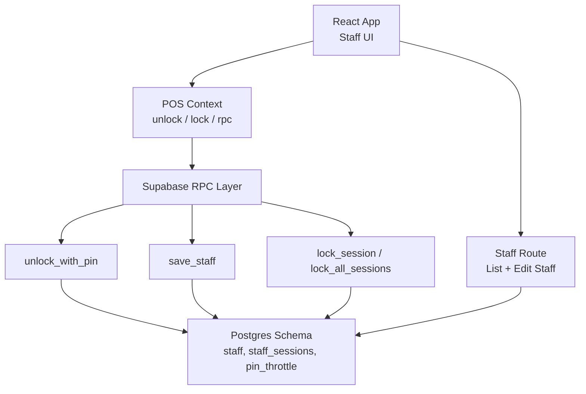
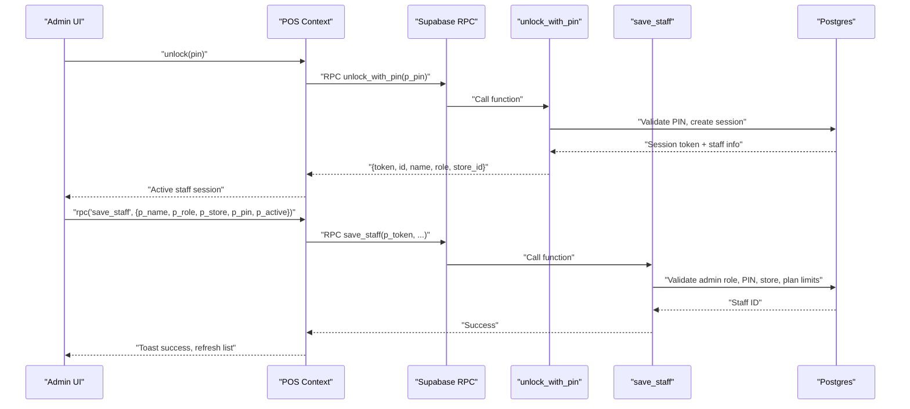
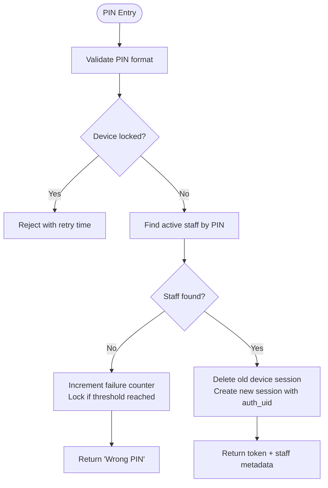
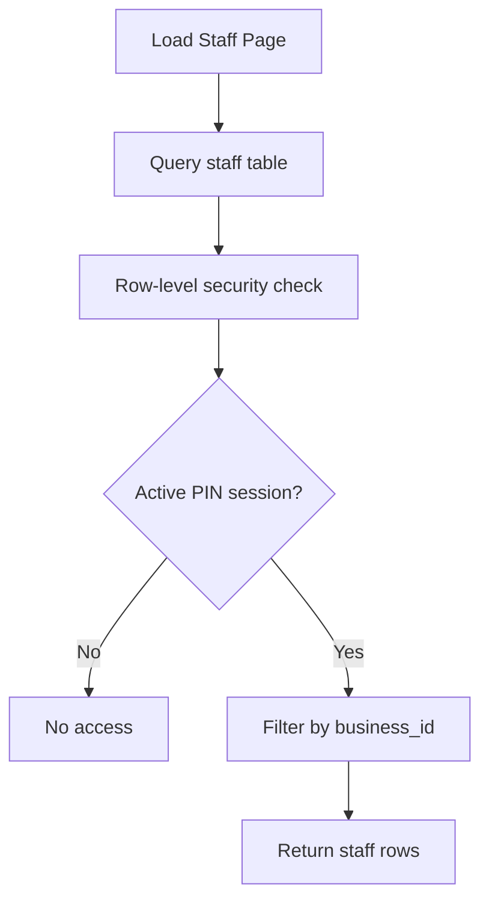
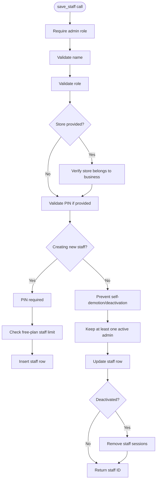
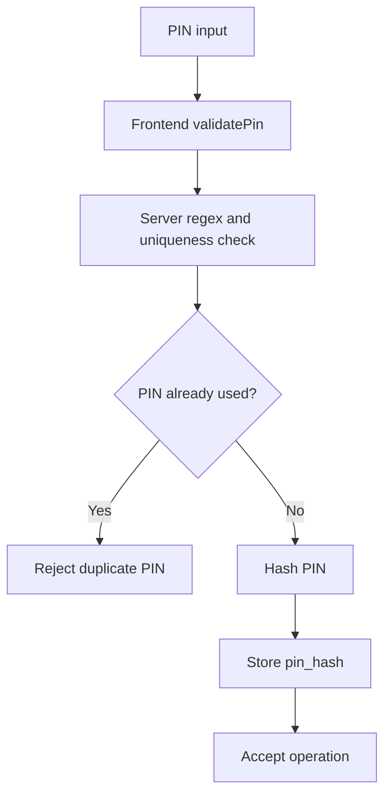
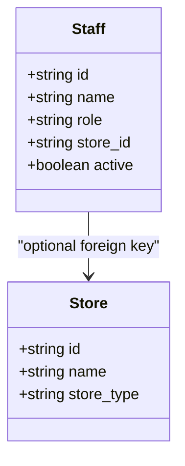
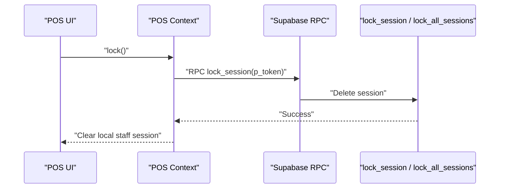
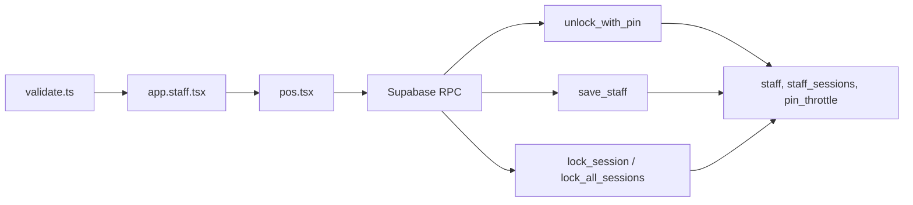

# Staff Management Endpoints

<cite>
**Referenced Files in This Document**   
- [app.staff.tsx](file://src/routes/_authenticated/app.staff.tsx)
- [pos.tsx](file://src/lib/pos.tsx)
- [validate.ts](file://src/lib/validate.ts)
- [types.ts](file://src/integrations/supabase/types.ts)
- [20261007084733_2ed95314-f75e-4843-977b-23f9e6359a48.sql](file://supabase/migrations/20261007084733_2ed95314-f75e-4843-977b-23f9e6359a48.sql)
- [20261008090000_security_hardening.sql](file://supabase/migrations/20261008090000_security_hardening.sql)
</cite>

## Table of Contents
1. [Introduction](#introduction)
2. [Project Structure](#project-structure)
3. [Core Components](#core-components)
4. [Architecture Overview](#architecture-overview)
5. [Detailed Component Analysis](#detailed-component-analysis)
6. [Dependency Analysis](#dependency-analysis)
7. [Performance Considerations](#performance-considerations)
8. [Troubleshooting Guide](#troubleshooting-guide)
9. [Conclusion](#conclusion)

## Introduction
This document describes the staff management surface used by the application. The system does not expose a traditional REST API for staff operations. Instead, it uses:
- A React route for the staff administration UI.
- Supabase RPC functions for authentication and data mutations.
- Row-level security policies and server-side validation to enforce roles, PIN rules, store assignments, and subscription limits.

The main staff-related capabilities are:
- Unlocking a POS session with a staff PIN.
- Listing staff records.
- Creating or updating a staff account.
- Assigning or changing a role.
- Setting or changing a PIN.
- Assigning a cashier to a specific store.
- Locking or clearing sessions.

Administrative operations such as creating or editing staff require an active admin session. Cashier store assignment is enforced at both the UI and database layers.

## Project Structure
The staff feature spans frontend routes, shared POS context, input validation utilities, generated TypeScript types, and Postgres migrations that define tables, RPCs, and security policies.

**Diagram sources**
- [app.staff.tsx:58-70](file://src/routes/_authenticated/app.staff.tsx#L58-L70)
- [app.staff.tsx:173-187](file://src/routes/_authenticated/app.staff.tsx#L173-L187)
- [pos.tsx:194-228](file://src/lib/pos.tsx#L194-L228)
- [20261007084733_2ed95314-f75e-4843-977b-23f9e6359a48.sql:165-203](file://supabase/migrations/20261007084733_2ed95314-f75e-4843-977b-23f9e6359a48.sql#L165-L203)
- [20261008090000_security_hardening.sql:219-291](file://supabase/migrations/20261008090000_security_hardening.sql#L219-L291)

**Section sources**
- [app.staff.tsx:26-70](file://src/routes/_authenticated/app.staff.tsx#L26-L70)
- [pos.tsx:115-228](file://src/lib/pos.tsx#L115-L228)
- [20261007084733_2ed95314-f75e-4843-977b-23f9e6359a48.sql:17-31](file://supabase/migrations/20261007084733_2ed95314-f75e-4843-977b-23f9e6359a48.sql#L17-L31)

## Core Components
- **Staff UI route**: Lists staff rows and provides an admin-only dialog for adding or editing staff. It calls `rpc("save_staff", ...)` after client-side validation.
- **POS context**: Provides `unlock`, `lock`, and a generic `rpc` helper that attaches the current staff token and masks server errors.
- **Validation utilities**: Enforce name length, PIN format, and safe text before sending requests.
- **Database schema and RPCs**: Define staff roles, PIN hashing, session tokens, throttling, and server-side authorization checks.

Key responsibilities:
- Frontend validates user input and hides sensitive details from error messages.
- Backend enforces business rules, role permissions, PIN uniqueness, store ownership, and subscription limits.
- Row-level security ensures clients can only read data belonging to their business and only when a valid PIN session exists.

**Section sources**
- [app.staff.tsx:149-187](file://src/routes/_authenticated/app.staff.tsx#L149-L187)
- [pos.tsx:194-228](file://src/lib/pos.tsx#L194-L228)
- [validate.ts:9-25](file://src/lib/validate.ts#L9-L25)
- [validate.ts:84-89](file://src/lib/validate.ts#L84-L89)
- [20261008090000_security_hardening.sql:329-371](file://supabase/migrations/20261008090000_security_hardening.sql#L329-L371)

## Architecture Overview
The staff lifecycle flows through a secure PIN-based session rather than username/password per operation.

**Diagram sources**
- [pos.tsx:194-228](file://src/lib/pos.tsx#L194-L228)
- [app.staff.tsx:173-187](file://src/routes/_authenticated/app.staff.tsx#L173-L187)
- [20261007084733_2ed95314-f75e-4843-977b-23f9e6359a48.sql:165-203](file://supabase/migrations/20261007084733_2ed95314-f75e-4843-977b-23f9e6359a48.sql#L165-L203)
- [20261008090000_security_hardening.sql:219-291](file://supabase/migrations/20261008090000_security_hardening.sql#L219-L291)
- [20261008090000_security_hardening.sql:329-371](file://supabase/migrations/20261008090000_security_hardening.sql#L329-L371)

## Detailed Component Analysis

### Authentication and Session Flow
- **Endpoint equivalent**: `unlock_with_pin`
- **Purpose**: Authenticate a staff member by PIN and return a short-lived session token bound to the signed-in device.
- **Input parameters**:
  - `p_pin`: Numeric PIN string.
- **Response fields**:
  - `token`: Session identifier passed to subsequent RPC calls.
  - `id`: Staff record ID.
  - `name`: Staff display name.
  - `role`: One of `admin`, `manager`, `cashier`.
  - `store_id`: Assigned store for cashiers; may be null.
  - `expires_at`: Session expiry timestamp.
- **Authorization**: Requires a signed-in user and a valid PIN. Wrong PIN attempts are throttled per business and device.
- **Security behavior**:
  - Replaces any existing session for the same device login.
  - Stores an `auth_uid` binding the session to the authenticated browser/device.
  - Uses an 8-hour default session lifetime.
  - Throttles repeated wrong PIN attempts and temporarily locks entry.

**Diagram sources**
- [20261008090000_security_hardening.sql:219-256](file://supabase/migrations/20261008090000_security_hardening.sql#L219-L256)

**Section sources**
- [pos.tsx:194-203](file://src/lib/pos.tsx#L194-L203)
- [20261007084733_2ed95314-f75e-4843-977b-23f9e6359a48.sql:165-175](file://supabase/migrations/20261007084733_2ed95314-f75e-4843-977b-23f9e6359a48.sql#L165-L175)
- [20261008090000_security_hardening.sql:219-256](file://supabase/migrations/20261008090000_security_hardening.sql#L219-L256)

### Staff Listing
- **Mechanism**: Direct table query against the `staff` table via Supabase client.
- **Access control**:
  - Row-level security restricts reads to the current business.
  - Reading staff data requires an active PIN session.
- **Returned fields**:
  - `id`, `name`, `role`, `store_id`, `active`.
- **Client behavior**:
  - Only renders the staff management UI when the current user has the `admin` role.
  - Caches results for a long period to avoid frequent reloads.

**Diagram sources**
- [app.staff.tsx:58-70](file://src/routes/_authenticated/app.staff.tsx#L58-L70)
- [20261008090000_security_hardening.sql:88-90](file://supabase/migrations/20261008090000_security_hardening.sql#L88-L90)

**Section sources**
- [app.staff.tsx:58-75](file://src/routes/_authenticated/app.staff.tsx#L58-L75)
- [20261007084733_2ed95314-f75e-4843-977b-23f9e6359a48.sql:102-125](file://supabase/migrations/20261007084733_2ed95314-f75e-4843-977b-23f9e6359a48.sql#L102-L125)
- [20261008090000_security_hardening.sql:88-90](file://supabase/migrations/20261008090000_security_hardening.sql#L88-L90)

### Staff Account Creation and Update
- **Endpoint equivalent**: `save_staff`
- **Purpose**: Create a new staff account or update an existing one.
- **Authorization**: Requires an active admin session.
- **Input parameters**:
  - `p_token`: Required; attached automatically by the POS context.
  - `p_id`: Optional; present when editing an existing staff row.
  - `p_name`: Required; sanitized and bounded.
  - `p_role`: Required; must be one of `admin`, `manager`, `cashier`.
  - `p_pin`: Optional; required when creating a new staff account.
  - `p_store`: Optional; must belong to the same business.
  - `p_active`: Optional; defaults to true.
- **Response**: Returns the created or updated staff ID.
- **Validation rules**:
  - Name must be non-empty and within the allowed length.
  - Role must be valid.
  - Store must exist and belong to the current business.
  - PIN must match the allowed numeric pattern when provided.
  - PIN must be unique among active staff in the business.
  - New accounts require a PIN.
  - An admin cannot demote or deactivate themselves.
  - At least one active admin must remain.
  - Free-plan limits apply to active staff PINs.

**Diagram sources**
- [20261008090000_security_hardening.sql:329-371](file://supabase/migrations/20261008090000_security_hardening.sql#L329-L371)

**Section sources**
- [app.staff.tsx:173-187](file://src/routes/_authenticated/app.staff.tsx#L173-L187)
- [20261008090000_security_hardening.sql:329-371](file://supabase/migrations/20261008090000_security_hardening.sql#L329-L371)

### PIN Management
- **Creation**: PIN is required when creating a new staff account.
- **Update**: PIN is optional when editing; omitting it leaves the existing hash unchanged.
- **Format**:
  - Frontend accepts 4-digit PINs in the UI form.
  - Server-side hardening allows 4 to 8 digits.
- **Uniqueness**: Duplicate PINs among active staff in the same business are rejected.
- **Storage**: PINs are hashed using a cryptographic function; plaintext PINs are never stored.
- **Brute-force protection**: Repeated wrong PIN attempts trigger a temporary lock per business and device.

**Diagram sources**
- [validate.ts:84-89](file://src/lib/validate.ts#L84-L89)
- [20261008090000_security_hardening.sql:341-344](file://supabase/migrations/20261008090000_security_hardening.sql#L341-L344)
- [20261008090000_security_hardening.sql:219-256](file://supabase/migrations/20261008090000_security_hardening.sql#L219-L256)

**Section sources**
- [app.staff.tsx:240-267](file://src/routes/_authenticated/app.staff.tsx#L240-L267)
- [validate.ts:84-89](file://src/lib/validate.ts#L84-L89)
- [20261008090000_security_hardening.sql:341-344](file://supabase/migrations/20261008090000_security_hardening.sql#L341-L344)

### Store Assignments
- **Assignment model**: Each staff row has an optional `store_id`.
- **Cashier restriction**: If a cashier has a store assignment, operations targeting other stores are rejected.
- **Admin UI behavior**: The staff edit dialog lets administrators assign either “all stores” (null) or a specific store.
- **Backend enforcement**: Store existence and business ownership are validated before saving.

**Diagram sources**
- [types.ts:745-787](file://src/integrations/supabase/types.ts#L745-L787)
- [20261008090000_security_hardening.sql:338-340](file://supabase/migrations/20261008090000_security_hardening.sql#L338-L340)

**Section sources**
- [app.staff.tsx:221-238](file://src/routes/_authenticated/app.staff.tsx#L221-L238)
- [types.ts:745-787](file://src/integrations/supabase/types.ts#L745-L787)
- [20261008090000_security_hardening.sql:338-340](file://supabase/migrations/20261008090000_security_hardening.sql#L338-L340)

### Session Locking and Logout
- **Endpoints**:
  - `lock_session`: Removes a single session token.
  - `lock_all_sessions`: Clears all sessions for the current device login.
- **Behavior**:
  - Removing a session forces re-authentication on the next operation.
  - Signing out clears PIN throttle state for the device.
- **Use cases**:
  - Manual logout.
  - Idle auto-lock.
  - Switching between staff on the same device.

**Diagram sources**
- [pos.tsx:205-215](file://src/lib/pos.tsx#L205-L215)
- [20261008090000_security_hardening.sql:272-291](file://supabase/migrations/20261008090000_security_hardening.sql#L272-L291)

**Section sources**
- [pos.tsx:205-228](file://src/lib/pos.tsx#L205-L228)
- [20261008090000_security_hardening.sql:272-291](file://supabase/migrations/20261008090000_security_hardening.sql#L272-L291)

## Dependency Analysis
The staff management surface depends on several layers:

**Diagram sources**
- [validate.ts:84-89](file://src/lib/validate.ts#L84-L89)
- [app.staff.tsx:173-187](file://src/routes/_authenticated/app.staff.tsx#L173-L187)
- [pos.tsx:194-228](file://src/lib/pos.tsx#L194-L228)
- [20261007084733_2ed95314-f75e-4843-977b-23f9e6359a48.sql:165-203](file://supabase/migrations/20261007084733_2ed95314-f75e-4843-977b-23f9e6359a48.sql#L165-L203)
- [20261008090000_security_hardening.sql:219-291](file://supabase/migrations/20261008090000_security_hardening.sql#L219-L291)

**Section sources**
- [app.staff.tsx:58-187](file://src/routes/_authenticated/app.staff.tsx#L58-L187)
- [pos.tsx:194-228](file://src/lib/pos.tsx#L194-L228)
- [20261007084733_2ed95314-f75e-4843-977b-23f9e6359a48.sql:165-203](file://supabase/migrations/20261007084733_2ed95314-f75e-4843-977b-23f9e6359a48.sql#L165-L203)
- [20261008090000_security_hardening.sql:219-291](file://supabase/migrations/20261008090000_security_hardening.sql#L219-L291)

## Performance Considerations
- **Caching**: The staff list uses a long stale time to reduce repeated queries during a session.
- **Session reuse**: A single device-bound session avoids repeated PIN prompts until expiry or explicit lock.
- **Error masking**: RPC errors are masked to prevent leaking internal database details to the UI.
- **Offline queue**: While not directly part of staff management, the POS context queues operations and retries them when online, reducing failed administrative workflows due to transient network issues.

[No sources needed since this section provides general guidance]

## Troubleshooting Guide
Common issues and their likely causes:

- **“Locked: enter your PIN again”**
  - Cause: Session expired, invalid, or not bound to the current device login.
  - Resolution: Re-enter the staff PIN to obtain a new session.

- **“Your role (...) is not allowed to do this”**
  - Cause: The active staff role does not include the required permission.
  - Resolution: Use an admin session for administrative operations.

- **“Wrong PIN”**
  - Cause: Invalid PIN or throttled device after repeated failures.
  - Resolution: Wait for the lockout window or use a correct PIN.

- **“That PIN is already used by someone else”**
  - Cause: Duplicate PIN among active staff in the same business.
  - Resolution: Choose a different PIN.

- **“PIN required”**
  - Cause: Creating a new staff account without providing a PIN.
  - Resolution: Provide a valid PIN when adding a new staff member.

- **“Unknown store”**
  - Cause: Store ID does not exist or does not belong to the current business.
  - Resolution: Select a valid store from the business’s store list.

- **“You cannot demote or deactivate yourself”**
  - Cause: Attempting to change the calling admin’s own role or active status.
  - Resolution: Perform the change from another admin account.

- **“Keep at least one active admin”**
  - Cause: Removing the last active admin would leave no administrator.
  - Resolution: Ensure another active admin remains.

- **Generic or constraint errors**
  - Cause: Database constraints or policy violations.
  - Resolution: Review input bounds, role requirements, and business ownership.

**Section sources**
- [pos.tsx:93-104](file://src/lib/pos.tsx#L93-L104)
- [pos.tsx:220-228](file://src/lib/pos.tsx#L220-L228)
- [20261008090000_security_hardening.sql:219-291](file://supabase/migrations/20261008090000_security_hardening.sql#L219-L291)
- [20261008090000_security_hardening.sql:329-371](file://supabase/migrations/20261008090000_security_hardening.sql#L329-L371)

## Conclusion
Staff management in this project is implemented as a secure, PIN-driven workflow rather than a conventional REST API. Administrative operations are protected by:
- Active PIN sessions.
- Role checks requiring admin privileges.
- Server-side validation of names, roles, PINs, stores, and plan limits.
- Device-bound sessions with expiration and throttling.
- Row-level security restricting data access to the current business.

For integration, treat the relevant RPCs as the authoritative endpoints:
- `unlock_with_pin` for authentication.
- `save_staff` for creation and updates.
- `lock_session` and `lock_all_sessions` for session cleanup.
- Direct table reads for listing staff under the documented access controls.