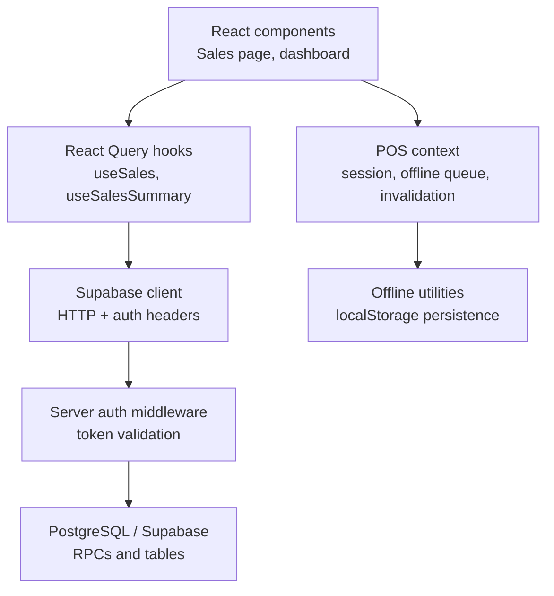
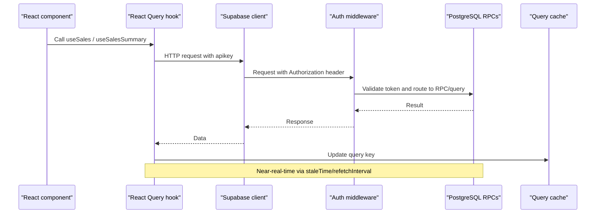
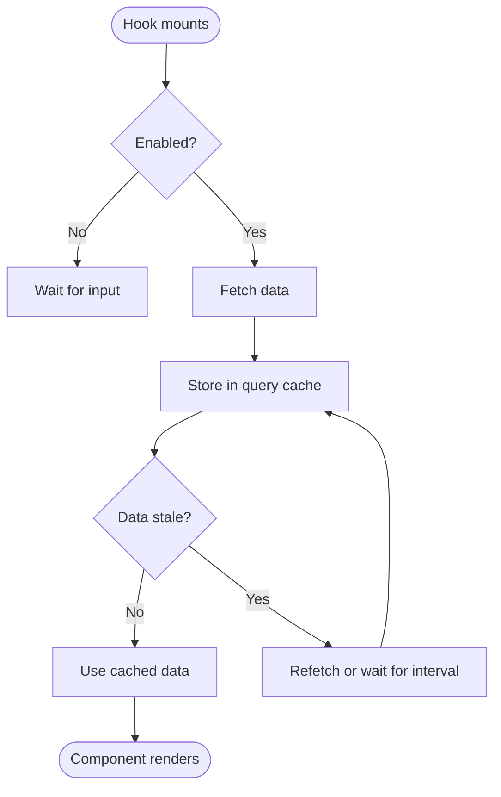
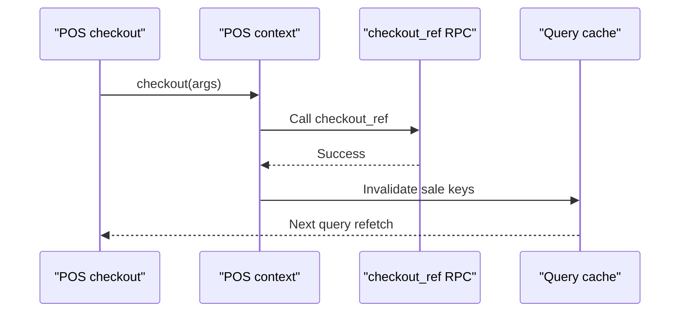
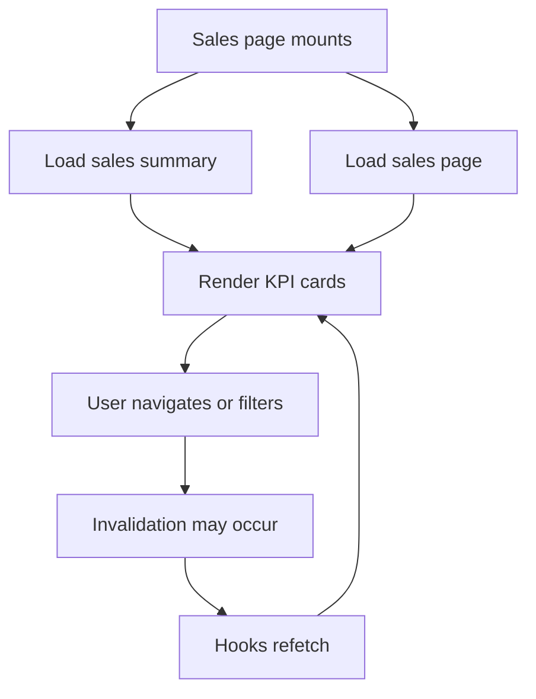
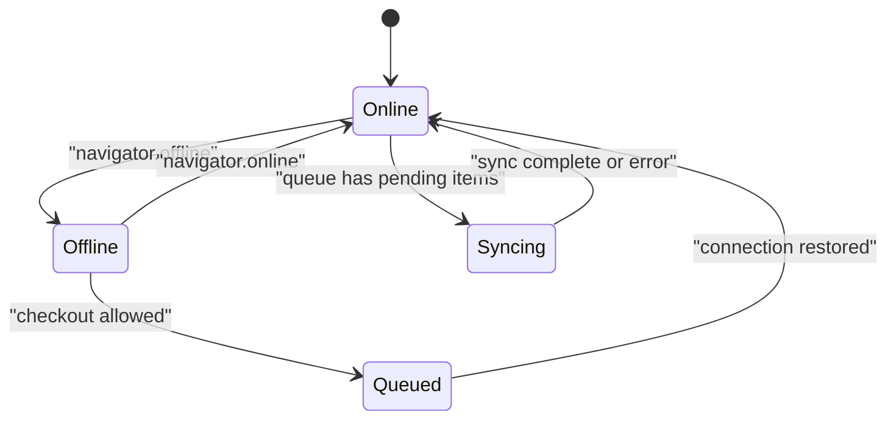
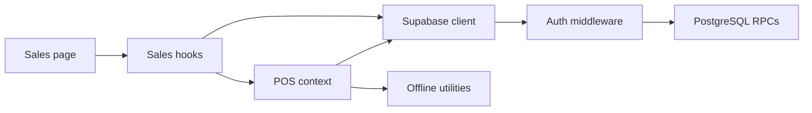

# Real-time Subscriptions

<cite>
**Referenced Files in This Document**
- [client.ts](file://src/integrations/supabase/client.ts)
- [auth-middleware.ts](file://src/integrations/supabase/auth-middleware.ts)
- [pos.tsx](file://src/lib/pos.tsx)
- [offline.ts](file://src/lib/offline.ts)
- [sales.ts](file://src/lib/sales.ts)
- [app.sales.tsx](file://src/routes/_authenticated/app.sales.tsx)
- [billing.ts](file://src/lib/billing.ts)
- [subscription-policy.ts](file://src/lib/subscription-policy.ts)
- [20261009210500_retail_operations.sql](file://supabase/migrations/20261009210500_retail_operations.sql)
</cite>

## Table of Contents
1. [Introduction](#introduction)
2. [Project Structure](#project-structure)
3. [Core Components](#core-components)
4. [Architecture Overview](#architecture-overview)
5. [Detailed Component Analysis](#detailed-component-analysis)
6. [Dependency Analysis](#dependency-analysis)
7. [Performance Considerations](#performance-considerations)
8. [Troubleshooting Guide](#troubleshooting-guide)
9. [Conclusion](#conclusion)

## Introduction
This document explains how real-time and near-real-time data updates work in the Storq POS system. The application does not use a dedicated WebSocket subscription channel for live database events. Instead, it achieves “live” behavior through:

- Polling React Query hooks with short stale times and refetch intervals.
- Explicit cache invalidation triggered by RPC writes (for example, checkout and approval flows).
- A device-local offline queue that persists sales while offline and replays them when connectivity returns.
- Browser network event listeners to track online state and trigger background sync.

The result is an experience where sales, inventory-related reads, and user session changes appear updated across devices without requiring a persistent real-time socket.

## Project Structure
Real-time behavior spans several layers:

- Client configuration and authentication headers are set up in the Supabase client.
- Server-side middleware validates tokens for function calls.
- The POS context manages staff sessions, business/store data, offline queue state, and explicit cache invalidation.
- Offline utilities persist reference data and queued sales.
- Feature hooks read sales and billing data using React Query.
- Database migrations define RPCs that mutate sales, stock, and transfers.

**Diagram sources**
- [client.ts:57-83](file://src/integrations/supabase/client.ts#L57-L83)
- [auth-middleware.ts:34-105](file://src/integrations/supabase/auth-middleware.ts#L34-L105)
- [pos.tsx:115-440](file://src/lib/pos.tsx#L115-L440)
- [offline.ts:15-55](file://src/lib/offline.ts#L15-L55)
- [sales.ts:37-73](file://src/lib/sales.ts#L37-L73)

**Section sources**
- [client.ts:1-96](file://src/integrations/supabase/client.ts#L1-L96)
- [auth-middleware.ts:1-105](file://src/integrations/supabase/auth-middleware.ts#L1-L105)
- [pos.tsx:1-448](file://src/lib/pos.tsx#L1-L448)
- [offline.ts:1-92](file://src/lib/offline.ts#L1-L92)
- [sales.ts:1-217](file://src/lib/sales.ts#L1-L217)

## Core Components
- Supabase client: Creates the HTTP client, injects API keys, and supports server-side URL rewriting. It enables authenticated requests but does not open a WebSocket subscription.
- Auth middleware: Validates bearer tokens on server routes and attaches claims to the request context.
- POS context: Manages staff sessions, store selection, currency formatting, offline queue, and cache invalidation. It exposes `checkout`, `rpc`, `syncQueue`, and `refresh`.
- Offline utilities: Persist reference queries and queued sales in localStorage; expose helpers for network error detection and unique references.
- Sales hooks: Read sales lists, summaries, and pages using React Query with configured stale times and query functions.
- Billing hook: Reads subscription status with gentle polling and derives access flags.

Key responsibilities for real-time-like behavior:
- Short stale times make cached data refresh automatically after a period.
- Writes call RPCs that update rows; callers then invalidate related query keys.
- Offline queue ensures sales are eventually consistent even when the browser is disconnected.

**Section sources**
- [client.ts:57-95](file://src/integrations/supabase/client.ts#L57-L95)
- [auth-middleware.ts:34-105](file://src/integrations/supabase/auth-middleware.ts#L34-L105)
- [pos.tsx:115-440](file://src/lib/pos.tsx#L115-L440)
- [offline.ts:15-92](file://src/lib/offline.ts#L15-L92)
- [sales.ts:37-148](file://src/lib/sales.ts#L37-L148)
- [billing.ts:10-28](file://src/lib/billing.ts#L10-L28)

## Architecture Overview
The system uses a pull-based model rather than push-based subscriptions. Data becomes “live” because:

1. UI components call React Query hooks.
2. Hooks execute HTTP requests through the Supabase client.
3. Server middleware validates the token and executes RPCs or queries.
4. Write RPCs change rows in PostgreSQL.
5. After successful mutations, the client invalidates query keys so nearby reads refresh.
6. Offline queue items are retried periodically until they succeed.

**Diagram sources**
- [sales.ts:37-73](file://src/lib/sales.ts#L37-L73)
- [client.ts:57-83](file://src/integrations/supabase/client.ts#L57-L83)
- [auth-middleware.ts:34-105](file://src/integrations/supabase/auth-middleware.ts#L34-L105)

## Detailed Component Analysis

### Subscription Lifecycle
There is no traditional WebSocket subscription lifecycle. Instead, each feature has a query lifecycle:

- Enablement: Queries are enabled only when required inputs exist, such as a business ID.
- First load: The hook fetches data from the database.
- Caching: Results are stored under a stable query key.
- Staleness: After `staleTime`, the data is considered stale and can be refetched.
- Refetch interval: Some queries use `refetchInterval` to poll gently.
- Invalidation: Writes trigger explicit invalidation so dependent queries refresh.

**Diagram sources**
- [sales.ts:37-73](file://src/lib/sales.ts#L37-L73)
- [billing.ts:10-28](file://src/lib/billing.ts#L10-L28)

**Section sources**
- [sales.ts:37-73](file://src/lib/sales.ts#L37-L73)
- [billing.ts:10-28](file://src/lib/billing.ts#L10-L28)

### Event Types and Payload Structures
The codebase does not define a generic event bus. Instead, events are represented by:

- Query keys: For example, `["sales", key, filter]`, `["sales-summary", filter]`, `["business", userId]`, `["stores", businessId]`.
- Invalidations: Triggered by RPC success paths, typically around sale-related operations.
- Offline queue entries: Structured objects containing a reference, timestamp, total, store ID, and arguments.

Relevant payload structures include:

- Sale row fields used by list and detail views.
- Sales summary fields computed server-side.
- Offline queued sale fields.

These structures are consumed by hooks and UI components rather than emitted by a real-time channel.

**Section sources**
- [sales.ts:5-35](file://src/lib/sales.ts#L5-L35)
- [sales.ts:118-148](file://src/lib/sales.ts#L118-L148)
- [offline.ts:62-92](file://src/lib/offline.ts#L62-L92)

### Database Changes and Cache Invalidation
Database changes become visible to the UI through two mechanisms:

1. Polling: Hooks like `useSales` and `useSalesSummary` have short stale times, causing periodic refreshes.
2. Explicit invalidation: Successful write RPCs cause related query keys to be invalidated.

For example, the POS context’s queue sync path invalidates sale-related keys after successfully syncing queued sales.

**Diagram sources**
- [pos.tsx:275-338](file://src/lib/pos.tsx#L275-L338)
- [20261009210500_retail_operations.sql:289-320](file://supabase/migrations/20261009210500_retail_operations.sql#L289-L320)

**Section sources**
- [pos.tsx:275-338](file://src/lib/pos.tsx#L275-L338)
- [20261009210500_retail_operations.sql:289-320](file://supabase/migrations/20261009210500_retail_operations.sql#L289-L320)

### Handling Real-time Updates in React Components
Components consume data through hooks:

- Sales list and pagination use `useSalesPage`.
- Headline metrics use `useSalesSummary`.
- Staff names are loaded once and reused.
- The sales page displays loading states, empty states, and paginated results.

Because these hooks rely on React Query caching, components automatically re-render when their query data changes after refetch or invalidation.

**Diagram sources**
- [app.sales.tsx:93-124](file://src/routes/_authenticated/app.sales.tsx#L93-L124)
- [sales.ts:126-181](file://src/lib/sales.ts#L126-L181)

**Section sources**
- [app.sales.tsx:93-124](file://src/routes/_authenticated/app.sales.tsx#L93-L124)
- [sales.ts:126-181](file://src/lib/sales.ts#L126-L181)

### Managing Connection State
Connection state is tracked locally:

- The POS context listens to `navigator.onLine`, `online`, and `offline` events.
- When offline, checkout can enqueue sales if allowed.
- Background sync retries queued sales every 30 seconds while online and unlocked.
- Failed queue items show retry and discard options.

**Diagram sources**
- [pos.tsx:249-345](file://src/lib/pos.tsx#L249-L345)

**Section sources**
- [pos.tsx:249-345](file://src/lib/pos.tsx#L249-L345)

### Subscription Policy and Billing Updates
Billing data is polled rather than pushed:

- The billing hook reads subscription fields from the database.
- It uses a long stale time and a longer refetch interval.
- Access decisions are derived locally using the subscription policy helper.

This approach avoids frequent database hits while keeping the billing banner reasonably fresh.

**Section sources**
- [billing.ts:10-28](file://src/lib/billing.ts#L10-L28)
- [subscription-policy.ts:1-22](file://src/lib/subscription-policy.ts#L1-L22)

## Dependency Analysis
The real-time-like behavior depends on a small set of modules:

- Supabase client provides authenticated HTTP transport.
- Auth middleware enforces token validity for server routes.
- POS context coordinates session state, offline queue, and cache invalidation.
- Offline utilities provide persistence and network error detection.
- Sales hooks depend on the client and react-query.
- Database migrations define RPCs that mutate sales, stock, and transfers.

**Diagram sources**
- [client.ts:57-95](file://src/integrations/supabase/client.ts#L57-L95)
- [auth-middleware.ts:34-105](file://src/integrations/supabase/auth-middleware.ts#L34-L105)
- [pos.tsx:115-440](file://src/lib/pos.tsx#L115-L440)
- [offline.ts:15-92](file://src/lib/offline.ts#L15-L92)
- [sales.ts:37-181](file://src/lib/sales.ts#L37-L181)

**Section sources**
- [client.ts:57-95](file://src/integrations/supabase/client.ts#L57-L95)
- [auth-middleware.ts:34-105](file://src/integrations/supabase/auth-middleware.ts#L34-L105)
- [pos.tsx:115-440](file://src/lib/pos.tsx#L115-L440)
- [offline.ts:15-92](file://src/lib/offline.ts#L15-L92)
- [sales.ts:37-181](file://src/lib/sales.ts#L37-L181)

## Performance Considerations
To keep the POS responsive and bandwidth-efficient:

- Prefer server-side aggregation for large datasets. The sales summary is computed in SQL rather than in the browser.
- Keep stale times short for frequently changing data, but avoid zero staleness unless necessary.
- Use pagination for large lists instead of loading entire periods.
- Avoid including volatile derived values in query keys; derive them locally after fetching.
- Debounce or throttle expensive side effects; the offline cache persistence already batches saves.
- Reuse staff name maps and other small dictionaries to reduce repeated lookups.
- Limit RPC payloads; the checkout RPC validates cart size and tender count.

[No sources needed since this section provides general guidance]

## Troubleshooting Guide
Common issues and how the code handles them:

- Missing environment variables: The Supabase client throws a clear error when `SUPABASE_URL` or `SUPABASE_PUBLISHABLE_KEY` is missing.
- Unauthorized or invalid tokens: Server middleware rejects unauthorized requests and surfaces controlled errors.
- Row-level security violations: RPC error messages are masked to hide internal SQL details and show user-friendly text.
- Network failures during checkout: Network errors are detected and can fall back to the offline queue when allowed.
- Locked staff sessions: RPC responses indicating a locked session clear local staff state and prompt re-locking.
- Storage full: Local storage persistence failures are caught and ignored so the app continues working online.

Recommended debugging steps:

1. Check whether the Supabase client initializes and whether environment variables are present.
2. Verify that server middleware accepts the bearer token.
3. Inspect React Query cache keys and stale times for the affected feature.
4. Review the offline queue for failed or pending sales.
5. Confirm that RPCs return expected results and that invalidation occurs after successful writes.

**Section sources**
- [client.ts:64-72](file://src/integrations/supabase/client.ts#L64-L72)
- [auth-middleware.ts:88-105](file://src/integrations/supabase/auth-middleware.ts#L88-L105)
- [pos.tsx:93-104](file://src/lib/pos.tsx#L93-L104)
- [pos.tsx:220-228](file://src/lib/pos.tsx#L220-L228)
- [pos.tsx:309-338](file://src/lib/pos.tsx#L309-L338)
- [offline.ts:40-55](file://src/lib/offline.ts#L40-L55)

## Conclusion
Storq POS achieves real-time-like updates without a dedicated WebSocket subscription layer. It combines:

- React Query polling with carefully chosen stale times and refetch intervals.
- Explicit cache invalidation after RPC writes.
- An offline queue that persists and replays sales when connectivity returns.
- Robust error masking and connection-state handling.

For new features, follow the same pattern: read data through hooks, keep query keys stable, invalidate related keys after mutations, and handle offline scenarios explicitly. If true push-based real-time behavior is later required, consider adding a Supabase Realtime channel alongside the existing polling and invalidation strategy.

[No sources needed since this section summarizes without analyzing specific files]