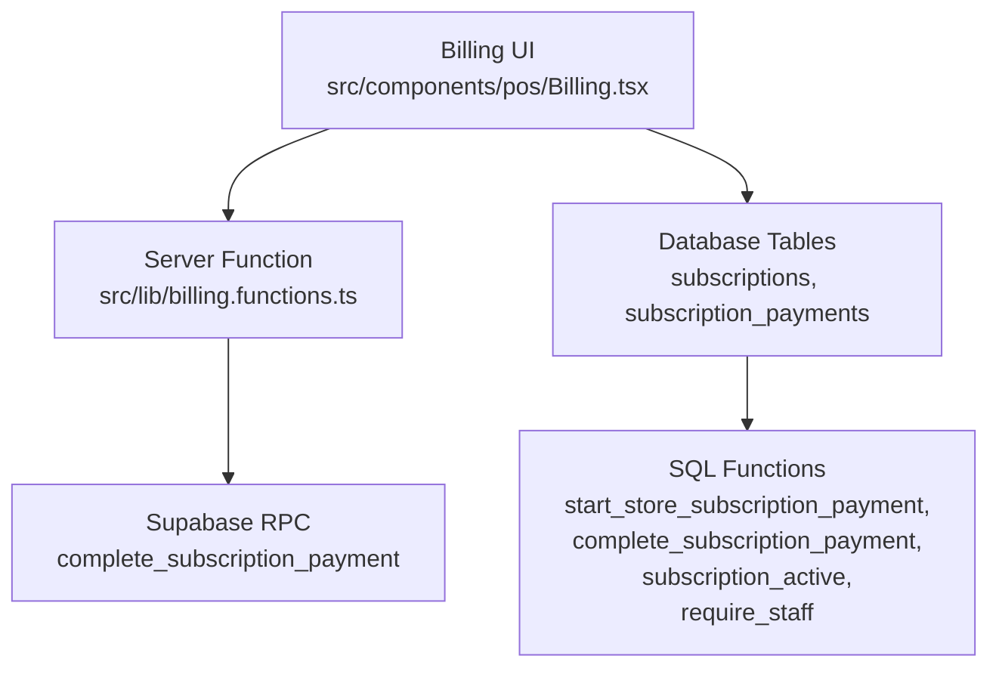
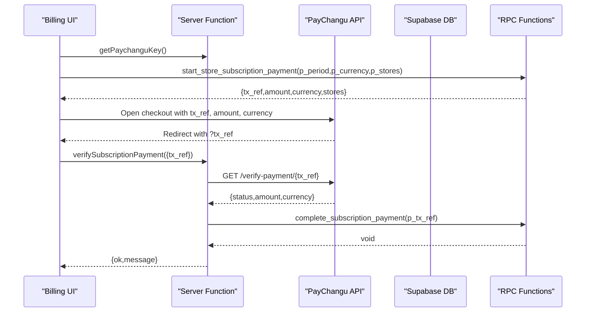
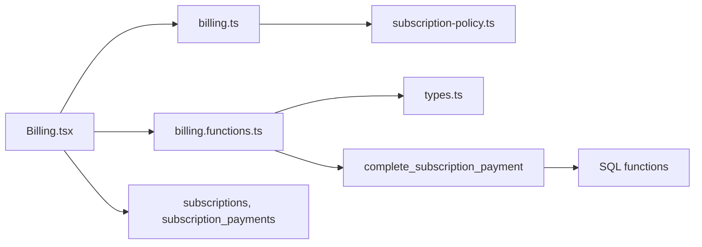

# Billing & Subscription RPC Functions

<cite>
**Referenced Files in This Document**
- [Billing.tsx](file://src/components/pos/Billing.tsx)
- [billing.functions.ts](file://src/lib/billing.functions.ts)
- [billing.ts](file://src/lib/billing.ts)
- [subscription-policy.ts](file://src/lib/subscription-policy.ts)
- [20261007100137_bfc24679-0e49-446b-b715-df35c6e8c994.sql](file://supabase/migrations/20261007100137_bfc24679-0e49-446b-b715-df35c6e8c994.sql)
- [20261007115041_3e857134-c53a-47c9-a33f-3db16cc13962.sql](file://supabase/migrations/20261007115041_3e857134-c53a-47c9-a33f-3db16cc13962.sql)
- [types.ts](file://src/integrations/supabase/types.ts)
</cite>

## Table of Contents
1. [Introduction](#introduction)
2. [Project Structure](#project-structure)
3. [Core Components](#core-components)
4. [Architecture Overview](#architecture-overview)
5. [Detailed Component Analysis](#detailed-component-analysis)
6. [Dependency Analysis](#dependency-analysis)
7. [Performance Considerations](#performance-considerations)
8. [Troubleshooting Guide](#troubleshooting-guide)
9. [Conclusion](#conclusion)

## Introduction
This document provides comprehensive API documentation for billing and subscription Supabase RPC functions used by the application. It covers:
- Subscription lifecycle management (trial, paid periods, store capacity)
- Payment processing via PayChangu
- Invoice generation and download
- Trial period handling and enforcement

The focus is on server-side RPC functions that enforce business rules, validate payments, and update subscription state. Client components orchestrate user flows but delegate sensitive operations to secure RPC endpoints.

## Project Structure
Billing-related functionality spans UI components, client utilities, server functions, and database migrations:
- UI component orchestrates plan selection, payment initiation, and invoice downloads
- Server function validates and completes payments securely
- Database schema defines subscriptions and payment records
- SQL functions implement pricing, validation, and subscription updates

**Diagram sources**
- [Billing.tsx:54-139](file://src/components/pos/Billing.tsx#L54-L139)
- [billing.functions.ts:10-53](file://src/lib/billing.functions.ts#L10-L53)
- [20261007100137_bfc24679-0e49-446b-b715-df35c6e8c994.sql:1-63](file://supabase/migrations/20261007100137_bfc24679-0e49-446b-b715-df35c6e8c994.sql#L1-L63)
- [20261007115041_3e857134-c53a-47c9-a33f-3db16cc13962.sql:36-82](file://supabase/migrations/20261007115041_3e857134-c53a-47c9-a33f-3db16cc13962.sql#L36-L82)

**Section sources**
- [Billing.tsx:54-139](file://src/components/pos/Billing.tsx#L54-L139)
- [billing.functions.ts:10-53](file://src/lib/billing.functions.ts#L10-L53)
- [20261007100137_bfc24679-0e49-446b-b715-df35c6e8c994.sql:1-63](file://supabase/migrations/20261007100137_bfc24679-0e49-446b-b715-df35c6e8c994.sql#L1-L63)
- [20261007115041_3e857134-c53a-47c9-a33f-3db16cc13962.sql:36-82](file://supabase/migrations/20261007115041_3e857134-c53a-47c9-a33f-3db16cc13962.sql#L36-L82)

## Core Components
- Billing UI component: manages plan selection, currency and period toggles, store slot configuration, payment initiation, and invoice downloads
- Server function: verifies PayChangu payment and activates subscription via RPC
- Database tables: subscriptions and subscription_payments store plan state and payment history
- SQL functions: enforce roles, validate plans/prices, compute amounts, and update subscription state

Key responsibilities:
- Pricing model: per-store monthly price with optional yearly discount
- Store capacity: enforced via paid_store_limit and trial limits
- Payment verification: amount and currency must match recorded values
- Subscription activation: extends paid_until and updates plan based on period

**Section sources**
- [Billing.tsx:54-139](file://src/components/pos/Billing.tsx#L54-L139)
- [billing.functions.ts:10-53](file://src/lib/billing.functions.ts#L10-L53)
- [20261007100137_bfc24679-0e49-446b-b715-df35c6e8c994.sql:1-63](file://supabase/migrations/20261007100137_bfc24679-0e49-446b-b715-df35c6e8c994.sql#L1-L63)
- [20261007115041_3e857134-c53a-47c9-a33f-3db16cc13962.sql:36-82](file://supabase/migrations/20261007115041_3e857134-c53a-47c9-a33f-3db16cc13962.sql#L36-L82)

## Architecture Overview
End-to-end flow from UI to database:

**Diagram sources**
- [Billing.tsx:94-139](file://src/components/pos/Billing.tsx#L94-L139)
- [billing.functions.ts:10-53](file://src/lib/billing.functions.ts#L10-L53)
- [20261007115041_3e857134-c53a-47c9-a33f-3db16cc13962.sql:36-55](file://supabase/migrations/20261007115041_3e857134-c53a-47c9-a33f-3db16cc13962.sql#L36-L55)
- [20261007115041_3e857134-c53a-47c9-a33f-3db16cc13962.sql:65-82](file://supabase/migrations/20261007115041_3e857134-c53a-47c9-a33f-3db16cc13962.sql#L65-L82)

## Detailed Component Analysis

### RPC: start_store_subscription_payment
Purpose: Create a pending subscription payment record and return transaction details for checkout.

Parameters:
- p_token: uuid — Staff authentication token
- p_period: text — Must be one of: monthly, yearly
- p_currency: text — Must be one of: MWK, USD
- p_stores: integer — Number of store slots to purchase; must cover existing stores and active paid slots; maximum 1000

Return value:
- JSON object containing:
  - tx_ref: string — Unique transaction reference prefixed with storq-
  - amount: numeric — Total amount calculated using pricing rules
  - currency: text — Selected currency
  - stores: integer — Number of store slots purchased

Business rules:
- Requires admin or manager role
- Validates period and currency
- Ensures p_stores >= current store count and >= paid_store_limit when subscription is active
- Calculates amount:
  - Monthly: base_price_per_store * p_stores
  - Yearly: base_price_per_store * p_stores * 12 * 0.85
- Inserts a pending payment record into subscription_payments

Security:
- Executable by authenticated users and service_role
- Revoked from PUBLIC and anon

**Section sources**
- [20261007115041_3e857134-c53a-47c9-a33f-3db16cc13962.sql:36-55](file://supabase/migrations/20261007115041_3e857134-c53a-47c9-a33f-3db16cc13962.sql#L36-L55)

### RPC: complete_subscription_payment
Purpose: Activate a verified payment and update subscription state.

Parameters:
- p_tx_ref: text — Transaction reference returned by start_store_subscription_payment

Return value:
- void

Business rules:
- Only executable by service_role
- Validates payment record existence and status
- Re-validates amount against expected formula for period and currency
- Updates subscription:
  - Extends paid_until based on remaining time and new duration
  - Sets paid_store_limit to target capacity
  - Records plan as selected period
- Marks payment as paid and sets paid_at timestamp

Edge cases:
- Idempotent: already paid payments are ignored
- Invalid inputs raise exceptions

**Section sources**
- [20261007115041_3e857134-c53a-47c9-a33f-3db16cc13962.sql:65-82](file://supabase/migrations/20261007115041_3e857134-c53a-47c9-a33f-3db16cc13962.sql#L65-L82)

### Server Function: verifySubscriptionPayment
Purpose: Verify a PayChangu payment and activate subscription if valid.

Input:
- tx_ref: string — Minimum length 6, maximum length 80

Output:
- ok: boolean
- message: string

Processing steps:
- Checks environment secret for PayChangu
- Retrieves payment record by tx_ref
- If already paid, returns success
- Calls PayChangu API to verify payment status, amount, and currency
- Validates amount equality and currency match
- Calls complete_subscription_payment RPC
- Returns activation result

Error handling:
- Missing configuration
- Payment not found
- Payment not confirmed
- Amount mismatch
- RPC failure during activation

**Section sources**
- [billing.functions.ts:10-53](file://src/lib/billing.functions.ts#L10-L53)

### Data Model: Subscriptions and Payments
Subscriptions table fields:
- business_id: uuid — Primary key referencing businesses
- trial_ends_at: timestamptz — Trial expiration
- paid_until: timestamptz — Paid period end
- plan: text — Current plan period (monthly/yearly)
- created_at: timestamptz — Record creation time
- paid_store_limit: integer — Active paid store capacity

Subscription payments table fields:
- tx_ref: text — Primary key transaction reference
- business_id: uuid — Business association
- period: text — Plan period
- currency: text — Currency code
- amount: numeric — Charged amount
- stores: integer — Purchased store slots
- status: text — Payment status (pending/paid)
- created_by: uuid — Staff who initiated payment
- created_at: timestamptz — Creation time
- paid_at: timestamptz — Payment completion time

Access controls:
- Row-level security policies restrict access to authenticated users within their business context
- Service role has full access for internal operations

**Section sources**
- [20261007100137_bfc24679-0e49-446b-b715-df35c6e8c994.sql:1-28](file://supabase/migrations/20261007100137_bfc24679-0e49-446b-b715-df35c6e8c994.sql#L1-L28)
- [20261007115041_3e857134-c53a-47c9-a33f-3db16cc13962.sql:1-6](file://supabase/migrations/20261007115041_3e857134-c53a-47c9-a33f-3db16cc13962.sql#L1-L6)

### Subscription Policy and Access Logic
Derived access flags:
- paid: true if paid_until is in the future
- trial: true if trial_ends_at is in the future and not paid
- capacity: paid_store_limit value
- overLimit: paid and storeCount exceeds capacity
- active: trial or (paid and not overLimit)
- canAddStore: trial or (paid and storeCount < capacity)

Usage:
- UI uses these flags to render status banners and enable/disable actions
- Backend enforces capacity via require_staff and subscription_active helpers

**Section sources**
- [subscription-policy.ts:1-22](file://src/lib/subscription-policy.ts#L1-L22)
- [billing.ts:10-39](file://src/lib/billing.ts#L10-L39)

### Billing UI Integration
Responsibilities:
- Fetches PayChangu public key
- Initiates payment via RPC and opens checkout
- Handles callback with tx_ref and triggers verification
- Displays subscription status, usage progress, and invoice history
- Generates PDF invoices for paid transactions

Key interactions:
- useSubscription hook reads subscription data and derives access flags
- Server function verifySubscriptionPayment validates and activates payments
- Invoice printing uses local PDF generation with transaction details

**Section sources**
- [Billing.tsx:54-139](file://src/components/pos/Billing.tsx#L54-L139)
- [Billing.tsx:141-169](file://src/components/pos/Billing.tsx#L141-L169)
- [Billing.tsx:635-673](file://src/components/pos/Billing.tsx#L635-L673)

## Dependency Analysis
Component relationships and dependencies:

**Diagram sources**
- [Billing.tsx:1-10](file://src/components/pos/Billing.tsx#L1-L10)
- [billing.functions.ts:1-53](file://src/lib/billing.functions.ts#L1-L53)
- [billing.ts:1-55](file://src/lib/billing.ts#L1-L55)
- [subscription-policy.ts:1-22](file://src/lib/subscription-policy.ts#L1-L22)
- [types.ts:1220-1223](file://src/integrations/supabase/types.ts#L1220-L1223)

Coupling and cohesion:
- Billing UI depends on both client library and server function for orchestration
- Server function encapsulates external API calls and RPC invocation
- SQL functions centralize business logic and security checks
- Policy module provides pure derivation without side effects

Potential circular dependencies:
- None detected between modules; dependencies are unidirectional

External integrations:
- PayChangu API for payment verification
- Environment variables for public and secret keys

**Section sources**
- [Billing.tsx:1-10](file://src/components/pos/Billing.tsx#L1-L10)
- [billing.functions.ts:1-53](file://src/lib/billing.functions.ts#L1-L53)
- [billing.ts:1-55](file://src/lib/billing.ts#L1-L55)
- [subscription-policy.ts:1-22](file://src/lib/subscription-policy.ts#L1-L22)
- [types.ts:1220-1223](file://src/integrations/supabase/types.ts#L1220-L1223)

## Performance Considerations
- Subscription queries use React Query with staleTime and refetchInterval to balance freshness and performance
- Invoice history caching reduces repeated database hits
- Server-side validation avoids unnecessary network calls to payment providers
- SQL functions perform idempotent updates to prevent redundant work

Recommendations:
- Keep query keys stable to avoid cache invalidation storms
- Use background jobs for heavy invoice generation if needed
- Monitor PayChangu API latency and implement retries with backoff

[No sources needed since this section provides general guidance]

## Troubleshooting Guide
Common issues and resolutions:
- Payments not configured: Ensure PAYCHANGU_SECRET_KEY is set in environment
- Payment not found: Verify tx_ref exists and matches a pending payment
- Payment not confirmed yet: Check PayChangu API response and retry after confirmation
- Amount mismatch: Confirm stored amount equals provider-reported amount
- Could not activate subscription: Inspect RPC error logs and validate input parameters

Debugging tips:
- Log PayChangu verification responses
- Validate subscription state before and after activation
- Review RLS policies if access errors occur

**Section sources**
- [billing.functions.ts:10-53](file://src/lib/billing.functions.ts#L10-L53)
- [20261007115041_3e857134-c53a-47c9-a33f-3db16cc13962.sql:65-82](file://supabase/migrations/20261007115041_3e857134-c53a-47c9-a33f-3db16cc13962.sql#L65-L82)

## Conclusion
The billing and subscription system combines secure RPC functions, robust validation, and clear UI flows to manage subscription lifecycles. Key strengths include strict input validation, idempotent activation, and transparent invoice generation. Proper configuration of environment variables and careful handling of payment verification ensure reliable operation.

[No sources needed since this section summarizes without analyzing specific files]