# Inventory Management RPC Functions

<cite>
**Referenced Files in This Document**
- [20261007084733_2ed95314-f75e-4843-977b-23f9e6359a48.sql](file://supabase/migrations/20261007084733_2ed95314-f75e-4843-977b-23f9e6359a48.sql)
- [20261007102244_c10153f5-18b7-409c-8196-3337d3f296c4.sql](file://supabase/migrations/20261007102244_c10153f5-18b7-409c-8196-3337d3f296c4.sql)
- [20261008090000_security_hardening.sql](file://supabase/migrations/20261008090000_security_hardening.sql)
- [20261009210500_retail_operations.sql](file://supabase/migrations/20261009210500_retail_operations.sql)
- [20261011130000_stock_absolute_set.sql](file://supabase/migrations/20261011130000_stock_absolute_set.sql)
- [products.ts](file://src/lib/products.ts)
- [transfers.ts](file://src/lib/transfers.ts)
- [offline.ts](file://src/lib/offline.ts)
- [pos.tsx](file://src/lib/pos.tsx)
- [app.inventory.tsx](file://src/routes/_authenticated/app.inventory.tsx)
</cite>

## Table of Contents
1. [Introduction](#introduction)
2. [Project Structure](#project-structure)
3. [Core Components](#core-components)
4. [Architecture Overview](#architecture-overview)
5. [Detailed Component Analysis](#detailed-component-analysis)
6. [Dependency Analysis](#dependency-analysis)
7. [Performance Considerations](#performance-considerations)
8. [Troubleshooting Guide](#troubleshooting-guide)
9. [Conclusion](#conclusion)

## Introduction
This document provides API documentation for the inventory management Supabase RPC functions used by the application. It covers:

- Stock tracking and ledgering
- Inventory adjustments with required reasons
- Absolute stock setting for audits and corrections
- Store-to-store stock transfers (dispatch, receive, cancel)
- Low-stock alerts based on reorder points
- Offline inventory operations with automatic synchronization

The RPCs are implemented as `SECURITY DEFINER` functions behind staff authentication. Client code calls them through a shared `rpc` helper that injects the authenticated staff token.

## Project Structure
Inventory-related functionality is split between server-side SQL migrations and client-side hooks:

| Area | Responsibility | Key files |
|---|---|---|
| Server RPCs | Stock movement, transfers, low-stock queries, product metadata | Retail operations and stock migrations |
| Client hooks | Stock reads, transfer mutations, low-stock queries | `products.ts`, `transfers.ts` |
| Offline layer | Local cache persistence and queued operations | `offline.ts` |
| RPC transport | Token injection and error masking | `pos.tsx` |
| UI entry point | Stock adjustment dialog and movement history | `app.inventory.tsx` |

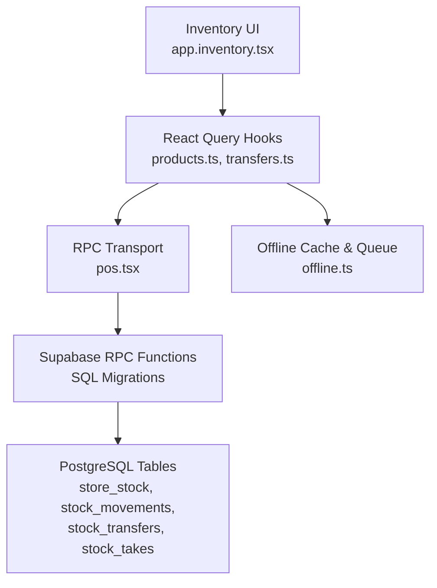

**Diagram sources**
- [app.inventory.tsx:993-1179](file://src/routes/_authenticated/app.inventory.tsx#L993-L1179)
- [products.ts:82-106](file://src/lib/products.ts#L82-L106)
- [transfers.ts:51-139](file://src/lib/transfers.ts#L51-L139)
- [offline.ts:1-92](file://src/lib/offline.ts#L1-L92)
- [pos.tsx:220-228](file://src/lib/pos.tsx#L220-L228)

**Section sources**
- [products.ts:1-107](file://src/lib/products.ts#L1-L107)
- [transfers.ts:1-140](file://src/lib/transfers.ts#L1-L140)
- [offline.ts:1-92](file://src/lib/offline.ts#L1-L92)
- [pos.tsx:220-228](file://src/lib/pos.tsx#L220-L228)
- [app.inventory.tsx:993-1179](file://src/routes/_authenticated/app.inventory.tsx#L993-L1179)

## Core Components
The inventory system exposes these primary RPC surfaces:

| RPC Name | Purpose | Required Roles | Main Parameters | Returns |
|---|---|---|---|---|
| `adjust_stock_reason` | Add or remove stock with an audit reason | Admin, Manager | Store, product, delta, reason, note | Void |
| `set_stock_qty` | Set absolute stock quantity for audit/correction | Admin, Manager | Store, product, target quantity, reason, note | New balance |
| `create_transfer` | Dispatch stock from one store to another | Admin, Manager | Source store, destination store, items array, note | Transfer ID |
| `receive_transfer` | Receive dispatched stock at the destination store | Admin, Manager | Transfer ID | Status text |
| `cancel_transfer` | Cancel an in-transit transfer and return stock to source | Admin, Manager | Transfer ID | Status text |
| `low_stock` | Read active products at or below reorder point | Admin, Manager | Store ID | JSON array of low-stock items |

All RPCs require a valid staff token. The client automatically passes `p_token` through the shared `rpc` helper.

**Section sources**
- [20261007102244_c10153f5-18b7-409c-8196-3337d3f296c4.sql:87-100](file://supabase/migrations/20261007102244_c10153f5-18b7-409c-8196-3337d3f296c4.sql#L87-L100)
- [20261011130000_stock_absolute_set.sql:32-65](file://supabase/migrations/20261011130000_stock_absolute_set.sql#L32-L65)
- [20261009210500_retail_operations.sql:408-501](file://supabase/migrations/20261009210500_retail_operations.sql#L408-L501)
- [20261009210500_retail_operations.sql:503-527](file://supabase/migrations/20261009210500_retail_operations.sql#L503-L527)

## Architecture Overview
Stock changes flow through a controlled pipeline rather than direct table writes:

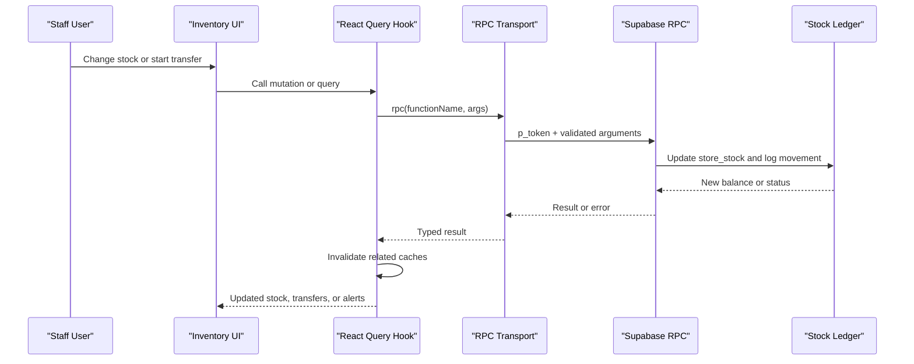

**Diagram sources**
- [app.inventory.tsx:1031-1073](file://src/routes/_authenticated/app.inventory.tsx#L1031-L1073)
- [transfers.ts:117-139](file://src/lib/transfers.ts#L117-L139)
- [pos.tsx:220-228](file://src/lib/pos.tsx#L220-L228)
- [20261007102244_c10153f5-18b7-409c-8196-3337d3f296c4.sql:29-46](file://supabase/migrations/20261007102244_c10153f5-18b7-409c-8196-3337d3f296c4.sql#L29-L46)

## Detailed Component Analysis

### Stock Adjustments: `adjust_stock_reason`
This function updates stock by a signed delta and records an audit reason. It is the preferred way to add or remove stock after the legacy reason-less `adjust_stock` was removed.

#### Parameters
| Parameter | Type | Required | Validation / Behavior |
|---|---|---:|---|
| `p_token` | UUID | Yes | Staff authentication token injected by the client |
| `p_store` | UUID | Yes | Must exist under the caller’s business |
| `p_product` | UUID | Yes | Must be an active product under the caller’s business |
| `p_delta` | Numeric | Yes | Positive adds stock; negative removes stock |
| `p_reason` | Text | Yes | Must be one of the allowed reasons |
| `p_note` | Text | No | Optional audit note |

#### Allowed Reasons
- `supplier_intake`
- `refund_restock`
- `stocktake`
- `opening_balance`
- `adjustment`
- `transfer_in`
- `transfer_out`
- `correction`
- `damage`
- `shrinkage`
- `return_to_supplier`

#### Behavior
- Validates store and product ownership.
- Rejects unknown reasons.
- Sets audit context before updating stock.
- Updates `store_stock` with conflict handling so repeated updates are safe.
- Triggers a trigger that logs a row in `stock_movements`.

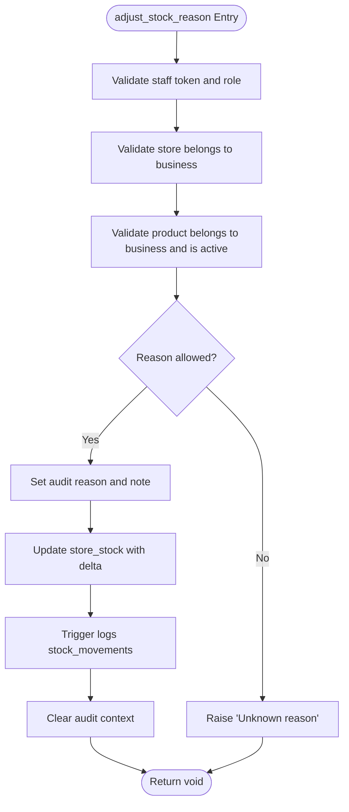

**Diagram sources**
- [20261007102244_c10153f5-18b7-409c-8196-3337d3f296c4.sql:87-100](file://supabase/migrations/20261007102244_c10153f5-18b7-409c-8196-3337d3f296c4.sql#L87-L100)
- [20261007102244_c10153f5-18b7-409c-8196-3337d3f296c4.sql:29-46](file://supabase/migrations/20261007102244_c10153f5-18b7-409c-8196-3337d3f296c4.sql#L29-L46)

**Section sources**
- [20261007102244_c10153f5-18b7-409c-8196-3337d3f296c4.sql:87-100](file://supabase/migrations/20261007102244_c10153f5-18b7-409c-8196-3337d3f296c4.sql#L87-L100)
- [20261008090000_security_hardening.sql:22-24](file://supabase/migrations/20261008090000_security_hardening.sql#L22-L24)
- [app.inventory.tsx:1058-1066](file://src/routes/_authenticated/app.inventory.tsx#L1058-L1066)

### Absolute Stock Setting: `set_stock_qty`
This function sets the exact stock quantity for a product at a store. It is designed for audits, corrections, and reconciliation where the client should not compute deltas.

#### Parameters
| Parameter | Type | Required | Validation / Behavior |
|---|---|---:|---|
| `p_token` | UUID | Yes | Staff authentication token |
| `p_store` | UUID | Yes | Must belong to the caller’s business |
| `p_product` | UUID | Yes | Must be an active product under the caller’s business |
| `p_qty` | Numeric | Yes | Target absolute quantity |
| `p_reason` | Text | Yes | Audit reason; typically `correction` |
| `p_note` | Text | No | Optional audit note |

#### Behavior
- Resolves the current balance server-side instead of trusting client-computed deltas.
- Computes the delta internally as `target - current`.
- Applies the same audit context and ledger logging as other stock changes.
- Returns the new balance.

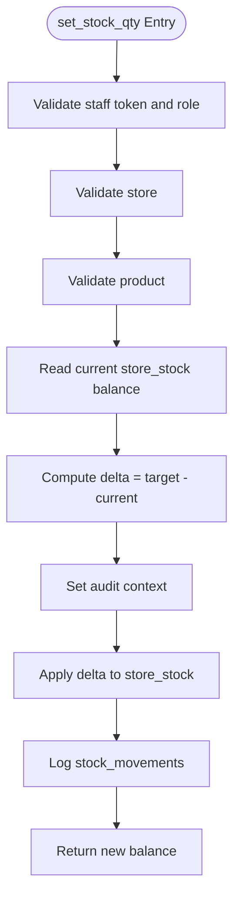

**Diagram sources**
- [20261011130000_stock_absolute_set.sql:32-65](file://supabase/migrations/20261011130000_stock_absolute_set.sql#L32-L65)

**Section sources**
- [20261011130000_stock_absolute_set.sql:32-65](file://supabase/migrations/20261011130000_stock_absolute_set.sql#L32-L65)
- [app.inventory.tsx:1047-1057](file://src/routes/_authenticated/app.inventory.tsx#L1047-L1057)

### Stock Transfers: Create, Receive, Cancel
Transfers move stock between stores while keeping a full audit trail. A transfer has three states: `in_transit`, `received`, and `cancelled`.

#### Create Transfer: `create_transfer`
Dispatches stock out of the source store.

| Parameter | Type | Required | Validation / Behavior |
|---|---|---:|---|
| `p_token` | UUID | Yes | Staff authentication token |
| `p_from` | UUID | Yes | Source store under the caller’s business |
| `p_to` | UUID | Yes | Destination store under the caller’s business |
| `p_items` | JSONB Array | Yes | Product lines with `product_id` and `qty` |
| `p_note` | Text | No | Optional transfer note |

Validation rules include:
- Source and destination must be different stores.
- At least one item line is required.
- Maximum 200 item lines per transfer.
- Each item must be an active product under the business.
- Duplicate product IDs in the items array are rejected.
- Source store must have enough stock for each requested line.

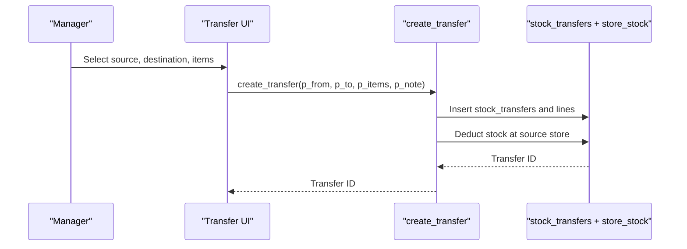

**Diagram sources**
- [20261009210500_retail_operations.sql:408-452](file://supabase/migrations/20261009210500_retail_operations.sql#L408-L452)

#### Receive Transfer: `receive_transfer`
Books stock into the destination store and marks the transfer as received.

| Parameter | Type | Required | Validation / Behavior |
|---|---|---:|---|
| `p_token` | UUID | Yes | Staff authentication token |
| `p_id` | UUID | Yes | Transfer ID |

Validation rules include:
- Transfer must exist under the caller’s business.
- Transfer must be in `in_transit` state.
- If the manager is assigned to a specific store, they must be assigned to the destination store.

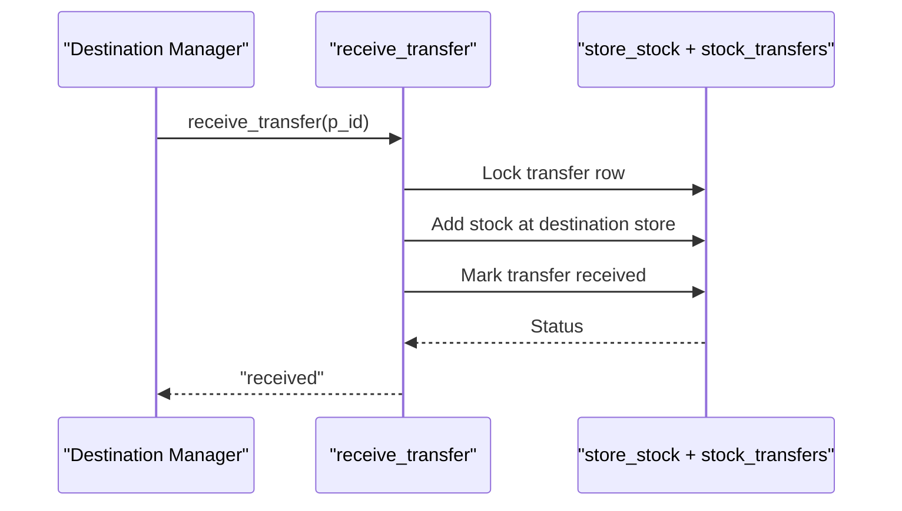

**Diagram sources**
- [20261009210500_retail_operations.sql:454-471](file://supabase/migrations/20261009210500_retail_operations.sql#L454-L471)

#### Cancel Transfer: `cancel_transfer`
Returns dispatched stock to the source store and cancels the transfer.

| Parameter | Type | Required | Validation / Behavior |
|---|---|---:|---|
| `p_token` | UUID | Yes | Staff authentication token |
| `p_id` | UUID | Yes | Transfer ID |

Validation rules include:
- Transfer must exist under the caller’s business.
- Transfer must be in `in_transit` state.
- If the manager is assigned to a specific store, they must be assigned to the source store.

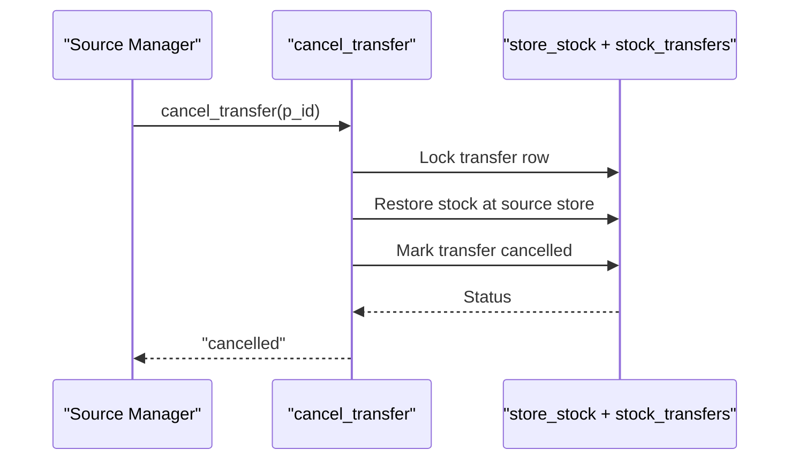

**Diagram sources**
- [20261009210500_retail_operations.sql:473-491](file://supabase/migrations/20261009210500_retail_operations.sql#L473-L491)

**Section sources**
- [20261009210500_retail_operations.sql:22-59](file://supabase/migrations/20261009210500_retail_operations.sql#L22-L59)
- [20261009210500_retail_operations.sql:408-501](file://supabase/migrations/20261009210500_retail_operations.sql#L408-L501)
- [transfers.ts:7-25](file://src/lib/transfers.ts#L7-L25)
- [transfers.ts:51-89](file://src/lib/transfers.ts#L51-L89)
- [transfers.ts:117-139](file://src/lib/transfers.ts#L117-L139)

### Low-Stock Alerts: `low_stock`
This read-only RPC returns active products whose current stock is at or below their configured reorder point for a given store. Results are ordered by worst shortfall first.

| Parameter | Type | Required | Validation / Behavior |
|---|---|---:|---|
| `p_token` | UUID | Yes | Staff authentication token |
| `p_store` | UUID | Yes | Must belong to the caller’s business |

Response fields:
| Field | Meaning |
|---|---|
| `product_id` | Product identifier |
| `name` | Product name |
| `sku` | Product SKU, nullable |
| `qty` | Current stock at the store |
| `reorder_point` | Configured reorder threshold |
| `shortfall` | Difference between reorder point and current stock |

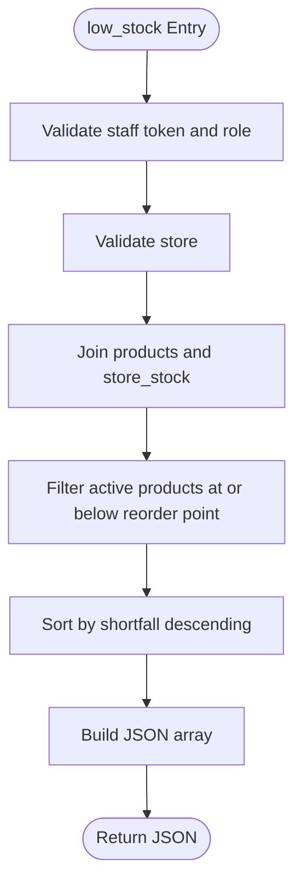

**Diagram sources**
- [20261009210500_retail_operations.sql:503-527](file://supabase/migrations/20261009210500_retail_operations.sql#L503-L527)

**Section sources**
- [20261009210500_retail_operations.sql:503-527](file://supabase/migrations/20261009210500_retail_operations.sql#L503-L527)
- [transfers.ts:92-115](file://src/lib/transfers.ts#L92-L115)

### Stock Tracking and Movement Ledger
Every change to `store_stock` is recorded in `stock_movements`. This provides an append-only audit trail for stock levels.

Key concepts:
- `delta`: Positive or negative change.
- `balance_after`: Stock level after the change.
- `reason`: Audit reason such as `adjustment`, `transfer_in`, `transfer_out`, `correction`, `stocktake`, etc.
- `note`: Optional human-readable note.
- `ref_id`: Optional reference ID, such as a transfer ID or stock take ID.
- `staff_id`: Staff member who caused the change.

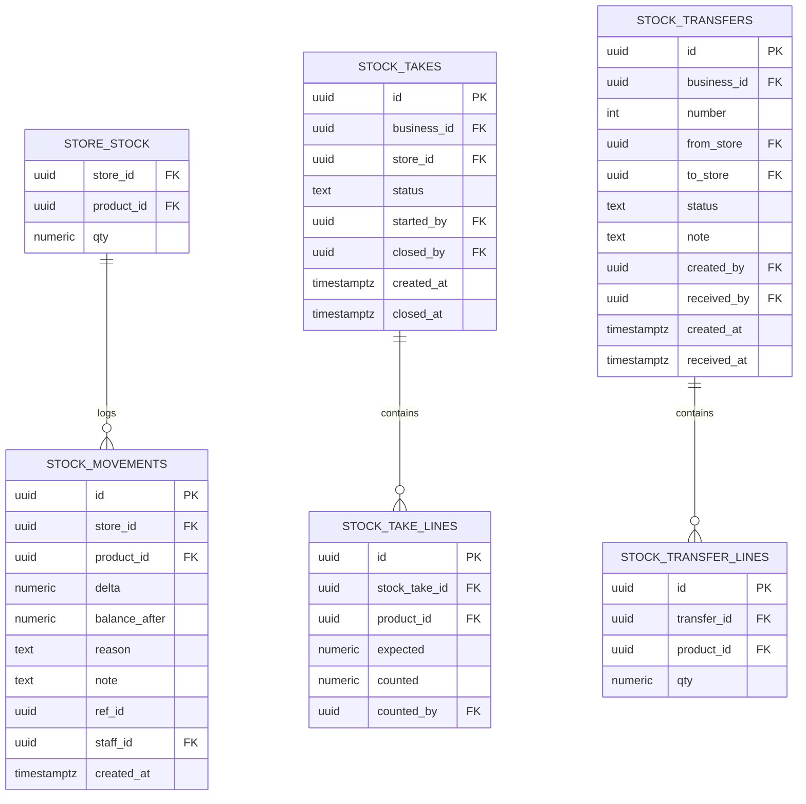

**Diagram sources**
- [20261007102244_c10153f5-18b7-409c-8196-3337d3f296c4.sql:29-46](file://supabase/migrations/20261007102244_c10153f5-18b7-409c-8196-3337d3f296c4.sql#L29-L46)
- [20261009210500_retail_operations.sql:22-59](file://supabase/migrations/20261009210500_retail_operations.sql#L22-L59)
- [20261007084733_2ed95314-f75e-4843-977b-23f9e6359a48.sql:341-375](file://supabase/migrations/20261007084733_2ed95314-f75e-4843-977b-23f9e6359a48.sql#L341-L375)

**Section sources**
- [20261007102244_c10153f5-18b7-409c-8196-3337d3f296c4.sql:29-46](file://supabase/migrations/20261007102244_c10153f5-18b7-409c-8196-3337d3f296c4.sql#L29-L46)
- [app.inventory.tsx:1005-1029](file://src/routes/_authenticated/app.inventory.tsx#L1005-L1029)

### Inventory Reconciliation and Stock Takes
Stock takes provide a structured reconciliation workflow:

1. Open a stock take for a store.
2. Populate expected quantities from current `store_stock`.
3. Count physical stock per product.
4. Close the stock take to apply counted quantities.

#### Stock Take RPCs
| RPC Name | Purpose | Parameters | Returns |
|---|---|---|---|
| `start_stock_take` | Open a reconciliation session | Store ID | Stock take ID |
| `count_stock` | Record counted quantity for a product | Stock take ID, product ID, counted quantity | Void |
| `close_stock_take` | Apply counted quantities and close the session | Stock take ID | Void |

Behavior highlights:
- Only one open stock take is allowed per store.
- Counting requires an open stock take.
- Closing applies only rows where `counted` is not null.
- Closing sets the stock take status to closed and records the closer.

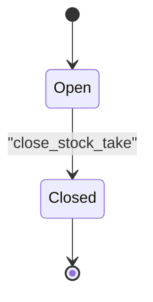

**Diagram sources**
- [20261007084733_2ed95314-f75e-4843-977b-23f9e6359a48.sql:341-375](file://supabase/migrations/20261007084733_2ed95314-f75e-4843-977b-23f9e6359a48.sql#L341-L375)

**Section sources**
- [20261007084733_2ed95314-f75e-4843-977b-23f9e6359a48.sql:341-375](file://supabase/migrations/20261007084733_2ed95314-f75e-4843-977b-23f9e6359a48.sql#L341-L375)

### Client Integration Patterns

#### Reading Stock Levels
The client reads current stock per store from `store_stock`. For live screens like the POS, it can poll periodically because stock changes also occur outside the current device.

| Use Case | Hook | Data Source | Refresh Strategy |
|---|---|---|---|
| Catalog and reorder metadata | `useProducts` | `products`, `product_costs` | Long-lived cache |
| Store stock map | `useStock` | `store_stock` | Stale-time refresh; optional live polling |
| Low-stock alerts | `useLowStock` | `low_stock` RPC | Stale-time refresh |
| Transfer list | `useTransfers` | `stock_transfers` | Stale-time refresh |

**Section sources**
- [products.ts:22-53](file://src/lib/products.ts#L22-L53)
- [products.ts:82-106](file://src/lib/products.ts#L82-L106)
- [transfers.ts:51-89](file://src/lib/transfers.ts#L51-L89)
- [transfers.ts:92-115](file://src/lib/transfers.ts#L92-L115)

#### Performing Stock Adjustments
The inventory UI supports three modes:

| Mode | RPC | Delta Behavior | Typical Reason |
|---|---|---|---|
| Add stock | `adjust_stock_reason` | Positive delta | `supplier_intake`, `refund_restock`, `opening_balance` |
| Remove stock | `adjust_stock_reason` | Negative delta | `damage`, `shrinkage`, `return_to_supplier` |
| Set count | `set_stock_qty` | Absolute target resolved server-side | `correction` |

After a successful mutation, the UI invalidates:
- `stock`
- `movements`
- `dash-alerts`
- `transfers`
- `low-stock`

**Section sources**
- [app.inventory.tsx:1031-1073](file://src/routes/_authenticated/app.inventory.tsx#L1031-L1073)
- [app.inventory.tsx:993-1179](file://src/routes/_authenticated/app.inventory.tsx#L993-L1179)

#### Executing Transfers
Transfer mutations share a single React Query mutation hook. On success, it invalidates transfer, stock, low-stock, dashboard alerts, and movement caches.

**Section sources**
- [transfers.ts:117-139](file://src/lib/transfers.ts#L117-L139)

### Offline Inventory Operations with Automatic Sync
The offline layer persists reference data and queues operations when the network is unavailable.

#### Persisted Reference Data
The following query keys are persisted locally:
- `business`
- `stores`
- `products`
- `collections`
- `stock`
- `staff-names`

Buying costs are excluded from persistence because they are role-gated.

#### Offline Sales Queue
Sales made offline are stored as queued operations with:
- A unique reference
- Timestamp
- Total amount
- Store ID
- RPC arguments
- Optional error message

When online, the app retries queued sales using the same RPC surface.

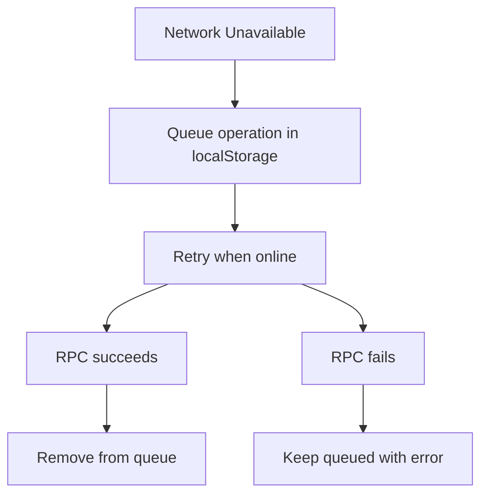

**Diagram sources**
- [offline.ts:1-92](file://src/lib/offline.ts#L1-L92)

**Section sources**
- [offline.ts:1-92](file://src/lib/offline.ts#L1-L92)
- [pos.tsx:249-253](file://src/lib/pos.tsx#L249-L253)

## Dependency Analysis
The inventory RPCs depend on several supporting mechanisms:

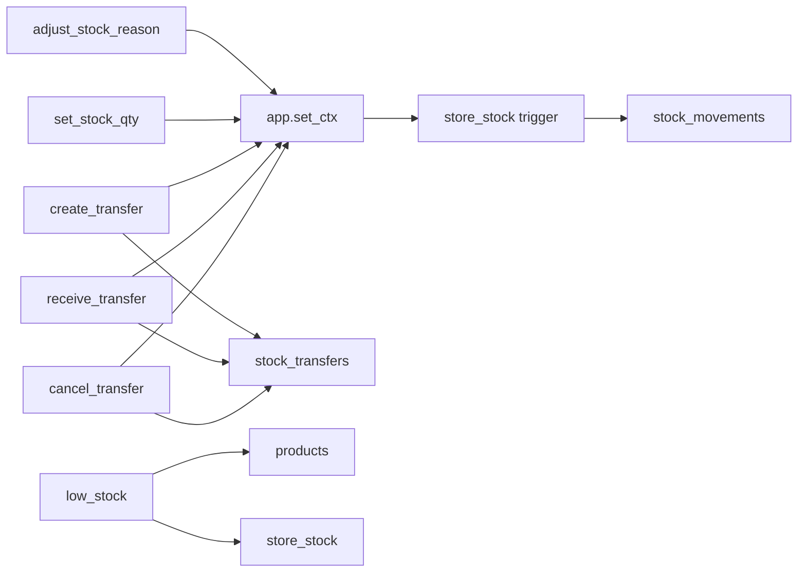

**Diagram sources**
- [20261007102244_c10153f5-18b7-409c-8196-3337d3f296c4.sql:29-46](file://supabase/migrations/20261007102244_c10153f5-18b7-409c-8196-3337d3f296c4.sql#L29-L46)
- [20261009210500_retail_operations.sql:408-527](file://supabase/migrations/20261009210500_retail_operations.sql#L408-L527)

### Coupling and Cohesion
- Stock adjustments and absolute stock setting both rely on `app.set_ctx` to record audit context.
- All stock writes go through `store_stock`, which centralizes ledger logging via a trigger.
- Transfers are decoupled from sales but still update the same `store_stock` table.
- Low-stock reads depend on product metadata and current stock levels.

### External Dependencies
- `public.require_staff` enforces authentication and role checks.
- `extensions.crypt` is used elsewhere in retail operations; inventory RPCs primarily use role-based access.
- React Query drives caching, invalidation, and background refresh.

**Section sources**
- [20261007102244_c10153f5-18b7-409c-8196-3337d3f296c4.sql:29-46](file://supabase/migrations/20261007102244_c10153f5-18b7-409c-8196-3337d3f296c4.sql#L29-L46)
- [20261009210500_retail_operations.sql:408-527](file://supabase/migrations/20261009210500_retail_operations.sql#L408-L527)
- [transfers.ts:117-139](file://src/lib/transfers.ts#L117-L139)

## Performance Considerations
- **Server-side validation**: RPCs validate inputs early, reducing round-trips and preventing inconsistent state.
- **Conflict-safe updates**: Stock updates use `ON CONFLICT ... DO UPDATE`, making repeated calls safe.
- **Append-only ledger**: `stock_movements` grows monotonously; limit history queries and avoid scanning large ranges without pagination.
- **Live stock polling**: Live mode polls every 30 seconds for the POS; disable polling on non-POS screens to reduce load.
- **Transfer limits**: Maximum 200 item lines per transfer prevents oversized payloads.
- **Query staleness**: Default stale times range from 30 seconds to 60 minutes depending on data volatility.

[No sources needed since this section provides general guidance]

## Troubleshooting Guide

### Common Errors and Causes
| Symptom | Likely Cause | Resolution |
|---|---|---|
| Unknown store | Invalid or unauthorized store ID | Verify store belongs to the current business |
| Unknown product | Invalid, inactive, or cross-business product | Check product status and business ownership |
| Unknown reason | Unsupported reason string | Use one of the documented reasons |
| Not enough stock | Insufficient source stock for sale or transfer | Reduce quantity or replenish stock |
| Only in-transit transfers can be cancelled | Transfer already received or cancelled | Use receive or do not cancel completed transfers |
| You are not assigned to the destination/source store | Role-scoped manager restriction | Perform action from the correct store context |
| RPC locked | Session lock or concurrent operation | Clear staff session if locked and retry |

### Debugging Stock Changes
1. Open the product movement history in the inventory screen.
2. Confirm the reason matches the intended operation.
3. Compare `delta` and `balance_after` to verify correctness.
4. For transfers, check `stock_transfers` and `stock_transfer_lines`.
5. For stock takes, check `stock_takes` and `stock_take_lines`.

### Offline Issues
- If sales fail offline, inspect the queued operations.
- When connectivity returns, allow the app to retry queued operations.
- Clear local cache only if reference data is corrupted; this does not clear queued sales.

**Section sources**
- [20261009210500_retail_operations.sql:415-438](file://supabase/migrations/20261009210500_retail_operations.sql#L415-L438)
- [20261009210500_retail_operations.sql:459-491](file://supabase/migrations/20261009210500_retail_operations.sql#L459-L491)
- [pos.tsx:220-228](file://src/lib/pos.tsx#L220-L228)
- [offline.ts:71-92](file://src/lib/offline.ts#L71-L92)

## Conclusion
The inventory management RPCs provide a secure, auditable, and multi-store-capable foundation for stock control. They enforce strict input validation, require explicit audit reasons, maintain an immutable movement ledger, and support both incremental adjustments and absolute reconciliation. Transfers keep stock movements traceable across stores, while low-stock alerts help prevent shortages. Offline support ensures continuity for retail operations, with automatic retry and consistent server-side resolution of stock state.

[No sources needed since this section summarizes without analyzing specific files]