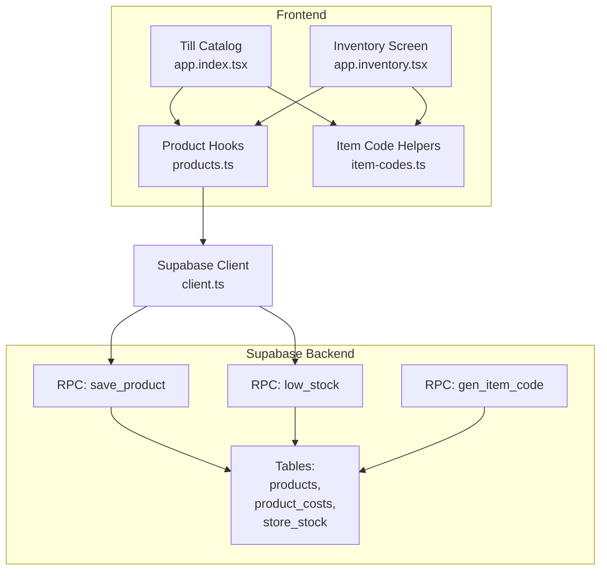
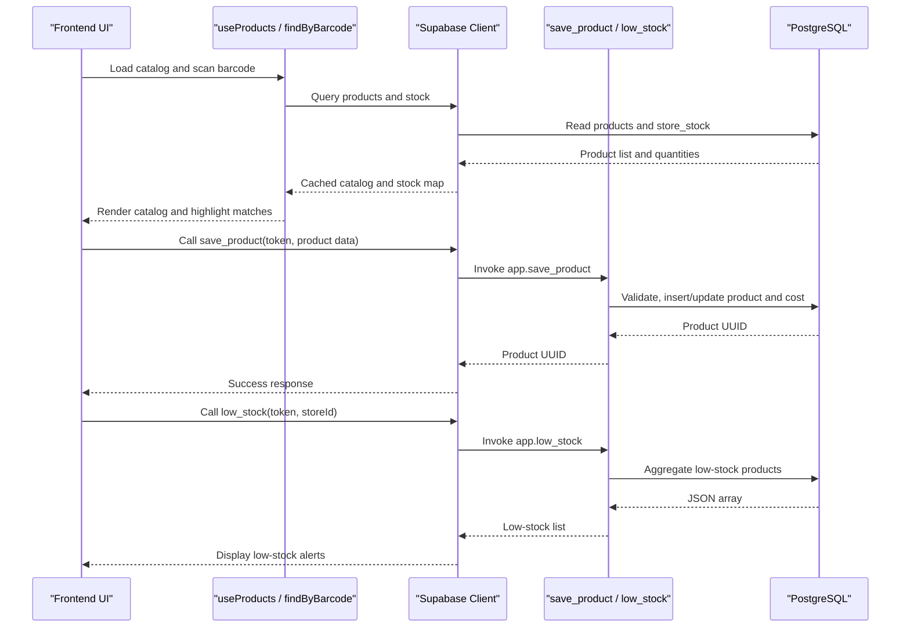
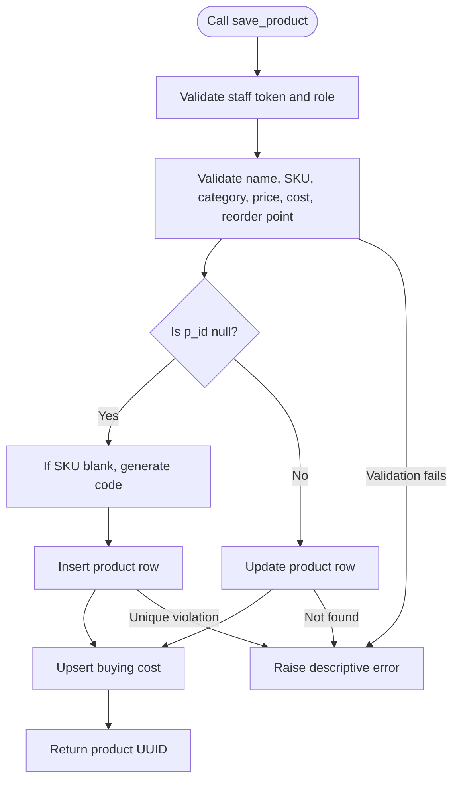
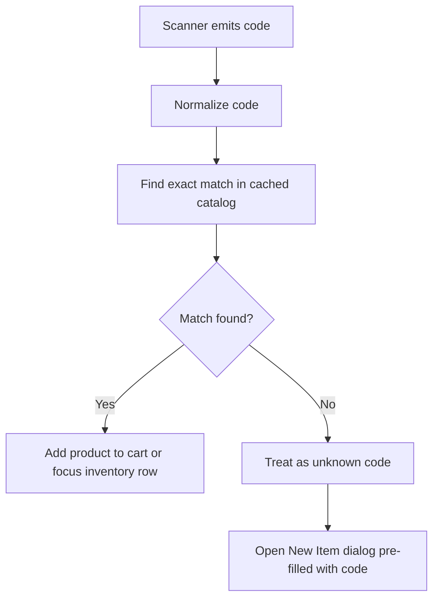
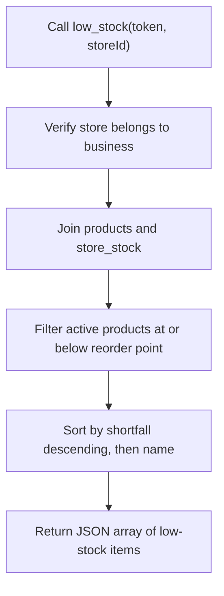
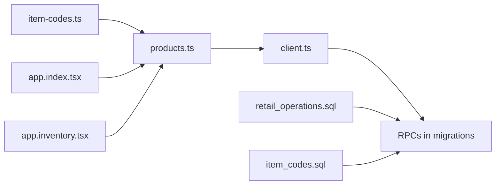

# Product Management RPC Functions

<cite>
**Referenced Files in This Document**
- [20261009210500_retail_operations.sql](file://supabase/migrations/20261009210500_retail_operations.sql)
- [20261011100000_item_codes.sql](file://supabase/migrations/20261011100000_item_codes.sql)
- [20261011110000_drop_legacy_save_product_overload.sql](file://supabase/migrations/20261011110000_drop_legacy_save_product_overload.sql)
- [products.ts](file://src/lib/products.ts)
- [item-codes.ts](file://src/lib/item-codes.ts)
- [client.ts](file://src/integrations/supabase/client.ts)
- [auth-middleware.ts](file://src/integrations/supabase/auth-middleware.ts)
- [app.index.tsx](file://src/routes/_authenticated/app.index.tsx)
- [app.inventory.tsx](file://src/routes/_authenticated/app.inventory.tsx)
</cite>

## Table of Contents
1. [Introduction](#introduction)
2. [Project Structure](#project-structure)
3. [Core Components](#core-components)
4. [Architecture Overview](#architecture-overview)
5. [Detailed Component Analysis](#detailed-component-analysis)
6. [Dependency Analysis](#dependency-analysis)
7. [Performance Considerations](#performance-considerations)
8. [Troubleshooting Guide](#troubleshooting-guide)
9. [Conclusion](#conclusion)

## Introduction
This document describes the product management API surface exposed by Supabase RPC functions for this project. It focuses on:

- Creating, updating, and querying products through `save_product`.
- Barcode scanning integration using a single item code stored in `products.sku`.
- Item code generation via `gen_item_code` and client-side helpers.
- Low-stock reporting through `low_stock`.
- Authentication and authorization requirements.
- Frontend usage patterns for catalog browsing, inventory editing, barcode scanning, and stock-aware search.

The RPCs are implemented as PostgreSQL functions under the `app` schema with public forwarders in `public`, secured by `SECURITY DEFINER` and role checks. The frontend uses the generated Supabase client to call these RPCs or query tables directly where appropriate.

## Project Structure
Product-related functionality is split between server-side SQL migrations and frontend utilities:

- Server-side RPCs and schema changes live in Supabase migrations.
- Frontend product catalog hooks, barcode matching, and stock queries live in TypeScript modules.
- Routes use those hooks to implement the till catalog, inventory management, and scanner workflows.

**Diagram sources**
- [app.index.tsx](file://src/routes/_authenticated/app.index.tsx)
- [app.inventory.tsx](file://src/routes/_authenticated/app.inventory.tsx)
- [products.ts](file://src/lib/products.ts)
- [item-codes.ts](file://src/lib/item-codes.ts)
- [client.ts](file://src/integrations/supabase/client.ts)
- [20261009210500_retail_operations.sql](file://supabase/migrations/20261009210500_retail_operations.sql)
- [20261011100000_item_codes.sql](file://supabase/migrations/20261011100000_item_codes.sql)

**Section sources**
- [products.ts](file://src/lib/products.ts)
- [item-codes.ts](file://src/lib/item-codes.ts)
- [client.ts](file://src/integrations/supabase/client.ts)
- [20261009210500_retail_operations.sql](file://supabase/migrations/20261009210500_retail_operations.sql)
- [20261011100000_item_codes.sql](file://supabase/migrations/20261011100000_item_codes.sql)

## Core Components
This section documents the product-focused RPCs and their expected behavior.

### Product Save RPC
- Function name: `save_product`
- Schema: `app.save_product` with a public forwarder `public.save_product`
- Purpose: Create or update a product and its buying cost; generate an item code when none is provided during creation.
- Authorization: Requires an authenticated staff token and admin or manager role.
- Parameters:
  - `p_token`: UUID identifying the authenticated staff session.
  - `p_id`: UUID of the product to update; pass null to create a new product.
  - `p_name`: Product name (required, trimmed, length-limited, no control characters).
  - `p_sku`: Optional item code (barcode/SKU/QR payload); validated and normalized; unique per business.
  - `p_category`: Optional category string.
  - `p_price`: Selling price (non-negative numeric within allowed range).
  - `p_cost`: Buying cost (optional non-negative numeric within allowed range).
  - `p_active`: Whether the product is active.
  - `p_reorder_point`: Optional reorder threshold for low-stock alerts.
- Return type: UUID of the created or updated product.
- Error handling: Raises explicit errors for invalid input, missing items, duplicate codes, and insufficient permissions.

Key behaviors:
- On create with a blank SKU, the backend generates a stable auto code.
- On edit, clearing the SKU keeps the existing code so labels and scans remain valid.
- Buying cost is upserted into `product_costs` per product.

**Section sources**
- [20261009210500_retail_operations.sql](file://supabase/migrations/20261009210500_retail_operations.sql)
- [20261011100000_item_codes.sql](file://supabase/migrations/20261011100000_item_codes.sql)
- [20261011110000_drop_legacy_save_product_overload.sql](file://supabase/migrations/20261011110000_drop_legacy_save_product_overload.sql)

### Low Stock RPC
- Function name: `low_stock`
- Schema: `app.low_stock` with a public forwarder `public.low_stock`
- Purpose: Return active products at or below their reorder point for a given store, sorted by worst shortfall first.
- Authorization: Requires an authenticated staff token and admin or manager role.
- Parameters:
  - `p_token`: UUID identifying the authenticated staff session.
  - `p_store`: UUID of the store whose stock levels should be evaluated.
- Return type: JSON array of objects containing product identifiers, names, SKUs, current quantity, reorder point, and shortfall.
- Error handling: Raises an error if the store is unknown or the caller lacks permission.

**Section sources**
- [20261009210500_retail_operations.sql](file://supabase/migrations/20261009210500_retail_operations.sql)

### Item Code Generator RPC
- Function name: `gen_item_code`
- Schema: `app.gen_item_code`
- Purpose: Generate a unique, human-friendly item code for a business.
- Authorization: Restricted to service role; intended for internal use by `save_product`.
- Parameters:
  - `p_business`: UUID of the business for which to generate the code.
- Return type: Text code starting with a fixed prefix followed by unambiguous characters.
- Collision strategy: Retries with different candidates until uniqueness is guaranteed.

**Section sources**
- [20261011100000_item_codes.sql](file://supabase/migrations/20261011100000_item_codes.sql)

## Architecture Overview
The product management flow combines frontend hooks, barcode normalization, and secure RPCs.

**Diagram sources**
- [products.ts](file://src/lib/products.ts)
- [item-codes.ts](file://src/lib/item-codes.ts)
- [client.ts](file://src/integrations/supabase/client.ts)
- [20261009210500_retail_operations.sql](file://supabase/migrations/20261009210500_retail_operations.sql)
- [20261011100000_item_codes.sql](file://supabase/migrations/20261011100000_item_codes.sql)

## Detailed Component Analysis

### Product Save Workflow
The product save workflow handles both creation and updates with strict validation and automatic code generation.

**Diagram sources**
- [20261009210500_retail_operations.sql](file://supabase/migrations/20261009210500_retail_operations.sql)
- [20261011100000_item_codes.sql](file://supabase/migrations/20261011100000_item_codes.sql)

**Section sources**
- [20261009210500_retail_operations.sql](file://supabase/migrations/20261009210500_retail_operations.sql)
- [20261011100000_item_codes.sql](file://supabase/migrations/20261011100000_item_codes.sql)

### Barcode Scanning Integration
The system treats one item code as the single source of truth across typed SKU, barcode scanners, and QR payloads.

- Normalization: Codes are trimmed and space-collapsed before comparison.
- Matching: Exact match against the cached product catalog after normalization.
- Generation: Auto-generated codes follow a stable format and avoid ambiguous characters.
- Uniqueness: A unique index enforces case-insensitive uniqueness per business.

**Diagram sources**
- [products.ts](file://src/lib/products.ts)
- [item-codes.ts](file://src/lib/item-codes.ts)
- [app.index.tsx](file://src/routes/_authenticated/app.index.tsx)
- [app.inventory.tsx](file://src/routes/_authenticated/app.inventory.tsx)

**Section sources**
- [products.ts](file://src/lib/products.ts)
- [item-codes.ts](file://src/lib/item-codes.ts)
- [app.index.tsx](file://src/routes/_authenticated/app.index.tsx)
- [app.inventory.tsx](file://src/routes/_authenticated/app.inventory.tsx)

### Low Stock Reporting
Low stock reporting helps managers identify products needing replenishment.

**Diagram sources**
- [20261009210500_retail_operations.sql](file://supabase/migrations/20261009210500_retail_operations.sql)

**Section sources**
- [20261009210500_retail_operations.sql](file://supabase/migrations/20261009210500_retail_operations.sql)

### Frontend Usage Patterns

#### Product Catalog Loading
- The catalog hook fetches active products from the `products` table and optionally merges buying costs from `product_costs`.
- It caches results for a long period and only refetches when explicitly invalidated.
- Costs are pulled only for screens that need them (admin/manager roles).

Typical usage:
- Import the product hook.
- Call it inside a component to get the product list.
- Use the returned data to render tiles or tables.

**Section sources**
- [products.ts](file://src/lib/products.ts)

#### Barcode Search and Cart Addition
- The till page uses a barcode matcher to find an exact product in the cached catalog.
- If a match is found, the product is added to the cart.
- If not found, the scanner can open a new-item dialog pre-filled with the scanned code.

Typical usage:
- Normalize the scanned code.
- Match against the product list.
- Handle match or unknown-code paths.

**Section sources**
- [app.index.tsx](file://src/routes/_authenticated/app.index.tsx)
- [products.ts](file://src/lib/products.ts)
- [item-codes.ts](file://src/lib/item-codes.ts)

#### Inventory Editing and Stock Awareness
- The inventory screen loads products with costs and stock quantities.
- It supports filtering, sorting, and scanner-based navigation to matching rows.
- It integrates low-stock alerts to highlight items near or below reorder points.

Typical usage:
- Load products with cost enabled.
- Load store stock for the current store.
- Use scanner wedge to jump to matching items or open new-item form.

**Section sources**
- [app.inventory.tsx](file://src/routes/_authenticated/app.inventory.tsx)
- [products.ts](file://src/lib/products.ts)

## Dependency Analysis
The product management layer depends on:

- Supabase client configuration and authentication middleware.
- PostgreSQL RPCs defined in migrations.
- Frontend hooks and routes that consume those RPCs and tables.

**Diagram sources**
- [client.ts](file://src/integrations/supabase/client.ts)
- [products.ts](file://src/lib/products.ts)
- [item-codes.ts](file://src/lib/item-codes.ts)
- [app.index.tsx](file://src/routes/_authenticated/app.index.tsx)
- [app.inventory.tsx](file://src/routes/_authenticated/app.inventory.tsx)
- [20261009210500_retail_operations.sql](file://supabase/migrations/20261009210500_retail_operations.sql)
- [20261011100000_item_codes.sql](file://supabase/migrations/20261011100000_item_codes.sql)

**Section sources**
- [client.ts](file://src/integrations/supabase/client.ts)
- [products.ts](file://src/lib/products.ts)
- [item-codes.ts](file://src/lib/item-codes.ts)
- [app.index.tsx](file://src/routes/_authenticated/app.index.tsx)
- [app.inventory.tsx](file://src/routes/_authenticated/app.inventory.tsx)
- [20261009210500_retail_operations.sql](file://supabase/migrations/20261009210500_retail_operations.sql)
- [20261011100000_item_codes.sql](file://supabase/migrations/20261011100000_item_codes.sql)

## Performance Considerations
- Catalog caching: The product hook caches the catalog for a long duration to avoid repeated network calls during scanning and search.
- Cost loading: Buying costs are fetched separately and only when needed by admin/manager screens.
- Stock polling: Stock data can be polled on the till to reflect real-time changes from other tills or imports.
- Barcode matching: Exact matching runs over the in-memory catalog, minimizing latency.
- RPC efficiency: Low-stock aggregation is performed server-side with joins and ordering.

[No sources needed since this section provides general guidance]

## Troubleshooting Guide

### Authentication and Authorization
- All product RPCs require an authenticated staff token.
- Product write operations require admin or manager roles.
- Low-stock reads require admin or manager roles.
- The Supabase client attaches API keys appropriately; ensure environment variables are configured correctly.

Common issues:
- Missing or invalid token leads to authorization errors.
- Calling write RPCs without required roles raises permission errors.
- Using the wrong client key may bypass RLS unexpectedly.

**Section sources**
- [auth-middleware.ts](file://src/integrations/supabase/auth-middleware.ts)
- [client.ts](file://src/integrations/supabase/client.ts)
- [20261009210500_retail_operations.sql](file://supabase/migrations/20261009210500_retail_operations.sql)

### Validation Errors
- Product name too long or contains unsupported characters.
- SKU exceeds length limit or contains invalid characters.
- Price or cost outside allowed ranges.
- Reorder point outside allowed range.
- Duplicate item code triggers a clear error message.

Resolution steps:
- Trim and validate inputs on the frontend before calling RPCs.
- Use the item code generator for auto codes.
- Avoid sending empty SKUs on edits if you want to preserve existing codes.

**Section sources**
- [20261009210500_retail_operations.sql](file://supabase/migrations/20261009210500_retail_operations.sql)
- [20261011100000_item_codes.sql](file://supabase/migrations/20261011100000_item_codes.sql)

### Barcode Not Resolving
- Ensure the scanned code is normalized exactly like stored codes.
- Confirm the product is active.
- Verify there are no extra spaces or case differences.

**Section sources**
- [products.ts](file://src/lib/products.ts)
- [item-codes.ts](file://src/lib/item-codes.ts)

### Low Stock Alerts Not Showing
- Confirm the store ID is correct and belongs to the business.
- Ensure the product has a reorder point set.
- Verify the user has admin or manager role.

**Section sources**
- [20261009210500_retail_operations.sql](file://supabase/migrations/20261009210500_retail_operations.sql)

## Conclusion
The product management API centers around a secure, validated `save_product` RPC that creates or updates products, enforces item code uniqueness, and optionally generates codes. Barcode scanning integrates seamlessly through normalized exact matching against a cached catalog. Low-stock reporting provides actionable insights for replenishment. Frontend components leverage these RPCs and helpers to deliver responsive catalog browsing, inventory editing, and reliable scanning workflows.

[No sources needed since this section summarizes without analyzing specific files]