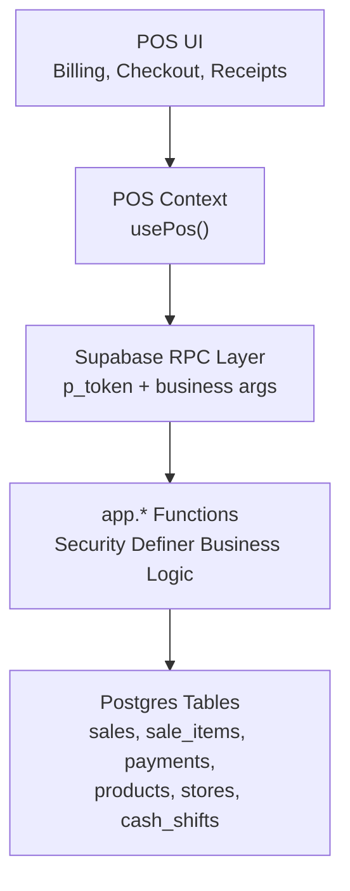
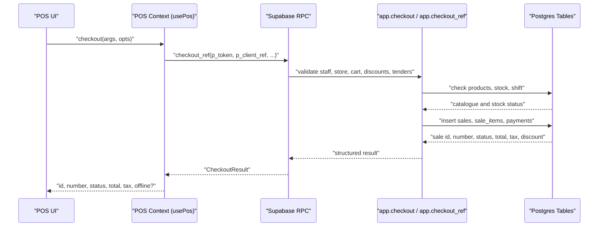
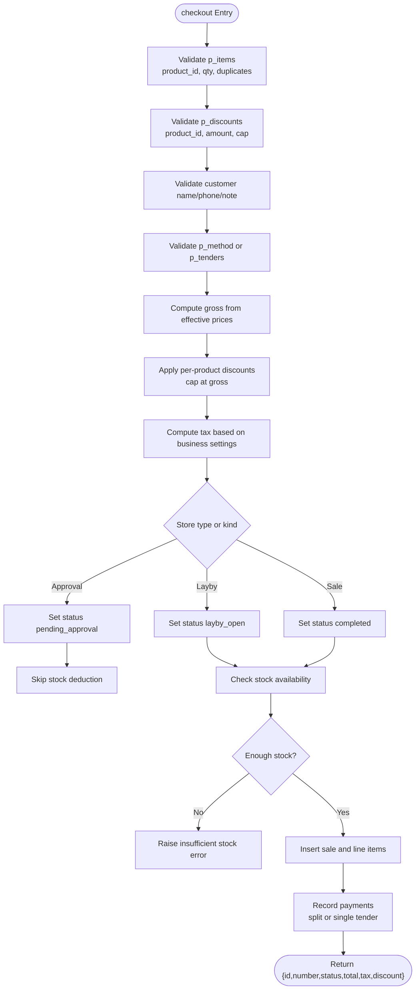
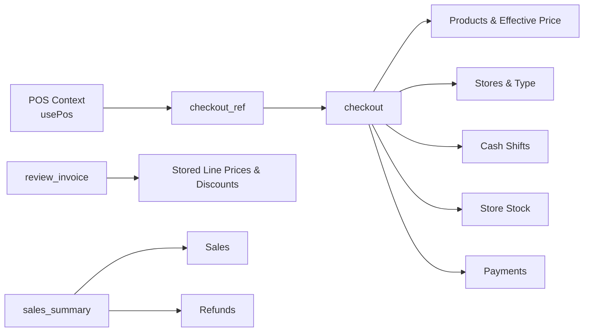

# Sales Transaction RPC Functions

<cite>
**Referenced Files in This Document**
- [pos.tsx](file://src/lib/pos.tsx)
- [sales.ts](file://src/lib/sales.ts)
- [20261009210500_retail_operations.sql](file://supabase/migrations/20261009210500_retail_operations.sql)
- [20261011090000_sales_summary.sql](file://supabase/migrations/20261011090000_sales_summary.sql)
- [20261009193153_97dc4c9b-c04f3a80-e05e-498f-ab87-694d79f3fe3f.sql](file://supabase/migrations/20261009193153_97dc4c9b-c04f3a80-e05e-498f-ab87-694d79f3fe3f.sql)
</cite>

## Table of Contents
1. [Introduction](#introduction)
2. [Project Structure](#project-structure)
3. [Core Components](#core-components)
4. [Architecture Overview](#architecture-overview)
5. [Detailed Component Analysis](#detailed-component-analysis)
6. [Dependency Analysis](#dependency-analysis)
7. [Performance Considerations](#performance-considerations)
8. [Troubleshooting Guide](#troubleshooting-guide)
9. [Conclusion](#conclusion)

## Introduction
This document provides comprehensive API documentation for the sales transaction Supabase RPC functions used by the point-of-sale system. It covers processing sales, calculating totals, applying discounts, computing tax, recording split tenders and payment methods, generating receipts through read APIs, and managing related operations such as approval workflows and offline checkout replay. The focus is on the server-side RPCs exposed to authenticated staff sessions, their parameters, validation rules, business logic, error behavior, and end-to-end usage patterns.

## Project Structure
The sales transaction surface is implemented in two layers:
- Client-side POS context that authenticates calls, masks errors, queues offline sales, and invokes RPCs.
- Server-side SQL functions that enforce security, validate inputs, compute totals, apply discounts and tax, check stock, record payments, and return structured results.

**Diagram sources**
- [pos.tsx:220-228](file://src/lib/pos.tsx#L220-L228)
- [20261009210500_retail_operations.sql:108-287](file://supabase/migrations/20261009210500_retail_operations.sql#L108-L287)

**Section sources**
- [pos.tsx:115-228](file://src/lib/pos.tsx#L115-L228)
- [20261009210500_retail_operations.sql:1-10](file://supabase/migrations/20261009210500_retail_operations.sql#L1-L10)

## Core Components
- `checkout`: Creates a sale with cart items, optional per-line discounts, split tenders, tax computation, stock checks, and payment records.
- `checkout_ref`: Idempotent wrapper around `checkout` using a client-generated reference to support retries and offline queue replay.
- `review_invoice`: Approves or rejects pending-approval invoices, re-validates stock, recomputes tender coverage, and finalizes payments.
- `sales_summary`: Aggregates revenue, collected amounts, transaction counts, pending approvals, and refunds over a time range.

These are invoked from the client via the shared `rpc()` helper, which attaches the staff token and masks internal Postgres errors.

**Section sources**
- [20261009210500_retail_operations.sql:108-320](file://supabase/migrations/20261009210500_retail_operations.sql#L108-L320)
- [20261011090000_sales_summary.sql:14-57](file://supabase/migrations/20261011090000_sales_summary.sql#L14-L57)
- [pos.tsx:220-228](file://src/lib/pos.tsx#L220-L228)

## Architecture Overview
The sales workflow uses a secure RPC boundary:
- The client sends `p_token` plus business arguments.
- The server validates staff roles, store assignment, catalogue membership, discount caps, tender coverage, and stock availability.
- On success, it persists sales, line items, costs, and payments; on failure, it raises controlled messages.

**Diagram sources**
- [pos.tsx:275-307](file://src/lib/pos.tsx#L275-L307)
- [20261009210500_retail_operations.sql:292-320](file://supabase/migrations/20261009210500_retail_operations.sql#L292-L320)
- [20261009210500_retail_operations.sql:108-287](file://supabase/migrations/20261009210500_retail_operations.sql#L108-L287)

## Detailed Component Analysis

### RPC: `checkout`
Creates a new sale with full validation and accounting.

- Purpose
  - Validate cart, discounts, customer data, payment method or split tenders.
  - Compute gross, discount, subtotal, tax, and total based on business settings.
  - Enforce cashier discount caps and manager PIN override.
  - Check stock availability unless the sale requires approval.
  - Record sale, line items, item costs, and payments.
  - Return structured result including identifiers and computed totals.

- Parameters
  - `p_token`: UUID staff session token.
  - `p_store`: UUID store identifier.
  - `p_kind`: `"sale"` or `"layby"`.
  - `p_items`: JSON array of cart lines. Each object must contain:
    - `product_id`: UUID of an active product in the business catalogue.
    - `qty`: Positive numeric quantity up to three decimal places.
  - `p_payment`: Numeric fallback when no split tenders are provided; clamped between zero and total.
  - `p_method`: Optional single payment method (`"cash"`, `"card"`, `"mobile"`).
  - `p_customer_name`: Optional text, trimmed and validated length/format.
  - `p_customer_phone`: Optional phone string matching allowed characters and length.
  - `p_note`: Optional note, trimmed and length-limited.
  - `p_tenders`: Optional JSON array of split tenders. Each object must contain:
    - `method`: One of `"cash"`, `"card"`, `"mobile"`.
    - `amount`: Positive numeric amount with up to two decimals.
  - `p_discounts`: Optional JSON array of per-product discounts. Each object must contain:
    - `product_id`: UUID of a product present in the cart.
    - `amount`: Non-negative numeric amount capped at line value.
  - `p_override_pin`: Optional manager PIN string for exceeding cashier discount limits.

- Validation Rules
  - Cart must be a non-empty array with valid product IDs and positive quantities.
  - Duplicate product lines are not allowed; merge before calling.
  - Discounts must reference products in the catalogue and cannot exceed gross.
  - Cashier discount cap: per-line discount limited to 10% of line value; overall discount limited to 10% of gross unless overridden by a valid manager PIN.
  - Store must belong to the staff’s business; cashiers can only use assigned stores.
  - Layby requires a customer name.
  - Payment method values are restricted to known enums.
  - Tender arrays are validated for structure, method enum, positive amounts, and count limits.
  - For completed sales, tenders must cover the total; cash overpayment is bounded to prevent extreme change scenarios.

- Tax and Totals
  - Gross is sum of effective price times quantity across all items.
  - Discount is summed from per-product discount entries and capped at gross.
  - Subtotal is gross minus discount, floored at zero.
  - If business has tax enabled:
    - Inclusive tax: total equals subtotal; tax is back-calculated from subtotal.
    - Exclusive tax: tax is subtotal multiplied by tax rate; total is subtotal plus tax.
  - Otherwise, tax is zero and total equals subtotal.

- Stock Checks
  - For immediate sales, stock is checked against store inventory; insufficient stock raises a controlled error listing affected products.
  - For pending-approval sales, stock is not deducted until approval.

- Payments and Ledger
  - If split tenders are provided, multiple payment rows are recorded per tender method.
  - If no split tenders, a single payment row is inserted using the derived method and amount.
  - For completed sales, cash overpayment is handled by adjusting the cash tender to avoid double-counting change.
  - Layby sales transition to completed when paid amount reaches total.

- Output
  - Returns JSON with fields:
    - `id`: Sale UUID.
    - `number`: Sequential sale number.
    - `status`: `"completed"`, `"pending_approval"`, or `"layby_open"` (or `"layby_completed"` if fully paid).
    - `total`: Final invoice total.
    - `tax`: Computed tax amount.
    - `discount`: Total discount applied.

- Error Handling
  - Controlled messages for invalid cart, unknown store, unknown sale type, missing layby customer, unsupported characters, unknown payment method, invalid payment amount, catalogue mismatch, duplicate cart lines, bad discount entries, discounts exceeding gross, cashier discount requiring manager PIN, wrong manager PIN, unknown items, insufficient stock, tender validation failures, and tender coverage violations.

**Diagram sources**
- [20261009210500_retail_operations.sql:108-287](file://supabase/migrations/20261009210500_retail_operations.sql#L108-L287)

**Section sources**
- [20261009210500_retail_operations.sql:108-287](file://supabase/migrations/20261009210500_retail_operations.sql#L108-L287)

### RPC: `checkout_ref`
Idempotent checkout wrapper for retries and offline queue replay.

- Purpose
  - Prevent duplicate sales for the same client reference.
  - Lock processing per client reference to avoid race conditions.
  - Reuse existing sale if already recorded under the same reference.
  - Delegate to `app.checkout` and attach the client reference to the persisted sale.

- Parameters
  - `p_token`: UUID staff session token.
  - `p_client_ref`: UUID generated by the client to identify this sale attempt.
  - All other parameters are identical to `checkout`.

- Behavior
  - If a sale with the same `client_ref` exists for the same business, returns the existing sale with a `duplicate` flag set to true.
  - Otherwise, calls `app.checkout` and updates the sale’s `client_ref`.

- Output
  - Same structured result as `checkout`, plus `duplicate: true` when returning an existing sale.

**Section sources**
- [20261009193153_97dc4c9b-c04f3a80-e05e-498f-ab87-694d79f3fe3f.sql:4-22](file://supabase/migrations/20261009193153_97dc4c9b-c04f3a80-e05e-498f-ab87-694d79f3fe3f.sql#L4-L22)
- [20261009210500_retail_operations.sql:292-320](file://supabase/migrations/20261009210500_retail_operations.sql#L292-L320)

### RPC: `review_invoice`
Approves or rejects pending-approval invoices and finalizes payments.

- Purpose
  - Allow managers/admins to approve or reject invoices created in approval mode.
  - Re-validate stock at approval time.
  - Recompute invoice totals from stored line prices and discounts.
  - Accept split tenders or a single payment method.
  - Update sale status, payment method, paid amount, and record payments.

- Parameters
  - `p_token`: UUID staff session token.
  - `p_sale`: UUID of the pending-approval sale.
  - `p_approve`: Boolean indicating approval decision.
  - `p_payment`: Numeric fallback when no split tenders are provided.
  - `p_method`: Optional single payment method enum.
  - `p_tenders`: Optional JSON array of split tenders with `method` and `amount`.

- Validation Rules
  - Only pending-approval invoices can be reviewed.
  - The reviewer cannot approve their own invoice unless they are admin.
  - Stock must be sufficient at approval time.
  - Invoice totals are recomputed from stored line prices and discounts.
  - Tender coverage must meet invoice total; cash overpayment is bounded similarly to checkout.
  - Payment method values are restricted to known enums.

- Output
  - Returns the resulting status text: `"approved"` (or `"layby_completed"` for fully paid layby), or `"rejected"`.

**Section sources**
- [20261009210500_retail_operations.sql:325-406](file://supabase/migrations/20261009210500_retail_operations.sql#L325-L406)

### RPC: `sales_summary`
Aggregates sales KPIs over a time range.

- Purpose
  - Provide exact headline numbers without loading large datasets into the browser.
  - Compute net revenue, collected amounts, transaction counts, pending approvals, and refund totals.

- Parameters
  - `p_token`: UUID staff session token.
  - `p_store`: Optional store filter.
  - `p_from`: Start timestamp (inclusive).
  - `p_to`: End timestamp (exclusive).

- Output
  - JSON object with:
    - `revenue`: Sum of `total - refunded` for completed, layby-completed, partially-refunded, and refunded sales.
    - `collected`: Sum of `paid` excluding pending-approval and rejected sales.
    - `transactions`: Count of completed, layby-completed, partially-refunded, and refunded sales.
    - `pending`: Count of pending-approval sales.
    - `refunds`: Sum of refund amounts within the period and store scope.

**Section sources**
- [20261011090000_sales_summary.sql:14-57](file://supabase/migrations/20261011090000_sales_summary.sql#L14-L57)

## Dependency Analysis
Client-side dependencies:
- `usePos` exposes `rpc`, `checkout`, currency formatting, and offline queue management.
- `checkout` wraps `checkout_ref` and falls back to local queue when offline or network errors occur.
- Sales list and summary hooks call `sales_summary` RPC for accurate KPIs.

Server-side dependencies:
- `app.checkout` depends on product catalogue, store configuration, business tax settings, cash shifts, and stock ledger.
- `app.checkout_ref` depends on unique index on `sales.client_ref`.
- `app.review_invoice` depends on stored line prices and discounts to recompute authoritative totals.
- `app.sales_summary` depends on sales and refunds tables filtered by business and store.

**Diagram sources**
- [pos.tsx:275-307](file://src/lib/pos.tsx#L275-L307)
- [20261009210500_retail_operations.sql:108-287](file://supabase/migrations/20261009210500_retail_operations.sql#L108-L287)
- [20261011090000_sales_summary.sql:14-57](file://supabase/migrations/20261011090000_sales_summary.sql#L14-L57)

**Section sources**
- [pos.tsx:275-307](file://src/lib/pos.tsx#L275-L307)
- [20261009210500_retail_operations.sql:108-287](file://supabase/migrations/20261009210500_retail_operations.sql#L108-L287)
- [20261011090000_sales_summary.sql:14-57](file://supabase/migrations/20261011090000_sales_summary.sql#L14-L57)

## Performance Considerations
- Use `sales_summary` for KPI cards instead of aggregating in the browser; it performs a single aggregate pass over the date range.
- Avoid fetching nested sale items for list-only views; the client already distinguishes list vs detail queries.
- Split tenders are limited to ten entries; keep splits minimal to reduce overhead.
- Offline queue sync runs periodically; batch retries are handled safely by advisory locks on client references.

[No sources needed since this section provides general guidance]

## Troubleshooting Guide
Common errors and handling strategies:
- Insufficient stock: The server lists affected products in the error message. Resolve by restocking or switching to approval mode where appropriate.
- Unknown store or catalogue mismatch: Ensure the selected store belongs to the staff’s business and all cart items are active products.
- Discount policy violations: Cashiers cannot exceed 10% discount thresholds without a valid manager PIN.
- Tender coverage issues: Ensure split tenders cover the invoice total; cash overpayment is bounded to prevent extreme change scenarios.
- Network or locking errors: The POS context masks raw Postgres internals and surfaces user-friendly messages; locked sessions clear locally and require re-unlock.

Error masking and offline queue behavior:
- Raw Postgres errors are replaced with generic or localized messages.
- Network errors trigger offline queuing; queued sales retry automatically when online.

**Section sources**
- [pos.tsx:93-104](file://src/lib/pos.tsx#L93-L104)
- [pos.tsx:220-228](file://src/lib/pos.tsx#L220-L228)
- [pos.tsx:309-345](file://src/lib/pos.tsx#L309-L345)
- [20261009210500_retail_operations.sql:194-203](file://supabase/migrations/20261009210500_retail_operations.sql#L194-L203)

## Conclusion
The sales transaction RPCs provide a secure, validated, and auditable path from cart to posted sale. They enforce role-based access, store scoping, catalogue integrity, discount policies, tax rules, stock availability, and payment correctness. Clients should use `checkout_ref` for idempotency, rely on `sales_summary` for accurate KPIs, and handle controlled error messages gracefully while leveraging offline queueing for resilience.

[No sources needed since this section summarizes without analyzing specific files]