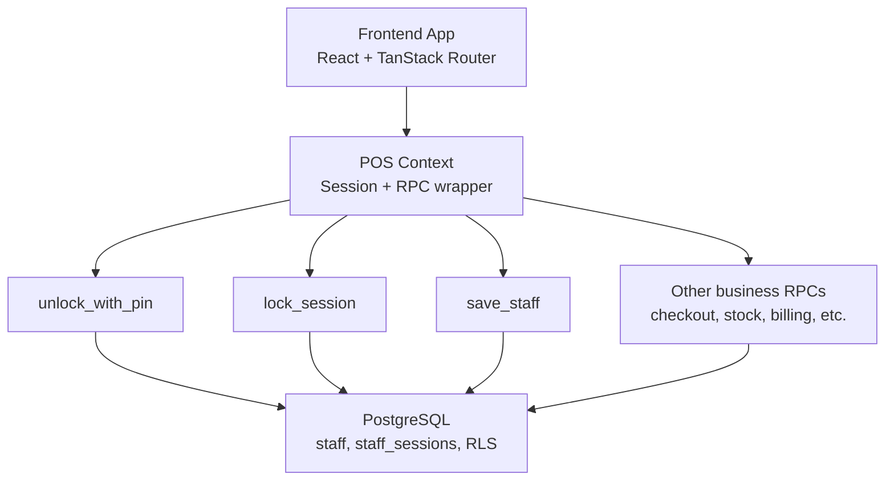
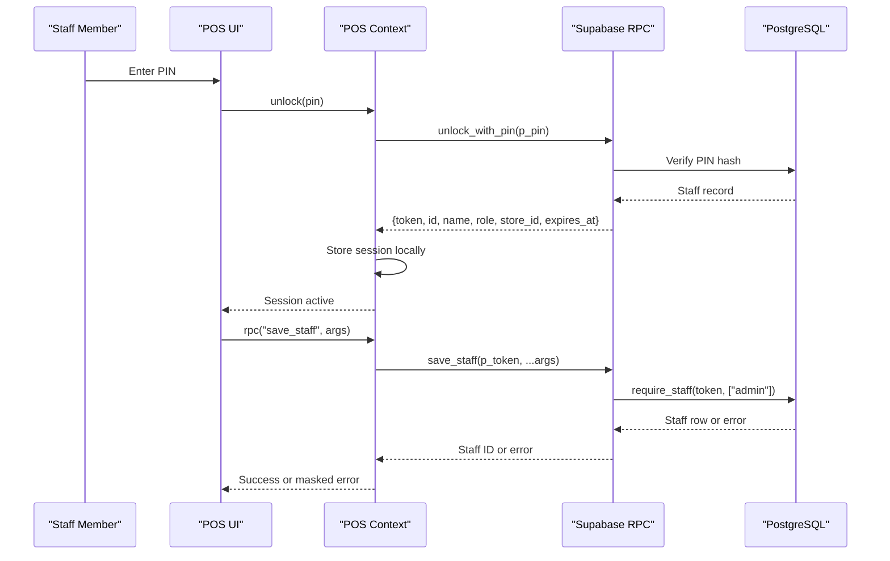
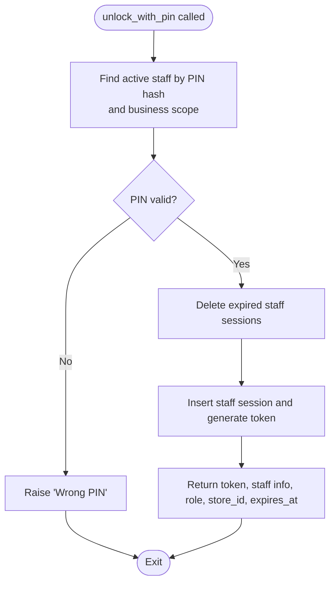
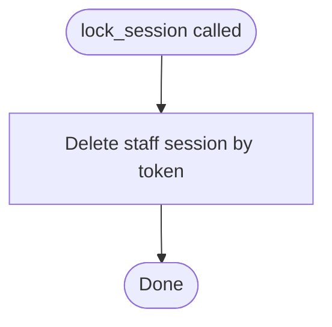
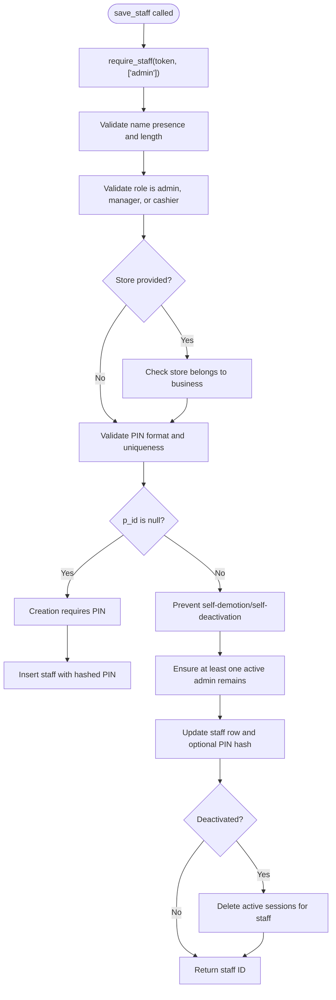
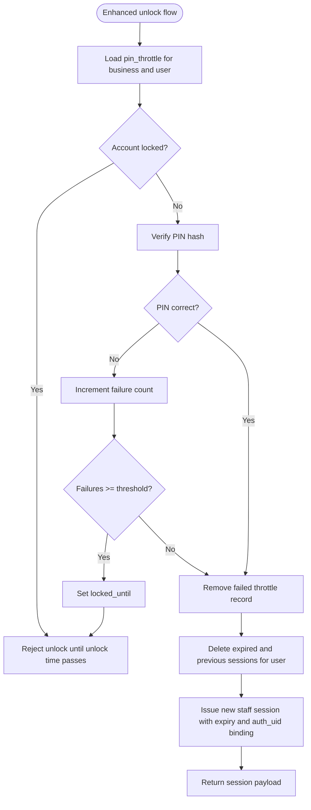
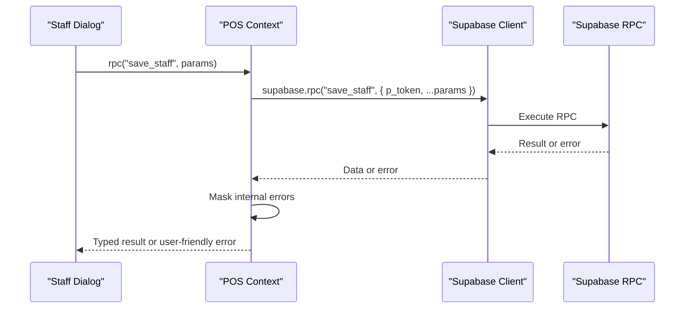
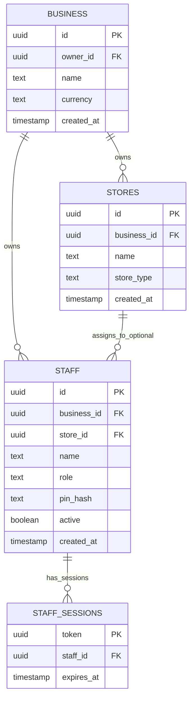
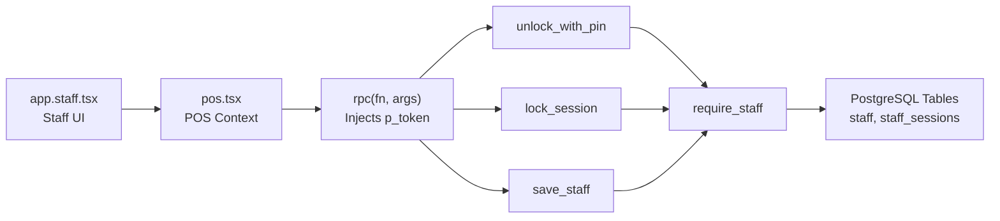

# Staff Management RPC Functions

<cite>
**Referenced Files in This Document**
- [pos.tsx](file://src/lib/pos.tsx)
- [app.staff.tsx](file://src/routes/_authenticated/app.staff.tsx)
- [20261007084733_2ed95314-f75e-4843-977b-23f9e6359a48.sql](file://supabase/migrations/20261007084733_2ed95314-f75e-4843-977b-23f9e6359a48.sql)
- [20261008090000_security_hardening.sql](file://supabase/migrations/20261008090000_security_hardening.sql)
</cite>

## Table of Contents
1. [Introduction](#introduction)
2. [Project Structure](#project-structure)
3. [Core Components](#core-components)
4. [Architecture Overview](#architecture-overview)
5. [Detailed Component Analysis](#detailed-component-analysis)
6. [Dependency Analysis](#dependency-analysis)
7. [Performance Considerations](#performance-considerations)
8. [Troubleshooting Guide](#troubleshooting-guide)
9. [Conclusion](#conclusion)

## Introduction
This document describes the staff management API surface exposed through Supabase RPC functions and the frontend integration used by the point-of-sale application. It covers:

- Staff account creation and editing.
- PIN validation, throttling, and session issuance.
- Role-based access control for admin, manager, and cashier roles.
- Store assignment and store-scoped operations.
- Authentication flows using a device-bound staff session token.
- Permission checking patterns and session lifecycle management.

The backend logic is implemented as PostgreSQL functions under the `public` schema. The frontend calls these functions through a shared `rpc` helper that automatically attaches the current staff session token.

## Project Structure
The relevant code is split across three layers:

| Layer | Responsibility | Key Files |
|---|---|---|
| Frontend POS context | Manages staff sessions, auto-locking, role checks, and RPC invocation | [pos.tsx](file://src/lib/pos.tsx) |
| Staff UI | Renders the staff roster, edit dialog, role selection, store selection, and PIN input | [app.staff.tsx](file://src/routes/_authenticated/app.staff.tsx) |
| Backend SQL | Defines tables, RLS policies, staff session handling, and RPC functions | [20261007084733_2ed95314-f75e-4843-977b-23f9e6359a48.sql](file://supabase/migrations/20261007084733_2ed95314-f75e-4843-977b-23f9e6359a48.sql), [20261008090000_security_hardening.sql](file://supabase/migrations/20261008090000_security_hardening.sql) |

**Diagram sources**
- [pos.tsx:194-228](file://src/lib/pos.tsx#L194-L228)
- [20261007084733_2ed95314-f75e-4843-977b-23f9e6359a48.sql:165-203](file://supabase/migrations/20261007084733_2ed95314-f75e-4843-977b-23f9e6359a48.sql#L165-L203)

**Section sources**
- [pos.tsx:115-228](file://src/lib/pos.tsx#L115-L228)
- [app.staff.tsx:54-187](file://src/routes/_authenticated/app.staff.tsx#L54-L187)
- [20261007084733_2ed95314-f75e-4843-977b-23f9e6359a48.sql:17-31](file://supabase/migrations/20261007084733_2ed95314-f75e-4843-977b-23f9e6359a48.sql#L17-L31)

## Core Components
The staff management system has five core components:

| Component | Purpose | Primary Parameters | Output / Side Effects |
|---|---|---|---|
| `unlock_with_pin` | Validates a staff PIN and issues a short-lived session token | `p_pin` | JSON with session token, staff ID, name, role, store ID, and expiry |
| `lock_session` | Invalidates a specific staff session token | `p_token` | None; deletes the matching session row |
| `require_staff` | Internal authorization helper used by other RPCs | `p_token`, allowed roles array | Staff row or raises an error if locked or unauthorized |
| `pin_taken` | Checks whether a PIN is already used by another active staff member | `p_business`, `p_pin`, optional `p_except` | Boolean |
| `save_staff` | Creates or updates a staff account with role, PIN, store assignment, and active status | `p_token`, `p_id`, `p_name`, `p_role`, `p_pin`, `p_store`, `p_active` | New or updated staff ID |

These functions are invoked from the frontend through the `PosProvider.rpc` helper, which injects `p_token` automatically when a staff session exists.

**Section sources**
- [pos.tsx:37-45](file://src/lib/pos.tsx#L37-L45)
- [pos.tsx:194-228](file://src/lib/pos.tsx#L194-L228)
- [20261007084733_2ed95314-f75e-4843-977b-23f9e6359a48.sql:134-203](file://supabase/migrations/20261007084733_2ed95314-f75e-4843-977b-23f9e6359a48.sql#L134-L203)

## Architecture Overview
The staff authentication and permission model follows this flow:

1. A signed-in user unlocks a staff account by entering a PIN.
2. `unlock_with_pin` verifies the PIN against the hashed value stored in the database.
3. On success, a new staff session token is created and returned to the client.
4. The client stores the session locally and attaches it to every RPC call via `p_token`.
5. Business RPCs use `require_staff` to validate the token, expiry, active status, business ownership, and required roles.
6. Cashier store scoping is enforced at the RPC layer: a cashier can only operate on their assigned store.

**Diagram sources**
- [pos.tsx:194-228](file://src/lib/pos.tsx#L194-L228)
- [20261007084733_2ed95314-f75e-4843-977b-23f9e6359a48.sql:134-203](file://supabase/migrations/20261007084733_2ed95314-f75e-4843-977b-23f9e6359a48.sql#L134-L203)

## Detailed Component Analysis

### Staff Session Lifecycle

#### `unlock_with_pin`
- **Purpose**: Authenticate a staff member by PIN and issue a session token.
- **Parameters**:
  - `p_pin`: Text string containing the PIN entered by the user.
- **Behavior**:
  - Looks up an active staff member belonging to the current business whose PIN hash matches the supplied PIN.
  - Removes expired staff sessions.
  - Inserts a new staff session row with a generated UUID token.
  - Returns a JSON object containing the session token, staff ID, name, role, store ID, and expiry time.
- **Errors**:
  - Raises an error when no matching active staff PIN is found.
- **Security Notes**:
  - PINs are compared against hashed values.
  - The function is defined as `SECURITY DEFINER`, so it runs with elevated privileges but still enforces business scoping through `my_business_id`.

**Diagram sources**
- [20261007084733_2ed95314-f75e-4843-977b-23f9e6359a48.sql:165-175](file://supabase/migrations/20261007084733_2ed95314-f75e-4843-977b-23f9e6359a48.sql#L165-L175)

**Section sources**
- [20261007084733_2ed95314-f75e-4843-977b-23f9e6359a48.sql:165-175](file://supabase/migrations/20261007084733_2ed95314-f75e-4843-977b-23f9e6359a48.sql#L165-L175)

#### `lock_session`
- **Purpose**: Explicitly invalidate a staff session token.
- **Parameters**:
  - `p_token`: UUID of the staff session to lock.
- **Behavior**:
  - Deletes the session row matching the provided token.
- **Frontend Behavior**:
  - The frontend calls this before clearing local state, but does not fail the UI if the server call fails.
  - Local cleanup still occurs even if the server call fails.

**Diagram sources**
- [20261007084733_2ed95314-f75e-4843-977b-23f9e6359a48.sql:177-180](file://supabase/migrations/20261007084733_2ed95314-f75e-4843-977b-23f9e6359a48.sql#L177-L180)

**Section sources**
- [20261007084733_2ed95314-f75e-4843-977b-23f9e6359a48.sql:177-180](file://supabase/migrations/20261007084733_2ed95314-f75e-4843-977b-23f9e6359a48.sql#L177-L180)
- [pos.tsx:205-215](file://src/lib/pos.tsx#L205-L215)

### Staff Account Management

#### `save_staff`
- **Purpose**: Create or update a staff account.
- **Authorization**:
  - Requires an active admin session through `require_staff`.
- **Parameters**:
  - `p_token`: Required. Staff session token injected by the frontend.
  - `p_id`: Optional. Existing staff ID for updates; null for creation.
  - `p_name`: Required text. Sanitized and validated for length.
  - `p_role`: Required. Must be one of `admin`, `manager`, or `cashier`.
  - `p_pin`: Optional during updates; required during creation.
  - `p_store`: Optional store ID. Null means all stores.
  - `p_active`: Boolean controlling whether the staff account is active.
- **Validation Rules**:
  - Name must be present and within the configured maximum length.
  - Role must be a supported enum-like value.
  - If a PIN is supplied, it must match the expected digit pattern.
  - PIN uniqueness is enforced across active staff members in the same business.
  - Creation requires a PIN.
  - An admin cannot demote themselves or deactivate themselves.
  - At least one active admin must remain after changes.
  - Store assignment must belong to the calling admin’s business.
- **Side Effects**:
  - Creates or updates the staff row.
  - Hashes and stores the PIN.
  - Deactivating a staff member removes their active sessions.

**Diagram sources**
- [20261007084733_2ed95314-f75e-4843-977b-23f9e6359a48.sql:182-203](file://supabase/migrations/20261007084733_2ed95314-f75e-4843-977b-23f9e6359a48.sql#L182-L203)

**Section sources**
- [20261007084733_2ed95314-f75e-4843-977b-23f9e6359a48.sql:182-203](file://supabase/migrations/20261007084733_2ed95314-f75e-4843-977b-23f9e6359a48.sql#L182-L203)
- [app.staff.tsx:149-187](file://src/routes/_authenticated/app.staff.tsx#L149-L187)

### Enhanced Security and Throttling

The security hardening migration introduces stricter session binding, improved PIN policy, and plan-based limits.

Key behaviors include:

| Area | Behavior |
|---|---|
| Session binding | Sessions are bound to the authenticated user who unlocked them, preventing token reuse across different logged-in users. |
| Expiry | Sessions have an explicit expiry time and are cleaned up before issuing a new one. |
| PIN throttling | Repeated wrong PIN attempts increase failure counts and can lock the account temporarily. |
| PIN policy | PINs are validated as numeric strings with a configurable length range. |
| Plan limits | Free plans restrict the number of staff PINs and store capacity. |
| Admin safety | Active admins cannot be removed without keeping at least one active admin. |

**Diagram sources**
- [20261008090000_security_hardening.sql:239-256](file://supabase/migrations/20261008090000_security_hardening.sql#L239-L256)
- [20261008090000_security_hardening.sql:259-266](file://supabase/migrations/20261008090000_security_hardening.sql#L259-L266)

**Section sources**
- [20261008090000_security_hardening.sql:239-266](file://supabase/migrations/20261008090000_security_hardening.sql#L239-L266)
- [20261008090000_security_hardening.sql:329-366](file://supabase/migrations/20261008090000_security_hardening.sql#L329-L366)

### Frontend Integration

#### POS Context RPC Wrapper
The `PosProvider` exposes:

- `unlock(pin)`: Calls `unlock_with_pin`, validates the PIN locally, stores the session, and refreshes queries.
- `lock()`: Calls `lock_session`, then clears local staff state and invalidates cached data.
- `rpc(fn, args)`: Wraps all RPC calls by injecting `p_token` from the current staff session.
- `can(...roles)`: Checks whether the current staff role is included in the allowed roles.

**Diagram sources**
- [pos.tsx:220-228](file://src/lib/pos.tsx#L220-L228)
- [app.staff.tsx:173-187](file://src/routes/_authenticated/app.staff.tsx#L173-L187)

**Section sources**
- [pos.tsx:194-228](file://src/lib/pos.tsx#L194-L228)
- [app.staff.tsx:149-187](file://src/routes/_authenticated/app.staff.tsx#L149-L187)

### Roles, Permissions, and Access Control

| Role | Allowed Operations | Notes |
|---|---|---|
| `admin` | Manage staff, manage stores, manage products, adjust stock, review invoices, start/close stock takes, and most administrative actions. | Only admins can create or edit staff accounts. |
| `manager` | Product and inventory operations, invoice approval, stock take control, layby cancellation. | Cannot manage staff accounts unless promoted to admin. |
| `cashier` | Checkout, layby payments, stock counting. | Can only operate on their assigned store if `store_id` is set. |

The authorization helper `require_staff` enforces:

- Token existence.
- Token expiry.
- Active staff status.
- Business ownership.
- Role membership in the allowed roles array passed to each RPC.

Cashier store scoping is enforced explicitly in checkout-related RPCs: if a cashier has a store assignment, they cannot operate on a different store.

**Section sources**
- [20261007084733_2ed95314-f75e-4843-977b-23f9e6359a48.sql:134-144](file://supabase/migrations/20261007084733_2ed95314-f75e-4843-977b-23f9e6359a48.sql#L134-L144)
- [20261007084733_2ed95314-f75e-4843-977b-23f9e6359a48.sql:253-260](file://supabase/migrations/20261007084733_2ed95314-f75e-4843-977b-23f9e6359a48.sql#L253-L260)
- [pos.tsx:37-70](file://src/lib/pos.tsx#L37-L70)

### Data Model Summary

**Diagram sources**
- [20261007084733_2ed95314-f75e-4843-977b-23f9e6359a48.sql:3-31](file://supabase/migrations/20261007084733_2ed95314-f75e-4843-977b-23f9e6359a48.sql#L3-L31)

## Dependency Analysis

**Diagram sources**
- [app.staff.tsx:173-187](file://src/routes/_authenticated/app.staff.tsx#L173-L187)
- [pos.tsx:220-228](file://src/lib/pos.tsx#L220-L228)
- [20261007084733_2ed95314-f75e-4843-977b-23f9e6359a48.sql:134-203](file://supabase/migrations/20261007084733_2ed95314-f75e-4843-977b-23f9e6359a48.sql#L134-L203)

**Section sources**
- [app.staff.tsx:149-187](file://src/routes/_authenticated/app.staff.tsx#L149-L187)
- [pos.tsx:220-228](file://src/lib/pos.tsx#L220-L228)
- [20261007084733_2ed95314-f75e-4843-977b-23f9e6359a48.sql:134-203](file://supabase/migrations/20261007084733_2ed95314-f75e-4843-977b-23f9e6359a48.sql#L134-L203)

## Performance Considerations
- Staff roster queries use a long stale time to avoid frequent re-fetching during a trading session.
- Business and store metadata also uses long stale times because they change infrequently.
- Session tokens are short-lived and scoped to the unlocking authenticated user, reducing risk of stale or reused sessions.
- Expired sessions are cleaned up before issuing new ones.
- PIN hashing uses a cryptographic extension rather than plaintext storage.
- Errors are masked on the frontend to avoid leaking database internals to users.

[No sources needed since this section provides general guidance]

## Troubleshooting Guide

| Symptom | Likely Cause | Resolution |
|---|---|---|
| “Enter your PIN again” or similar locked message | Staff session token is missing, expired, inactive, or not authorized for the requested operation. | Re-enter the PIN to obtain a fresh session. Ensure the staff account is active. |
| “Your role (...) is not allowed to do this” | The current staff role is not in the allowed roles array for the RPC. | Use an admin or manager account for administrative operations. |
| “Unknown store” | Store ID does not belong to the current business or is not assigned correctly. | Select a valid store from the business’s store list. |
| “PIN required” | Creating a new staff account without providing a PIN. | Provide a PIN when adding a new staff member. |
| “That PIN is already used by someone else” | Duplicate PIN across active staff members. | Choose a different PIN. |
| “You cannot demote or deactivate yourself” | Admin tried to remove admin rights or deactivate their own account. | Keep at least one active admin and perform the change from another admin account. |
| “Wrong PIN” | Incorrect PIN or inactive staff account. | Verify the PIN and ensure the staff account is active. |
| Generic or internal database error shown to user | Raw Postgres error leaked to the UI. | The frontend masks most internal errors; check server logs for exact cause. |

**Section sources**
- [pos.tsx:93-104](file://src/lib/pos.tsx#L93-L104)
- [pos.tsx:220-228](file://src/lib/pos.tsx#L220-L228)
- [20261007084733_2ed95314-f75e-4843-977b-23f9e6359a48.sql:134-203](file://supabase/migrations/20261007084733_2ed95314-f75e-4843-977b-23f9e6359a48.sql#L134-L203)

## Conclusion
The staff management API is centered around secure PIN-based unlocking, short-lived staff session tokens, and strict role-based authorization. Administrators manage staff accounts, roles, PINs, and store assignments through `save_staff`, while operational features enforce cashier store scoping and business-level ownership. The frontend integrates tightly with the backend by wrapping RPC calls, masking sensitive errors, and managing session lifecycle, including automatic locking and cache invalidation.

For future development:

- Always pass `p_token` through the shared `rpc` helper rather than manually constructing RPC calls.
- Treat `role` as a controlled enum-like value.
- Enforce minimum admin safety rules before deactivating or changing admin roles.
- Validate PINs both on the frontend and backend.
- Respect store scoping for cashiers.
- Keep session expiry and locking behavior consistent between client and server.

[No sources needed since this section summarizes without analyzing specific files]