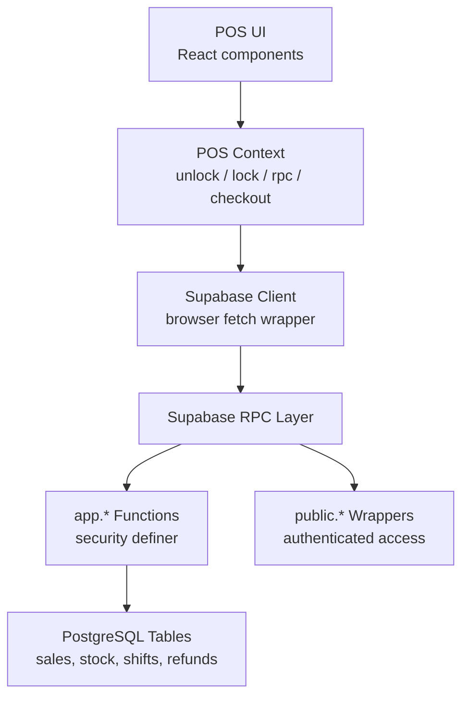
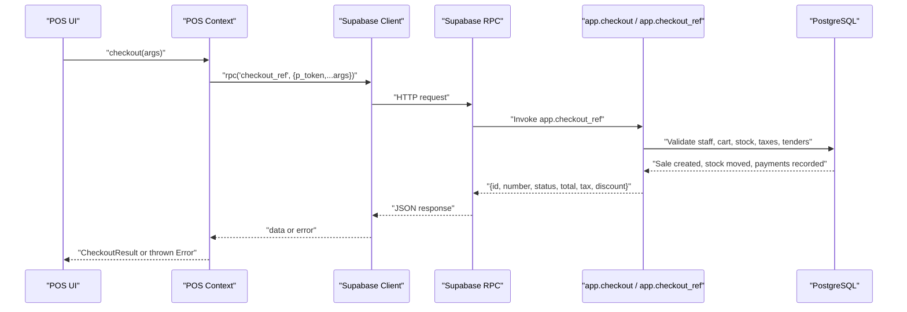
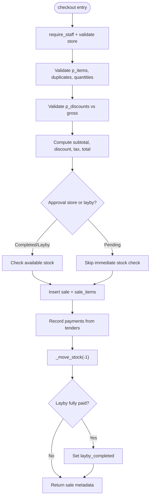
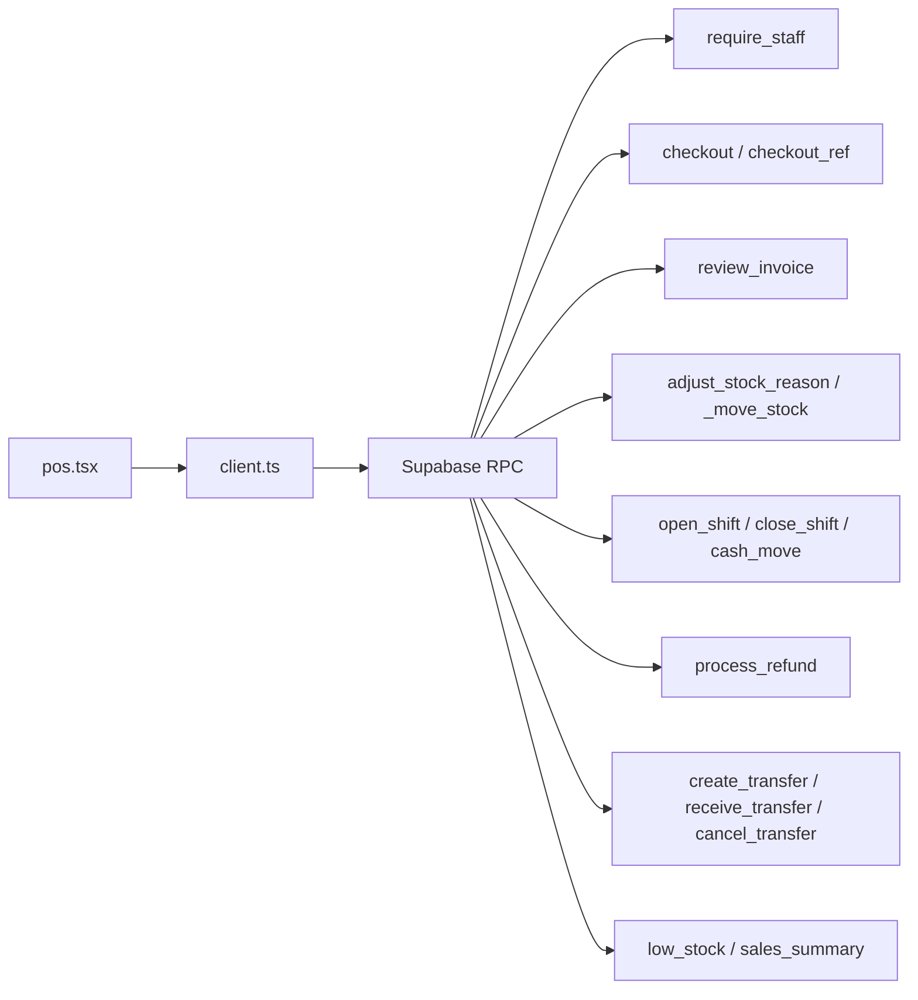

# Supabase RPC Functions

<cite>
**Referenced Files in This Document**
- [pos.tsx](file://src/lib/pos.tsx)
- [client.ts](file://src/integrations/supabase/client.ts)
- [billing.functions.ts](file://src/lib/billing.functions.ts)
- [20261007084733_2ed95314-f75e-4843-977b-23f9e6359a48.sql](file://supabase/migrations/20261007084733_2ed95314-f75e-4843-977b-23f9e6359a48.sql)
- [20261007092354_1daf7bc8-d22a-46ae-a571-1e6c509ed166.sql](file://supabase/migrations/20261007092354_1daf7bc8-d22a-46ae-a571-1e6c509ed166.sql)
- [20261007102244_c10153f5-18b7-409c-8196-3337d3f296c4.sql](file://supabase/migrations/20261007102244_c10153f5-18b7-409c-8196-3337d3f296c4.sql)
- [20261009210500_retail_operations.sql](file://supabase/migrations/20261009210500_retail_operations.sql)
- [20261011090000_sales_summary.sql](file://supabase/migrations/20261011090000_sales_summary.sql)
</cite>

## Table of Contents
1. [Introduction](#introduction)
2. [Project Structure](#project-structure)
3. [Core Components](#core-components)
4. [Architecture Overview](#architecture-overview)
5. [Detailed Component Analysis](#detailed-component-analysis)
6. [Dependency Analysis](#dependency-analysis)
7. [Performance Considerations](#performance-considerations)
8. [Troubleshooting Guide](#troubleshooting-guide)
9. [Conclusion](#conclusion)

## Introduction
This document provides comprehensive API documentation for all Supabase RPC functions exposed by the Storq POS system. It covers authentication, parameters, return types, business rules, error handling, and frontend integration patterns. The focus is on sales processing, inventory updates, billing calculations, cash shifts, refunds, transfers, and reporting.

The frontend uses a shared POS context to call RPCs with an authenticated staff token. Server-side helpers also call RPCs through a service role client where appropriate.

## Project Structure
Storq exposes database logic as PostgreSQL functions under two namespaces:
- `app.*`: internal security-definer implementations that enforce roles, validate inputs, and perform business operations.
- `public.*`: thin wrappers that forward calls to `app.*` and are granted to authenticated users.

Frontend entry points:
- `src/lib/pos.tsx`: POS context, PIN unlock, session lock, generic RPC wrapper, offline checkout queue, and till hygiene.
- `src/integrations/supabase/client.ts`: Supabase client configuration and environment setup.
- `src/lib/billing.functions.ts`: server function that verifies subscription payments and calls a completion RPC.

Backend definitions:
- Migrations define tables, policies, and RPCs across several files.

**Diagram sources**
- [pos.tsx:115-228](file://src/lib/pos.tsx#L115-L228)
- [client.ts:57-95](file://src/integrations/supabase/client.ts#L57-L95)
- [20261009210500_retail_operations.sql:312-320](file://supabase/migrations/20261009210500_retail_operations.sql#L312-L320)

**Section sources**
- [pos.tsx:115-228](file://src/lib/pos.tsx#L115-L228)
- [client.ts:57-95](file://src/integrations/supabase/client.ts#L57-L95)

## Core Components
- Authentication and session management:
  - `unlock_with_pin`: authenticates staff via PIN and returns a short-lived session token.
  - `lock_session`: invalidates a staff session token.
  - `require_staff`: resolves a valid staff session and enforces allowed roles.
- Sales and checkout:
  - `checkout`, `checkout_ref`: create sales, compute totals/tax/discounts, record items, move stock, and record payments.
  - `review_invoice`: approve or reject pending invoices; supports split tenders.
  - `layby_pay`, `cancel_layby`: manage layby payment plans.
- Inventory and stock:
  - `adjust_stock`, `adjust_stock_reason`: adjust store stock with ledger reasons.
  - `_move_stock`: internal helper used by sales and reversals.
  - Stock take lifecycle: `start_stock_take`, `count_stock`, `close_stock_take`.
- Cash shifts and accounting:
  - `open_shift`, `cash_move`, `get_shift_summary`, `close_shift`.
  - `record_expense`, `delete_expense`.
- Refunds:
  - `process_refund`: partial/full refunds with optional restocking and tax allocation.
- Transfers:
  - `create_transfer`, `receive_transfer`, `cancel_transfer`: move stock between stores with ledger trail.
- Reporting:
  - `low_stock`: list products at or below reorder point.
  - `sales_summary`: aggregate revenue, collected, transactions, pending, and refunds.

**Section sources**
- [20261007084733_2ed95314-f75e-4843-977b-23f9e6359a48.sql:135-375](file://supabase/migrations/20261007084733_2ed95314-f75e-4843-977b-23f9e6359a48.sql#L135-L375)
- [20261007092354_1daf7bc8-d22a-46ae-a571-1e6c509ed166.sql:21-77](file://supabase/migrations/20261007092354_1daf7bc8-d22a-46ae-a571-1e6c509ed166.sql#L21-L77)
- [20261007102244_c10153f5-18b7-409c-8196-3337d3f296c4.sql:87-397](file://supabase/migrations/20261007102244_c10153f5-18b7-409c-8196-3337d3f296c4.sql#L87-L397)
- [20261009210500_retail_operations.sql:62-553](file://supabase/migrations/20261009210500_retail_operations.sql#L62-L553)
- [20261011090000_sales_summary.sql:14-71](file://supabase/migrations/20261011090000_sales_summary.sql#L14-L71)

## Architecture Overview
The POS frontend calls RPCs through a typed Supabase client. The POS context injects the current staff token into every RPC call. Errors from Postgres are masked to hide internal details and to handle locked sessions gracefully. Offline sales are queued locally and replayed when online.

**Diagram sources**
- [pos.tsx:275-307](file://src/lib/pos.tsx#L275-L307)
- [20261009210500_retail_operations.sql:292-320](file://supabase/migrations/20261009210500_retail_operations.sql#L292-L320)

## Detailed Component Analysis

### Authentication and Session RPCs

#### `unlock_with_pin(p_pin text)`
- Purpose: Authenticate a staff member using a PIN and issue a session token.
- Parameters:
  - `p_pin`: Four-digit numeric PIN.
- Returns: JSON object containing `token`, `id`, `name`, `role`, `store_id`.
- Business logic:
  - Validates PIN against active staff in the current business.
  - Cleans expired sessions and inserts a new session with expiry.
- Authentication: Requires no prior auth; called before obtaining a staff token.
- Error handling: Throws if PIN is wrong.
- Frontend usage: Called from POS unlock flow; result stored in local storage and used to populate the staff session.

**Section sources**
- [20261007084733_2ed95314-f75e-4843-977b-23f9e6359a48.sql:165-175](file://supabase/migrations/20261007084733_2ed95314-f75e-4843-977b-23f9e6359a48.sql#L165-L175)
- [pos.tsx:194-203](file://src/lib/pos.tsx#L194-L203)

#### `lock_session(p_token uuid)`
- Purpose: Invalidate a staff session token.
- Parameters:
  - `p_token`: Active staff session token.
- Returns: void.
- Business logic: Deletes the specified session row.
- Authentication: Executed by admin-defined function; requires valid token.
- Frontend usage: Called when locking the POS workspace.

**Section sources**
- [20261007084733_2ed95314-f75e-4843-977b-23f9e6359a48.sql:177-180](file://supabase/migrations/20261007084733_2ed95314-f75e-4843-977b-23f9e6359a48.sql#L177-L180)
- [pos.tsx:205-215](file://src/lib/pos.tsx#L205-L215)

#### `require_staff(p_token uuid, p_roles text[])`
- Purpose: Resolve a valid staff session and enforce allowed roles.
- Parameters:
  - `p_token`: Staff session token.
  - `p_roles`: Allowed roles array (e.g., `['admin','manager','cashier']`).
- Returns: Staff row.
- Business logic:
  - Verifies session exists, is not expired, belongs to the current business, and has one of the required roles.
  - Raises “Locked” error if invalid.
- Security: SECURITY DEFINER; grants revoked from public/anon.

**Section sources**
- [20261007084733_2ed95314-f75e-4843-977b-23f9e6359a48.sql:135-144](file://supabase/migrations/20261007084733_2ed95314-f75e-4843-977b-23f9e6359a48.sql#L135-L144)

### Sales and Checkout RPCs

#### `checkout(p_token uuid, p_store uuid, p_kind text, p_items jsonb, p_payment numeric, p_method text, p_customer_name text, p_customer_phone text, p_note text, p_tenders jsonb DEFAULT NULL, p_discounts jsonb DEFAULT NULL, p_override_pin text DEFAULT NULL)`
- Purpose: Create a sale or layby with validation, discounts, tax calculation, stock checks, and payment recording.
- Parameters:
  - `p_token`: Staff session token.
  - `p_store`: Store UUID.
  - `p_kind`: `"sale"` or `"layby"`.
  - `p_items`: Array of `{product_id, qty}`.
  - `p_payment`: Single tender amount fallback.
  - `p_method`: Default method (`cash`, `card`, `mobile`) when not splitting.
  - `p_customer_name`, `p_customer_phone`, `p_note`: Optional customer info and note.
  - `p_tenders`: Array of `{method, amount}` for split tenders.
  - `p_discounts`: Array of `{product_id, amount}` per-line discounts.
  - `p_override_pin`: Manager PIN to override cashier discount caps.
- Returns: JSON with `id`, `number`, `status`, `total`, `tax`, `discount`.
- Business logic:
  - Validates staff, store assignment, cart shape, quantities, catalogue membership, duplicate lines, discounts vs gross, customer fields, payment methods, and tender sums.
  - Computes subtotal, discount, tax based on business tax settings, and final total.
  - Determines status: approval-required stores become `pending_approval`; laybies start `layby_open`; direct sales become `completed`.
  - Checks stock availability unless pending approval.
  - Records sale, sale items, stock movement, and payments according to tenders.
  - Applies layby completion when paid in full.
- Validation rules:
  - Cart must be non-empty, each item must have a valid product UUID and positive quantity.
  - Discounts cannot exceed gross; cashier discounts over 10% require manager PIN.
  - Tenders must cover total for completed sales; cash overpayment allowed within limits.
- Error handling: Throws descriptive errors for invalid inputs, insufficient stock, unknown entities, and policy violations.

**Diagram sources**
- [20261009210500_retail_operations.sql:108-287](file://supabase/migrations/20261009210500_retail_operations.sql#L108-L287)

**Section sources**
- [20261009210500_retail_operations.sql:108-287](file://supabase/migrations/20261009210500_retail_operations.sql#L108-L287)

#### `checkout_ref(p_token uuid, p_client_ref uuid, p_store uuid, p_kind text, p_items jsonb, p_payment numeric, p_method text, p_customer_name text, p_customer_phone text, p_note text, p_tenders jsonb DEFAULT NULL, p_discounts jsonb DEFAULT NULL, p_override_pin text DEFAULT NULL)`
- Purpose: Idempotent checkout wrapper that associates a client reference to avoid duplicate sales during retries or offline sync.
- Parameters: Same as `checkout`, plus `p_client_ref`.
- Returns: Same as `checkout`, plus `duplicate: true` if already processed.
- Business logic:
  - Uses advisory lock keyed by client reference.
  - If sale already exists for the reference, returns existing sale data.
  - Otherwise delegates to `app.checkout` and attaches the client reference to the sale.

**Section sources**
- [20261009210500_retail_operations.sql:292-320](file://supabase/migrations/20261009210500_retail_operations.sql#L292-L320)
- [pos.tsx:275-307](file://src/lib/pos.tsx#L275-L307)

#### `review_invoice(p_token uuid, p_sale uuid, p_approve boolean, p_payment numeric, p_method text, p_tenders jsonb DEFAULT NULL)`
- Purpose: Approve or reject a pending invoice; supports split tenders and stock checks.
- Parameters:
  - `p_token`, `p_sale`, `p_approve`, `p_payment`, `p_method`, `p_tenders`.
- Returns: Status string (`completed`, `layby_open`, `layby_completed`, or `rejected`).
- Business logic:
  - Ensures invoice is awaiting approval and not self-approved by non-admin.
  - Recomputes billable amounts from stored sale items to prevent stale cart manipulation.
  - Validates tenders and computes payment method.
  - Moves stock and records payments upon approval.

**Section sources**
- [20261009210500_retail_operations.sql:325-406](file://supabase/migrations/20261009210500_retail_operations.sql#L325-L406)

#### `layby_pay(p_token uuid, p_sale uuid, p_amount numeric, p_method text)`
- Purpose: Add payment toward an open layby.
- Parameters:
  - `p_token`, `p_sale`, `p_amount`, `p_method`.
- Returns: Updated layby status.
- Business logic:
  - Validates layby state and amount.
  - Records payment and updates paid total; completes layby if fully paid.

**Section sources**
- [20261007084733_2ed95314-f75e-4843-977b-23f9e6359a48.sql:314-326](file://supabase/migrations/20261007084733_2ed95314-f75e-4843-977b-23f9e6359a48.sql#L314-L326)

#### `cancel_layby(p_token uuid, p_sale uuid)`
- Purpose: Cancel an open layby and reverse stock movements.
- Parameters:
  - `p_token`, `p_sale`.
- Returns: void.
- Business logic:
  - Validates layby state.
  - Sets status to cancelled and restores stock.

**Section sources**
- [20261007084733_2ed95314-f75e-4843-977b-23f9e6359a48.sql:328-337](file://supabase/migrations/20261007084733_2ed95314-f75e-4843-977b-23f9e6359a48.sql#L328-L337)

### Inventory and Stock RPCs

#### `adjust_stock(p_token uuid, p_store uuid, p_product uuid, p_delta numeric)`
- Purpose: Adjust store stock by a delta.
- Parameters:
  - `p_token`, `p_store`, `p_product`, `p_delta`.
- Returns: void.
- Business logic:
  - Requires admin or manager.
  - Validates store ownership.
  - Inserts delta with upsert semantics.

**Section sources**
- [20261007084733_2ed95314-f75e-4843-977b-23f9e6359a48.sql:233-241](file://supabase/migrations/20261007084733_2ed95314-f75e-4843-977b-23f9e6359a48.sql#L233-L241)

#### `adjust_stock_reason(p_token uuid, p_store uuid, p_product uuid, p_delta numeric, p_reason text, p_note text)`
- Purpose: Adjust stock with a reason and optional note; logs to stock_movements ledger.
- Parameters:
  - `p_token`, `p_store`, `p_product`, `p_delta`, `p_reason`, `p_note`.
- Returns: void.
- Business logic:
  - Requires admin or manager.
  - Validates store/product and allowed reasons.
  - Sets context for ledger logging and performs upsert.

**Section sources**
- [20261007102244_c10153f5-18b7-409c-8196-3337d3f296c4.sql:87-100](file://supabase/migrations/20261007102244_c10153f5-18b7-409c-8196-3337d3f296c4.sql#L87-L100)

#### `_move_stock(p_sale uuid, p_sign int)`
- Purpose: Internal helper to adjust stock for sales and reversals; tagged with reason via context.
- Parameters:
  - `p_sale`: Sale UUID.
  - `p_sign`: -1 for sale, +1 for reversal.
- Returns: void.
- Business logic:
  - Sets context reason (`sale` or `sale_reversal`) and inserts stock deltas for sale items.
  - Revoked from public/anon; only callable by security-definer functions.

**Section sources**
- [20261007102244_c10153f5-18b7-409c-8196-3337d3f296c4.sql:70-80](file://supabase/migrations/20261007102244_c10153f5-18b7-409c-8196-3337d3f296c4.sql#L70-L80)

#### Stock Take Lifecycle
- `start_stock_take(p_token uuid, p_store uuid)`: Opens a stock take and seeds expected counts.
- `count_stock(p_token uuid, p_take uuid, p_product uuid, p_counted numeric)`: Records counted quantity.
- `close_stock_take(p_token uuid, p_take uuid)`: Applies counted values to stock and closes the take.

**Section sources**
- [20261007084733_2ed95314-f75e-4843-977b-23f9e6359a48.sql:339-375](file://supabase/migrations/20261007084733_2ed95314-f75e-4843-977b-23f9e6359a48.sql#L339-L375)
- [20261007102244_c10153f5-18b7-409c-8196-3337d3f296c4.sql:103-116](file://supabase/migrations/20261007102244_c10153f5-18b7-409c-8196-3337d3f296c4.sql#L103-L116)

### Cash Shifts and Expenses

#### `open_shift(p_token uuid, p_store uuid, p_float numeric, p_notes text)`
- Purpose: Open a cash shift for a store.
- Parameters:
  - `p_token`, `p_store`, `p_float`, `p_notes`.
- Returns: Shift UUID.
- Business logic:
  - Validates staff/store assignment and ensures no open shift exists.
  - Creates shift with opening float.

**Section sources**
- [20261007102244_c10153f5-18b7-409c-8196-3337d3f296c4.sql:195-207](file://supabase/migrations/20261007102244_c10153f5-18b7-409c-8196-3337d3f296c4.sql#L195-L207)

#### `cash_move(p_token uuid, p_shift uuid, p_kind text, p_amount numeric, p_reason text)`
- Purpose: Record cash in/out during a shift.
- Parameters:
  - `p_token`, `p_shift`, `p_kind` (`in`/`out`), `p_amount`, `p_reason`.
- Returns: void.
- Business logic:
  - Validates kind, amount, and open shift.

**Section sources**
- [20261007102244_c10153f5-18b7-409c-8196-3337d3f296c4.sql:209-218](file://supabase/migrations/20261007102244_c10153f5-18b7-409c-8196-3337d3f296c4.sql#L209-L218)

#### `get_shift_summary(p_token uuid, p_shift uuid)`
- Purpose: Read live shift summary including expected cash and breakdowns.
- Parameters:
  - `p_token`, `p_shift`.
- Returns: JSONB summary.
- Business logic:
  - Delegates to internal `app.shift_summary`.

**Section sources**
- [20261007102244_c10153f5-18b7-409c-8196-3337d3f296c4.sql:246-253](file://supabase/migrations/20261007102244_c10153f5-18b7-409c-8196-3337d3f296c4.sql#L246-L253)

#### `close_shift(p_token uuid, p_shift uuid, p_counted numeric, p_notes text)`
- Purpose: Close a shift with counted cash and variance calculation.
- Parameters:
  - `p_token`, `p_shift`, `p_counted`, `p_notes`.
- Returns: JSONB summary including counted cash and variance.
- Business logic:
  - Validates open shift and counted amount; writes expected cash and variance.

**Section sources**
- [20261007102244_c10153f5-18b7-409c-8196-3337d3f296c4.sql:255-269](file://supabase/migrations/20261007102244_c10153f5-18b7-409c-8196-3337d3f296c4.sql#L255-L269)

#### `record_expense(p_token uuid, p_store uuid, p_amount numeric, p_category text, p_source text, p_note text, p_date date)`
- Purpose: Record an expense linked to a store and shift context.
- Parameters:
  - `p_token`, `p_store`, `p_amount`, `p_category`, `p_source`, `p_note`, `p_date`.
- Returns: Expense UUID.
- Business logic:
  - Validates store assignment, amount positivity, and source enum.

**Section sources**
- [20261007092354_1daf7bc8-d22a-46ae-a571-1e6c509ed166.sql:21-34](file://supabase/migrations/20261007092354_1daf7bc8-d22a-46ae-a571-1e6c509ed166.sql#L21-L34)

#### `delete_expense(p_token uuid, p_id uuid)`
- Purpose: Delete an expense.
- Parameters:
  - `p_token`, `p_id`.
- Returns: void.
- Business logic:
  - Requires admin or manager and deletes matching expense.

**Section sources**
- [20261007092354_1daf7bc8-d22a-46ae-a571-1e6c509ed166.sql:36-42](file://supabase/migrations/20261007092354_1daf7bc8-d22a-46ae-a571-1e6c509ed166.sql#L36-L42)

### Refunds

#### `process_refund(p_token uuid, p_sale uuid, p_items jsonb, p_method text, p_reason text)`
- Purpose: Process partial or full refunds with optional restocking and tax allocation.
- Parameters:
  - `p_token`, `p_sale`, `p_items` (array of `{sale_item_id, qty, restock}`), `p_method`, `p_reason`.
- Returns: JSON with refund `id`, `number`, and `amount`.
- Business logic:
  - Validates sale state and items.
  - Calculates refund line amounts considering tax-inclusive/exclusive settings.
  - Updates refunded quantities and sale totals.
  - Optionally restocks items and logs stock movements.
  - Associates refund with open shift if present.

**Section sources**
- [20261007102244_c10153f5-18b7-409c-8196-3337d3f296c4.sql:271-316](file://supabase/migrations/20261007102244_c10153f5-18b7-409c-8196-3337d3f296c4.sql#L271-L316)

### Transfers

#### `create_transfer(p_token uuid, p_from uuid, p_to uuid, p_items jsonb, p_note text)`
- Purpose: Dispatch stock transfer from one store to another; deducts from origin.
- Parameters:
  - `p_token`, `p_from`, `p_to`, `p_items` (array of `{product_id, qty}`), `p_note`.
- Returns: Transfer UUID.
- Business logic:
  - Validates stores, items, quantities, and stock availability at origin.
  - Creates transfer and lines; logs stock movement with reason `transfer_out`.

**Section sources**
- [20261009210500_retail_operations.sql:411-452](file://supabase/migrations/20261009210500_retail_operations.sql#L411-L452)

#### `receive_transfer(p_token uuid, p_id uuid)`
- Purpose: Receive a transfer; adds stock to destination.
- Parameters:
  - `p_token`, `p_id`.
- Returns: Status string (`received`).
- Business logic:
  - Validates transfer state and destination store assignment.
  - Logs stock movement with reason `transfer_in`.

**Section sources**
- [20261009210500_retail_operations.sql:455-471](file://supabase/migrations/20261009210500_retail_operations.sql#L455-L471)

#### `cancel_transfer(p_token uuid, p_id uuid)`
- Purpose: Cancel an in-transit transfer; returns stock to origin.
- Parameters:
  - `p_token`, `p_id`.
- Returns: Status string (`cancelled`).
- Business logic:
  - Validates transfer state and source store assignment.
  - Logs correction stock movement.

**Section sources**
- [20261009210500_retail_operations.sql:475-491](file://supabase/migrations/20261009210500_retail_operations.sql#L475-L491)

### Reporting and Analytics

#### `low_stock(p_token uuid, p_store uuid)`
- Purpose: List active products at or below their reorder point for a store.
- Parameters:
  - `p_token`, `p_store`.
- Returns: JSON array of low-stock items with shortfall.
- Business logic:
  - Requires admin or manager.
  - Joins products and store stock to compute shortfall.

**Section sources**
- [20261009210500_retail_operations.sql:505-527](file://supabase/migrations/20261009210500_retail_operations.sql#L505-L527)

#### `sales_summary(p_token uuid, p_store uuid, p_from timestamptz, p_to timestamptz)`
- Purpose: Aggregate sales KPIs for a time window.
- Parameters:
  - `p_token`, `p_store` (optional), `p_from`, `p_to`.
- Returns: JSON with `revenue`, `collected`, `transactions`, `pending`, `refunds`.
- Business logic:
  - Enforces staff role and store tenancy.
  - Aggregates net revenue, collected amounts, transaction counts, pending invoices, and refunds.

**Section sources**
- [20261011090000_sales_summary.sql:14-57](file://supabase/migrations/20261011090000_sales_summary.sql#L14-L57)

### Billing and Subscription Integration

#### `complete_subscription_payment(p_tx_ref text)`
- Purpose: Activate a subscription after external payment verification.
- Parameters:
  - `p_tx_ref`: Transaction reference from payment provider.
- Returns: void.
- Business logic:
  - Called from server-side verification flow after confirming payment details.
- Frontend usage:
  - Invoked indirectly via server function that validates payment and then calls this RPC.

**Section sources**
- [billing.functions.ts:44-52](file://src/lib/billing.functions.ts#L44-L52)

## Dependency Analysis
- Frontend dependencies:
  - `src/lib/pos.tsx` depends on `src/integrations/supabase/client.ts` for RPC transport.
  - `src/lib/billing.functions.ts` imports server-side Supabase client to call subscription completion RPC.
- Backend dependencies:
  - All write RPCs depend on `require_staff` for authorization.
  - Stock changes are logged via `app.set_ctx` and trigger ledger entries.
  - Sales and approvals use `_move_stock` to update inventory atomically.

**Diagram sources**
- [pos.tsx:115-228](file://src/lib/pos.tsx#L115-L228)
- [20261007084733_2ed95314-f75e-4843-977b-23f9e6359a48.sql:135-144](file://supabase/migrations/20261007084733_2ed95314-f75e-4843-977b-23f9e6359a48.sql#L135-L144)
- [20261009210500_retail_operations.sql:108-320](file://supabase/migrations/20261009210500_retail_operations.sql#L108-L320)
- [20261007102244_c10153f5-18b7-409c-8196-3337d3f296c4.sql:87-397](file://supabase/migrations/20261007102244_c10153f5-18b7-409c-8196-3337d3f296c4.sql#L87-L397)
- [20261011090000_sales_summary.sql:14-57](file://supabase/migrations/20261011090000_sales_summary.sql#L14-L57)

**Section sources**
- [pos.tsx:115-228](file://src/lib/pos.tsx#L115-L228)
- [client.ts:57-95](file://src/integrations/supabase/client.ts#L57-L95)

## Performance Considerations
- Use `checkout_ref` for idempotency to avoid duplicate sales during retries or offline sync.
- Prefer `sales_summary` for KPI aggregation instead of loading large lists into the browser.
- Batch stock adjustments where possible; prefer `adjust_stock_reason` to maintain ledger integrity.
- Avoid excessive RPC calls by leveraging cached data and query invalidation hooks provided by the POS context.

[No sources needed since this section provides general guidance]

## Troubleshooting Guide
Common error patterns and handling:
- Locked sessions:
  - When a session expires or is invalidated, RPCs throw messages indicating the need to re-authenticate.
  - The POS context clears the staff session and forces re-lock when it detects a locked message.
- Generic errors:
  - SQL internals, RLS violations, constraint errors, and syntax errors are masked to user-friendly messages.
- Network errors:
  - Offline checkout automatically queues sales and retries when connectivity returns.

Frontend error masking and session clearing:
- `maskRpcError` sanitizes raw Postgres errors.
- `rpc` wrapper clears staff session on locked errors and throws masked messages.

**Section sources**
- [pos.tsx:93-104](file://src/lib/pos.tsx#L93-L104)
- [pos.tsx:220-228](file://src/lib/pos.tsx#L220-L228)
- [pos.tsx:310-338](file://src/lib/pos.tsx#L310-L338)

## Conclusion
Storq’s Supabase RPC surface centralizes business logic, enforces strict authorization and validation, and maintains auditability through stock ledgers and shift summaries. The frontend integrates cleanly via a POS context that handles authentication, error masking, and offline resilience. For robust integrations, always use the documented RPC signatures, respect validation constraints, and leverage idempotent checkout references and reporting aggregates.

[No sources needed since this section summarizes without analyzing specific files]