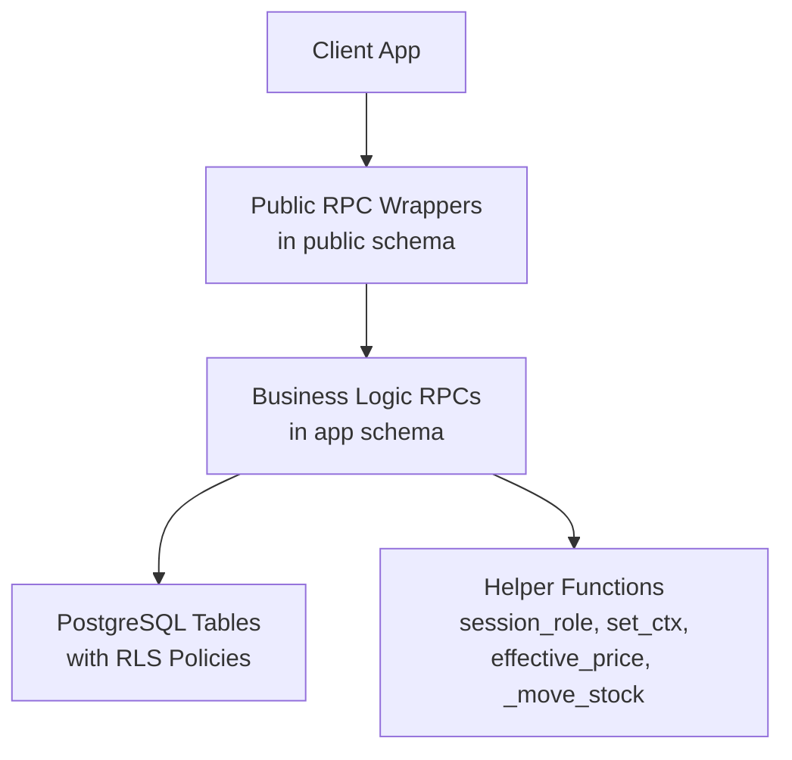
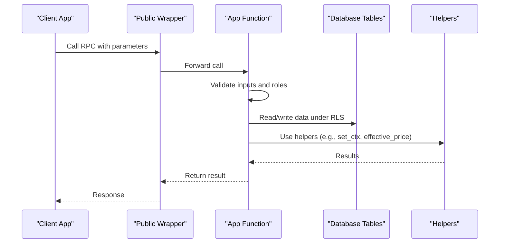
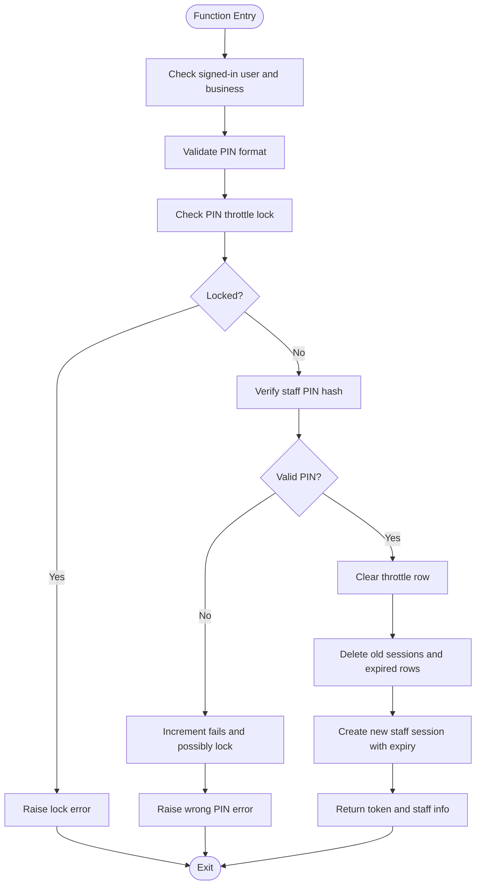
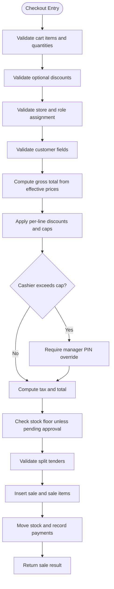
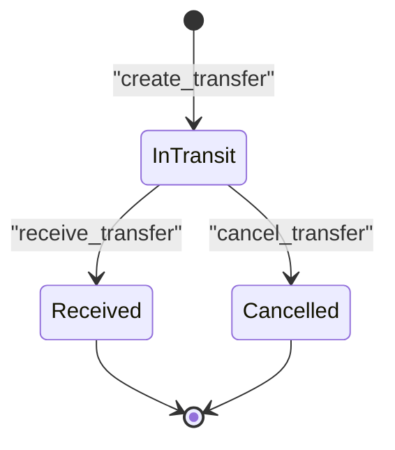
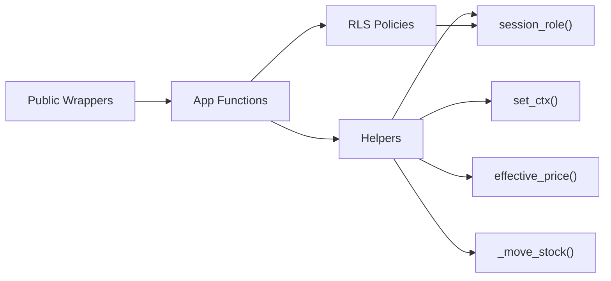

# Utility & System RPC Functions

<cite>
**Referenced Files in This Document**   
- [README.md](file://README.md)
- [config.toml](file://supabase/config.toml)
- [20261007101503_838baf20-162a-45c9-97a2-a1928381f341.sql](file://supabase/migrations/20261007101503_838baf20-162a-45c9-97a2-a1928381f341.sql)
- [20261008090000_security_hardening.sql](file://supabase/migrations/20261008090000_security_hardening.sql)
- [20261009210500_retail_operations.sql](file://supabase/migrations/20261009210500_retail_operations.sql)
</cite>

## Table of Contents
1. [Introduction](#introduction)
2. [Project Structure](#project-structure)
3. [Core Components](#core-components)
4. [Architecture Overview](#architecture-overview)
5. [Detailed Component Analysis](#detailed-component-analysis)
6. [Dependency Analysis](#dependency-analysis)
7. [Performance Considerations](#performance-considerations)
8. [Troubleshooting Guide](#troubleshooting-guide)
9. [Conclusion](#conclusion)

## Introduction
This document provides comprehensive API documentation for the utility and system-level Supabase RPC functions used by the application. It focuses on:
- System configuration and setup operations
- Security operations such as PIN unlocking, session locking, role checks, and brute-force throttling
- Data validation and business rules enforced inside RPCs
- Helper utilities that support stock movement, context tracking, pricing, and subscription checks
- Administrative operations including staff management, product management, checkout, refunds, transfers, and low-stock reporting

The repository is a retail point-of-sale application built with Lovable. The backend security model relies on PostgreSQL functions in the `app` schema, exposed through thin public wrappers. All writes go through these RPCs; direct table writes are revoked from clients.

**Section sources**
- [README.md:1-26](file://README.md#L1-L26)

## Project Structure
At the database layer, the project uses migrations to define schemas, policies, and RPCs. Key files relevant to this documentation are:
- `supabase/config.toml`: Supabase project identifier
- `supabase/migrations/20261007101503_838baf20-162a-45c9-97a2-a1928381f341.sql`: Creates the `app` schema and generates public wrappers around existing `public` functions
- `supabase/migrations/20261008090000_security_hardening.sql`: Core security hardening, PIN unlock, session locking, RLS policies, data bounds, and many business RPCs
- `supabase/migrations/20261009210500_retail_operations.sql`: Retail operations including split tenders, per-line discounts, manager PIN override, store-to-store transfers, and low-stock reporting

**Diagram sources**
- [20261007101503_838baf20-162a-45c9-97a2-a1928381f341.sql:1-36](file://supabase/migrations/20261007101503_838baf20-162a-45c9-97a2-a1928381f341.sql#L1-L36)
- [20261008090000_security_hardening.sql:68-77](file://supabase/migrations/20261008090000_security_hardening.sql#L68-L77)
- [20261008090000_security_hardening.sql:715-757](file://supabase/migrations/20261008090000_security_hardening.sql#L715-L757)

**Section sources**
- [config.toml:1-1](file://supabase/config.toml#L1-L1)
- [20261007101503_838baf20-162a-45c9-97a2-a1928381f341.sql:1-36](file://supabase/migrations/20261007101503_838baf20-162a-45c9-97a2-a1928381f341.sql#L1-L36)
- [20261008090000_security_hardening.sql:715-757](file://supabase/migrations/20261008090000_security_hardening.sql#L715-L757)
- [20261009210500_retail_operations.sql:529-556](file://supabase/migrations/20261009210500_retail_operations.sql#L529-L556)

## Core Components
This section documents the primary RPC families:
- Authentication and session security
- Business setup and configuration
- Product and cost management
- Checkout, approvals, and refunds
- Stock adjustments and transfers
- Shifts, expenses, collections, and stock takes
- Pricing and helper utilities

### Authentication and Session Security
- `app.unlock_with_pin(p_pin text)`
  - Purpose: Validates a 4–8 digit PIN against the signed-in user’s business, enforces throttle limits, and creates a device-bound staff session.
  - Parameters:
    - `p_pin`: 4–8 digits
  - Returns: JSON object containing `token`, `id`, `name`, `role`, `store_id`, `expires_at`
  - Security: Throttles wrong attempts per business and device; locks after repeated failures.
- `app.lock_session(p_token uuid)`
  - Purpose: Locks a specific staff session token and clears PIN throttle state for the current device login.
  - Parameters:
    - `p_token`: Staff session token
- `app.lock_all_sessions()`
  - Purpose: Signs out all sessions for the current device login and clears PIN throttle state.
- `public.require_staff_nosub(p_token uuid, p_roles text[])`
  - Purpose: Internal helper that validates a staff session token, checks roles, and sets the current staff context.
  - Parameters:
    - `p_token`: Staff session token
    - `p_roles`: Allowed roles array
  - Returns: Staff row
- `app.session_role()`
  - Purpose: Resolves the active role for the current device login based on the latest valid staff session.
  - Returns: Role text or NULL if no active PIN session exists.

**Section sources**
- [20261008090000_security_hardening.sql:218-291](file://supabase/migrations/20261008090000_security_hardening.sql#L218-L291)
- [20261008090000_security_hardening.sql:68-77](file://supabase/migrations/20261008090000_security_hardening.sql#L68-L77)

### Business Setup and Configuration
- `app.setup_business(p_name text, p_currency text, p_store_name text, p_store_type text, p_owner_name text, p_pin text)`
  - Purpose: Creates a new business, initial store, and admin staff account with a hashed PIN.
  - Parameters:
    - `p_name`: Business name (validated length)
    - `p_currency`: Optional currency code (max 4 characters)
    - `p_store_name`: Initial store name (validated length)
    - `p_store_type`: Either `direct` or `approval`
    - `p_owner_name`: Admin owner name (validated length)
    - `p_pin`: 4–8 digits
  - Returns: Business ID
- `app.save_store(p_token uuid, p_id uuid, p_name text, p_store_type text)`
  - Purpose: Creates or updates a store under an active subscription, enforcing plan limits.
  - Parameters:
    - `p_token`: Admin staff session token
    - `p_id`: Optional existing store ID
    - `p_name`: Store name (validated length)
    - `p_store_type`: Either `direct` or `approval`
  - Returns: Store ID

**Section sources**
- [20261008090000_security_hardening.sql:302-393](file://supabase/migrations/20261008090000_security_hardening.sql#L302-L393)

### Product and Cost Management
- `app.save_product(p_token uuid, p_id uuid, p_name text, p_sku text, p_category text, p_price numeric, p_cost numeric, p_active boolean, p_reorder_point numeric DEFAULT NULL)`
  - Purpose: Creates or updates a product and its buying cost in a gated table.
  - Parameters:
    - `p_token`: Admin or manager staff session token
    - `p_id`: Optional existing product ID
    - `p_name`: Item name (validated length and character set)
    - `p_sku`: Optional barcode/SKU (validated format and length)
    - `p_category`: Optional category (validated length)
    - `p_price`: Selling price (non-negative upper bound)
    - `p_cost`: Buying cost (optional, non-negative upper bound)
    - `p_active`: Active flag
    - `p_reorder_point`: Optional reorder threshold (non-negative upper bound)
  - Returns: Product ID

**Section sources**
- [20261008090000_security_hardening.sql:395-425](file://supabase/migrations/20261008090000_security_hardening.sql#L395-L425)
- [20261009210500_retail_operations.sql:61-100](file://supabase/migrations/20261009210500_retail_operations.sql#L61-L100)

### Checkout, Approvals, and Refunds
- `app.checkout(p_token uuid, p_store uuid, p_kind text, p_items jsonb, p_payment numeric, p_method text, p_customer_name text, p_customer_phone text, p_note text, p_tenders jsonb DEFAULT NULL, p_discounts jsonb DEFAULT NULL, p_override_pin text DEFAULT NULL)`
  - Purpose: Validates cart, applies discounts, computes totals and tax, enforces stock floor, records sale items and costs, and posts payments. Supports split tenders and manager PIN override for cashier discounts.
  - Parameters:
    - `p_token`: Admin, manager, or cashier staff session token
    - `p_store`: Store ID
    - `p_kind`: Either `sale` or `layby`
    - `p_items`: Array of item objects with `product_id` and `qty`
    - `p_payment`: Single payment amount (fallback when not using split tenders)
    - `p_method`: Payment method (`cash`, `card`, `mobile`)
    - `p_customer_name`: Customer name (validated length and character set)
    - `p_customer_phone`: Phone number (validated format)
    - `p_note`: Optional note (validated length)
    - `p_tenders`: Optional array of tender objects with `method` and `amount`
    - `p_discounts`: Optional array of discount objects keyed by `product_id` and `amount`
    - `p_override_pin`: Optional manager PIN to allow cashier discounts beyond caps
  - Returns: JSON object with `id`, `number`, `status`, `total`, `tax`, and optionally `discount`
- `app.checkout_ref(...)`
  - Purpose: Idempotent checkout wrapper using a client reference to avoid duplicate sales.
- `app.review_invoice(p_token uuid, p_sale uuid, p_approve boolean, p_payment numeric, p_method text, p_tenders jsonb DEFAULT NULL)`
  - Purpose: Approves or rejects pending approval invoices, recomputes totals from stored line prices, enforces stock availability, and records split tenders.
- `app.process_refund(p_token uuid, p_sale uuid, p_items jsonb, p_method text, p_reason text)`
  - Purpose: Processes partial or full refunds, reads buying cost from the gated table, supports restocking, and updates refund and sale statuses.

**Section sources**
- [20261008090000_security_hardening.sql:427-605](file://supabase/migrations/20261008090000_security_hardening.sql#L427-L605)
- [20261009210500_retail_operations.sql:102-320](file://supabase/migrations/20261009210500_retail_operations.sql#L102-L320)
- [20261009210500_retail_operations.sql:322-406](file://supabase/migrations/20261009210500_retail_operations.sql#L322-L406)

### Stock Adjustments and Transfers
- `app.adjust_stock_reason(p_token uuid, p_store uuid, p_product uuid, p_delta numeric, p_reason text, p_note text)`
  - Purpose: Adjusts store stock with a validated reason and bounded delta; ensures stock does not go negative.
- `app.create_transfer(p_token uuid, p_from uuid, p_to uuid, p_items jsonb, p_note text)`
  - Purpose: Dispatches a store-to-store transfer, validates catalogue items and source stock, and deducts inventory at the origin.
- `app.receive_transfer(p_token uuid, p_id uuid)`
  - Purpose: Receives an in-transit transfer and adds inventory at the destination.
- `app.cancel_transfer(p_token uuid, p_id uuid)`
  - Purpose: Cancels an in-transit transfer and returns units to the origin.

**Section sources**
- [20261008090000_security_hardening.sql:607-626](file://supabase/migrations/20261008090000_security_hardening.sql#L607-L626)
- [20261009210500_retail_operations.sql:408-501](file://supabase/migrations/20261009210500_retail_operations.sql#L408-L501)

### Shifts, Expenses, Collections, and Stock Takes
- `app.open_shift(p_token uuid, p_store uuid, p_float numeric, p_notes text)`
- `app.cash_move(p_token uuid, p_shift uuid, p_kind text, p_amount numeric, p_reason text)`
- `app.get_shift_summary(p_token uuid, p_shift uuid)`
- `app.close_shift(p_token uuid, p_shift uuid, p_counted numeric, p_notes text)`
- `app.record_expense(p_token uuid, p_store uuid, p_amount numeric, p_category text, p_source text, p_note text, p_date date)`
- `app.save_collection(p_token uuid, p_id uuid, p_name text, p_discount numeric, p_shared boolean)`
- `app.count_stock(p_token uuid, p_take uuid, p_product uuid, p_counted numeric)`

These functions enforce role checks, input bounds, and business constraints. They are defined in earlier migrations and referenced here as part of the broader RPC surface.

**Section sources**
- [20261008090000_security_hardening.sql:644-693](file://supabase/migrations/20261008090000_security_hardening.sql#L644-L693)

### Pricing and Helper Utilities
- `public.effective_price(p_product uuid)`
  - Purpose: Computes the effective selling price considering applicable collection discounts.
- `app.set_ctx(p_reason text, p_ref uuid, p_note text)`
  - Purpose: Sets audit context for stock movements and ledger entries.
- `public._move_stock(p_sale uuid, p_sign integer)`
  - Purpose: Moves stock quantities for a sale or refund operation.
- `public.subscription_active(p_business uuid)`
  - Purpose: Checks whether a business has an active paid or trial subscription.

**Section sources**
- [20261008090000_security_hardening.sql:293-300](file://supabase/migrations/20261008090000_security_hardening.sql#L293-L300)
- [20261008090000_security_hardening.sql:706-713](file://supabase/migrations/20261008090000_security_hardening.sql#L706-L713)

## Architecture Overview
The RPC architecture separates public-facing wrappers from secure business logic:
- Public wrappers expose functions to authenticated clients
- `app` schema functions implement security checks, validation, and business rules
- Row Level Security (RLS) restricts direct table access; only read is allowed for authenticated users
- Helper functions provide reusable capabilities like session role resolution, context tracking, and stock movement

**Diagram sources**
- [20261007101503_838baf20-162a-45c9-97a2-a1928381f341.sql:10-34](file://supabase/migrations/20261007101503_838baf20-162a-45c9-97a2-a1928381f341.sql#L10-L34)
- [20261008090000_security_hardening.sql:715-757](file://supabase/migrations/20261008090000_security_hardening.sql#L715-L757)

## Detailed Component Analysis

### PIN Unlock Flow

**Diagram sources**
- [20261008090000_security_hardening.sql:218-256](file://supabase/migrations/20261008090000_security_hardening.sql#L218-L256)

**Section sources**
- [20261008090000_security_hardening.sql:218-256](file://supabase/migrations/20261008090000_security_hardening.sql#L218-L256)

### Checkout Validation and Tender Splitting

**Diagram sources**
- [20261009210500_retail_operations.sql:108-287](file://supabase/migrations/20261009210500_retail_operations.sql#L108-L287)

**Section sources**
- [20261009210500_retail_operations.sql:108-287](file://supabase/migrations/20261009210500_retail_operations.sql#L108-L287)

### Transfer Lifecycle

**Diagram sources**
- [20261009210500_retail_operations.sql:411-491](file://supabase/migrations/20261009210500_retail_operations.sql#L411-L491)

**Section sources**
- [20261009210500_retail_operations.sql:411-491](file://supabase/migrations/20261009210500_retail_operations.sql#L411-L491)

## Dependency Analysis
Key dependencies and relationships among RPCs and helpers:
- Public wrappers depend on `app` functions
- Business RPCs depend on helper functions for session role, context, pricing, and stock movement
- RLS policies depend on `app.session_role()` and `app.my_business_id()`
- Subscription checks depend on `public.subscription_active()`

**Diagram sources**
- [20261007101503_838baf20-162a-45c9-97a2-a1928381f341.sql:10-34](file://supabase/migrations/20261007101503_838baf20-162a-45c9-97a2-a1928381f341.sql#L10-L34)
- [20261008090000_security_hardening.sql:68-77](file://supabase/migrations/20261008090000_security_hardening.sql#L68-L77)
- [20261008090000_security_hardening.sql:706-713](file://supabase/migrations/20261008090000_security_hardening.sql#L706-L713)

**Section sources**
- [20261007101503_838baf20-162a-45c9-97a2-a1928381f341.sql:10-34](file://supabase/migrations/20261007101503_838baf20-162a-45c9-97a2-a1928381f341.sql#L10-L34)
- [20261008090000_security_hardening.sql:68-77](file://supabase/migrations/20261008090000_security_hardening.sql#L68-L77)
- [20261008090000_security_hardening.sql:706-713](file://supabase/migrations/20261008090000_security_hardening.sql#L706-L713)

## Performance Considerations
- Input validation is performed early in RPCs to fail fast and reduce unnecessary database work
- JSON arrays are validated for size and structure to prevent excessive processing
- Stock checks are performed before committing changes to avoid inconsistent states
- Split tender handling includes bounds checks to prevent overpayment anomalies
- Helper functions like `effective_price` and `_move_stock` encapsulate common logic to reduce duplication and improve maintainability

[No sources needed since this section provides general guidance]

## Troubleshooting Guide
Common errors and their causes:
- Wrong PIN or locked due to too many attempts: Indicates invalid PIN or throttle lock; wait until lock expires or clear throttle via sign-out
- Not enough stock: Cart or transfer requests exceed available inventory; adjust quantities or replenish stock
- Unknown store/product: IDs do not belong to the current business or are inactive; verify catalogue and store assignments
- Discounts need manager PIN: Cashier attempted discounts exceeding caps without manager PIN override
- Tenders do not cover total or exceed total: Split tender amounts are incorrect; ensure they match invoice total within allowed overpayment range
- Subscription missing or expired: Billing must be configured before creating stores or adding staff

Operational tips:
- Use `app.lock_all_sessions()` to sign out all sessions for a device
- Use `app.low_stock(p_token, p_store)` to identify products needing reorder
- Review stock movements via context set by `app.set_ctx()` during adjustments and transfers

**Section sources**
- [20261008090000_security_hardening.sql:218-291](file://supabase/migrations/20261008090000_security_hardening.sql#L218-L291)
- [20261009210500_retail_operations.sql:503-527](file://supabase/migrations/20261009210500_retail_operations.sql#L503-L527)

## Conclusion
The utility and system RPCs form a robust, secure foundation for the application’s retail operations. They enforce strict input validation, role-based access, and business rules while providing essential administrative and operational capabilities. By centralizing logic in the `app` schema and exposing thin public wrappers, the system maintains clarity, security, and maintainability. Administrators should rely on these RPCs for all write operations and use helper utilities for consistent behavior across features.

[No sources needed since this section summarizes without analyzing specific files]