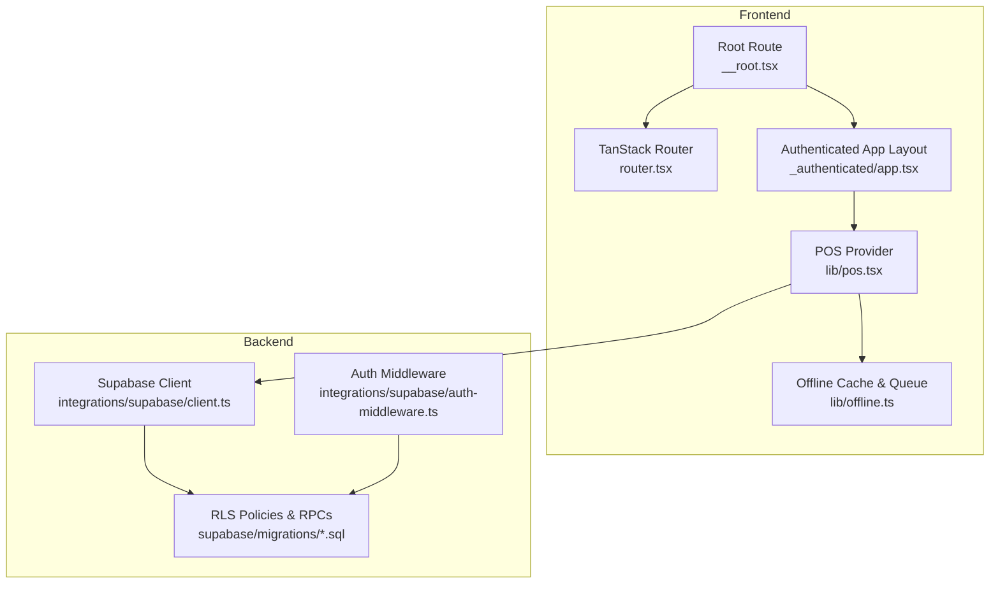
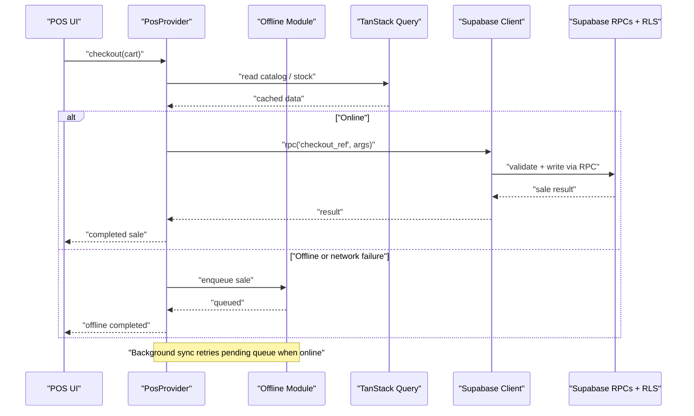
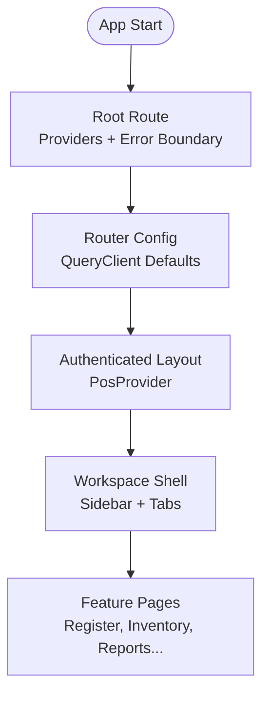
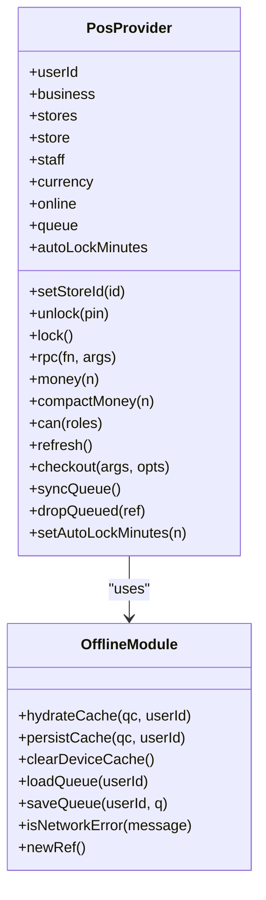
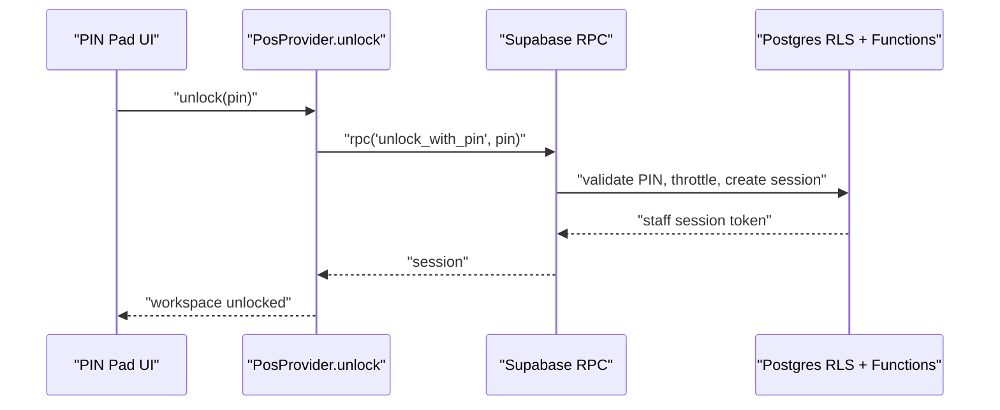
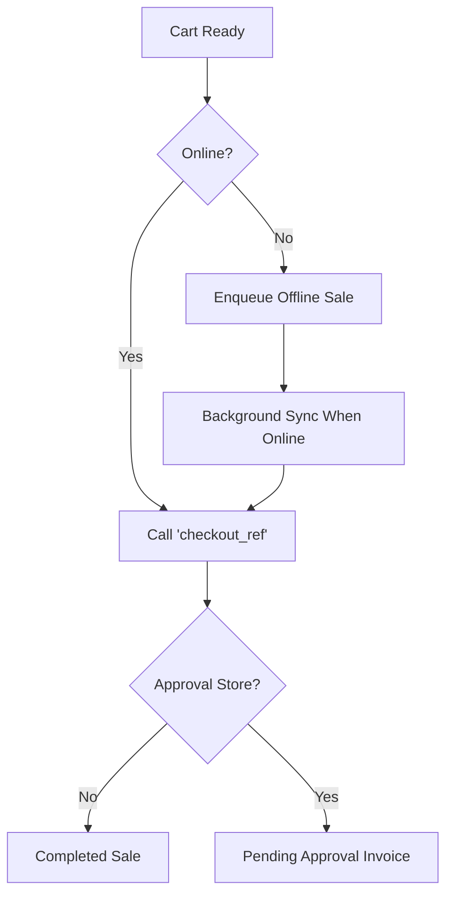
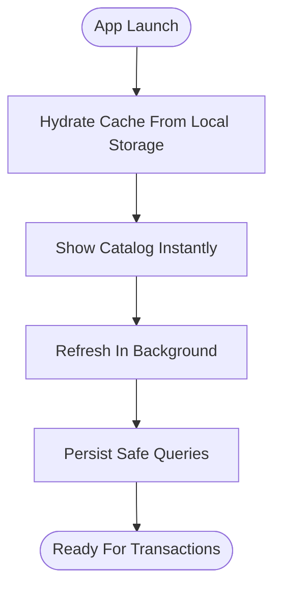
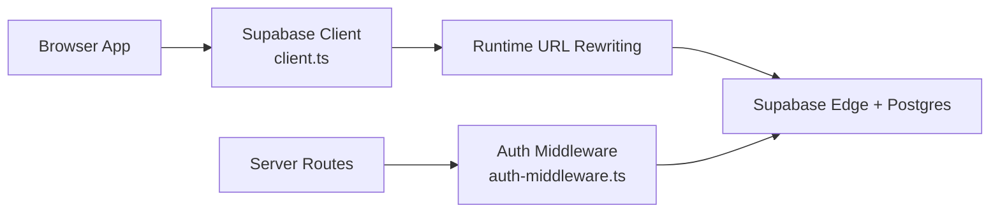
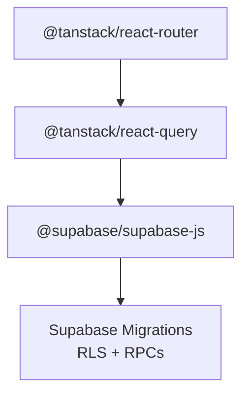
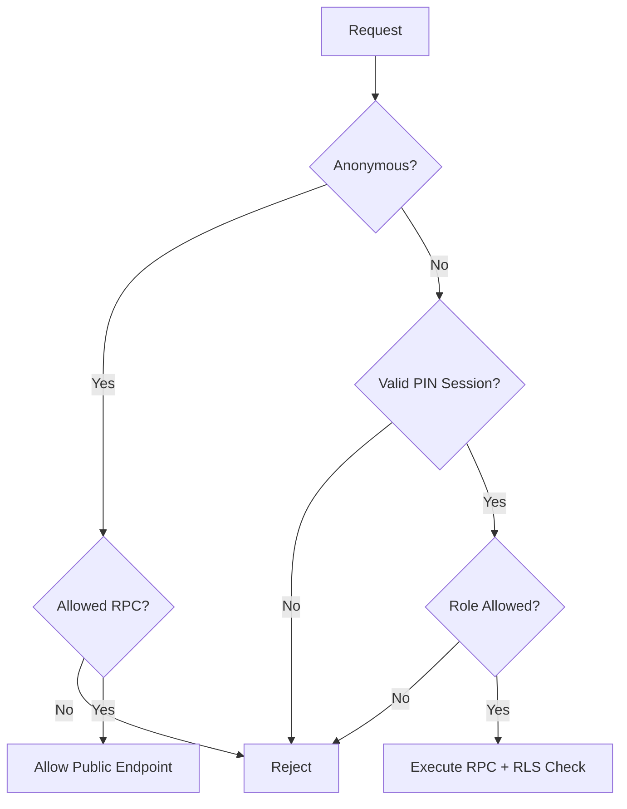

# Architecture Overview

<cite>
**Referenced Files in This Document**
- [README.md](file://README.md)
- [package.json](file://package.json)
- [src/router.tsx](file://src/router.tsx)
- [src/routes/__root.tsx](file://src/routes/__root.tsx)
- [src/routes/_authenticated/app.tsx](file://src/routes/_authenticated/app.tsx)
- [src/lib/pos.tsx](file://src/lib/pos.tsx)
- [src/lib/offline.ts](file://src/lib/offline.ts)
- [src/integrations/supabase/client.ts](file://src/integrations/supabase/client.ts)
- [src/integrations/supabase/auth-middleware.ts](file://src/integrations/supabase/auth-middleware.ts)
- [supabase/migrations/20261008090000_security_hardening.sql](file://supabase/migrations/20261008090000_security_hardening.sql)
- [supabase/migrations/20261009210500_retail_operations.sql](file://supabase/migrations/20261009210500_retail_operations.sql)
</cite>

## Table of Contents
1. [Introduction](#introduction)
2. [Project Structure](#project-structure)
3. [Core Components](#core-components)
4. [Architecture Overview](#architecture-overview)
5. [Detailed Component Analysis](#detailed-component-analysis)
6. [Dependency Analysis](#dependency-analysis)
7. [Performance Considerations](#performance-considerations)
8. [Security and Access Control](#security-and-access-control)
9. [Technology Stack Decisions](#technology-stack-decisions)
10. [Troubleshooting Guide](#troubleshooting-guide)
11. [Conclusion](#conclusion)

## Introduction
Storq POS is a mobile-first point-of-sale application for single or multi-store retail operations. It supports direct sales and approval-based workflows, staff PIN authentication, inventory management, layby payments, and offline-tolerant checkout. The frontend uses React with TanStack Router and TanStack Query for data fetching and caching. Backend logic and security are implemented in Supabase using Row-Level Security policies, role-aware SQL functions, and RPCs that enforce business rules.

The system prioritizes fast register startup, reliable offline sales, and strict server-side validation so that cashiers can work confidently on low-connectivity devices while maintaining secure, auditable records.

## Project Structure
At a high level:
- Frontend routing and layout live under `src/routes`.
- Shared business state and offline behavior live under `src/lib`.
- Supabase client integration lives under `src/integrations/supabase`.
- Database schema, RLS policies, and RPCs live under `supabase/migrations`.

**Diagram sources**
- [src/routes/__root.tsx:59-138](file://src/routes/__root.tsx#L59-L138)
- [src/router.tsx:5-33](file://src/router.tsx#L5-L33)
- [src/routes/_authenticated/app.tsx:73-92](file://src/routes/_authenticated/app.tsx#L73-L92)
- [src/lib/pos.tsx:115-147](file://src/lib/pos.tsx#L115-L147)
- [src/lib/offline.ts:15-55](file://src/lib/offline.ts#L15-L55)
- [src/integrations/supabase/client.ts:57-84](file://src/integrations/supabase/client.ts#L57-L84)
- [src/integrations/supabase/auth-middleware.ts:34-105](file://src/integrations/supabase/auth-middleware.ts#L34-L105)
- [supabase/migrations/20261008090000_security_hardening.sql:67-112](file://supabase/migrations/20261008090000_security_hardening.sql#L67-L112)

**Section sources**
- [README.md:1-26](file://README.md#L1-L26)
- [package.json:19-79](file://package.json#L19-L79)

## Core Components
- TanStack Router configures the app router, query client defaults, and route tree.
- Root route sets up global providers, error handling, internationalization, and auth listeners.
- Authenticated app layout wraps the workspace in `PosProvider` and gates access by setup, subscription, and PIN unlock.
- `PosProvider` centralizes business context: staff session, store selection, money formatting, RPC calls, offline queueing, and idle lock.
- Offline module persists reference data snapshots and sale queues to local storage.
- Supabase client handles environment configuration, fetch interception, and browser/server URL routing.
- Auth middleware validates tokens on the server side for protected routes.
- Supabase migrations define RLS policies, PIN throttling, staff sessions, and RPCs for checkout, approvals, transfers, and more.

**Section sources**
- [src/router.tsx:5-33](file://src/router.tsx#L5-L33)
- [src/routes/__root.tsx:59-138](file://src/routes/__root.tsx#L59-L138)
- [src/routes/_authenticated/app.tsx:73-129](file://src/routes/_authenticated/app.tsx#L73-L129)
- [src/lib/pos.tsx:55-84](file://src/lib/pos.tsx#L55-L84)
- [src/lib/offline.ts:1-14](file://src/lib/offline.ts#L1-L14)
- [src/integrations/supabase/client.ts:57-84](file://src/integrations/supabase/client.ts#L57-L84)
- [src/integrations/supabase/auth-middleware.ts:34-105](file://src/integrations/supabase/auth-middleware.ts#L34-L105)
- [supabase/migrations/20261008090000_security_hardening.sql:26-77](file://supabase/migrations/20261008090000_security_hardening.sql#L26-L77)

## Architecture Overview
The system follows an offline-first pattern:
- Reference data (business, stores, products, collections, stock, staff names) is hydrated from local storage on startup and refreshed in the background.
- Sales made while offline are queued locally and replayed when connectivity returns.
- TanStack Query provides cache freshness without refetching on window focus, reducing unnecessary database hits on slow connections.
- Server-side RPCs validate all writes, enforce roles, and maintain audit trails.

**Diagram sources**
- [src/lib/pos.tsx:275-338](file://src/lib/pos.tsx#L275-L338)
- [src/lib/offline.ts:62-92](file://src/lib/offline.ts#L62-L92)
- [src/router.tsx:5-23](file://src/router.tsx#L5-L23)
- [supabase/migrations/20261009210500_retail_operations.sql:289-320](file://supabase/migrations/20261009210500_retail_operations.sql#L289-L320)

## Detailed Component Analysis

### Routing and Application Shell
- The root route initializes `QueryClientProvider`, sets SEO metadata, installs global error reporting, and subscribes to auth state changes.
- The router config disables refetch-on-focus, limits retries, and increases stale times for POS stability.
- The authenticated app layout wraps child routes in `PosProvider` and renders the sidebar, workspace tabs, and feature pages.

**Diagram sources**
- [src/routes/__root.tsx:59-138](file://src/routes/__root.tsx#L59-L138)
- [src/router.tsx:5-33](file://src/router.tsx#L5-L33)
- [src/routes/_authenticated/app.tsx:73-92](file://src/routes/_authenticated/app.tsx#L73-L92)

**Section sources**
- [src/routes/__root.tsx:59-138](file://src/routes/__root.tsx#L59-L138)
- [src/router.tsx:5-33](file://src/router.tsx#L5-L33)
- [src/routes/_authenticated/app.tsx:73-129](file://src/routes/_authenticated/app.tsx#L73-L129)

### POS Provider and Business Context
`PosProvider` is the central orchestrator for POS state:
- Loads and persists staff sessions and selected store.
- Fetches business and stores with long-lived caches.
- Exposes `unlock`, `lock`, `rpc`, `money`, `compactMoney`, `can`, and `checkout`.
- Manages online status, offline queue persistence, and periodic background sync.
- Enforces idle lock to protect tills between users.

**Diagram sources**
- [src/lib/pos.tsx:55-84](file://src/lib/pos.tsx#L55-L84)
- [src/lib/offline.ts:15-55](file://src/lib/offline.ts#L15-L55)

**Section sources**
- [src/lib/pos.tsx:115-448](file://src/lib/pos.tsx#L115-L448)
- [src/lib/offline.ts:1-92](file://src/lib/offline.ts#L1-L92)

### Authentication, PIN Unlock, and Session Management
- Users sign in with email/password; then they unlock the POS with a staff PIN.
- `unlock_with_pin` enforces PIN shape, throttles brute-force attempts per device, and creates a short-lived staff session bound to the device login.
- `lock_session` invalidates the active session; sign-out clears all sessions for the device.
- Role checks use `app.session_role()` inside RLS policies and RPCs.

**Diagram sources**
- [src/lib/pos.tsx:194-215](file://src/lib/pos.tsx#L194-L215)
- [supabase/migrations/20261008090000_security_hardening.sql:218-291](file://supabase/migrations/20261008090000_security_hardening.sql#L218-L291)

**Section sources**
- [src/routes/_authenticated/app.tsx:131-151](file://src/routes/_authenticated/app.tsx#L131-L151)
- [src/lib/pos.tsx:194-215](file://src/lib/pos.tsx#L194-L215)
- [supabase/migrations/20261008090000_security_hardening.sql:218-291](file://supabase/migrations/20261008090000_security_hardening.sql#L218-L291)

### Checkout Flow and Approval Workflows
- Direct stores complete sales immediately; approval stores create invoices awaiting manager/admin review.
- Checkout supports split tenders, per-line discounts, and optional manager override PIN for cashier discounts.
- Offline checkout falls back to local queue and replays through `checkout_ref`.

**Diagram sources**
- [src/lib/pos.tsx:275-338](file://src/lib/pos.tsx#L275-L338)
- [supabase/migrations/20261009210500_retail_operations.sql:102-320](file://supabase/migrations/20261009210500_retail_operations.sql#L102-L320)

**Section sources**
- [supabase/migrations/20261009210500_retail_operations.sql:102-320](file://supabase/migrations/20261009210500_retail_operations.sql#L102-L320)
- [src/lib/pos.tsx:275-338](file://src/lib/pos.tsx#L275-L338)

### Offline-First Data Strategy
- Hydration loads cached reference data instantly and marks it stale for background refresh.
- Persistence batches updates to avoid excessive local storage writes.
- Only safe, non-role-gated reference data is persisted.
- Sale queue survives reloads and retries until success or explicit discard.

**Diagram sources**
- [src/lib/offline.ts:15-55](file://src/lib/offline.ts#L15-L55)
- [src/lib/pos.tsx:242-247](file://src/lib/pos.tsx#L242-L247)

**Section sources**
- [src/lib/offline.ts:1-92](file://src/lib/offline.ts#L1-L92)
- [src/lib/pos.tsx:242-247](file://src/lib/pos.tsx#L242-L247)

### Supabase Client and Server Integration
- Browser client uses publishable keys and intercepts requests to route them correctly between public URLs and runtime backend URLs.
- Server middleware validates tokens and attaches user claims to route context.
- Admin service-role client exists for privileged server operations where RLS must be bypassed intentionally.

**Diagram sources**
- [src/integrations/supabase/client.ts:10-54](file://src/integrations/supabase/client.ts#L10-L54)
- [src/integrations/supabase/auth-middleware.ts:34-105](file://src/integrations/supabase/auth-middleware.ts#L34-L105)

**Section sources**
- [src/integrations/supabase/client.ts:57-84](file://src/integrations/supabase/client.ts#L57-L84)
- [src/integrations/supabase/auth-middleware.ts:34-105](file://src/integrations/supabase/auth-middleware.ts#L34-L105)

## Dependency Analysis
Key dependencies and relationships:
- `@tanstack/react-router` drives navigation and route context.
- `@tanstack/react-query` manages data fetching, caching, and invalidation.
- `@supabase/supabase-js` connects to Supabase with environment-driven configuration.
- Supabase migrations provide RLS policies, PIN throttling, staff sessions, and RPCs.

**Diagram sources**
- [package.json:52-57](file://package.json#L52-L57)
- [src/router.tsx:1-33](file://src/router.tsx#L1-L33)
- [src/integrations/supabase/client.ts:57-84](file://src/integrations/supabase/client.ts#L57-L84)
- [supabase/migrations/20261008090000_security_hardening.sql:67-112](file://supabase/migrations/20261008090000_security_hardening.sql#L67-L112)

**Section sources**
- [package.json:52-57](file://package.json#L52-L57)
- [src/router.tsx:1-33](file://src/router.tsx#L1-L33)

## Performance Considerations
- Default query stale time is increased to reduce refetch noise on POS terminals.
- Refetch-on-window-focus is disabled to prevent unnecessary database load when the app regains visibility.
- Retry counts are limited to avoid request stacking on slow networks.
- Reference data hydration ensures instant register startup while refreshing in the background.
- Local storage persistence is debounced to minimize I/O churn.

[No sources needed since this section provides general guidance]

## Security and Access Control
- Anonymous RPC execution is restricted except for explicitly allowed public endpoints.
- PIN brute-force protection tracks failed attempts per business and device, locking after repeated failures.
- Staff sessions are short-lived and bound to the device login that created them.
- All sensitive writes go through `SECURITY DEFINER` RPCs validated by `require_staff` and role checks.
- Row-Level Security policies require a valid PIN session for most reads and restrict money-related data to appropriate roles.
- Cost and margin data are moved into separate tables with stricter read policies.

**Diagram sources**
- [supabase/migrations/20261008090000_security_hardening.sql:7-20](file://supabase/migrations/20261008090000_security_hardening.sql#L7-L20)
- [supabase/migrations/20261008090000_security_hardening.sql:26-77](file://supabase/migrations/20261008090000_security_hardening.sql#L26-L77)
- [supabase/migrations/20261008090000_security_hardening.sql:79-112](file://supabase/migrations/20261008090000_security_hardening.sql#L79-L112)

**Section sources**
- [supabase/migrations/20261008090000_security_hardening.sql:7-20](file://supabase/migrations/20261008090000_security_hardening.sql#L7-L20)
- [supabase/migrations/20261008090000_security_hardening.sql:26-77](file://supabase/migrations/20261008090000_security_hardening.sql#L26-L77)
- [supabase/migrations/20261008090000_security_hardening.sql:79-112](file://supabase/migrations/20261008090000_security_hardening.sql#L79-L112)

## Technology Stack Decisions
- React with TanStack Router provides type-safe routing and nested layouts suitable for complex POS screens.
- TanStack Query enables predictable caching and targeted invalidation, critical for offline-first retail workflows.
- Supabase offers a unified backend with authentication, database, and RPCs, simplifying deployment and security policy management.
- Mobile-first UI components and responsive layouts support tablets and phones commonly used in retail environments.
- Trade-offs include relying on browser local storage for offline queues and accepting eventual consistency during sync windows.

**Section sources**
- [package.json:52-79](file://package.json#L52-L79)
- [README.md:1-26](file://README.md#L1-L26)

## Troubleshooting Guide
Common issues and remedies:
- Raw database errors are masked to generic messages to avoid leaking internals; check server logs for detailed diagnostics.
- If a sale fails to sync, inspect the offline banner for retry or discard options.
- PIN lockouts indicate too many wrong attempts; wait for the cooldown period or contact an admin.
- Sign-out clears local staff sessions and queries; ensure the correct user unlocks the till afterward.
- Subscription locks show billing gating; resolve plan or store limits before accessing features.

**Section sources**
- [src/lib/pos.tsx:88-104](file://src/lib/pos.tsx#L88-L104)
- [src/lib/pos.tsx:389-433](file://src/lib/pos.tsx#L389-L433)
- [supabase/migrations/20261008090000_security_hardening.sql:218-291](file://supabase/migrations/20261008090000_security_hardening.sql#L218-L291)

## Conclusion
Storq POS combines a resilient offline-first frontend with strong server-side security and business logic. TanStack Router and React Context deliver a clear component hierarchy and centralized state, while Supabase enforces role-based access and validates every transaction. This architecture supports both direct and approval-based retail models, making it suitable for mobile-first environments where reliability, speed, and security matter most.