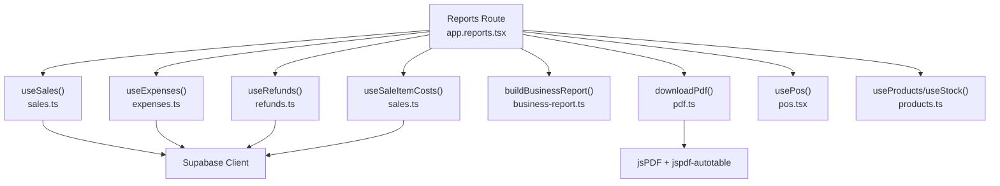
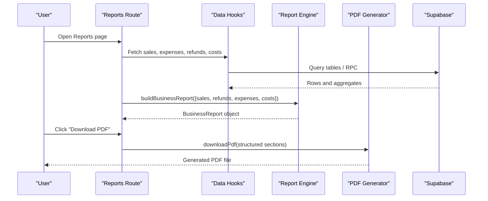
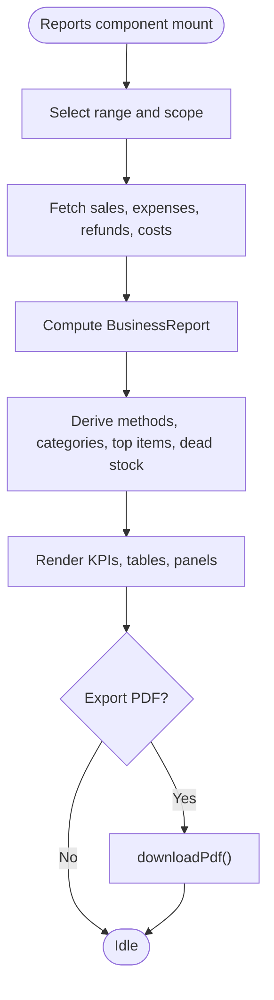
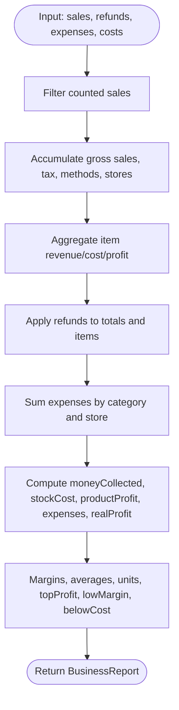
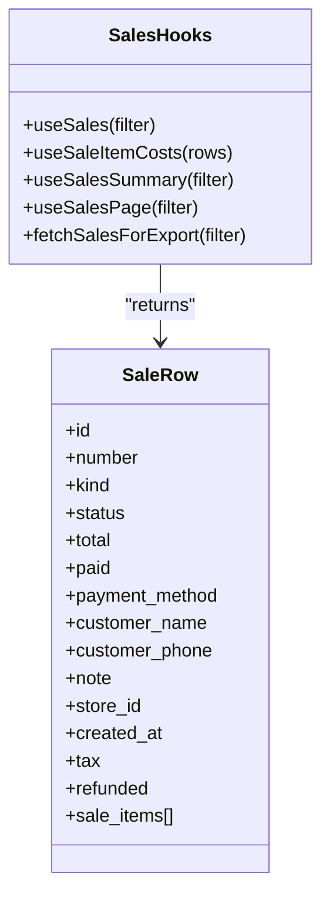
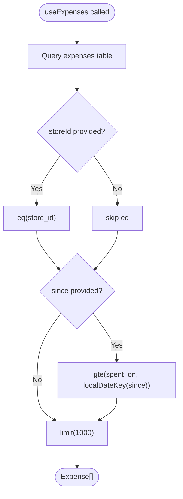
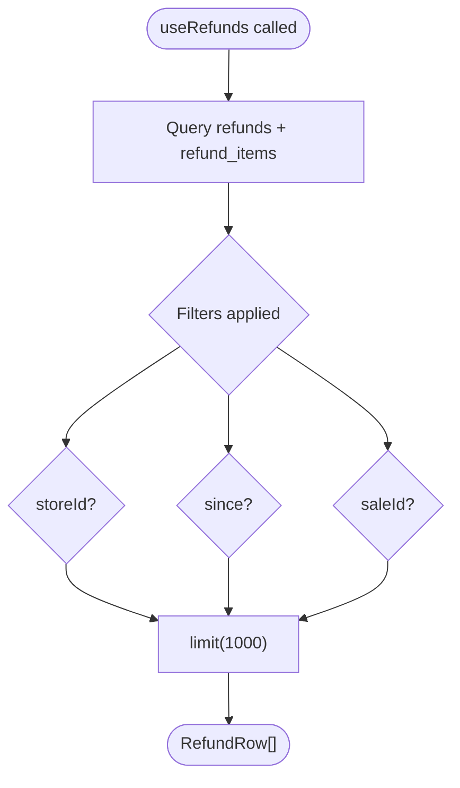
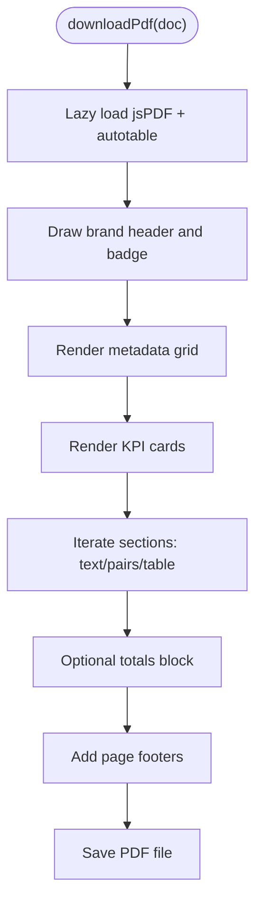
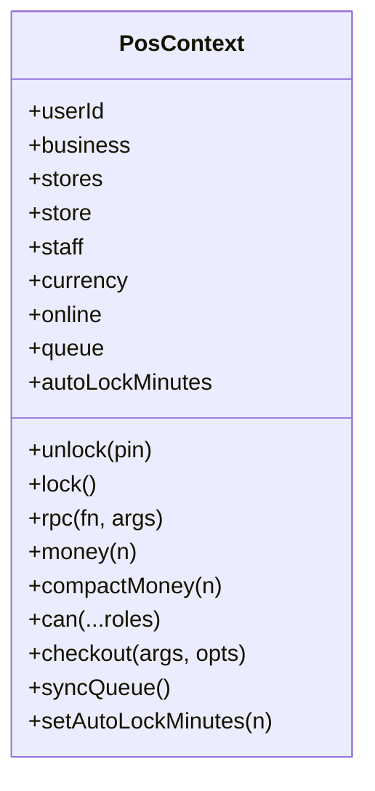
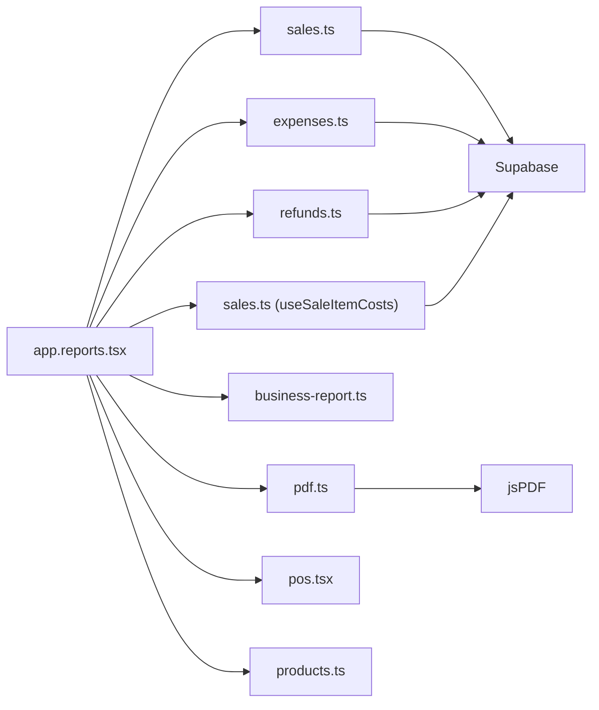

# Business Reporting System

<cite>
**Referenced Files in This Document**   
- [README.md](file://README.md)
- [package.json](file://package.json)
- [business-report.ts](file://src/lib/business-report.ts)
- [business-report.test.ts](file://src/lib/business-report.test.ts)
- [app.reports.tsx](file://src/routes/_authenticated/app.reports.tsx)
- [sales.ts](file://src/lib/sales.ts)
- [expenses.ts](file://src/lib/expenses.ts)
- [refunds.ts](file://src/lib/refunds.ts)
- [pdf.ts](file://src/lib/pdf.ts)
- [pos.tsx](file://src/lib/pos.tsx)
- [products.ts](file://src/lib/products.ts)
- [20261011090000_sales_summary.sql](file://supabase/migrations/20261011090000_sales_summary.sql)
</cite>

## Table of Contents
1. [Introduction](#introduction)
2. [Project Structure](#project-structure)
3. [Core Components](#core-components)
4. [Architecture Overview](#architecture-overview)
5. [Detailed Component Analysis](#detailed-component-analysis)
6. [Dependency Analysis](#dependency-analysis)
7. [Performance Considerations](#performance-considerations)
8. [Troubleshooting Guide](#troubleshooting-guide)
9. [Conclusion](#conclusion)

## Introduction
This document explains the Business Reporting System used by the StockWise POS application. The system aggregates sales, refunds, and expenses to produce a plain-language profit statement for one or multiple stores, supports time-range filtering, identifies below-cost items, tracks payment methods, and exports a branded PDF business statement. It is built on React, TanStack Router, TanStack Query, Supabase, and jsPDF.

The project’s README describes a multi-store retail system with PIN-based staff roles, direct-sale and approval-based store types, layby support, and Square/Shopify-like aesthetics. The reporting feature focuses on profitability, cash flow, and operational insights rather than checkout execution.

**Section sources**
- [README.md:1-26](file://README.md#L1-L26)

## Project Structure
The reporting feature spans UI routing, data fetching hooks, pure report math, and PDF export:

- Route and UI: `src/routes/_authenticated/app.reports.tsx`
- Pure report engine: `src/lib/business-report.ts`
- Data hooks: `src/lib/sales.ts`, `src/lib/expenses.ts`, `src/lib/refunds.ts`
- PDF generation: `src/lib/pdf.ts`
- Shared POS context and money formatting: `src/lib/pos.tsx`
- Product catalog and stock helpers: `src/lib/products.ts`
- Server-side aggregate RPC migration: `supabase/migrations/20261011090000_sales_summary.sql`

**Diagram sources**
- [app.reports.tsx:1-568](file://src/routes/_authenticated/app.reports.tsx#L1-L568)
- [sales.ts:1-217](file://src/lib/sales.ts#L1-L217)
- [expenses.ts:1-69](file://src/lib/expenses.ts#L1-L69)
- [refunds.ts:1-56](file://src/lib/refunds.ts#L1-L56)
- [business-report.ts:1-147](file://src/lib/business-report.ts#L1-L147)
- [pdf.ts:1-527](file://src/lib/pdf.ts#L1-L527)
- [pos.tsx:1-451](file://src/lib/pos.tsx#L1-L451)
- [products.ts:1-107](file://src/lib/products.ts#L1-L107)

**Section sources**
- [package.json:1-106](file://package.json#L1-L106)

## Core Components
- Reports route component: orchestrates filters, queries, report computation, UI panels, and PDF export.
- Business report engine: pure function that computes profit metrics, item-level margins, payment method totals, expense categories, and per-store summaries.
- Data hooks: fetch sales, refunds, expenses, sale-item costs, products, and stock from Supabase using TanStack Query.
- PDF generator: builds branded A4 statements and thermal receipts using jsPDF.
- POS context: provides authentication, role checks, currency formatting, store selection, and offline queueing utilities.

Key responsibilities:
- Filtering by date range and single/all stores.
- Aggregating completed and refund-adjusted sales into collected revenue.
- Subtracting stock cost and operating expenses to derive product and real profit.
- Identifying below-cost items and low-margin products.
- Rendering KPIs, tables, and progress bars.
- Exporting a structured PDF with statement, tables, and sign-off text.

**Section sources**
- [app.reports.tsx:1-568](file://src/routes/_authenticated/app.reports.tsx#L1-L568)
- [business-report.ts:1-147](file://src/lib/business-report.ts#L1-L147)
- [sales.ts:1-217](file://src/lib/sales.ts#L1-L217)
- [expenses.ts:1-69](file://src/lib/expenses.ts#L1-L69)
- [refunds.ts:1-56](file://src/lib/refunds.ts#L1-L56)
- [pdf.ts:1-527](file://src/lib/pdf.ts#L1-L527)
- [pos.tsx:1-451](file://src/lib/pos.tsx#L1-L451)

## Architecture Overview
The reporting pipeline combines client-side data aggregation with a pure calculation layer and a presentation/export layer.

**Diagram sources**
- [app.reports.tsx:41-115](file://src/routes/_authenticated/app.reports.tsx#L41-L115)
- [sales.ts:37-73](file://src/lib/sales.ts#L37-L73)
- [expenses.ts:35-58](file://src/lib/expenses.ts#L35-L58)
- [refunds.ts:26-51](file://src/lib/refunds.ts#L26-L51)
- [business-report.ts:45-145](file://src/lib/business-report.ts#L45-L145)
- [pdf.ts:58-273](file://src/lib/pdf.ts#L58-L273)

## Detailed Component Analysis

### Reports Route (`app.reports.tsx`)
Responsibilities:
- Manage state for date range and all-stores toggle.
- Compute `since` date and scope label.
- Fetch sales, expenses, refunds, sale-item costs, products, and stock.
- Build the business report via `buildBusinessReport`.
- Derive derived views: dead stock, payment methods, top profit items, low margin items, expense categories.
- Render KPI verdict, bottom-line steps, tables, and panels.
- Export a branded PDF using `downloadPdf`.

Important behaviors:
- Admin/manager-only access gate.
- Loading states while queries are pending.
- Currency formatting through `money` from POS context.
- Multi-store breakdown when enabled.

**Diagram sources**
- [app.reports.tsx:41-115](file://src/routes/_authenticated/app.reports.tsx#L41-L115)
- [app.reports.tsx:236-300](file://src/routes/_authenticated/app.reports.tsx#L236-L300)
- [app.reports.tsx:302-498](file://src/routes/_authenticated/app.reports.tsx#L302-L498)

**Section sources**
- [app.reports.tsx:1-568](file://src/routes/_authenticated/app.reports.tsx#L1-L568)

### Business Report Engine (`business-report.ts`)
Responsibilities:
- Define input/output types for sales, refunds, expenses, and item lines.
- Filter counted sales by status set.
- Aggregate gross sales, tax, payment method totals, and per-store metrics.
- Compute item-level revenue, cost, and profit; track sold keys.
- Apply refunds to reduce collected revenue and stock cost.
- Sum expenses by category and till source; compute per-store expenses.
- Produce final metrics: money collected, stock cost, product profit, real profit, margins, orders, average sale, units sold, top profit, low margin, below-cost list, and below-cost loss.

Complexity:
- Single pass over sales, refunds, and expenses: O(n + m + k).
- Item grouping uses a map keyed by product id or name: amortized O(1) insert/update.
- Sorting top/below-cost lists: O(p log p) where p is number of unique items.

**Diagram sources**
- [business-report.ts:43-145](file://src/lib/business-report.ts#L43-L145)

**Section sources**
- [business-report.ts:1-147](file://src/lib/business-report.ts#L1-L147)
- [business-report.test.ts:1-77](file://src/lib/business-report.test.ts#L1-L77)

### Data Hooks

#### Sales Hook (`sales.ts`)
- `useSales`: fetches sales rows with optional nested items, filtered by store, statuses, and since date; caches results with stale time.
- `useSaleItemCosts`: fetches buying costs for sale items in batches; returns a map keyed by sale item id.
- `useSalesSummary`: calls server RPC `sales_summary` to get exact headline numbers without loading full rows.
- `useSalesPage`: paginated read of sales rows with exact count.
- `fetchSalesForExport`: lazy full-period export query bounded by limit.

**Diagram sources**
- [sales.ts:5-35](file://src/lib/sales.ts#L5-L35)
- [sales.ts:37-73](file://src/lib/sales.ts#L37-L73)
- [sales.ts:77-99](file://src/lib/sales.ts#L77-L99)
- [sales.ts:126-148](file://src/lib/sales.ts#L126-L148)
- [sales.ts:156-181](file://src/lib/sales.ts#L156-L181)
- [sales.ts:200-216](file://src/lib/sales.ts#L200-L216)

**Section sources**
- [sales.ts:1-217](file://src/lib/sales.ts#L1-L217)

#### Expenses Hook (`expenses.ts`)
- `useExpenses`: fetches expenses ordered by spent date and created date, limited to 1000 rows, filterable by store and local calendar day.
- `rangeDays` and `sinceFor`: helper constants and functions to compute period start ISO strings.

**Diagram sources**
- [expenses.ts:35-58](file://src/lib/expenses.ts#L35-L58)
- [expenses.ts:61-68](file://src/lib/expenses.ts#L61-L68)

**Section sources**
- [expenses.ts:1-69](file://src/lib/expenses.ts#L1-L69)

#### Refunds Hook (`refunds.ts`)
- `useRefunds`: fetches refunds with nested refund items, filterable by store, since date, and sale id.

**Diagram sources**
- [refunds.ts:26-51](file://src/lib/refunds.ts#L26-L51)

**Section sources**
- [refunds.ts:1-56](file://src/lib/refunds.ts#L1-L56)

### PDF Generation (`pdf.ts`)
Responsibilities:
- Generate branded A4 business statements with header, badge, metadata grid, KPI cards, and sections (tables, pairs, text).
- Generate thermal receipt PDFs sized for an 80mm roll.
- Provide CSV helpers for safe export.
- Generate printable QR label sheets.

Key design points:
- Lazy imports of jsPDF and autotable to avoid SSR bundle size.
- Text normalization for standard Latin-1 fonts.
- Page footer with generated timestamp and page numbering.
- Safe CSV cell escaping to prevent formula injection.

**Diagram sources**
- [pdf.ts:58-273](file://src/lib/pdf.ts#L58-L273)
- [pdf.ts:286-381](file://src/lib/pdf.ts#L286-L381)
- [pdf.ts:386-431](file://src/lib/pdf.ts#L386-L431)
- [pdf.ts:447-526](file://src/lib/pdf.ts#L447-L526)

**Section sources**
- [pdf.ts:1-527](file://src/lib/pdf.ts#L1-L527)

### POS Context (`pos.tsx`)
Responsibilities:
- Manage staff session, store selection, role checks, and auto-lock hygiene.
- Provide RPC wrapper with error masking.
- Offer money formatting based on business currency.
- Handle offline queueing and background sync.

Relevance to reporting:
- Provides `can("admin", "manager")` gating for reports.
- Supplies `money` formatter used across report UI and PDF.
- Supplies `business` metadata for PDF headers and currency.

**Diagram sources**
- [pos.tsx:29-85](file://src/lib/pos.tsx#L29-L85)
- [pos.tsx:116-231](file://src/lib/pos.tsx#L116-L231)
- [pos.tsx:278-341](file://src/lib/pos.tsx#L278-L341)
- [pos.tsx:369-391](file://src/lib/pos.tsx#L369-L391)

**Section sources**
- [pos.tsx:1-451](file://src/lib/pos.tsx#L1-L451)

### Products and Stock (`products.ts`)
Responsibilities:
- Fetch product catalog with optional buying costs for admin/manager.
- Provide barcode lookup against cached catalog.
- Fetch store stock levels with optional live polling for till usage.

Relevance to reporting:
- Used to identify dead stock not sold within the selected period.
- Supports valuation of unsold inventory for display.

**Section sources**
- [products.ts:1-107](file://src/lib/products.ts#L1-L107)

## Dependency Analysis
High-level dependencies:
- Reports route depends on:
  - Data hooks for sales, expenses, refunds, costs.
  - Report engine for pure calculations.
  - PDF generator for export.
  - POS context for permissions, currency, and business info.
  - Products/stock for dead-stock analysis.
- Data hooks depend on Supabase client and TanStack Query caching.
- Report engine has no external runtime dependencies beyond JavaScript primitives.
- PDF generator depends on jsPDF and jspdf-autotable.

**Diagram sources**
- [app.reports.tsx:1-568](file://src/routes/_authenticated/app.reports.tsx#L1-L568)
- [sales.ts:1-217](file://src/lib/sales.ts#L1-L217)
- [expenses.ts:1-69](file://src/lib/expenses.ts#L1-L69)
- [refunds.ts:1-56](file://src/lib/refunds.ts#L1-L56)
- [business-report.ts:1-147](file://src/lib/business-report.ts#L1-L147)
- [pdf.ts:1-527](file://src/lib/pdf.ts#L1-L527)
- [pos.tsx:1-451](file://src/lib/pos.tsx#L1-L451)
- [products.ts:1-107](file://src/lib/products.ts#L1-L107)

**Section sources**
- [app.reports.tsx:1-568](file://src/routes/_authenticated/app.reports.tsx#L1-L568)
- [business-report.ts:1-147](file://src/lib/business-report.ts#L1-L147)
- [pdf.ts:1-527](file://src/lib/pdf.ts#L1-L527)

## Performance Considerations
- Query caching:
  - Sales, expenses, and refunds use short stale times to keep UI responsive while avoiding excessive re-fetches.
  - Sale item costs have longer stale time because they are immutable snapshots once recorded.
  - Catalog and stock queries are long-lived or polled only where needed.
- Server-side aggregation:
  - `sales_summary` RPC computes headline numbers on the database side, avoiding large client-side aggregations and truncation issues.
- Batched cost lookups:
  - Sale item costs are fetched in batches of 500 ids to reduce payload size and round-trips.
- PDF generation:
  - jsPDF modules are lazily imported to avoid bloating the initial bundle.
- Memory efficiency:
  - Report engine processes arrays in single passes and uses maps for item grouping.

[No sources needed since this section provides general guidance]

## Troubleshooting Guide
Common issues and resolutions:
- Reports show zero collected revenue:
  - Verify that sales have counted statuses; pending approvals are excluded by the report engine.
  - Check that the selected date range includes the sales.
- Below-cost items appear unexpectedly:
  - Confirm that sale item costs are present for those items; missing costs default to zero and can inflate perceived losses.
- PDF export fails:
  - Ensure jsPDF and autotable can be dynamically imported; check browser compatibility and network availability.
- Multi-store breakdown shows missing stores:
  - Ensure the user has permission to view all stores and that the store exists under the authenticated business.
- Cash till reconciliation mismatch:
  - Verify that till-sourced expenses are correctly categorized and that cash sales are included in the selected period.

**Section sources**
- [business-report.ts:43-145](file://src/lib/business-report.ts#L43-L145)
- [app.reports.tsx:89-115](file://src/routes/_authenticated/app.reports.tsx#L89-L115)
- [pdf.ts:58-273](file://src/lib/pdf.ts#L58-L273)

## Conclusion
The Business Reporting System delivers a clear, auditable profit statement for retail operations. It separates concerns cleanly:
- UI orchestration in the reports route.
- Pure calculation logic in the report engine.
- Robust data fetching via TanStack Query hooks.
- Branded PDF export for sharing and recordkeeping.

It supports multi-store environments, flexible date ranges, and actionable insights such as below-cost items, low-margin products, and payment method distribution. With server-side aggregation and careful caching, it balances accuracy and performance for typical POS workloads.

[No sources needed since this section summarizes without analyzing specific files]