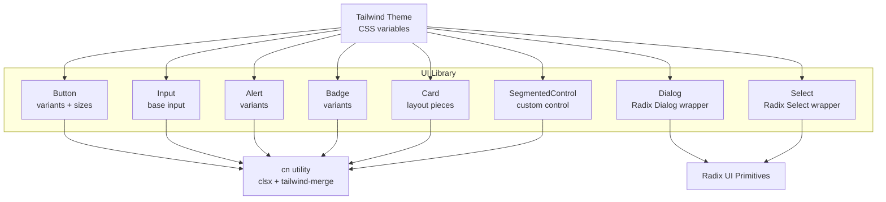
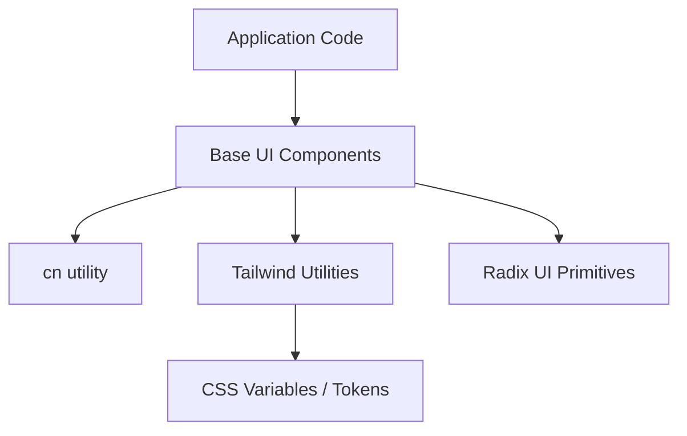
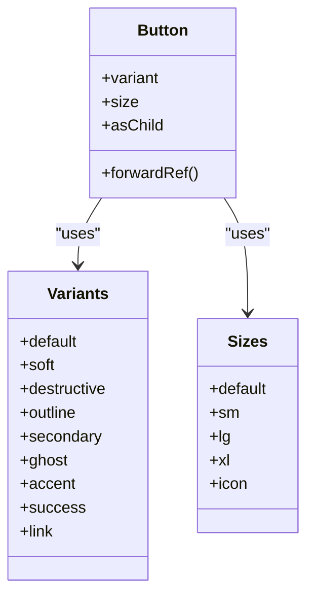
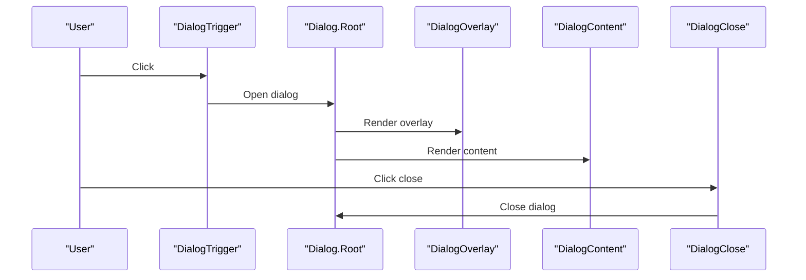
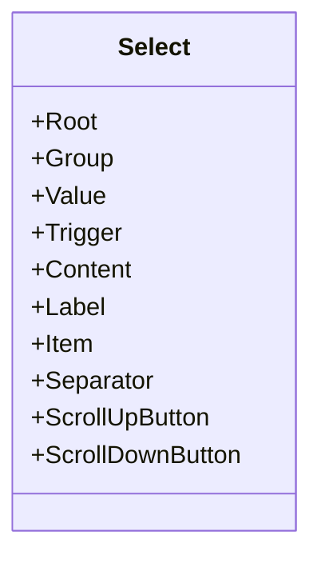
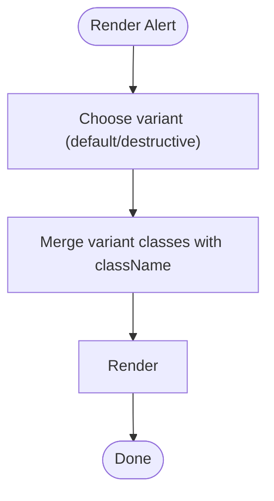
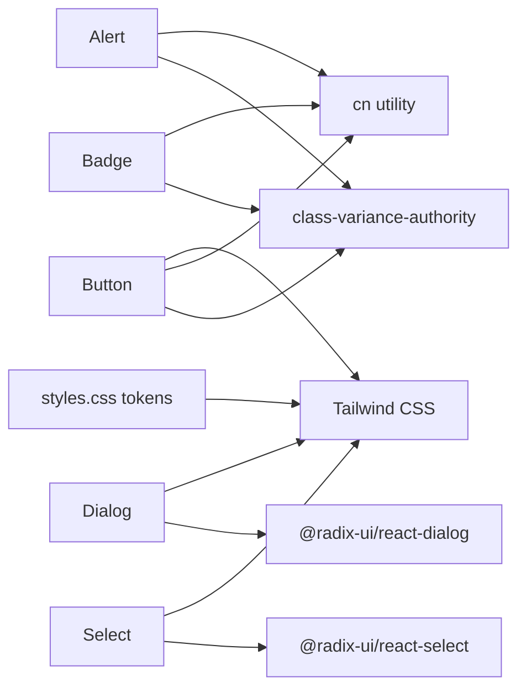

# Base UI Components

<cite>
**Referenced Files in This Document**
- [button.tsx](file://src/components/ui/button.tsx)
- [input.tsx](file://src/components/ui/input.tsx)
- [dialog.tsx](file://src/components/ui/dialog.tsx)
- [badge.tsx](file://src/components/ui/badge.tsx)
- [card.tsx](file://src/components/ui/card.tsx)
- [select.tsx](file://src/components/ui/select.tsx)
- [alert.tsx](file://src/components/ui/alert.tsx)
- [segmented-control.tsx](file://src/components/ui/segmented-control.tsx)
- [utils.ts](file://src/lib/utils.ts)
- [styles.css](file://src/styles.css)
- [components.json](file://components.json)
- [package.json](file://package.json)
</cite>

## Table of Contents
1. [Introduction](#introduction)
2. [Project Structure](#project-structure)
3. [Core Components](#core-components)
4. [Architecture Overview](#architecture-overview)
5. [Detailed Component Analysis](#detailed-component-analysis)
6. [Dependency Analysis](#dependency-analysis)
7. [Performance Considerations](#performance-considerations)
8. [Troubleshooting Guide](#troubleshooting-guide)
9. [Conclusion](#conclusion)

## Introduction
This document describes the base UI component library built on Radix UI primitives and styled with Tailwind CSS. The library uses class-variance-authority (cva) to define consistent styling variants, a shared utility for safe class merging, and a design system defined via CSS custom properties and Tailwind theme tokens. It covers the architecture pattern, prop interfaces, accessibility features, composition strategies, and integration with the design system including color tokens, spacing, and typography. Examples include variant usage, size customization, and composition patterns for components such as Button, Input, Dialog, Badge, Card, Select, Alert, and SegmentedControl.

## Project Structure
The UI components live under src/components/ui and follow a consistent pattern:
- Primitives wrap Radix UI components or native elements.
- Styling is applied through Tailwind classes merged via a shared cn utility.
- Variants are declared with cva for components that need multiple visual modes or sizes.
- Accessibility attributes and roles are provided by Radix primitives and enhanced where needed.

**Diagram sources**
- [button.tsx:1-55](file://src/components/ui/button.tsx#L1-L55)
- [input.tsx:1-23](file://src/components/ui/input.tsx#L1-L23)
- [dialog.tsx:1-105](file://src/components/ui/dialog.tsx#L1-L105)
- [select.tsx:1-153](file://src/components/ui/select.tsx#L1-L153)
- [alert.tsx:1-50](file://src/components/ui/alert.tsx#L1-L50)
- [badge.tsx:1-34](file://src/components/ui/badge.tsx#L1-L34)
- [card.tsx:1-59](file://src/components/ui/card.tsx#L1-L59)
- [segmented-control.tsx:1-47](file://src/components/ui/segmented-control.tsx#L1-L47)
- [utils.ts:1-7](file://src/lib/utils.ts#L1-L7)
- [styles.css:31-94](file://src/styles.css#L31-L94)

**Section sources**
- [components.json:1-23](file://components.json#L1-L23)
- [package.json:19-79](file://package.json#L19-L79)

## Core Components
This section summarizes the core components, their responsibilities, and how they integrate with the design system.

- Button
  - Provides multiple visual variants and sizes using cva.
  - Supports asChild composition to render into any element via Radix Slot.
  - Uses semantic focus-visible ring and disabled states.
  - Integrates with brand tokens like primary, secondary, accent, success, destructive.

- Input
  - Styled native input with consistent border, padding, placeholder, and focus ring.
  - Extends standard HTML input props.

- Dialog
  - Wraps Radix Dialog primitives with accessible overlay, portal, close button, header/footer, title, and description.
  - Includes animations and keyboard/screen-reader support from Radix.

- Select
  - Wraps Radix Select with trigger, content, viewport, labels, items, separators, and scroll buttons.
  - Applies consistent sizing, focus ring, and iconography.

- Alert
  - Variant-based alert container with role="alert".
  - Title and description helpers for structure.

- Badge
  - Variant-based label for status and metadata.
  - Uses soft tints per design spec.

- Card
  - Layout-oriented composite: Card, CardHeader, CardTitle, CardDescription, CardContent, CardFooter.
  - Uses card tokens and spacing.

- SegmentedControl
  - Custom tab-like control with accessible role="tablist" and aria-selected.
  - Controlled value and onChange pattern; supports size variants.

**Section sources**
- [button.tsx:7-54](file://src/components/ui/button.tsx#L7-L54)
- [input.tsx:5-20](file://src/components/ui/input.tsx#L5-L20)
- [dialog.tsx:9-104](file://src/components/ui/dialog.tsx#L9-L104)
- [select.tsx:9-152](file://src/components/ui/select.tsx#L9-L152)
- [alert.tsx:6-49](file://src/components/ui/alert.tsx#L6-L49)
- [badge.tsx:6-33](file://src/components/ui/badge.tsx#L6-L33)
- [card.tsx:5-58](file://src/components/ui/card.tsx#L5-L58)
- [segmented-control.tsx:11-47](file://src/components/ui/segmented-control.tsx#L11-L47)

## Architecture Overview
The library follows a layered architecture:
- Presentation layer: React components in src/components/ui.
- Styling layer: Tailwind utilities and CSS variables defined in styles.css.
- Utility layer: Shared helpers like cn for class merging.
- Primitive layer: Radix UI components providing behavior and accessibility.

**Diagram sources**
- [button.tsx:1-55](file://src/components/ui/button.tsx#L1-L55)
- [utils.ts:1-7](file://src/lib/utils.ts#L1-L7)
- [styles.css:31-94](file://src/styles.css#L31-L94)
- [dialog.tsx:1-105](file://src/components/ui/dialog.tsx#L1-L105)

## Detailed Component Analysis

### Button
- Pattern
  - Defines variants and sizes via cva.
  - Exposes a forwardRef component supporting asChild composition.
  - Merges default classes, variant classes, and user className via cn.
- Props
  - Inherits all HTML button attributes.
  - Adds variant and size from cva.
  - Adds asChild boolean to render as a Radix Slot instead of a button element.
- Variants
  - Visual modes: default, soft, destructive, outline, secondary, ghost, accent, success, link.
  - Sizes: default, sm, lg, xl, icon.
- Accessibility
  - Focus-visible ring and disabled state handled via Tailwind classes.
  - Keyboard interaction inherited from native button semantics.
- Composition
  - Use asChild to compose with icons or other interactive elements without nested buttons.

**Diagram sources**
- [button.tsx:7-54](file://src/components/ui/button.tsx#L7-L54)

**Section sources**
- [button.tsx:7-54](file://src/components/ui/button.tsx#L7-L54)

### Input
- Pattern
  - ForwardRef input with consistent base styles.
  - Accepts all standard input props and an optional type.
- Styling
  - Border, background, padding, placeholder color, focus ring, and disabled state.
- Accessibility
  - Native input semantics; focus-visible ring for keyboard users.

```mermaid
flowchart TD
Start(["Render Input"]) --> ApplyClasses["Merge base classes with className"]
ApplyClasses --> Render["Render <input> with ref and props"]
Render --> End(["Done"])
```

**Diagram sources**
- [input.tsx:5-20](file://src/components/ui/input.tsx#L5-L20)

**Section sources**
- [input.tsx:5-20](file://src/components/ui/input.tsx#L5-L20)

### Dialog
- Pattern
  - Wraps Radix Dialog.Root, Trigger, Portal, Close, Overlay, Content, Header, Footer, Title, Description.
  - Adds accessible close button with screen reader text.
- Styling
  - Overlay fade, content positioning, animation states, rounded corners, and responsive layout.
- Accessibility
  - Radix provides focus management, trap focus, escape handling, and ARIA attributes.
  - Close button includes sr-only label.

**Diagram sources**
- [dialog.tsx:9-104](file://src/components/ui/dialog.tsx#L9-L104)

**Section sources**
- [dialog.tsx:9-104](file://src/components/ui/dialog.tsx#L9-L104)

### Select
- Pattern
  - Wraps Radix Select with Trigger, Content, Viewport, Label, Item, Separator, Scroll buttons.
  - Applies consistent sizing, focus ring, and icon indicators.
- Accessibility
  - Radix manages keyboard navigation, selection, and ARIA roles.
  - Icons for selected item and dropdown direction.

**Diagram sources**
- [select.tsx:9-152](file://src/components/ui/select.tsx#L9-L152)

**Section sources**
- [select.tsx:9-152](file://src/components/ui/select.tsx#L9-L152)

### Alert
- Pattern
  - Variant-based alert container with role="alert".
  - Title and description helpers for structured alerts.
- Accessibility
  - Semantic role for assistive technologies.

**Diagram sources**
- [alert.tsx:6-49](file://src/components/ui/alert.tsx#L6-L49)

**Section sources**
- [alert.tsx:6-49](file://src/components/ui/alert.tsx#L6-L49)

### Badge
- Pattern
  - Variant-based badge using soft tints per design spec.
- Accessibility
  - Semantic div; use with appropriate context or add aria-label when needed.

**Section sources**
- [badge.tsx:6-33](file://src/components/ui/badge.tsx#L6-L33)

### Card
- Pattern
  - Composite layout components: Card, CardHeader, CardTitle, CardDescription, CardContent, CardFooter.
- Styling
  - Uses card tokens and spacing utilities.

**Section sources**
- [card.tsx:5-58](file://src/components/ui/card.tsx#L5-L58)

### SegmentedControl
- Pattern
  - Custom controlled component with options array, value, onChange, and size.
  - Accessible tablist/tab pattern with aria-selected.
- Styling
  - Track background, active segment card style, and spacing.

**Section sources**
- [segmented-control.tsx:11-47](file://src/components/ui/segmented-control.tsx#L11-L47)

## Dependency Analysis
Key dependencies and relationships:
- class-variance-authority: Used by Button, Badge, and Alert to declare variants.
- clsx and tailwind-merge: Combined in cn utility for deterministic class resolution.
- @radix-ui/*: Provides robust primitives for Dialog, Select, and others.
- Tailwind CSS: Supplies utility classes and theme tokens mapped from CSS variables.
- lucide-react: Icon library used within components like Dialog and Select.

**Diagram sources**
- [button.tsx:1-55](file://src/components/ui/button.tsx#L1-L55)
- [badge.tsx:1-34](file://src/components/ui/badge.tsx#L1-L34)
- [alert.tsx:1-50](file://src/components/ui/alert.tsx#L1-L50)
- [dialog.tsx:1-105](file://src/components/ui/dialog.tsx#L1-L105)
- [select.tsx:1-153](file://src/components/ui/select.tsx#L1-L153)
- [utils.ts:1-7](file://src/lib/utils.ts#L1-L7)
- [styles.css:31-94](file://src/styles.css#L31-L94)

**Section sources**
- [package.json:19-79](file://package.json#L19-L79)
- [utils.ts:1-7](file://src/lib/utils.ts#L1-L7)

## Performance Considerations
- Class computation
  - cva computes variant classes at build time; runtime cost is minimal.
  - cn merges classes efficiently using clsx and tailwind-merge.
- Animations
  - Dialog and Select use data-state animations; ensure reduced-motion preferences are respected.
- Rendering
  - Use asChild on Button to avoid extra DOM nodes when composing with other interactive elements.
- Fonts and assets
  - Fonts are imported locally to avoid cross-origin blocking; variable fonts reduce fallback issues.
- Reduced motion
  - Global styles respect prefers-reduced-motion; components should not override this behavior.

[No sources needed since this section provides general guidance]

## Troubleshooting Guide
- Variants not applying
  - Ensure variant values match those defined in cva.
  - Verify that className is passed through and not overridden.
- Focus ring missing
  - Check that focus-visible styles are not being suppressed by parent styles.
  - Confirm that the component receives focus and is not disabled.
- Dialog not closing
  - Ensure DialogClose is present or handle onClose logic correctly.
  - Verify that the overlay/content are rendered inside a portal.
- Select options not visible
  - Confirm that SelectContent is mounted and positioned correctly.
  - Check z-index conflicts with other overlays.
- Color tokens mismatch
  - Verify CSS variables are defined in :root and .dark blocks and mapped in @theme inline.
  - Ensure Tailwind is scanning the correct source files.

**Section sources**
- [button.tsx:7-54](file://src/components/ui/button.tsx#L7-L54)
- [dialog.tsx:9-104](file://src/components/ui/dialog.tsx#L9-L104)
- [select.tsx:9-152](file://src/components/ui/select.tsx#L9-L152)
- [styles.css:31-94](file://src/styles.css#L31-L94)

## Conclusion
The base UI component library provides a consistent, accessible, and theme-driven set of primitives. By combining Radix UI for behavior, Tailwind for styling, and cva for variants, it offers a scalable foundation for building feature-rich applications. The design system tokens in styles.css ensure cohesive visuals across light and dark themes. Following the documented patterns for variants, composition, and accessibility will help maintain consistency and performance across the application.

[No sources needed since this section summarizes without analyzing specific files]