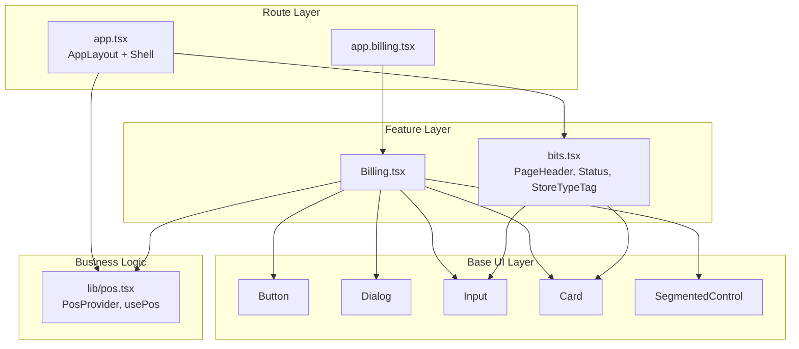
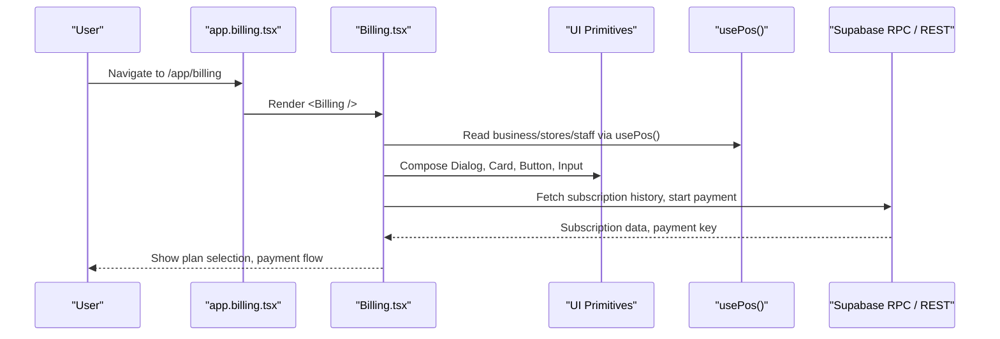
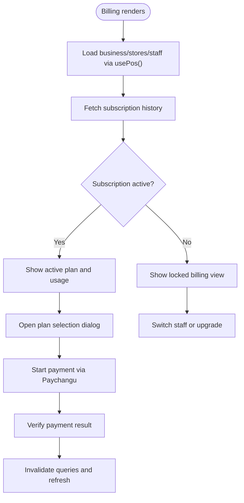
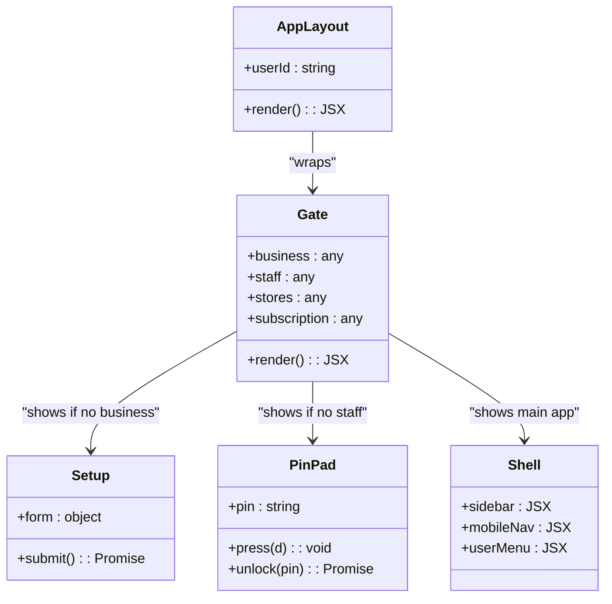
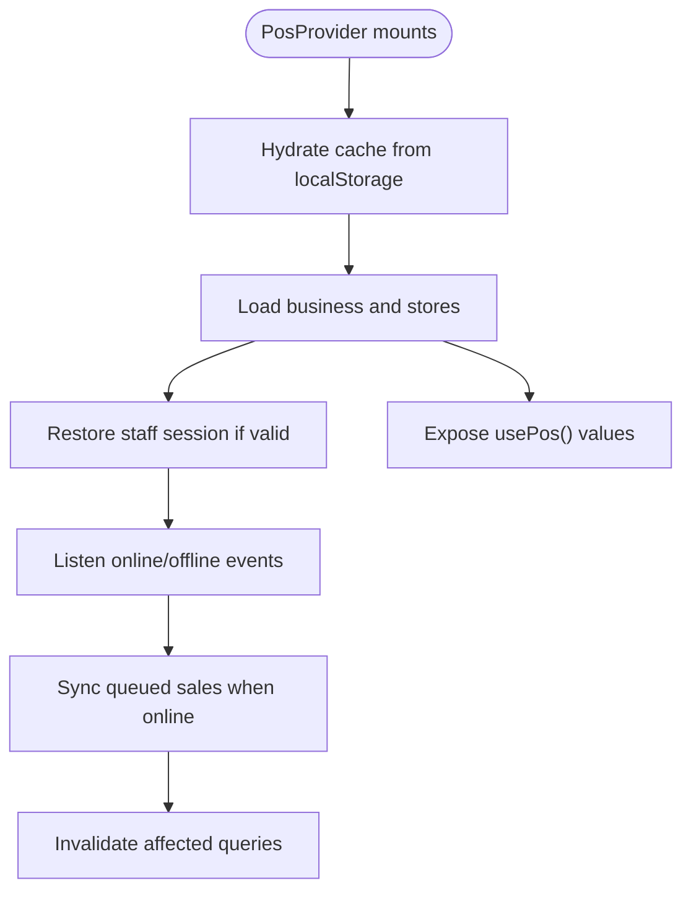
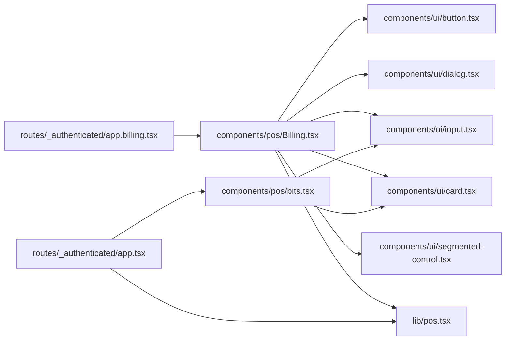

# Component Architecture & Organization

<cite>
**Referenced Files in This Document**
- [README.md](file://README.md)
- [components.json](file://components.json)
- [src/components/ui/button.tsx](file://src/components/ui/button.tsx)
- [src/components/ui/dialog.tsx](file://src/components/ui/dialog.tsx)
- [src/components/ui/input.tsx](file://src/components/ui/input.tsx)
- [src/components/ui/card.tsx](file://src/components/ui/card.tsx)
- [src/components/ui/segmented-control.tsx](file://src/components/ui/segmented-control.tsx)
- [src/components/pos/bits.tsx](file://src/components/pos/bits.tsx)
- [src/components/pos/Billing.tsx](file://src/components/pos/Billing.tsx)
- [src/routes/_authenticated/app.billing.tsx](file://src/routes/_authenticated/app.billing.tsx)
- [src/routes/_authenticated/app.tsx](file://src/routes/_authenticated/app.tsx)
- [src/lib/pos.tsx](file://src/lib/pos.tsx)
</cite>

## Table of Contents
1. [Introduction](#introduction)
2. [Project Structure](#project-structure)
3. [Core Components](#core-components)
4. [Architecture Overview](#architecture-overview)
5. [Detailed Component Analysis](#detailed-component-analysis)
6. [Dependency Analysis](#dependency-analysis)
7. [Performance Considerations](#performance-considerations)
8. [Troubleshooting Guide](#troubleshooting-guide)
9. [Conclusion](#conclusion)
10. [Appendices](#appendices)

## Introduction
This document explains the component architecture and organization of the Storq POS system. It covers how base UI components under src/components/ui/ are built on Radix UI primitives, how feature-specific components live under src/components/pos/, and how route-based pages under src/routes/_authenticated/ map to application features. It also provides guidelines for creating new components, prop interfaces, styling with Tailwind CSS, integration with business logic through hooks and context providers, accessibility considerations, and responsive design patterns.

The project is a point-of-sale application designed for single or multi-store retail operations, including direct sales and approval-based workflows, with PIN-based staff sessions and subscription billing.

**Section sources**
- [README.md:1-26](file://README.md#L1-L26)

## Project Structure
Storq organizes its frontend into three main layers:

- Base UI layer: src/components/ui/ contains small, reusable, accessible primitives (Button, Dialog, Input, Card, SegmentedControl, etc.). These wrap Radix UI primitives and apply consistent Tailwind styles.
- Feature layer: src/components/pos/ contains POS-specific building blocks and screens (Billing, WorkspaceTabs, bits helpers, scanner hooks).
- Route layer: src/routes/_authenticated/ contains TanStack Router file-based routes that render feature pages inside an authenticated shell.

**Diagram sources**
- [src/components/ui/button.tsx:1-55](file://src/components/ui/button.tsx#L1-L55)
- [src/components/ui/dialog.tsx:1-105](file://src/components/ui/dialog.tsx#L1-L105)
- [src/components/ui/input.tsx:1-23](file://src/components/ui/input.tsx#L1-L23)
- [src/components/ui/card.tsx:1-59](file://src/components/ui/card.tsx#L1-L59)
- [src/components/ui/segmented-control.tsx:1-64](file://src/components/ui/segmented-control.tsx#L1-L64)
- [src/components/pos/bits.tsx:1-140](file://src/components/pos/bits.tsx#L1-L140)
- [src/components/pos/Billing.tsx:1-674](file://src/components/pos/Billing.tsx#L1-L674)
- [src/routes/_authenticated/app.tsx:1-599](file://src/routes/_authenticated/app.tsx#L1-L599)
- [src/routes/_authenticated/app.billing.tsx:1-19](file://src/routes/_authenticated/app.billing.tsx#L1-L19)
- [src/lib/pos.tsx:1-448](file://src/lib/pos.tsx#L1-L448)

**Section sources**
- [components.json:1-23](file://components.json#L1-L23)

## Core Components
This section documents the foundational UI primitives and their usage patterns.

- Button
  - Variants: default, soft, destructive, outline, secondary, ghost, accent, success, link.
  - Sizes: default, sm, lg, xl, icon.
  - Supports asChild composition via Radix Slot.
  - Styling uses class-variance-authority and Tailwind utility classes.

- Dialog
  - Composed from Radix Dialog primitives: Root, Trigger, Portal, Close, Overlay, Content, Header, Footer, Title, Description.
  - Provides keyboard focus management, overlay animations, and accessible close button.

- Input
  - Styled input with consistent border, focus ring, placeholder color, and disabled state.

- Card
  - Semantic container with CardHeader, CardTitle, CardDescription, CardContent, CardFooter.

- SegmentedControl
  - Accessible tablist/tab pattern for mutually exclusive options.
  - Accepts typed options with labels and optional icons; controlled by value/onChange.

These components are used throughout feature components like Billing and page-level helpers in bits.tsx.

**Section sources**
- [src/components/ui/button.tsx:1-55](file://src/components/ui/button.tsx#L1-L55)
- [src/components/ui/dialog.tsx:1-105](file://src/components/ui/dialog.tsx#L1-L105)
- [src/components/ui/input.tsx:1-23](file://src/components/ui/input.tsx#L1-L23)
- [src/components/ui/card.tsx:1-59](file://src/components/ui/card.tsx#L1-L59)
- [src/components/ui/segmented-control.tsx:1-64](file://src/components/ui/segmented-control.tsx#L1-L64)

## Architecture Overview
The application follows a layered architecture:

- Routes render feature components inside an authenticated layout.
- Feature components compose base UI primitives and shared POS helpers.
- Business logic is centralized in lib/pos.tsx via PosProvider and usePos hook.
- Data fetching and caching are handled by React Query and Supabase client calls.
- Offline support queues sales locally and syncs when online.

**Diagram sources**
- [src/routes/_authenticated/app.billing.tsx:1-19](file://src/routes/_authenticated/app.billing.tsx#L1-L19)
- [src/components/pos/Billing.tsx:1-674](file://src/components/pos/Billing.tsx#L1-L674)
- [src/lib/pos.tsx:1-448](file://src/lib/pos.tsx#L1-L448)

## Detailed Component Analysis

### Base UI Components
- Button
  - Implements variant and size control using cva.
  - Exposes ButtonProps extending HTML attributes and VariantProps.
  - Uses cn utility to merge Tailwind classes.

- Dialog
  - Wraps Radix Dialog primitives with consistent overlay/content styling.
  - Includes accessible close button and sr-only text.

- Input
  - ForwardRef input with consistent focus ring and disabled states.

- Card
  - Provides semantic sections for structured content.

- SegmentedControl
  - Implements accessible tablist/tab roles.
  - Controlled component with aria-selected and aria-label support.

**Section sources**
- [src/components/ui/button.tsx:1-55](file://src/components/ui/button.tsx#L1-L55)
- [src/components/ui/dialog.tsx:1-105](file://src/components/ui/dialog.tsx#L1-L105)
- [src/components/ui/input.tsx:1-23](file://src/components/ui/input.tsx#L1-L23)
- [src/components/ui/card.tsx:1-59](file://src/components/ui/card.tsx#L1-L59)
- [src/components/ui/segmented-control.tsx:1-64](file://src/components/ui/segmented-control.tsx#L1-L64)

### Feature Helpers: bits.tsx
- PageHeader
  - Displays breadcrumb, title, subtitle, and optional actions.
- Field
  - Label wrapper for form fields.
- NativeSelect
  - Select wrapper around ui/select primitives.
- Status
  - Badge displaying localized status based on internal mapping.
- StoreTypeTag
  - Badge indicating store type (direct vs approval).

These helpers standardize common UI patterns across POS screens.

**Section sources**
- [src/components/pos/bits.tsx:1-140](file://src/components/pos/bits.tsx#L1-L140)

### Feature Screen: Billing
Billing.tsx composes multiple UI primitives and integrates with business logic:

- Reads business, stores, role permissions, and subscription state via usePos().
- Uses React Query to fetch subscription payment history.
- Integrates with server functions to obtain payment keys and verify payments.
- Presents plan selection, currency selection, store slot configuration, and payment dialogs.
- Renders invoice history with download actions.

**Diagram sources**
- [src/components/pos/Billing.tsx:1-674](file://src/components/pos/Billing.tsx#L1-L674)
- [src/lib/pos.tsx:1-448](file://src/lib/pos.tsx#L1-L448)

**Section sources**
- [src/components/pos/Billing.tsx:1-674](file://src/components/pos/Billing.tsx#L1-L674)

### Route-Based Organization: app.billing.tsx
- Defines a TanStack Router file route at /_authenticated/app/billing.
- Sets meta tags for SEO and social sharing.
- Renders the Billing component.

This demonstrates the one-to-one mapping between route files and feature components.

**Section sources**
- [src/routes/_authenticated/app.billing.tsx:1-19](file://src/routes/_authenticated/app.billing.tsx#L1-L19)

### Application Shell: app.tsx
- Wraps the entire authenticated app in PosProvider to provide business context.
- Implements gate logic for setup, PIN pad, subscription gating, and main shell.
- Builds sidebar navigation, user menu, mobile bottom nav, and workspace tabs.
- Integrates i18n, validation utilities, and offline banner via usePos.

**Diagram sources**
- [src/routes/_authenticated/app.tsx:1-599](file://src/routes/_authenticated/app.tsx#L1-L599)

**Section sources**
- [src/routes/_authenticated/app.tsx:1-599](file://src/routes/_authenticated/app.tsx#L1-L599)

### Business Context: lib/pos.tsx
- Provides PosProvider and usePos hook.
- Manages staff session lifecycle (unlock/lock), store selection, and role checks.
- Offers rpc wrapper with error masking for safe user messages.
- Handles money formatting, currency symbol, and compact chart labels.
- Implements offline queueing for sales and background syncing.
- Integrates idle lock to auto-lock till after inactivity.

**Diagram sources**
- [src/lib/pos.tsx:1-448](file://src/lib/pos.tsx#L1-L448)

**Section sources**
- [src/lib/pos.tsx:1-448](file://src/lib/pos.tsx#L1-L448)

## Dependency Analysis
The following diagram shows how routes, feature components, UI primitives, and business logic depend on each other.

**Diagram sources**
- [src/routes/_authenticated/app.billing.tsx:1-19](file://src/routes/_authenticated/app.billing.tsx#L1-L19)
- [src/routes/_authenticated/app.tsx:1-599](file://src/routes/_authenticated/app.tsx#L1-L599)
- [src/components/pos/Billing.tsx:1-674](file://src/components/pos/Billing.tsx#L1-L674)
- [src/components/pos/bits.tsx:1-140](file://src/components/pos/bits.tsx#L1-L140)
- [src/components/ui/button.tsx:1-55](file://src/components/ui/button.tsx#L1-L55)
- [src/components/ui/dialog.tsx:1-105](file://src/components/ui/dialog.tsx#L1-L105)
- [src/components/ui/input.tsx:1-23](file://src/components/ui/input.tsx#L1-L23)
- [src/components/ui/card.tsx:1-59](file://src/components/ui/card.tsx#L1-L59)
- [src/components/ui/segmented-control.tsx:1-64](file://src/components/ui/segmented-control.tsx#L1-L64)
- [src/lib/pos.tsx:1-448](file://src/lib/pos.tsx#L1-L448)

**Section sources**
- [src/routes/_authenticated/app.billing.tsx:1-19](file://src/routes/_authenticated/app.billing.tsx#L1-L19)
- [src/routes/_authenticated/app.tsx:1-599](file://src/routes/_authenticated/app.tsx#L1-L599)
- [src/components/pos/Billing.tsx:1-674](file://src/components/pos/Billing.tsx#L1-L674)
- [src/components/pos/bits.tsx:1-140](file://src/components/pos/bits.tsx#L1-L140)
- [src/lib/pos.tsx:1-448](file://src/lib/pos.tsx#L1-L448)

## Performance Considerations
- Use React Query’s staleTime for near-static data like business and stores to reduce refetches.
- Prefer controlled UI components (e.g., SegmentedControl) to keep state predictable and avoid unnecessary re-renders.
- Batch expensive operations (e.g., payment flows) and show loading/disabled states to prevent repeated submissions.
- Leverage offline queueing to maintain responsiveness when network is unavailable; sync in background when connectivity returns.
- Avoid heavy computations in render paths; memoize derived values where appropriate.

[No sources needed since this section provides general guidance]

## Troubleshooting Guide
Common issues and resolutions:

- Raw database errors visible in UI
  - Cause: Unmasked RPC errors leaking SQL internals.
  - Resolution: The rpc wrapper masks sensitive errors; ensure all server calls go through usePos.rpc.

- Staff session not persisting or showing stale data
  - Cause: Expired or invalid local staff token.
  - Resolution: Clear local storage and re-unlock via PIN pad; PosProvider validates expiry and clears invalid sessions.

- Sales not syncing when back online
  - Cause: Network flakiness or locked session during sync.
  - Resolution: Check online status and unlock staff; use syncQueue manually or wait for automatic retry.

- Billing payment not verifying
  - Cause: Missing payment provider key or failed verification callback.
  - Resolution: Ensure payment provider is configured; verify tx_ref handling and query invalidation.

**Section sources**
- [src/lib/pos.tsx:93-104](file://src/lib/pos.tsx#L93-L104)
- [src/lib/pos.tsx:194-215](file://src/lib/pos.tsx#L194-L215)
- [src/lib/pos.tsx:275-338](file://src/lib/pos.tsx#L275-L338)
- [src/components/pos/Billing.tsx:74-92](file://src/components/pos/Billing.tsx#L74-L92)

## Conclusion
Storq’s component architecture separates concerns cleanly: base UI primitives in src/components/ui/ provide consistent, accessible building blocks; feature components in src/components/pos/ compose these primitives and integrate with business logic via lib/pos.tsx; routes in src/routes/_authenticated/ map directly to application features. This structure promotes reusability, testability, and maintainability while supporting responsive design and accessibility best practices.

[No sources needed since this section summarizes without analyzing specific files]

## Appendices

### Guidelines for Creating New Components
- Place reusable UI primitives under src/components/ui/.
- Compose feature-specific components under src/components/pos/.
- Map each major feature to a route file under src/routes/_authenticated/ using TanStack Router conventions.
- Use Tailwind CSS for styling; leverage cn utility to merge classes.
- Follow established prop interfaces (e.g., ButtonProps) and extend them only when necessary.
- Integrate with business logic via usePos() for authentication, roles, store context, and checkout flows.
- Ensure accessibility:
  - Use semantic elements and ARIA attributes (e.g., role="tablist", aria-selected).
  - Provide screen-reader-only text where needed (e.g., sr-only).
  - Maintain focus management and keyboard navigation.
- Support responsive design:
  - Use Tailwind breakpoints (sm, md, lg) to adapt layouts.
  - Keep touch targets large enough for POS environments.
  - Test on both desktop and mobile views.

**Section sources**
- [src/components/ui/button.tsx:1-55](file://src/components/ui/button.tsx#L1-L55)
- [src/components/ui/dialog.tsx:1-105](file://src/components/ui/dialog.tsx#L1-L105)
- [src/components/ui/segmented-control.tsx:1-64](file://src/components/ui/segmented-control.tsx#L1-L64)
- [src/routes/_authenticated/app.tsx:487-599](file://src/routes/_authenticated/app.tsx#L487-L599)