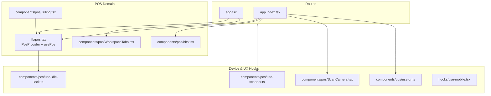
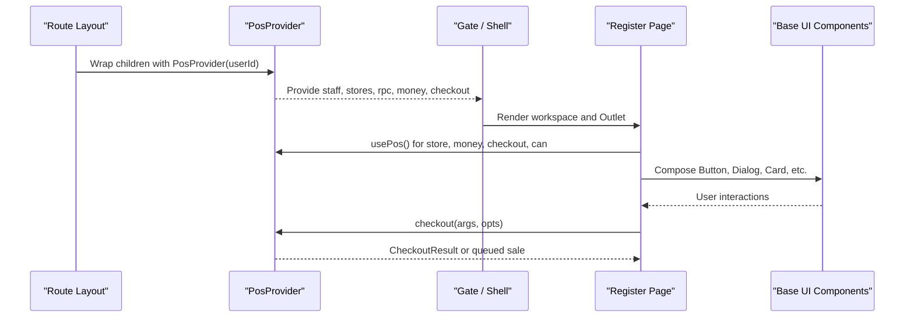
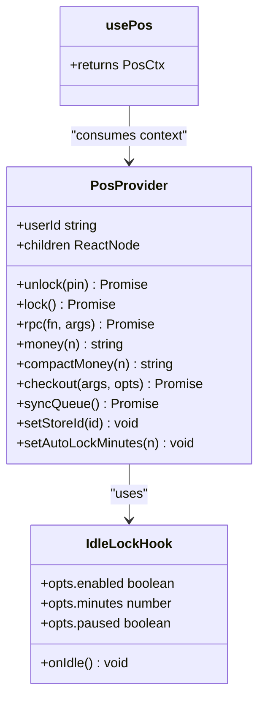
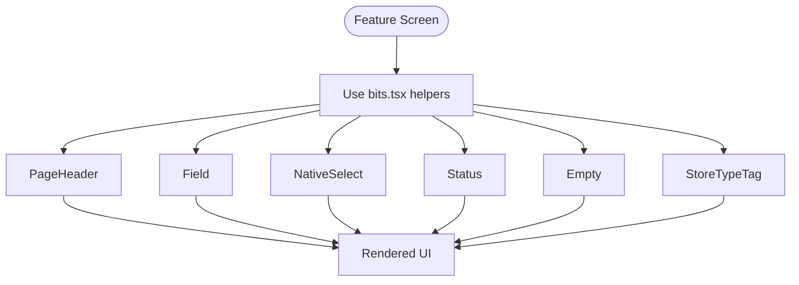
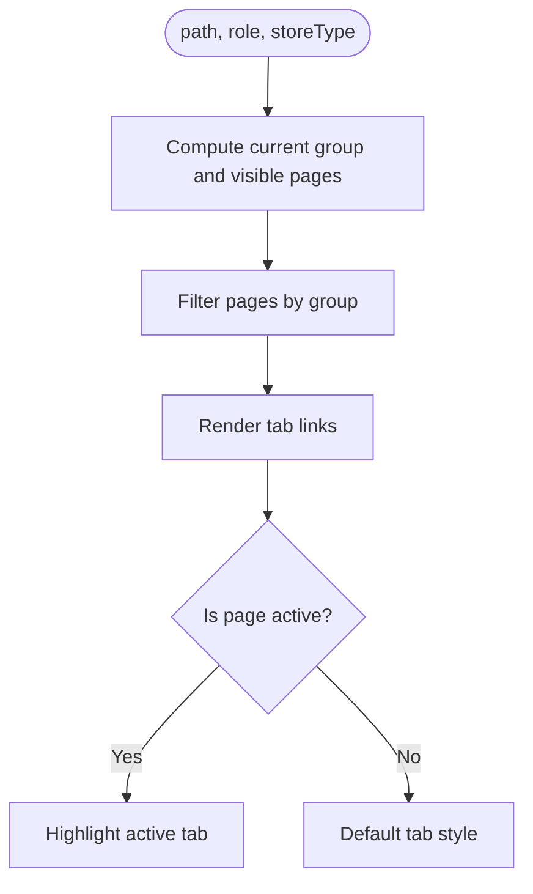
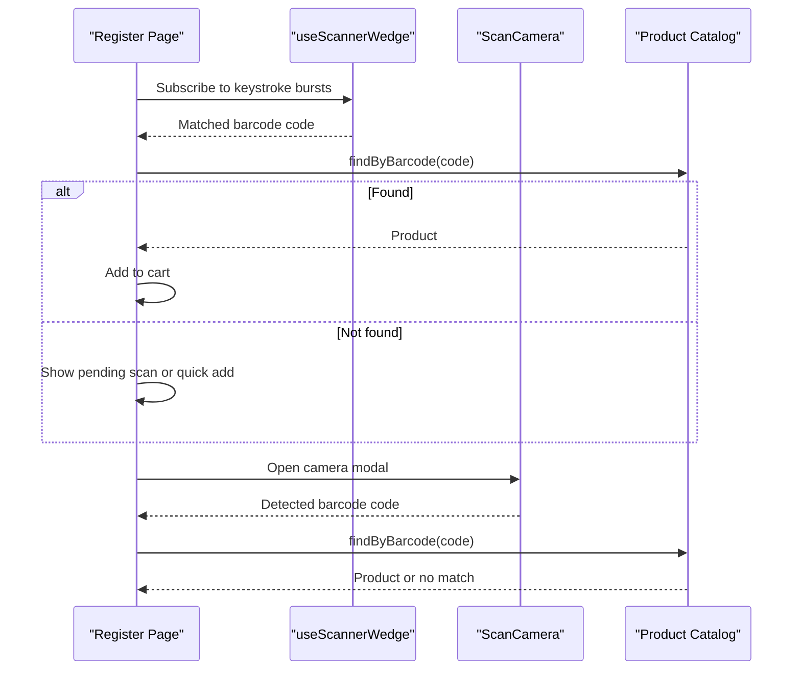
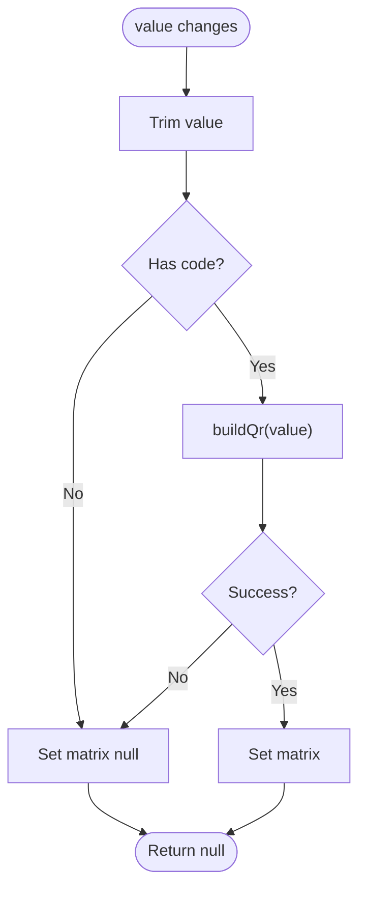
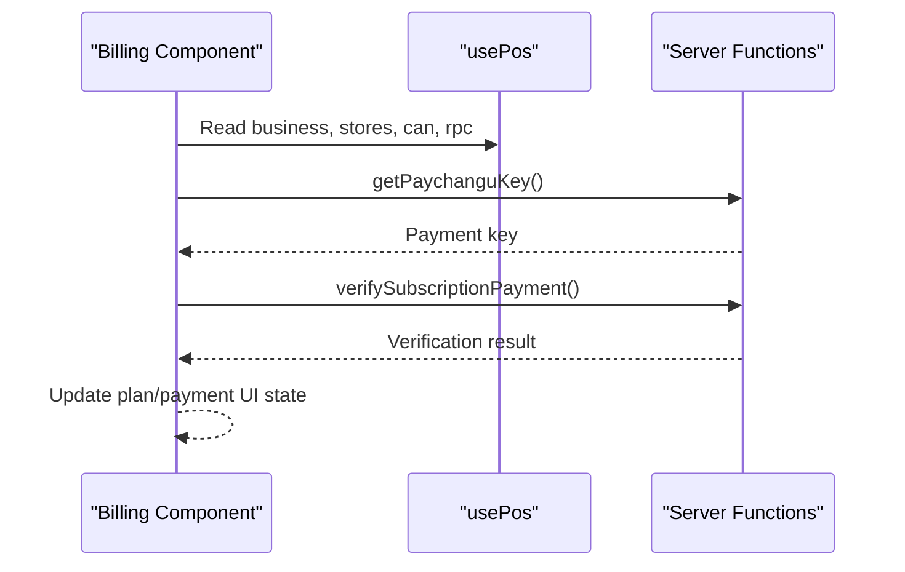
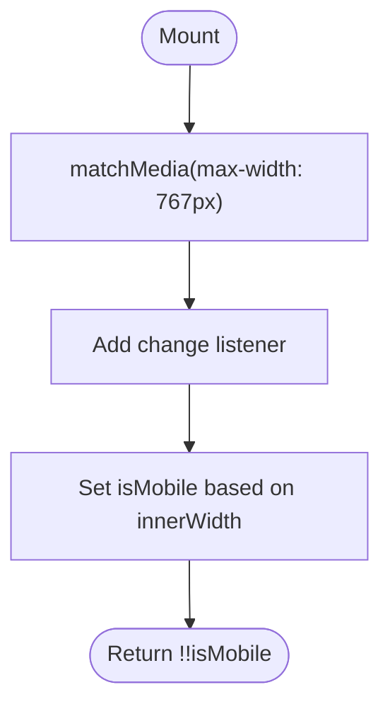
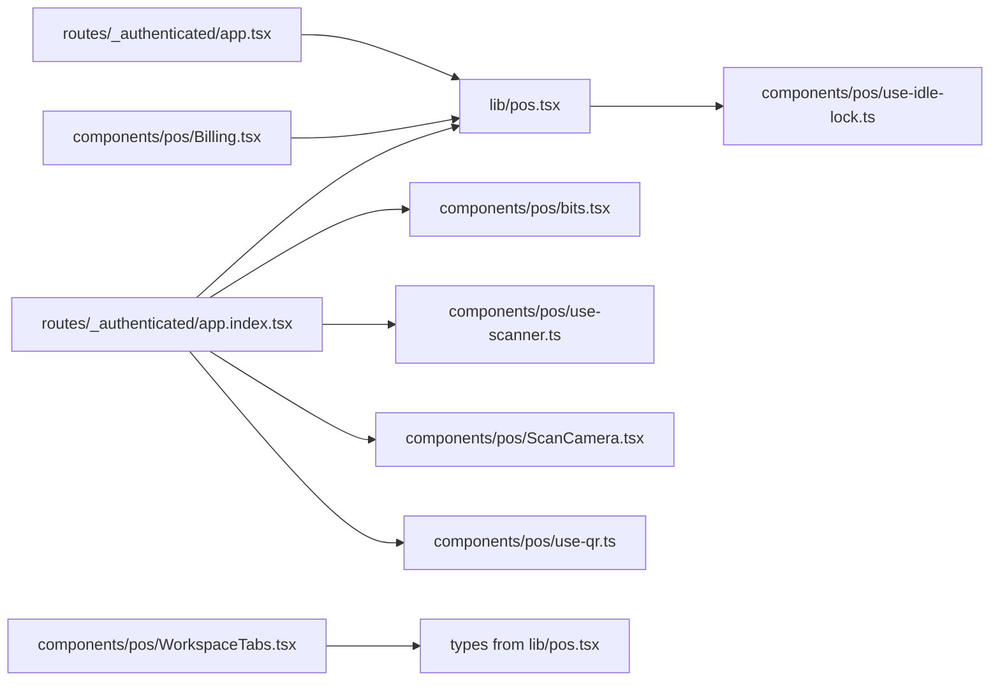

# Component Composition & Patterns

<cite>
**Referenced Files in This Document**
- [pos.tsx](file://src/lib/pos.tsx)
- [app.tsx](file://src/routes/_authenticated/app.tsx)
- [bits.tsx](file://src/components/pos/bits.tsx)
- [WorkspaceTabs.tsx](file://src/components/pos/WorkspaceTabs.tsx)
- [use-idle-lock.ts](file://src/components/pos/use-idle-lock.ts)
- [use-scanner.ts](file://src/components/pos/use-scanner.ts)
- [ScanCamera.tsx](file://src/components/pos/ScanCamera.tsx)
- [use-qr.ts](file://src/components/pos/use-qr.ts)
- [Billing.tsx](file://src/components/pos/Billing.tsx)
- [app.index.tsx](file://src/routes/_authenticated/app.index.tsx)
- [use-mobile.tsx](file://src/hooks/use-mobile.tsx)
</cite>

## Table of Contents
1. [Introduction](#introduction)
2. [Project Structure](#project-structure)
3. [Core Components](#core-components)
4. [Architecture Overview](#architecture-overview)
5. [Detailed Component Analysis](#detailed-component-analysis)
6. [Dependency Analysis](#dependency-analysis)
7. [Performance Considerations](#performance-considerations)
8. [Troubleshooting Guide](#troubleshooting-guide)
9. [Guidelines for New Components](#guidelines-for-new-components)
10. [Conclusion](#conclusion)

## Introduction
This document explains the component composition patterns and architectural principles used across the Storq POS application. It focuses on:
- How base UI components are composed into feature-specific components.
- The provider pattern implemented through React Context.
- Separation of concerns between presentation and business logic.
- Strategies to avoid prop drilling.
- Custom hook patterns for state, device behavior, and offline operations.
- Integration between components and the POS context.
- Naming conventions and file organization guidelines for extending the codebase safely.

The goal is to make these patterns accessible to both experienced developers and contributors with limited technical background.

## Project Structure
Storq organizes its frontend around a clear separation between shared UI primitives, feature-specific POS components, reusable hooks, and route-level pages.

**Diagram sources**
- [app.tsx:84-92](file://src/routes/_authenticated/app.tsx#L84-L92)
- [app.tsx:456-599](file://src/routes/_authenticated/app.tsx#L456-L599)
- [app.index.tsx:111-180](file://src/routes/_authenticated/app.index.tsx#L111-L180)
- [pos.tsx:115-117](file://src/lib/pos.tsx#L115-L117)
- [bits.tsx:15-76](file://src/components/pos/bits.tsx#L15-L76)
- [WorkspaceTabs.tsx:20-63](file://src/components/pos/WorkspaceTabs.tsx#L20-L63)
- [Billing.tsx:54-69](file://src/components/pos/Billing.tsx#L54-L69)
- [use-idle-lock.ts:9-39](file://src/components/pos/use-idle-lock.ts#L9-L39)
- [use-scanner.ts:31-83](file://src/components/pos/use-scanner.ts#L31-L83)
- [ScanCamera.tsx:22-81](file://src/components/pos/ScanCamera.tsx#L22-L81)
- [use-qr.ts:9-26](file://src/components/pos/use-qr.ts#L9-L26)
- [use-mobile.tsx:5-19](file://src/hooks/use-mobile.tsx#L5-L19)

**Section sources**
- [app.tsx:84-92](file://src/routes/_authenticated/app.tsx#L84-L92)
- [app.tsx:456-599](file://src/routes/_authenticated/app.tsx#L456-L599)
- [app.index.tsx:111-180](file://src/routes/_authenticated/app.index.tsx#L111-L180)
- [pos.tsx:115-117](file://src/lib/pos.tsx#L115-L117)
- [bits.tsx:15-76](file://src/components/pos/bits.tsx#L15-L76)
- [WorkspaceTabs.tsx:20-63](file://src/components/pos/WorkspaceTabs.tsx#L20-L63)
- [Billing.tsx:54-69](file://src/components/pos/Billing.tsx#L54-L69)
- [use-idle-lock.ts:9-39](file://src/components/pos/use-idle-lock.ts#L9-L39)
- [use-scanner.ts:31-83](file://src/components/pos/use-scanner.ts#L31-L83)
- [ScanCamera.tsx:22-81](file://src/components/pos/ScanCamera.tsx#L22-L81)
- [use-qr.ts:9-26](file://src/components/pos/use-qr.ts#L9-L26)
- [use-mobile.tsx:5-19](file://src/hooks/use-mobile.tsx#L5-L19)

## Core Components
The core of the application’s architecture is the POS context provider and its consumer hook. This pattern centralizes authentication, store selection, currency formatting, RPC calls, offline queueing, and idle locking.

Key responsibilities:
- Provider setup and lifecycle management.
- Staff session unlock/lock flow.
- Business and store data loading.
- Currency formatting helpers.
- Offline sales queue and sync.
- Role-based capability checks.
- Auto-lock based on inactivity.

Consumers access this shared state via `usePos`, avoiding prop drilling across deep component trees.

**Section sources**
- [pos.tsx:28-84](file://src/lib/pos.tsx#L28-L84)
- [pos.tsx:109-113](file://src/lib/pos.tsx#L109-L113)
- [pos.tsx:115-117](file://src/lib/pos.tsx#L115-L117)
- [pos.tsx:149-184](file://src/lib/pos.tsx#L149-L184)
- [pos.tsx:194-228](file://src/lib/pos.tsx#L194-L228)
- [pos.tsx:230-240](file://src/lib/pos.tsx#L230-L240)
- [pos.tsx:249-338](file://src/lib/pos.tsx#L249-L338)
- [pos.tsx:347-388](file://src/lib/pos.tsx#L347-L388)

## Architecture Overview
The application uses a layered approach:
- Route-level layout wraps the app in `PosProvider`.
- Feature routes (e.g., Register, Sales, Inventory) consume `usePos` for domain state and actions.
- Shared UI primitives live under `components/ui`.
- POS-specific composable building blocks live under `components/pos`.
- Device and UX behaviors are encapsulated in custom hooks.

**Diagram sources**
- [app.tsx:84-92](file://src/routes/_authenticated/app.tsx#L84-L92)
- [app.tsx:95-129](file://src/routes/_authenticated/app.tsx#L95-L129)
- [app.tsx:456-599](file://src/routes/_authenticated/app.tsx#L456-L599)
- [app.index.tsx:111-180](file://src/routes/_authenticated/app.index.tsx#L111-L180)
- [pos.tsx:115-117](file://src/lib/pos.tsx#L115-L117)
- [pos.tsx:275-307](file://src/lib/pos.tsx#L275-L307)

## Detailed Component Analysis

### POS Context Provider and Hook
The provider encapsulates:
- Staff session persistence and validation.
- Business and store queries.
- Store selection and role-aware defaults.
- RPC wrapper with error masking.
- Money formatting utilities.
- Offline queue management and auto-sync.
- Idle lock integration.

**Diagram sources**
- [pos.tsx:115-117](file://src/lib/pos.tsx#L115-L117)
- [pos.tsx:194-228](file://src/lib/pos.tsx#L194-L228)
- [pos.tsx:275-338](file://src/lib/pos.tsx#L275-L338)
- [pos.tsx:347-388](file://src/lib/pos.tsx#L347-L388)
- [use-idle-lock.ts:9-39](file://src/components/pos/use-idle-lock.ts#L9-L39)

**Section sources**
- [pos.tsx:115-117](file://src/lib/pos.tsx#L115-L117)
- [pos.tsx:194-228](file://src/lib/pos.tsx#L194-L228)
- [pos.tsx:275-338](file://src/lib/pos.tsx#L275-L338)
- [pos.tsx:347-388](file://src/lib/pos.tsx#L347-L388)
- [use-idle-lock.ts:9-39](file://src/components/pos/use-idle-lock.ts#L9-L39)

### Base UI Components and POS Building Blocks
Base UI components from `components/ui` are composed into higher-level POS building blocks:
- `PageHeader`, `Field`, `NativeSelect`, `Status`, `Empty`, `StoreTypeTag` provide consistent layouts and labels.
- These components are reused by feature screens like Register and Setup.

**Diagram sources**
- [bits.tsx:15-76](file://src/components/pos/bits.tsx#L15-L76)
- [bits.tsx:102-129](file://src/components/pos/bits.tsx#L102-L129)
- [app.tsx:153-267](file://src/routes/_authenticated/app.tsx#L153-L267)
- [app.index.tsx:111-180](file://src/routes/_authenticated/app.index.tsx#L111-L180)

**Section sources**
- [bits.tsx:15-76](file://src/components/pos/bits.tsx#L15-L76)
- [bits.tsx:102-129](file://src/components/pos/bits.tsx#L102-L129)
- [app.tsx:153-267](file://src/routes/_authenticated/app.tsx#L153-L267)
- [app.index.tsx:111-180](file://src/routes/_authenticated/app.index.tsx#L111-L180)

### Workspace Tabs and Navigation
Workspace tabs render grouped navigation links based on user role and store type. They rely on shared navigation configuration and i18n labels.

**Diagram sources**
- [WorkspaceTabs.tsx:20-63](file://src/components/pos/WorkspaceTabs.tsx#L20-L63)

**Section sources**
- [WorkspaceTabs.tsx:20-63](file://src/components/pos/WorkspaceTabs.tsx#L20-L63)

### Barcode Scanning and Camera Integration
Two scanning strategies coexist:
- Hardware scanner wedge detection via `useScannerWedge`.
- Camera-based barcode detection via `ScanCamera`.

**Diagram sources**
- [use-scanner.ts:31-83](file://src/components/pos/use-scanner.ts#L31-L83)
- [ScanCamera.tsx:22-81](file://src/components/pos/ScanCamera.tsx#L22-L81)
- [app.index.tsx:222-248](file://src/routes/_authenticated/app.index.tsx#L222-L248)

**Section sources**
- [use-scanner.ts:31-83](file://src/components/pos/use-scanner.ts#L31-L83)
- [ScanCamera.tsx:22-81](file://src/components/pos/ScanCamera.tsx#L22-L81)
- [app.index.tsx:222-248](file://src/routes/_authenticated/app.index.tsx#L222-L248)

### QR Code Generation Hook
The QR hook builds a matrix asynchronously and manages stale updates safely.

**Diagram sources**
- [use-qr.ts:9-26](file://src/components/pos/use-qr.ts#L9-L26)

**Section sources**
- [use-qr.ts:9-26](file://src/components/pos/use-qr.ts#L9-L26)

### Billing and Subscription Flow
Billing integrates with the POS context to read business and store information, then orchestrates subscription flows using server functions.

**Diagram sources**
- [Billing.tsx:54-69](file://src/components/pos/Billing.tsx#L54-L69)

**Section sources**
- [Billing.tsx:54-69](file://src/components/pos/Billing.tsx#L54-L69)

### Mobile Responsiveness Hook
A simple hook detects mobile breakpoints and exposes a boolean flag for responsive rendering decisions.

**Diagram sources**
- [use-mobile.tsx:5-19](file://src/hooks/use-mobile.tsx#L5-L19)

**Section sources**
- [use-mobile.tsx:5-19](file://src/hooks/use-mobile.tsx#L5-L19)

## Dependency Analysis
The following diagram shows how components depend on the POS context and each other.

**Diagram sources**
- [app.tsx:84-92](file://src/routes/_authenticated/app.tsx#L84-L92)
- [app.index.tsx:111-180](file://src/routes/_authenticated/app.index.tsx#L111-L180)
- [bits.tsx:15-76](file://src/components/pos/bits.tsx#L15-L76)
- [use-scanner.ts:31-83](file://src/components/pos/use-scanner.ts#L31-L83)
- [ScanCamera.tsx:22-81](file://src/components/pos/ScanCamera.tsx#L22-L81)
- [use-qr.ts:9-26](file://src/components/pos/use-qr.ts#L9-L26)
- [Billing.tsx:54-69](file://src/components/pos/Billing.tsx#L54-L69)
- [WorkspaceTabs.tsx:20-63](file://src/components/pos/WorkspaceTabs.tsx#L20-L63)
- [pos.tsx:115-117](file://src/lib/pos.tsx#L115-L117)
- [use-idle-lock.ts:9-39](file://src/components/pos/use-idle-lock.ts#L9-L39)

**Section sources**
- [app.tsx:84-92](file://src/routes/_authenticated/app.tsx#L84-L92)
- [app.index.tsx:111-180](file://src/routes/_authenticated/app.index.tsx#L111-L180)
- [bits.tsx:15-76](file://src/components/pos/bits.tsx#L15-L76)
- [use-scanner.ts:31-83](file://src/components/pos/use-scanner.ts#L31-L83)
- [ScanCamera.tsx:22-81](file://src/components/pos/ScanCamera.tsx#L22-L81)
- [use-qr.ts:9-26](file://src/components/pos/use-qr.ts#L9-L26)
- [Billing.tsx:54-69](file://src/components/pos/Billing.tsx#L54-L69)
- [WorkspaceTabs.tsx:20-63](file://src/components/pos/WorkspaceTabs.tsx#L20-L63)
- [pos.tsx:115-117](file://src/lib/pos.tsx#L115-L117)
- [use-idle-lock.ts:9-39](file://src/components/pos/use-idle-lock.ts#L9-L39)

## Performance Considerations
- Memoized formatting: Money and compact money formatters are memoized to avoid unnecessary recalculations.
- Deferred search: The register defers search term updates to keep input responsive while catalog filtering runs.
- Live stock reads: Stock is re-read live to reflect imports or concurrent till activity without stale badges.
- Offline queue batching: Queue sync runs periodically and avoids redundant work when already syncing.
- Idle lock pauses during sync: Prevents locking the till while replaying queued sales.

[No sources needed since this section provides general guidance]

## Troubleshooting Guide
Common issues and their handling:
- Raw server errors masked: RPC errors containing SQL internals are replaced with generic messages; policy violations map to readable text.
- Session lockout: If the server reports a locked session, the provider clears local staff state and prompts re-unlock.
- Offline queue failures: Failed items show localized error messages with retry and discard options.
- Subscription errors: Billing surfaces a retry button when subscription checks fail.

**Section sources**
- [pos.tsx:93-104](file://src/lib/pos.tsx#L93-L104)
- [pos.tsx:220-228](file://src/lib/pos.tsx#L220-L228)
- [pos.tsx:310-338](file://src/lib/pos.tsx#L310-L338)
- [app.tsx:107-129](file://src/routes/_authenticated/app.tsx#L107-L129)

## Guidelines for New Components
Follow these patterns to integrate new components consistently:

- Prefer composition over inheritance:
  - Compose base UI components (`Button`, `Dialog`, `Card`, `Input`) with POS building blocks (`PageHeader`, `Field`, `NativeSelect`, `Status`).
  - Keep feature-specific logic close to the feature screen; reuse shared helpers where appropriate.

- Avoid prop drilling:
  - Access shared state and actions via `usePos()` instead of passing props down multiple levels.
  - Keep component props minimal and focused on presentation.

- Encapsulate device and UX behaviors in hooks:
  - Create custom hooks for side effects like scanning, idle detection, or media access.
  - Expose stable callbacks via refs to avoid restarting effects on every render.

- Separate presentation from business logic:
  - Presentational components should not directly call RPCs; delegate to `usePos().rpc` or `usePos().checkout`.
  - Use typed return values and error handling at the boundary between UI and context.

- Naming conventions:
  - Feature components under `components/pos/`: `Billing.tsx`, `DiscountDialog.tsx`, `QuickAddItem.tsx`, `ReceiptModal.tsx`, `WorkspaceTabs.tsx`.
  - Hooks under `components/pos/` or `hooks/`: `use-idle-lock.ts`, `use-scanner.ts`, `use-qr.ts`, `use-mobile.tsx`.
  - Route-level pages under `routes/_authenticated/`: `app.tsx`, `app.index.tsx`, plus feature routes.

- File organization:
  - Co-locate related types and helpers near their usage (e.g., POS types in `lib/pos.tsx`).
  - Keep UI primitives in `components/ui`; compose them in `components/pos`.
  - Place feature-specific composables in `components/pos/bits.tsx` when they are broadly reused within POS features.

- Error handling:
  - Surface user-friendly messages; never expose raw database errors.
  - Provide retry and discard options for failed offline operations.

- Accessibility and internationalization:
  - Use i18n keys for all user-facing strings.
  - Include aria attributes for interactive elements and status regions.

**Section sources**
- [bits.tsx:15-76](file://src/components/pos/bits.tsx#L15-L76)
- [pos.tsx:109-113](file://src/lib/pos.tsx#L109-L113)
- [use-scanner.ts:31-83](file://src/components/pos/use-scanner.ts#L31-L83)
- [use-idle-lock.ts:9-39](file://src/components/pos/use-idle-lock.ts#L9-L39)
- [app.tsx:84-92](file://src/routes/_authenticated/app.tsx#L84-L92)
- [app.index.tsx:111-180](file://src/routes/_authenticated/app.index.tsx#L111-L180)

## Conclusion
Storq’s component architecture emphasizes:
- A single source of truth for POS state via `PosProvider` and `usePos`.
- Clean composition of base UI components into feature-specific screens.
- Robust separation of concerns between presentation and business logic.
- Effective avoidance of prop drilling through context and hooks.
- Reliable device integration and offline support.

By following the established patterns and guidelines, new components will integrate seamlessly, remain maintainable, and scale with the application’s growing feature set.

[No sources needed since this section summarizes without analyzing specific files]