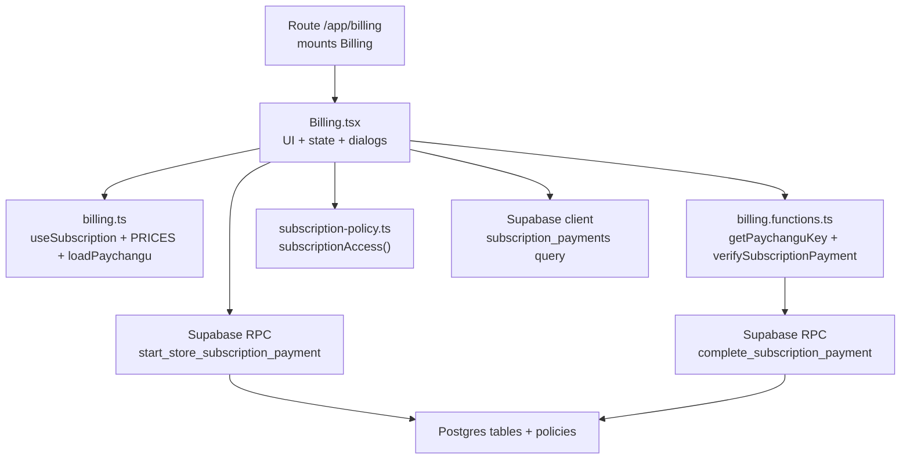
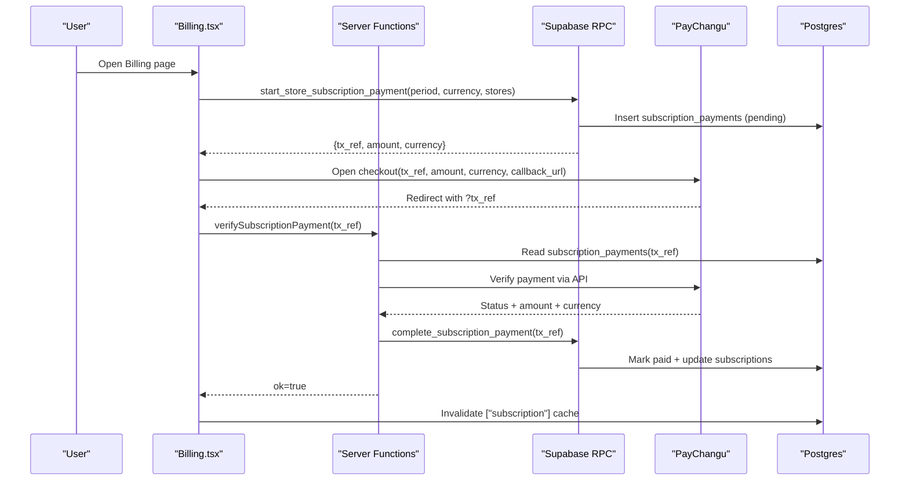
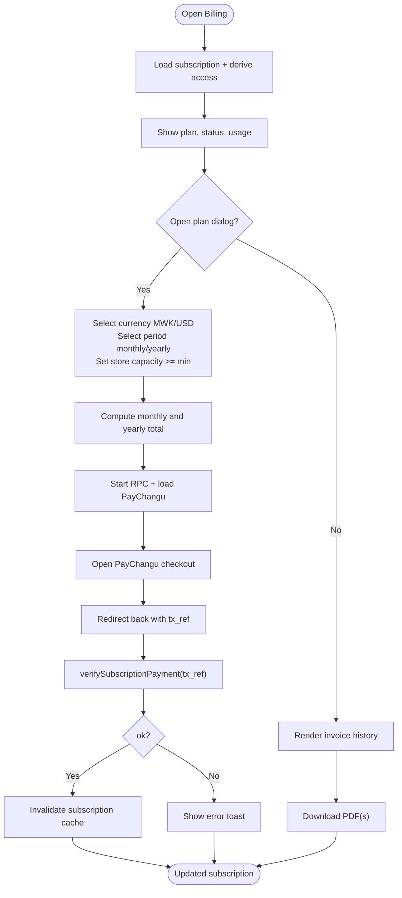
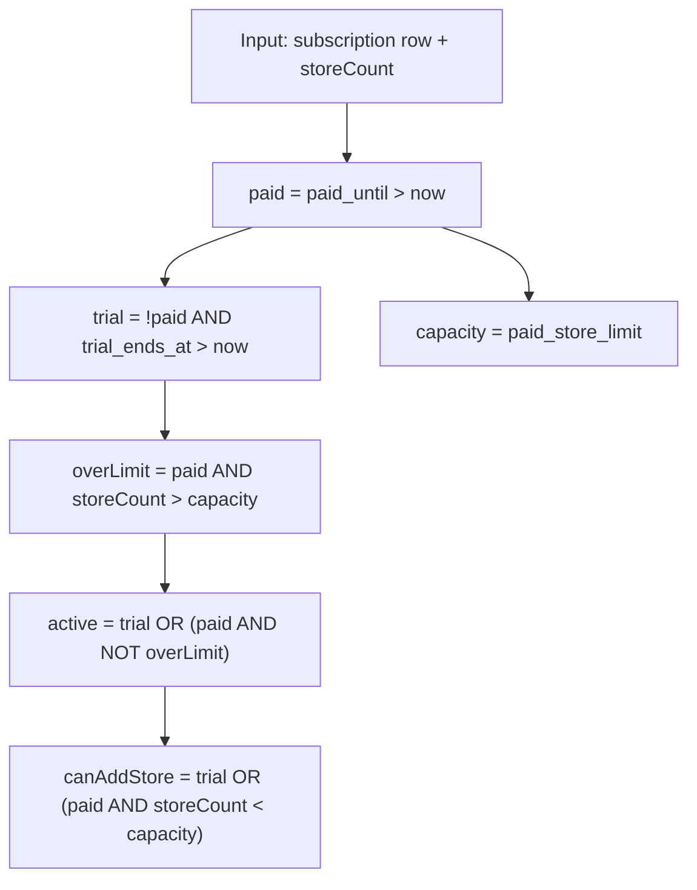
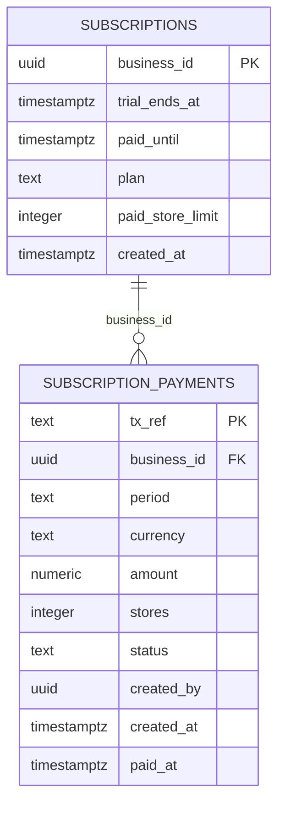
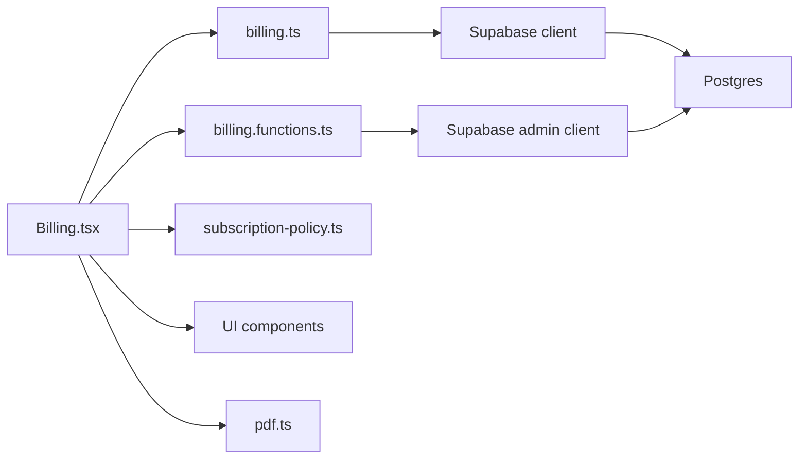

# Billing Component

<cite>
**Referenced Files in This Document**
- [app.billing.tsx](file://src/routes/_authenticated/app.billing.tsx)
- [Billing.tsx](file://src/components/pos/Billing.tsx)
- [billing.ts](file://src/lib/billing.ts)
- [billing.functions.ts](file://src/lib/billing.functions.ts)
- [subscription-policy.ts](file://src/lib/subscription-policy.ts)
- [20261007100137_bfc24679-0e49-446b-b715-df35c6e8c994.sql](file://supabase/migrations/20261007100137_bfc24679-0e49-446b-b715-df35c6e8c994.sql)
- [20261007115041_3e857134-c53a-47c9-a33f-3db16cc13962.sql](file://supabase/migrations/20261007115041_3e857134-c53a-47c9-a33f-3db16cc13962.sql)
- [20261007115238_6662954d-34a5-4c8e-b71e-7f98b51895af.sql](file://supabase/migrations/20261007115238_6662954d-34a5-4c8e-b71e-7f98b51895af.sql)
</cite>

## Table of Contents
1. [Introduction](#introduction)
2. [Project Structure](#project-structure)
3. [Core Components](#core-components)
4. [Architecture Overview](#architecture-overview)
5. [Detailed Component Analysis](#detailed-component-analysis)
6. [Dependency Analysis](#dependency-analysis)
7. [Performance Considerations](#performance-considerations)
8. [Troubleshooting Guide](#troubleshooting-guide)
9. [Conclusion](#conclusion)

## Introduction
The Billing component manages subscription lifecycle, plan selection, payment initiation and verification through PayChangu, invoice history display, and PDF invoice generation. It also enforces store capacity limits based on the active paid period or trial window. The UI is exposed at a dedicated authenticated route and integrates with Supabase RPC functions for secure server-side operations.

## Project Structure
The billing feature spans a small set of focused files:
- A TanStack Router page that mounts the Billing UI.
- The Billing React component handling state, pricing, dialogs, and user flows.
- Subscription data fetching and PayChangu script loading utilities.
- Server functions for PayChangu key retrieval and payment verification.
- Subscription policy logic for access derivation.
- Database schema and RPC functions for payments, subscriptions, and capacity enforcement.

**Diagram sources**
- [app.billing.tsx:4-18](file://src/routes/_authenticated/app.billing.tsx#L4-L18)
- [Billing.tsx:54-139](file://src/components/pos/Billing.tsx#L54-L139)
- [billing.ts:10-55](file://src/lib/billing.ts#L10-L55)
- [billing.functions.ts:4-53](file://src/lib/billing.functions.ts#L4-L53)
- [subscription-policy.ts:8-22](file://src/lib/subscription-policy.ts#L8-L22)
- [20261007100137_bfc24679-0e49-446b-b715-df35c6e8c994.sql:1-63](file://supabase/migrations/20261007100137_bfc24679-0e49-446b-b715-df35c6e8c994.sql#L1-L63)

**Section sources**
- [app.billing.tsx:4-18](file://src/routes/_authenticated/app.billing.tsx#L4-L18)
- [Billing.tsx:54-139](file://src/components/pos/Billing.tsx#L54-L139)

## Core Components
- Billing page route: renders the Billing component under an authenticated layout and sets SEO metadata.
- Billing UI: displays current plan status, store usage, payment method summary, invoice history, and plan selection/payment dialogs.
- Subscription hook: fetches subscription row and derives access flags including over-limit detection.
- Payment utilities: lazy-load PayChangu SDK and expose server functions to retrieve public keys and verify payments.
- Subscription policy: pure function computing paid/trial/capacity/access states from raw subscription data and store count.
- Database layer: defines subscriptions and subscription_payments tables, RLS policies, and RPC functions for starting and completing payments.

**Section sources**
- [app.billing.tsx:4-18](file://src/routes/_authenticated/app.billing.tsx#L4-L18)
- [Billing.tsx:54-139](file://src/components/pos/Billing.tsx#L54-L139)
- [billing.ts:10-55](file://src/lib/billing.ts#L10-L55)
- [billing.functions.ts:4-53](file://src/lib/billing.functions.ts#L4-L53)
- [subscription-policy.ts:8-22](file://src/lib/subscription-policy.ts#L8-L22)
- [20261007100137_bfc24679-0e49-446b-b715-df35c6e8c994.sql:1-63](file://supabase/migrations/20261007100137_bfc24679-0e49-446b-b715-df35c6e8c994.sql#L1-L63)

## Architecture Overview
The Billing flow combines client-side state, server functions, and Supabase RPCs:
- Client reads subscription data via useSubscription and computes derived access.
- User selects currency (MWK/USD), billing period (monthly/yearly), and desired store capacity.
- Client calls start_store_subscription_payment RPC to create a pending payment record and receive a transaction reference.
- Client opens PayChangu checkout with amount, currency, callback URL, and customer metadata.
- After redirect, client verifies payment via verifySubscriptionPayment server function, which validates against PayChangu API and activates subscription via complete_subscription_payment RPC.
- Invoice history is fetched from subscription_payments and can be exported as PDFs.

**Diagram sources**
- [Billing.tsx:94-139](file://src/components/pos/Billing.tsx#L94-L139)
- [billing.functions.ts:10-53](file://src/lib/billing.functions.ts#L10-L53)
- [20261007100137_bfc24679-0e49-446b-b715-df35c6e8c994.sql:36-63](file://supabase/migrations/20261007100137_bfc24679-0e49-446b-b715-df35c6e8c994.sql#L36-L63)

## Detailed Component Analysis

### Billing Page Route
- Exposes `/app/billing` under authenticated routes.
- Sets meta title, description, and OpenGraph tags.
- Renders the Billing component.

**Section sources**
- [app.billing.tsx:4-18](file://src/routes/_authenticated/app.billing.tsx#L4-L18)

### Billing UI Component
Responsibilities:
- Displays current plan, renewal/expiry dates, and status badge (active, trial, expired, over limit).
- Shows store usage progress bar and per-store monthly cost calculation.
- Presents last payment method summary and provider info.
- Provides plan selection dialog with currency toggle (MWK/USD), period toggle (monthly/yearly), and store capacity input constrained by minimum required slots.
- Initiates payment via PayChangu and handles return URL redemption.
- Lists invoice history with status badges and download actions.
- Generates PDF invoices using a shared PDF utility.

State and behavior highlights:
- Currency and period are local state; total price computed from PRICES and YEARLY_FACTOR.
- Minimum store capacity is enforced: cannot go below existing stores or previously paid capacity when already paid.
- Payment flow uses Promise.all to fetch PayChangu public key, start RPC, current user, and load SDK.
- On mount, checks for `?tx_ref` and verifies payment once.
- Uses react-query to invalidate subscription cache after successful verification.

Error handling:
- Toast messages for configuration errors, missing PayChangu SDK, and verification failures.
- Graceful fallbacks for missing business name or email.

Invoice generation:
- Paid invoices can be downloaded individually or in batch.
- PDF includes business name, date, plan line, currency, totals, and footer note.

**Diagram sources**
- [Billing.tsx:54-139](file://src/components/pos/Billing.tsx#L54-L139)
- [Billing.tsx:144-169](file://src/components/pos/Billing.tsx#L144-L169)
- [Billing.tsx:312-369](file://src/components/pos/Billing.tsx#L312-L369)
- [Billing.tsx:439-566](file://src/components/pos/Billing.tsx#L439-L566)
- [Billing.tsx:635-673](file://src/components/pos/Billing.tsx#L635-L673)

**Section sources**
- [Billing.tsx:54-139](file://src/components/pos/Billing.tsx#L54-L139)
- [Billing.tsx:144-169](file://src/components/pos/Billing.tsx#L144-L169)
- [Billing.tsx:312-369](file://src/components/pos/Billing.tsx#L312-L369)
- [Billing.tsx:439-566](file://src/components/pos/Billing.tsx#L439-L566)
- [Billing.tsx:635-673](file://src/components/pos/Billing.tsx#L635-L673)

### Subscription Data Hook and Pricing Constants
- useSubscription fetches the subscription row for the business and returns derived access information.
- Cache key excludes storeCount to avoid unnecessary refetches when store list changes.
- Polling interval refreshes status gently while relying on SQL-level enforcement.
- PRICES define base per-store monthly prices for MWK and USD.
- YEARLY_FACTOR applies a discount multiplier for annual plans.
- loadPaychangu lazily injects the PayChangu SDK script and caches the promise.

Complexity:
- Query cost is O(1) per business due to indexed lookup by business_id.
- Access derivation is O(1) pure computation.

**Section sources**
- [billing.ts:10-55](file://src/lib/billing.ts#L10-L55)

### Subscription Policy
- Computes paid, trial, capacity, overLimit, active, and canAddStore flags.
- Over-limit occurs when paid_until is valid but store count exceeds paid_store_limit.
- Active means either trial is valid or paid and not over-limit.

**Diagram sources**
- [subscription-policy.ts:8-22](file://src/lib/subscription-policy.ts#L8-L22)

**Section sources**
- [subscription-policy.ts:8-22](file://src/lib/subscription-policy.ts#L8-L22)

### Server Functions for Payments
- getPaychanguKey: returns the public key used to initialize PayChangu checkout.
- verifySubscriptionPayment:
  - Validates request payload.
  - Reads the pending payment record.
  - Calls PayChangu API to confirm success, amount, and currency.
  - Activates subscription via complete_subscription_payment RPC only if all checks pass.
  - Returns structured result for UI feedback.

Security:
- Secret key is read from environment variables.
- Only service role can execute complete_subscription_payment.

**Section sources**
- [billing.functions.ts:4-53](file://src/lib/billing.functions.ts#L4-L53)

### Database Schema and RPC Functions
Tables:
- subscriptions: tracks trial_ends_at, paid_until, plan, and paid_store_limit.
- subscription_payments: records each attempted payment with tx_ref, period, currency, amount, stores, status, timestamps, and creator.

Policies:
- Row-level security restricts access to the current business.

RPC functions:
- start_subscription_payment: creates a pending payment with validated inputs and returns tx_ref and amount.
- complete_subscription_payment: marks payment paid and updates subscription expiration and plan.

Capacity enforcement:
- Additional migration adds paid_store_limit and guards store creation and staff writes when over capacity.
- Guard tests validate blocking of extra stores, staff write protection, prepaid credit preservation, and idempotent completion.

**Diagram sources**
- [20261007100137_bfc24679-0e49-446b-b715-df35c6e8c994.sql:1-28](file://supabase/migrations/20261007100137_bfc24679-0e49-446b-b715-df35c6e8c994.sql#L1-L28)

**Section sources**
- [20261007100137_bfc24679-0e49-446b-b715-df35c6e8c994.sql:1-63](file://supabase/migrations/20261007100137_bfc24679-0e49-446b-b715-df35c6e8c994.sql#L1-L63)
- [20261007115041_3e857134-c53a-47c9-a33f-3db16cc13962.sql:17-82](file://supabase/migrations/20261007115041_3e857134-c53a-47c9-a33f-3db16cc13962.sql#L17-L82)
- [20261007115238_6662954d-34a5-4c8e-b71e-7f98b51895af.sql:1-41](file://supabase/migrations/20261007115238_6662954d-34a5-4c8e-b71e-7f98b51895af.sql#L1-L41)

## Dependency Analysis
- Billing.tsx depends on:
  - @tanstack/react-query for caching and invalidation.
  - @tanstack/react-start server functions for secure endpoints.
  - Sonner for toast notifications.
  - Supabase client for auth and direct queries.
  - billing.ts for subscription data and PayChangu loader.
  - billing.functions.ts for server-side verification.
  - subscription-policy.ts for access derivation.
  - UI primitives and icons.
  - pdf.ts for invoice export.

- billing.functions.ts depends on:
  - Environment variables for PayChangu keys.
  - Supabase admin client for DB and RPC access.
  - Zod for input validation.

- Database migrations depend on:
  - Existing businesses and staff tables.
  - Security roles and policies.

**Diagram sources**
- [Billing.tsx:1-37](file://src/components/pos/Billing.tsx#L1-L37)
- [billing.ts:1-55](file://src/lib/billing.ts#L1-L55)
- [billing.functions.ts:1-53](file://src/lib/billing.functions.ts#L1-L53)

**Section sources**
- [Billing.tsx:1-37](file://src/components/pos/Billing.tsx#L1-L37)
- [billing.ts:1-55](file://src/lib/billing.ts#L1-L55)
- [billing.functions.ts:1-53](file://src/lib/billing.functions.ts#L1-L53)

## Performance Considerations
- Subscription query uses staleTime and refetchInterval to reduce database load while keeping status reasonably fresh.
- Store count is excluded from the query key to prevent cache busting on store list hydration changes.
- Invoice history has a longer staleTime since it is append-only and invalidated on payment events.
- PayChangu SDK is loaded once and cached via a module-level promise.
- PDF generation runs client-side and avoids network overhead beyond asset loading.

[No sources needed since this section provides general guidance]

## Troubleshooting Guide
Common issues and resolutions:
- PayChangu not configured:
  - Symptom: Error indicating payments are not configured.
  - Cause: Missing PAYCHANGU_PUBLIC_KEY or PAYCHANGU_SECRET_KEY.
  - Resolution: Configure environment variables and redeploy.

- PayChangu SDK failed to load:
  - Symptom: Error stating PayChangu could not be loaded.
  - Cause: Network block or CDN issue.
  - Resolution: Check network connectivity and ensure external scripts are allowed.

- Payment verification fails:
  - Symptom: “Payment not confirmed yet” or “Payment amount does not match.”
  - Cause: PayChangu API returned non-success or mismatched amount/currency.
  - Resolution: Confirm amount and currency in the checkout request match the stored payment record.

- Authentication problems:
  - Symptom: Errors when calling RPCs or reading subscription data.
  - Cause: Unauthenticated session or insufficient permissions.
  - Resolution: Ensure user is logged in and has required roles (admin/manager).

- Over-limit detected:
  - Symptom: UI shows over-limit status and prevents adding stores.
  - Cause: Store count exceeds paid_store_limit during paid period.
  - Resolution: Purchase additional store capacity or wait for trial expiry.

- Duplicate confirmation safety:
  - Behavior: Re-running complete_subscription_payment is idempotent and preserves prepaid credit calculations.
  - Validation: Guard tests assert duplicate confirmation does not extend time unexpectedly.

**Section sources**
- [Billing.tsx:94-139](file://src/components/pos/Billing.tsx#L94-L139)
- [billing.functions.ts:10-53](file://src/lib/billing.functions.ts#L10-L53)
- [20261007115238_6662954d-34a5-4c8e-b71e-7f98b51895af.sql:1-41](file://supabase/migrations/20261007115238_6662954d-34a5-4c8e-b71e-7f98b51895af.sql#L1-L41)

## Conclusion
The Billing component provides a robust subscription management experience with clear UI signals for plan status, store capacity, and payment history. It integrates securely with PayChangu and Supabase RPCs to initiate and verify payments, enforce capacity limits, and generate PDF invoices. The architecture separates concerns between UI, server functions, policy logic, and database constraints, ensuring reliability, security, and maintainability.

[No sources needed since this section summarizes without analyzing specific files]