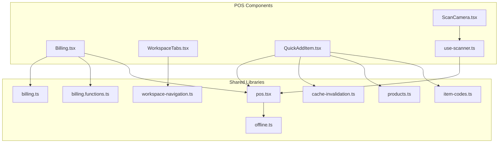
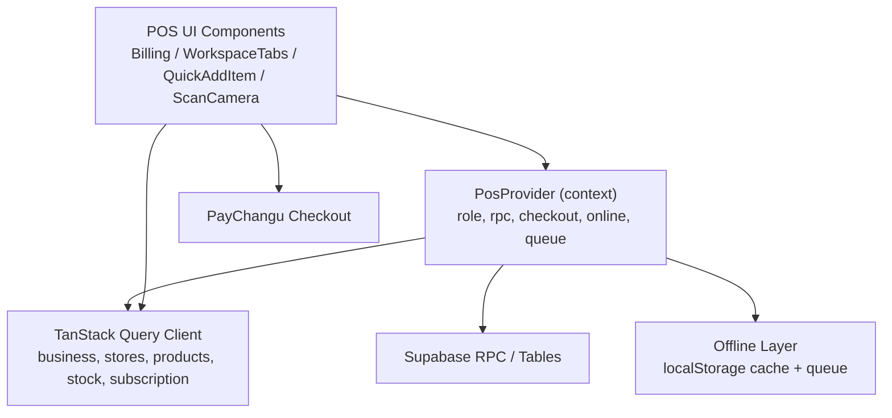
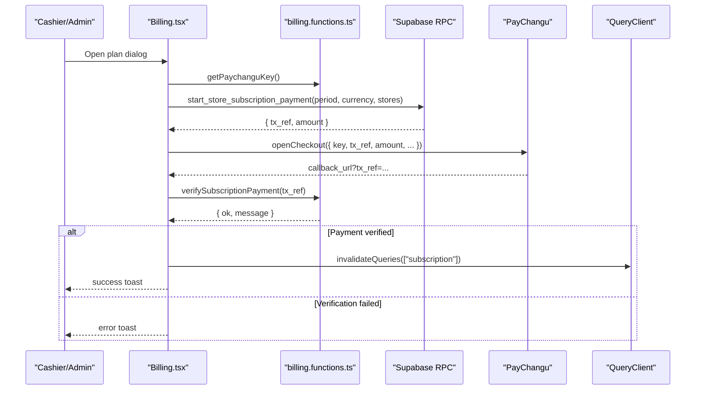
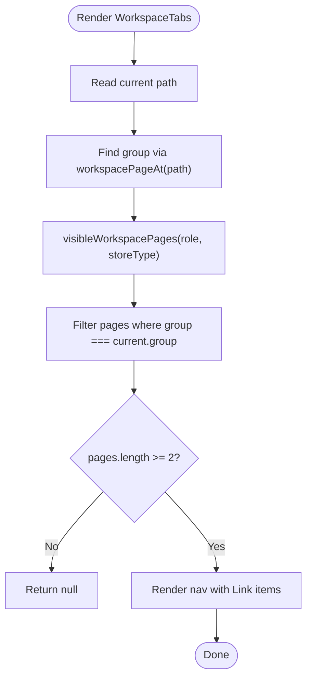
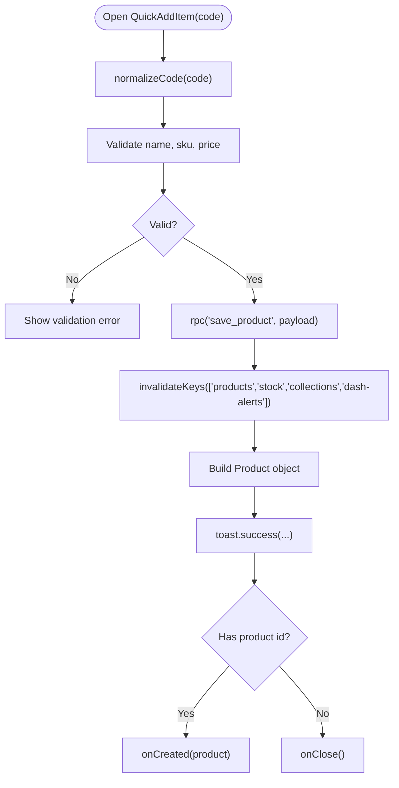
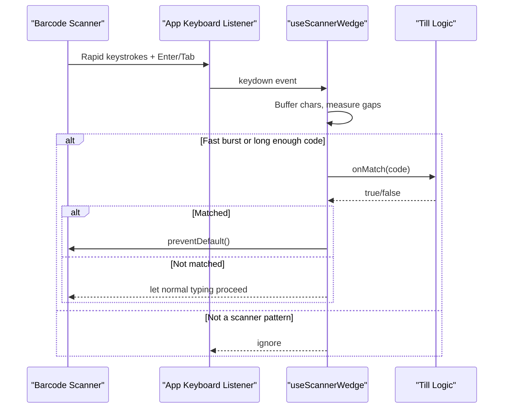
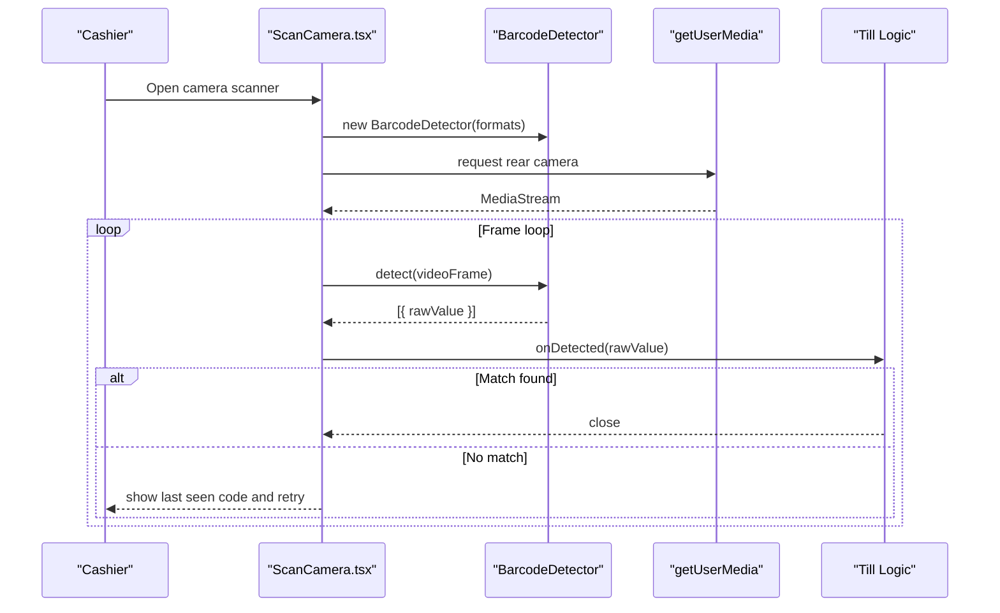
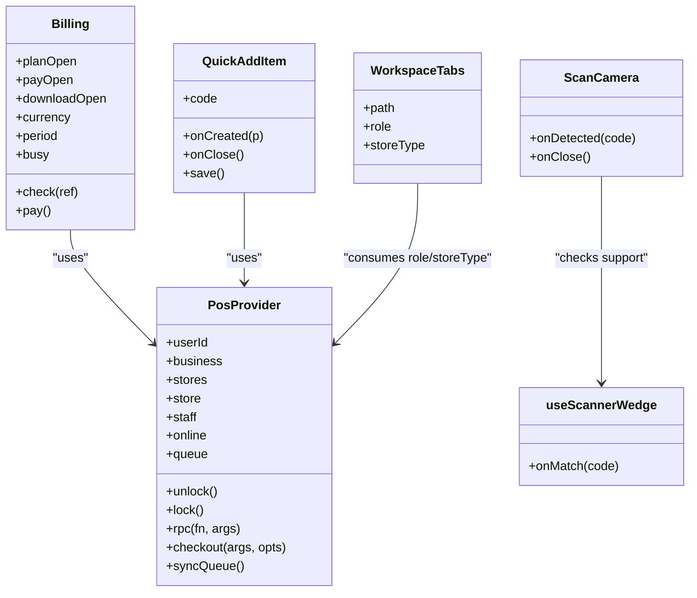

# POS-Specific Components

<cite>
**Referenced Files in This Document**
- [Billing.tsx](file://src/components/pos/Billing.tsx)
- [WorkspaceTabs.tsx](file://src/components/pos/WorkspaceTabs.tsx)
- [QuickAddItem.tsx](file://src/components/pos/QuickAddItem.tsx)
- [ScanCamera.tsx](file://src/components/pos/ScanCamera.tsx)
- [use-scanner.ts](file://src/components/pos/use-scanner.ts)
- [billing.ts](file://src/lib/billing.ts)
- [billing.functions.ts](file://src/lib/billing.functions.ts)
- [offline.ts](file://src/lib/offline.ts)
- [pos.tsx](file://src/lib/pos.tsx)
- [workspace-navigation.ts](file://src/lib/workspace-navigation.ts)
- [cache-invalidation.ts](file://src/lib/cache-invalidation.ts)
- [products.ts](file://src/lib/products.ts)
- [item-codes.ts](file://src/lib/item-codes.ts)
</cite>

## Table of Contents
1. [Introduction](#introduction)
2. [Project Structure](#project-structure)
3. [Core Components](#core-components)
4. [Architecture Overview](#architecture-overview)
5. [Detailed Component Analysis](#detailed-component-analysis)
6. [Dependency Analysis](#dependency-analysis)
7. [Performance Considerations](#performance-considerations)
8. [Troubleshooting Guide](#troubleshooting-guide)
9. [Conclusion](#conclusion)

## Introduction
This document explains the point-of-sale components responsible for subscription billing, workspace navigation, rapid product entry, and barcode scanning. It focuses on how these components integrate with business logic, manage state, handle events, and update data in real time. It also covers performance patterns for high-frequency transactions and offline capability integration.

The key components are:
- Billing: subscription management, payment flow, invoice history, and plan selection.
- WorkspaceTabs: grouped navigation between POS views based on role and store type.
- QuickAddItem: fast registration of unknown scanned items directly from the till.
- Scanner integration: hardware keyboard-wedge scanner support and camera-based BarcodeDetector scanning.

## Project Structure
The POS-specific code lives under `src/components/pos` and is supported by shared libraries under `src/lib`. The most relevant files are:

**Diagram sources**
- [Billing.tsx:1-10](file://src/components/pos/Billing.tsx#L1-L10)
- [WorkspaceTabs.tsx:1-10](file://src/components/pos/WorkspaceTabs.tsx#L1-L10)
- [QuickAddItem.tsx:1-18](file://src/components/pos/QuickAddItem.tsx#L1-L18)
- [ScanCamera.tsx:1-13](file://src/components/pos/ScanCamera.tsx#L1-L13)
- [use-scanner.ts:1-22](file://src/components/pos/use-scanner.ts#L1-L22)
- [pos.tsx:1-27](file://src/lib/pos.tsx#L1-L27)
- [offline.ts:1-14](file://src/lib/offline.ts#L1-L14)
- [billing.ts:1-9](file://src/lib/billing.ts#L1-L9)
- [billing.functions.ts:1-11](file://src/lib/billing.functions.ts#L1-L11)
- [workspace-navigation.ts:1-29](file://src/lib/workspace-navigation.ts#L1-L29)
- [cache-invalidation.ts:1-11](file://src/lib/cache-invalidation.ts#L1-L11)
- [products.ts:1-17](file://src/lib/products.ts#L1-L17)
- [item-codes.ts:1-24](file://src/lib/item-codes.ts#L1-L24)

**Section sources**
- [Billing.tsx:1-674](file://src/components/pos/Billing.tsx#L1-L674)
- [WorkspaceTabs.tsx:1-64](file://src/components/pos/WorkspaceTabs.tsx#L1-L64)
- [QuickAddItem.tsx:1-148](file://src/components/pos/QuickAddItem.tsx#L1-L148)
- [ScanCamera.tsx:1-175](file://src/components/pos/ScanCamera.tsx#L1-L175)
- [use-scanner.ts:1-84](file://src/components/pos/use-scanner.ts#L1-L84)
- [billing.ts:1-56](file://src/lib/billing.ts#L1-L56)
- [billing.functions.ts:1-54](file://src/lib/billing.functions.ts#L1-L54)
- [offline.ts:1-92](file://src/lib/offline.ts#L1-L92)
- [pos.tsx:1-448](file://src/lib/pos.tsx#L1-L448)
- [workspace-navigation.ts:1-163](file://src/lib/workspace-navigation.ts#L1-L163)
- [cache-invalidation.ts:1-27](file://src/lib/cache-invalidation.ts#L1-L27)
- [products.ts:1-107](file://src/lib/products.ts#L1-L107)
- [item-codes.ts:1-84](file://src/lib/item-codes.ts#L1-L84)

## Core Components
- Billing manages subscription status, plan selection, currency and period toggles, payment initiation through PayChangu, payment verification, and invoice download.
- WorkspaceTabs renders a grouped tab bar that filters pages by role and store type, using stable route URLs.
- QuickAddItem lets authorized users register an unknown item immediately after scanning, validates input, calls the server RPC, updates local caches, and optionally adds the new product to the basket.
- ScanCamera provides a camera-based barcode scanner modal using the browser BarcodeDetector API; it integrates with use-scanner’s keyboard-wedge detection for hardware scanners.

**Section sources**
- [Billing.tsx:54-674](file://src/components/pos/Billing.tsx#L54-L674)
- [WorkspaceTabs.tsx:20-63](file://src/components/pos/WorkspaceTabs.tsx#L20-L63)
- [QuickAddItem.tsx:30-147](file://src/components/pos/QuickAddItem.tsx#L30-L147)
- [ScanCamera.tsx:22-175](file://src/components/pos/ScanCamera.tsx#L22-L175)
- [use-scanner.ts:24-83](file://src/components/pos/use-scanner.ts#L24-L83)

## Architecture Overview
The POS architecture centers around a shared context provider that exposes authentication, role checks, RPC calls, money formatting, online/offline state, and an offline sales queue. UI components consume this context and coordinate with TanStack Query for data fetching and caching.

**Diagram sources**
- [pos.tsx:115-448](file://src/lib/pos.tsx#L115-L448)
- [offline.ts:15-92](file://src/lib/offline.ts#L15-L92)
- [billing.ts:10-56](file://src/lib/billing.ts#L10-L56)
- [billing.functions.ts:4-54](file://src/lib/billing.functions.ts#L4-L54)

## Detailed Component Analysis

### Billing Component
Purpose:
- Display current subscription status, trial or active periods, and over-limit warnings.
- Allow eligible roles to upgrade/renew plans, select currency and billing period, and initiate payment via PayChangu.
- Show payment history and allow downloading paid invoices as PDFs.
- Integrate with the POS context for permissions and RPC calls.

Key behaviors:
- Subscription data is fetched via `useSubscription`, which caches results and derives access flags without refetching when store count changes.
- Payment starts by calling a server function to get a public key and initiating a transaction through the RPC endpoint.
- On return URL callback, the component verifies the payment via a server function before refreshing subscription queries.
- Invoice history is cached with a long stale time because it is append-only.

State and data flow:
- Local state controls dialog visibility, selected currency, period, requested store slots, and busy indicators.
- Derived values compute monthly/yearly totals and usage percentage.
- TanStack Query invalidates subscription-related keys after successful payment.

**Diagram sources**
- [Billing.tsx:74-139](file://src/components/pos/Billing.tsx#L74-L139)
- [billing.functions.ts:4-54](file://src/lib/billing.functions.ts#L4-L54)

Business logic integration:
- Permissions are enforced via `can("admin", "manager")` from the POS context.
- Pricing constants and yearly discount factor come from `billing.ts`.
- Subscription policy derivation uses `subscriptionAccess` to compute over-limit/trial/active states.

Error handling:
- Missing payment configuration or unsupported browser features surface user-friendly messages.
- Payment verification failures show clear errors without leaking internals.

Real-time updates:
- Subscription query refreshes periodically and invalidates on payment completion.
- Invoice list remains cached to avoid unnecessary re-fetches.

**Section sources**
- [Billing.tsx:54-674](file://src/components/pos/Billing.tsx#L54-L674)
- [billing.ts:1-56](file://src/lib/billing.ts#L1-L56)
- [billing.functions.ts:1-54](file://src/lib/billing.functions.ts#L1-L54)

### WorkspaceTabs Component
Purpose:
- Render a segmented control-like navigation bar for the current workspace group.
- Filter visible pages by role and store type.
- Use existing routes so switching tabs does not introduce new routing behavior.

Navigation logic:
- Determines the current page group from the current path.
- Filters pages by role and approval-only constraints.
- Renders links with active styling and i18n labels.

**Diagram sources**
- [WorkspaceTabs.tsx:20-63](file://src/components/pos/WorkspaceTabs.tsx#L20-L63)
- [workspace-navigation.ts:124-136](file://src/lib/workspace-navigation.ts#L124-L136)

Integration points:
- Uses i18n for label rendering.
- Relies on role and store type from the parent POS context.

**Section sources**
- [WorkspaceTabs.tsx:1-64](file://src/components/pos/WorkspaceTabs.tsx#L1-L64)
- [workspace-navigation.ts:1-163](file://src/lib/workspace-navigation.ts#L1-L163)

### QuickAddItem Component
Purpose:
- Provide a fast way for authorized users to register a product when a scanned code is unknown.
- Validate name, SKU, and selling price.
- Call the server RPC to save the product, then update local caches and optionally add the product to the basket.

Validation and creation flow:
- Normalizes the scanned code.
- Validates required fields and amounts.
- Calls `save_product` RPC with sanitized inputs.
- Invalidates product, stock, collections, and dashboard alert caches.
- Shows success or error toasts.

**Diagram sources**
- [QuickAddItem.tsx:53-101](file://src/components/pos/QuickAddItem.tsx#L53-L101)

Data normalization:
- Uses `normalizeCode` to ensure consistent matching against catalog SKUs.
- Sanitizes text inputs according to limits.

Permissions:
- Hidden unless the user has admin or manager role.

**Section sources**
- [QuickAddItem.tsx:30-147](file://src/components/pos/QuickAddItem.tsx#L30-L147)
- [item-codes.ts:21-24](file://src/lib/item-codes.ts#L21-L24)
- [cache-invalidation.ts:11-26](file://src/lib/cache-invalidation.ts#L11-L26)

### Scanner Integration Components
Hardware scanner wedge:
- `useScannerWedge` listens for keystrokes and detects rapid bursts typical of barcode scanners.
- Ignores input when focus is in text fields or modifier keys are pressed.
- Emits matched codes to a callback, preventing default behavior to avoid double input.

Camera scanner:
- `ScanCameraButton` conditionally shows a camera icon if the platform supports BarcodeDetector and media devices.
- `ScanCamera` opens a modal, requests rear camera access, and runs a frame loop to detect barcodes.
- Handles permission errors, unsupported APIs, and unmatched codes gracefully.

**Diagram sources**
- [use-scanner.ts:31-83](file://src/components/pos/use-scanner.ts#L31-L83)

**Diagram sources**
- [ScanCamera.tsx:57-139](file://src/components/pos/ScanCamera.tsx#L57-L139)

Integration notes:
- Both scanner approaches feed into the same `onDetected` callback contract used by the POS workflow.
- Camera support is gated by `cameraScanSupported()` to hide unsupported UI.

**Section sources**
- [use-scanner.ts:1-84](file://src/components/pos/use-scanner.ts#L1-L84)
- [ScanCamera.tsx:1-175](file://src/components/pos/ScanCamera.tsx#L1-L175)

## Dependency Analysis
Component relationships and dependencies:

**Diagram sources**
- [pos.tsx:115-448](file://src/lib/pos.tsx#L115-L448)
- [Billing.tsx:54-674](file://src/components/pos/Billing.tsx#L54-L674)
- [WorkspaceTabs.tsx:20-63](file://src/components/pos/WorkspaceTabs.tsx#L20-L63)
- [QuickAddItem.tsx:36-147](file://src/components/pos/QuickAddItem.tsx#L36-L147)
- [ScanCamera.tsx:57-175](file://src/components/pos/ScanCamera.tsx#L57-L175)
- [use-scanner.ts:31-83](file://src/components/pos/use-scanner.ts#L31-L83)

Coupling and cohesion:
- Components depend on the POS context for permissions, RPC, and offline state, keeping UI logic cohesive.
- Shared libraries encapsulate domain logic (pricing, navigation, caching), reducing coupling between UI components.

Potential circular dependencies:
- None observed among the analyzed files; imports are unidirectional from components to libraries.

External integrations:
- Supabase RPC and tables for business data, subscriptions, and payments.
- PayChangu external payment service.
- Browser APIs: BarcodeDetector, getUserMedia, localStorage.

**Section sources**
- [pos.tsx:1-448](file://src/lib/pos.tsx#L1-L448)
- [billing.ts:1-56](file://src/lib/billing.ts#L1-L56)
- [workspace-navigation.ts:1-163](file://src/lib/workspace-navigation.ts#L1-L163)
- [offline.ts:1-92](file://src/lib/offline.ts#L1-L92)

## Performance Considerations
High-frequency transactions:
- Catalog and stock queries use long stale times to avoid frequent network calls during scanning and search.
- Stock query can enable live polling only on the till screen to keep quantities fresh without impacting other screens.
- Cache invalidation targets specific query keys rather than clearing the entire cache, minimizing re-fetch overhead.

Offline capability:
- Reference data is hydrated from localStorage at startup for instant display, then refreshed in the background.
- Sales made offline are queued locally and synced automatically when online, with periodic retries and error marking.
- Network change listeners update the online state and trigger sync attempts.

Optimization recommendations:
- Keep scanner callbacks lightweight; avoid heavy computations inside `onDetected`.
- Debounce expensive operations like PDF generation or bulk downloads.
- Prefer local lookups (`findByBarcode`) against cached catalogs instead of network calls.
- Use `staleTime` and targeted invalidation to balance freshness and performance.

**Section sources**
- [products.ts:22-53](file://src/lib/products.ts#L22-L53)
- [products.ts:82-107](file://src/lib/products.ts#L82-L107)
- [cache-invalidation.ts:1-27](file://src/lib/cache-invalidation.ts#L1-L27)
- [offline.ts:15-55](file://src/lib/offline.ts#L15-L55)
- [pos.tsx:242-345](file://src/lib/pos.tsx#L242-L345)

## Troubleshooting Guide
Common issues and resolutions:
- Payment not configured: Ensure PayChangu public and secret keys are set in the environment. The UI surfaces a clear message when the key is missing.
- Unsupported camera or BarcodeDetector: Hide camera scanner button and inform the user; fall back to hardware scanner wedge.
- Permission denied for camera: Show a readable error and allow closing the modal.
- Offline sales not syncing: Check the offline banner, unlock staff session if required, and manually trigger sync. Failed items can be retried or discarded.
- Subscription verification fails: Verify amount and currency match the recorded transaction; check server logs for PayChangu verification responses.

Debugging tips:
- Inspect TanStack Query cache keys to confirm invalidation scope.
- Review localStorage entries for offline queue and cached reference data.
- Use toast messages for immediate feedback on validation and RPC errors.

**Section sources**
- [billing.functions.ts:4-54](file://src/lib/billing.functions.ts#L4-L54)
- [ScanCamera.tsx:75-139](file://src/components/pos/ScanCamera.tsx#L75-L139)
- [pos.tsx:309-345](file://src/lib/pos.tsx#L309-L345)
- [offline.ts:71-92](file://src/lib/offline.ts#L71-L92)

## Conclusion
The POS-specific components provide a robust foundation for subscription billing, workspace navigation, rapid product entry, and barcode scanning. They integrate tightly with the POS context for permissions and offline capabilities, leverage TanStack Query for efficient data management, and implement careful error handling and performance optimizations suitable for high-frequency retail transactions. By composing these components thoughtfully and following the outlined patterns, teams can maintain responsive, reliable point-of-sale experiences both online and offline.