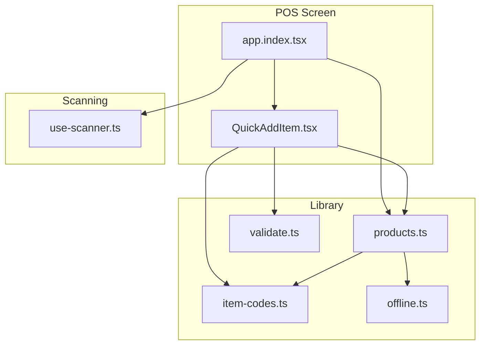
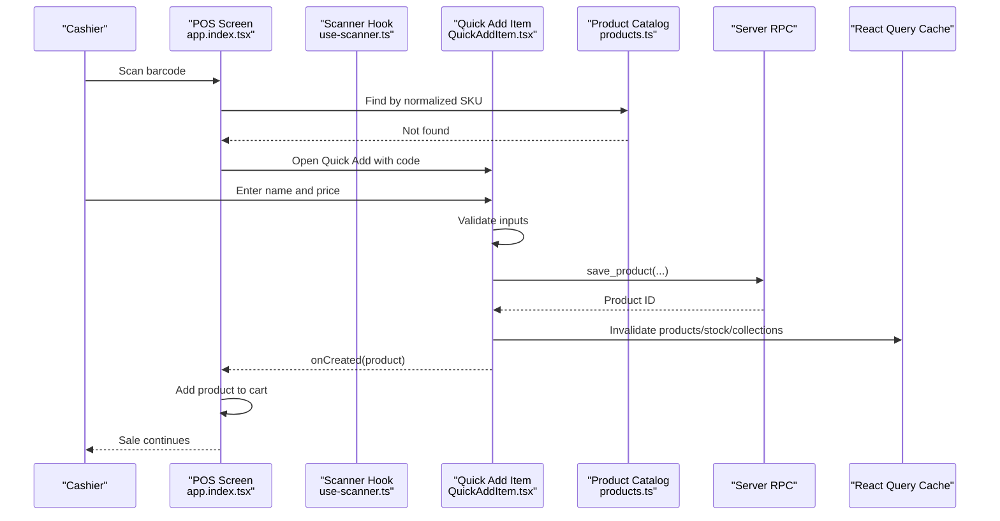
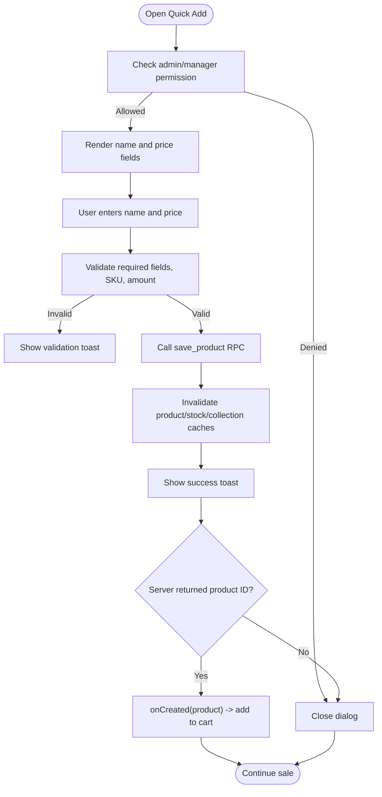
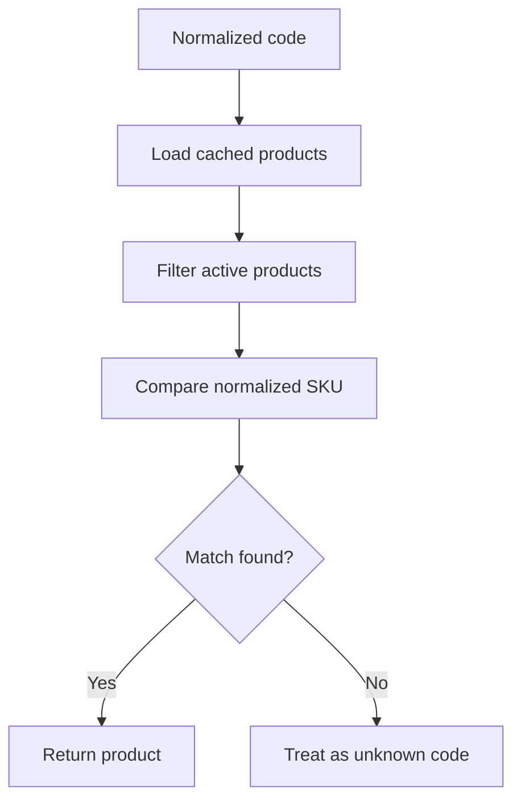
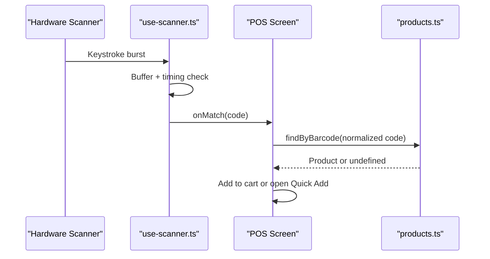
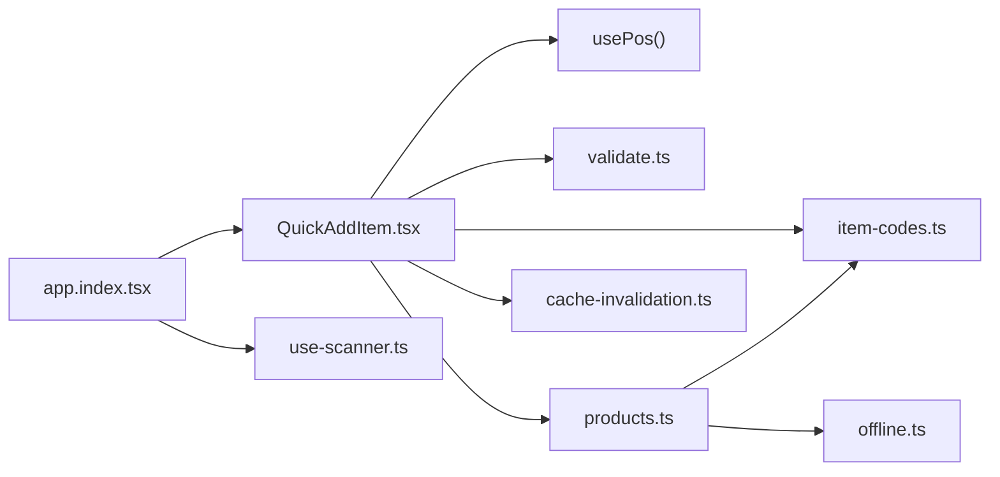

# Quick Add Item Component

<cite>
**Referenced Files in This Document**
- [QuickAddItem.tsx](file://src/components/pos/QuickAddItem.tsx)
- [app.index.tsx](file://src/routes/_authenticated/app.index.tsx)
- [products.ts](file://src/lib/products.ts)
- [item-codes.ts](file://src/lib/item-codes.ts)
- [use-scanner.ts](file://src/components/pos/use-scanner.ts)
- [validate.ts](file://src/lib/validate.ts)
- [offline.ts](file://src/lib/offline.ts)
</cite>

## Table of Contents
1. [Introduction](#introduction)
2. [Project Structure](#project-structure)
3. [Core Components](#core-components)
4. [Architecture Overview](#architecture-overview)
5. [Detailed Component Analysis](#detailed-component-analysis)
6. [Dependency Analysis](#dependency-analysis)
7. [Performance Considerations](#performance-considerations)
8. [Troubleshooting Guide](#troubleshooting-guide)
9. [Conclusion](#conclusion)

## Introduction
The Quick Add Item component enables rapid product entry during POS transactions when a scanned or typed item code is not yet present in the catalog. It provides a focused dialog for admins and managers to register a new product on the spot, then immediately add it to the current cart without leaving the till screen.

Key capabilities include:
- A compact form pre-filled with an unknown scanned code.
- Validation for product name, SKU/code, and selling price.
- Instant creation through a server RPC followed by cache invalidation.
- Immediate addition of the newly created product into the active POS cart.
- Integration with barcode scanning, keyboard shortcuts, and offline-ready product catalogs.

This documentation explains the user interface, search and scanning integration, validation flow, performance characteristics, and customization options for large catalogs and inventory workflows.

## Project Structure
The Quick Add Item feature spans several files:
- The UI and save logic live in the POS components directory.
- Product lookup and caching are handled by shared library modules.
- Barcode scanning uses a reusable hook that detects hardware scanner input.
- Input validation and limits are centralized for consistency across the app.
- Offline persistence ensures the catalog is available even without network access.

**Diagram sources**
- [app.index.tsx:582-594](file://src/routes/_authenticated/app.index.tsx#L582-L594)
- [QuickAddItem.tsx:30-103](file://src/components/pos/QuickAddItem.tsx#L30-L103)
- [products.ts:19-64](file://src/lib/products.ts#L19-L64)
- [item-codes.ts:21-29](file://src/lib/item-codes.ts#L21-L29)
- [use-scanner.ts:24-30](file://src/components/pos/use-scanner.ts#L24-L30)
- [offline.ts:9-13](file://src/lib/offline.ts#L9-L13)

**Section sources**
- [QuickAddItem.tsx:30-103](file://src/components/pos/QuickAddItem.tsx#L30-L103)
- [app.index.tsx:582-594](file://src/routes/_authenticated/app.index.tsx#L582-L594)
- [products.ts:19-64](file://src/lib/products.ts#L19-L64)
- [item-codes.ts:21-29](file://src/lib/item-codes.ts#L21-L29)
- [use-scanner.ts:24-30](file://src/components/pos/use-scanner.ts#L24-L30)
- [offline.ts:9-13](file://src/lib/offline.ts#L9-L13)

## Core Components
- Quick Add Item dialog: Presents fields for product name and selling price, validates inputs, calls the server RPC to create the product, invalidates relevant caches, and either adds the product to the cart or closes the dialog.
- Product catalog hook: Loads a lean, long-lived cached list of products optimized for fast local lookups.
- Code normalization utilities: Normalize SKUs and generated codes so exact matches work reliably across scanners, QR codes, and manual typing.
- Scanner wedge hook: Detects hardware barcode scanners and intercepts their keystroke bursts.
- Validation helpers: Enforce safe text, SKU format, and numeric price bounds.
- Offline persistence: Hydrates and persists reference data such as the product catalog for instant start and offline operation.

**Section sources**
- [QuickAddItem.tsx:30-147](file://src/components/pos/QuickAddItem.tsx#L30-L147)
- [products.ts:19-64](file://src/lib/products.ts#L19-L64)
- [item-codes.ts:21-29](file://src/lib/item-codes.ts#L21-L29)
- [use-scanner.ts:24-30](file://src/components/pos/use-scanner.ts#L24-L30)
- [validate.ts:9-25](file://src/lib/validate.ts#L9-L25)
- [offline.ts:9-13](file://src/lib/offline.ts#L9-L13)

## Architecture Overview
At runtime, the POS screen manages state for scanning, browsing, and quick adding. When a barcode scan resolves to an unknown code, the screen opens the Quick Add Item dialog. After successful creation, the newly created product is added directly to the cart.

**Diagram sources**
- [app.index.tsx:582-594](file://src/routes/_authenticated/app.index.tsx#L582-L594)
- [QuickAddItem.tsx:53-100](file://src/components/pos/QuickAddItem.tsx#L53-L100)
- [products.ts:54-64](file://src/lib/products.ts#L54-L64)
- [use-scanner.ts:24-30](file://src/components/pos/use-scanner.ts#L24-L30)

## Detailed Component Analysis

### Quick Add Item Dialog
The dialog is role-gated: only users with admin or manager permissions can use it. It accepts a pre-filled code from the parent POS screen and renders:
- A product name field with auto-focus and length limit.
- A selling price field with decimal input mode and numeric filtering.
- Keyboard support: pressing Enter submits the form when valid and not busy.
- Save behavior: validates inputs, sanitizes text, calls the server RPC, invalidates caches, shows success or error toasts, and either adds the product to the cart or closes the dialog.

**Diagram sources**
- [QuickAddItem.tsx:53-100](file://src/components/pos/QuickAddItem.tsx#L53-L100)
- [QuickAddItem.tsx:103-147](file://src/components/pos/QuickAddItem.tsx#L103-L147)

**Section sources**
- [QuickAddItem.tsx:30-147](file://src/components/pos/QuickAddItem.tsx#L30-L147)

### Product Search and Exact Lookup
Exact matching for barcodes, QR codes, and typed SKUs is performed against the cached product list using normalized codes. This avoids network latency and ensures consistent matching regardless of extra spaces or case differences.

Key behaviors:
- Normalization trims whitespace and collapses internal spaces.
- Exact match compares normalized lowercase codes.
- Only active products are considered.
- The catalog is loaded once and kept in memory for fast lookups.

**Diagram sources**
- [products.ts:54-64](file://src/lib/products.ts#L54-L64)
- [item-codes.ts:21-29](file://src/lib/item-codes.ts#L21-L29)

**Section sources**
- [products.ts:19-64](file://src/lib/products.ts#L19-L64)
- [item-codes.ts:21-29](file://src/lib/item-codes.ts#L21-L29)

### Barcode Scanning Integration
The scanner hook treats hardware scanners as keyboard wedges. It buffers printable keys and recognizes scanner patterns based on timing and burst length. It also supports camera-based scanning where the platform allows it.

Important details:
- Typing in text fields resets the buffer so normal input is never intercepted.
- Fast bursts or sufficiently long sequences trigger the match callback.
- The POS screen uses this hook to detect scans and decide whether to open Quick Add or add an existing product.

**Diagram sources**
- [use-scanner.ts:24-83](file://src/components/pos/use-scanner.ts#L24-L83)
- [products.ts:54-64](file://src/lib/products.ts#L54-L64)
- [app.index.tsx:582-594](file://src/routes/_authenticated/app.index.tsx#L582-L594)

**Section sources**
- [use-scanner.ts:1-84](file://src/components/pos/use-scanner.ts#L1-L84)
- [app.index.tsx:582-594](file://src/routes/_authenticated/app.index.tsx#L582-L594)

### Keyboard Shortcuts and Data Entry Efficiency
- Enter key submits the Quick Add form when valid and not busy.
- Price input restricts characters to digits and decimal point.
- Name input enforces maximum length and sanitizes unsafe characters before saving.
- Auto-focus on the name field speeds up registration after a scan.

These behaviors reduce friction during high-volume sales and keep the cashier’s workflow uninterrupted.

**Section sources**
- [QuickAddItem.tsx:111-133](file://src/components/pos/QuickAddItem.tsx#L111-L133)
- [validate.ts:36-41](file://src/lib/validate.ts#L36-L41)

### Customizing Search Fields
While Quick Add focuses on unknown codes, the POS screen’s main search supports:
- Text search by product name.
- SKU search via normalized codes.
- Category filtering.
- Deferred search updates to keep typing responsive.

You can extend these behaviors by modifying the filter logic in the POS screen and the normalization rules in the code utilities.

**Section sources**
- [app.index.tsx:138-159](file://src/routes/_authenticated/app.index.tsx#L138-L159)
- [item-codes.ts:21-29](file://src/lib/item-codes.ts#L21-L29)

### Handling Product Variants
The current model stores one product per row with a single SKU and price. If you need variants (size, color, etc.), consider:
- Adding variant-specific fields to the product type.
- Extending the Quick Add form to capture variant attributes.
- Updating the search and exact lookup to match variant identifiers.
- Adjusting stock tracking per variant if needed.

This would require changes to the product type, forms, and catalog queries.

[No sources needed since this section proposes conceptual extensions]

### Integrating with Inventory Management Systems
The component already integrates with the application’s inventory layer:
- Creation invalidates product, stock, and collection caches.
- Stock levels are tracked separately and refreshed periodically on the POS.
- Offline persistence keeps the catalog available when the network is down.

For external inventory systems, integrate at the RPC layer or cache invalidation step to sync changes consistently.

**Section sources**
- [QuickAddItem.tsx:82-95](file://src/components/pos/QuickAddItem.tsx#L82-L95)
- [products.ts:82-106](file://src/lib/products.ts#L82-L106)
- [offline.ts:9-13](file://src/lib/offline.ts#L9-L13)

## Dependency Analysis
The Quick Add Item component depends on:
- Role checks and RPC access from the POS context.
- Product types and exact lookup from the products module.
- Code normalization from the item-codes module.
- Validation helpers from the validate module.
- Cache invalidation utilities for React Query.
- Parent POS screen for opening the dialog and adding the product to the cart.

**Diagram sources**
- [QuickAddItem.tsx:1-18](file://src/components/pos/QuickAddItem.tsx#L1-L18)
- [app.index.tsx:582-594](file://src/routes/_authenticated/app.index.tsx#L582-L594)
- [products.ts:1-5](file://src/lib/products.ts#L1-L5)
- [item-codes.ts:1-13](file://src/lib/item-codes.ts#L1-L13)
- [use-scanner.ts:1-7](file://src/components/pos/use-scanner.ts#L1-L7)
- [offline.ts:1-13](file://src/lib/offline.ts#L1-L13)

**Section sources**
- [QuickAddItem.tsx:1-18](file://src/components/pos/QuickAddItem.tsx#L1-L18)
- [app.index.tsx:582-594](file://src/routes/_authenticated/app.index.tsx#L582-L594)
- [products.ts:1-5](file://src/lib/products.ts#L1-L5)
- [item-codes.ts:1-13](file://src/lib/item-codes.ts#L1-L13)
- [use-scanner.ts:1-7](file://src/components/pos/use-scanner.ts#L1-L7)
- [offline.ts:1-13](file://src/lib/offline.ts#L1-L13)

## Performance Considerations
- Local catalog caching: The product list is loaded once and kept in memory, enabling instant barcode resolution without network calls.
- Deferred search: The POS screen defers search term updates to keep typing smooth while tiles update.
- Memoized filters: Filtering and sorting are memoized to avoid unnecessary re-scans on every render.
- Stale time tuning: Product and stock queries use stale times and optional polling to balance freshness and performance.
- Offline readiness: Reference data like products is persisted locally for instant startup and offline operation.

Recommendations:
- Keep the catalog lean by excluding cost data unless necessary.
- Use exact SKU matching for barcodes to avoid full-text scans.
- Limit visible categories until the user browses to reduce initial rendering load.
- Monitor cache invalidation frequency to prevent excessive refetches.

**Section sources**
- [products.ts:19-52](file://src/lib/products.ts#L19-L52)
- [products.ts:82-106](file://src/lib/products.ts#L82-L106)
- [app.index.tsx:138-159](file://src/routes/_authenticated/app.index.tsx#L138-L159)
- [offline.ts:9-13](file://src/lib/offline.ts#L9-L13)

## Troubleshooting Guide
Common issues and resolutions:
- Dialog does not open: Ensure the user has admin or manager permissions; otherwise the component returns null.
- Product not added to cart: Verify that `onCreated` is called and the parent screen adds the product to the cart.
- Barcode not recognized: Confirm the code is normalized and matches an active product’s SKU exactly.
- Validation errors: Check name length, SKU format, and price bounds; ensure sanitized text is used before saving.
- Offline failures: Confirm the product catalog is hydrated from the local cache and that cache invalidation occurs after creation.

Debugging tips:
- Inspect the normalized code passed to the dialog and to exact lookup.
- Review toast messages for validation and server errors.
- Check React Query cache invalidation keys after product creation.
- Verify scanner hook configuration and whether text fields reset the buffer.

**Section sources**
- [QuickAddItem.tsx:103-147](file://src/components/pos/QuickAddItem.tsx#L103-L147)
- [validate.ts:99-122](file://src/lib/validate.ts#L99-L122)
- [products.ts:54-64](file://src/lib/products.ts#L54-L64)
- [use-scanner.ts:41-79](file://src/components/pos/use-scanner.ts#L41-L79)

## Conclusion
The Quick Add Item component streamlines product registration during POS transactions by combining a focused dialog, robust validation, exact barcode matching, and immediate cart integration. Its design emphasizes speed, reliability, and offline readiness, making it suitable for high-volume retail environments. By leveraging cached catalogs, deferred search, and precise code normalization, the system minimizes latency and maximizes throughput. Extensions for variants and external inventory integrations can be layered atop the existing architecture with careful attention to data models and cache synchronization.