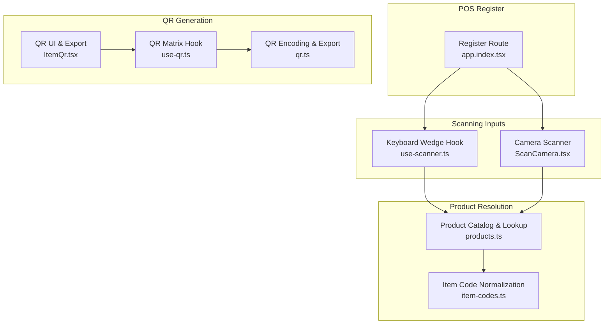
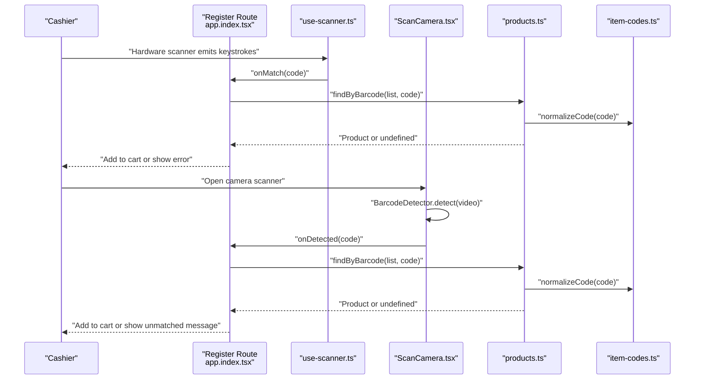
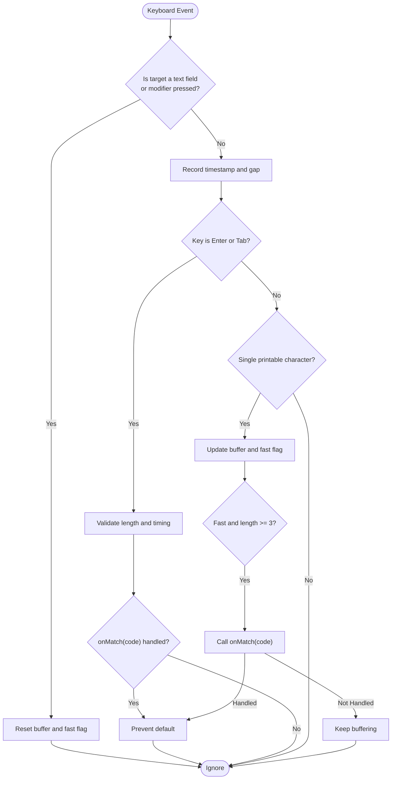
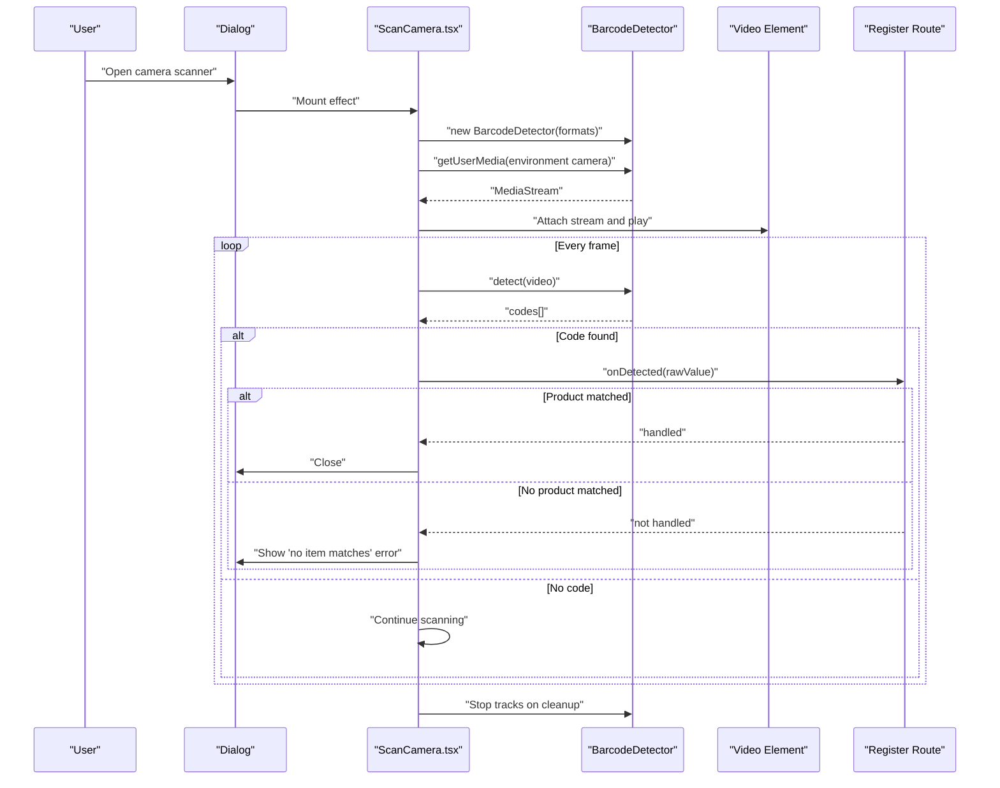
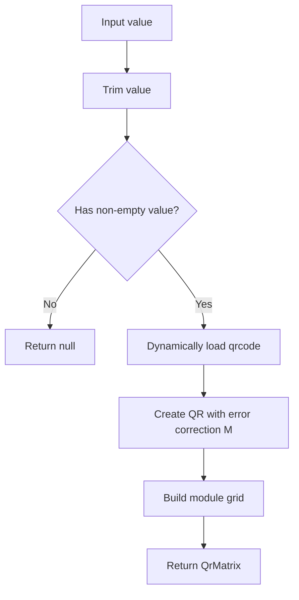
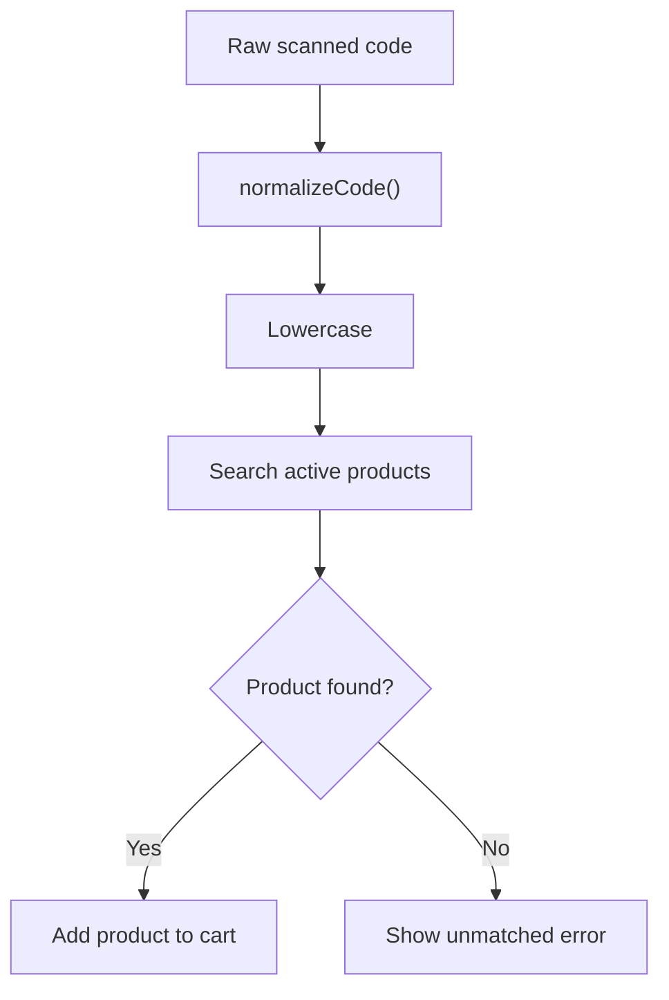
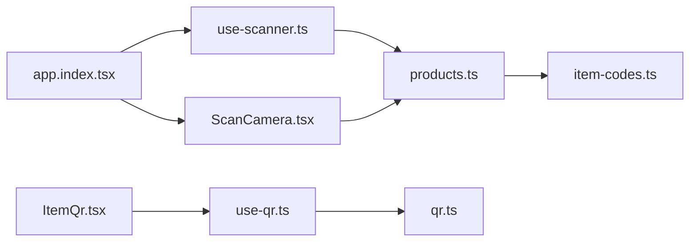

# Scanner Integration Components

<cite>
**Referenced Files in This Document**
- [use-scanner.ts](file://src/components/pos/use-scanner.ts)
- [ScanCamera.tsx](file://src/components/pos/ScanCamera.tsx)
- [use-qr.ts](file://src/components/pos/use-qr.ts)
- [qr.ts](file://src/lib/qr.ts)
- [item-codes.ts](file://src/lib/item-codes.ts)
- [products.ts](file://src/lib/products.ts)
- [app.index.tsx](file://src/routes/_authenticated/app.index.tsx)
- [ItemQr.tsx](file://src/components/pos/ItemQr.tsx)
</cite>

## Table of Contents
1. [Introduction](#introduction)
2. [Project Structure](#project-structure)
3. [Core Components](#core-components)
4. [Architecture Overview](#architecture-overview)
5. [Detailed Component Analysis](#detailed-component-analysis)
6. [Dependency Analysis](#dependency-analysis)
7. [Performance Considerations](#performance-considerations)
8. [Troubleshooting Guide](#troubleshooting-guide)
9. [Conclusion](#conclusion)

## Introduction
This document explains the scanner integration layer used by the point-of-sale register. It covers three main pieces:
- Hardware scanner input through a keyboard-wedge hook.
- Camera-based barcode and QR scanning through a browser-native detector.
- QR code generation for product codes, including matrix computation and export utilities.

The goal is to show how raw scan input becomes a product lookup, how errors are surfaced, and how fallbacks work when camera scanning is unavailable. It also includes configuration guidance, event handling patterns, performance considerations, and accessibility notes.

## Project Structure
The scanner integration spans hooks, UI components, and shared library modules:
- `src/components/pos/use-scanner.ts` provides hardware scanner detection and a keyboard-wedge listener.
- `src/components/pos/ScanCamera.tsx` implements camera-based scanning using the browser BarcodeDetector API.
- `src/components/pos/use-qr.ts` builds QR matrices from item codes.
- `src/lib/qr.ts` contains QR encoding, SVG/PNG generation, and file-saving helpers.
- `src/lib/item-codes.ts` defines normalization and payload rules for item codes.
- `src/lib/products.ts` exposes the cached product list and exact barcode lookup.
- `src/routes/_authenticated/app.index.tsx` integrates scanning into the register UI.
- `src/components/pos/ItemQr.tsx` renders and exports QR images for items.

**Diagram sources**
- [app.index.tsx:61-63](file://src/routes/_authenticated/app.index.tsx#L61-L63)
- [use-scanner.ts:31-83](file://src/components/pos/use-scanner.ts#L31-L83)
- [ScanCamera.tsx:57-139](file://src/components/pos/ScanCamera.tsx#L57-L139)
- [products.ts:22-64](file://src/lib/products.ts#L22-L64)
- [item-codes.ts:21-24](file://src/lib/item-codes.ts#L21-L24)
- [use-qr.ts:9-26](file://src/components/pos/use-qr.ts#L9-L26)
- [qr.ts:35-45](file://src/lib/qr.ts#L35-L45)
- [ItemQr.tsx:73-96](file://src/components/pos/ItemQr.tsx#L73-L96)

**Section sources**
- [use-scanner.ts:1-84](file://src/components/pos/use-scanner.ts#L1-L84)
- [ScanCamera.tsx:1-175](file://src/components/pos/ScanCamera.tsx#L1-L175)
- [use-qr.ts:1-27](file://src/components/pos/use-qr.ts#L1-L27)
- [qr.ts:1-116](file://src/lib/qr.ts#L1-L116)
- [item-codes.ts:1-84](file://src/lib/item-codes.ts#L1-L84)
- [products.ts:1-107](file://src/lib/products.ts#L1-L107)
- [app.index.tsx:111-160](file://src/routes/_authenticated/app.index.tsx#L111-L160)
- [ItemQr.tsx:1-182](file://src/components/pos/ItemQr.tsx#L1-L182)

## Core Components
- Keyboard wedge hook (`use-scanner.ts`)
  - Detects whether camera scanning is supported.
  - Listens for rapid printable keystrokes that resemble a barcode gun.
  - Ignores typing inside text fields or modifier-key combinations.
  - Resolves on Enter/Tab or after a fast burst once enough characters have been buffered.
- Camera scanner component (`ScanCamera.tsx`)
  - Opens a dialog with a live rear-camera preview.
  - Uses BarcodeDetector with a preferred set of formats (EAN, UPC, Code 128/39, ITF, QR).
  - Stops the media stream on close and surfaces permission or device errors.
  - Calls an `onDetected` callback; if no product matches, it keeps the modal open with a readable error.
- QR matrix hook (`use-qr.ts`)
  - Builds a QR matrix asynchronously for a given value.
  - Drops stale results when the input changes.
- QR library (`qr.ts`)
  - Dynamically loads the QR encoder to avoid bundling it in the base bundle.
  - Produces module grids, SVG paths, PNG data URLs, and downloadable files.
  - Defines quiet zone size and error-correction level.
- Item codes (`item-codes.ts`)
  - Normalizes codes by trimming and collapsing spaces.
  - Generates safe slugs for filenames.
  - Ensures QR payloads match what scanners emit.
- Product lookup (`products.ts`)
  - Caches the product catalog locally for fast matching.
  - Provides exact barcode lookup against active products.

**Section sources**
- [use-scanner.ts:15-83](file://src/components/pos/use-scanner.ts#L15-L83)
- [ScanCamera.tsx:39-139](file://src/components/pos/ScanCamera.tsx#L39-L139)
- [use-qr.ts:4-26](file://src/components/pos/use-qr.ts#L4-L26)
- [qr.ts:15-45](file://src/lib/qr.ts#L15-L45)
- [item-codes.ts:21-83](file://src/lib/item-codes.ts#L21-L83)
- [products.ts:19-64](file://src/lib/products.ts#L19-L64)

## Architecture Overview
The scanning pipeline connects input capture to product identification and then to POS actions.

**Diagram sources**
- [app.index.tsx:61-63](file://src/routes/_authenticated/app.index.tsx#L61-L63)
- [use-scanner.ts:31-83](file://src/components/pos/use-scanner.ts#L31-L83)
- [ScanCamera.tsx:110-129](file://src/components/pos/ScanCamera.tsx#L110-L129)
- [products.ts:60-64](file://src/lib/products.ts#L60-L64)
- [item-codes.ts:21-24](file://src/lib/item-codes.ts#L21-L24)

## Detailed Component Analysis

### Hardware Scanner Input: use-scanner.ts
Responsibilities:
- Provide a capability check for camera scanning.
- Implement a keyboard-wedge listener that buffers rapid printable keys.
- Avoid interfering with normal typing in inputs, textareas, selects, and content-editable elements.
- Resolve codes on Enter/Tab or early-resolve during fast bursts once a minimum length is reached.

Key behaviors:
- A gap threshold distinguishes scanner bursts from human typing.
- A minimum length threshold prevents accidental short sequences from being treated as codes.
- Modifier keys and focus-in-text-fields reset the buffer.
- The hook returns control to the page if `onMatch` does not prevent default behavior.

Configuration options:
- `enabled`: toggles the global listener.
- `onMatch(code)`: receives candidate codes; returning a truthy value prevents default key behavior.

Error handling:
- No explicit errors are thrown; invalid or partial sequences are ignored.
- If `onMatch` does not handle the code, the keystroke proceeds normally.

Accessibility:
- Does not interfere with screen readers because it only intercepts specific key events outside text inputs.

**Diagram sources**
- [use-scanner.ts:31-83](file://src/components/pos/use-scanner.ts#L31-L83)

**Section sources**
- [use-scanner.ts:1-84](file://src/components/pos/use-scanner.ts#L1-L84)

### Camera-Based Scanning: ScanCamera.tsx
Responsibilities:
- Render a header button that opens the camera scanner when supported.
- Open a modal with a live video preview.
- Initialize BarcodeDetector with preferred retail formats.
- Request camera access and display user-friendly errors when blocked or unsupported.
- Continuously detect barcodes until one resolves or the modal closes.
- Call `onDetected`; if no product matches, keep the modal open and show an error with the last seen code.

Supported formats:
- EAN-13, EAN-8, UPC-A, UPC-E, Code 128, Code 39, ITF, QR Code.

Error states:
- No BarcodeDetector support: shows a localized message.
- Camera permission denied or device unavailable: shows a localized message.
- Unmatched code: shows a localized message with the detected raw value.

Lifecycle:
- Media stream is stopped on cleanup.
- Animation frame loop is canceled on cleanup.
- Callback refs ensure the latest handlers are used without restarting the camera.

**Diagram sources**
- [ScanCamera.tsx:75-139](file://src/components/pos/ScanCamera.tsx#L75-L139)
- [app.index.tsx:422-423](file://src/routes/_authenticated/app.index.tsx#L422-L423)

**Section sources**
- [ScanCamera.tsx:1-175](file://src/components/pos/ScanCamera.tsx#L1-L175)

### QR Code Detection and Generation: use-qr.ts and qr.ts
Responsibilities:
- `use-qr.ts` computes a QR matrix for a given value and manages async loading.
- `qr.ts` dynamically imports the QR encoder, builds module grids, and generates SVG/PNG outputs.

Key behaviors:
- Empty values return null.
- Stale computations are dropped when the input changes.
- Error correction level M is used for robustness.
- Quiet zone size follows the spec minimum.
- SVG path generation merges runs per row for efficient rendering.
- PNG export uses a fixed pixel size for sharp prints.

**Diagram sources**
- [use-qr.ts:9-26](file://src/components/pos/use-qr.ts#L9-L26)
- [qr.ts:35-45](file://src/lib/qr.ts#L35-L45)

**Section sources**
- [use-qr.ts:1-27](file://src/components/pos/use-qr.ts#L1-L27)
- [qr.ts:1-116](file://src/lib/qr.ts#L1-L116)

### Product Identification Pipeline
Responsibilities:
- Normalize scanned codes consistently.
- Look up active products in the cached catalog.
- Ensure QR payloads match what scanners emit.

Normalization and matching:
- Codes are trimmed and inner spaces collapsed.
- Matching is case-insensitive.
- Only active products are considered.

QR payload consistency:
- QR payloads use normalized codes so printed labels and scanned codes resolve identically.

**Diagram sources**
- [item-codes.ts:21-24](file://src/lib/item-codes.ts#L21-L24)
- [products.ts:60-64](file://src/lib/products.ts#L60-L64)

**Section sources**
- [item-codes.ts:1-84](file://src/lib/item-codes.ts#L1-L84)
- [products.ts:19-64](file://src/lib/products.ts#L19-L64)

### Register Integration: app.index.tsx
Responsibilities:
- Integrate both hardware scanner input and camera scanning into the register.
- Manage state for scanning dialogs, pending scans, and quick-add flows.
- Use the product catalog and stock information to add items to the cart.

Integration points:
- Imports `ScanCamera`, `ScanCameraButton`, and `useScannerWedge`.
- Renders the camera button next to the search input.
- Maintains `scanning` state to open/close the camera dialog.
- Uses `pendingScan` to apply codes while the catalog refreshes.

**Section sources**
- [app.index.tsx:61-63](file://src/routes/_authenticated/app.index.tsx#L61-L63)
- [app.index.tsx:111-160](file://src/routes/_authenticated/app.index.tsx#L111-L160)
- [app.index.tsx:407-423](file://src/routes/_authenticated/app.index.tsx#L407-L423)

### QR UI and Export: ItemQr.tsx
Responsibilities:
- Render QR images for item codes.
- Provide copy, PNG download, and SVG download actions.
- Use the QR matrix hook to compute matrices efficiently.

Export behavior:
- PNG export uses a high-resolution data URL.
- SVG export uses the computed matrix to generate an SVG string.
- File names are derived from a safe slug of the item code.

**Section sources**
- [ItemQr.tsx:1-182](file://src/components/pos/ItemQr.tsx#L1-L182)
- [use-qr.ts:9-26](file://src/components/pos/use-qr.ts#L9-L26)
- [qr.ts:74-116](file://src/lib/qr.ts#L74-L116)

## Dependency Analysis
The scanner integration has clear boundaries:
- Input layers (`use-scanner.ts`, `ScanCamera.tsx`) produce normalized strings.
- Resolution layer (`products.ts`, `item-codes.ts`) maps strings to products.
- Output layer (`ItemQr.tsx`, `qr.ts`) renders and exports QR images.

**Diagram sources**
- [use-scanner.ts:31-83](file://src/components/pos/use-scanner.ts#L31-L83)
- [ScanCamera.tsx:110-129](file://src/components/pos/ScanCamera.tsx#L110-L129)
- [products.ts:60-64](file://src/lib/products.ts#L60-L64)
- [item-codes.ts:21-24](file://src/lib/item-codes.ts#L21-L24)
- [ItemQr.tsx:73-96](file://src/components/pos/ItemQr.tsx#L73-L96)
- [use-qr.ts:9-26](file://src/components/pos/use-qr.ts#L9-L26)
- [qr.ts:35-45](file://src/lib/qr.ts#L35-L45)
- [app.index.tsx:61-63](file://src/routes/_authenticated/app.index.tsx#L61-L63)

**Section sources**
- [use-scanner.ts:1-84](file://src/components/pos/use-scanner.ts#L1-L84)
- [ScanCamera.tsx:1-175](file://src/components/pos/ScanCamera.tsx#L1-L175)
- [products.ts:1-107](file://src/lib/products.ts#L1-L107)
- [item-codes.ts:1-84](file://src/lib/item-codes.ts#L1-L84)
- [ItemQr.tsx:1-182](file://src/components/pos/ItemQr.tsx#L1-L182)
- [use-qr.ts:1-27](file://src/components/pos/use-qr.ts#L1-L27)
- [qr.ts:1-116](file://src/lib/qr.ts#L1-L116)
- [app.index.tsx:111-160](file://src/routes/_authenticated/app.index.tsx#L111-L160)

## Performance Considerations
- Continuous scanning
  - Camera scanning uses `requestAnimationFrame` to poll frames only while the modal is open.
  - The media stream is stopped on cleanup to avoid unnecessary battery drain.
  - BarcodeDetector is constructed once per mount; callbacks are updated via refs to avoid restarts.
- Bundle size
  - The QR encoder is dynamically imported so screens that do not render QRs do not pay its cost.
- Catalog caching
  - The product catalog is cached locally for fast matching; stock data can be refreshed periodically on the register.
- Rendering efficiency
  - QR path generation merges runs per row to reduce SVG path complexity.
  - QR matrix computation drops stale results when inputs change.

Recommendations:
- Keep camera scanning disabled unless the modal is visible.
- Avoid re-rendering heavy UI while scanning is active.
- Prefer exact barcode matching over fuzzy search for speed.
- Limit background refetch intervals to necessary screens.

[No sources needed since this section provides general guidance]

## Troubleshooting Guide
Common issues and resolutions:
- Camera scanner button not visible
  - Camera scanning is hidden when `cameraScanSupported()` returns false.
  - Verify browser supports BarcodeDetector and getUserMedia.
- Camera permission denied
  - The component sets an error message when getUserMedia fails.
  - Ask the user to allow camera access and retry.
- No BarcodeDetector support
  - The component displays a localized message indicating lack of support.
  - Fall back to hardware scanner input or manual entry.
- Unmatched code from camera
  - The component shows a message with the last detected code.
  - Ensure the item’s SKU matches exactly after normalization.
- Hardware scanner not recognized
  - Confirm the scanner acts as a keyboard wedge and ends with Enter or Tab.
  - Ensure the focus is not inside a text field when scanning.
- QR code not printing or scanning
  - Ensure QR payloads use normalized codes.
  - Use exported PNG/SVG at sufficient resolution for print.

**Section sources**
- [ScanCamera.tsx:75-139](file://src/components/pos/ScanCamera.tsx#L75-L139)
- [use-scanner.ts:31-83](file://src/components/pos/use-scanner.ts#L31-L83)
- [item-codes.ts:76-83](file://src/lib/item-codes.ts#L76-L83)
- [products.ts:60-64](file://src/lib/products.ts#L60-L64)

## Conclusion
The scanner integration provides a robust pipeline from hardware and camera inputs to product identification and QR generation. It prioritizes correctness through consistent code normalization, leverages browser APIs where available, and offers fallbacks when camera scanning is unsupported. For production use, ensure proper error messaging, optimize continuous scanning performance, and maintain accessibility for all users.

[No sources needed since this section summarizes without analyzing specific files]