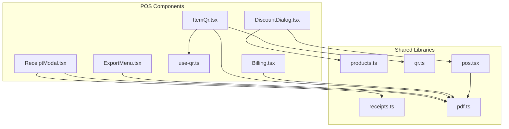
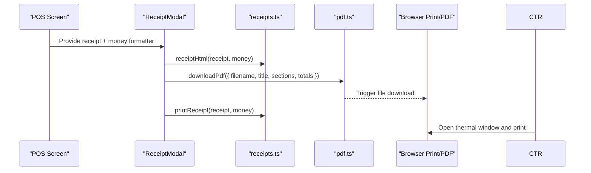
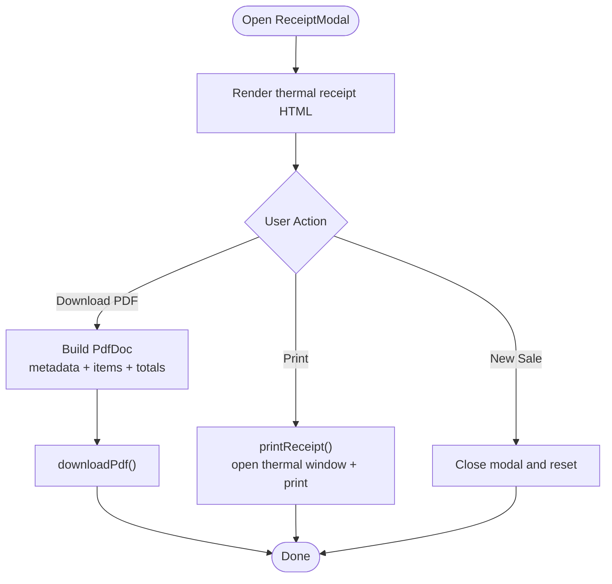
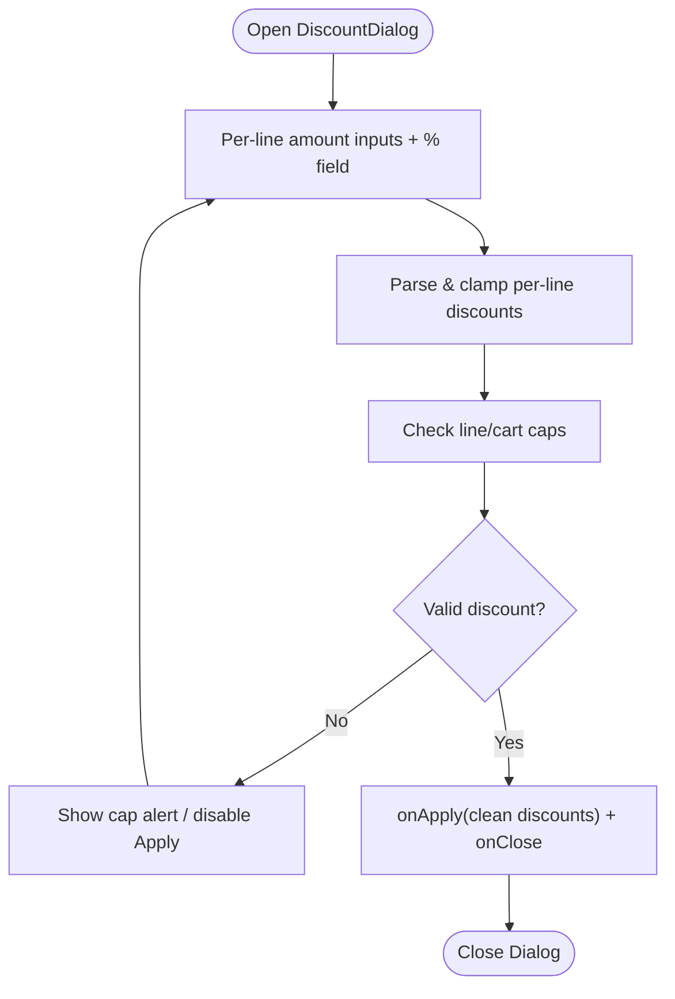
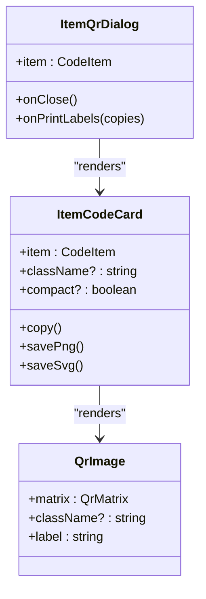
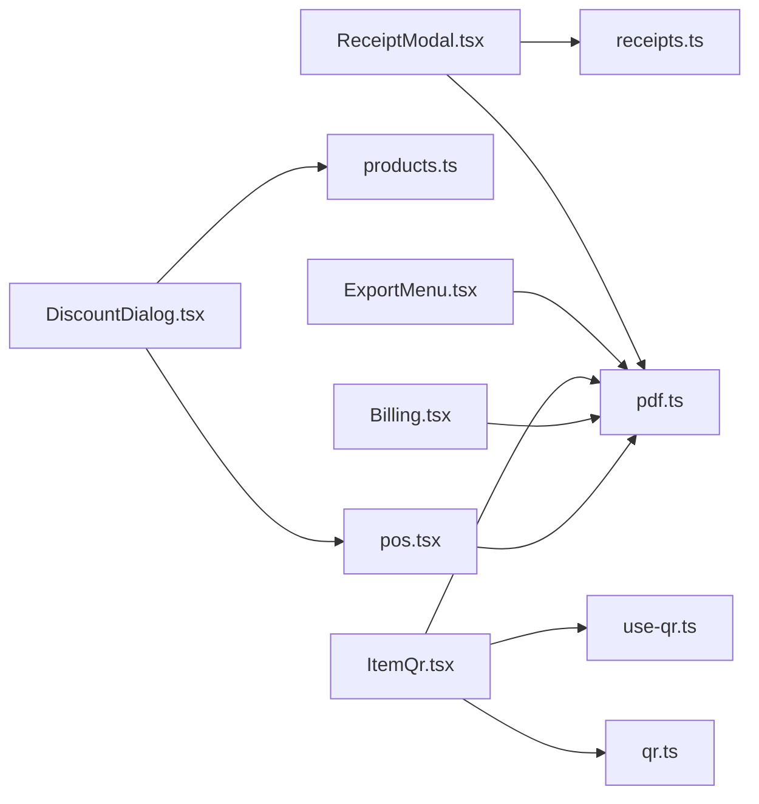

# Supporting POS Components

<cite>
**Referenced Files in This Document**
- [ReceiptModal.tsx](file://src/components/pos/ReceiptModal.tsx)
- [DiscountDialog.tsx](file://src/components/pos/DiscountDialog.tsx)
- [ExportMenu.tsx](file://src/components/pos/ExportMenu.tsx)
- [ItemQr.tsx](file://src/components/pos/ItemQr.tsx)
- [use-qr.ts](file://src/components/pos/use-qr.ts)
- [Billing.tsx](file://src/components/pos/Billing.tsx)
- [receipts.ts](file://src/lib/receipts.ts)
- [products.ts](file://src/lib/products.ts)
- [qr.ts](file://src/lib/qr.ts)
- [pdf.ts](file://src/lib/pdf.ts)
- [pos.tsx](file://src/lib/pos.tsx)
</cite>

## Table of Contents
1. [Introduction](#introduction)
2. [Project Structure](#project-structure)
3. [Core Components](#core-components)
4. [Architecture Overview](#architecture-overview)
5. [Detailed Component Analysis](#detailed-component-analysis)
6. [Dependency Analysis](#dependency-analysis)
7. [Performance Considerations](#performance-considerations)
8. [Security Considerations](#security-considerations)
9. [Troubleshooting Guide](#troubleshooting-guide)
10. [Conclusion](#conclusion)

## Introduction
This document explains the supporting point-of-sale components that enhance the checkout and inventory experience:

- **ReceiptModal**: previews and prints a completed sale or layby receipt, and downloads a branded PDF.
- **DiscountDialog**: applies per-line manual discounts with cashier caps and manager escalation.
- **ExportMenu**: provides a unified export dropdown for CSV and PDF outputs.
- **ItemQr**: generates QR codes for product codes, supports copying, PNG/SVG download, and label printing.

It also covers how these components integrate with the main POS workflow, how temporary state is managed, and what to consider for security and performance when handling receipts, discounts, exports, and QR data.

## Project Structure
The relevant code lives under `src/components/pos` for UI components and `src/lib` for shared logic:

**Diagram sources**
- [ReceiptModal.tsx:1-149](file://src/components/pos/ReceiptModal.tsx#L1-L149)
- [DiscountDialog.tsx:1-184](file://src/components/pos/DiscountDialog.tsx#L1-L184)
- [ExportMenu.tsx:1-44](file://src/components/pos/ExportMenu.tsx#L1-L44)
- [ItemQr.tsx:1-182](file://src/components/pos/ItemQr.tsx#L1-L182)
- [use-qr.ts:1-27](file://src/components/pos/use-qr.ts#L1-L27)
- [Billing.tsx:1-674](file://src/components/pos/Billing.tsx#L1-L674)
- [receipts.ts:1-241](file://src/lib/receipts.ts#L1-L241)
- [products.ts:1-107](file://src/lib/products.ts#L1-L107)
- [qr.ts:1-116](file://src/lib/qr.ts#L1-L116)
- [pdf.ts:1-412](file://src/lib/pdf.ts#L1-L412)
- [pos.tsx:1-448](file://src/lib/pos.tsx#L1-L448)

**Section sources**
- [ReceiptModal.tsx:1-149](file://src/components/pos/ReceiptModal.tsx#L1-L149)
- [DiscountDialog.tsx:1-184](file://src/components/pos/DiscountDialog.tsx#L1-L184)
- [ExportMenu.tsx:1-44](file://src/components/pos/ExportMenu.tsx#L1-L44)
- [ItemQr.tsx:1-182](file://src/components/pos/ItemQr.tsx#L1-L182)
- [receipts.ts:1-241](file://src/lib/receipts.ts#L1-L241)
- [products.ts:1-107](file://src/lib/products.ts#L1-L107)
- [qr.ts:1-116](file://src/lib/qr.ts#L1-L116)
- [pdf.ts:1-412](file://src/lib/pdf.ts#L1-L412)
- [pos.tsx:1-448](file://src/lib/pos.tsx#L1-L448)

## Core Components
- **ReceiptModal** renders an on-screen thermal-style receipt preview, offers PDF download, and triggers browser printing. It uses shared receipt builders and a money formatter from the POS context.
- **DiscountDialog** lets cashiers enter per-line discount amounts, apply percentage-based quick fills, and enforces cashier caps while warning about manager PIN requirements.
- **ExportMenu** is a small dropdown that routes export requests to “csv” or “pdf”. The caller implements the actual export; this component only selects the format.
- **ItemQr** builds QR matrices for item codes, renders SVG previews, copies codes, exports PNG/SVG, and opens a dialog for printing label sheets.

These components are intentionally thin UI layers around shared libraries (`receipts`, `products`, `qr`, `pdf`) and the POS context (`usePos`).

**Section sources**
- [ReceiptModal.tsx:37-148](file://src/components/pos/ReceiptModal.tsx#L37-L148)
- [DiscountDialog.tsx:29-183](file://src/components/pos/DiscountDialog.tsx#L29-L183)
- [ExportMenu.tsx:16-43](file://src/components/pos/ExportMenu.tsx#L16-L43)
- [ItemQr.tsx:33-181](file://src/components/pos/ItemQr.tsx#L33-L181)

## Architecture Overview
The supporting components follow a consistent pattern:

1. Receive props from the parent POS screen (e.g., receipt data, cart lines, item code).
2. Use `usePos()` for business context such as currency formatting, role checks, and checkout integration.
3. Delegate rendering/formatting to shared libraries:
   - Receipts: HTML/text generation and printing helpers.
   - Discounts: cap calculations and rounding utilities.
   - QR: matrix building, SVG path generation, PNG/SVG output.
   - PDF/CSV: client-side document generation.

**Diagram sources**
- [ReceiptModal.tsx:78-138](file://src/components/pos/ReceiptModal.tsx#L78-L138)
- [receipts.ts:127-227](file://src/lib/receipts.ts#L127-L227)
- [pdf.ts:51-266](file://src/lib/pdf.ts#L51-L266)

## Detailed Component Analysis

### ReceiptModal
ReceiptModal shows a success header, a scrollable thermal-style receipt preview, and action buttons for PDF download and printing. It also provides a “new sale” action.

Key behaviors:
- Uses `receiptTitle`, `receiptHtml`, and `methodLabel` from `receipts.ts`.
- Formats all monetary values through the POS-provided `money` function.
- Downloads a branded PDF using `downloadPdf` with structured metadata, table sections, and totals.
- Prints via `printReceipt`, which opens a thermal-sized window and calls the browser print dialog.

**Diagram sources**
- [ReceiptModal.tsx:54-145](file://src/components/pos/ReceiptModal.tsx#L54-L145)
- [receipts.ts:127-227](file://src/lib/receipts.ts#L127-L227)
- [pdf.ts:51-266](file://src/lib/pdf.ts#L51-L266)

Customization guidance:
- To customize receipt layout, modify the HTML builder in `receipts.ts` rather than the modal’s inline styles.
- To change PDF structure, adjust the `PdfDoc` object passed to `downloadPdf` in the calling screen.

**Section sources**
- [ReceiptModal.tsx:37-148](file://src/components/pos/ReceiptModal.tsx#L37-L148)
- [receipts.ts:10-34](file://src/lib/receipts.ts#L10-L34)
- [receipts.ts:127-227](file://src/lib/receipts.ts#L127-L227)
- [pdf.ts:20-32](file://src/lib/pdf.ts#L20-L32)

### DiscountDialog
DiscountDialog manages per-line discount inputs, percentage quick-fill, and validation against cashier caps.

Key behaviors:
- Maintains local text input state for each line and computes parsed numeric discounts.
- Applies percentage across all lines proportionally.
- Enforces cashier discount caps using `lineCapBlocked` and `cartCapBlocked` from `products.ts`.
- Displays warnings when caps are exceeded and disables application when no valid discount exists.

**Diagram sources**
- [DiscountDialog.tsx:44-84](file://src/components/pos/DiscountDialog.tsx#L44-L84)
- [products.ts:66-80](file://src/lib/products.ts#L66-L80)

Implementation notes:
- Temporary state is held locally inside the dialog; changes are committed via `onApply`.
- Cashier vs manager behavior is inferred from `can("admin", "manager")`.
- Server-side enforcement still applies; this sheet edits local cart discounts.

**Section sources**
- [DiscountDialog.tsx:29-183](file://src/components/pos/DiscountDialog.tsx#L29-L183)
- [products.ts:66-80](file://src/lib/products.ts#L66-L80)
- [pos.tsx:366-388](file://src/lib/pos.tsx#L366-L388)

### ExportMenu
ExportMenu is a lightweight wrapper around a dropdown menu that routes export selection to the parent.

Key behaviors:
- Provides two options: CSV and PDF.
- Delegates actual export implementation to the caller via `onExport(kind)`.
- Supports alignment and disabled state.

Integration example:
- A sales list page can call `onExport("csv")` to generate a CSV report using `toCsv` and `downloadCsv`.
- For PDF reports, build a `PdfDoc` and call `downloadPdf`.

**Section sources**
- [ExportMenu.tsx:16-43](file://src/components/pos/ExportMenu.tsx#L16-L43)
- [pdf.ts:268-282](file://src/lib/pdf.ts#L268-L282)
- [pdf.ts:51-266](file://src/lib/pdf.ts#L51-L266)

### ItemQr
ItemQr provides QR code generation and export for product codes.

Key behaviors:
- Builds a QR matrix asynchronously using `buildQr` and caches it via `useQrMatrix`.
- Renders an SVG preview with crisp edges and proper quiet zone.
- Copies the code to clipboard, exports PNG/SVG files, and opens a dialog for printing label sheets.
- Label printing reuses the same module grid to ensure consistency between preview and printed labels.

**Diagram sources**
- [ItemQr.tsx:33-135](file://src/components/pos/ItemQr.tsx#L33-L135)
- [ItemQr.tsx:141-181](file://src/components/pos/ItemQr.tsx#L141-L181)

Customization guidance:
- To change QR appearance, adjust the SVG drawing in `QrImage` and the underlying `qrPath` generator.
- To change label layout, update `downloadLabelSheet` in `pdf.ts`.

**Section sources**
- [ItemQr.tsx:33-181](file://src/components/pos/ItemQr.tsx#L33-L181)
- [use-qr.ts:9-26](file://src/components/pos/use-qr.ts#L9-L26)
- [qr.ts:35-95](file://src/lib/qr.ts#L35-L95)
- [pdf.ts:318-411](file://src/lib/pdf.ts#L318-L411)

## Dependency Analysis
The following diagram maps the primary dependencies among the supporting components and their shared libraries.

**Diagram sources**
- [ReceiptModal.tsx:1-24](file://src/components/pos/ReceiptModal.tsx#L1-L24)
- [DiscountDialog.tsx:1-24](file://src/components/pos/DiscountDialog.tsx#L1-L24)
- [ExportMenu.tsx:1-10](file://src/components/pos/ExportMenu.tsx#L1-L10)
- [ItemQr.tsx:1-26](file://src/components/pos/ItemQr.tsx#L1-L26)
- [Billing.tsx:1-28](file://src/components/pos/Billing.tsx#L1-L28)
- [receipts.ts:1-4](file://src/lib/receipts.ts#L1-L4)
- [products.ts:1-5](file://src/lib/products.ts#L1-L5)
- [qr.ts:1-23](file://src/lib/qr.ts#L1-L23)
- [pdf.ts:1-5](file://src/lib/pdf.ts#L1-L5)
- [pos.tsx:1-27](file://src/lib/pos.tsx#L1-L27)

**Section sources**
- [ReceiptModal.tsx:1-24](file://src/components/pos/ReceiptModal.tsx#L1-L24)
- [DiscountDialog.tsx:1-24](file://src/components/pos/DiscountDialog.tsx#L1-L24)
- [ExportMenu.tsx:1-10](file://src/components/pos/ExportMenu.tsx#L1-L10)
- [ItemQr.tsx:1-26](file://src/components/pos/ItemQr.tsx#L1-L26)
- [Billing.tsx:1-28](file://src/components/pos/Billing.tsx#L1-L28)
- [receipts.ts:1-4](file://src/lib/receipts.ts#L1-L4)
- [products.ts:1-5](file://src/lib/products.ts#L1-L5)
- [qr.ts:1-23](file://src/lib/qr.ts#L1-L23)
- [pdf.ts:1-5](file://src/lib/pdf.ts#L1-L5)
- [pos.tsx:1-27](file://src/lib/pos.tsx#L1-L27)

## Performance Considerations
- **Lazy loading heavy libraries**: QR generation and PDF generation use dynamic imports so they do not increase the initial bundle size for screens that never need them.
- **Memoized formatting**: Money formatting is memoized in the POS context to avoid repeated computations.
- **Efficient QR rendering**: QR paths merge runs per row and reuse the same matrix for preview and print, avoiding redundant encoding.
- **Catalog caching**: Product catalog and stock queries use long stale times and explicit invalidation to reduce network traffic during a trading session.
- **Offline queueing**: Checkout operations queue offline sales and sync later, preventing UI stalls when the network is unavailable.

Recommendations:
- Keep large datasets out of React state; prefer derived values and memoization.
- Batch expensive operations (e.g., generating multiple QR images) and debounce user input where appropriate.
- Reuse generated assets (PNG/SVG) when possible to avoid recomputation.

[No sources needed since this section provides general guidance]

## Security Considerations
- **Receipt content sanitization**: Receipt HTML and text builders escape control characters and HTML entities to prevent injection into the DOM.
- **Error masking**: RPC errors are masked to hide database internals and policy details from the UI.
- **Session hygiene**: Staff sessions are validated, expired tokens are cleared, and idle lock prevents unauthorized access after inactivity.
- **CSV formula protection**: CSV cells are sanitized to prevent spreadsheet formula injection.
- **Role-based controls**: Discount dialogs and other sensitive actions respect roles via `can("admin", "manager")`.

Best practices:
- Always sanitize user-supplied strings before inserting into HTML or external formats.
- Never trust client-side discount limits; enforce server-side rules.
- Clear sensitive local storage on logout or session expiry.

**Section sources**
- [receipts.ts:60-74](file://src/lib/receipts.ts#L60-L74)
- [pos.tsx:88-104](file://src/lib/pos.tsx#L88-L104)
- [pos.tsx:194-215](file://src/lib/pos.tsx#L194-L215)
- [pos.tsx:347-364](file://src/lib/pos.tsx#L347-L364)
- [pdf.ts:268-273](file://src/lib/pdf.ts#L268-L273)

## Troubleshooting Guide
Common issues and resolutions:

- **Receipt print popup blocked**: If the browser blocks the print window, show an error and guide the user to allow popups.
- **QR code not rendering**: Ensure the item has a non-empty code; the matrix is null until encoding completes.
- **Discounts capped**: When cashier caps are exceeded, reduce discount amounts or escalate to a manager PIN flow.
- **Export fails**: Verify that the caller implements the actual export logic for CSV/PDF and handles errors gracefully.
- **Offline sales not syncing**: Check online status, staff session validity, and retry failed queued sales.

Operational tips:
- Use toast notifications for immediate feedback on success/failure.
- Validate inputs early (e.g., discount percentages, copy counts).
- Provide clear affordances for retrying failed operations.

**Section sources**
- [ReceiptModal.tsx:133-135](file://src/components/pos/ReceiptModal.tsx#L133-L135)
- [ItemQr.tsx:76-96](file://src/components/pos/ItemQr.tsx#L76-L96)
- [DiscountDialog.tsx:145-167](file://src/components/pos/DiscountDialog.tsx#L145-L167)
- [pos.tsx:309-345](file://src/lib/pos.tsx#L309-L345)

## Conclusion
The supporting POS components provide focused, reusable functionality for receipts, discounts, exports, and QR codes. They integrate cleanly with the POS context and shared libraries, emphasizing safe rendering, role-aware controls, and efficient resource usage. By following the customization and security guidance here, teams can extend these components confidently while maintaining a reliable and performant point-of-sale experience.

[No sources needed since this section summarizes without analyzing specific files]