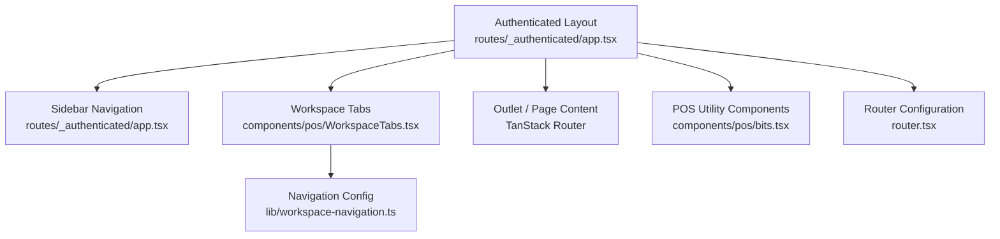
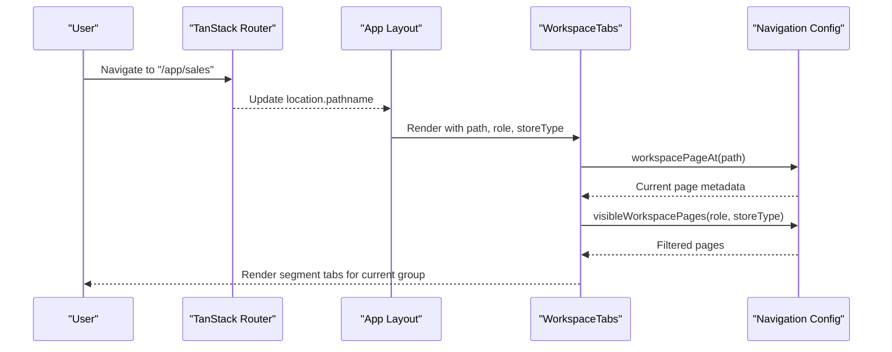
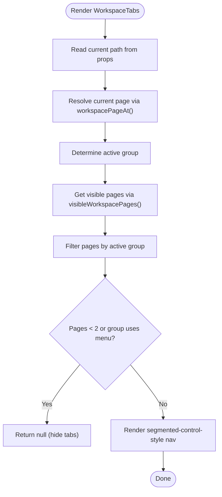
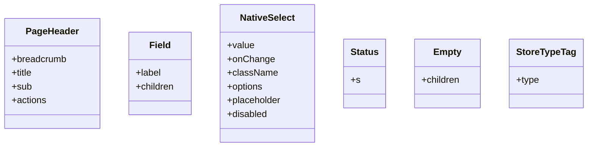
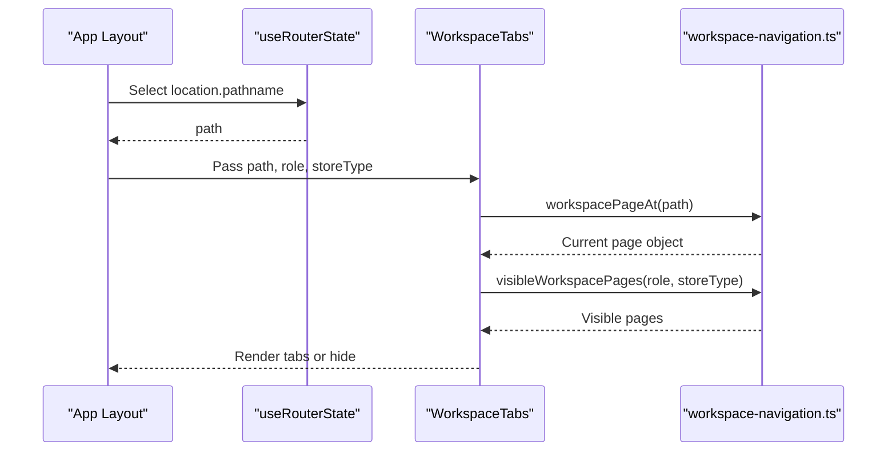
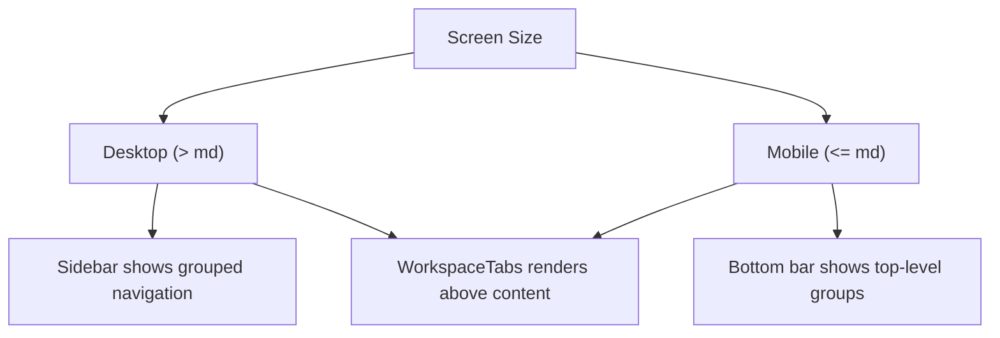
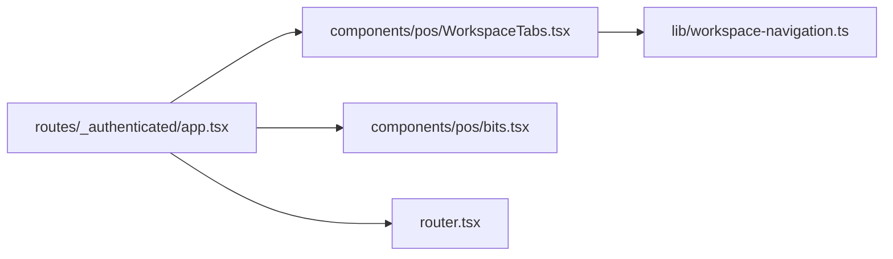

# Workspace Management Components

<cite>
**Referenced Files in This Document**
- [WorkspaceTabs.tsx](file://src/components/pos/WorkspaceTabs.tsx)
- [bits.tsx](file://src/components/pos/bits.tsx)
- [workspace-navigation.ts](file://src/lib/workspace-navigation.ts)
- [app.tsx](file://src/routes/_authenticated/app.tsx)
- [router.tsx](file://src/router.tsx)
</cite>

## Table of Contents
1. [Introduction](#introduction)
2. [Project Structure](#project-structure)
3. [Core Components](#core-components)
4. [Architecture Overview](#architecture-overview)
5. [Detailed Component Analysis](#detailed-component-analysis)
6. [Dependency Analysis](#dependency-analysis)
7. [Performance Considerations](#performance-considerations)
8. [Troubleshooting Guide](#troubleshooting-guide)
9. [Conclusion](#conclusion)
10. [Appendices](#appendices)

## Introduction
This document explains the workspace management components that power POS navigation and layout organization. It focuses on:
- The `WorkspaceTabs` component, which renders a segmented control for switching between sibling pages within a workspace group such as sales, inventory, or finance.
- The `bits.tsx` utility components used across POS screens, including `PageHeader`, `Field`, `NativeSelect`, `Status`, `Empty`, and `StoreTypeTag`.
- Tab state resolution through route integration with TanStack Router.
- Responsive behavior across desktop and mobile layouts.
- Practical guidance for adding new workspace tabs, customizing tab appearance, handling permissions, and optimizing performance for large numbers of tabs.

## Project Structure
The workspace UI is composed of:
- A top-level authenticated layout that owns routing, sidebar navigation, store selection, and user menu.
- A workspace tab bar rendered above page content when appropriate.
- A centralized navigation configuration that defines routes, groups, roles, and visibility rules.
- Shared UI primitives reused by many POS screens.

**Diagram sources**
- [app.tsx:456-598](file://src/routes/_authenticated/app.tsx#L456-L598)
- [WorkspaceTabs.tsx:21-66](file://src/components/pos/WorkspaceTabs.tsx#L21-L66)
- [workspace-navigation.ts:33-168](file://src/lib/workspace-navigation.ts#L33-L168)
- [bits.tsx:15-139](file://src/components/pos/bits.tsx#L15-L139)
- [router.tsx:25-30](file://src/router.tsx#L25-L30)

**Section sources**
- [app.tsx:73-92](file://src/routes/_authenticated/app.tsx#L73-L92)
- [app.tsx:456-598](file://src/routes/_authenticated/app.tsx#L456-L598)
- [WorkspaceTabs.tsx:1-66](file://src/components/pos/WorkspaceTabs.tsx#L1-L66)
- [workspace-navigation.ts:1-169](file://src/lib/workspace-navigation.ts#L1-L169)
- [bits.tsx:1-140](file://src/components/pos/bits.tsx#L1-L140)
- [router.tsx:1-33](file://src/router.tsx#L1-L33)

## Core Components
- `WorkspaceTabs`: Renders a horizontal segmented control for sibling pages inside the current workspace group. It hides itself when there are fewer than two visible siblings or when the group uses an actions menu instead of a tab row.
- `bits.tsx`: Provides reusable UI building blocks:
  - `PageHeader`: Consistent page title, optional breadcrumb, subtitle, and action buttons.
  - `Field`: Label wrapper for form fields.
  - `NativeSelect`: Styled select using the shared Select primitives.
  - `Status`: Badge with localized status text and color mapping.
  - `Empty`: Centered empty-state card.
  - `StoreTypeTag`: Badge indicating direct sale or approval-based stores.

These components are intentionally small, composable, and styled consistently with the application’s design tokens.

**Section sources**
- [WorkspaceTabs.tsx:21-66](file://src/components/pos/WorkspaceTabs.tsx#L21-L66)
- [bits.tsx:15-139](file://src/components/pos/bits.tsx#L15-L139)

## Architecture Overview
The workspace navigation architecture separates concerns into three layers:
1. **Routing layer**: TanStack Router manages URL state and provides the current path to components.
2. **Configuration layer**: `workspace-navigation.ts` defines all workspace pages, their groups, roles, and visibility rules.
3. **Presentation layer**: `WorkspaceTabs` reads the current route, resolves the active group, filters visible pages, and renders links.

**Diagram sources**
- [app.tsx:456-598](file://src/routes/_authenticated/app.tsx#L456-L598)
- [WorkspaceTabs.tsx:21-66](file://src/components/pos/WorkspaceTabs.tsx#L21-L66)
- [workspace-navigation.ts:124-142](file://src/lib/workspace-navigation.ts#L124-L142)

## Detailed Component Analysis

### WorkspaceTabs Component
`WorkspaceTabs` is responsible for rendering a compact segmented control for sibling pages within the same workspace group. It integrates tightly with the router and navigation configuration.

Key responsibilities:
- Resolve the current page from the router-provided path.
- Determine the active workspace group.
- Filter visible pages based on role and store type.
- Hide the tab bar when it would be redundant (fewer than two siblings or when the group uses an actions menu).
- Render accessible links with proper aria attributes and styling.

**Diagram sources**
- [WorkspaceTabs.tsx:21-66](file://src/components/pos/WorkspaceTabs.tsx#L21-L66)
- [workspace-navigation.ts:124-142](file://src/lib/workspace-navigation.ts#L124-L142)

#### Props and Behavior
- `path`: Current route path provided by the parent layout.
- `role`: Staff role used to filter visible pages.
- `storeType`: Store type used to filter approval-only pages.

Behavior highlights:
- Uses i18n for labels and group aria-labels.
- Applies active styling to the currently selected tab.
- Uses TanStack Router’s `Link` for navigation without introducing new routes.

**Section sources**
- [WorkspaceTabs.tsx:21-66](file://src/components/pos/WorkspaceTabs.tsx#L21-L66)

### bits.tsx Utility Components
`bits.tsx` provides common UI patterns used throughout POS screens.

- `PageHeader`:
  - Accepts breadcrumb, title, subtitle, and actions.
  - Wraps content in a responsive flex layout.
  - Suitable for consistent page headers across workspaces.

- `Field`:
  - Wraps form controls with a label and spacing.

- `NativeSelect`:
  - Wrapper around the shared Select component.
  - Supports placeholder, disabled state, and options array.

- `Status`:
  - Maps internal status strings to localized labels and color classes.
  - Falls back to raw string if no mapping exists.

- `Empty`:
  - Simple centered card for empty states.

- `StoreTypeTag`:
  - Displays badge for direct-sale or approval-based stores.

**Diagram sources**
- [bits.tsx:15-139](file://src/components/pos/bits.tsx#L15-L139)

**Section sources**
- [bits.tsx:15-139](file://src/components/pos/bits.tsx#L15-L139)

### Route Integration and Tab State Management
The app layout computes the current route path and passes it to `WorkspaceTabs`. The navigation configuration maps paths to workspace groups and pages.

**Diagram sources**
- [app.tsx:456-598](file://src/routes/_authenticated/app.tsx#L456-L598)
- [WorkspaceTabs.tsx:21-66](file://src/components/pos/WorkspaceTabs.tsx#L21-L66)
- [workspace-navigation.ts:136-142](file://src/lib/workspace-navigation.ts#L136-L142)

**Section sources**
- [app.tsx:456-598](file://src/routes/_authenticated/app.tsx#L456-L598)
- [WorkspaceTabs.tsx:21-66](file://src/components/pos/WorkspaceTabs.tsx#L21-L66)
- [workspace-navigation.ts:136-142](file://src/lib/workspace-navigation.ts#L136-L142)

### Responsive Behavior Across Screen Sizes
The authenticated layout adapts navigation for different screen sizes:
- Desktop: Sidebar shows grouped navigation; `WorkspaceTabs` appears above page content for intra-group switching.
- Mobile: A bottom tab bar shows top-level workspace groups; `WorkspaceTabs` still renders above content where applicable.

**Diagram sources**
- [app.tsx:557-594](file://src/routes/_authenticated/app.tsx#L557-L594)
- [WorkspaceTabs.tsx:41-64](file://src/components/pos/WorkspaceTabs.tsx#L41-L64)

**Section sources**
- [app.tsx:557-594](file://src/routes/_authenticated/app.tsx#L557-L594)
- [WorkspaceTabs.tsx:41-64](file://src/components/pos/WorkspaceTabs.tsx#L41-L64)

## Dependency Analysis
The following diagram shows how components depend on each other and on the navigation configuration.

**Diagram sources**
- [app.tsx:23-30](file://src/routes/_authenticated/app.tsx#L23-L30)
- [WorkspaceTabs.tsx:1-10](file://src/components/pos/WorkspaceTabs.tsx#L1-L10)
- [workspace-navigation.ts:1-2](file://src/lib/workspace-navigation.ts#L1-L2)
- [router.tsx:1-3](file://src/router.tsx#L1-L3)

**Section sources**
- [app.tsx:23-30](file://src/routes/_authenticated/app.tsx#L23-L30)
- [WorkspaceTabs.tsx:1-10](file://src/components/pos/WorkspaceTabs.tsx#L1-L10)
- [workspace-navigation.ts:1-2](file://src/lib/workspace-navigation.ts#L1-L2)
- [router.tsx:1-3](file://src/router.tsx#L1-L3)

## Performance Considerations
- **Tab list size**: `WorkspaceTabs` only renders visible siblings for the active group. If the number of pages grows, consider grouping related pages and moving some into per-page actions menus to keep the tab bar compact.
- **Lazy loading heavy components**: Defer loading of heavy page components using dynamic imports at the route level. This reduces initial bundle size and improves first paint.
- **Router query caching**: The router is configured with sensible defaults for query staleness and retries, reducing unnecessary refetches on focus changes.
- **Avoid re-renders**: Keep `WorkspaceTabs` lightweight. Do not perform expensive computations inside render; precompute derived data in the navigation config or memoize in the parent layout.

[No sources needed since this section provides general guidance]

## Troubleshooting Guide
Common issues and resolutions:
- **Tabs not appearing**:
  - Ensure the current group has at least two visible sibling pages.
  - Verify the group is not one that moves siblings into an actions menu.
- **Wrong active tab**:
  - Confirm the path passed to `WorkspaceTabs` matches the actual route.
  - Check that `workspacePageAt` correctly maps the path to the intended page.
- **Permission-related missing tabs**:
  - Review the roles array for each page in the navigation configuration.
  - For approval-only pages, ensure the store type is set appropriately.
- **Mobile navigation confusion**:
  - Remember that the bottom bar shows top-level groups, while `WorkspaceTabs` handles intra-group switching.

**Section sources**
- [WorkspaceTabs.tsx:31-38](file://src/components/pos/WorkspaceTabs.tsx#L31-L38)
- [workspace-navigation.ts:124-142](file://src/lib/workspace-navigation.ts#L124-L142)
- [workspace-navigation.ts:33-122](file://src/lib/workspace-navigation.ts#L33-L122)

## Conclusion
The workspace management system cleanly separates routing, configuration, and presentation. `WorkspaceTabs` provides a focused, accessible segmented control for intra-group navigation, while `bits.tsx` offers reusable UI primitives for consistent page composition. The navigation configuration centralizes permissions, labels, and visibility logic, making it straightforward to add new tabs and customize behavior. With careful attention to lazy loading and tab list size, the system scales well for larger POS deployments.

[No sources needed since this section summarizes without analyzing specific files]

## Appendices

### How to Add a New Workspace Tab
Steps:
1. Define the new page in the navigation configuration with its route, label key, group, and roles.
2. If the page is approval-only, mark it accordingly so visibility respects store type.
3. Place the corresponding route file under the authenticated routes folder.
4. Optionally add a header using `PageHeader` and other utilities from `bits.tsx`.

**Section sources**
- [workspace-navigation.ts:33-122](file://src/lib/workspace-navigation.ts#L33-L122)
- [bits.tsx:15-36](file://src/components/pos/bits.tsx#L15-L36)

### Customizing Tab Appearance
- Adjust styles in `WorkspaceTabs` for active/inactive states.
- Use Tailwind utility classes for colors, spacing, and typography.
- Ensure accessibility attributes like `aria-current` remain intact.

**Section sources**
- [WorkspaceTabs.tsx:41-64](file://src/components/pos/WorkspaceTabs.tsx#L41-L64)

### Handling Tab-Specific Permissions
- Assign roles to each page in the navigation configuration.
- Use `visibleWorkspacePages` to filter pages based on staff role and store type.
- For approval-only features, gate access by store type.

**Section sources**
- [workspace-navigation.ts:33-122](file://src/lib/workspace-navigation.ts#L33-L122)
- [workspace-navigation.ts:124-128](file://src/lib/workspace-navigation.ts#L124-L128)