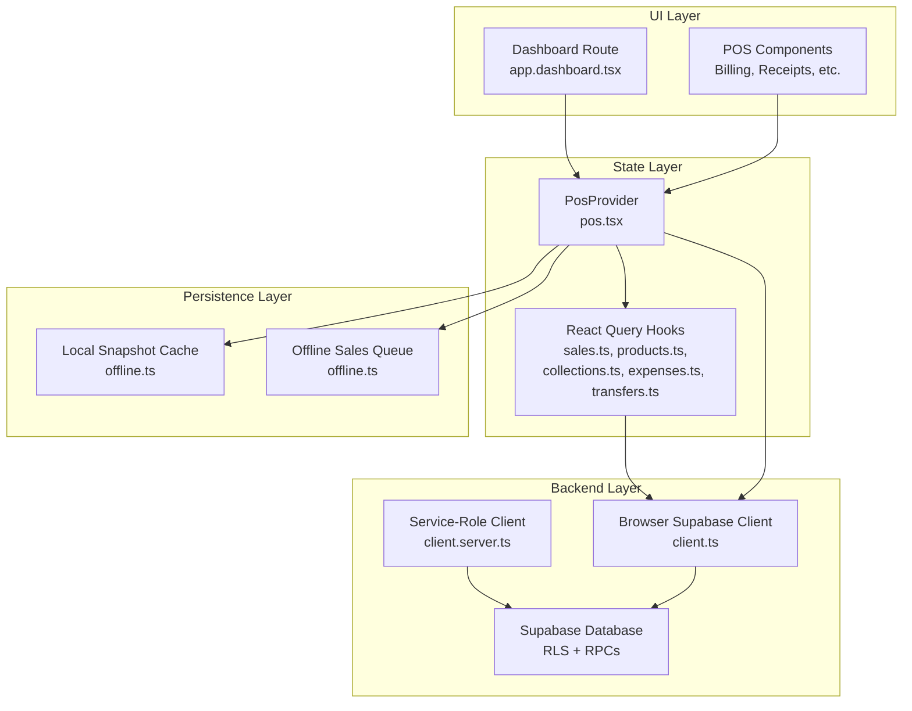
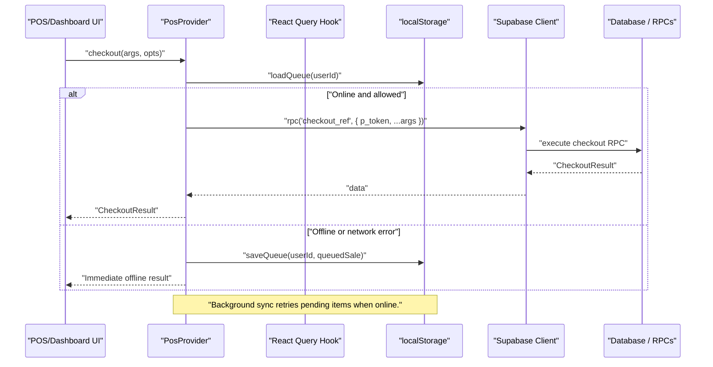
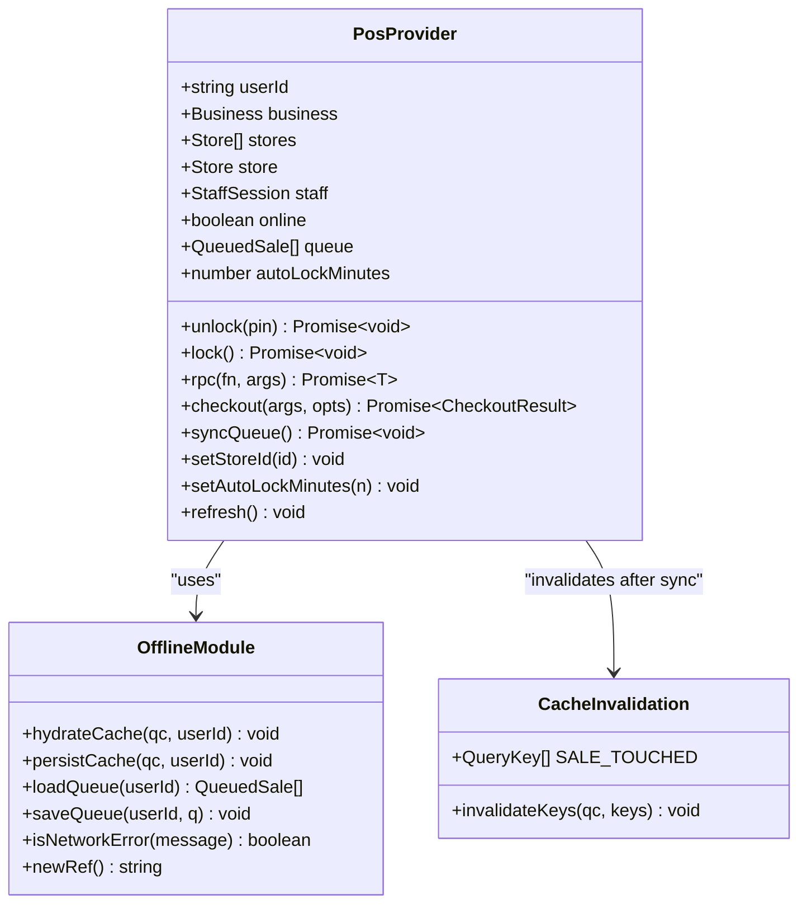
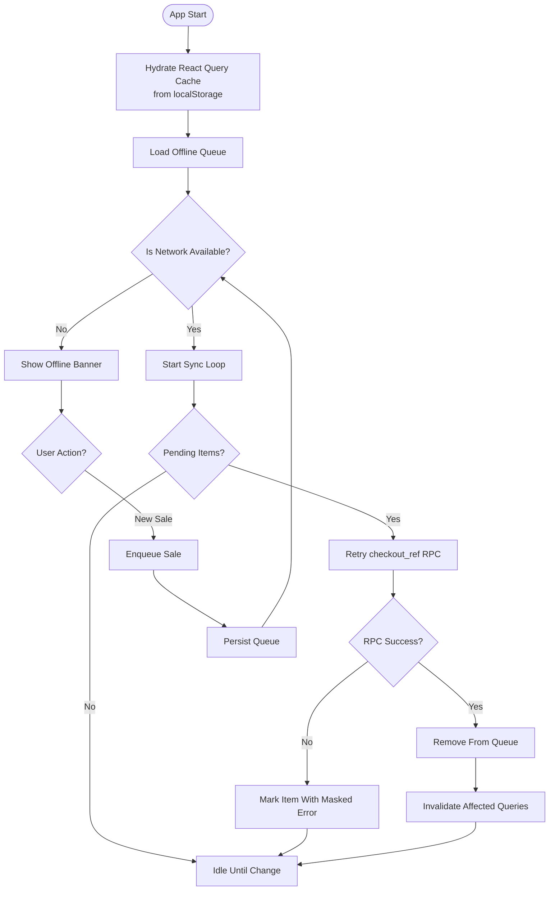
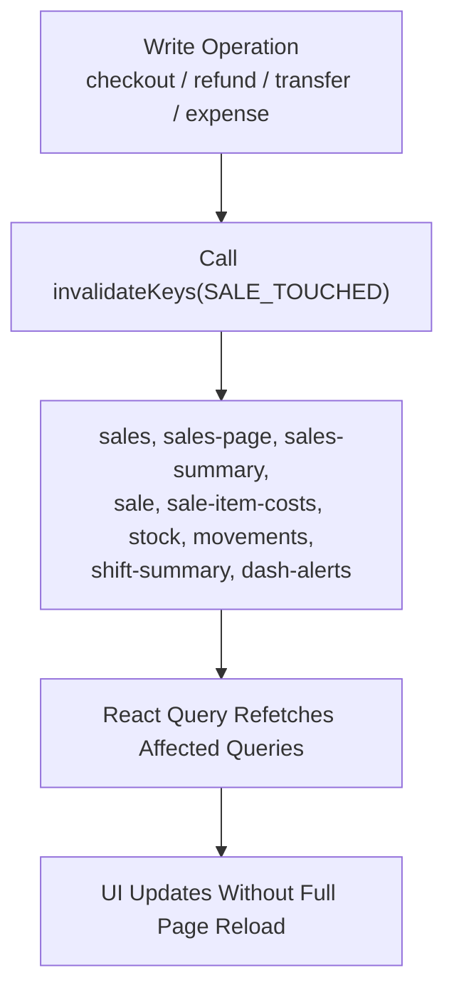
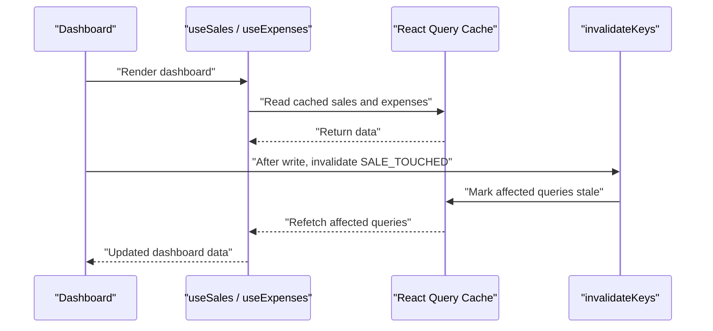
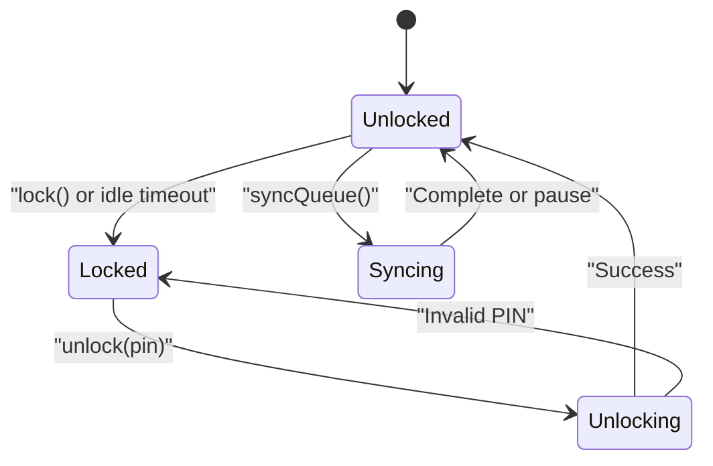
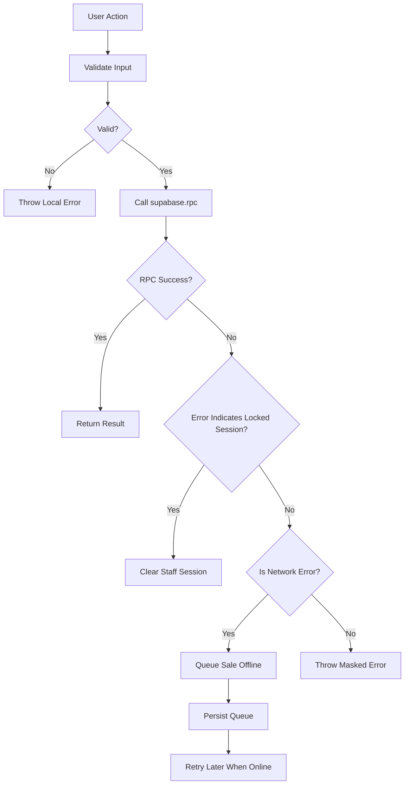
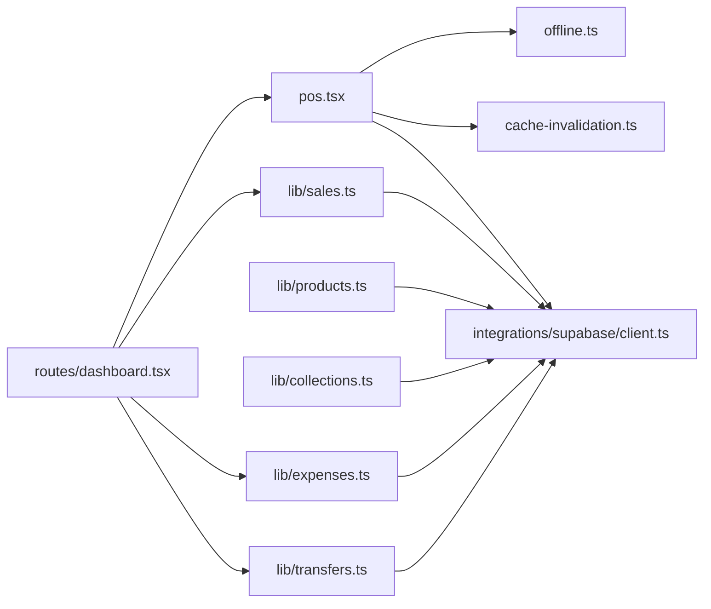

# Data Flow & State Management

<cite>
**Referenced Files in This Document**
- [pos.tsx](file://src/lib/pos.tsx)
- [offline.ts](file://src/lib/offline.ts)
- [cache-invalidation.ts](file://src/lib/cache-invalidation.ts)
- [sales.ts](file://src/lib/sales.ts)
- [products.ts](file://src/lib/products.ts)
- [collections.ts](file://src/lib/collections.ts)
- [expenses.ts](file://src/lib/expenses.ts)
- [transfers.ts](file://src/lib/transfers.ts)
- [dashboard.tsx](file://src/routes/_authenticated/app.dashboard.tsx)
- [client.ts](file://src/integrations/supabase/client.ts)
- [client.server.ts](file://src/integrations/supabase/client.server.ts)
- [types.ts](file://src/integrations/supabase/types.ts)
</cite>

## Table of Contents
1. [Introduction](#introduction)
2. [Project Structure](#project-structure)
3. [Core Components](#core-components)
4. [Architecture Overview](#architecture-overview)
5. [Detailed Component Analysis](#detailed-component-analysis)
6. [Dependency Analysis](#dependency-analysis)
7. [Performance Considerations](#performance-considerations)
8. [Troubleshooting Guide](#troubleshooting-guide)
9. [Conclusion](#conclusion)

## Introduction
This document explains how the Storq POS system manages data flow and state across the user interface, local device storage, React Query server state, and Supabase database operations. The central coordination point is `PosProvider`, which owns business context, store selection, staff sessions, offline queueing, and shared RPC behavior. Reads are primarily handled by React Query hooks that call Supabase directly or through a tokenized RPC wrapper. Writes go through `rpc` or mutation helpers, with failed network operations falling back to an offline-first queue that automatically retries when connectivity returns.

The design intentionally separates:
- **Server state**: cached by React Query with explicit invalidation keys.
- **Local UI state**: such as selected store, auto-lock settings, and online status.
- **Device persistence**: a small snapshot cache for instant start and a durable offline sales queue.
- **Supabase integration**: typed client usage, service-role client for server code, and role-gated SQL functions.

## Project Structure
At a high level, the relevant layers are:

**Diagram sources**
- [pos.tsx:115-440](file://src/lib/pos.tsx#L115-L440)
- [offline.ts:15-91](file://src/lib/offline.ts#L15-L91)
- [sales.ts:37-180](file://src/lib/sales.ts#L37-L180)
- [products.ts:22-106](file://src/lib/products.ts#L22-L106)
- [client.ts:63-95](file://src/integrations/supabase/client.ts#L63-L95)
- [client.server.ts:36-72](file://src/integrations/supabase/client.server.ts#L36-L72)

**Section sources**
- [pos.tsx:115-440](file://src/lib/pos.tsx#L115-L440)
- [offline.ts:1-91](file://src/lib/offline.ts#L1-L91)
- [client.ts:63-95](file://src/integrations/supabase/client.ts#L63-L95)
- [client.server.ts:36-72](file://src/integrations/supabase/client.server.ts#L36-L72)

## Core Components
The core state and data-flow components are:

| Component | Responsibility | Key Behaviors |
|---|---|---|
| `PosProvider` | Central business context, session management, offline queue, RPC wrapper, currency formatting, store selection | Loads staff session from storage, hydrates React Query cache, exposes `checkout`, `syncQueue`, `unlock`, `lock`, `rpc`, `can`. |
| `offline.ts` | Device-local snapshot cache and offline sales queue | Persists safe reference data, loads queued sales, persists queue mutations, detects network errors, generates unique refs. |
| `cache-invalidation.ts` | Shared list of query keys affected by sales and stock changes | Exposes `SALE_TOUCHED` and `invalidateKeys` so writes only refresh related queries. |
| React Query hooks | Read and mutate server state | `useSales`, `useProducts`, `useCollections`, `useExpenses`, `useTransfers`, `useLowStock`, `useSalesSummary`, `useSalesPage`. |
| Supabase clients | Typed HTTP access to tables and RPCs | Browser client uses publishable key; server client uses service role. |

**Section sources**
- [pos.tsx:28-84](file://src/lib/pos.tsx#L28-L84)
- [offline.ts:1-91](file://src/lib/offline.ts#L1-L91)
- [cache-invalidation.ts:1-27](file://src/lib/cache-invalidation.ts#L1-L27)
- [sales.ts:37-180](file://src/lib/sales.ts#L37-L180)
- [products.ts:22-106](file://src/lib/products.ts#L22-L106)
- [collections.ts:15-56](file://src/lib/collections.ts#L15-L56)
- [expenses.ts:35-69](file://src/lib/expenses.ts#L35-L69)
- [transfers.ts:52-140](file://src/lib/transfers.ts#L52-L140)

## Architecture Overview
The application follows a layered architecture:

1. **User interaction** triggers UI actions in POS components or dashboard routes.
2. **Context layer** (`PosProvider`) provides authenticated RPC calls, current staff session, store context, and offline queue control.
3. **Query layer** (React Query hooks) reads from Supabase tables or calls RPCs.
4. **Persistence layer** keeps a snapshot of safe reference data and queues offline transactions.
5. **Backend layer** enforces security via Row-Level Security and validated RPCs.

**Diagram sources**
- [pos.tsx:275-338](file://src/lib/pos.tsx#L275-L338)
- [offline.ts:71-91](file://src/lib/offline.ts#L71-L91)

**Section sources**
- [pos.tsx:115-440](file://src/lib/pos.tsx#L115-L440)
- [offline.ts:15-91](file://src/lib/offline.ts#L15-L91)

## Detailed Component Analysis

### PosProvider: Centralized Business Context and Session Management
`PosProvider` is the single source of truth for POS-wide state. It manages:

- **Staff session lifecycle**: unlock with PIN, lock session, clear previous staff data, and invalidate all queries on logout.
- **Store context**: persisted store ID, effective store resolution for cashiers, and role-based store assignment.
- **Business and stores loading**: long-lived queries for business configuration and store list.
- **RPC wrapper**: injects staff token, masks raw Postgres errors, and clears session on lock-related failures.
- **Offline queue**: tracks online status, persists queued sales, and retries them periodically.
- **Till hygiene**: idle auto-lock using `useIdleLock`.

**Diagram sources**
- [pos.tsx:55-84](file://src/lib/pos.tsx#L55-L84)
- [pos.tsx:115-440](file://src/lib/pos.tsx#L115-L440)
- [offline.ts:15-91](file://src/lib/offline.ts#L15-L91)
- [cache-invalidation.ts:11-26](file://src/lib/cache-invalidation.ts#L11-L26)

Key implementation details:

- **Staff session persistence**: The provider loads a stored staff session, validates its expiry, and rejects stale tokens created before the security migration.
- **Query invalidation on role change**: When clearing staff, it removes the local token and invalidates all queries to prevent one staff member’s data leaking to another.
- **RPC error masking**: Raw Postgres internals are replaced with localized generic messages, except for controlled business errors.
- **Offline checkout fallback**: If offline is allowed and the device is offline, or if a network error occurs, the sale is queued immediately with a generated reference.
- **Automatic sync loop**: When online and staffed, pending queue items are retried every 30 seconds until they succeed or hit a hard failure.

**Section sources**
- [pos.tsx:115-228](file://src/lib/pos.tsx#L115-L228)
- [pos.tsx:242-338](file://src/lib/pos.tsx#L242-L338)
- [pos.tsx:347-388](file://src/lib/pos.tsx#L347-L388)

### Offline-First Queue and Local Persistence
The offline module separates two concerns:

1. **Snapshot cache**: A versioned JSON object in localStorage containing successful React Query results for safe reference data.
2. **Offline queue**: An array of queued sales keyed by user, persisted whenever the queue changes.

**Diagram sources**
- [offline.ts:15-55](file://src/lib/offline.ts#L15-L55)
- [offline.ts:71-91](file://src/lib/offline.ts#L71-L91)
- [pos.tsx:242-345](file://src/lib/pos.tsx#L242-L345)

Important behaviors:

- **Instant start**: On mount, the provider hydrates React Query with last-known catalog, business, stores, collections, stock, and staff names. These entries are marked as instantly shown but stale, so they refresh in the background.
- **Safe persistence set**: Only non-role-gated reference data is persisted locally. Buying costs, reports, and other sensitive data remain server-only.
- **Debounced persistence**: Cache updates are debounced to avoid excessive localStorage writes.
- **Queue durability**: Every queue mutation persists to localStorage; empty queues remove the key.
- **Network error detection**: A regex-based helper distinguishes transient network failures from business validation errors.

**Section sources**
- [offline.ts:1-91](file://src/lib/offline.ts#L1-L91)
- [pos.tsx:242-345](file://src/lib/pos.tsx#L242-L345)

### React Query Server State and Cache Invalidation Strategy
The application uses React Query for server state rather than global UI state. Each hook defines a stable query key and a sensible `staleTime`:

| Hook | Query Key Pattern | Stale Time | Purpose |
|---|---|---:|---|
| `business` | `["business", userId]` | 5 minutes | Business configuration and tax settings. |
| `stores` | `["stores", businessId]` | 5 minutes | Store list and types. |
| `products` | `["products", businessId, withCost]` | 30 minutes | Catalog and optional buying costs. |
| `collections` | `["collections", businessId]` | 5 minutes | Collection discounts and product membership. |
| `stock` | `["stock", storeId]` | 1 minute | Store-level stock map. |
| `sales` | `["sales", key, filter]` | 1 minute | Sales list with optional line items. |
| `sales-summary` | `["sales-summary", filter]` | 1 minute | Aggregated revenue and counts. |
| `sales-page` | `["sales-page", filter]` | 1 minute | Paginated sales ledger. |
| `expenses` | `["expenses", filter]` | 1 minute | Expense list. |
| `dash-alerts` | `["dash-alerts", storeId, storeType, canManage, locale]` | 1 minute | Dashboard alert feed. |

**Diagram sources**
- [cache-invalidation.ts:11-26](file://src/lib/cache-invalidation.ts#L11-L26)
- [pos.tsx:330-337](file://src/lib/pos.tsx#L330-L337)
- [transfers.ts:126-137](file://src/lib/transfers.ts#L126-L137)

Key patterns:

- **Targeted invalidation**: Instead of clearing the entire cache, writes invalidate only keys known to be affected by money or stock movement.
- **Stale-time strategy**: Short-lived lists like sales and expenses stay fresh during active trading, while near-static data like products and collections stays cached longer.
- **Placeholder data**: Paged sales use `keepPreviousData` to avoid blank flashes while new pages load.
- **Live polling fallback**: Stock uses a gentle 30-second refetch interval when live mode is enabled, compensating for external CSV imports that cannot trigger local invalidation.

**Section sources**
- [pos.tsx:149-175](file://src/lib/pos.tsx#L149-L175)
- [sales.ts:37-180](file://src/lib/sales.ts#L37-L180)
- [products.ts:22-106](file://src/lib/products.ts#L22-L106)
- [collections.ts:15-56](file://src/lib/collections.ts#L15-L56)
- [expenses.ts:35-69](file://src/lib/expenses.ts#L35-L69)
- [transfers.ts:52-140](file://src/lib/transfers.ts#L52-L140)
- [cache-invalidation.ts:1-27](file://src/lib/cache-invalidation.ts#L1-L27)

### Real-Time Data Updates and Subscriptions
Within the analyzed codebase, real-time updates are implemented primarily through:

- **React Query polling**: `refetchInterval` on stock and subscription queries.
- **Explicit cache invalidation**: After successful writes, affected query keys are invalidated.
- **Dashboard alert recomputation**: Alerts depend on sales and stock state and are refreshed when those states change.

There is no direct `supabase.channel().on(...)` subscription logic visible in the analyzed files. Real-time-like behavior is achieved through short polling and targeted invalidation rather than persistent WebSocket subscriptions.

**Diagram sources**
- [dashboard.tsx:77-135](file://src/routes/_authenticated/app.dashboard.tsx#L77-L135)
- [cache-invalidation.ts:11-26](file://src/lib/cache-invalidation.ts#L11-L26)

**Section sources**
- [dashboard.tsx:77-135](file://src/routes/_authenticated/app.dashboard.tsx#L77-L135)
- [products.ts:82-106](file://src/lib/products.ts#L82-L106)
- [billing.ts:10-28](file://src/lib/billing.ts#L10-L28)

### Relationship Between React Query and Local UI State
The system draws a clear boundary between server state and UI-specific state:

| Concern | Storage | Lifecycle |
|---|---|---|
| Business config, stores, products, collections, sales, expenses, stock | React Query cache | Cached per query key, invalidated explicitly. |
| Staff session, selected store, auto-lock minutes, online status | React state + localStorage | Tied to provider and device session. |
| Offline queue | localStorage | Persists across reloads until synced or discarded. |
| Instant-start snapshot | localStorage | Loaded once at app start, then kept in sync. |

**Diagram sources**
- [pos.tsx:194-228](file://src/lib/pos.tsx#L194-L228)
- [pos.tsx:347-364](file://src/lib/pos.tsx#L347-L364)
- [pos.tsx:309-345](file://src/lib/pos.tsx#L309-L345)

**Section sources**
- [pos.tsx:115-228](file://src/lib/pos.tsx#L115-L228)
- [pos.tsx:242-364](file://src/lib/pos.tsx#L242-L364)

### Error Handling Patterns and Retry Mechanisms
Error handling is layered:

1. **PIN validation**: Immediate local error before calling the backend.
2. **RPC error masking**: Raw Postgres errors are sanitized into localized messages.
3. **Session lock detection**: Errors indicating a locked session clear the local staff context.
4. **Network error detection**: Offline checkout falls back to queuing instead of failing the user experience.
5. **Queue retry loop**: Pending items are retried every 30 seconds; hard failures mark the item with a masked error message.
6. **Manual retry and discard**: Failed queue items expose retry and discard actions in the offline banner.

**Diagram sources**
- [pos.tsx:194-228](file://src/lib/pos.tsx#L194-L228)
- [pos.tsx:275-338](file://src/lib/pos.tsx#L275-L338)
- [offline.ts:83-91](file://src/lib/offline.ts#L83-L91)

**Section sources**
- [pos.tsx:93-104](file://src/lib/pos.tsx#L93-L104)
- [pos.tsx:194-228](file://src/lib/pos.tsx#L194-L228)
- [pos.tsx:275-338](file://src/lib/pos.tsx#L275-L338)
- [offline.ts:83-91](file://src/lib/offline.ts#L83-L91)

## Dependency Analysis
The main dependency relationships are:

**Diagram sources**
- [pos.tsx:115-440](file://src/lib/pos.tsx#L115-L440)
- [sales.ts:1-217](file://src/lib/sales.ts#L1-L217)
- [products.ts:1-107](file://src/lib/products.ts#L1-L107)
- [collections.ts:1-56](file://src/lib/collections.ts#L1-L56)
- [expenses.ts:1-69](file://src/lib/expenses.ts#L1-L69)
- [transfers.ts:1-140](file://src/lib/transfers.ts#L1-L140)
- [dashboard.tsx:1-302](file://src/routes/_authenticated/app.dashboard.tsx#L1-L302)
- [client.ts:63-95](file://src/integrations/supabase/client.ts#L63-L95)

Coupling observations:

- `PosProvider` is the primary coupling point for authentication, RPC, and offline behavior.
- Hooks are loosely coupled to the provider through `usePos()` and tightly coupled to React Query.
- Supabase client usage is centralized in the integrations layer; most feature modules import it directly for table reads.
- Cache invalidation is centralized in `cache-invalidation.ts`, reducing scattered invalidation logic.

Potential risks:

- Direct `supabase.rpc` calls bypass some type safety because the RPC signatures are not fully reflected in the frontend types.
- Heavy reliance on localStorage means storage quota or privacy modes can affect offline behavior.
- Polling-based freshness is simple but may generate extra requests compared to true real-time subscriptions.

**Section sources**
- [pos.tsx:115-440](file://src/lib/pos.tsx#L115-L440)
- [sales.ts:1-217](file://src/lib/sales.ts#L1-L217)
- [products.ts:1-107](file://src/lib/products.ts#L1-L107)
- [collections.ts:1-56](file://src/lib/collections.ts#L1-L56)
- [expenses.ts:1-69](file://src/lib/expenses.ts#L1-L69)
- [transfers.ts:1-140](file://src/lib/transfers.ts#L1-L140)
- [dashboard.tsx:1-302](file://src/routes/_authenticated/app.dashboard.tsx#L1-L302)

## Performance Considerations
- **Long-lived reference data**: Business, stores, products, and collections use long `staleTime` values to reduce repeated network calls.
- **Fresh operational data**: Sales, expenses, stock, and dashboard alerts use shorter stale times to reflect recent activity.
- **Instant start**: Hydration avoids waiting for the full catalog to load before showing the register.
- **Debounced cache persistence**: Prevents frequent localStorage writes on every query update.
- **Paged sales**: Uses exact count and range queries so large datasets do not force full-table loads into memory.
- **Live stock polling**: Gentle 30-second polling avoids expensive real-time subscriptions while keeping quantities reasonably accurate.
- **Targeted invalidation**: Avoids re-fetching unrelated data like subscription or catalog data when only sales change.

[No sources needed since this section provides general guidance]

## Troubleshooting Guide
Common issues and their likely causes:

| Symptom | Likely Cause | Recommended Action |
|---|---|---|
| Register shows offline even though internet works | `navigator.onLine` is false or browser restricts network events | Refresh page; check browser network tab; verify fetch policy. |
| Offline sales never sync | No staff session or persistent network failure | Unlock till; check queue banner; retry failed items manually. |
| Raw Postgres error appears in UI | Error masking did not match the message pattern | Inspect RPC error message; add localization mapping if appropriate. |
| Previous staff data leaks after logout | `clearStaff` not called or query invalidation missing | Ensure `lock()` or session expiry clears staff and invalidates queries. |
| Dashboard does not show latest sales | Cache not invalidated or stale time too long | Trigger `refresh()` or ensure write path calls `invalidateKeys`. |
| Stock quantity looks outdated | External CSV import bypassed local invalidation | Enable live stock polling or trigger manual refresh. |
| Service-role client fails on server | Missing environment variables | Verify `SUPABASE_URL` and `SUPABASE_SERVICE_ROLE_KEY`. |

**Section sources**
- [pos.tsx:93-104](file://src/lib/pos.tsx#L93-L104)
- [pos.tsx:186-228](file://src/lib/pos.tsx#L186-L228)
- [pos.tsx:309-345](file://src/lib/pos.tsx#L309-L345)
- [client.server.ts:36-72](file://src/integrations/supabase/client.server.ts#L36-L72)

## Conclusion
Storq POS uses a pragmatic hybrid model: React Query owns server state, `PosProvider` owns business and session context, and localStorage provides both instant-start snapshots and durable offline transaction queues. Real-time-like behavior is achieved through short polling and explicit cache invalidation rather than persistent Supabase subscriptions. This approach favors reliability, simplicity, and predictable performance for a retail register where availability and correctness matter more than instantaneous event streams.

For future improvements, consider adding explicit Supabase real-time subscriptions for critical dashboards, strengthening RPC type inference, and making offline retry policies configurable per error category.

[No sources needed since this section summarizes without analyzing specific files]