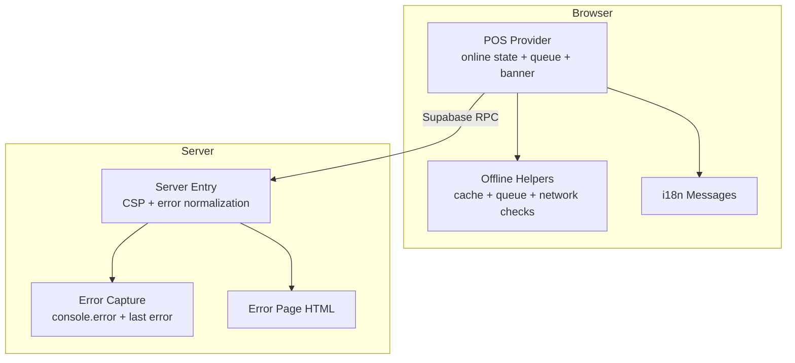
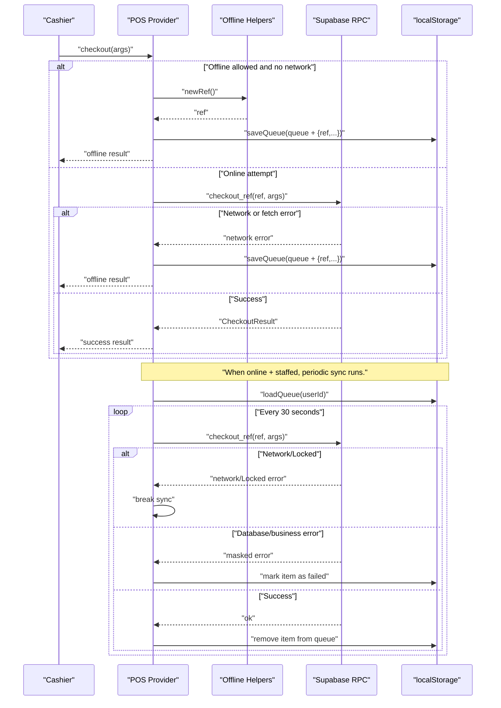
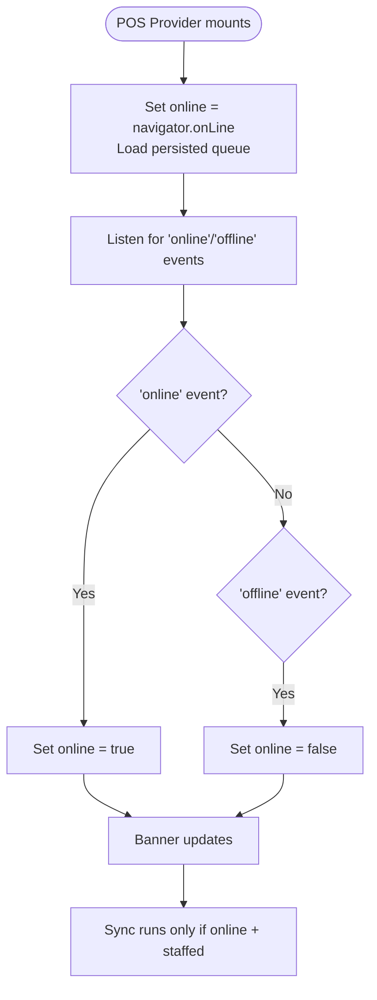
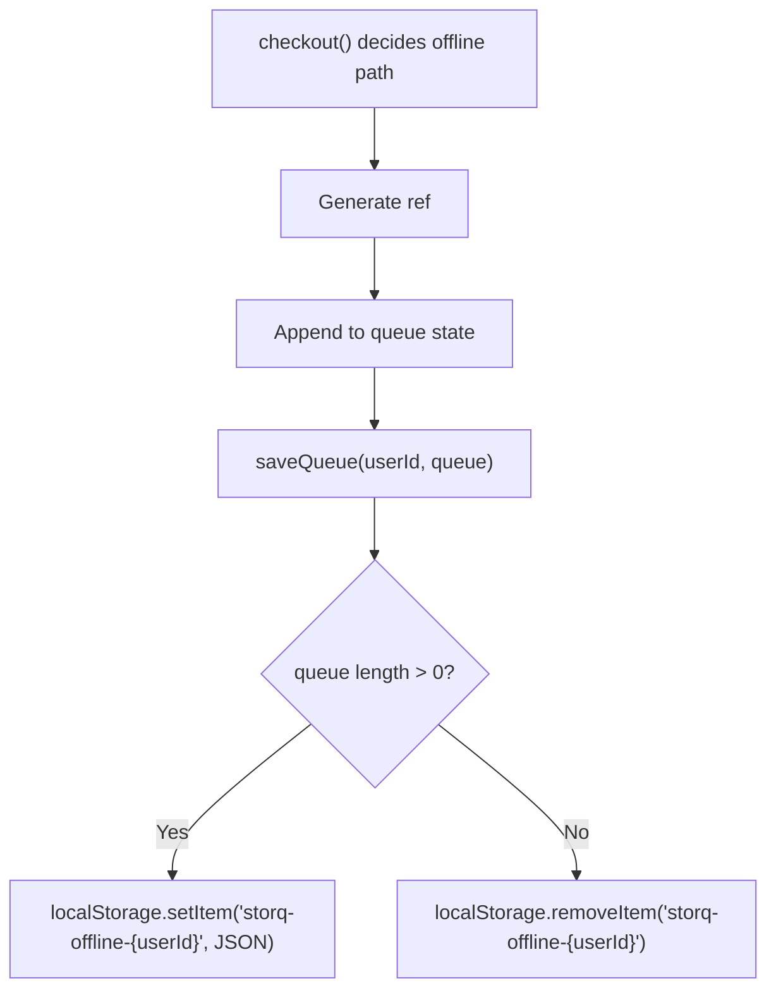
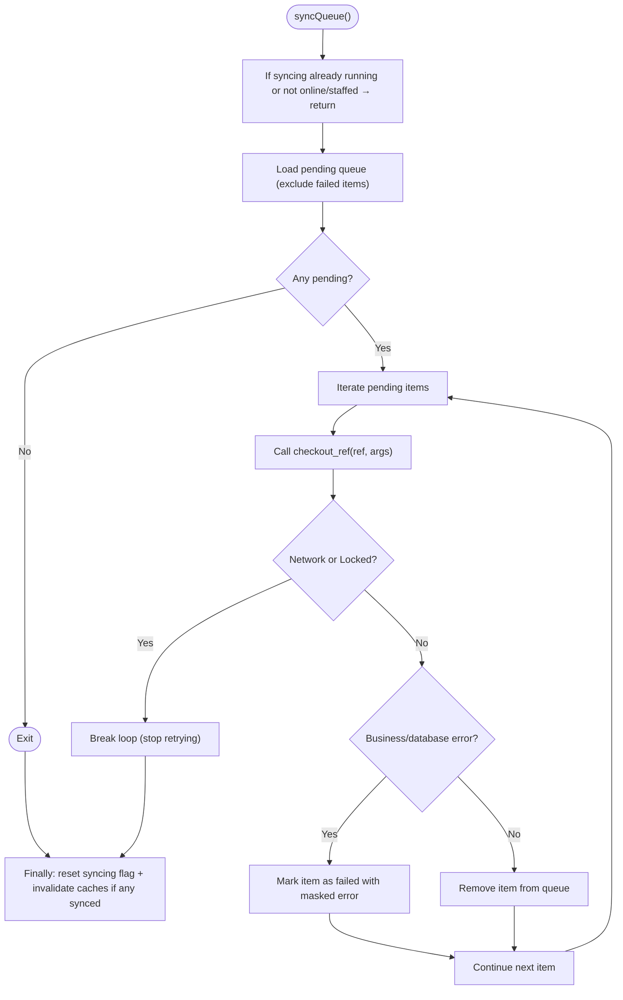
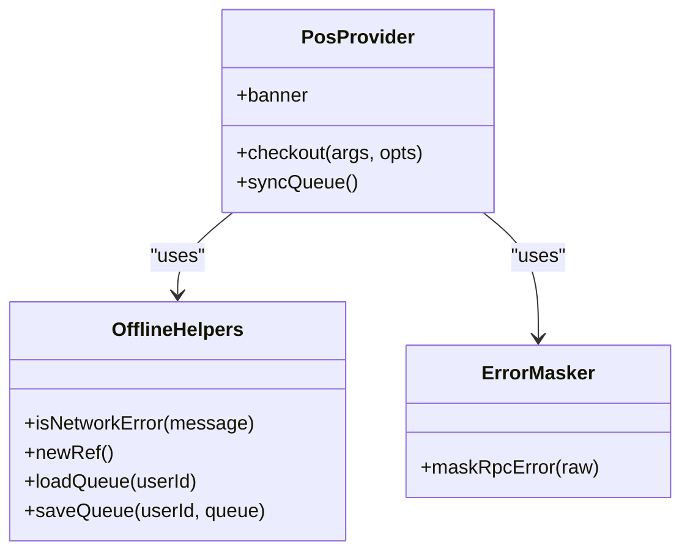
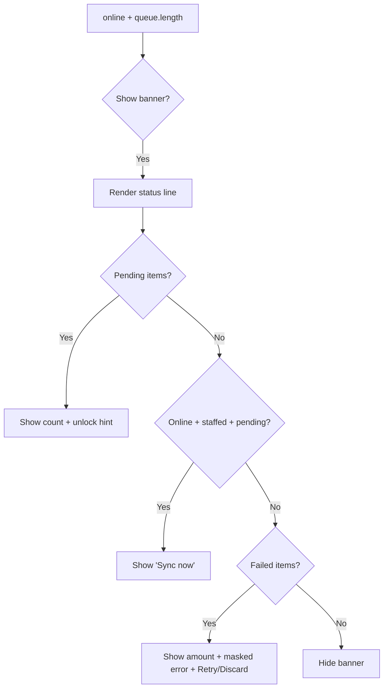
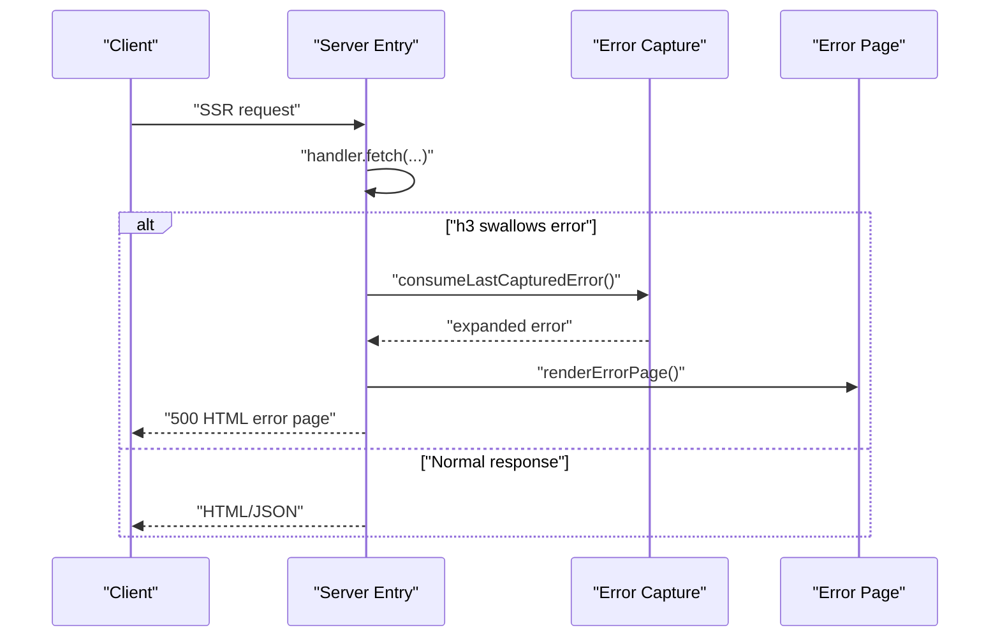
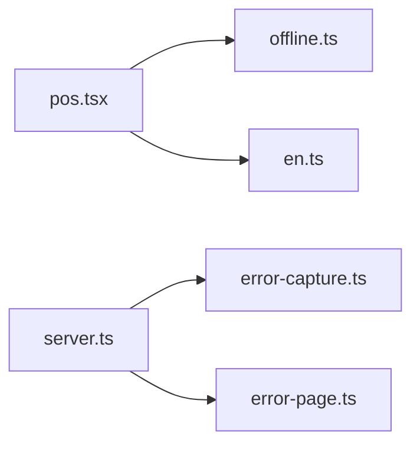

# Error Handling & Recovery Patterns

<cite>
**Referenced Files in This Document**   
- [offline.ts](file://src/lib/offline.ts)
- [pos.tsx](file://src/lib/pos.tsx)
- [en.ts](file://src/lib/i18n/en.ts)
- [error-capture.ts](file://src/lib/error-capture.ts)
- [error-page.ts](file://src/lib/error-page.ts)
- [server.ts](file://src/server.ts)
</cite>

## Table of Contents
1. [Introduction](#introduction)
2. [Project Structure](#project-structure)
3. [Core Components](#core-components)
4. [Architecture Overview](#architecture-overview)
5. [Detailed Component Analysis](#detailed-component-analysis)
6. [Dependency Analysis](#dependency-analysis)
7. [Performance Considerations](#performance-considerations)
8. [Troubleshooting Guide](#troubleshooting-guide)
9. [Conclusion](#conclusion)

## Introduction
This document explains how the offline system detects connectivity changes, persists sales while disconnected, surfaces clear user feedback through an offline banner, and recovers when connectivity returns. It also documents error masking, retry behavior, graceful degradation for database operations, data integrity guarantees during partial failures, and server-side error capture. The goal is to help developers and operators understand what happens when network or database operations fail, how users are informed, and how the system attempts recovery without losing transactional intent.

## Project Structure
The offline error-handling and recovery logic spans a small set of focused modules:

- `src/lib/offline.ts`: Device-local cache and queue helpers, network-error detection, and reference-data persistence.
- `src/lib/pos.tsx`: POS context that owns online state, the offline queue, checkout fallbacks, automatic sync, and the offline banner UI.
- `src/lib/i18n/en.ts`: User-facing messages for offline states, errors, and actions.
- `src/lib/error-capture.ts`: Global error capture and description utilities used by the server layer.
- `src/lib/error-page.ts`: Minimal HTML fallback page for catastrophic server errors.
- `src/server.ts`: Server entry point that normalizes SSR errors, applies security headers, and renders the error page.

**Diagram sources**
- [pos.tsx:115-440](file://src/lib/pos.tsx#L115-L440)
- [offline.ts:1-92](file://src/lib/offline.ts#L1-L92)
- [en.ts:82-104](file://src/lib/i18n/en.ts#L82-L104)
- [server.ts:1-154](file://src/server.ts#L1-L154)
- [error-capture.ts:1-82](file://src/lib/error-capture.ts#L1-L82)
- [error-page.ts:1-31](file://src/lib/error-page.ts#L1-L31)

**Section sources**
- [offline.ts:1-92](file://src/lib/offline.ts#L1-L92)
- [pos.tsx:115-440](file://src/lib/pos.tsx#L115-L440)
- [en.ts:82-104](file://src/lib/i18n/en.ts#L82-L104)
- [server.ts:1-154](file://src/server.ts#L1-L154)
- [error-capture.ts:1-82](file://src/lib/error-capture.ts#L1-L82)
- [error-page.ts:1-31](file://src/lib/error-page.ts#L1-L31)

## Core Components
- Offline queue and cache:
  - Persists reference data snapshots for instant start.
  - Stores queued sales made while offline.
  - Provides network-error detection and unique reference generation.
- POS provider:
  - Tracks `navigator.onLine` and listens for online/offline events.
  - Wraps checkout calls with offline fallback.
  - Runs periodic sync when online and staffed.
  - Renders an offline banner with status, retry, and discard actions.
- Error masking:
  - Converts raw RPC/database errors into safe, user-friendly messages.
- Server error capture:
  - Captures unhandled errors and renders a friendly error page.

**Section sources**
- [offline.ts:15-92](file://src/lib/offline.ts#L15-L92)
- [pos.tsx:249-440](file://src/lib/pos.tsx#L249-L440)
- [pos.tsx:93-104](file://src/lib/pos.tsx#L93-L104)
- [server.ts:70-85](file://src/server.ts#L70-L85)

## Architecture Overview
The offline system follows a resilient pattern:

1. Detect connectivity via browser APIs.
2. If offline or network fails, enqueue the sale locally.
3. Persist the queue to localStorage.
4. Show an offline banner with actionable status.
5. When online and staffed, retry queued items periodically.
6. On success, remove the item from the queue; on failure, mark it as failed with a masked message.
7. Provide manual retry and discard controls.

**Diagram sources**
- [pos.tsx:275-338](file://src/lib/pos.tsx#L275-L338)
- [pos.tsx:340-345](file://src/lib/pos.tsx#L340-L345)
- [offline.ts:71-92](file://src/lib/offline.ts#L71-L92)

**Section sources**
- [pos.tsx:275-345](file://src/lib/pos.tsx#L275-L345)
- [offline.ts:71-92](file://src/lib/offline.ts#L71-L92)

## Detailed Component Analysis

### Network Connectivity Detection
- The POS provider initializes `online` using `navigator.onLine`.
- It subscribes to `window.addEventListener("online", ...)` and `window.addEventListener("offline", ...)`.
- These listeners update the reactive `online` flag used by the banner and sync logic.

**Diagram sources**
- [pos.tsx:249-263](file://src/lib/pos.tsx#L249-L263)
- [pos.tsx:390-433](file://src/lib/pos.tsx#L390-L433)

**Section sources**
- [pos.tsx:249-263](file://src/lib/pos.tsx#L249-L263)

### Offline Queue Persistence and Integrity
- Queued sales are stored under a user-scoped key in `localStorage`.
- Each queued sale includes a client-generated reference, timestamp, total, store ID, and arguments.
- The queue is updated atomically through a callback-based setter that both updates React state and persists to storage.
- On load, malformed JSON is handled gracefully by returning an empty queue.

Key behaviors:
- New references use `crypto.randomUUID()` when available, otherwise fall back to a deterministic generator.
- Saving an empty queue removes the key to avoid stale entries.
- Reference data caching is versioned and safely hydrates on app start.

**Diagram sources**
- [pos.tsx:275-307](file://src/lib/pos.tsx#L275-L307)
- [offline.ts:71-92](file://src/lib/offline.ts#L71-L92)

**Section sources**
- [offline.ts:62-92](file://src/lib/offline.ts#L62-L92)
- [pos.tsx:264-307](file://src/lib/pos.tsx#L264-L307)

### Retry Strategy and Exponential Backoff
Current implementation:
- Automatic retry uses a fixed interval of 30 seconds after successful sync starts.
- There is no exponential backoff implemented in the codebase.
- Sync stops early on network errors or locked sessions to avoid busy loops.
- Failed items are marked with a masked error and remain in the queue until manually retried or discarded.

Recommendations (conceptual):
- Introduce exponential backoff with jitter for failed retries.
- Add maximum retry counts and dead-letter handling for unrecoverable errors.
- Surface per-item retry progress and backoff countdowns in the banner.

**Diagram sources**
- [pos.tsx:309-338](file://src/lib/pos.tsx#L309-L338)

**Section sources**
- [pos.tsx:309-338](file://src/lib/pos.tsx#L309-L338)

### Graceful Degradation for Database Failures
- RPC calls throw wrapped errors where database-related messages are sanitized.
- The sanitizer replaces SQL internals, policy violations, permission issues, and overly long messages with generic user-safe text.
- Checkout treats network errors as offline candidates when `offlineOk` is enabled, preserving the sale intent locally.
- During sync, non-network database errors are recorded per item rather than failing the entire batch.

**Diagram sources**
- [pos.tsx:93-104](file://src/lib/pos.tsx#L93-L104)
- [pos.tsx:275-338](file://src/lib/pos.tsx#L275-L338)
- [offline.ts:83-92](file://src/lib/offline.ts#L83-L92)

**Section sources**
- [pos.tsx:93-104](file://src/lib/pos.tsx#L93-L104)
- [pos.tsx:275-338](file://src/lib/pos.tsx#L275-L338)

### Offline Banner and User Feedback
The banner displays:
- Online/offline status.
- Number of pending sales waiting to sync.
- A prompt to unlock if needed.
- A “Sync now” button when online and staffed.
- Per-failed-sale messages with “Retry” and “Discard” options.

Messages are localized via i18n keys under `offline.*`.

**Diagram sources**
- [pos.tsx:390-433](file://src/lib/pos.tsx#L390-L433)
- [en.ts:82-92](file://src/lib/i18n/en.ts#L82-L92)

**Section sources**
- [pos.tsx:390-433](file://src/lib/pos.tsx#L390-L433)
- [en.ts:82-92](file://src/lib/i18n/en.ts#L82-L92)

### Data Integrity During Partial Failures
- Each queued sale has a unique client reference, enabling idempotent replay on the server.
- Successful sync removes the item from the queue; failures keep the item with a masked error.
- Sync breaks early on transient network or locked-session errors to prevent indefinite retries.
- After any successful sync, related query caches are invalidated so the UI reflects updated totals and transactions.

Integrity guarantees:
- No sale is lost due to network interruption; it remains in the local queue until successfully synced or explicitly discarded.
- Batch processing avoids partial loss by marking individual failures instead of discarding the whole queue.

**Section sources**
- [pos.tsx:309-338](file://src/lib/pos.tsx#L309-L338)
- [offline.ts:71-92](file://src/lib/offline.ts#L71-L92)

### Rollback Capabilities and Transaction Semantics
- The current client-side implementation does not implement explicit rollback or multi-step transaction coordination.
- Idempotency is achieved through client references passed to the server RPC.
- For multi-step operations, the server should enforce atomicity; the client relies on the server’s response to determine success or failure.
- If a server-side transaction partially fails, the RPC error is masked and surfaced to the user; the client marks the operation as failed and waits for retry or manual action.

Operational guidance:
- Ensure server RPCs are idempotent with respect to `p_client_ref`.
- Prefer single RPC boundaries for critical sequences to simplify client-side recovery.
- Use server-side constraints and policies to prevent inconsistent states even if retries occur.

**Section sources**
- [pos.tsx:309-338](file://src/lib/pos.tsx#L309-L338)
- [pos.tsx:93-104](file://src/lib/pos.tsx#L93-L104)

### Server-Side Error Capture and Fallback Pages
- The server wraps responses to detect swallowed SSR errors and logs captured errors.
- A minimal error page is rendered for catastrophic failures.
- Global error capture expands stack traces and cause chains before logging.

**Diagram sources**
- [server.ts:70-85](file://src/server.ts#L70-L85)
- [error-capture.ts:52-81](file://src/lib/error-capture.ts#L52-L81)
- [error-page.ts:1-31](file://src/lib/error-page.ts#L1-L31)

**Section sources**
- [server.ts:70-85](file://src/server.ts#L70-L85)
- [error-capture.ts:1-82](file://src/lib/error-capture.ts#L1-L82)
- [error-page.ts:1-31](file://src/lib/error-page.ts#L1-L31)

## Dependency Analysis
- `pos.tsx` depends on:
  - `offline.ts` for queue/cache/network helpers.
  - `i18n/en.ts` for user-facing messages.
  - Supabase RPC for checkout and session management.
- `server.ts` depends on:
  - `error-capture.ts` for expanded error logging.
  - `error-page.ts` for fallback HTML.

**Diagram sources**
- [pos.tsx:1-27](file://src/lib/pos.tsx#L1-L27)
- [server.ts:1-5](file://src/server.ts#L1-L5)

**Section sources**
- [pos.tsx:1-27](file://src/lib/pos.tsx#L1-L27)
- [server.ts:1-5](file://src/server.ts#L1-L5)

## Performance Considerations
- Queue persistence is debounced via React Query cache subscriptions for reference data; queue writes are immediate but lightweight.
- Sync runs every 30 seconds only when online and staffed, reducing unnecessary network churn.
- Early break on network or locked errors prevents repeated failures during outages.
- Avoid adding heavy synchronous work inside queue mutation callbacks to keep UI responsive.

[No sources needed since this section provides general guidance]

## Troubleshooting Guide
Common scenarios and resolutions:

- Sales show as “waiting to sync”:
  - Ensure the device is online and the staff session is unlocked.
  - Click “Sync now” in the banner.
  - Verify that the queue contains pending items and no hard failures.

- A sale shows as failed with a masked error:
  - Review the masked message in the banner.
  - Click “Retry” to attempt resync.
  - If persistent, check server-side business rules or permissions.

- Persistent network errors:
  - The sync loop breaks on network errors; restore connectivity and retry.
  - Consider implementing exponential backoff to reduce burst retries.

- Stale or corrupted local data:
  - Clear the device cache using the provided utility to force a fresh hydration.
  - Reopen the POS to rehydrate from the server.

- Server crashes or SSR errors:
  - The server will render a friendly error page and log expanded errors.
  - Check server logs for captured error details.

**Section sources**
- [pos.tsx:390-433](file://src/lib/pos.tsx#L390-L433)
- [offline.ts:57-60](file://src/lib/offline.ts#L57-L60)
- [server.ts:70-85](file://src/server.ts#L70-L85)

## Conclusion
The offline system prioritizes resilience and clarity:
- Connectivity changes are detected reactively.
- Sales are reliably queued and persisted when offline.
- Users receive actionable feedback through a concise banner.
- Retries run at a fixed interval with early termination on transient conditions.
- Errors are masked to protect sensitive internals while remaining informative.
- Data integrity is preserved through unique references and per-item failure tracking.
- Server-side error capture ensures catastrophic failures are logged and presented gracefully.

Future improvements could include exponential backoff, retry budgets, and richer per-item status indicators, while maintaining the current strong guarantees around persistence and user communication.