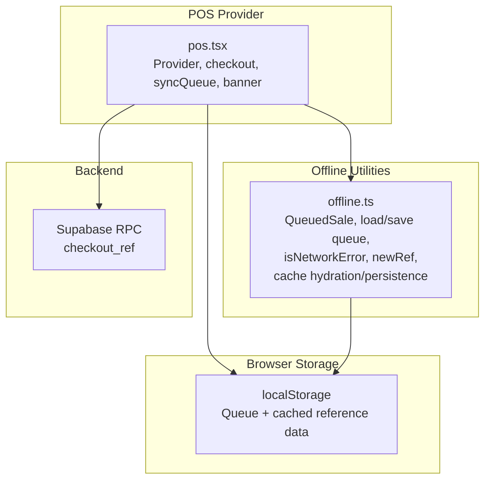
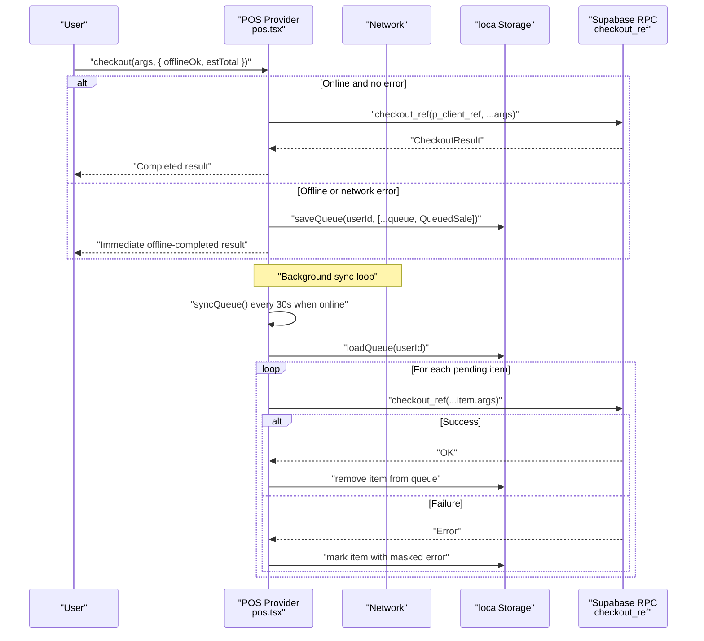
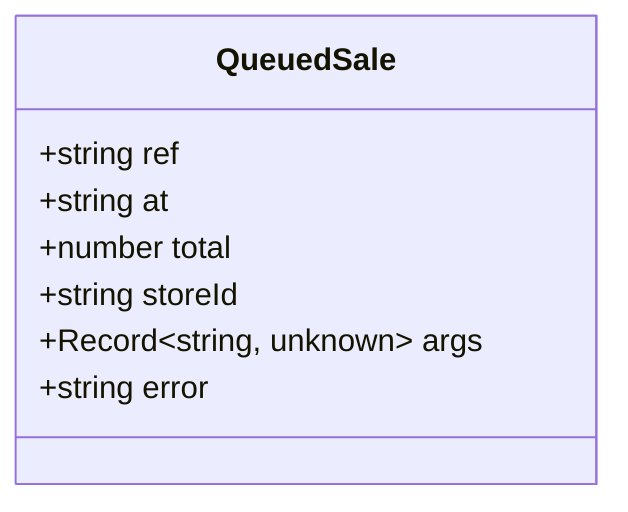
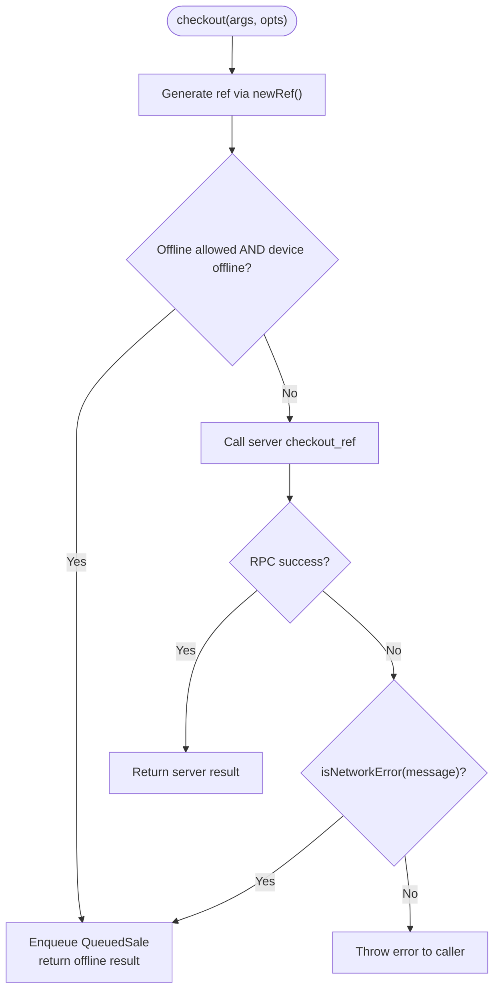
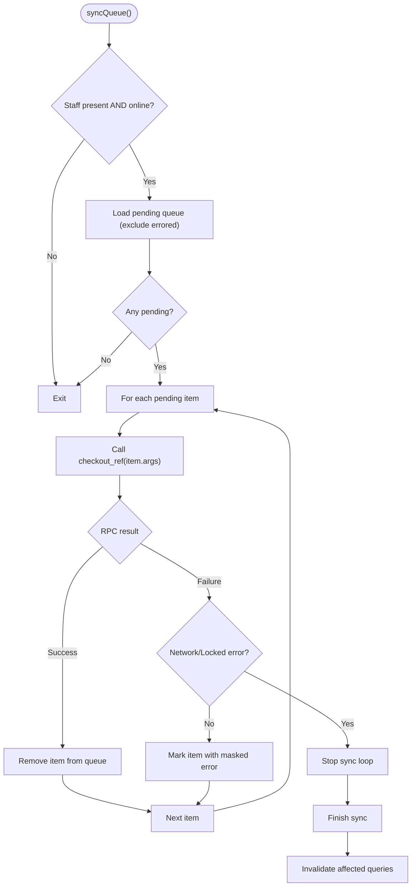
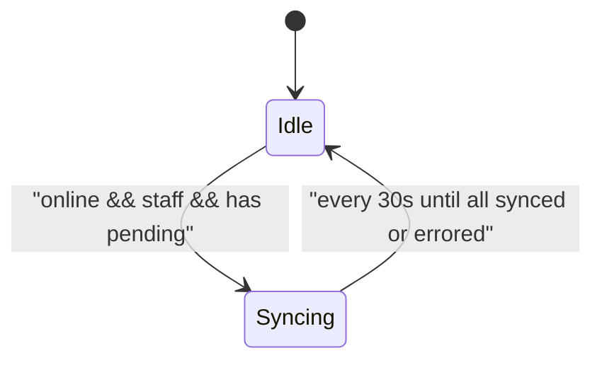
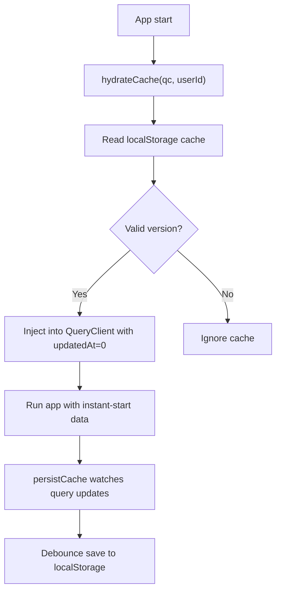
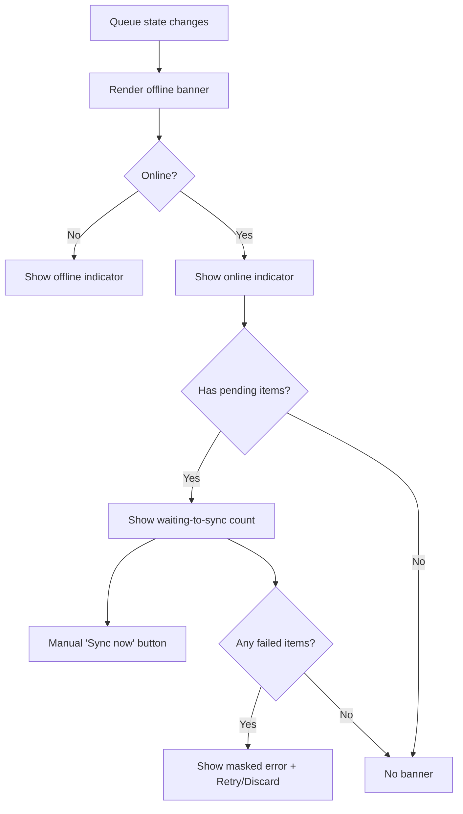
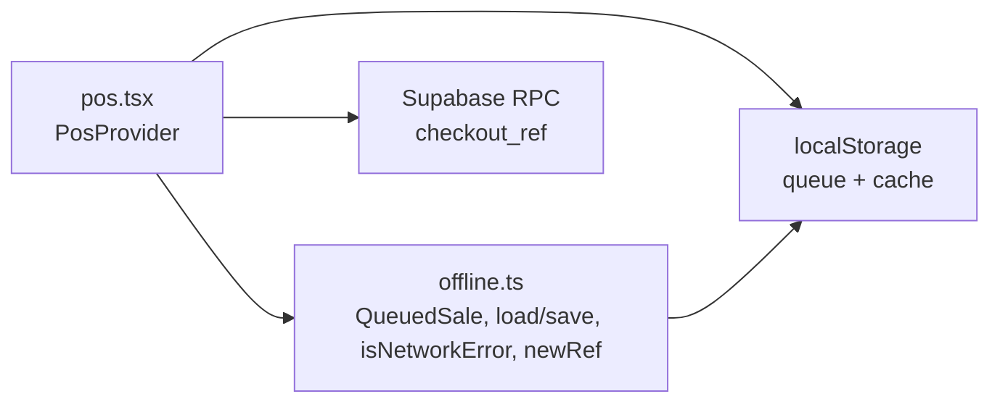

# Offline Sync & Queue Management

<cite>
**Referenced Files in This Document**
- [offline.ts](file://src/lib/offline.ts)
- [pos.tsx](file://src/lib/pos.tsx)
</cite>

## Table of Contents
1. [Introduction](#introduction)
2. [Project Structure](#project-structure)
3. [Core Components](#core-components)
4. [Architecture Overview](#architecture-overview)
5. [Detailed Component Analysis](#detailed-component-analysis)
6. [Dependency Analysis](#dependency-analysis)
7. [Performance Considerations](#performance-considerations)
8. [Troubleshooting Guide](#troubleshooting-guide)
9. [Conclusion](#conclusion)

## Introduction
This document explains the offline-first architecture and queue management system used by the POS register. It focuses on how transactions are safely queued locally when network connectivity is lost, how they are persisted to the browser’s local storage, and how automatic synchronization resumes once the device is online again. It also documents the `QueuedSale` data structure, retry behavior, error handling, and the user-facing feedback provided through the offline banner component.

## Project Structure
The offline sync logic is implemented across two core files:

- `src/lib/offline.ts`: Defines the persistent queue model, reference generation helpers, and utilities for loading/saving the queue and detecting network errors. It also manages a lightweight cache of reference data for instant start-up.
- `src/lib/pos.tsx`: Implements the POS provider, including checkout orchestration, queue state management, automatic background synchronization, and the offline banner UI.

**Diagram sources**
- [pos.tsx:249-345](file://src/lib/pos.tsx#L249-L345)
- [offline.ts:62-91](file://src/lib/offline.ts#L62-L91)

**Section sources**
- [offline.ts:1-91](file://src/lib/offline.ts#L1-L91)
- [pos.tsx:109-440](file://src/lib/pos.tsx#L109-L440)

## Core Components
- `QueuedSale`: The queue item shape that represents a sale attempted while offline. It includes a unique client reference, timestamp, estimated total, store association, original checkout arguments, and optional error text.
- Queue persistence: `loadQueue` and `saveQueue` read/write the queue array from `localStorage`, keyed by user ID.
- Network detection: `isNetworkError` recognizes common network-related error messages so failed operations can be retried or queued.
- Reference generator: `newRef` creates stable identifiers for each queued transaction.
- POS provider integration: The provider orchestrates checkout, maintains queue state, runs periodic syncs, and renders an offline banner with retry and discard actions.

**Section sources**
- [offline.ts:62-91](file://src/lib/offline.ts#L62-L91)
- [pos.tsx:249-345](file://src/lib/pos.tsx#L249-L345)

## Architecture Overview
The offline-first flow ensures sales continue even without internet access:

1. When the user completes a checkout, the provider attempts a server call.
2. If offline or a network error occurs (and offline mode is allowed), the sale is enqueued locally with a generated reference and immediate “completed” feedback to the user.
3. The queue is persisted to `localStorage`.
4. When the device becomes online and staff is authenticated, the provider automatically synchronizes pending items every 30 seconds.
5. Successful syncs remove the item from the queue; failures mark the item with a masked error message and allow manual retry or discard.

**Diagram sources**
- [pos.tsx:275-338](file://src/lib/pos.tsx#L275-L338)
- [offline.ts:71-84](file://src/lib/offline.ts#L71-L84)

## Detailed Component Analysis

### QueuedSale Data Model
`QueuedSale` captures all information needed to replay a sale later:

- `ref`: Unique client-generated identifier for the transaction.
- `at`: ISO timestamp when the sale was created.
- `total`: Estimated total at time of creation.
- `storeId`: Store associated with the sale.
- `args`: Original checkout arguments passed to the server function.
- `error?`: Optional masked error message if a sync attempt failed.

**Diagram sources**
- [offline.ts:62-69](file://src/lib/offline.ts#L62-L69)

**Section sources**
- [offline.ts:62-69](file://src/lib/offline.ts#L62-L69)

### Checkout Function and Offline Handling
The `checkout` function implements the primary decision point:

- Generates a unique reference using `newRef`.
- If offline mode is allowed and the device is offline, it immediately enqueues the sale and returns a local “completed” result.
- Otherwise, it calls the server RPC. On a network error (detected via `isNetworkError`) and when offline mode is allowed, it enqueues the sale instead of throwing.
- On non-network errors, it throws to the caller.

**Diagram sources**
- [pos.tsx:275-307](file://src/lib/pos.tsx#L275-L307)
- [offline.ts:83-91](file://src/lib/offline.ts#L83-L91)

**Section sources**
- [pos.tsx:275-307](file://src/lib/pos.tsx#L275-L307)
- [offline.ts:83-91](file://src/lib/offline.ts#L83-L91)

### Synchronization Process (`syncQueue`)
`sychQueue` is responsible for replaying queued sales:

- Guards against concurrent syncs and requires both staff authentication and online status.
- Loads pending items (excluding those already marked with an error).
- Iterates through pending items and calls the server RPC with the stored arguments.
- On success, removes the item from the queue.
- On failure:
  - Stops further processing if the error indicates the device is locked or a network issue.
  - Marks the failing item with a masked error message.
- After any successful sync, invalidates relevant query keys to refresh UI data.

**Diagram sources**
- [pos.tsx:310-338](file://src/lib/pos.tsx#L310-L338)

**Section sources**
- [pos.tsx:310-338](file://src/lib/pos.tsx#L310-L338)

### Automatic Sync Timer
When conditions are met, the provider starts a timer that triggers `syncQueue` every 30 seconds:

- Conditions: device is online, staff is authenticated, and not all queue items are in error state.
- Cleanup: the interval is cleared when dependencies change or the component unmounts.

**Diagram sources**
- [pos.tsx:340-345](file://src/lib/pos.tsx#L340-L345)

**Section sources**
- [pos.tsx:340-345](file://src/lib/pos.tsx#L340-L345)

### Local Storage Persistence
Two types of data are persisted in `localStorage`:

- Transaction queue: keyed by user ID, storing an array of `QueuedSale`.
- Cached reference data: a snapshot of safe-to-persist query results (e.g., business, stores, products, collections, stock, staff names) to enable instant start-up.

Key behaviors:

- Queue load/save functions handle malformed data gracefully and return empty arrays on parse errors.
- Cache hydration restores last-known reference data into React Query with a stale marker so it refreshes in the background.
- Cache persistence watches query updates and debounces writes to avoid excessive storage writes.

**Diagram sources**
- [offline.ts:15-55](file://src/lib/offline.ts#L15-L55)

**Section sources**
- [offline.ts:15-55](file://src/lib/offline.ts#L15-L55)
- [offline.ts:71-81](file://src/lib/offline.ts#L71-L81)

### Error States and User Feedback (Offline Banner)
The provider renders an offline banner that communicates current state and offers actions:

- Shows whether the device is online or offline.
- Displays count of items waiting to sync and prompts unlocking if required.
- Provides a “Sync now” button when online and staffed.
- For failed items, shows masked error text and allows:
  - Retry: clears the error flag so the item can be retried during the next sync cycle.
  - Discard: removes the failed item after confirmation.

**Diagram sources**
- [pos.tsx:389-433](file://src/lib/pos.tsx#L389-L433)

**Section sources**
- [pos.tsx:389-433](file://src/lib/pos.tsx#L389-L433)

## Dependency Analysis
The following diagram maps key relationships between modules and external services:

**Diagram sources**
- [pos.tsx:109-440](file://src/lib/pos.tsx#L109-L440)
- [offline.ts:15-91](file://src/lib/offline.ts#L15-L91)

**Section sources**
- [pos.tsx:109-440](file://src/lib/pos.tsx#L109-L440)
- [offline.ts:15-91](file://src/lib/offline.ts#L15-L91)

## Performance Considerations
- Debounced cache persistence avoids frequent `localStorage` writes by batching updates after query changes.
- The sync loop runs only when online and staffed, preventing unnecessary work.
- Network error detection short-circuits sync loops on transient issues, reducing repeated retries.
- Using a single shared queue state and persisting only when changed minimizes storage overhead.

[No sources needed since this section provides general guidance]

## Troubleshooting Guide
Common scenarios and their handling:

- Device goes offline during checkout:
  - If offline mode is allowed, the sale is queued and the user sees an immediate “completed” result.
  - The offline banner indicates sales were saved locally.
- Network error during sync:
  - The failing item is marked with a masked error.
  - The sync loop stops on network or lock errors to prevent repeated failures.
- Manual retry:
  - Users can clear the error flag for a failed item; the next sync will retry it.
- Discarding failed items:
  - Users can confirm removal of a failed item from the queue.
- Auto-lock interactions:
  - If the session locks during sync, the loop stops; the user must unlock to resume syncing.

**Section sources**
- [pos.tsx:310-338](file://src/lib/pos.tsx#L310-L338)
- [pos.tsx:389-433](file://src/lib/pos.tsx#L389-L433)

## Conclusion
Storq POS implements a robust offline-first design centered around a durable local queue and automatic background synchronization. Sales are captured instantly when offline, persisted safely, and replayed reliably once connectivity is restored. Clear user feedback and controlled retry behavior ensure a smooth experience even under adverse network conditions.

[No sources needed since this section summarizes without analyzing specific files]