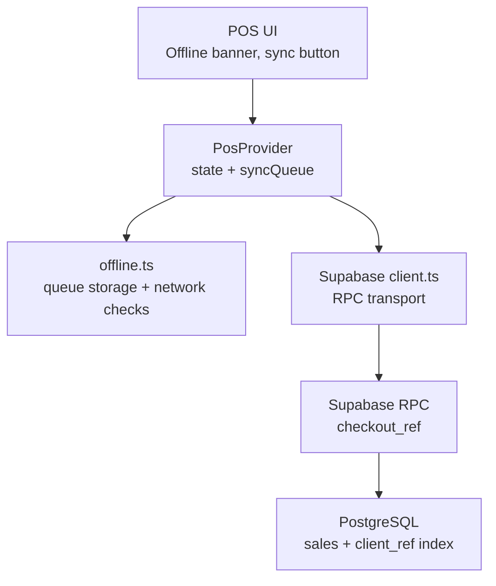
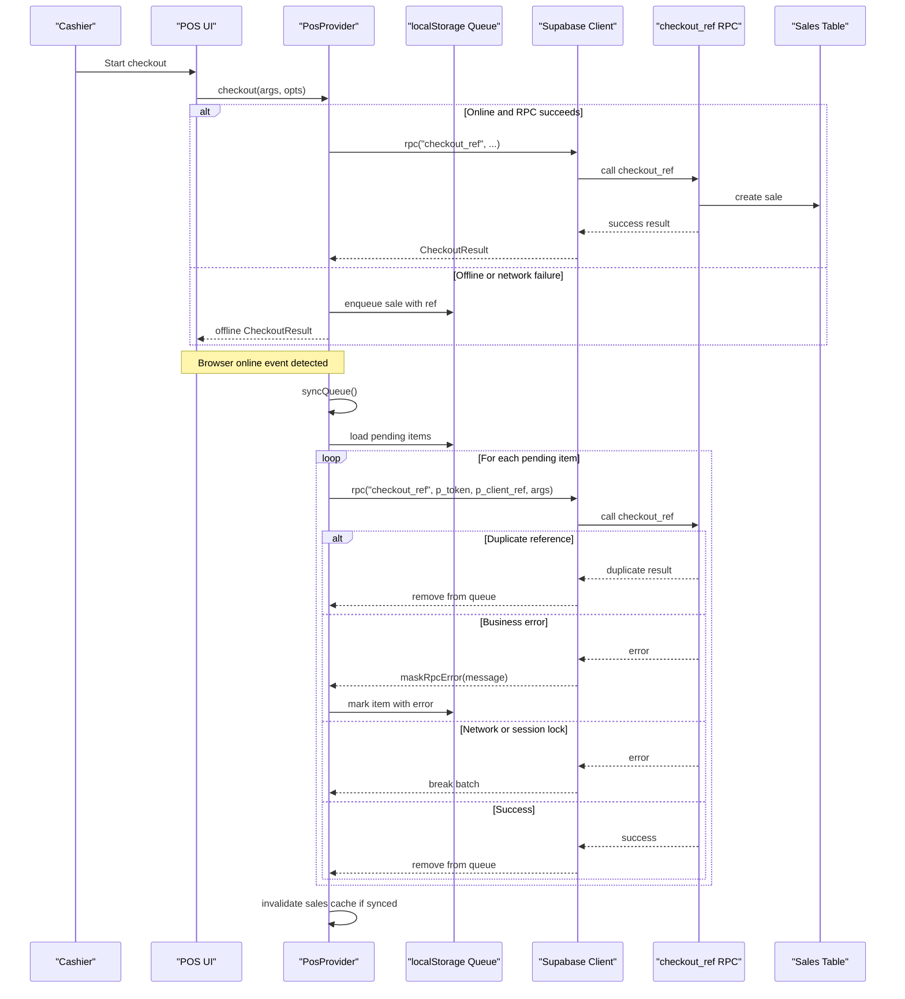
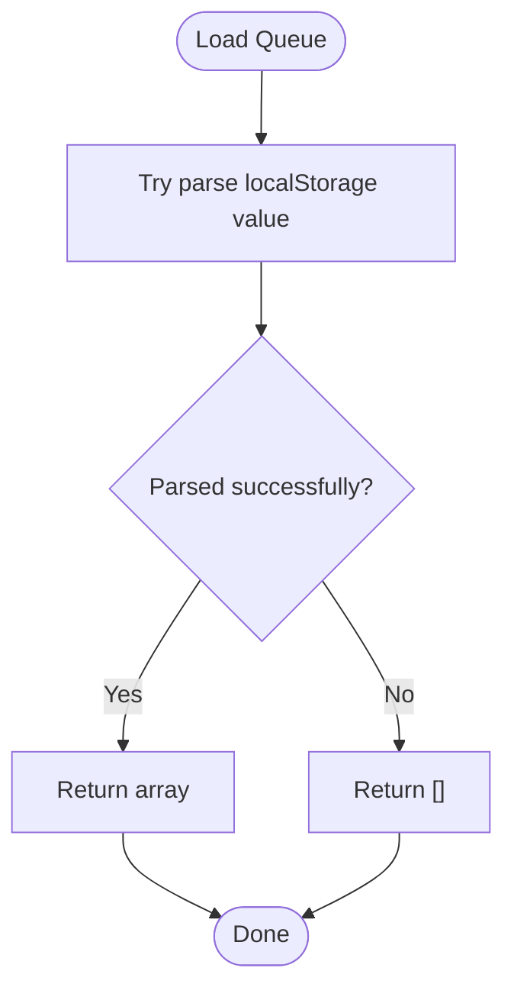
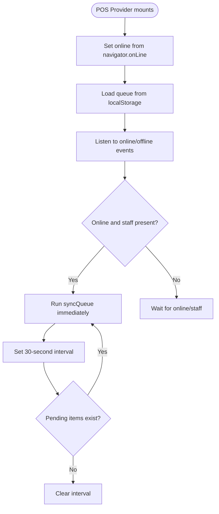
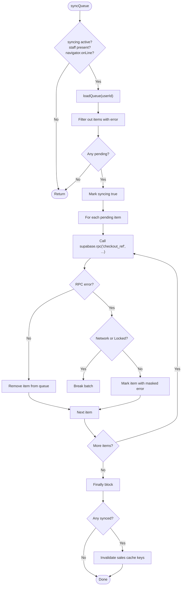
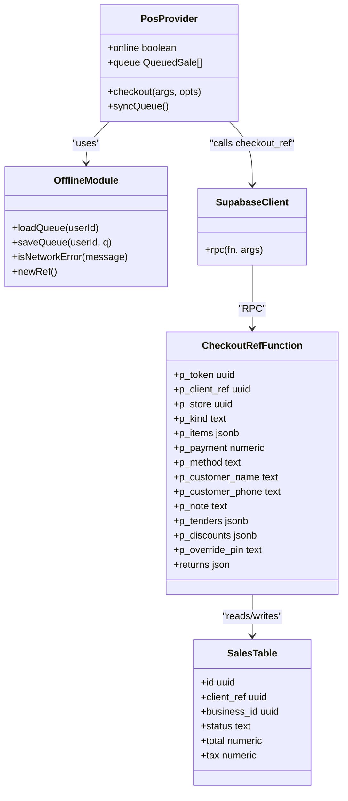
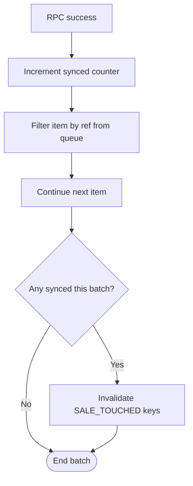
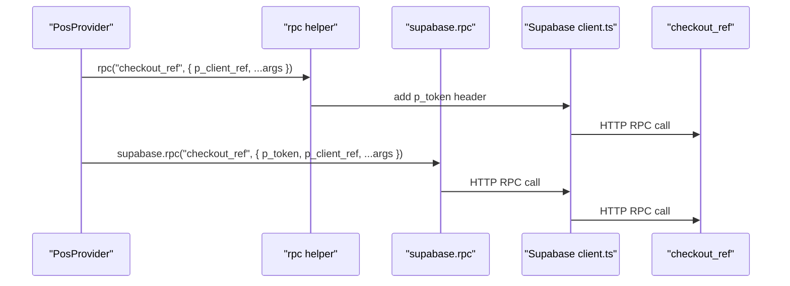
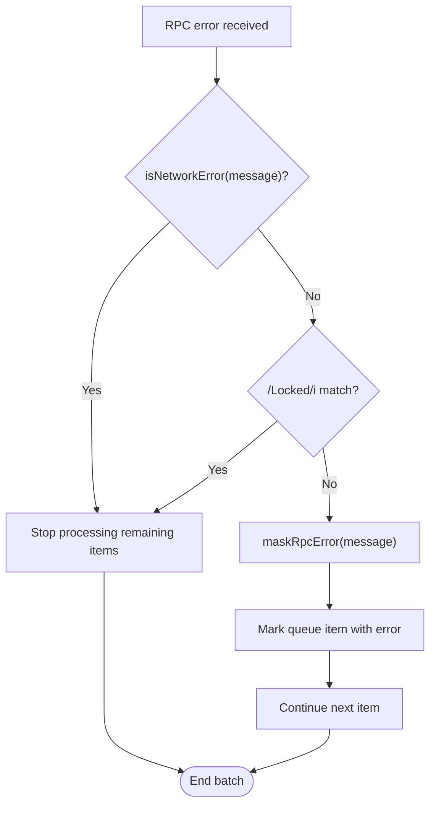
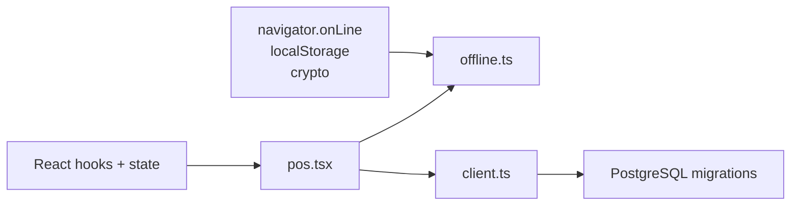

# Sync & Synchronization Engine

<cite>
**Referenced Files in This Document**
- [pos.tsx](file://src/lib/pos.tsx)
- [offline.ts](file://src/lib/offline.ts)
- [client.ts](file://src/integrations/supabase/client.ts)
- [20261009193153_97dc4c9b-c64d-4f55-9cfe-e17b97fb71ec.sql](file://supabase/migrations/20261009193153_97dc4c9b-c64d-4f55-9cfe-e17b97fb71ec.sql)
- [20261009210500_retail_operations.sql](file://supabase/migrations/20261009210500_retail_operations.sql)
</cite>

## Table of Contents
1. [Introduction](#introduction)
2. [Project Structure](#project-structure)
3. [Core Components](#core-components)
4. [Architecture Overview](#architecture-overview)
5. [Detailed Component Analysis](#detailed-component-analysis)
6. [Dependency Analysis](#dependency-analysis)
7. [Performance Considerations](#performance-considerations)
8. [Troubleshooting Guide](#troubleshooting-guide)
9. [Conclusion](#conclusion)

## Introduction
This document explains the automatic synchronization engine for offline POS sales. It focuses on how queued transactions are persisted locally, how they are retried when network connectivity is restored, and how conflicts between multiple offline transactions are resolved. The engine uses a 30-second polling loop that runs only while the device is online and authenticated, processes queued items in insertion order, removes successful items from the queue, and marks failed items with masked error messages so users can retry or discard them.

The sync process integrates directly with Supabase RPC calls through `checkout_ref`, which provides idempotent replay semantics using a client-generated unique reference.

## Project Structure
The synchronization logic is implemented primarily in two files:

- `src/lib/pos.tsx`: Provides the POS context, offline queue state, connection monitoring, the `syncQueue` function, and UI feedback.
- `src/lib/offline.ts`: Implements local queue persistence, network error detection, and reference generation.
- `src/integrations/supabase/client.ts`: Creates and configures the Supabase client used by RPC calls.
- `supabase/migrations/*.sql`: Define the server-side `checkout_ref` function and schema constraints that make offline replay safe.

**Diagram sources**
- [pos.tsx:249-345](file://src/lib/pos.tsx#L249-L345)
- [offline.ts:62-91](file://src/lib/offline.ts#L62-L91)
- [client.ts:57-95](file://src/integrations/supabase/client.ts#L57-L95)
- [20261009193153_97dc4c9b-c64d-4f55-9cfe-e17b97fb71ec.sql:1-32](file://supabase/migrations/20261009193153_97dc4c9b-c64d-4f55-9cfe-e17b97fb71ec.sql#L1-L32)

**Section sources**
- [pos.tsx:1-115](file://src/lib/pos.tsx#L1-L115)
- [offline.ts:1-91](file://src/lib/offline.ts#L1-L91)
- [client.ts:1-96](file://src/integrations/supabase/client.ts#L1-L96)

## Core Components
- **Offline queue model**: Each queued sale stores a generated reference, timestamp, estimated total, store identifier, original checkout arguments, and an optional error message.
- **Local persistence**: The queue is stored per user in browser storage and loaded into React state at startup.
- **Connection monitoring**: The app listens to browser `online` and `offline` events and updates its internal online flag.
- **Automatic retry loop**: When online and authenticated, `syncQueue` runs immediately and then every 30 seconds until no pending items remain.
- **Idempotent replay**: `checkout_ref` uses a unique client reference and advisory transaction lock to prevent duplicate sales.
- **Error masking**: Raw backend errors are sanitized before being shown to users.

**Section sources**
- [offline.ts:62-91](file://src/lib/offline.ts#L62-L91)
- [pos.tsx:249-345](file://src/lib/pos.tsx#L249-L345)
- [20261009193153_97dc4c9b-c64d-4f55-9cfe-e17b97fb71ec.sql:1-32](file://supabase/migrations/20261009193153_97dc4c9b-c64d-4f55-9cfe-e17b97fb71ec.sql#L1-L32)

## Architecture Overview
The synchronization engine follows a simple but robust flow:

1. A sale is attempted. If the device is offline or the network call fails, the sale is enqueued locally.
2. When the browser reports online status, the POS provider starts syncing.
3. `syncQueue` loads pending items, skips already-failed items, and replays each one through `checkout_ref`.
4. Successful items are removed from the queue; failed items receive a masked error.
5. Network errors and locked sessions stop further processing in the current batch.
6. After any successful sync, cached data related to sales is invalidated so the UI reflects updated totals and inventory.

**Diagram sources**
- [pos.tsx:275-345](file://src/lib/pos.tsx#L275-L345)
- [20261009193153_97dc4c9b-c64d-4f55-9cfe-e17b97fb71ec.sql:4-20](file://supabase/migrations/20261009193153_97dc4c9b-c64d-4f55-9cfe-e17b97fb71ec.sql#L4-L20)
- [20261009210500_retail_operations.sql:292-310](file://supabase/migrations/20261009210500_retail_operations.sql#L292-L310)

## Detailed Component Analysis

### Offline Queue Model and Persistence
The queue model represents a sale that could not be recorded on the server. Each entry includes:

| Field | Purpose |
|---|---|
| `ref` | Unique client-generated reference used for idempotent replay |
| `at` | Timestamp when the sale was created |
| `total` | Estimated total used for offline UX |
| `storeId` | Store associated with the sale |
| `args` | Original checkout arguments forwarded to `checkout_ref` |
| `error` | Optional masked error after a failed sync attempt |

Persistence functions:

- `loadQueue(userId)` returns the stored array or an empty array if storage is corrupted.
- `saveQueue(userId, q)` writes the queue to storage when non-empty and removes the key when empty.
- `newRef()` generates a UUID-like value using the browser’s crypto API or a fallback generator.

**Diagram sources**
- [offline.ts:71-81](file://src/lib/offline.ts#L71-L81)

**Section sources**
- [offline.ts:62-91](file://src/lib/offline.ts#L62-L91)

### Connection Monitoring and Retry Loop
The POS provider tracks `navigator.onLine` and initializes the queue from storage. When the device becomes online, it triggers an immediate sync and sets up a 30-second interval.

Key behaviors:

- Sync does not run if another sync is already active.
- Sync does not run without an authenticated staff session.
- Sync does not run when the browser reports offline.
- Only items without an error field are retried automatically.
- Failed items remain in the queue and can be retried manually or discarded by the user.

**Diagram sources**
- [pos.tsx:249-345](file://src/lib/pos.tsx#L249-L345)

**Section sources**
- [pos.tsx:249-345](file://src/lib/pos.tsx#L249-L345)

### syncQueue Processing Logic
`syncQueue` is the core synchronization function. Its responsibilities include:

- Guarding against concurrent syncs using a ref flag.
- Loading pending items from storage.
- Iterating through items in insertion order.
- Calling `checkout_ref` with the staff token, client reference, and original arguments.
- Removing successful items from the queue.
- Marking business errors with a masked message.
- Stopping the batch on network failures or session lock errors.
- Invalidating sales-related cache entries after any successful sync.

**Diagram sources**
- [pos.tsx:309-338](file://src/lib/pos.tsx#L309-L338)

**Section sources**
- [pos.tsx:309-338](file://src/lib/pos.tsx#L309-L338)

### Conflict Resolution Strategy
When multiple offline transactions are created, conflict resolution is handled server-side by `checkout_ref`:

1. A unique `client_ref` is generated per sale attempt.
2. The database has a partial unique index on `sales.client_ref`.
3. `checkout_ref` acquires an advisory transaction lock scoped to the client reference.
4. If a sale with the same `client_ref` already exists, the function returns a duplicate response instead of creating a second sale.
5. If the existing sale belongs to a different business, the function raises an error to prevent cross-business replay.
6. If no sale exists, the function creates the sale and then assigns the `client_ref`.

This design ensures:

- No duplicate sales from repeated retries.
- Safe replay even if the client restarts or the sync loop runs multiple times.
- Clear distinction between first-time creation and idempotent replay.

**Diagram sources**
- [pos.tsx:275-338](file://src/lib/pos.tsx#L275-L338)
- [offline.ts:62-91](file://src/lib/offline.ts#L62-L91)
- [20261009193153_97dc4c9b-c64d-4f55-9cfe-e17b97fb71ec.sql:1-32](file://supabase/migrations/20261009193153_97dc4c9b-c64d-4f55-9cfe-e17b97fb71ec.sql#L1-L32)
- [20261009210500_retail_operations.sql:292-310](file://supabase/migrations/20261009210500_retail_operations.sql#L292-L310)

**Section sources**
- [20261009193153_97dc4c9b-c64d-4f55-9cfe-e17b97fb71ec.sql:1-32](file://supabase/migrations/20261009193153_97dc4c9b-c64d-4f55-9cfe-e17b97fb71ec.sql#L1-L32)
- [20261009210500_retail_operations.sql:292-310](file://supabase/migrations/20261009210500_retail_operations.sql#L292-L310)

### Order of Processing Queued Items
Queued items are processed in the order they were inserted into the queue. The implementation reads the stored array and iterates through it sequentially. There is no explicit sorting by timestamp or priority. This means:

- Earlier sales are synchronized before later sales.
- If an earlier sale fails due to a network issue or session lock, later sales are not processed in that batch.
- Manual retry of a failed item does not change its position relative to other pending items unless the queue is rewritten.

**Section sources**
- [pos.tsx:310-333](file://src/lib/pos.tsx#L310-L333)
- [offline.ts:71-81](file://src/lib/offline.ts#L71-L81)

### Tracking Successful Synchronizations
Successful synchronizations are tracked by removing the corresponding item from the queue. The implementation filters out the item by its reference after a successful RPC response. Additionally:

- A counter tracks how many items were synced during the current batch.
- If any items were synced, sales-related cache keys are invalidated so downstream queries reflect the new state.
- The UI shows the number of waiting-to-sync items and allows manual sync.

**Diagram sources**
- [pos.tsx:315-337](file://src/lib/pos.tsx#L315-L337)

**Section sources**
- [pos.tsx:315-337](file://src/lib/pos.tsx#L315-L337)

### Integration with Supabase API Calls
The sync engine uses the shared Supabase client to call `checkout_ref`. Two integration points are important:

1. **Direct checkout path**: When a sale is initiated online, the POS provider calls `rpc("checkout_ref", ...)` with the client reference and checkout arguments.
2. **Retry path**: During sync, the provider calls `supabase.rpc("checkout_ref", ...)` directly with the staff token, client reference, and original arguments.

The Supabase client configuration handles environment variables, fetch interception, authentication headers, and lazy initialization.

**Diagram sources**
- [pos.tsx:220-228](file://src/lib/pos.tsx#L220-L228)
- [pos.tsx:301-323](file://src/lib/pos.tsx#L301-L323)
- [client.ts:57-95](file://src/integrations/supabase/client.ts#L57-L95)

**Section sources**
- [pos.tsx:220-228](file://src/lib/pos.tsx#L220-L228)
- [pos.tsx:301-323](file://src/lib/pos.tsx#L301-L323)
- [client.ts:57-95](file://src/integrations/supabase/client.ts#L57-L95)

### Handling Partial Successes in Batch Operations
The sync loop is sequential and does not use a batch RPC. Therefore, partial successes are handled item-by-item:

- Each successful item is removed from the queue immediately.
- Each failed item is marked with a masked error and remains in the queue.
- Network errors and session lock errors stop further processing in the current batch.
- Subsequent sync attempts will retry remaining pending items.

This approach avoids assuming all-or-nothing behavior and keeps partially completed work visible to the user.

**Section sources**
- [pos.tsx:316-333](file://src/lib/pos.tsx#L316-L333)

### Error Handling During Network Failures
Network errors are detected using a pattern-based check against common fetch and timeout messages. When a network error occurs during sync:

- The current batch stops processing.
- Remaining items stay in the queue.
- The next sync attempt will retry them once connectivity is restored.

Business errors are masked before being stored in the queue. Security-sensitive or internal Postgres messages are replaced with generic user-facing messages.

**Diagram sources**
- [pos.tsx:324-328](file://src/lib/pos.tsx#L324-L328)
- [offline.ts:83-84](file://src/lib/offline.ts#L83-L84)
- [pos.tsx:93-104](file://src/lib/pos.tsx#L93-L104)

**Section sources**
- [pos.tsx:93-104](file://src/lib/pos.tsx#L93-L104)
- [pos.tsx:324-328](file://src/lib/pos.tsx#L324-L328)
- [offline.ts:83-84](file://src/lib/offline.ts#L83-L84)

## Dependency Analysis
The synchronization engine depends on several layers:

- **React state and effects**: Manage online status, queue state, and the 30-second interval.
- **Browser APIs**: `navigator.onLine`, `localStorage`, and `crypto.randomUUID`.
- **Supabase client**: Provides RPC transport and environment configuration.
- **Database schema**: Enforces uniqueness and idempotency through `client_ref`.

**Diagram sources**
- [pos.tsx:249-345](file://src/lib/pos.tsx#L249-L345)
- [offline.ts:62-91](file://src/lib/offline.ts#L62-L91)
- [client.ts:57-95](file://src/integrations/supabase/client.ts#L57-L95)
- [20261009193153_97dc4c9b-c64d-4f55-9cfe-e17b97fb71ec.sql:1-32](file://supabase/migrations/20261009193153_97dc4c9b-c64d-4f55-9cfe-e17b97fb71ec.sql#L1-L32)

**Section sources**
- [pos.tsx:249-345](file://src/lib/pos.tsx#L249-L345)
- [offline.ts:62-91](file://src/lib/offline.ts#L62-L91)
- [client.ts:57-95](file://src/integrations/supabase/client.ts#L57-L95)

## Performance Considerations
- **Sequential processing**: The sync loop processes one item at a time. This simplifies error handling and ordering but can be slow with large queues.
- **30-second interval**: The interval prevents excessive polling but may delay synchronization under persistent intermittent connectivity.
- **Queue size growth**: If many sales fail, the queue grows and each sync iteration scans all pending items.
- **Storage operations**: Every queue mutation persists to `localStorage`, which adds I/O overhead.
- **Cache invalidation**: Cache invalidation happens after any successful sync, which helps keep UI state consistent but should not be confused with batching.

Recommendations for large queues:

- Consider chunked or paginated sync batches to reduce per-batch latency.
- Add exponential backoff for transient network failures.
- Prioritize older items explicitly if insertion order is insufficient.
- Monitor queue length and warn users when it exceeds a threshold.
- Avoid unnecessary re-renders by batching queue updates where possible.

[No sources needed since this section provides general guidance]

## Troubleshooting Guide
Common issues and their likely causes:

| Symptom | Likely Cause | Behavior |
|---|---|---|
| Sales never sync | Device offline or staff not unlocked | `syncQueue` returns early |
| Sync stops mid-queue | Network error or session lock | Batch breaks; remaining items stay pending |
| Duplicate sale appears | Client reference collision or server-side replay mismatch | Server detects duplicate via `client_ref` and returns duplicate result |
| User sees generic error | Backend returned security-sensitive or malformed error | Error is masked before display |
| Queue disappears unexpectedly | Corrupted or empty storage | `loadQueue` returns empty array |
| Manual retry does nothing | Item still has error and sync loop is blocked | User can retry or discard the item |

User-facing controls:

- Manual sync button when online and staff is unlocked.
- Retry button for failed items.
- Discard button for failed items after confirmation.
- Banner showing offline status, waiting count, and failed messages.

**Section sources**
- [pos.tsx:309-338](file://src/lib/pos.tsx#L309-L338)
- [pos.tsx:389-433](file://src/lib/pos.tsx#L389-L433)
- [offline.ts:71-91](file://src/lib/offline.ts#L71-L91)

## Conclusion
The automatic synchronization engine provides resilient offline POS operation by combining local queue persistence, connection-aware retry logic, and server-side idempotency. The `syncQueue` function runs every 30 seconds when the device is online and authenticated, processes queued sales in insertion order, removes successful items, and marks failed items with masked errors. Conflict resolution is delegated to `checkout_ref`, which uses a unique client reference and advisory locking to prevent duplicate sales. While the current implementation is simple and safe, scaling to very large queues would benefit from batching, backoff, and explicit prioritization strategies.

[No sources needed since this section summarizes without analyzing specific files]