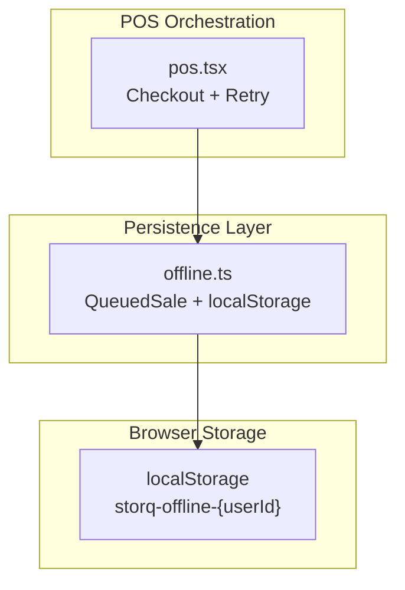
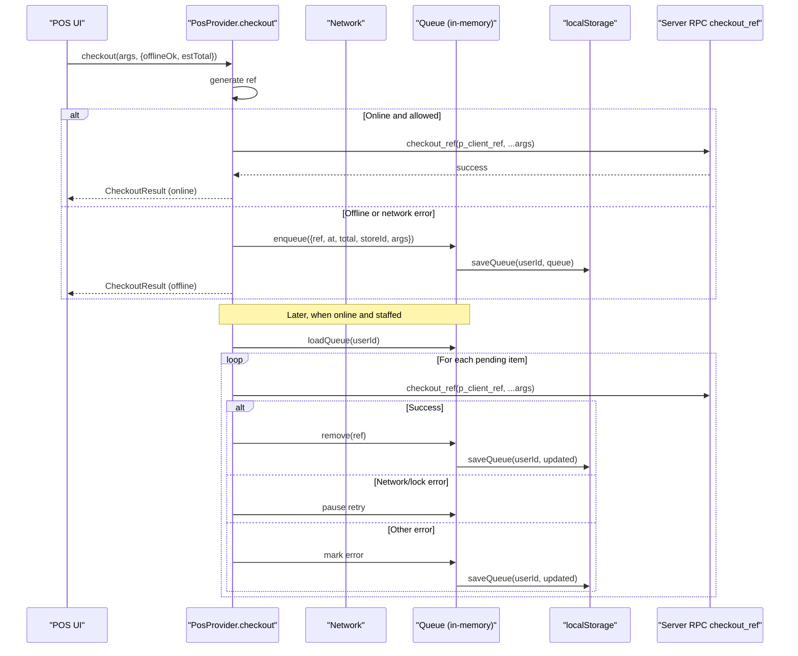
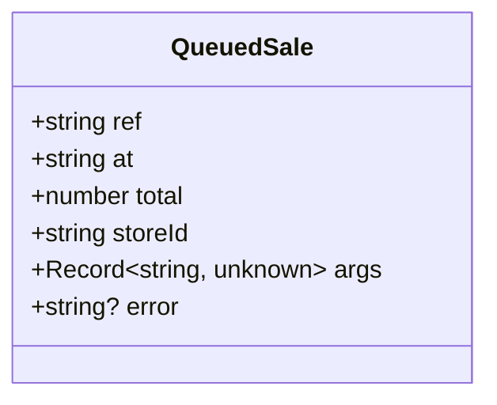
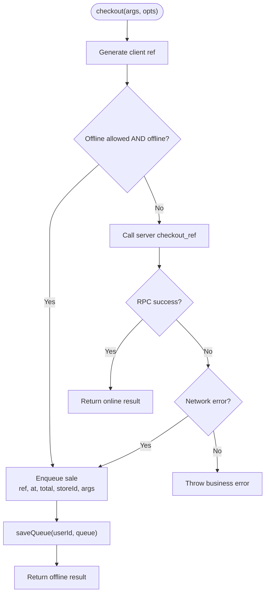
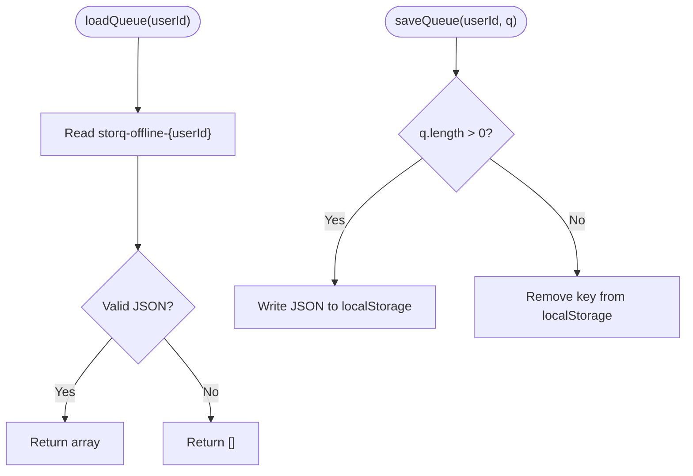
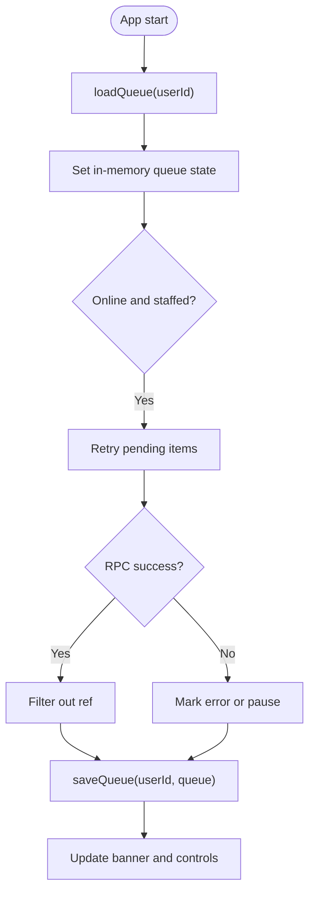
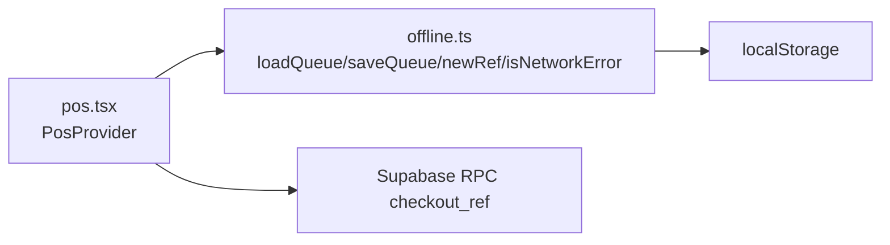

# Transaction Queue Management

<cite>
**Referenced Files in This Document**
- [offline.ts](file://src/lib/offline.ts)
- [pos.tsx](file://src/lib/pos.tsx)
</cite>

## Table of Contents
1. [Introduction](#introduction)
2. [Project Structure](#project-structure)
3. [Core Components](#core-components)
4. [Architecture Overview](#architecture-overview)
5. [Detailed Component Analysis](#detailed-component-analysis)
6. [Dependency Analysis](#dependency-analysis)
7. [Performance Considerations](#performance-considerations)
8. [Troubleshooting Guide](#troubleshooting-guide)
9. [Conclusion](#conclusion)

## Introduction
This document explains the transaction queue management system used by the point-of-sale application to keep selling during network outages. It focuses on the queued sale data model, how transactions are added when offline, how the queue is persisted locally, and how queued items are retried and cleared. It also clarifies what is stored locally and how complex checkout payloads are serialized for later replay.

## Project Structure
The queue implementation is split between a persistence layer and the POS context that orchestrates checkout and retry behavior:

- Persistence utilities: `src/lib/offline.ts`
  - Defines the queued sale type
  - Loads and saves the queue to `localStorage`
  - Generates unique client references
  - Detects network-related errors

- POS orchestration: `src/lib/pos.tsx`
  - Manages online/offline state
  - Adds sales to the queue during checkout when offline or when a network error occurs
  - Periodically retries queued sales when connectivity returns
  - Exposes helpers to clear failed or processed transactions

**Diagram sources**
- [pos.tsx:249-345](file://src/lib/pos.tsx#L249-L345)
- [offline.ts:62-80](file://src/lib/offline.ts#L62-L80)

**Section sources**
- [offline.ts:1-92](file://src/lib/offline.ts#L1-L92)
- [pos.tsx:1-448](file://src/lib/pos.tsx#L1-L448)

## Core Components
- QueuedSale interface
  - ref: Unique client-generated identifier for the sale
  - at: ISO timestamp when the sale was queued
  - total: Estimated total amount recorded at enqueue time
  - storeId: Store identifier associated with the sale
  - args: Full checkout payload used to replay the sale via server RPC
  - error: Optional human-readable error message after a failed retry attempt

- Queue persistence
  - Keys: `storq-offline-{userId}`
  - Format: JSON array of QueuedSale objects
  - Behavior: Empty arrays remove the key; non-empty arrays persist the full queue

- Checkout integration
  - When offline or when a network error occurs, checkout enqueues a sale instead of failing
  - Enqueued sales return an immediate “offline” result while being persisted

- Retry and cleanup
  - When online and authenticated, queued sales are retried sequentially
  - Successful retries are removed from the queue
  - Network or session lock errors pause retry; other errors mark the item as failed
  - Failed items can be retried individually or discarded

**Section sources**
- [offline.ts:62-80](file://src/lib/offline.ts#L62-L80)
- [pos.tsx:275-338](file://src/lib/pos.tsx#L275-L338)

## Architecture Overview
The queue ensures continuity of sales operations under intermittent connectivity. The flow below shows how a checkout request is handled depending on network status and whether it is allowed to proceed offline.

**Diagram sources**
- [pos.tsx:275-338](file://src/lib/pos.tsx#L275-L338)
- [offline.ts:71-80](file://src/lib/offline.ts#L71-L80)

## Detailed Component Analysis

### QueuedSale Data Model
The queued sale object captures everything needed to replay a sale later:

- ref: Stable identifier generated once per sale
- at: Time of enqueue for ordering and diagnostics
- total: Snapshot of estimated total at enqueue time
- storeId: Target store for the sale
- args: Complete checkout arguments required by the server RPC
- error: Optional last error message for failed retries

**Diagram sources**
- [offline.ts:62-69](file://src/lib/offline.ts#L62-L69)

**Section sources**
- [offline.ts:62-69](file://src/lib/offline.ts#L62-L69)

### Adding Transactions During Checkout
When a user completes a checkout:

1. A unique reference is generated
2. If offline is allowed and the device is offline, or if a network error occurs, the sale is enqueued
3. The queue is updated in memory and immediately persisted to `localStorage`
4. An immediate “offline” result is returned to the UI so the till remains responsive

**Diagram sources**
- [pos.tsx:275-307](file://src/lib/pos.tsx#L275-L307)
- [offline.ts:86-91](file://src/lib/offline.ts#L86-L91)

**Section sources**
- [pos.tsx:275-307](file://src/lib/pos.tsx#L275-L307)
- [offline.ts:86-91](file://src/lib/offline.ts#L86-L91)

### Queue Persistence Mechanism
- Storage location: Browser `localStorage`
- Key pattern: `storq-offline-{userId}`
- Serialization: JSON array of QueuedSale objects
- Load behavior: Returns empty array on parse failure
- Save behavior: Removes key if queue becomes empty; otherwise writes JSON string

**Diagram sources**
- [offline.ts:71-80](file://src/lib/offline.ts#L71-L80)

**Section sources**
- [offline.ts:71-80](file://src/lib/offline.ts#L71-L80)

### Maximum Queue Size Limits
There is no explicit maximum queue size enforced by the code. The queue grows until:

- The browser’s `localStorage` quota is reached
- The user manually discards failed items
- The app restarts and loads the persisted queue

Practical implications:

- Very large queues may hit storage limits
- Performance of serialization and retry loops scales with queue length
- Consider monitoring queue length and prompting users to clear old items

[No sources needed since this section provides general guidance]

### Retrieving and Clearing the Queue
- Retrieve: The POS provider loads the queue on initialization and exposes it through context
- Clear processed: Successful retries automatically remove items from the queue
- Clear failed: Users can retry individual failed items or discard them

**Diagram sources**
- [pos.tsx:251-273](file://src/lib/pos.tsx#L251-L273)
- [pos.tsx:310-345](file://src/lib/pos.tsx#L310-L345)

**Section sources**
- [pos.tsx:251-273](file://src/lib/pos.tsx#L251-L273)
- [pos.tsx:310-345](file://src/lib/pos.tsx#L310-L345)

### Data Serialization Details
- All queued sale fields are serializable primitives or plain objects
- args contains the complete checkout payload, including cart items and payment information
- Complex objects like cart lines and payment details are stored as-is within args
- No additional transformation is applied before saving to `localStorage`

Important considerations:

- Ensure checkout arguments do not include transient runtime-only values that cannot be serialized
- Avoid storing sensitive data beyond what is necessary for replay
- Keep args minimal but sufficient for server-side processing

**Section sources**
- [offline.ts:62-69](file://src/lib/offline.ts#L62-L69)
- [pos.tsx:280-290](file://src/lib/pos.tsx#L280-L290)

## Dependency Analysis
The following diagram shows how the POS orchestration depends on the persistence layer and browser storage.

**Diagram sources**
- [pos.tsx:15-23](file://src/lib/pos.tsx#L15-L23)
- [pos.tsx:275-338](file://src/lib/pos.tsx#L275-L338)
- [offline.ts:71-91](file://src/lib/offline.ts#L71-L91)

**Section sources**
- [pos.tsx:15-23](file://src/lib/pos.tsx#L15-L23)
- [pos.tsx:275-338](file://src/lib/pos.tsx#L275-L338)
- [offline.ts:71-91](file://src/lib/offline.ts#L71-L91)

## Performance Considerations
- Queue persistence is synchronous and happens on every update; keep queue sizes reasonable
- Retry logic processes items sequentially to avoid overwhelming the server
- Background sync runs periodically; consider adjusting frequency based on expected queue volume
- Large args payloads increase serialization cost and storage usage

[No sources needed since this section provides general guidance]

## Troubleshooting Guide
Common issues and resolutions:

- Queue not loading after refresh
  - Verify `localStorage` contains the expected key
  - Check for JSON parse errors; corrupted data falls back to an empty queue

- Items stuck in queue
  - Confirm the device is online and the user is authenticated
  - Inspect any error messages attached to failed items
  - Use retry or discard actions exposed in the UI

- Network errors during retry
  - Network or session lock errors pause further retries
  - Resolve connectivity or re-authenticate, then retry

- Storage quota exceeded
  - Reduce queue size by clearing failed items
  - Monitor queue length and encourage timely synchronization

**Section sources**
- [pos.tsx:310-345](file://src/lib/pos.tsx#L310-L345)
- [offline.ts:71-84](file://src/lib/offline.ts#L71-L84)

## Conclusion
The transaction queue system enables resilient point-of-sale operations by capturing checkout data locally when offline and replaying it when connectivity returns. The design centers on a simple, serializable QueuedSale structure and straightforward localStorage persistence. While there is no hard limit on queue size, operators should monitor queue length and ensure timely synchronization to avoid storage constraints. The provided retry and cleanup mechanisms help maintain data integrity and provide clear feedback to users during outages.