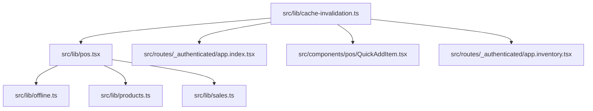
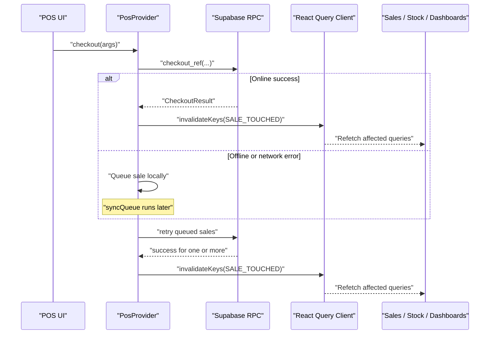
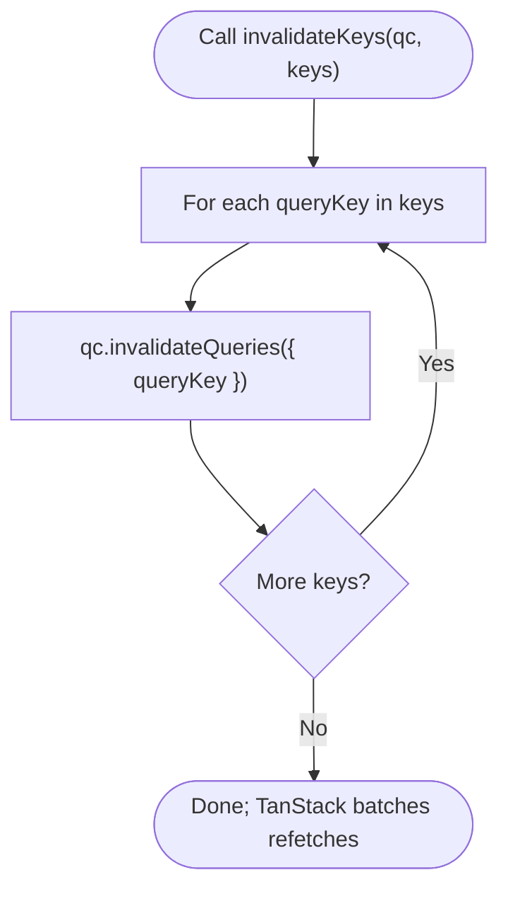
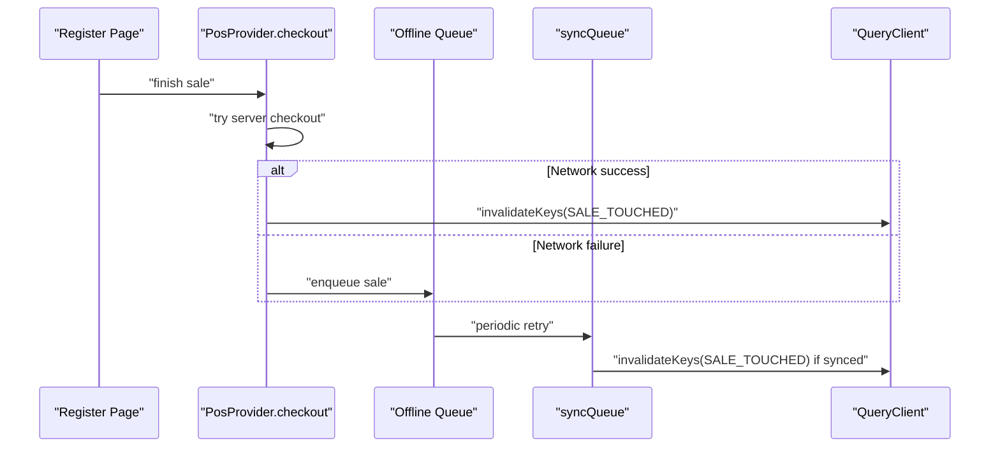
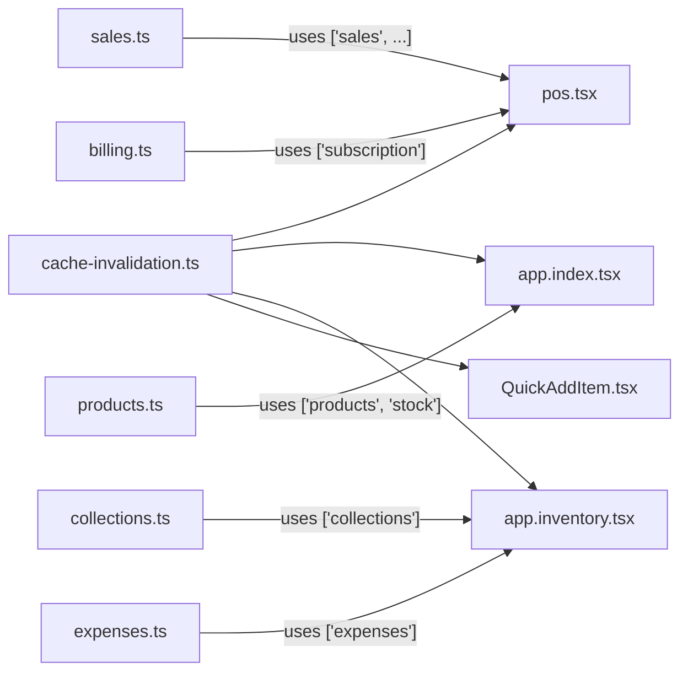

# Cache Invalidation Strategy

<cite>
**Referenced Files in This Document**
- [cache-invalidation.ts](file://src/lib/cache-invalidation.ts)
- [pos.tsx](file://src/lib/pos.tsx)
- [app.index.tsx](file://src/routes/_authenticated/app.index.tsx)
- [QuickAddItem.tsx](file://src/components/pos/QuickAddItem.tsx)
- [app.inventory.tsx](file://src/routes/_authenticated/app.inventory.tsx)
- [offline.ts](file://src/lib/offline.ts)
- [products.ts](file://src/lib/products.ts)
- [sales.ts](file://src/lib/sales.ts)
</cite>

## Table of Contents
1. [Introduction](#introduction)
2. [Project Structure](#project-structure)
3. [Core Components](#core-components)
4. [Architecture Overview](#architecture-overview)
5. [Detailed Component Analysis](#detailed-component-analysis)
6. [Dependency Analysis](#dependency-analysis)
7. [Performance Considerations](#performance-considerations)
8. [Troubleshooting Guide](#troubleshooting-guide)
9. [Conclusion](#conclusion)

## Introduction
This document explains the cache invalidation strategy used by the Storq POS system to keep React Query data consistent with real-time business operations such as sales, stock adjustments, product edits, and offline queue syncs. The central idea is simple: instead of clearing the entire cache after every write, the application invalidates only the query prefixes that can actually be affected. This keeps the register fast, avoids unnecessary catalog or subscription refetches, and makes multi-device updates predictable.

The strategy revolves around three concepts:
- A shared `invalidateKeys` helper that wraps TanStack’s `invalidateQueries`.
- A curated `SALE_TOUCHED` list of query key prefixes that must refresh whenever money or stock changes.
- Explicit invalidation calls at write boundaries, including successful checkout, offline queue sync, product creation, inventory edits, stock adjustments, and CSV imports.

## Project Structure
The cache invalidation logic lives primarily in a small library module and is consumed by POS flows, inventory screens, and the offline sync pipeline.

**Diagram sources**
- [cache-invalidation.ts:1-26](file://src/lib/cache-invalidation.ts#L1-L26)
- [pos.tsx:1-40](file://src/lib/pos.tsx#L1-L40)
- [app.index.tsx:1-30](file://src/routes/_authenticated/app.index.tsx#L1-L30)
- [QuickAddItem.tsx:1-10](file://src/components/pos/QuickAddItem.tsx#L1-L10)
- [app.inventory.tsx:1-20](file://src/routes/_authenticated/app.inventory.tsx#L1-L20)
- [offline.ts:1-15](file://src/lib/offline.ts#L1-L15)
- [products.ts:20-30](file://src/lib/products.ts#L20-L30)
- [sales.ts:45-55](file://src/lib/sales.ts#L45-L55)

**Section sources**
- [cache-invalidation.ts:1-26](file://src/lib/cache-invalidation.ts#L1-L26)
- [pos.tsx:1-40](file://src/lib/pos.tsx#L1-L40)

## Core Components
### `invalidateKeys`
`invalidateKeys` is a thin wrapper around TanStack’s `QueryClient.invalidateQueries`. It accepts a `QueryClient` instance and an array of query key prefixes, then invalidates each prefix individually. TanStack batches these requests, so calling it with multiple keys does not cause redundant network traffic.

Key responsibilities:
- Centralize invalidation behavior.
- Avoid accidental full-cache clears outside authentication events.
- Make invalidation intent explicit at every write boundary.

### `SALE_TOUCHED`
`SALE_TOUCHED` is the canonical set of query prefixes that represent financial or stock state. When any sale completes or is synced from the offline queue, this list is invalidated. It includes:
- Sales lists and detail queries.
- Sales summary and page-level summaries.
- Sale-specific cost maps.
- Store stock.
- Stock movement ledger.
- Shift summary.
- Dashboard alerts.

The comment in the file explicitly states that route writes should invalidate these keys rather than nuking the whole cache, because completing a sale should not re-pull unrelated data such as the product catalog, expenses, or subscription configuration.

**Section sources**
- [cache-invalidation.ts:3-26](file://src/lib/cache-invalidation.ts#L3-L26)

## Architecture Overview
At runtime, the POS provider owns the staff session, online status, offline queue, and checkout flow. After a successful server-side operation, it invalidates only the relevant query prefixes. Offline queued sales are retried periodically; when any of them successfully syncs, the same `SALE_TOUCHED` set is invalidated so all views reflect the new totals, stock levels, and alerts.

**Diagram sources**
- [pos.tsx:275-338](file://src/lib/pos.tsx#L275-L338)
- [cache-invalidation.ts:11-26](file://src/lib/cache-invalidation.ts#L11-L26)

## Detailed Component Analysis

### `invalidateKeys` Implementation
The implementation iterates over the provided key array and calls `qc.invalidateQueries({ queryKey })` for each entry. The function intentionally returns `void` and ignores the promise result because invalidation is fire-and-forget: callers should not wait for refetch completion before closing modals or navigating away.

Design implications:
- Each key becomes its own invalidation request, but TanStack batches them efficiently.
- Callers control precision by passing only the prefixes they care about.
- The function is safe to call repeatedly during batched mutations.

**Diagram sources**
- [cache-invalidation.ts:23-26](file://src/lib/cache-invalidation.ts#L23-L26)

**Section sources**
- [cache-invalidation.ts:23-26](file://src/lib/cache-invalidation.ts#L23-L26)

### `SALE_TOUCHED` Pattern
`SALE_TOUCHED` is the performance optimization layer. Instead of using a keyless `invalidateQueries()` call on every write, the POS invalidates only the prefixes that matter for financial and stock state. This prevents expensive refetches of unrelated data such as:
- Product catalog.
- Expenses.
- Subscription configuration.
- Staff names or other reference data that may have longer stale times.

The pattern also documents which views are affected: sales lists, sale details, stock, movements, shift summary, and dashboard alerts.

**Section sources**
- [cache-invalidation.ts:3-21](file://src/lib/cache-invalidation.ts#L3-L21)

### POS Checkout and Offline Sync
The POS provider exposes a `checkout` method that either calls the server directly or queues the sale locally when offline. The offline queue is persisted in `localStorage`, and `syncQueue` retries pending sales periodically.

Important invalidation points:
- Successful direct checkout invalidates `SALE_TOUCHED`.
- Successful offline queue sync invalidates `SALE_TOUCHED` once any item has been synced.
- Lock/unlock and auth-related events use a full cache clear via `qc.invalidateQueries()`, because user context changed and stale rows must not leak between sessions.

**Diagram sources**
- [pos.tsx:275-338](file://src/lib/pos.tsx#L275-L338)
- [cache-invalidation.ts:11-26](file://src/lib/cache-invalidation.ts#L11-L26)

**Section sources**
- [pos.tsx:186-215](file://src/lib/pos.tsx#L186-L215)
- [pos.tsx:275-338](file://src/lib/pos.tsx#L275-L338)

### Register Finish Flow
The register page uses `usePos().checkout` to complete sales and laybys. On success, it clears local cart state, shows the receipt or approval message, and invalidates `SALE_TOUCHED`. This ensures that:
- Sales lists update.
- Live stock badges refresh.
- Summaries and dashboards reflect the new transaction.
- Movement history becomes available.

**Section sources**
- [app.index.tsx:273-355](file://src/routes/_authenticated/app.index.tsx#L273-L355)

### Quick Add Item
When a scanned barcode does not match the current catalog, admins and managers can create the product inline. After saving the product through the RPC, the component invalidates:
- Products.
- Stock.
- Collections.
- Dashboard alerts.

This is narrower than `SALE_TOUCHED` because no sale occurred; only catalog and related surfaces need refreshing.

**Section sources**
- [QuickAddItem.tsx:53-101](file://src/components/pos/QuickAddItem.tsx#L53-L101)

### Inventory Edit and Stock Adjustment
Inventory edits and stock adjustments follow the same principle: perform the server mutation, close the modal immediately for responsiveness, then invalidate only the affected query prefixes.

Product save path:
- Invalidates products, stock, movements, collections, and dashboard alerts.

Stock adjustment path:
- Invalidates stock, movements, and dashboard alerts.

These targeted invalidations avoid reloading the entire catalog unnecessarily while still keeping the ledger and alert feed consistent.

**Section sources**
- [app.inventory.tsx:740-778](file://src/routes/_authenticated/app.inventory.tsx#L740-L778)
- [app.inventory.tsx:1067-1105](file://src/routes/_authenticated/app.inventory.tsx#L1067-L1105)

### CSV Import
CSV import first refetches products and stock to ensure the preview matches live data. Then it applies product updates and absolute stock quantities. Finally, it invalidates the same set of prefixes used by product saves and stock adjustments.

**Section sources**
- [app.inventory.tsx:1344-1394](file://src/routes/_authenticated/app.inventory.tsx#L1344-L1394)

### Offline Persistence and Hydration
The offline module persists selected reference queries to `localStorage` and hydrates them on app start. It subscribes to React Query cache updates and debounces persistence. This complements invalidation:
- Hydration gives instant startup data.
- Stale timestamps force background refetch.
- Invalidation keeps persisted snapshots consistent with server state.

**Section sources**
- [offline.ts:1-55](file://src/lib/offline.ts#L1-L55)

## Dependency Analysis
The cache invalidation strategy depends on consistent query key patterns across the application. Key consumers include:
- Products and stock queries.
- Sales and refund queries.
- Collections, transfers, and low-stock queries.
- Billing and subscription queries.

**Diagram sources**
- [cache-invalidation.ts:11-21](file://src/lib/cache-invalidation.ts#L11-L21)
- [products.ts:25-30](file://src/lib/products.ts#L25-L30)
- [sales.ts:49-55](file://src/lib/sales.ts#L49-L55)

**Section sources**
- [products.ts:25-30](file://src/lib/products.ts#L25-L30)
- [sales.ts:49-55](file://src/lib/sales.ts#L49-L55)

## Performance Considerations
The most important performance rule is already encoded in the codebase: do not use keyless cache invalidation for routine business writes. Use `invalidateKeys` with precise prefixes.

Recommended practices:
- Prefer `SALE_TOUCHED` for any operation that changes money or stock.
- Use smaller custom key arrays for catalog-only changes.
- Reserve full cache invalidation for authentication, lock/unlock, or role changes where stale user data must be purged.
- Keep query keys stable and hierarchical so prefix-based invalidation works reliably.
- Combine invalidation with long `staleTime` for reference data that rarely changes.
- Use offline hydration for instant-start reference data, but still rely on invalidation to reconcile with the server.

## Troubleshooting Guide
Common symptoms and likely causes:

| Symptom | Likely Cause | Recommended Fix |
| --- | --- | --- |
| Sales total does not update after checkout | Missing invalidation of sales or summary keys | Ensure `SALE_TOUCHED` is invalidated after successful checkout or offline sync. |
| Stock badge stays stale | Stock query not invalidated | Invalidate `["stock"]` after stock adjustments, sales, or CSV imports. |
| Catalog reloads too often | Full cache cleared on non-auth writes | Replace keyless `invalidateQueries()` with targeted `invalidateKeys`. |
| Dashboard alerts not updating | Alerts not included in invalidation set | Include `["dash-alerts"]` in the invalidation set for stock or sales changes. |
| Offline sale appears twice or disappears | Queue sync logic or error handling issue | Check `syncQueue` retry behavior and whether `invalidateKeys` runs only after successful sync. |
| User sees previous staff data after unlock | Session change did not clear cache | Use full cache invalidation on lock/unlock and auth events. |

**Section sources**
- [pos.tsx:186-215](file://src/lib/pos.tsx#L186-L215)
- [pos.tsx:309-338](file://src/lib/pos.tsx#L309-L338)

## Conclusion
Storq’s cache invalidation strategy is intentionally conservative and explicit. Rather than treating the React Query cache as a global reset button, it treats cache consistency as a contract between database mutations and query prefixes. `invalidateKeys` provides a reusable interface, `SALE_TOUCHED` captures the financial and stock surface area, and each write path chooses the smallest valid invalidation set. This approach keeps the POS responsive, reduces unnecessary network traffic, and makes real-time updates predictable across devices and offline scenarios.