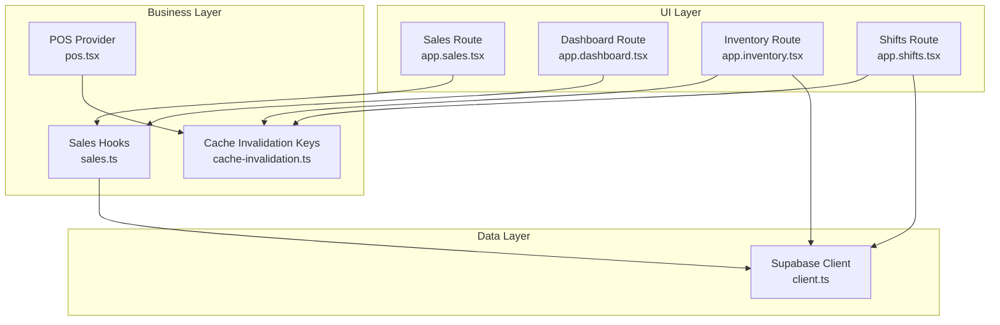
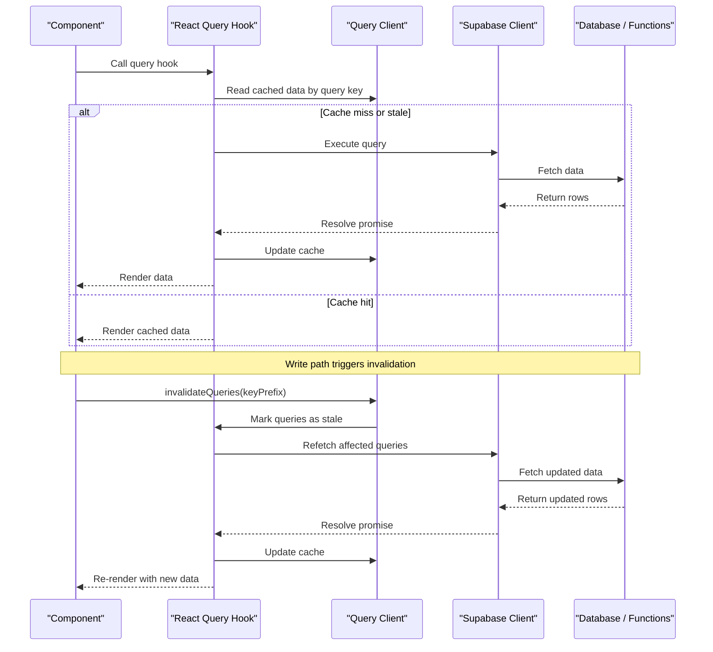
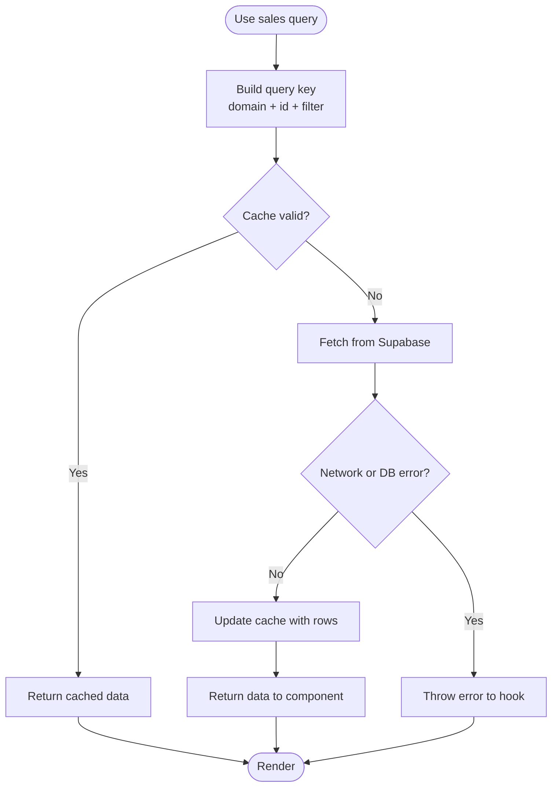
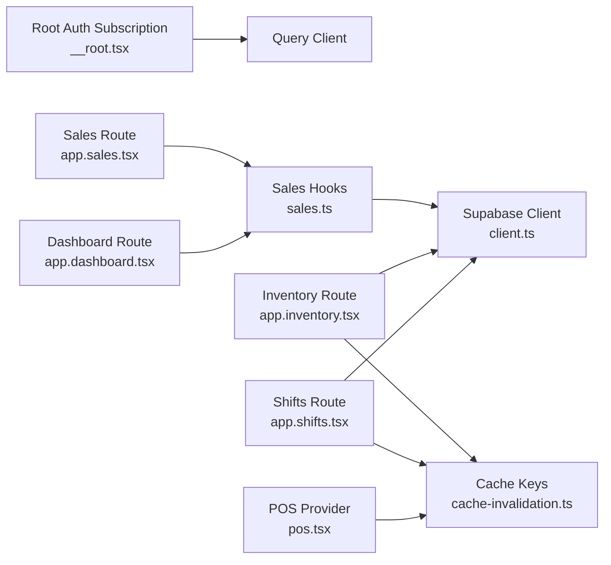

# React Query Integration

<cite>
**Referenced Files in This Document**
- [__root.tsx](file://src/routes/__root.tsx)
- [client.ts](file://src/integrations/supabase/client.ts)
- [cache-invalidation.ts](file://src/lib/cache-invalidation.ts)
- [pos.tsx](file://src/lib/pos.tsx)
- [sales.ts](file://src/lib/sales.ts)
- [app.sales.tsx](file://src/routes/_authenticated/app.sales.tsx)
- [app.dashboard.tsx](file://src/routes/_authenticated/app.dashboard.tsx)
- [app.inventory.tsx](file://src/routes/_authenticated/app.inventory.tsx)
- [app.shifts.tsx](file://src/routes/_authenticated/app.shifts.tsx)
</cite>

## Table of Contents
1. [Introduction](#introduction)
2. [Project Structure](#project-structure)
3. [Core Components](#core-components)
4. [Architecture Overview](#architecture-overview)
5. [Detailed Component Analysis](#detailed-component-analysis)
6. [Dependency Analysis](#dependency-analysis)
7. [Performance Considerations](#performance-considerations)
8. [Troubleshooting Guide](#troubleshooting-guide)
9. [Conclusion](#conclusion)

## Introduction
This document explains how the Storq POS application integrates React Query with Supabase data access and how cache updates are coordinated across components. The project currently uses explicit query invalidation rather than direct Supabase real-time subscriptions to drive refetches. Cache keys are carefully designed so that writes such as sales, stock adjustments, product edits, and shift operations only invalidate the affected areas instead of clearing the entire cache. This keeps UI consistency high while minimizing unnecessary network requests.

The key ideas covered here are:
- How query keys are structured for sales, summaries, inventory, shifts, and dashboard alerts.
- How writes trigger targeted cache invalidation.
- How loading states and stale data are handled during updates.
- How to configure queries for optimal performance when adding real-time behavior later.
- Practical debugging techniques for real-time or event-driven data flow issues.

## Project Structure
At a high level, the integration spans three layers:
- Data layer: Supabase client configuration and typed database access.
- Business layer: Shared hooks and utilities that define query keys and fetch logic.
- UI layer: Routes and components that consume queries and react to invalidation.

**Diagram sources**
- [app.sales.tsx:109-120](file://src/routes/_authenticated/app.sales.tsx#L109-L120)
- [app.dashboard.tsx:67-83](file://src/routes/_authenticated/app.dashboard.tsx#L67-L83)
- [app.inventory.tsx:772-778](file://src/routes/_authenticated/app.inventory.tsx#L772-L778)
- [app.shifts.tsx:67-90](file://src/routes/_authenticated/app.shifts.tsx#L67-L90)
- [pos.tsx:330-337](file://src/lib/pos.tsx#L330-L337)
- [sales.ts:37-72](file://src/lib/sales.ts#L37-L72)
- [cache-invalidation.ts:1-26](file://src/lib/cache-invalidation.ts#L1-L26)
- [client.ts:57-84](file://src/integrations/supabase/client.ts#L57-L84)

**Section sources**
- [client.ts:57-84](file://src/integrations/supabase/client.ts#L57-L84)
- [cache-invalidation.ts:1-26](file://src/lib/cache-invalidation.ts#L1-L26)
- [pos.tsx:115-228](file://src/lib/pos.tsx#L115-L228)
- [sales.ts:37-72](file://src/lib/sales.ts#L37-L72)
- [app.sales.tsx:109-120](file://src/routes/_authenticated/app.sales.tsx#L109-L120)
- [app.dashboard.tsx:67-83](file://src/routes/_authenticated/app.dashboard.tsx#L67-L83)
- [app.inventory.tsx:772-778](file://src/routes/_authenticated/app.inventory.tsx#L772-L778)
- [app.shifts.tsx:67-90](file://src/routes/_authenticated/app.shifts.tsx#L67-L90)

## Core Components
This section documents the core pieces that make cache updates predictable and consistent.

### Query Key Strategy
- Sales list queries use a stable prefix plus filter context. For example, the sales list hook composes a key from a domain tag, an identifier, and the full filter object. This ensures different filters and views do not collide.
- Sales summary queries include store and time-range filters so each dashboard or report view has its own cached result.
- Inventory-related queries are invalidated by a shared set of keys covering products, stock, movements, collections, and dashboard alerts.
- Shift queries separate the historical shift list from the live shift summary, allowing independent caching and polling strategies.

Key behaviors:
- Stale times are tuned per query type. Frequently changing lists like sales and dashboards use short stale windows (for example, around one minute), while near-static data like staff names or business settings use longer or infinite stale times.
- Queries often keep previous data during transitions to avoid blank flashes.

**Section sources**
- [sales.ts:37-72](file://src/lib/sales.ts#L37-L72)
- [sales.ts:126-147](file://src/lib/sales.ts#L126-L147)
- [sales.ts:156-180](file://src/lib/sales.ts#L156-L180)
- [app.dashboard.tsx:67-83](file://src/routes/_authenticated/app.dashboard.tsx#L67-L83)
- [app.shifts.tsx:67-90](file://src/routes/_authenticated/app.shifts.tsx#L67-L90)

### Centralized Cache Invalidation
The application defines a focused set of “touched” keys that represent data affected by sales and stock movements. Instead of clearing the whole cache, write paths call a helper that invalidates only those prefixes. This is important because:
- Completing a sale should update sales lists, summaries, stock, movements, and dashboard alerts.
- Editing an item should update products, stock, movements, collections, and dashboard alerts.
- Opening, recording, or closing a shift should update shift lists and the live shift summary.

The helper iterates over the configured keys and invalidates each prefix individually, letting React Query batch and refetch efficiently.

**Section sources**
- [cache-invalidation.ts:1-26](file://src/lib/cache-invalidation.ts#L1-L26)
- [pos.tsx:330-337](file://src/lib/pos.tsx#L330-L337)
- [app.inventory.tsx:772-778](file://src/routes/_authenticated/app.inventory.tsx#L772-L778)
- [app.shifts.tsx:97-105](file://src/routes/_authenticated/app.shifts.tsx#L97-L105)
- [app.shifts.tsx:290-303](file://src/routes/_authenticated/app.shifts.tsx#L290-L303)
- [app.shifts.tsx:346-364](file://src/routes/_authenticated/app.shifts.tsx#L346-L364)

### Authentication and Global Cache Behavior
At the root level, the app subscribes to Supabase authentication state changes. On sign-in, sign-out, or user update, it invalidates all queries. On sign-out, it also clears the device cache. This guarantees that user-scoped data does not leak between sessions and that global navigation stays consistent after auth events.

**Section sources**
- [__root.tsx:118-128](file://src/routes/__root.tsx#L118-L128)

## Architecture Overview
The current architecture relies on explicit invalidation rather than direct real-time subscriptions. The flow is:

1. A component calls a React Query hook.
2. The hook builds a query key and executes a Supabase query through the shared client.
3. The result is cached under that key with a configured stale time.
4. A mutation or RPC write triggers `invalidateQueries` against specific key prefixes.
5. React Query detects the invalidation and refetches affected queries automatically.
6. Components re-render with fresh data while preserving previous data where appropriate.

**Diagram sources**
- [sales.ts:37-72](file://src/lib/sales.ts#L37-L72)
- [sales.ts:126-147](file://src/lib/sales.ts#L126-L147)
- [pos.tsx:330-337](file://src/lib/pos.tsx#L330-L337)
- [cache-invalidation.ts:23-26](file://src/lib/cache-invalidation.ts#L23-L26)

## Detailed Component Analysis

### Sales Data Flow
The sales module provides:
- A list hook that fetches sales rows with optional line-item joins.
- A summary hook that computes aggregates via a server function.
- A paginated page hook that returns rows and total counts.
- A cost map hook for sale items.

Key design points:
- The list hook sets a short stale time so other-device changes become visible within about a minute without constant refetching.
- The summary hook is server-side aggregated and invalidated through the same touched-key strategy.
- The page hook preserves previous data during pagination to avoid flashing empty content.

**Diagram sources**
- [sales.ts:37-72](file://src/lib/sales.ts#L37-L72)
- [sales.ts:126-147](file://src/lib/sales.ts#L126-L147)
- [sales.ts:156-180](file://src/lib/sales.ts#L156-L180)

**Section sources**
- [sales.ts:37-72](file://src/lib/sales.ts#L37-L72)
- [sales.ts:126-147](file://src/lib/sales.ts#L126-L147)
- [sales.ts:156-180](file://src/lib/sales.ts#L156-L180)
- [app.sales.tsx:109-120](file://src/routes/_authenticated/app.sales.tsx#L109-L120)

### Dashboard Aggregation and Alerts
The dashboard combines sales, expenses, costs, and alert queries:
- It reads sales with a filter derived from the selected range.
- It conditionally includes sale-item joins based on role permissions.
- It computes revenue, COGS, profit, payment-method distribution, and trend data locally from cached rows.
- It maintains a dashboard-alerts query with a moderate stale time.

This approach avoids pulling large datasets repeatedly when switching ranges; it re-bins already cached rows when possible.

**Section sources**
- [app.dashboard.tsx:67-83](file://src/routes/_authenticated/app.dashboard.tsx#L67-L83)
- [app.dashboard.tsx:137-167](file://src/routes/_authenticated/app.dashboard.tsx#L137-L167)

### Inventory Updates and Targeted Invalidation
When editing or creating an item, the inventory dialog:
- Validates inputs.
- Calls the server RPC to save product details and optionally adjust stock.
- Invalidates product, stock, movement, collection, and dashboard-alert keys.

This ensures that the inventory table, low-stock indicators, and dashboard notifications stay consistent after edits.

**Section sources**
- [app.inventory.tsx:711-778](file://src/routes/_authenticated/app.inventory.tsx#L711-L778)

### Shift Operations and Live Summary
The shifts screen separates:
- Historical shift list query with a long stale time.
- Live shift summary query with a polling interval.

On open, cash move, or close actions, it invalidates both the shift list and the live summary key. The live summary remains responsive through periodic refetching rather than continuous polling of every screen.

**Section sources**
- [app.shifts.tsx:67-90](file://src/routes/_authenticated/app.shifts.tsx#L67-L90)
- [app.shifts.tsx:97-105](file://src/routes/_authenticated/app.shifts.tsx#L97-L105)
- [app.shifts.tsx:290-303](file://src/routes/_authenticated/app.shifts.tsx#L290-L303)
- [app.shifts.tsx:346-364](file://src/routes/_authenticated/app.shifts.tsx#L346-L364)

### Offline Checkout and Cache Refresh
The POS provider manages offline checkout:
- If offline or network errors occur, checkout attempts queue the sale locally.
- When online, queued sales are retried periodically.
- After successful sync, it invalidates the touched keys so all related screens refresh.

This pattern is especially relevant when integrating real-time updates: real-time events can be treated similarly to successful syncs by invalidating the same key prefixes.

**Section sources**
- [pos.tsx:275-337](file://src/lib/pos.tsx#L275-L337)

## Dependency Analysis
The main dependency relationships are:

- UI routes depend on business-layer hooks for data fetching.
- Business-layer hooks depend on the Supabase client.
- Write flows depend on the centralized cache invalidation helpers.
- Root-level auth subscription drives global cache invalidation.

**Diagram sources**
- [__root.tsx:118-128](file://src/routes/__root.tsx#L118-L128)
- [app.sales.tsx:109-120](file://src/routes/_authenticated/app.sales.tsx#L109-L120)
- [app.dashboard.tsx:67-83](file://src/routes/_authenticated/app.dashboard.tsx#L67-L83)
- [app.inventory.tsx:772-778](file://src/routes/_authenticated/app.inventory.tsx#L772-L778)
- [app.shifts.tsx:67-90](file://src/routes/_authenticated/app.shifts.tsx#L67-L90)
- [pos.tsx:330-337](file://src/lib/pos.tsx#L330-L337)
- [sales.ts:37-72](file://src/lib/sales.ts#L37-L72)
- [client.ts:57-84](file://src/integrations/supabase/client.ts#L57-L84)

**Section sources**
- [__root.tsx:118-128](file://src/routes/__root.tsx#L118-L128)
- [cache-invalidation.ts:1-26](file://src/lib/cache-invalidation.ts#L1-L26)
- [pos.tsx:330-337](file://src/lib/pos.tsx#L330-L337)
- [sales.ts:37-72](file://src/lib/sales.ts#L37-L72)

## Performance Considerations
To optimize real-time or event-driven updates with React Query:

- Prefer targeted invalidation over global invalidation. Use the existing touched-key strategy so only affected queries refetch.
- Tune staleTime per query:
  - Short stale windows for frequently changing lists like sales and dashboards.
  - Longer or infinite stale windows for static reference data like staff names or business settings.
- Keep previous data during transitions using placeholder strategies to avoid blank flashes.
- Avoid heavy nested joins unless needed. The dashboard already skips sale-item joins for cashiers to reduce payload size.
- Use server-side aggregation for KPIs and totals instead of computing large datasets in the browser.
- Debounce or throttle expensive UI computations derived from cached data.
- Limit polling intervals for live summaries to reasonable values.

[No sources needed since this section provides general guidance]

## Troubleshooting Guide
Common issues and debugging techniques:

1. **Queries not updating after a write**
   - Verify that the write path invalidates the correct key prefix.
   - Confirm that the consuming query uses a key starting with that prefix.
   - Example touch targets include sales, stock, movements, collections, and dashboard alerts.

2. **Too many refetches**
   - Check whether staleTime is too low.
   - Ensure placeholder data is used for paginated or transitioning queries.
   - Avoid invalidating unrelated keys.

3. **Blank UI during updates**
   - Use placeholder data for list pages.
   - Keep previous data while fetching the next page or new range.

4. **Auth-related cache problems**
   - Confirm that the root auth subscription invalidates queries on sign-in and sign-out.
   - On sign-out, ensure the device cache is cleared.

5. **Offline vs online inconsistency**
   - Inspect the offline queue and retry behavior in the POS provider.
   - Validate that successful syncs trigger the same invalidation as online writes.

6. **Real-time events not reflected**
   - Treat real-time events like successful mutations: invalidate the same key prefixes.
   - Add logging around invalidation calls to trace which keys are being refreshed.

**Section sources**
- [__root.tsx:118-128](file://src/routes/__root.tsx#L118-L128)
- [pos.tsx:275-337](file://src/lib/pos.tsx#L275-L337)
- [cache-invalidation.ts:1-26](file://src/lib/cache-invalidation.ts#L1-L26)

## Conclusion
Storq POS currently achieves consistent UI updates through well-structured React Query keys and targeted cache invalidation. Sales, inventory, shifts, and dashboard data are kept in sync by invalidating only the affected query prefixes. This approach is efficient, predictable, and easy to extend.

If you add Supabase real-time subscriptions later, the recommended pattern is to treat real-time events as invalidation triggers for the same key prefixes used by mutations. This preserves the existing cache model while enabling near-real-time UI updates without manual state merging.

[No sources needed since this section summarizes without analyzing specific files]