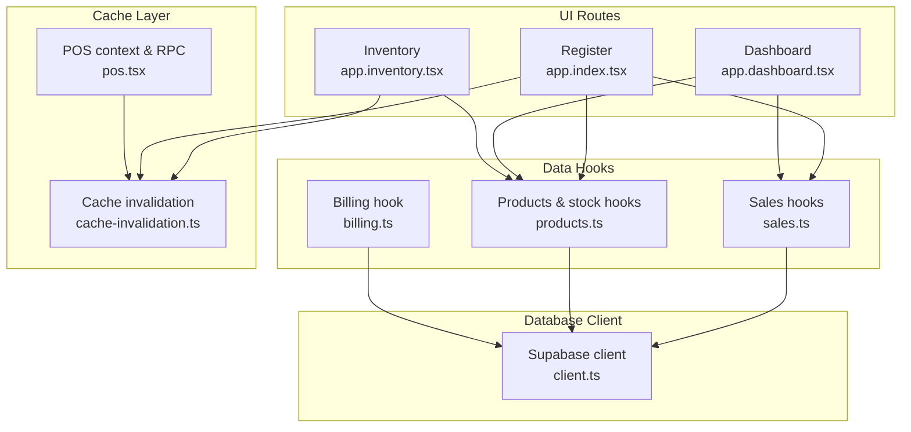
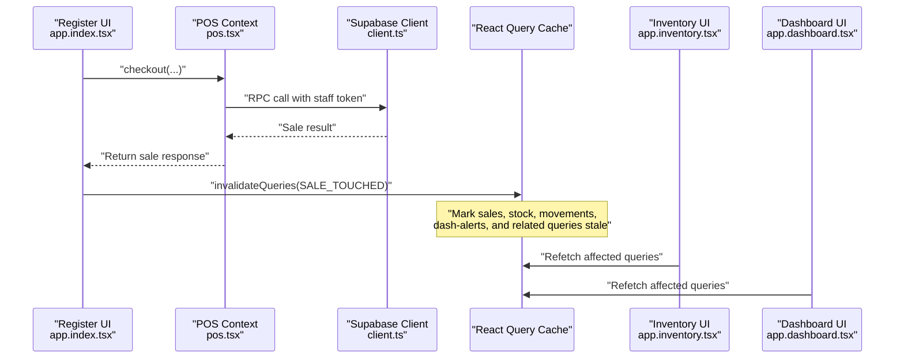
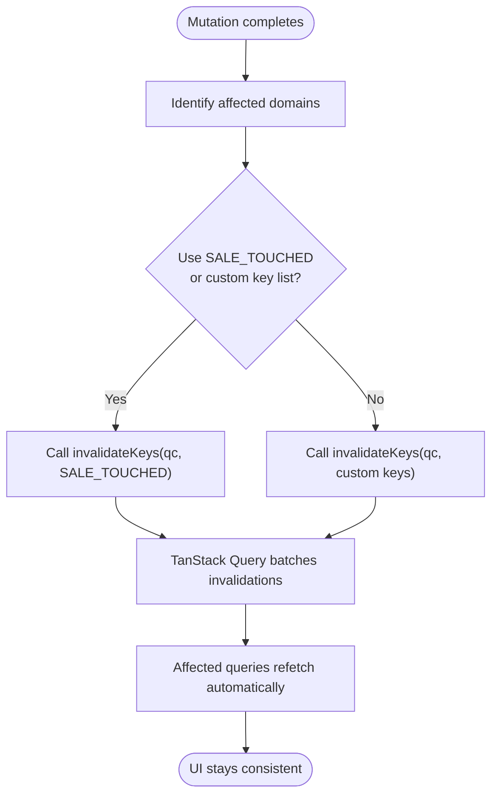
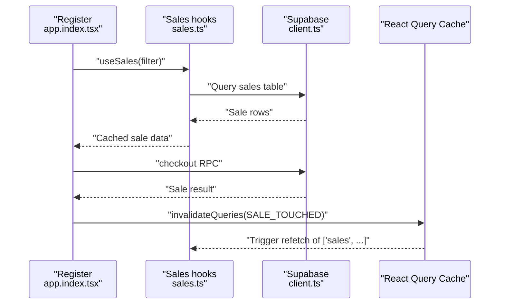
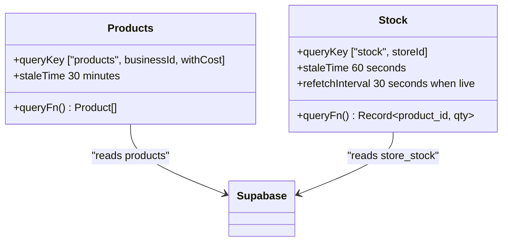
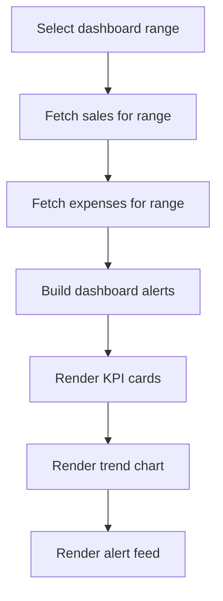
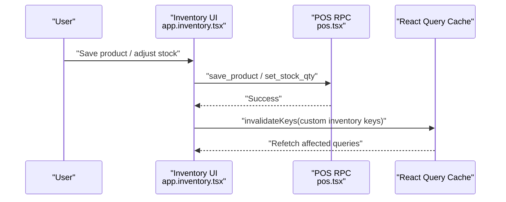
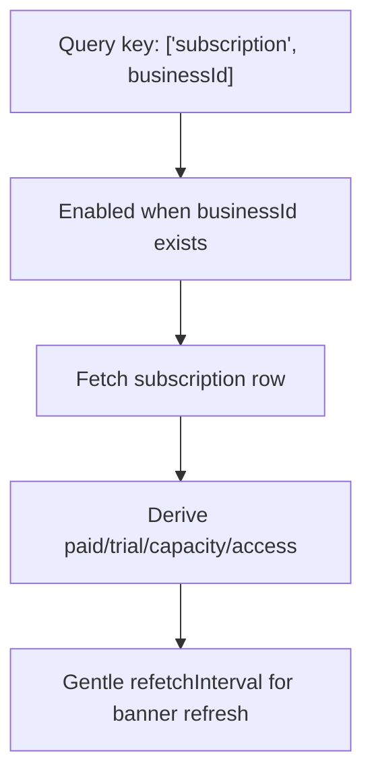
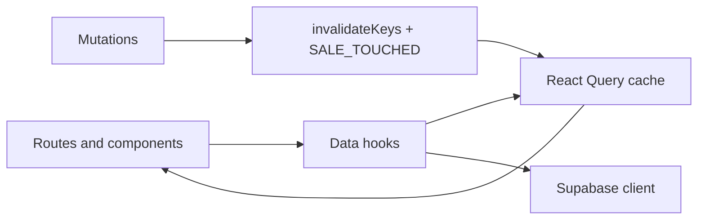

# Real-time Data Updates

<cite>
**Referenced Files in This Document**
- [cache-invalidation.ts](file://src/lib/cache-invalidation.ts)
- [client.ts](file://src/integrations/supabase/client.ts)
- [sales.ts](file://src/lib/sales.ts)
- [products.ts](file://src/lib/products.ts)
- [app.index.tsx](file://src/routes/_authenticated/app.index.tsx)
- [app.dashboard.tsx](file://src/routes/_authenticated/app.dashboard.tsx)
- [app.inventory.tsx](file://src/routes/_authenticated/app.inventory.tsx)
- [pos.tsx](file://src/lib/pos.tsx)
- [billing.ts](file://src/lib/billing.ts)
- [subscription-policy.ts](file://src/lib/subscription-policy.ts)
</cite>

## Table of Contents
1. [Introduction](#introduction)
2. [Project Structure](#project-structure)
3. [Core Components](#core-components)
4. [Architecture Overview](#architecture-overview)
5. [Detailed Component Analysis](#detailed-component-analysis)
6. [Dependency Analysis](#dependency-analysis)
7. [Performance Considerations](#performance-considerations)
8. [Troubleshooting Guide](#troubleshooting-guide)
9. [Conclusion](#conclusion)

## Introduction
This document explains how the Storq POS system keeps inventory, sales, and business intelligence data consistent across devices using React Query caching and Supabase-backed operations. The application does not rely on a persistent WebSocket subscription layer for real-time updates; instead, it uses:

- Carefully designed query keys that group related data.
- Targeted cache invalidation through `invalidateKeys` and the `SALE_TOUCHED` key set.
- Gentle polling where needed to reconcile changes made outside the current device.
- Long-lived cached catalogs and stock maps to keep the till fast and responsive.

The result is an experience that feels live while avoiding expensive network traffic and keeping UI state predictable.

## Project Structure
The real-time update strategy spans several layers:

- Data access hooks define query keys and fetch functions.
- Route components consume those hooks and trigger writes.
- A shared cache invalidation utility marks affected queries after mutations.
- The Supabase client provides authenticated database access.
- Business logic such as billing and subscription policy drives feature gating and periodic refreshes.

**Diagram sources**
- [app.index.tsx:111-355](file://src/routes/_authenticated/app.index.tsx#L111-L355)
- [app.dashboard.tsx:55-135](file://src/routes/_authenticated/app.dashboard.tsx#L55-L135)
- [app.inventory.tsx:110-185](file://src/routes/_authenticated/app.inventory.tsx#L110-L185)
- [sales.ts:37-73](file://src/lib/sales.ts#L37-L73)
- [products.ts:22-53](file://src/lib/products.ts#L22-L53)
- [products.ts:82-106](file://src/lib/products.ts#L82-L106)
- [billing.ts:10-28](file://src/lib/billing.ts#L10-L28)
- [cache-invalidation.ts:1-26](file://src/lib/cache-invalidation.ts#L1-L26)
- [client.ts:57-95](file://src/integrations/supabase/client.ts#L57-L95)
- [pos.tsx:220-247](file://src/lib/pos.tsx#L220-L247)

**Section sources**
- [app.index.tsx:111-355](file://src/routes/_authenticated/app.index.tsx#L111-L355)
- [app.dashboard.tsx:55-135](file://src/routes/_authenticated/app.dashboard.tsx#L55-L135)
- [app.inventory.tsx:110-185](file://src/routes/_authenticated/app.inventory.tsx#L110-L185)
- [sales.ts:37-73](file://src/lib/sales.ts#L37-L73)
- [products.ts:22-53](file://src/lib/products.ts#L22-L53)
- [products.ts:82-106](file://src/lib/products.ts#L82-L106)
- [billing.ts:10-28](file://src/lib/billing.ts#L10-L28)
- [cache-invalidation.ts:1-26](file://src/lib/cache-invalidation.ts#L1-L26)
- [client.ts:57-95](file://src/integrations/supabase/client.ts#L57-L95)
- [pos.tsx:220-247](file://src/lib/pos.tsx#L220-L247)

## Core Components
- **Cache invalidation utility**: Defines the `SALE_TOUCHED` query key prefixes and a helper that invalidates each prefix individually so TanStack Query can batch refetches efficiently.
- **Sales hooks**: Provide paginated sales lists, summaries, item cost maps, and export helpers with explicit stale times and server-side aggregation.
- **Product and stock hooks**: Keep a long-lived product catalog and optionally poll store stock on the live register screen.
- **POS context**: Wraps RPC calls, currency formatting, offline queueing, and cache hydration/persistence.
- **Billing hook**: Reads subscription state with gentle polling and derives access flags without polluting query keys.

Key responsibilities:
- Define stable query keys per domain.
- Invalidate only what changed.
- Avoid full-cache resets except during authentication or lock transitions.
- Use server-side aggregation for business metrics.
- Poll minimally and only when necessary.

**Section sources**
- [cache-invalidation.ts:1-26](file://src/lib/cache-invalidation.ts#L1-L26)
- [sales.ts:37-73](file://src/lib/sales.ts#L37-L73)
- [sales.ts:126-148](file://src/lib/sales.ts#L126-L148)
- [products.ts:22-53](file://src/lib/products.ts#L22-L53)
- [products.ts:82-106](file://src/lib/products.ts#L82-L106)
- [billing.ts:10-28](file://src/lib/billing.ts#L10-L28)
- [pos.tsx:220-247](file://src/lib/pos.tsx#L220-L247)

## Architecture Overview
The application integrates React Query with Supabase through a typed client. Real-time behavior comes from two complementary mechanisms:

1. **Targeted cache invalidation**: After successful mutations, the app invalidates specific query key prefixes. This triggers automatic refetching of affected queries without reloading unrelated data.
2. **Controlled polling**: For data that may change outside the current device (for example, CSV imports or other tills), the stock query can poll at a fixed interval.

**Diagram sources**
- [app.index.tsx:273-355](file://src/routes/_authenticated/app.index.tsx#L273-L355)
- [pos.tsx:220-247](file://src/lib/pos.tsx#L220-L247)
- [client.ts:57-95](file://src/integrations/supabase/client.ts#L57-L95)
- [cache-invalidation.ts:11-25](file://src/lib/cache-invalidation.ts#L11-L25)
- [app.inventory.tsx:760-766](file://src/routes/_authenticated/app.inventory.tsx#L760-L766)
- [app.dashboard.tsx:77-82](file://src/routes/_authenticated/app.dashboard.tsx#L77-L82)

## Detailed Component Analysis

### Cache Invalidation Strategy
The cache invalidation module centralizes which query keys must be refreshed when money or stock moves. It exports:

- `SALE_TOUCHED`: A list of query key prefixes covering sales lists, sales pages, sales summaries, individual sales, sale item costs, stock, movements, shift summary, and dashboard alerts.
- `invalidateKeys`: A function that iterates over provided keys and calls `invalidateQueries` for each prefix. TanStack Query batches these invalidations.

This design ensures that completing a sale or adjusting inventory does not re-fetch unrelated data such as the product catalog, expenses, or subscription settings.

**Diagram sources**
- [cache-invalidation.ts:11-25](file://src/lib/cache-invalidation.ts#L11-L25)

**Section sources**
- [cache-invalidation.ts:1-26](file://src/lib/cache-invalidation.ts#L1-L26)

### Sales Data Flow
The sales hooks provide:

- `useSales`: Fetches recent sales with optional filtering by store, status, date range, and whether line items are included. It uses a stable query key and a short stale time so cross-device rows remain fresh while navigation does not repeatedly pull large windows.
- `useSalesSummary`: Calls a server-side aggregate RPC to compute revenue, collected amounts, transaction counts, pending invoices, and refunds. This avoids loading all rows into the browser just to calculate totals.
- `useSalesPage`: Paginates sales directly from the server and preserves previous page data while loading new pages.
- `fetchSalesForExport`: Lazily loads the full period for CSV/PDF export only when requested.

After checkout, the register invalidates `SALE_TOUCHED`, causing sales lists, summaries, dashboards, and stock-related views to refresh.

**Diagram sources**
- [sales.ts:37-73](file://src/lib/sales.ts#L37-L73)
- [sales.ts:126-148](file://src/lib/sales.ts#L126-L148)
- [app.index.tsx:273-355](file://src/routes/_authenticated/app.index.tsx#L273-L355)
- [client.ts:57-95](file://src/integrations/supabase/client.ts#L57-L95)

**Section sources**
- [sales.ts:37-73](file://src/lib/sales.ts#L37-L73)
- [sales.ts:126-148](file://src/lib/sales.ts#L126-L148)
- [app.index.tsx:273-355](file://src/routes/_authenticated/app.index.tsx#L273-L355)

### Products and Stock Updates
The product and stock hooks implement a performance-first approach:

- `useProducts` caches the catalog for a long time because catalog edits happen through dedicated inventory screens. Buying costs are fetched separately and only when the user has permission.
- `findByBarcode` matches scanned codes against the already-cached catalog rather than issuing a new network request.
- `useStock` returns a map of product quantities for a store. On the live register screen, it polls every 30 seconds to reconcile changes made by CSV imports or other tills. Other screens do not poll.

**Diagram sources**
- [products.ts:22-53](file://src/lib/products.ts#L22-L53)
- [products.ts:82-106](file://src/lib/products.ts#L82-L106)
- [client.ts:57-95](file://src/integrations/supabase/client.ts#L57-L95)

**Section sources**
- [products.ts:22-53](file://src/lib/products.ts#L22-L53)
- [products.ts:82-106](file://src/lib/products.ts#L82-L106)

### Dashboard and Business Intelligence
The dashboard composes sales, expenses, and alert data:

- Sales data is filtered by the selected range and role-based visibility.
- Expenses are loaded alongside sales.
- Dashboard alerts check pending approval invoices, open laybys, and low-stock items.
- The alert query is marked stale for one minute and belongs to `SALE_TOUCHED`, so inventory and sales mutations keep it consistent without constant refetching.

**Diagram sources**
- [app.dashboard.tsx:55-135](file://src/routes/_authenticated/app.dashboard.tsx#L55-L135)

**Section sources**
- [app.dashboard.tsx:55-135](file://src/routes/_authenticated/app.dashboard.tsx#L55-L135)

### Inventory Mutations and Cache Consistency
Inventory mutations use targeted invalidation:

- Editing or creating a product invalidates product listings, stock, movements, collections, and dashboard alerts.
- Adjusting stock invalidates stock, movements, and dashboard alerts.
- These invalidations ensure that the register, reports, and dashboards reflect updated quantities and values without reloading unrelated data.

**Diagram sources**
- [app.inventory.tsx:760-766](file://src/routes/_authenticated/app.inventory.tsx#L760-L766)
- [app.inventory.tsx:1093-1093](file://src/routes/_authenticated/app.inventory.tsx#L1093-L1093)
- [app.inventory.tsx:1383-1383](file://src/routes/_authenticated/app.inventory.tsx#L1383-L1383)
- [pos.tsx:220-247](file://src/lib/pos.tsx#L220-L247)

**Section sources**
- [app.inventory.tsx:760-766](file://src/routes/_authenticated/app.inventory.tsx#L760-L766)
- [app.inventory.tsx:1093-1093](file://src/routes/_authenticated/app.inventory.tsx#L1093-L1093)
- [app.inventory.tsx:1383-1383](file://src/routes/_authenticated/app.inventory.tsx#L1383-L1383)

### Subscription and Business Settings Refresh
The billing hook reads subscription state from the database and derives access flags:

- The query key includes only the business identifier, not derived UI state like store count.
- Stale time and refetch interval are tuned for a banner-like refresh rather than tight real-time coupling.
- Access decisions are computed locally from the subscription record and current store count.

**Diagram sources**
- [billing.ts:10-28](file://src/lib/billing.ts#L10-L28)
- [subscription-policy.ts:1-22](file://src/lib/subscription-policy.ts#L1-L22)

**Section sources**
- [billing.ts:10-28](file://src/lib/billing.ts#L10-L28)
- [subscription-policy.ts:1-22](file://src/lib/subscription-policy.ts#L1-L22)

## Dependency Analysis
The real-time update flow depends on clear boundaries between UI, hooks, cache utilities, and the database client:

- UI routes call hooks and trigger mutations.
- Hooks define query keys and fetch functions.
- Mutations call `invalidateKeys` with either `SALE_TOUCHED` or domain-specific keys.
- The Supabase client handles environment configuration, headers, and session persistence.
- The POS context wraps RPC calls and coordinates cache hydration and persistence.

**Diagram sources**
- [app.index.tsx:273-355](file://src/routes/_authenticated/app.index.tsx#L273-L355)
- [app.inventory.tsx:760-766](file://src/routes/_authenticated/app.inventory.tsx#L760-L766)
- [cache-invalidation.ts:11-25](file://src/lib/cache-invalidation.ts#L11-L25)
- [client.ts:57-95](file://src/integrations/supabase/client.ts#L57-L95)
- [pos.tsx:220-247](file://src/lib/pos.tsx#L220-L247)

**Section sources**
- [app.index.tsx:273-355](file://src/routes/_authenticated/app.index.tsx#L273-L355)
- [app.inventory.tsx:760-766](file://src/routes/_authenticated/app.inventory.tsx#L760-L766)
- [cache-invalidation.ts:11-25](file://src/lib/cache-invalidation.ts#L11-L25)
- [client.ts:57-95](file://src/integrations/supabase/client.ts#L57-L95)
- [pos.tsx:220-247](file://src/lib/pos.tsx#L220-L247)

## Performance Considerations
- Prefer server-side aggregation for business metrics. The sales summary uses an RPC to compute totals rather than loading all rows.
- Keep long-lived caches for stable datasets. The product catalog has a 30-minute stale time because catalog edits go through inventory screens.
- Use targeted invalidation instead of clearing the entire cache. Only authentication and lock transitions reset all queries.
- Poll selectively. Stock polling is enabled only on the live register screen and disabled in background tabs.
- Avoid putting derived UI state in query keys. The billing hook keys only on the business ID so store count changes do not cause unnecessary refetches.
- Defer heavy computations. The register defers search input and computes cart totals incrementally.
- Preserve previous data during pagination. Sales pages use placeholder data to avoid blank flashes while loading the next page.

[No sources needed since this section provides general guidance]

## Troubleshooting Guide
Common issues and their likely causes:

- **Sales numbers do not update after checkout**: Ensure the register invalidates `SALE_TOUCHED` after a successful sale. Missing invalidation means sales lists, summaries, and dashboards stay stale.
- **Stock badge shows outdated quantity**: If the change came from CSV import or another till, the register’s stock query should poll every 30 seconds. Verify that `live` mode is enabled on the register screen.
- **Catalog reloads too often**: Check whether derived UI state was added to the product query key. The key should include only the business ID and cost flag.
- **Dashboard alerts flicker or refetch too much**: Confirm that the alert query is part of `SALE_TOUCHED` and uses a reasonable stale time.
- **Subscription banner never refreshes**: Verify the billing hook’s refetch interval and that the business ID is present.
- **Environment errors from Supabase**: Ensure both URL and publishable key are configured before the client initializes.

**Section sources**
- [app.index.tsx:273-355](file://src/routes/_authenticated/app.index.tsx#L273-L355)
- [products.ts:82-106](file://src/lib/products.ts#L82-L106)
- [products.ts:22-53](file://src/lib/products.ts#L22-L53)
- [app.dashboard.tsx:77-82](file://src/routes/_authenticated/app.dashboard.tsx#L77-L82)
- [billing.ts:10-28](file://src/lib/billing.ts#L10-L28)
- [client.ts:64-72](file://src/integrations/supabase/client.ts#L64-L72)

## Conclusion
Storq achieves real-time consistency without a dedicated WebSocket subscription layer by combining:

- Stable query keys grouped by domain.
- Targeted cache invalidation through `invalidateKeys` and `SALE_TOUCHED`.
- Minimal, purposeful polling for data that can change outside the current device.
- Server-side aggregation for business metrics.
- Long-lived caches for stable reference data.

This approach keeps the POS fast, reduces unnecessary network traffic, and maintains UI consistency across inventory updates, sales events, and business intelligence views.

[No sources needed since this section summarizes without analyzing specific files]