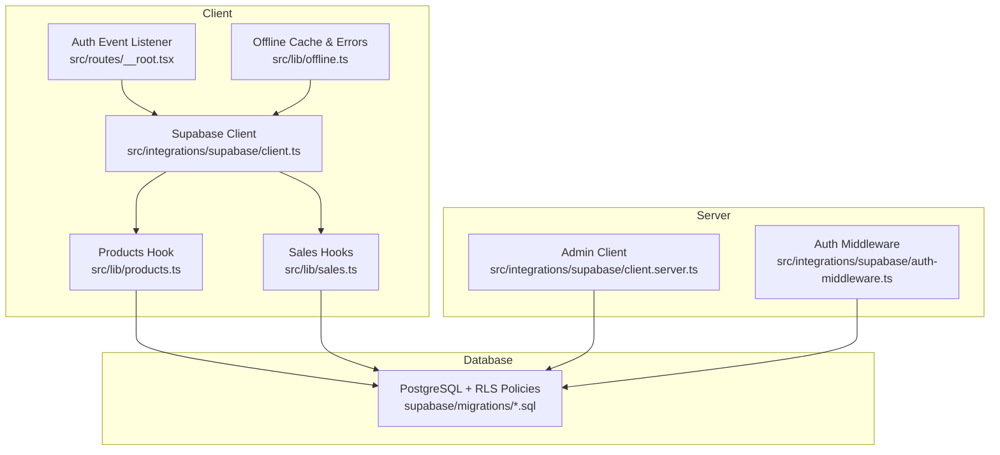
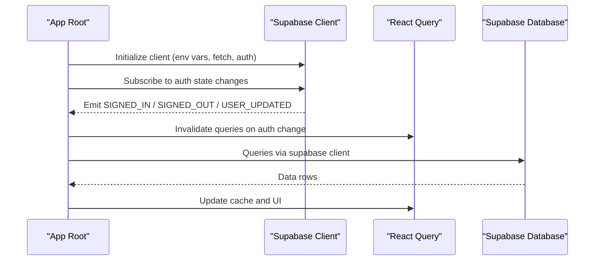
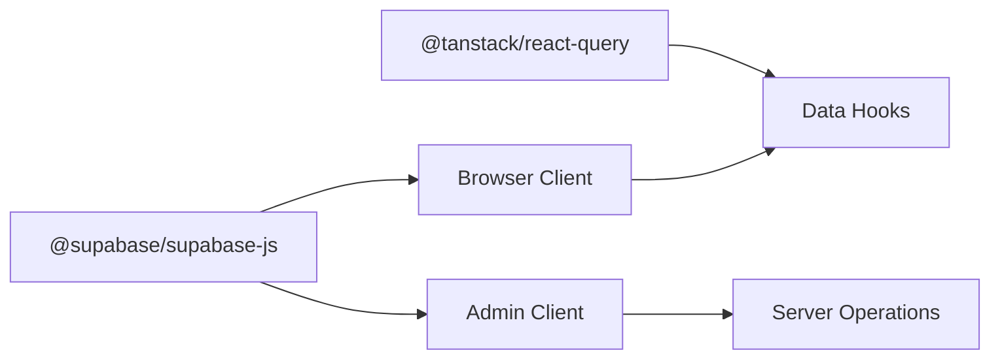

# Supabase Subscriptions Setup

<cite>
**Referenced Files in This Document**
- [client.ts](file://src/integrations/supabase/client.ts)
- [client.server.ts](file://src/integrations/supabase/client.server.ts)
- [auth-middleware.ts](file://src/integrations/supabase/auth-middleware.ts)
- [__root.tsx](file://src/routes/__root.tsx)
- [products.ts](file://src/lib/products.ts)
- [sales.ts](file://src/lib/sales.ts)
- [offline.ts](file://src/lib/offline.ts)
- [billing.ts](file://src/lib/billing.ts)
- [subscription-policy.ts](file://src/lib/subscription-policy.ts)
- [20261007084733_2ed95314-f75e-4843-977b-23f9e6359a48.sql](file://supabase/migrations/20261007084733_2ed95314-f75e-4843-977b-23f9e6359a48.sql)
- [package.json](file://package.json)
</cite>

## Table of Contents
1. [Introduction](#introduction)
2. [Project Structure](#project-structure)
3. [Core Components](#core-components)
4. [Architecture Overview](#architecture-overview)
5. [Detailed Component Analysis](#detailed-component-analysis)
6. [Dependency Analysis](#dependency-analysis)
7. [Performance Considerations](#performance-considerations)
8. [Troubleshooting Guide](#troubleshooting-guide)
9. [Conclusion](#conclusion)

## Introduction
This document explains how to set up and use Supabase real-time subscriptions in the Storq POS system. It covers:
- Initializing and configuring the Supabase client for browser and server contexts
- Environment setup and authentication integration
- Subscription lifecycle management, connection handling, and error recovery
- Practical examples for subscribing to products, sales, and business settings changes
- Best practices for managing multiple subscriptions efficiently and handling connection drops gracefully

The current codebase uses polling and cache invalidation patterns with React Query rather than explicit Supabase real-time channels. The guidance below shows how to extend the existing architecture to add real-time subscriptions safely and consistently.

## Project Structure
Key areas relevant to Supabase integration and data synchronization:
- Client initialization and environment configuration live under `src/integrations/supabase`
- Authentication events are handled at the application root
- Data hooks for products and sales live under `src/lib`
- Offline persistence and network error helpers live under `src/lib/offline.ts`
- Database schema and RLS policies are defined in migrations

**Diagram sources**
- [client.ts:57-84](file://src/integrations/supabase/client.ts#L57-L84)
- [client.server.ts:35-58](file://src/integrations/supabase/client.server.ts#L35-L58)
- [auth-middleware.ts:34-105](file://src/integrations/supabase/auth-middleware.ts#L34-L105)
- [__root.tsx:118-128](file://src/routes/__root.tsx#L118-L128)
- [products.ts:22-53](file://src/lib/products.ts#L22-L53)
- [sales.ts:37-73](file://src/lib/sales.ts#L37-L73)
- [offline.ts:15-55](file://src/lib/offline.ts#L15-L55)
- [20261007084733_2ed95314-f75e-4843-977b-23f9e6359a48.sql:102-130](file://supabase/migrations/20261007084733_2ed95314-f75e-4843-977b-23f9e6359a48.sql#L102-L130)

**Section sources**
- [client.ts:57-84](file://src/integrations/supabase/client.ts#L57-L84)
- [client.server.ts:35-58](file://src/integrations/supabase/client.server.ts#L35-L58)
- [auth-middleware.ts:34-105](file://src/integrations/supabase/auth-middleware.ts#L34-L105)
- [__root.tsx:118-128](file://src/routes/__root.tsx#L118-L128)
- [products.ts:22-53](file://src/lib/products.ts#L22-L53)
- [sales.ts:37-73](file://src/lib/sales.ts#L37-L73)
- [offline.ts:15-55](file://src/lib/offline.ts#L15-L55)
- [20261007084733_2ed95314-f75e-4843-977b-23f9e6359a48.sql:102-130](file://supabase/migrations/20261007084733_2ed95314-f75e-4843-977b-23f9e6359a48.sql#L102-L130)

## Core Components
- Supabase client (browser): Initializes the client with environment variables, custom fetch, auth storage, session persistence, and token refresh.
- Supabase admin client (server): Uses service role key to bypass RLS for trusted server operations.
- Auth middleware: Validates Bearer tokens on the server and attaches user context.
- Application root: Listens to auth state changes and invalidates React Query caches accordingly.
- Data hooks: Provide typed queries for products and sales using the shared client.
- Offline utilities: Persist reference data and queue offline actions; detect network errors.

**Section sources**
- [client.ts:57-84](file://src/integrations/supabase/client.ts#L57-L84)
- [client.server.ts:35-58](file://src/integrations/supabase/client.server.ts#L35-L58)
- [auth-middleware.ts:34-105](file://src/integrations/supabase/auth-middleware.ts#L34-L105)
- [__root.tsx:118-128](file://src/routes/__root.tsx#L118-L128)
- [products.ts:22-53](file://src/lib/products.ts#L22-L53)
- [sales.ts:37-73](file://src/lib/sales.ts#L37-L73)
- [offline.ts:15-55](file://src/lib/offline.ts#L15-L55)

## Architecture Overview
The app initializes a single Supabase client instance lazily via a proxy. Authentication is managed by Supabase JS SDK, and the root component reacts to auth events to invalidate cached data. Server-side operations use an admin client or authenticated middleware depending on the need.

**Diagram sources**
- [client.ts:57-84](file://src/integrations/supabase/client.ts#L57-L84)
- [__root.tsx:118-128](file://src/routes/__root.tsx#L118-L128)
- [products.ts:22-53](file://src/lib/products.ts#L22-L53)
- [sales.ts:37-73](file://src/lib/sales.ts#L37-L73)

## Detailed Component Analysis

### Supabase Client Initialization and Configuration
- Browser client:
  - Reads environment variables for URL and publishable key
  - Provides a custom fetch that sets apikey headers and handles new-style API keys
  - Configures auth storage, session persistence, and auto-refresh
  - Exposes a lazy-initialized singleton through a Proxy
- Server admin client:
  - Uses service role key and disables auth persistence
  - Intended for trusted server-only operations

Environment variables required:
- VITE_SUPABASE_URL and VITE_SUPABASE_PUBLISHABLE_KEY for the browser
- SUPABASE_URL and SUPABASE_SERVICE_ROLE_KEY for server admin client

Error handling:
- Throws if required environment variables are missing

**Section sources**
- [client.ts:6-84](file://src/integrations/supabase/client.ts#L6-L84)
- [client.server.ts:8-58](file://src/integrations/supabase/client.server.ts#L8-L58)

### Authentication Integration
- Root component subscribes to Supabase auth state changes
- On sign-in/sign-out/user update, it invalidates React Query caches
- On sign-out, it clears device cache and query cache

Best practice:
- Keep subscription cleanup in useEffect return to avoid memory leaks

**Section sources**
- [__root.tsx:118-128](file://src/routes/__root.tsx#L118-L128)

### Data Access Patterns (Products and Sales)
- Products hook:
  - Fetches product catalog and optionally buying costs based on role
  - Uses React Query caching with staleTime to reduce network calls
- Sales hooks:
  - Lists sales with optional joins and filters
  - Aggregates summaries via RPC
  - Paginates results and supports export

Current synchronization approach:
- Polling via refetchInterval where needed (e.g., stock in live mode)
- Explicit cache invalidation triggered by writes

**Section sources**
- [products.ts:22-53](file://src/lib/products.ts#L22-L53)
- [products.ts:82-106](file://src/lib/products.ts#L82-L106)
- [sales.ts:37-73](file://src/lib/sales.ts#L37-L73)
- [sales.ts:126-147](file://src/lib/sales.ts#L126-L147)
- [sales.ts:156-180](file://src/lib/sales.ts#L156-L180)

### Offline Persistence and Error Handling
- Hydrates React Query from localStorage on startup
- Persists selected query data to localStorage with debounced updates
- Tracks queued offline sales and provides network error detection

Integration point for real-time:
- Use these utilities to reconcile real-time updates with local cache and offline queues

**Section sources**
- [offline.ts:15-55](file://src/lib/offline.ts#L15-L55)
- [offline.ts:71-91](file://src/lib/offline.ts#L71-L91)

### Database Schema and Security
- Tables include store_stock, sales, sale_items, payments, stock_takes, stock_take_lines
- Row Level Security (RLS) policies restrict access by business_id and store ownership
- Grants define read/write permissions for authenticated and service_role users

Implications for real-time:
- Real-time channels respect RLS; ensure policies allow subscribers to receive changes they can read

**Section sources**
- [20261007084733_2ed95314-f75e-4843-977b-23f9e6359a48.sql:43-77](file://supabase/migrations/20261007084733_2ed95314-f75e-4843-977b-23f9e6359a48.sql#L43-L77)
- [20261007084733_2ed95314-f75e-4843-977b-23f9e6359a48.sql:102-130](file://supabase/migrations/20261007084733_2ed95314-f75e-4843-977b-23f9e6359a48.sql#L102-L130)

## Dependency Analysis
External dependencies relevant to Supabase and real-time capabilities:
- @supabase/supabase-js: Provides client, auth, and real-time features
- @tanstack/react-query: Manages caching, background refetching, and invalidation

**Diagram sources**
- [package.json:52-56](file://package.json#L52-L56)
- [client.ts:2-4](file://src/integrations/supabase/client.ts#L2-L4)
- [client.server.ts:5-6](file://src/integrations/supabase/client.server.ts#L5-L6)
- [products.ts:1-4](file://src/lib/products.ts#L1-L4)
- [sales.ts:1-3](file://src/lib/sales.ts#L1-L3)

**Section sources**
- [package.json:52-56](file://package.json#L52-L56)

## Performance Considerations
- Prefer React Query caching with appropriate staleTime to minimize network traffic
- Use refetchInterval sparingly; enable only where necessary (e.g., live stock counts)
- Avoid subscribing to high-volume tables without filtering by business/store scope
- Batch invalidations instead of frequent granular updates
- Debounce UI updates when receiving many real-time events
- Offload heavy computations to server functions/RPCs

[No sources needed since this section provides general guidance]

## Troubleshooting Guide
Common issues and resolutions:
- Missing environment variables:
  - Ensure VITE_SUPABASE_URL and VITE_SUPABASE_PUBLISHABLE_KEY are set for the browser
  - Ensure SUPABASE_URL and SUPABASE_SERVICE_ROLE_KEY are set for server admin client
- Unauthorized requests:
  - Verify auth header format and token validity in server middleware
  - Confirm RLS policies allow the subscriber’s role to read target tables
- Connection drops:
  - Leverage React Query retry and staleTime strategies
  - Use offline utilities to persist and retry queued operations
- Memory leaks:
  - Always unsubscribe from auth and real-time subscriptions in effect cleanup

Actionable checks:
- Validate environment variables and console errors during initialization
- Inspect auth state transitions and query invalidation behavior
- Review RLS policies for the tables you intend to subscribe to

**Section sources**
- [client.ts:64-72](file://src/integrations/supabase/client.ts#L64-L72)
- [client.server.ts:39-47](file://src/integrations/supabase/client.server.ts#L39-L47)
- [auth-middleware.ts:49-95](file://src/integrations/supabase/auth-middleware.ts#L49-L95)
- [offline.ts:83-91](file://src/lib/offline.ts#L83-L91)

## Conclusion
Storq POS currently relies on React Query caching, selective polling, and explicit invalidation for data synchronization. To adopt Supabase real-time subscriptions:
- Initialize the client as already implemented
- Add real-time channel subscriptions scoped by business/store
- Reconcile real-time events with React Query cache and offline persistence
- Implement robust error handling and reconnection strategies
- Follow RLS policies to ensure secure, efficient real-time updates

[No sources needed since this section summarizes without analyzing specific files]