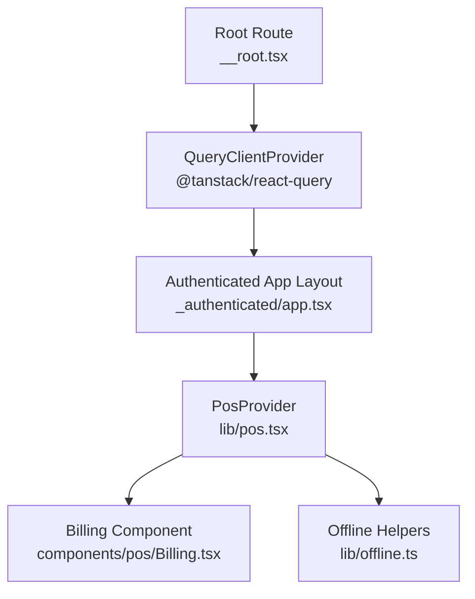
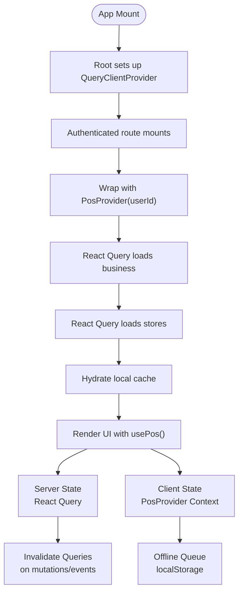
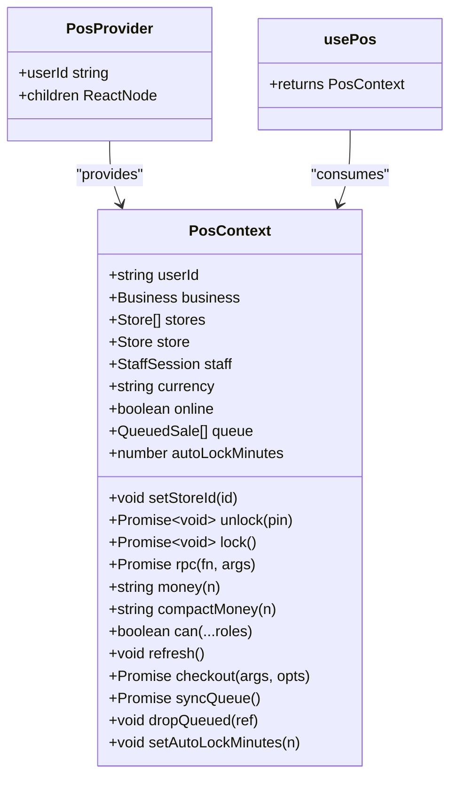
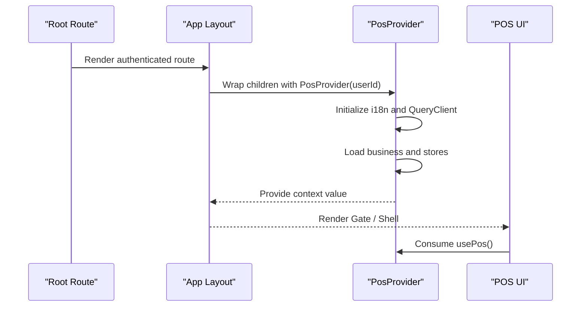
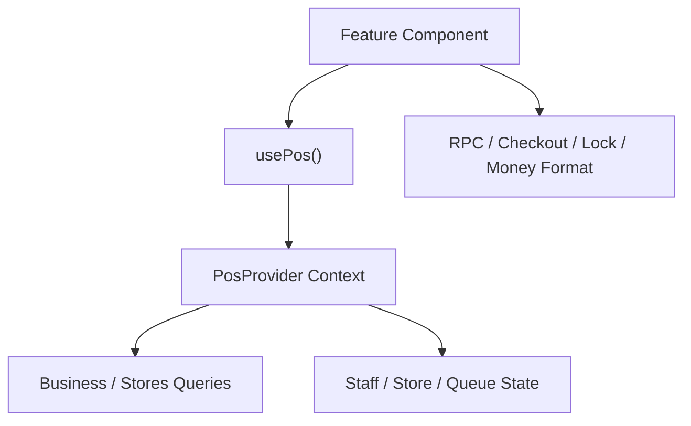
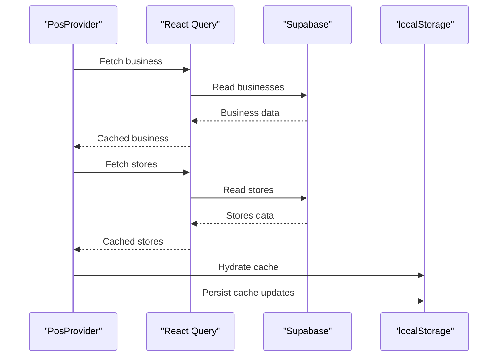
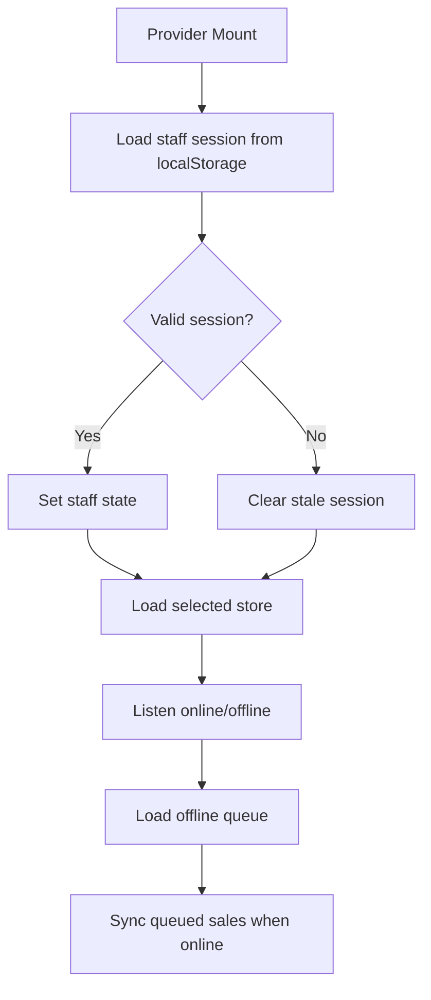
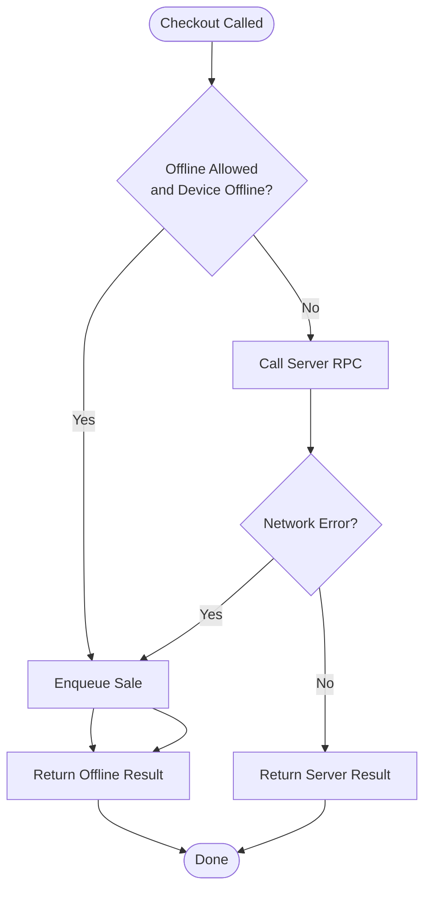
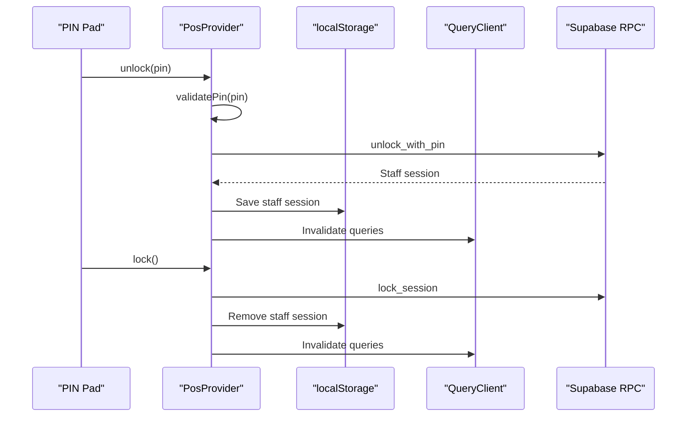
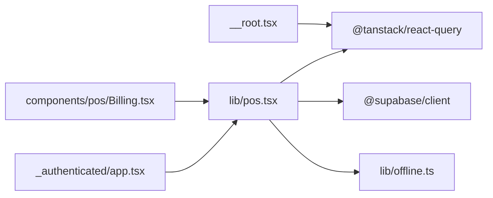

# Provider Pattern & Context Architecture

<cite>
**Referenced Files in This Document**
- [pos.tsx](file://src/lib/pos.tsx)
- [app.tsx](file://src/routes/_authenticated/app.tsx)
- [__root.tsx](file://src/routes/__root.tsx)
- [offline.ts](file://src/lib/offline.ts)
- [Billing.tsx](file://src/components/pos/Billing.tsx)
</cite>

## Table of Contents
1. [Introduction](#introduction)
2. [Project Structure](#project-structure)
3. [Core Components](#core-components)
4. [Architecture Overview](#architecture-overview)
5. [Detailed Component Analysis](#detailed-component-analysis)
6. [Dependency Analysis](#dependency-analysis)
7. [Performance Considerations](#performance-considerations)
8. [Troubleshooting Guide](#troubleshooting-guide)
9. [Conclusion](#conclusion)

## Introduction
This document explains the PosProvider pattern and React Context architecture used by Storq POS. It focuses on how `PosProvider` wraps authenticated application routes to provide centralized business context, staff session state, store selection, offline queue state, and shared utilities such as money formatting and RPC invocation. It also documents the separation between server state managed by React Query and client state managed by React Context, including when each approach is appropriate. Finally, it shows how components consume shared state through the `usePos` hook and provides best practices for provider composition and clean separation of concerns.

## Project Structure
The relevant parts of the codebase are organized around a small set of focused modules:

- Application root sets up React Query and global routing.
- The authenticated app layout wraps routes with `PosProvider`.
- `PosProvider` owns POS-specific client state and exposes a unified context.
- Offline helpers persist reference data and sales queues.
- Feature components consume context via `usePos`.

**Diagram sources**
- [__root.tsx:111-137](file://src/routes/__root.tsx#L111-L137)
- [app.tsx:84-93](file://src/routes/_authenticated/app.tsx#L84-L93)
- [pos.tsx:115-440](file://src/lib/pos.tsx#L115-L440)
- [offline.ts:15-55](file://src/lib/offline.ts#L15-L55)
- [Billing.tsx:54-58](file://src/components/pos/Billing.tsx#L54-L58)

**Section sources**
- [__root.tsx:59-137](file://src/routes/__root.tsx#L59-L137)
- [app.tsx:84-93](file://src/routes/_authenticated/app.tsx#L84-L93)
- [pos.tsx:115-440](file://src/lib/pos.tsx#L115-L440)

## Core Components
The core of the POS provider pattern lives in `src/lib/pos.tsx`. It defines:

- A strongly typed context value interface describing business, stores, staff, permissions, RPC, money formatting, checkout, offline status, queue management, and auto-lock configuration.
- A `usePos` hook that reads from the context and throws if called outside the provider.
- A `PosProvider` component that composes:
  - Business and store queries via React Query.
  - Staff session persistence and PIN-based unlock/lock flows.
  - Store selection persisted to local storage.
  - Online/offline detection and an offline sales queue.
  - Auto-lock based on idle time.
  - A bottom banner showing offline and queue status.

Key responsibilities include:

- Centralizing role-based access checks through `can(...)`.
- Providing a safe RPC wrapper that injects the staff token and masks raw database errors.
- Exposing `checkout`, which either calls the server or enqueues a sale locally when offline.
- Keeping UI state (store selection, staff lock state, offline queue) separate from server state (business, stores, catalog).

**Section sources**
- [pos.tsx:28-84](file://src/lib/pos.tsx#L28-L84)
- [pos.tsx:109-113](file://src/lib/pos.tsx#L109-L113)
- [pos.tsx:115-440](file://src/lib/pos.tsx#L115-L440)

## Architecture Overview
Storq POS uses two complementary state layers:

1. **Server state**: Managed by React Query. This includes business configuration, stores, products, collections, stock, subscription data, and other remote resources. React Query handles caching, background refetching, stale-time policies, and cache invalidation.
2. **Client state**: Managed by React Context inside `PosProvider`. This includes the current staff session, selected store, online/offline status, offline sales queue, auto-lock settings, and derived values like currency and money formatters.

**Diagram sources**
- [__root.tsx:111-137](file://src/routes/__root.tsx#L111-L137)
- [app.tsx:84-93](file://src/routes/_authenticated/app.tsx#L84-L93)
- [pos.tsx:149-175](file://src/lib/pos.tsx#L149-L175)
- [pos.tsx:242-247](file://src/lib/pos.tsx#L242-L247)
- [offline.ts:15-55](file://src/lib/offline.ts#L15-L55)

### When to Use Server State vs Client State
Use **server state** when:

- Data comes from the backend and should be cached, deduplicated, and invalidated across components.
- You need automatic background fetching, retries, and stale-time behavior.
- Multiple features read or mutate the same resource.

Use **client state** when:

- The value is device-local and short-lived, such as a PIN pad input, modal open/close, or temporary UI flags.
- The value must survive only within the current provider instance, such as the active staff session.
- You need immediate synchronous updates without network round-trips, such as selecting a store before rendering.

In Storq POS:

- Business, stores, products, collections, stock, and subscription data are server state.
- Staff session, selected store, online/offline status, offline queue, and auto-lock minutes are client state.

**Section sources**
- [pos.tsx:149-175](file://src/lib/pos.tsx#L149-L175)
- [pos.tsx:249-345](file://src/lib/pos.tsx#L249-L345)
- [offline.ts:15-55](file://src/lib/offline.ts#L15-L55)

## Detailed Component Analysis

### PosProvider and usePos
`PosProvider` is the central orchestrator for POS-specific state. It:

- Initializes i18n so offline banners re-localize when language changes.
- Loads business and stores using React Query with long stale times because these values change rarely.
- Derives the effective store based on staff role and user-selected store.
- Persists staff sessions and store selection to local storage.
- Provides secure RPC calls that attach the staff token and mask database errors.
- Manages offline sales through an in-memory queue backed by localStorage.
- Syncs queued sales automatically when online and locked.
- Enforces till hygiene by auto-locking after inactivity.

**Diagram sources**
- [pos.tsx:28-84](file://src/lib/pos.tsx#L28-L84)
- [pos.tsx:109-113](file://src/lib/pos.tsx#L109-L113)
- [pos.tsx:115-440](file://src/lib/pos.tsx#L115-L440)

#### Provider Composition
The authenticated app layout wraps its content with `PosProvider`:

**Diagram sources**
- [app.tsx:84-93](file://src/routes/_authenticated/app.tsx#L84-L93)
- [pos.tsx:115-175](file://src/lib/pos.tsx#L115-L175)

#### Context Consumption Patterns
Components consume shared state through `usePos`. Examples include:

- Billing page reading business, stores, permissions, and RPC.
- Dashboard and collection pages reading store, money formatting, and permissions.
- POS billing and quick-add components reading RPC and permission checks.

**Diagram sources**
- [Billing.tsx:54-58](file://src/components/pos/Billing.tsx#L54-L58)
- [pos.tsx:109-113](file://src/lib/pos.tsx#L109-L113)
- [pos.tsx:366-388](file://src/lib/pos.tsx#L366-L388)

**Section sources**
- [pos.tsx:109-113](file://src/lib/pos.tsx#L109-L113)
- [pos.tsx:115-440](file://src/lib/pos.tsx#L115-L440)
- [Billing.tsx:54-58](file://src/components/pos/Billing.tsx#L54-L58)

### Server State Management with React Query
React Query is configured at the root level and provided through `QueryClientProvider`. Within `PosProvider`, business and store data are fetched with long stale times because they are near-static during a trading session. Other features use React Query for subscription history, product catalogs, and sales summaries.

Key behaviors:

- Long stale times reduce unnecessary refetches for slow-changing data.
- Explicit invalidation occurs after mutations, sign-out, and successful offline sync.
- Offline hydration restores recent reference data instantly, then refreshes in the background.

**Diagram sources**
- [__root.tsx:111-137](file://src/routes/__root.tsx#L111-L137)
- [pos.tsx:149-175](file://src/lib/pos.tsx#L149-L175)
- [offline.ts:15-55](file://src/lib/offline.ts#L15-L55)

**Section sources**
- [__root.tsx:111-137](file://src/routes/__root.tsx#L111-L137)
- [pos.tsx:149-175](file://src/lib/pos.tsx#L149-L175)
- [offline.ts:15-55](file://src/lib/offline.ts#L15-L55)

### Client State Management in PosProvider
Client state covers everything that belongs to the current POS session on this device:

- Staff session loaded from local storage and validated by expiry.
- Selected store persisted to local storage.
- Auto-lock minutes persisted to local storage.
- Online/offline status derived from browser events.
- Offline sales queue persisted to local storage.
- Derived values such as currency, money formatter, and role checks.

**Diagram sources**
- [pos.tsx:125-147](file://src/lib/pos.tsx#L125-L147)
- [pos.tsx:249-345](file://src/lib/pos.tsx#L249-L345)

**Section sources**
- [pos.tsx:125-147](file://src/lib/pos.tsx#L125-L147)
- [pos.tsx:249-345](file://src/lib/pos.tsx#L249-L345)

### Offline Sales Queue
The offline queue ensures POS transactions remain available even when the network is down. The flow is:

1. If offline is allowed and the device is offline, enqueue the sale immediately.
2. If online, attempt the server checkout.
3. On network failure, fall back to enqueueing the sale.
4. Periodically retry queued sales while online and unlocked.
5. Invalidate sales-related queries after successful sync.

**Diagram sources**
- [pos.tsx:275-307](file://src/lib/pos.tsx#L275-L307)
- [offline.ts:83-91](file://src/lib/offline.ts#L83-L91)

**Section sources**
- [pos.tsx:275-307](file://src/lib/pos.tsx#L275-L307)
- [offline.ts:62-91](file://src/lib/offline.ts#L62-L91)

### Staff Session, Locking, and Permissions
The provider manages staff sessions securely:

- PIN validation prevents invalid unlocks.
- Successful unlock persists the staff token and invalidates queries.
- Locking clears local session and attempts to invalidate the server-side session.
- Role checks are exposed through `can(...roles)` for UI gating.
- Idle locking triggers the lock function after a configurable period.

**Diagram sources**
- [pos.tsx:194-215](file://src/lib/pos.tsx#L194-L215)
- [pos.tsx:347-364](file://src/lib/pos.tsx#L347-L364)

**Section sources**
- [pos.tsx:194-215](file://src/lib/pos.tsx#L194-L215)
- [pos.tsx:347-364](file://src/lib/pos.tsx#L347-L364)

### Money Formatting and Currency
Currency is derived from the business query and defaults to a fallback until business data loads. Money formatting is centralized to ensure consistent display across the POS.

- `money` formats amounts according to the configured currency.
- `compactMoney` provides chart-friendly labels without currency symbols.
- `currency` exposes the symbol or code for downstream usage.

**Section sources**
- [pos.tsx:230-240](file://src/lib/pos.tsx#L230-L240)

## Dependency Analysis
The following diagram shows how the main files depend on each other:

**Diagram sources**
- [__root.tsx:1-2](file://src/routes/__root.tsx#L1-L2)
- [app.tsx:22-30](file://src/routes/_authenticated/app.tsx#L22-L30)
- [Billing.tsx:1-9](file://src/components/pos/Billing.tsx#L1-L9)
- [pos.tsx:11-26](file://src/lib/pos.tsx#L11-L26)
- [offline.ts:1-3](file://src/lib/offline.ts#L1-L3)

### Coupling and Cohesion
- `PosProvider` has high cohesion around POS session and offline behavior.
- Components consume context rather than importing low-level storage or query logic directly.
- React Query remains responsible for server state, reducing coupling between UI and network logic.
- Offline helpers encapsulate persistence details, keeping `PosProvider` focused on orchestration.

**Section sources**
- [pos.tsx:115-440](file://src/lib/pos.tsx#L115-L440)
- [offline.ts:15-55](file://src/lib/offline.ts#L15-L55)

## Performance Considerations
- Long stale times for business and stores reduce refetch overhead.
- Instant-start hydration shows last-known catalog and stock immediately, then refreshes in the background.
- Debounced cache persistence avoids excessive writes to localStorage.
- Offline queue batching reduces repeated network attempts.
- Auto-lock pauses during queue sync to prevent accidental locking while syncing.

[No sources needed since this section provides general guidance]

## Troubleshooting Guide
Common issues and their likely causes:

- **Calling `usePos` outside the provider**: The hook throws if used before `PosProvider` wraps the component tree. Ensure the authenticated route wraps content with `PosProvider`.
- **Raw database errors appearing in the UI**: Errors are masked to hide SQL internals; generic messages indicate policy violations, constraint failures, or malformed requests.
- **Offline sales not syncing**: Verify the device is online, the staff session is unlocked, and the queue contains pending items. Failed items show retry and discard options.
- **Store selection not persisting**: Store selection is saved to local storage; corrupted storage may reset to default behavior.
- **Subscription or billing queries failing**: Subscription data depends on business context; ensure business data loads successfully before accessing related features.

**Section sources**
- [pos.tsx:109-113](file://src/lib/pos.tsx#L109-L113)
- [pos.tsx:93-104](file://src/lib/pos.tsx#L93-L104)
- [pos.tsx:389-433](file://src/lib/pos.tsx#L389-L433)
- [offline.ts:71-81](file://src/lib/offline.ts#L71-L81)

## Conclusion
Storq POS uses a clear separation between server state and client state. React Query manages remote data with caching and invalidation, while `PosProvider` manages POS-specific client state, including staff sessions, store selection, offline queue, and permissions. Components consume shared state through `usePos`, keeping UI logic simple and focused. This architecture supports reliable offline-first POS workflows, secure staff sessions, and maintainable feature boundaries.

[No sources needed since this section summarizes without analyzing specific files]