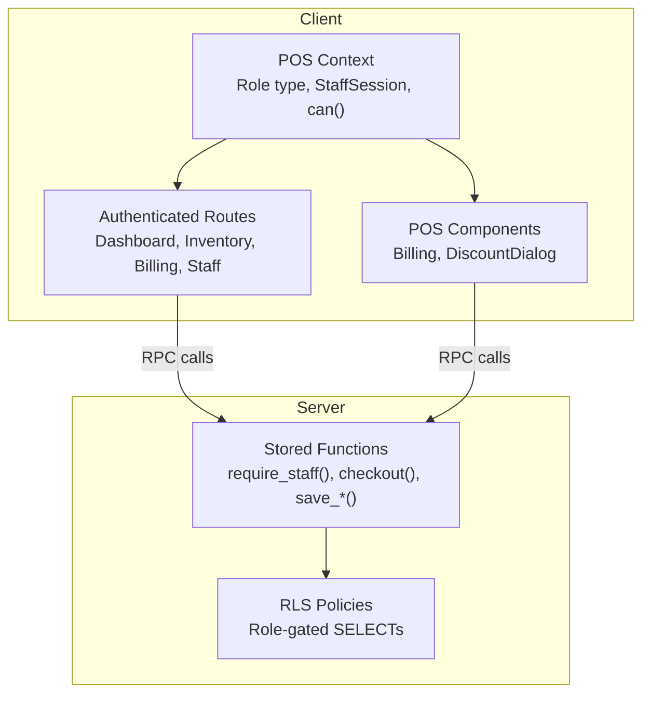
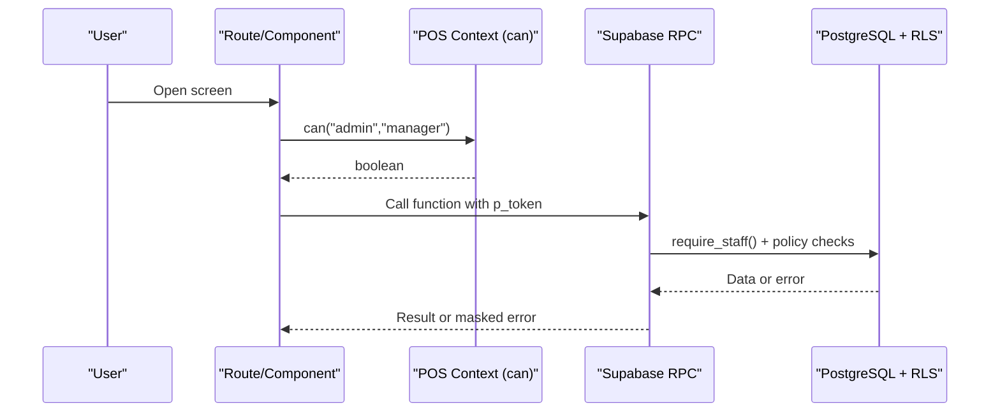
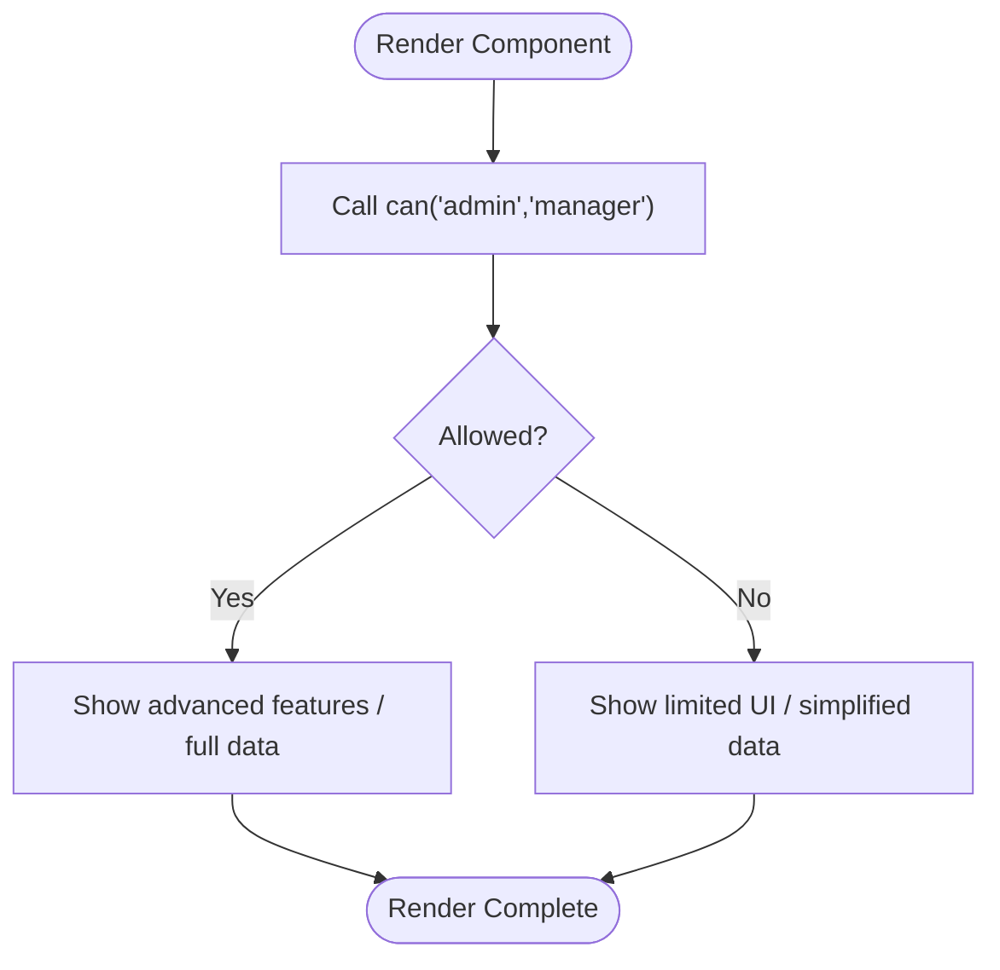
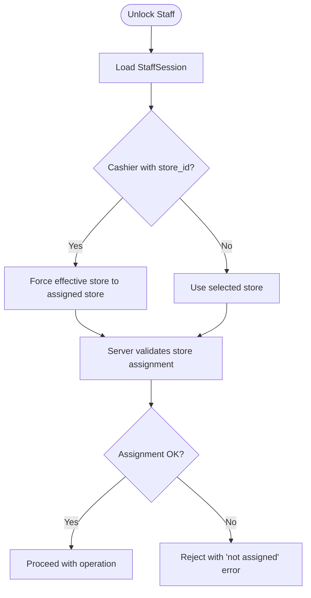
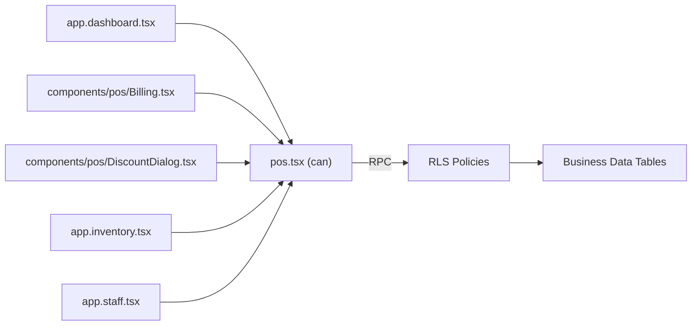

# Role-Based Access Control

<cite>
**Referenced Files in This Document**
- [pos.tsx](file://src/lib/pos.tsx)
- [auth-middleware.ts](file://src/integrations/supabase/auth-middleware.ts)
- [app.staff.tsx](file://src/routes/_authenticated/app.staff.tsx)
- [app.dashboard.tsx](file://src/routes/_authenticated/app.dashboard.tsx)
- [Billing.tsx](file://src/components/pos/Billing.tsx)
- [DiscountDialog.tsx](file://src/components/pos/DiscountDialog.tsx)
- [inventory.tsx](file://src/routes/_authenticated/app.inventory.tsx)
- [security_hardening.sql](file://supabase/migrations/20261008090000_security_hardening.sql)
</cite>

## Table of Contents
1. [Introduction](#introduction)
2. [Project Structure](#project-structure)
3. [Core Components](#core-components)
4. [Architecture Overview](#architecture-overview)
5. [Detailed Component Analysis](#detailed-component-analysis)
6. [Dependency Analysis](#dependency-analysis)
7. [Performance Considerations](#performance-considerations)
8. [Troubleshooting Guide](#troubleshooting-guide)
9. [Conclusion](#conclusion)

## Introduction
This document explains the role-based access control system used by Storq POS. It covers how roles are defined, how permissions are checked on the client with the `can()` helper, and how server-side policies enforce data access. It also documents the relationship between staff roles and store assignments, including cashier restrictions to specific stores, and provides examples of permission checks and conditional rendering across components. Finally, it highlights security implications and best practices for maintaining secure role-based behavior.

## Project Structure
The RBAC implementation spans three layers:
- Client context and helpers: role types, session state, and the `can()` method live in the POS context provider.
- Route and component usage: screens and dialogs use `can()` to gate UI features and data queries.
- Server enforcement: Supabase RLS policies and stored functions validate roles and restrict data access.



**Diagram sources**
- [pos.tsx:37-84](file://src/lib/pos.tsx#L37-L84)
- [security_hardening.sql:67-77](file://supabase/migrations/20261008090000_security_hardening.sql#L67-L77)
- [security_hardening.sql:142-168](file://supabase/migrations/20261008090000_security_hardening.sql#L142-L168)

**Section sources**
- [pos.tsx:37-84](file://src/lib/pos.tsx#L37-L84)
- [security_hardening.sql:67-77](file://supabase/migrations/20261008090000_security_hardening.sql#L67-L77)

## Core Components
- Role definitions: The application defines a strict union type for roles: admin, manager, and cashier.
- Staff session: A short-lived session object carries the staff token, identity, role, and optional store assignment.
- Permission helper: `can(...roles)` returns true only when the current staff session’s role is included in the requested roles.
- Store scoping: For cashiers, the effective store is forced to their assigned store when present; otherwise, the selected store applies.

Key responsibilities:
- Define roles and session shape.
- Provide `can()` for UI gating.
- Resolve effective store based on role and assignment.
- Mask RPC errors to avoid leaking internal details.

**Section sources**
- [pos.tsx:37-45](file://src/lib/pos.tsx#L37-L45)
- [pos.tsx:70-84](file://src/lib/pos.tsx#L70-L84)
- [pos.tsx:178-179](file://src/lib/pos.tsx#L178-L179)
- [pos.tsx:386](file://src/lib/pos.tsx#L386)

## Architecture Overview
RBAC is enforced at two levels:
- Frontend gating: Components call `can()` to show or hide features and adjust data fetching.
- Backend enforcement: Row-level security policies and stored functions require valid PIN sessions and check roles before allowing reads/writes.



**Diagram sources**
- [pos.tsx:386](file://src/lib/pos.tsx#L386)
- [security_hardening.sql:258-270](file://supabase/migrations/20261008090000_security_hardening.sql#L258-L270)
- [security_hardening.sql:142-168](file://supabase/migrations/20261008090000_security_hardening.sql#L142-L168)

## Detailed Component Analysis

### Role Types and Session Model
- Role type: Strictly limited to admin, manager, cashier.
- Staff session: Includes token, id, name, role, store_id, and expiry.
- Effective store resolution: Cashier with an assigned store is restricted to that store; otherwise, the user-selected store applies.

```mermaid
classDiagram
class Role {
<<union>>
"admin"
"manager"
"cashier"
}
class StaffSession {
+string token
+string id
+string name
+Role role
+string store_id
+string expires_at
}
class PosContext {
+StaffSession staff
+Store store
+boolean can(...roles)
+void setStoreId(id)
}
PosContext --> StaffSession : "uses"
StaffSession --> Role : "has"
```

**Diagram sources**
- [pos.tsx:37-45](file://src/lib/pos.tsx#L37-L45)
- [pos.tsx:55-84](file://src/lib/pos.tsx#L55-L84)
- [pos.tsx:178-179](file://src/lib/pos.tsx#L178-L179)

**Section sources**
- [pos.tsx:37-45](file://src/lib/pos.tsx#L37-L45)
- [pos.tsx:55-84](file://src/lib/pos.tsx#L55-L84)
- [pos.tsx:178-179](file://src/lib/pos.tsx#L178-L179)

### Permission Checking with can()
- The `can()` helper checks whether the current staff role matches any of the requested roles.
- It is used throughout routes and components to conditionally render UI and adjust data loading.

Examples in the codebase:
- Staff management page: Only admins can access.
- Dashboard: Profit metrics and inventory navigation differ for non-admin/manager users.
- Billing: Payment actions are gated to admin/manager.
- Discount dialog: Cashier-specific caps and messaging apply.
- Inventory: Non-admin/manager users see a no-access message.



**Diagram sources**
- [pos.tsx:386](file://src/lib/pos.tsx#L386)
- [app.staff.tsx:72-75](file://src/routes/_authenticated/app.staff.tsx#L72-L75)
- [app.dashboard.tsx:70-71](file://src/routes/_authenticated/app.dashboard.tsx#L70-L71)
- [Billing.tsx:166](file://src/components/pos/Billing.tsx#L166)
- [DiscountDialog.tsx:42](file://src/components/pos/DiscountDialog.tsx#L42)
- [inventory.tsx:309-312](file://src/routes/_authenticated/app.inventory.tsx#L309-L312)

**Section sources**
- [pos.tsx:386](file://src/lib/pos.tsx#L386)
- [app.staff.tsx:72-75](file://src/routes/_authenticated/app.staff.tsx#L72-L75)
- [app.dashboard.tsx:70-71](file://src/routes/_authenticated/app.dashboard.tsx#L70-L71)
- [Billing.tsx:166](file://src/components/pos/Billing.tsx#L166)
- [DiscountDialog.tsx:42](file://src/components/pos/DiscountDialog.tsx#L42)
- [inventory.tsx:309-312](file://src/routes/_authenticated/app.inventory.tsx#L309-L312)

### Role Inheritance Patterns
- There is no explicit inheritance hierarchy among roles. Instead, permissions are expressed as role sets per feature.
- Common patterns:
  - Admin-only: Staff management.
  - Admin/Manager: Billing payments, inventory editing, cost visibility, refunds, stock movements.
  - Admin/Manager/Cashier: Basic sales, expenses, stock counts.

This pattern avoids rigid inheritance while keeping intent clear through role arrays passed to `can()` and to server-side validators.

**Section sources**
- [app.staff.tsx:72-75](file://src/routes/_authenticated/app.staff.tsx#L72-L75)
- [app.dashboard.tsx:70-71](file://src/routes/_authenticated/app.dashboard.tsx#L70-L71)
- [security_hardening.sql:142-168](file://supabase/migrations/20261008090000_security_hardening.sql#L142-L168)

### Store Assignments and Cashier Restrictions
- Cashiers may be assigned to a specific store via `store_id`.
- When a cashier has an assigned store, the effective store is forced to that store, preventing them from operating under another store.
- Server-side validation enforces this restriction on write operations such as checkout and expense recording.



**Diagram sources**
- [pos.tsx:178-179](file://src/lib/pos.tsx#L178-L179)
- [security_hardening.sql:447-449](file://supabase/migrations/20261008090000_security_hardening.sql#L447-L449)
- [security_hardening.sql:644-660](file://supabase/migrations/20261008090000_security_hardening.sql#L644-L660)

**Section sources**
- [pos.tsx:178-179](file://src/lib/pos.tsx#L178-L179)
- [security_hardening.sql:447-449](file://supabase/migrations/20261008090000_security_hardening.sql#L447-L449)
- [security_hardening.sql:644-660](file://supabase/migrations/20261008090000_security_hardening.sql#L644-L660)

### Security Implications and Best Practices
- Never rely solely on frontend gating: Always enforce permissions server-side using RLS policies and stored functions.
- Keep role checks consistent: Use `can()` for UI and matching role arrays in server-side validators.
- Protect sensitive data: Cost and margin data are isolated behind manager/admin policies.
- Enforce store scoping: Ensure cashier store assignments are validated on both client and server.
- Avoid exposing internals: Mask RPC errors to prevent leaking database schema or policy text.

**Section sources**
- [pos.tsx:88-104](file://src/lib/pos.tsx#L88-L104)
- [security_hardening.sql:142-168](file://supabase/migrations/20261008090000_security_hardening.sql#L142-L168)

## Dependency Analysis
The following diagram shows how client components depend on the POS context and how server-side policies constrain data access.



**Diagram sources**
- [app.dashboard.tsx:70-71](file://src/routes/_authenticated/app.dashboard.tsx#L70-L71)
- [Billing.tsx:166](file://src/components/pos/Billing.tsx#L166)
- [DiscountDialog.tsx:42](file://src/components/pos/DiscountDialog.tsx#L42)
- [inventory.tsx:309-312](file://src/routes/_authenticated/app.inventory.tsx#L309-L312)
- [app.staff.tsx:72-75](file://src/routes/_authenticated/app.staff.tsx#L72-L75)
- [security_hardening.sql:142-168](file://supabase/migrations/20261008090000_security_hardening.sql#L142-L168)

**Section sources**
- [app.dashboard.tsx:70-71](file://src/routes/_authenticated/app.dashboard.tsx#L70-L71)
- [Billing.tsx:166](file://src/components/pos/Billing.tsx#L166)
- [DiscountDialog.tsx:42](file://src/components/pos/DiscountDialog.tsx#L42)
- [inventory.tsx:309-312](file://src/routes/_authenticated/app.inventory.tsx#L309-L312)
- [app.staff.tsx:72-75](file://src/routes/_authenticated/app.staff.tsx#L72-L75)
- [security_hardening.sql:142-168](file://supabase/migrations/20261008090000_security_hardening.sql#L142-L168)

## Performance Considerations
- Conditional data loading: Dashboards skip expensive joins (e.g., sale item costs) for cashiers to reduce query size.
- Cached static data: Business and store metadata are cached for long periods since they change infrequently.
- Offline queueing: Sales are queued locally when offline and synced later, reducing network overhead during connectivity issues.

[No sources needed since this section provides general guidance]

## Troubleshooting Guide
Common issues and resolutions:
- “Only admins” messages: Indicates the current role lacks required permissions; verify the staff role and ensure the correct PIN session is active.
- “Not assigned to this store”: Occurs when a cashier attempts to operate outside their assigned store; confirm the cashier’s store assignment and effective store selection.
- Generic or masked errors: RPC errors are intentionally masked to avoid leaking internals; inspect server logs and policies if access is unexpectedly denied.

**Section sources**
- [app.staff.tsx:72-75](file://src/routes/_authenticated/app.staff.tsx#L72-L75)
- [security_hardening.sql:447-449](file://supabase/migrations/20261008090000_security_hardening.sql#L447-L449)
- [pos.tsx:88-104](file://src/lib/pos.tsx#L88-L104)

## Conclusion
Storq POS implements a robust role-based access control model combining client-side gating with strong server-side enforcement. Roles are strictly typed, permissions are checked consistently via `can()`, and critical data access is protected by RLS policies and stored functions. Store scoping ensures cashiers operate within their assigned locations. Following the documented patterns and best practices will help maintain secure, predictable behavior across the application.

[No sources needed since this section summarizes without analyzing specific files]