# Staff Session Management

<cite>
**Referenced Files in This Document**
- [pos.tsx](file://src/lib/pos.tsx)
- [use-idle-lock.ts](file://src/components/pos/use-idle-lock.ts)
- [validate.ts](file://src/lib/validate.ts)
- [previewAuthStorage.ts](file://src/integrations/supabase/previewAuthStorage.ts)
- [security_hardening.sql](file://supabase/migrations/20261008090000_security_hardening.sql)
</cite>

## Update Summary
**Changes Made**
- Added comprehensive documentation for enhanced authentication storage resilience with robust error handling for third-party storage blocking
- Documented the logout tombstone mechanism for multi-tab synchronization
- Updated preview storage broker fallback mechanisms documentation
- Enhanced troubleshooting section with storage-related issues and resolutions

## Table of Contents
1. [Introduction](#introduction)
2. [Project Structure](#project-structure)
3. [Core Components](#core-components)
4. [Architecture Overview](#architecture-overview)
5. [Detailed Component Analysis](#detailed-component-analysis)
6. [Authentication Storage Resilience](#authentication-storage-resilience)
7. [Multi-Tab Synchronization](#multi-tab-synchronization)
8. [Dependency Analysis](#dependency-analysis)
9. [Performance Considerations](#performance-considerations)
10. [Troubleshooting Guide](#troubleshooting-guide)
11. [Conclusion](#conclusion)

## Introduction
This document explains the staff session management layer used by the point-of-sale workspace. It covers PIN-based authentication, token-based authorization, session persistence in `localStorage`, automatic locking after inactivity, and server-side session lifecycle enforcement. The system now includes enhanced storage resilience with robust error handling for third-party storage blocking, a logout tombstone mechanism for multi-tab synchronization, and improved preview storage broker fallback mechanisms. The goal is to help developers understand how a staff member unlocks the POS, how sessions are stored and expired, and how idle activity triggers an automatic lock for security.

## Project Structure
The staff session feature spans several main areas:
- React context and provider that manage session state, persistence, and auto-lock behavior.
- A small hook that watches user interaction and fires an idle callback.
- Enhanced authentication storage with resilient error handling and multi-tab synchronization.
- Server-side SQL functions that validate PINs, issue tokens, enforce expiration, and revoke sessions.

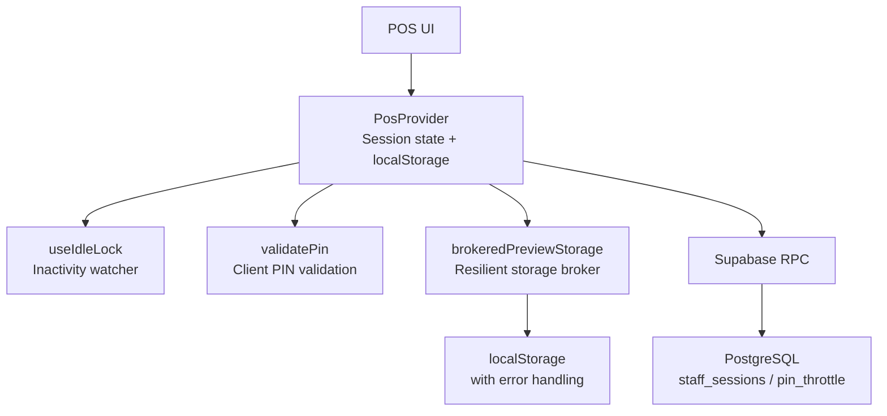

**Diagram sources**
- [pos.tsx:115-228](file://src/lib/pos.tsx#L115-L228)
- [use-idle-lock.ts:9-39](file://src/components/pos/use-idle-lock.ts#L9-L39)
- [previewAuthStorage.ts:1-106](file://src/integrations/supabase/previewAuthStorage.ts#L1-L106)
- [security_hardening.sql:239-291](file://supabase/migrations/20261008090000_security_hardening.sql#L239-L291)

**Section sources**
- [pos.tsx:115-228](file://src/lib/pos.tsx#L115-L228)
- [use-idle-lock.ts:9-39](file://src/components/pos/use-idle-lock.ts#L9-L39)
- [previewAuthStorage.ts:1-106](file://src/integrations/supabase/previewAuthStorage.ts#L1-L106)
- [security_hardening.sql:239-291](file://supabase/migrations/20261008090000_security_hardening.sql#L239-L291)

## Core Components
- `StaffSession`: the client-side representation of an authenticated staff session.
- `PosProvider`: manages session creation, persistence, unlocking, locking, and auto-lock configuration.
- `useIdleLock`: observes pointer and keyboard activity and triggers an idle callback.
- `brokeredPreviewStorage`: enhanced storage broker with resilient error handling and multi-tab synchronization.
- Server functions: `unlock_with_pin`, `lock_session`, and role/session checks enforced through RLS and helper functions.

Key responsibilities:
- Validate PIN locally before calling the server.
- Store and restore sessions from `localStorage` with robust error handling.
- Invalidate cached data when the session changes or expires.
- Automatically lock the workspace after inactivity.
- Handle storage failures gracefully without breaking the application.

**Section sources**
- [pos.tsx:38-45](file://src/lib/pos.tsx#L38-L45)
- [pos.tsx:115-228](file://src/lib/pos.tsx#L115-L228)
- [use-idle-lock.ts:9-39](file://src/components/pos/use-idle-lock.ts#L9-L39)
- [previewAuthStorage.ts:1-106](file://src/integrations/supabase/previewAuthStorage.ts#L1-L106)
- [security_hardening.sql:239-291](file://supabase/migrations/20261008090000_security_hardening.sql#L239-L291)

## Architecture Overview
The session flow combines client-side state with server-side enforcement and resilient storage:

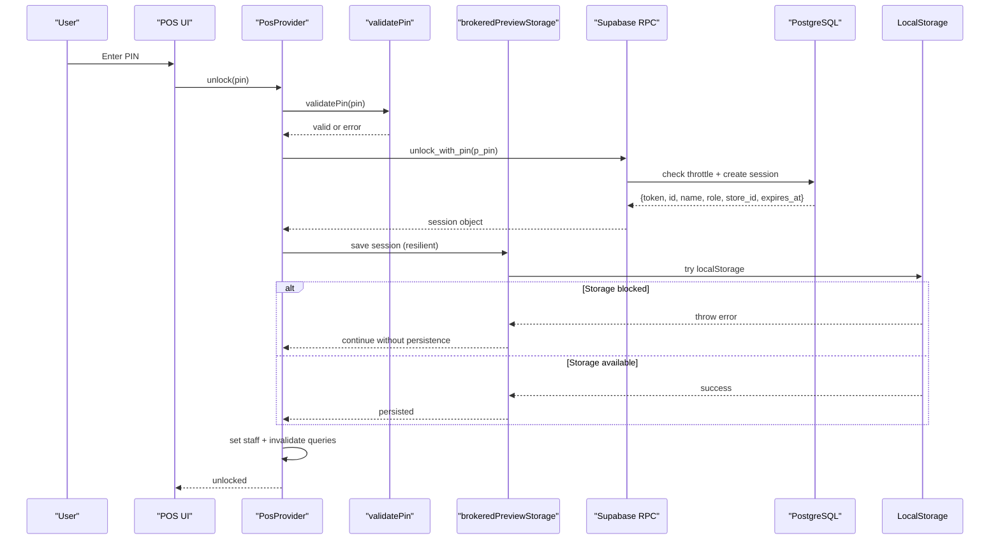

**Diagram sources**
- [pos.tsx:194-203](file://src/lib/pos.tsx#L194-L203)
- [previewAuthStorage.ts:62-89](file://src/integrations/supabase/previewAuthStorage.ts#L62-L89)
- [security_hardening.sql:239-256](file://supabase/migrations/20261008090000_security_hardening.sql#L239-L256)

## Detailed Component Analysis

### StaffSession Type
`StaffSession` represents the active staff identity and authorization token on the client.

| Field | Meaning | Notes |
|---|---|---|
| `token` | Short-lived session token sent with RPC calls | Used by server functions to identify and validate the session |
| `id` | Staff identifier | Maps to the staff record |
| `name` | Display name | Used in UI and audit contexts |
| `role` | Role string | One of admin, manager, cashier; controls permissions |
| `store_id` | Optional store restriction | Cashiers may be bound to a specific store |
| `expires_at` | Expiration timestamp | Client rejects stale sessions; server also enforces expiry |

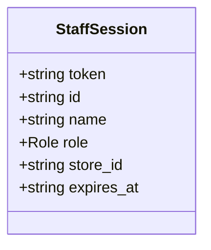

**Diagram sources**
- [pos.tsx:38-45](file://src/lib/pos.tsx#L38-L45)

**Section sources**
- [pos.tsx:38-45](file://src/lib/pos.tsx#L38-L45)

### Session Lifecycle in PosProvider
`PosProvider` owns the session lifecycle:
- On mount, it reads `localStorage` for the last known staff session, store selection, and auto-lock setting.
- It only restores sessions that have a token and a future expiration time.
- It clears previous staff data and invalidates cached queries when locking or expiring.
- It exposes `unlock`, `lock`, and `rpc` for secure operations.

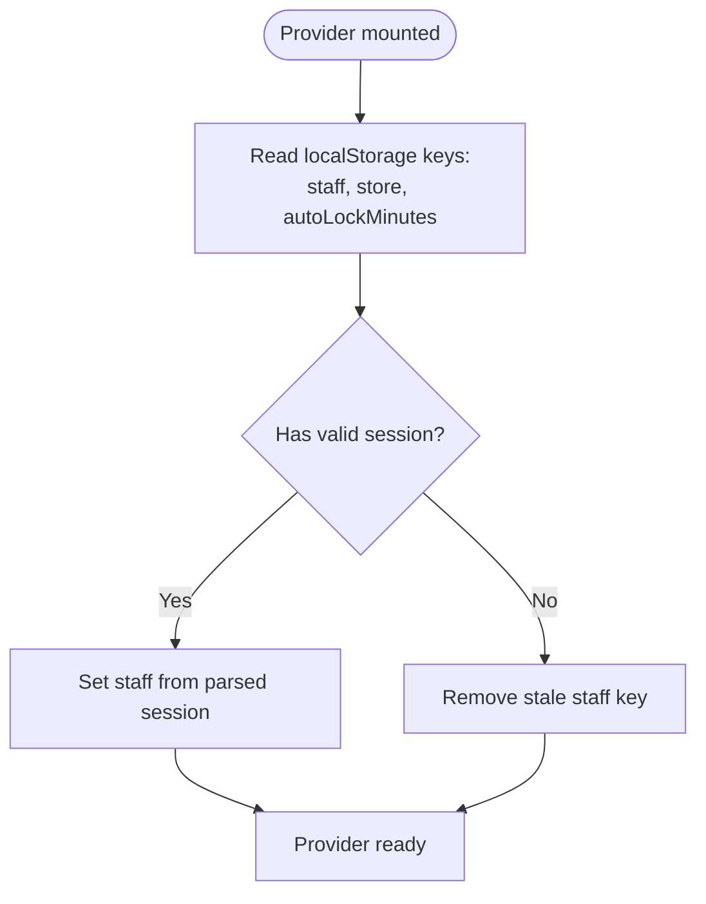

**Diagram sources**
- [pos.tsx:125-147](file://src/lib/pos.tsx#L125-L147)

**Section sources**
- [pos.tsx:115-192](file://src/lib/pos.tsx#L115-L192)

### PIN Authentication Flow
PIN authentication has two layers:
1. Client-side validation using `validatePin`.
2. Server-side validation via `unlock_with_pin`, which enforces throttling and creates a bounded session.

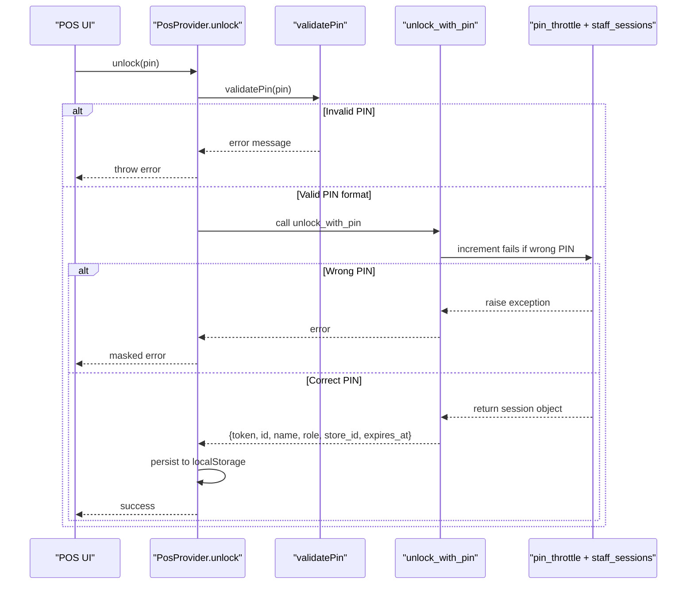

**Diagram sources**
- [pos.tsx:194-203](file://src/lib/pos.tsx#L194-L203)
- [security_hardening.sql:239-256](file://supabase/migrations/20261008090000_security_hardening.sql#L239-L256)

**Section sources**
- [pos.tsx:194-203](file://src/lib/pos.tsx#L194-L203)
- [security_hardening.sql:239-256](file://supabase/migrations/20261008090000_security_hardening.sql#L239-L256)

### Unlock Method
The `unlock` method performs:
- Local PIN validation.
- RPC call to `unlock_with_pin`.
- Error masking to avoid leaking internal database details.
- Persistence of the returned session into `localStorage`.
- State update and query cache invalidation.

Security considerations:
- Invalid PINs do not create a session.
- Errors are sanitized before reaching the UI.
- Throttling is handled server-side.

**Section sources**
- [pos.tsx:194-203](file://src/lib/pos.tsx#L194-L203)
- [pos.tsx:93-104](file://src/lib/pos.tsx#L93-L104)

### Lock Method
The `lock` method:
- Calls `lock_session` with the current token when available.
- Clears local staff state regardless of whether the RPC succeeds.
- Invalidates cached queries so previous user data cannot leak to the next user.

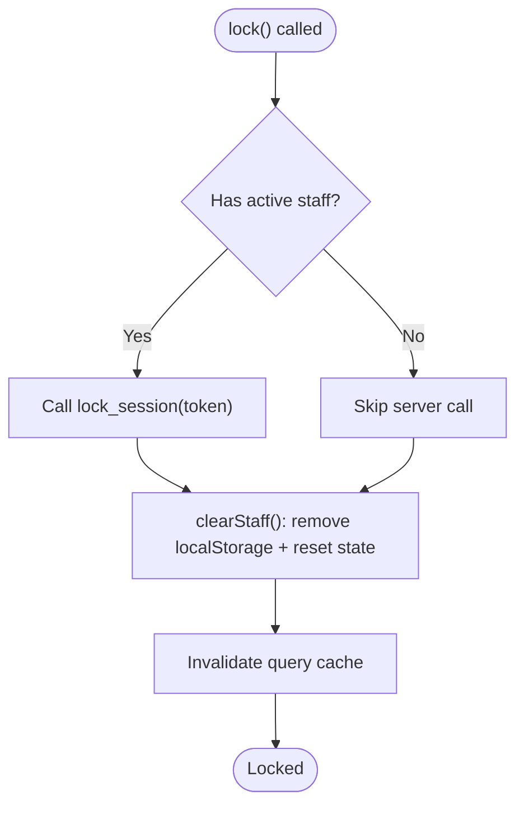

**Diagram sources**
- [pos.tsx:205-215](file://src/lib/pos.tsx#L205-L215)
- [security_hardening.sql:272-280](file://supabase/migrations/20261008090000_security_hardening.sql#L272-L280)

**Section sources**
- [pos.tsx:205-215](file://src/lib/pos.tsx#L205-L215)
- [security_hardening.sql:272-280](file://supabase/migrations/20261008090000_security_hardening.sql#L272-L280)

### Token-Based Authorization
After unlocking, every RPC call includes the staff token. The server validates:
- Token existence and expiry.
- Binding to the device login (`auth_uid`).
- Staff status and business scope.
- Required roles.

If any check fails, the server throws an error containing "Locked", which the client treats as a signal to clear the local session.

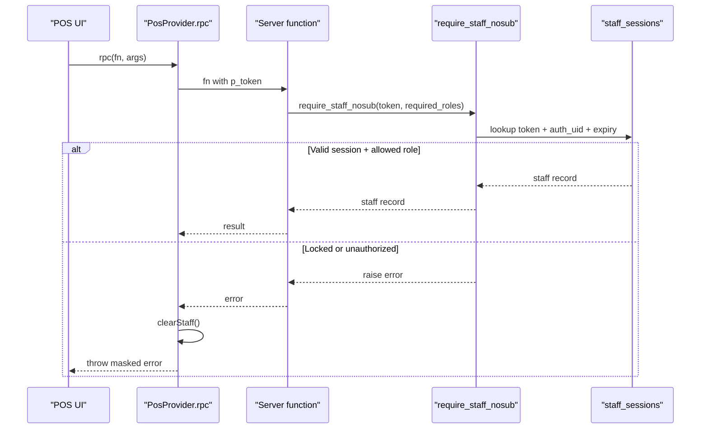

**Diagram sources**
- [pos.tsx:220-228](file://src/lib/pos.tsx#L220-L228)
- [security_hardening.sql:258-270](file://supabase/migrations/20261008090000_security_hardening.sql#L258-L270)

**Section sources**
- [pos.tsx:220-228](file://src/lib/pos.tsx#L220-L228)
- [security_hardening.sql:258-270](file://supabase/migrations/20261008090000_security_hardening.sql#L258-L270)

### Session Persistence Using localStorage
The provider persists:
- `pos-staff-{userId}`: JSON-encoded `StaffSession`.
- `pos-store-{userId}`: selected store ID.
- `pos-autolock-{userId}`: auto-lock timeout in minutes.

On startup:
- If the stored session lacks a token or has expired, it is removed.
- Store and auto-lock settings are restored if present.
- Storage errors are ignored to keep the app usable even when storage is unavailable.

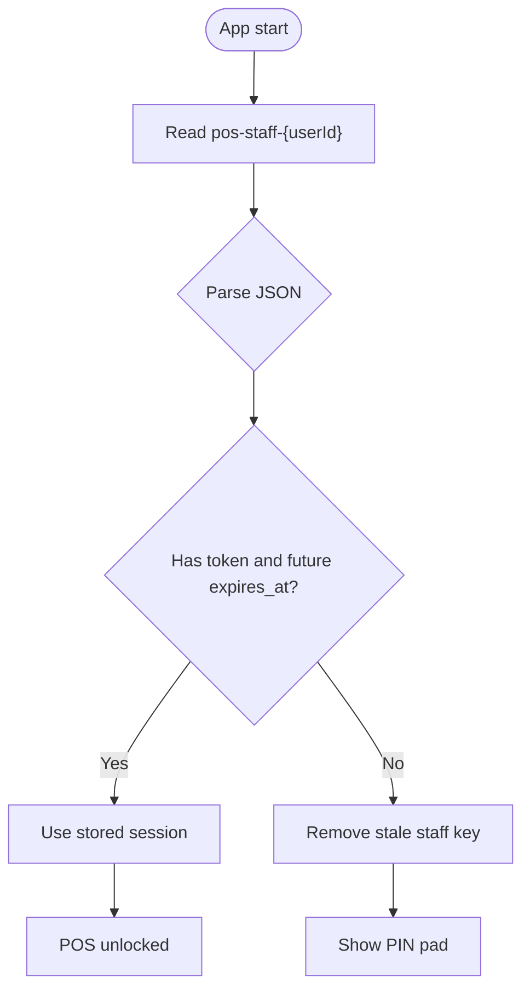

**Diagram sources**
- [pos.tsx:125-147](file://src/lib/pos.tsx#L125-L147)

**Section sources**
- [pos.tsx:118-147](file://src/lib/pos.tsx#L118-L147)

### Auto-Lock and Idle Lock Mechanism
Auto-lock is configurable per device and applies only while a staff session is active.

Configuration options:
- `enabled`: auto-lock is active when a staff session exists.
- `minutes`: idle threshold in minutes; clamped between 0 and 240.
- `paused`: prevents auto-lock during offline queue sync to avoid interrupting background work.

Behavior:
- The hook listens to keyboard, mouse, and touch events.
- Any interaction resets the timer.
- After inactivity, it invokes the current `lock` function.
- The effect cleans up timers and event listeners on unmount.

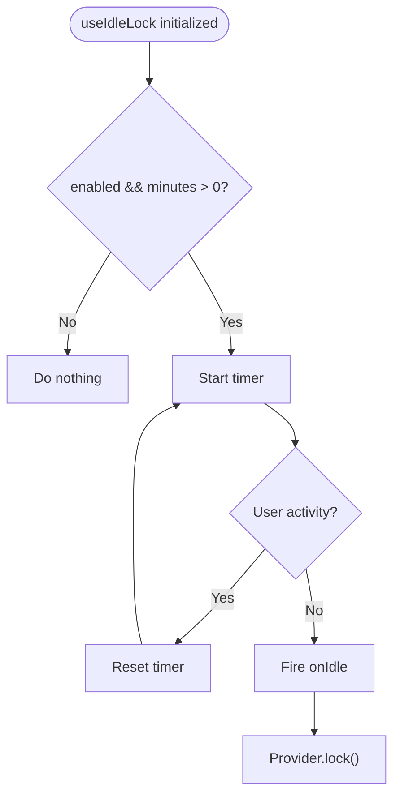

**Diagram sources**
- [use-idle-lock.ts:9-39](file://src/components/pos/use-idle-lock.ts#L9-L39)
- [pos.tsx:347-364](file://src/lib/pos.tsx#L347-L364)

**Section sources**
- [use-idle-lock.ts:9-39](file://src/components/pos/use-idle-lock.ts#L9-L39)
- [pos.tsx:347-364](file://src/lib/pos.tsx#L347-L364)

### Automatic Session Expiration Handling
Expiration is enforced both on the client and server:
- Client: rejects stored sessions without a future `expires_at`.
- Server: rejects requests where the session token is expired or not bound to the current device login.
- RPC wrapper: clears the local session when the server reports a locked state.

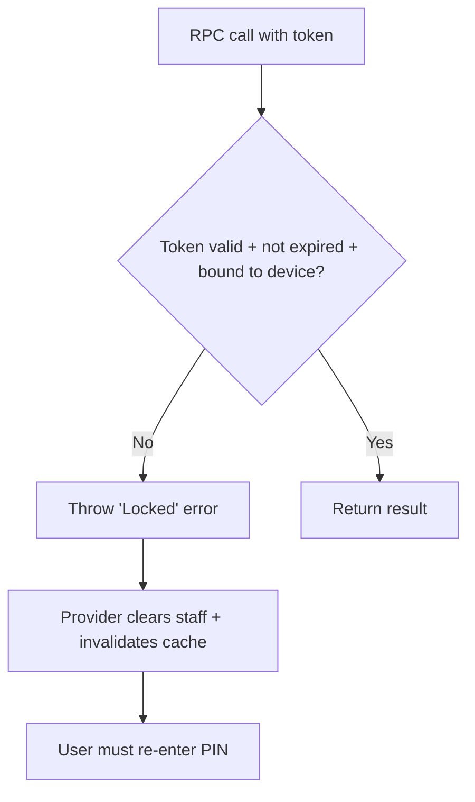

**Diagram sources**
- [pos.tsx:125-147](file://src/lib/pos.tsx#L125-L147)
- [pos.tsx:220-228](file://src/lib/pos.tsx#L220-L228)
- [security_hardening.sql:258-270](file://supabase/migrations/20261008090000_security_hardening.sql#L258-L270)

**Section sources**
- [pos.tsx:125-147](file://src/lib/pos.tsx#L125-L147)
- [pos.tsx:220-228](file://src/lib/pos.tsx#L220-L228)
- [security_hardening.sql:258-270](file://supabase/migrations/20261008090000_security_hardening.sql#L258-L270)

## Authentication Storage Resilience

### Enhanced Error Handling for Third-Party Storage Blocking
The authentication storage system now includes robust error handling to prevent third-party storage blocking from breaking the application. The `brokeredPreviewStorage` function provides a resilient storage abstraction that gracefully handles storage failures.

Key features:
- **Try-catch wrappers**: All localStorage operations are wrapped in try-catch blocks to handle storage blocking exceptions.
- **Fallback mechanisms**: When localStorage is unavailable, the system continues to operate with in-memory state.
- **Non-blocking initialization**: Storage failures during initialization don't prevent the application from starting.
- **Silent failure handling**: Storage errors are caught and logged internally without disrupting user experience.

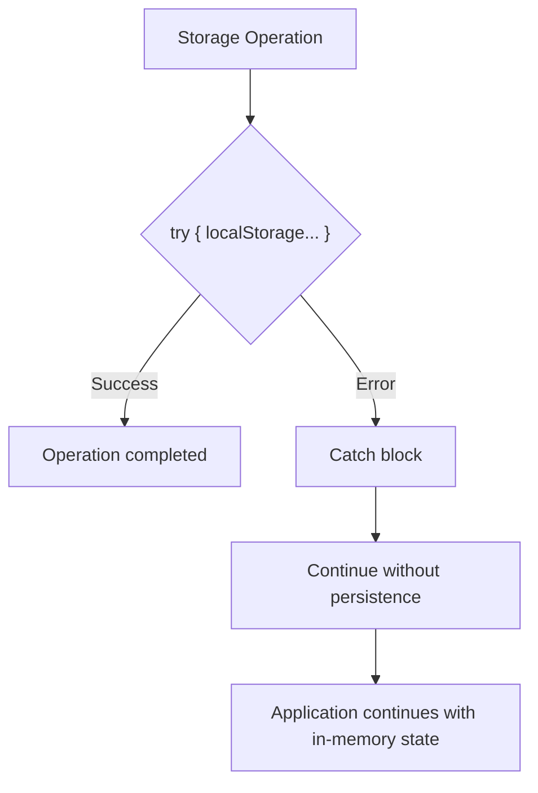

**Diagram sources**
- [previewAuthStorage.ts:62-89](file://src/integrations/supabase/previewAuthStorage.ts#L62-L89)
- [pos.tsx:355-359](file://src/lib/pos.tsx#L355-L359)

**Section sources**
- [previewAuthStorage.ts:62-89](file://src/integrations/supabase/previewAuthStorage.ts#L62-L89)
- [pos.tsx:355-359](file://src/lib/pos.tsx#L355-L359)

### Improved Preview Storage Broker Fallback Mechanisms
The preview storage broker now includes sophisticated fallback mechanisms to ensure reliable operation across different environments:

- **Retries for editor communication**: If the editor isn't listening initially, the system retries once after a short delay.
- **Safe local reads**: Local storage reads are wrapped in try-catch to handle blocked storage scenarios.
- **Graceful degradation**: When broker communication fails, the system falls back to direct localStorage usage.
- **Origin validation**: All cross-origin messages are validated against trusted origins to prevent security issues.

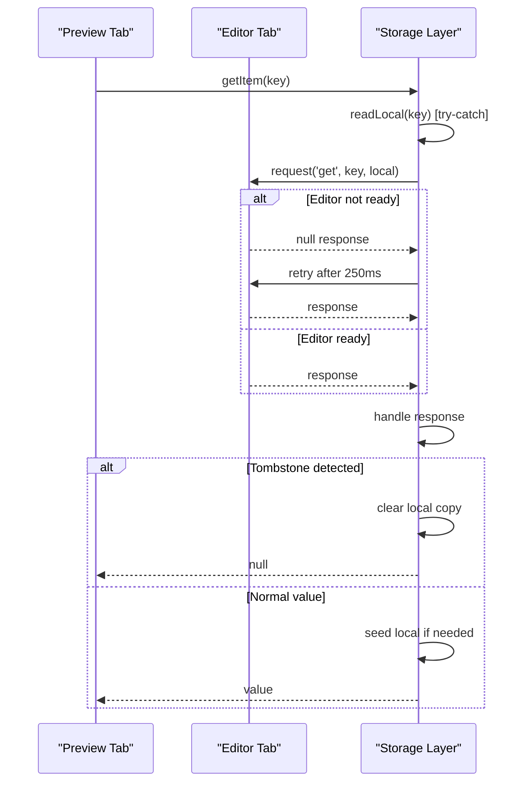

**Diagram sources**
- [previewAuthStorage.ts:59-89](file://src/integrations/supabase/previewAuthStorage.ts#L59-L89)

**Section sources**
- [previewAuthStorage.ts:59-89](file://src/integrations/supabase/previewAuthStorage.ts#L59-L89)

## Multi-Tab Synchronization

### Logout Tombstone Mechanism
The system implements a logout tombstone mechanism to synchronize logout actions across multiple browser tabs. When a user logs out in one tab, all other tabs are notified to clear their local session data.

How it works:
- **Tombstone marker**: An empty string (`''`) serves as a special marker indicating logout.
- **Cross-tab notification**: When logout occurs, the editor sends a tombstone to all preview tabs.
- **Local cleanup**: Preview tabs detect the tombstone and remove their local session data.
- **Resurrection prevention**: The tombstone prevents local sessions from being resurrected if the broker goes silent.

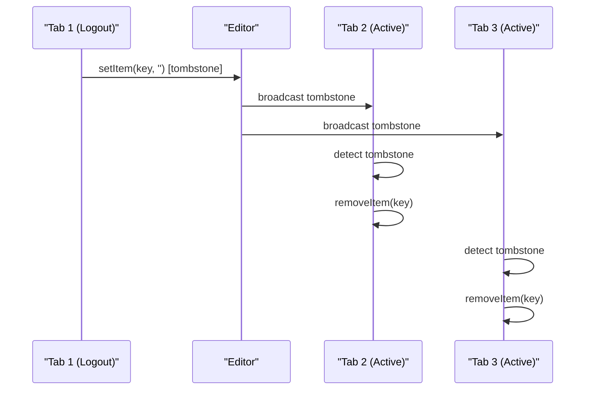

**Diagram sources**
- [previewAuthStorage.ts:75-80](file://src/integrations/supabase/previewAuthStorage.ts#L75-L80)
- [previewAuthStorage.ts:93-95](file://src/integrations/supabase/previewAuthStorage.ts#L93-L95)

**Section sources**
- [previewAuthStorage.ts:75-80](file://src/integrations/supabase/previewAuthStorage.ts#L75-L80)
- [previewAuthStorage.ts:93-95](file://src/integrations/supabase/previewAuthStorage.ts#L93-L95)

### Multi-Tab Session Synchronization
The preview storage broker ensures that all tabs share the same authentication state:

- **Centralized state**: The editor maintains the authoritative session state.
- **Automatic propagation**: Changes made in any tab are propagated to all other tabs.
- **Conflict resolution**: The editor's state takes precedence over local states.
- **Seeding mechanism**: New tabs automatically receive the current session from the editor.

**Section sources**
- [previewAuthStorage.ts:82-86](file://src/integrations/supabase/previewAuthStorage.ts#L82-L86)

### Examples

#### Session Creation
- A staff member enters a PIN.
- The client validates the PIN format.
- The server verifies the PIN, applies throttling, and returns a session object.
- The client stores the session with resilient error handling.

Relevant paths:
- [unlock implementation:194-203](file://src/lib/pos.tsx#L194-L203)
- [server PIN unlock logic:239-256](file://supabase/migrations/20261008090000_security_hardening.sql#L239-L256)

#### Authentication Flow
- Subsequent RPC calls include the staff token.
- The server validates the token, expiry, device binding, and role.
- Unauthorized or locked responses trigger local session cleanup.

Relevant paths:
- [RPC wrapper:220-228](file://src/lib/pos.tsx#L220-L228)
- [session role enforcement:258-270](file://supabase/migrations/20261008090000_security_hardening.sql#L258-L270)

#### Session Cleanup Procedures
- Manual lock clears local state and revokes the server session.
- Stale or expired sessions are removed on startup.
- Query cache invalidation prevents data leakage between users.
- Storage failures are handled gracefully without breaking the application.

Relevant paths:
- [lock implementation:205-215](file://src/lib/pos.tsx#L205-L215)
- [startup restoration and cleanup:125-147](file://src/lib/pos.tsx#L125-L147)
- [server session revocation:272-280](file://supabase/migrations/20261008090000_security_hardening.sql#L272-L280)

## Dependency Analysis
The following diagram shows how components depend on each other:

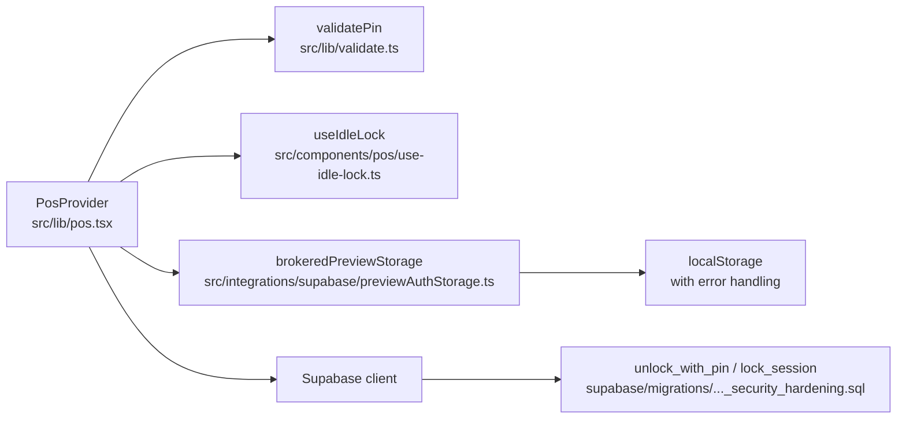

**Diagram sources**
- [pos.tsx:115-228](file://src/lib/pos.tsx#L115-L228)
- [use-idle-lock.ts:9-39](file://src/components/pos/use-idle-lock.ts#L9-L39)
- [previewAuthStorage.ts:1-106](file://src/integrations/supabase/previewAuthStorage.ts#L1-L106)
- [security_hardening.sql:239-291](file://supabase/migrations/20261008090000_security_hardening.sql#L239-L291)

**Section sources**
- [pos.tsx:115-228](file://src/lib/pos.tsx#L115-L228)
- [use-idle-lock.ts:9-39](file://src/components/pos/use-idle-lock.ts#L9-L39)
- [previewAuthStorage.ts:1-106](file://src/integrations/supabase/previewAuthStorage.ts#L1-L106)
- [security_hardening.sql:239-291](file://supabase/migrations/20261008090000_security_hardening.sql#L239-L291)

## Performance Considerations
- Session restoration is lightweight: one JSON parse and a date comparison.
- Auto-lock uses passive event listeners to minimize input latency.
- Query cache invalidation happens only on meaningful state changes.
- Offline queue syncing is rate-limited and paused during auto-lock countdown to avoid interfering with till hygiene.
- Storage operations are wrapped in try-catch blocks to prevent performance impact from storage failures.
- Preview storage broker includes retry mechanisms with minimal overhead.

## Troubleshooting Guide
Common issues and resolutions:
- **PIN rejected repeatedly**: The server tracks failed attempts and can temporarily lock PIN entry per device. Wait for the cooldown or sign out and back in.
- **Session disappears unexpectedly**: Check whether the stored session has a past `expires_at` or was created before the security migration; such sessions are intentionally rejected.
- **Auto-lock too aggressive**: Increase `autoLockMinutes`; values are clamped between 0 and 240.
- **Data visible after switching users**: Ensure `lock` is called and that query cache invalidation runs; the provider clears local state and invalidates queries on lock.
- **Storage errors preventing login**: The application should continue working even if localStorage is blocked. Check browser privacy settings or extensions that might be blocking storage access.
- **Sessions not syncing across tabs**: Verify that the preview storage broker is functioning correctly and that the editor is properly communicating with preview tabs.
- **Logout not propagating to other tabs**: Check if the logout tombstone mechanism is working correctly and that cross-origin messaging is not blocked by browser security policies.

Storage-specific troubleshooting:
- **Third-party storage blocking**: Check browser privacy settings, ad blockers, or security extensions that might be blocking localStorage access.
- **Preview storage broker failures**: Verify that the editor and preview tabs are on compatible domains and that cross-origin messaging is allowed.
- **Multi-tab synchronization issues**: Ensure that all tabs are part of the same preview environment and that the editor has proper permissions to communicate with preview tabs.

Operational references:
- [error masking:93-104](file://src/lib/pos.tsx#L93-L104)
- [PIN unlock and error handling:194-203](file://src/lib/pos.tsx#L194-L203)
- [storage error handling:355-359](file://src/lib/pos.tsx#L355-L359)
- [throttle and session creation:239-256](file://supabase/migrations/20261008090000_security_hardening.sql#L239-L256)
- [session revocation:272-280](file://supabase/migrations/20261008090000_security_hardening.sql#L272-L280)
- [logout tombstone mechanism:75-80](file://src/integrations/supabase/previewAuthStorage.ts#L75-L80)

**Section sources**
- [pos.tsx:93-104](file://src/lib/pos.tsx#L93-L104)
- [pos.tsx:194-203](file://src/lib/pos.tsx#L194-L203)
- [pos.tsx:355-359](file://src/lib/pos.tsx#L355-L359)
- [security_hardening.sql:239-256](file://supabase/migrations/20261008090000_security_hardening.sql#L239-L256)
- [security_hardening.sql:272-280](file://supabase/migrations/20261008090000_security_hardening.sql#L272-L280)
- [previewAuthStorage.ts:75-80](file://src/integrations/supabase/previewAuthStorage.ts#L75-L80)

## Conclusion
Staff session management in this application combines client-side convenience with strong server-side enforcement and resilient storage handling. PIN validation is validated locally first, then secured by server-side throttling and short-lived tokens. Sessions are persisted in `localStorage` but only restored when safe, with robust error handling for storage failures. The enhanced authentication storage system provides graceful degradation when storage is unavailable, while the logout tombstone mechanism ensures consistent state across multiple browser tabs. Auto-lock protects against idle exposure, while query cache invalidation prevents cross-user data leaks. For robust security, always rely on server-side token validation and treat the client token as a convenience rather than the sole authority. The new storage resilience features ensure that the application remains functional even in restrictive browser environments.