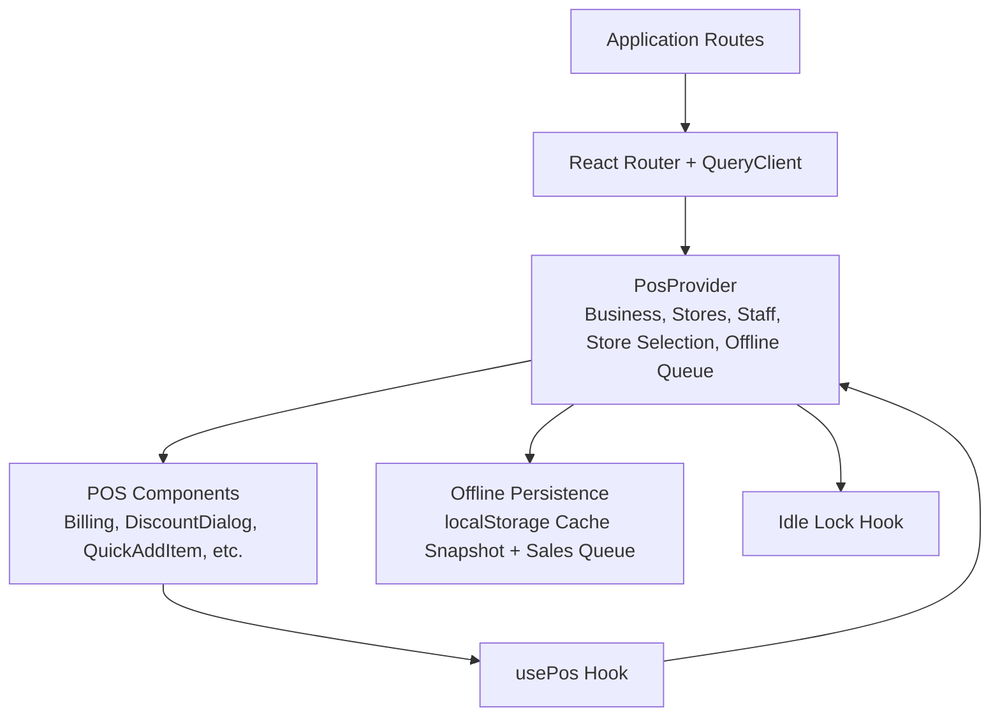
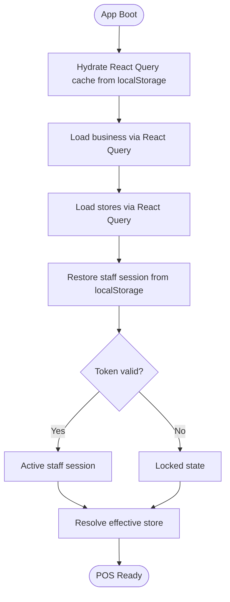
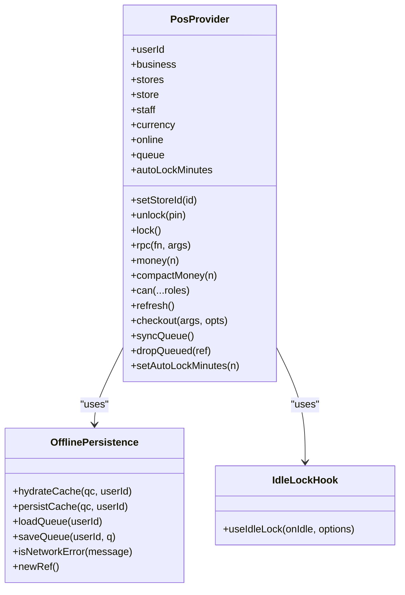
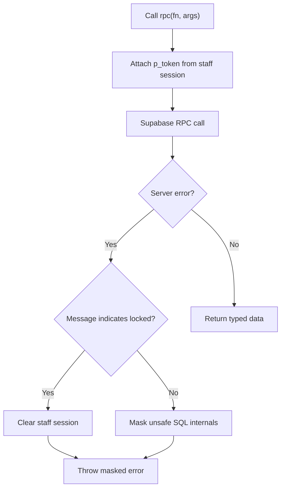
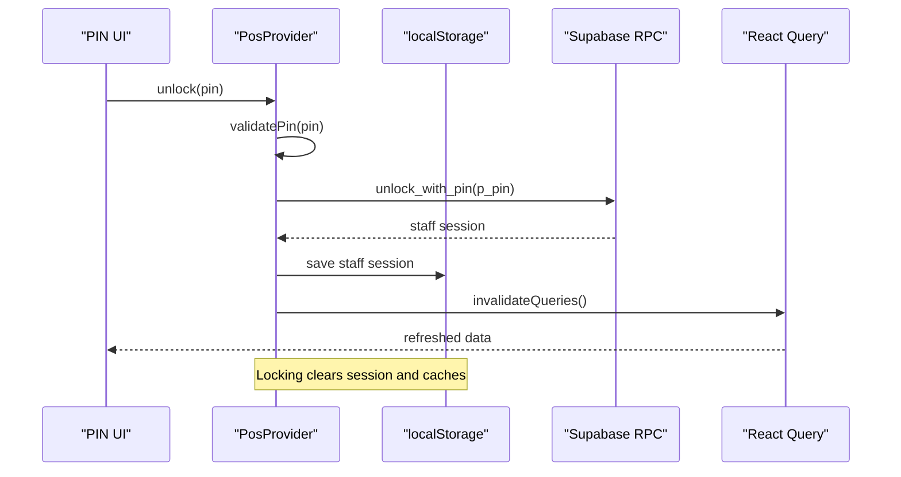
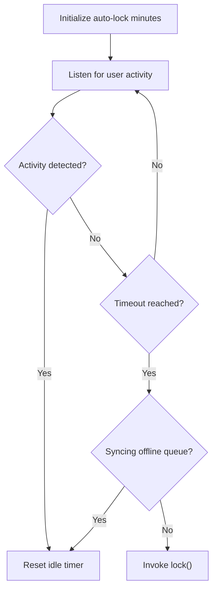
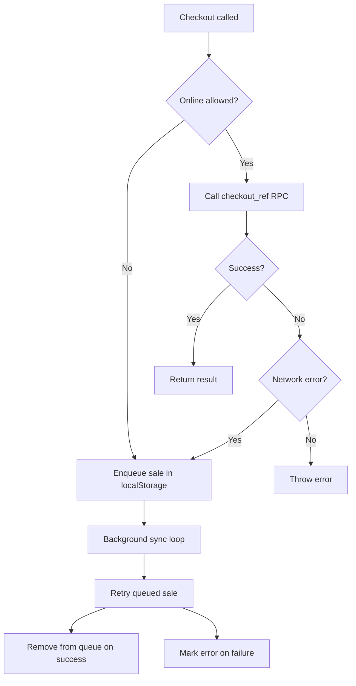
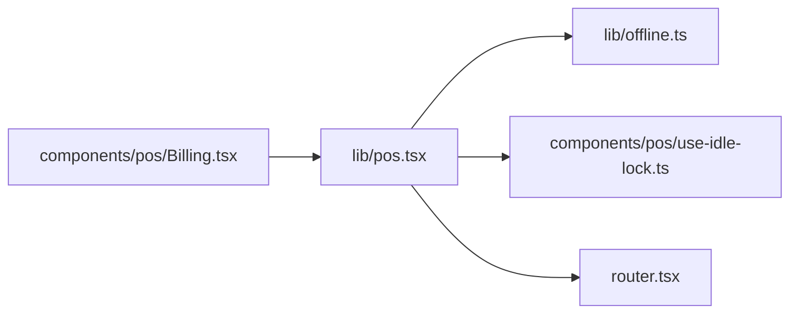

# State Management Architecture

<cite>
**Referenced Files in This Document**
- [pos.tsx](file://src/lib/pos.tsx)
- [offline.ts](file://src/lib/offline.ts)
- [use-idle-lock.ts](file://src/components/pos/use-idle-lock.ts)
- [router.tsx](file://src/router.tsx)
- [Billing.tsx](file://src/components/pos/Billing.tsx)
</cite>

## Table of Contents
1. [Introduction](#introduction)
2. [Project Structure](#project-structure)
3. [Core Components](#core-components)
4. [Architecture Overview](#architecture-overview)
5. [Detailed Component Analysis](#detailed-component-analysis)
6. [Dependency Analysis](#dependency-analysis)
7. [Performance Considerations](#performance-considerations)
8. [Troubleshooting Guide](#troubleshooting-guide)
9. [Conclusion](#conclusion)

## Introduction
This document explains the state management architecture used by Storq POS, which combines:
- React Context for shared business context and client-side session state
- React Query for server state caching, background refresh, and invalidation
- Local storage for persistent staff sessions, selected store, auto-lock settings, offline queue, and a snapshot of reference data

The central pattern is the `PosProvider` and `usePos` hook. They expose a single source of truth for business configuration, staff session, store selection, role-based access control, money formatting, and offline sales behavior. Server data such as business details, stores, products, collections, and stock are managed by React Query; UI-only or device-specific state such as the active staff session, selected store, online status, and offline queue is managed by React Context and local storage.

## Project Structure
The relevant state management code is concentrated in a small set of files:
- `src/lib/pos.tsx`: Provider, hook, types, session lifecycle, RPC wrapper, store selection, role checks, money formatting, offline queue orchestration, and auto-lock integration.
- `src/lib/offline.ts`: Browser-only persistence utilities for a React Query cache snapshot and an offline sales queue.
- `src/components/pos/use-idle-lock.ts`: Hook that triggers an idle callback after a configurable period of no pointer/key activity.
- `src/router.tsx`: React Query client configuration tuned for a POS terminal.
- `src/components/pos/Billing.tsx`: Example consumer of `usePos`.

**Diagram sources**
- [router.tsx:5-33](file://src/router.tsx#L5-L33)
- [pos.tsx:109-113](file://src/lib/pos.tsx#L109-L113)
- [pos.tsx:115-440](file://src/lib/pos.tsx#L115-L440)
- [offline.ts:15-91](file://src/lib/offline.ts#L15-L91)
- [use-idle-lock.ts:9-39](file://src/components/pos/use-idle-lock.ts#L9-L39)

**Section sources**
- [router.tsx:5-33](file://src/router.tsx#L5-L33)
- [pos.tsx:109-440](file://src/lib/pos.tsx#L109-L440)
- [offline.ts:1-91](file://src/lib/offline.ts#L1-L91)
- [use-idle-lock.ts:1-40](file://src/components/pos/use-idle-lock.ts#L1-L40)

## Core Components
The core state layer consists of:
- `PosProvider`: Wraps the application with shared POS context. It owns staff sessions, store selection, offline queue, auto-lock configuration, and exposes helpers like `rpc`, `checkout`, `can`, `money`, and `compactMoney`.
- `usePos`: Consumer hook that throws if used outside the provider and returns the full POS context.
- Offline persistence module: Provides a safe snapshot of non-sensitive reference data into React Query’s cache and a durable queue of offline sales.
- Idle lock hook: Triggers locking after inactivity while avoiding interruption during offline sync.

Key responsibilities:
- Separate server state from client state clearly.
- Persist only safe, non-role-gated reference data locally.
- Keep sensitive session state behind PIN authentication.
- Provide a consistent RPC interface that attaches the current staff token and masks unsafe server errors.
- Allow offline checkout with automatic retry when connectivity returns.

**Section sources**
- [pos.tsx:28-84](file://src/lib/pos.tsx#L28-L84)
- [pos.tsx:109-113](file://src/lib/pos.tsx#L109-L113)
- [pos.tsx:115-440](file://src/lib/pos.tsx#L115-L440)
- [offline.ts:1-91](file://src/lib/offline.ts#L1-L91)
- [use-idle-lock.ts:1-40](file://src/components/pos/use-idle-lock.ts#L1-L40)

## Architecture Overview
The architecture follows a clear separation between server state and client state:

- Server state (React Query):
  - Business configuration, stores, products, collections, stock, and other read-heavy data.
  - Cached with long stale times appropriate for a POS terminal.
  - Hydrated instantly from a local snapshot on startup and persisted back to local storage.
  - Invalidated explicitly after writes.

- Client state (React Context + local storage):
  - Active staff session, including token, role, and optional cashier store assignment.
  - Selected store ID and auto-lock timeout.
  - Online/offline status and the offline sales queue.
  - Money formatting functions derived from the loaded business currency.

**Diagram sources**
- [offline.ts:15-27](file://src/lib/offline.ts#L15-L27)
- [pos.tsx:149-184](file://src/lib/pos.tsx#L149-L184)
- [pos.tsx:125-147](file://src/lib/pos.tsx#L125-L147)

**Section sources**
- [router.tsx:5-33](file://src/router.tsx#L5-L33)
- [pos.tsx:149-184](file://src/lib/pos.tsx#L149-L184)
- [offline.ts:15-55](file://src/lib/offline.ts#L15-L55)

## Detailed Component Analysis

### PosProvider Pattern
`PosProvider` centralizes business context and POS operations:
- Loads business and stores through React Query.
- Resolves the effective store based on staff role and user selection.
- Persists and restores staff sessions, store selection, and auto-lock settings.
- Exposes `unlock`, `lock`, and `rpc` for secure server calls.
- Manages offline queue and sync scheduling.
- Integrates idle-based auto-lock.

**Diagram sources**
- [pos.tsx:115-440](file://src/lib/pos.tsx#L115-L440)
- [offline.ts:15-91](file://src/lib/offline.ts#L15-L91)
- [use-idle-lock.ts:9-39](file://src/components/pos/use-idle-lock.ts#L9-L39)

**Section sources**
- [pos.tsx:115-440](file://src/lib/pos.tsx#L115-L440)

### Server State vs Client State
Use React Query for data that comes from the server and may change independently of the UI:
- Business configuration
- Stores
- Products, collections, stock
- Any queryable resource fetched through Supabase

Use React Context for state that belongs to the current POS session or device:
- Active staff session and role
- Selected store
- Online/offline status
- Offline sales queue
- Auto-lock configuration
- Derived helpers like `money`, `compactMoney`, and `can`

Guidelines:
- Do not put large read-only catalogs in React Context unless they are intentionally part of the POS session state.
- Prefer React Query for data that benefits from caching, background refresh, and invalidation.
- Put transient UI state inside components using component-level state or hooks.

**Section sources**
- [pos.tsx:149-184](file://src/lib/pos.tsx#L149-L184)
- [pos.tsx:242-273](file://src/lib/pos.tsx#L242-L273)
- [router.tsx:5-33](file://src/router.tsx#L5-L33)

### Role-Based Access Control State
Role-based access control is enforced through the staff session:
- Roles include admin, manager, and cashier.
- The `can(...roles)` helper checks whether the current staff member has one of the required roles.
- Cashier users can be restricted to a specific store assigned in their session.
- All server calls go through `rpc`, which attaches the staff token and masks unsafe error messages.

**Diagram sources**
- [pos.tsx:220-228](file://src/lib/pos.tsx#L220-L228)
- [pos.tsx:93-104](file://src/lib/pos.tsx#L93-L104)

**Section sources**
- [pos.tsx:37-45](file://src/lib/pos.tsx#L37-L45)
- [pos.tsx:178-184](file://src/lib/pos.tsx#L178-L184)
- [pos.tsx:220-228](file://src/lib/pos.tsx#L220-L228)
- [pos.tsx:366-387](file://src/lib/pos.tsx#L366-L387)

### Staff Session Lifecycle and PIN Authentication
The staff session lifecycle ensures security across staff changes on shared devices:
- On mount, the provider restores a stored staff session if it exists and is still valid.
- `unlock(pin)` validates the PIN, calls the server unlock RPC, stores the new session, and invalidates queries.
- `lock()` attempts to notify the server and always clears local session state.
- Expired or invalid tokens are rejected so the PIN screen reappears.
- When the session changes, cached rows are invalidated to prevent the next user from reading previous-user data.

**Diagram sources**
- [pos.tsx:125-147](file://src/lib/pos.tsx#L125-L147)
- [pos.tsx:194-215](file://src/lib/pos.tsx#L194-L215)
- [pos.tsx:186-192](file://src/lib/pos.tsx#L186-L192)

**Section sources**
- [pos.tsx:125-147](file://src/lib/pos.tsx#L125-L147)
- [pos.tsx:186-215](file://src/lib/pos.tsx#L186-L215)

### Auto-Lock Functionality
Auto-lock improves till hygiene by locking the workspace after inactivity:
- The configured timeout is stored in local storage and restored per user.
- The idle lock hook listens to keyboard, mouse, and touch events.
- Locking is paused while the offline queue is syncing to avoid interrupting queued sale replay.
- The actual lock function is kept in a ref so the idle timer always invokes the latest implementation.

**Diagram sources**
- [pos.tsx:347-364](file://src/lib/pos.tsx#L347-L364)
- [use-idle-lock.ts:9-39](file://src/components/pos/use-idle-lock.ts#L9-L39)

**Section sources**
- [pos.tsx:347-364](file://src/lib/pos.tsx#L347-L364)
- [use-idle-lock.ts:1-40](file://src/components/pos/use-idle-lock.ts#L1-L40)

### Offline Queue State
The offline queue ensures sales continue even without internet:
- When offline or when a network error occurs during checkout, the sale is queued locally.
- Each queued sale has a unique reference, timestamp, total, target store, and arguments.
- The queue persists in local storage and is restored on app start.
- Background sync retries pending items every 30 seconds while online and unlocked.
- Failed items show actionable retry or discard controls.
- Successful syncs trigger targeted cache invalidation for sales-related data.

**Diagram sources**
- [pos.tsx:275-338](file://src/lib/pos.tsx#L275-L338)
- [offline.ts:62-91](file://src/lib/offline.ts#L62-L91)

**Section sources**
- [pos.tsx:249-345](file://src/lib/pos.tsx#L249-L345)
- [offline.ts:62-91](file://src/lib/offline.ts#L62-L91)

### Using `usePos` and Managing Component-Specific State
Components consume shared POS state through `usePos`. For example, billing and discount dialogs use it to access business context, permissions, and money formatting.

Recommended patterns:
- Read shared state and actions from `usePos`.
- Keep component-specific UI state in local component state.
- Avoid duplicating business configuration or staff session state in components.
- Use `can` to gate UI features and actions by role.
- Use `money` and `compactMoney` consistently for display values.

Example usage references:
- Billing component reads business, stores, permissions, RPC, and lock.
- Discount dialog uses money formatting and permission checks.
- Quick add item uses RPC and permission checks.

**Section sources**
- [Billing.tsx:5-55](file://src/components/pos/Billing.tsx#L5-L55)
- [pos.tsx:109-113](file://src/lib/pos.tsx#L109-L113)
- [pos.tsx:366-387](file://src/lib/pos.tsx#L366-L387)

## Dependency Analysis
The following diagram shows how the main modules depend on each other:

**Diagram sources**
- [pos.tsx:1-26](file://src/lib/pos.tsx#L1-L26)
- [offline.ts:1-91](file://src/lib/offline.ts#L1-L91)
- [use-idle-lock.ts:1-40](file://src/components/pos/use-idle-lock.ts#L1-L40)
- [router.tsx:1-33](file://src/router.tsx#L1-L33)
- [Billing.tsx:5-55](file://src/components/pos/Billing.tsx#L5-L55)

**Section sources**
- [pos.tsx:1-26](file://src/lib/pos.tsx#L1-L26)
- [offline.ts:1-91](file://src/lib/offline.ts#L1-L91)
- [use-idle-lock.ts:1-40](file://src/components/pos/use-idle-lock.ts#L1-L40)
- [router.tsx:1-33](file://src/router.tsx#L1-L33)
- [Billing.tsx:5-55](file://src/components/pos/Billing.tsx#L5-L55)

## Performance Considerations
- React Query defaults are tuned for a POS terminal: longer stale times, disabled window-focus refetches, limited retries, and no mutation retries.
- Reference data is hydrated instantly from a local snapshot so the register opens quickly.
- Only safe, non-role-gated reference data is persisted locally.
- Offline queue sync runs periodically but avoids concurrent replays.
- Money formatting functions are memoized to reduce unnecessary recomputation.
- Auto-lock pauses during offline sync to prevent disruptive state changes.

[No sources needed since this section provides general guidance]

## Troubleshooting Guide
Common issues and where to look:
- “usePos outside provider”: The hook requires `PosProvider` to wrap the component tree.
- Stale or empty data after switching staff: Ensure `clearStaff` invalidates queries and that expired tokens are rejected.
- Unsafe server errors visible in the UI: Errors should be masked; check the RPC wrapper and error masking logic.
- Offline sales not syncing: Verify online status, staff session, and that the sync loop is running.
- Auto-lock firing unexpectedly: Check idle lock configuration and whether syncing is paused.

Relevant implementation areas:
- Provider hook guard and context shape.
- Staff restoration, expiry validation, and clearing.
- RPC wrapper and error masking.
- Offline queue loading, saving, and sync scheduling.
- Idle lock hook behavior.

**Section sources**
- [pos.tsx:109-113](file://src/lib/pos.tsx#L109-L113)
- [pos.tsx:125-147](file://src/lib/pos.tsx#L125-L147)
- [pos.tsx:186-228](file://src/lib/pos.tsx#L186-L228)
- [pos.tsx:249-345](file://src/lib/pos.tsx#L249-L345)
- [use-idle-lock.ts:9-39](file://src/components/pos/use-idle-lock.ts#L9-L39)

## Conclusion
Storq POS uses a focused state management strategy:
- `PosProvider` and `usePos` provide a single, secure, and consistent interface for business context, staff sessions, store selection, permissions, and offline behavior.
- React Query manages server state with caching, background refresh, and explicit invalidation.
- Local storage supports fast startup and resilient offline operation without exposing sensitive data.
- Auto-lock and idle detection protect shared tills.
- Components should read shared state through `usePos` and keep only UI-specific state locally.

This separation makes the POS reliable under poor connectivity, secure across staff changes, and easier to extend with new screens and workflows.