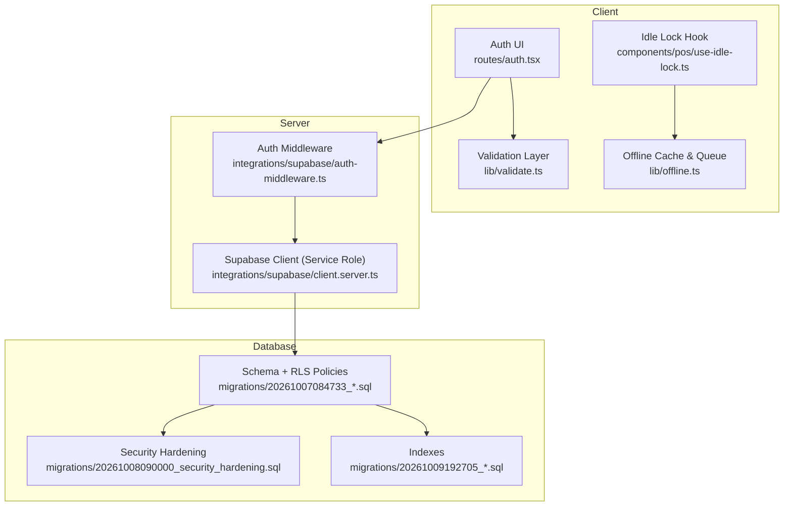
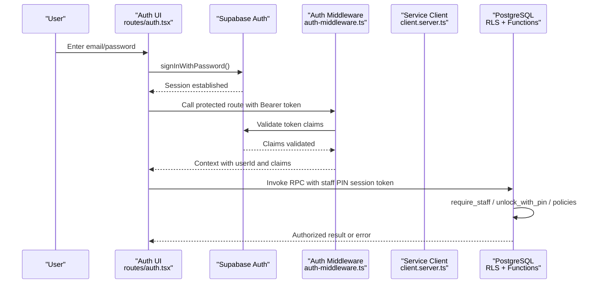
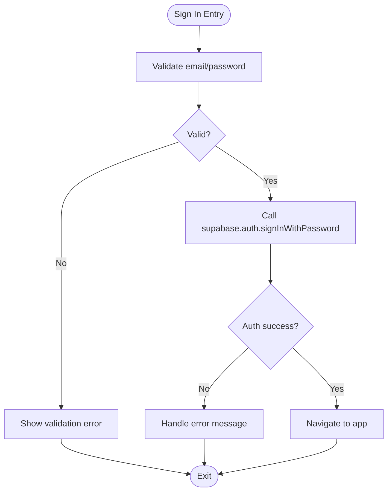
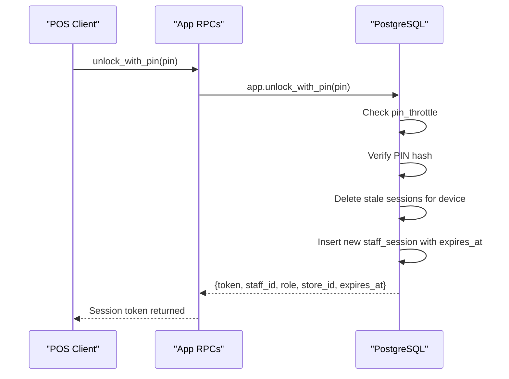
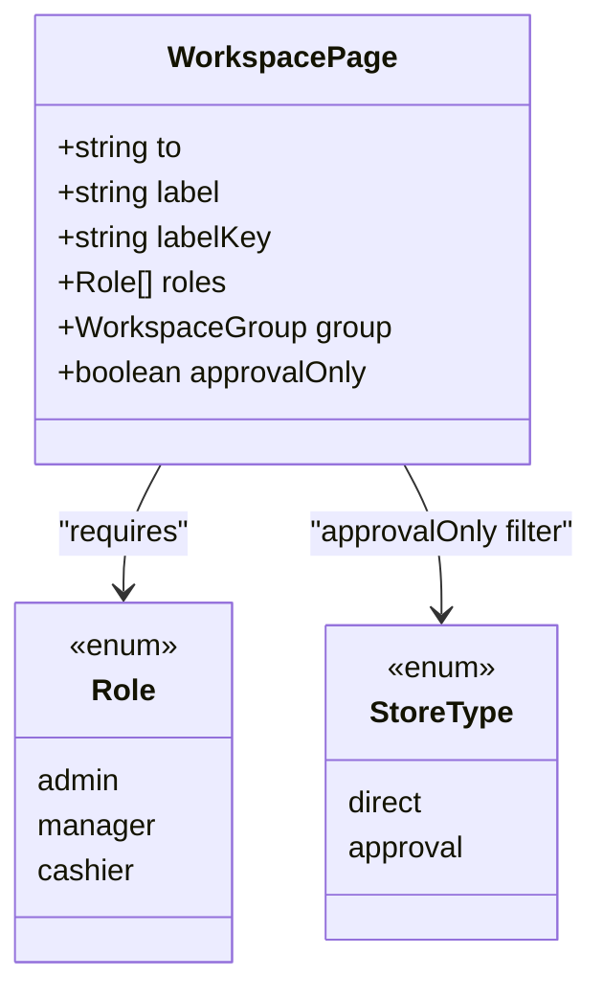
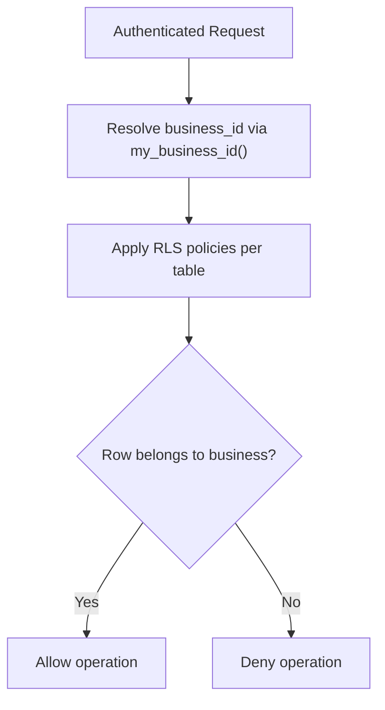
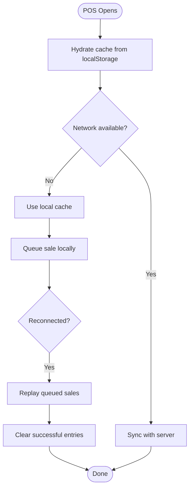
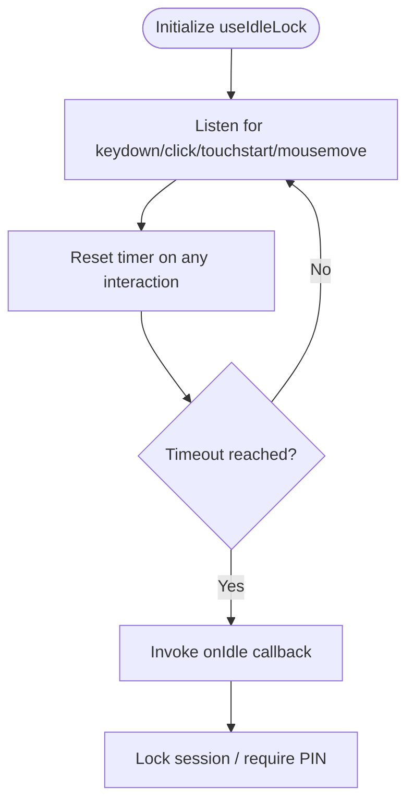
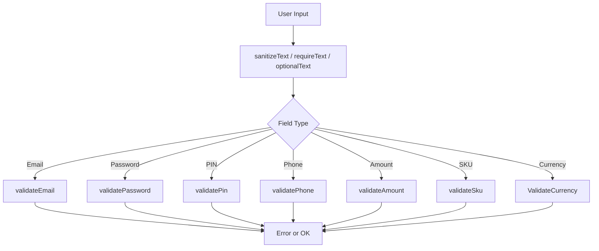
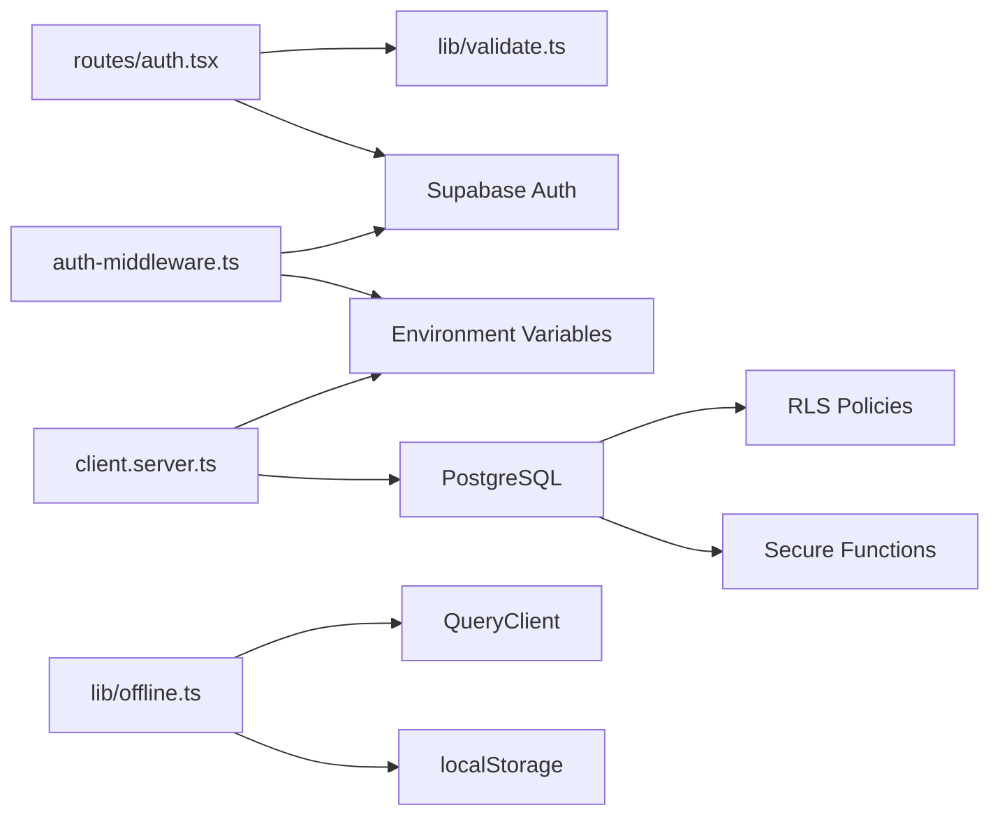

# Security Model & Access Control

<cite>
**Referenced Files in This Document**
- [README.md](file://README.md)
- [auth.tsx](file://src/routes/auth.tsx)
- [validate.ts](file://src/lib/validate.ts)
- [client.server.ts](file://src/integrations/supabase/client.server.ts)
- [auth-middleware.ts](file://src/integrations/supabase/auth-middleware.ts)
- [workspace-navigation.ts](file://src/lib/workspace-navigation.ts)
- [use-idle-lock.ts](file://src/components/pos/use-idle-lock.ts)
- [offline.ts](file://src/lib/offline.ts)
- [20261007084733_2ed95314-f75e-4843-977b-23f9e6359a48.sql](file://supabase/migrations/20261007084733_2ed95314-f75e-4843-977b-23f9e6359a48.sql)
- [20261008090000_security_hardening.sql](file://supabase/migrations/20261008090000_security_hardening.sql)
- [20261009192705_c04f3a80-e05e-498f-ab87-694d79f3fe3f.sql](file://supabase/migrations/20261009192705_c04f3a80-e05e-498f-ab87-694d79f3fe3f.sql)
</cite>

## Table of Contents
1. [Introduction](#introduction)
2. [Project Structure](#project-structure)
3. [Core Components](#core-components)
4. [Architecture Overview](#architecture-overview)
5. [Detailed Component Analysis](#detailed-component-analysis)
6. [Dependency Analysis](#dependency-analysis)
7. [Performance Considerations](#performance-considerations)
8. [Troubleshooting Guide](#troubleshooting-guide)
9. [Conclusion](#conclusion)

## Introduction
This document explains the security model and access control for the Storq POS system. It covers:
- Multi-layered authentication combining email/password via Supabase with PIN-based staff authentication for point-of-sale operations.
- Role-based access control (RBAC) supporting Admin, Manager, and Cashier roles with granular permissions.
- Row-Level Security (RLS) policies enforced at the PostgreSQL database layer through Supabase.
- Offline transaction processing, session management, and auto-lock functionality for device security.
- Input validation and sanitization patterns to protect against common web vulnerabilities.
- Secure communication considerations with external payment services and data encryption strategies.

The project’s README describes a single email/password login per business account with a four-digit PIN that identifies staff role and enables multi-device usage. The codebase implements this design using Supabase Auth, server-side middleware, Postgres functions, RLS policies, and client-side safeguards.

**Section sources**
- [README.md:1-26](file://README.md#L1-L26)

## Project Structure
Security-related implementation is spread across several layers:
- Authentication UI and flow: `/src/routes/auth.tsx`
- Shared input validation and sanitization: `/src/lib/validate.ts`
- Server-side Supabase clients and auth middleware: `/src/integrations/supabase/client.server.ts`, `/src/integrations/supabase/auth-middleware.ts`
- RBAC navigation and permission mapping: `/src/lib/workspace-navigation.ts`
- Device idle lock hook: `/src/components/pos/use-idle-lock.ts`
- Offline persistence and queueing: `/src/lib/offline.ts`
- Database schema, RLS policies, and secure RPCs: `supabase/migrations/*.sql`

**Diagram sources**
- [auth.tsx:1-266](file://src/routes/auth.tsx#L1-L266)
- [validate.ts:1-147](file://src/lib/validate.ts#L1-L147)
- [client.server.ts:1-73](file://src/integrations/supabase/client.server.ts#L1-L73)
- [auth-middleware.ts:1-106](file://src/integrations/supabase/auth-middleware.ts#L1-L106)
- [20261007084733_2ed95314-f75e-4843-977b-23f9e6359a48.sql:102-180](file://supabase/migrations/20261007084733_2ed95314-f75e-4843-977b-23f9e6359a48.sql#L102-L180)
- [20261008090000_security_hardening.sql:217-292](file://supabase/migrations/20261008090000_security_hardening.sql#L217-L292)
- [20261009192705_c04f3a80-e05e-498f-ab87-694d79f3fe3f.sql:1-23](file://supabase/migrations/20261009192705_c04f3a80-e05e-498f-ab87-694d79f3fe3f.sql#L1-L23)

**Section sources**
- [auth.tsx:1-266](file://src/routes/auth.tsx#L1-L266)
- [validate.ts:1-147](file://src/lib/validate.ts#L1-L147)
- [client.server.ts:1-73](file://src/integrations/supabase/client.server.ts#L1-L73)
- [auth-middleware.ts:1-106](file://src/integrations/supabase/auth-middleware.ts#L1-L106)
- [20261007084733_2ed95314-f75e-4843-977b-23f9e6359a48.sql:102-180](file://supabase/migrations/20261007084733_2ed95314-f75e-4843-977b-23f9e6359a48.sql#L102-L180)
- [20261008090000_security_hardening.sql:217-292](file://supabase/migrations/20261008090000_security_hardening.sql#L217-L292)
- [20261009192705_c04f3a80-e05e-498f-ab87-694d79f3fe3f.sql:1-23](file://supabase/migrations/20261009192705_c04f3a80-e05e-498f-ab87-694d79f3fe3f.sql#L1-L23)

## Core Components
- Email/password authentication via Supabase handles user sign-in, sign-up, password reset, and recovery flows.
- PIN-based staff authentication issues short-lived, device-bound sessions used for POS operations.
- RBAC defines Admin, Manager, and Cashier roles with page-level visibility and function-level authorization.
- RLS policies isolate data by business and enforce read/write boundaries at the database level.
- Offline mode persists reference data and queues sales locally until connectivity is restored.
- Idle lock protects unattended devices by requiring re-authentication after inactivity.

Key responsibilities:
- Authentication UI orchestrates Supabase Auth calls and validates inputs before submission.
- Validation utilities provide consistent length, format, and safety checks for all user inputs.
- Server-side middleware validates bearer tokens and attaches authenticated context.
- Service-role client bypasses RLS only on trusted server paths.
- Database functions implement role checks, PIN throttling, session lifecycle, and business logic.
- Navigation module maps roles to visible workspace pages.

**Section sources**
- [auth.tsx:45-107](file://src/routes/auth.tsx#L45-L107)
- [validate.ts:9-25](file://src/lib/validate.ts#L9-L25)
- [auth-middleware.ts:34-105](file://src/integrations/supabase/auth-middleware.ts#L34-L105)
- [client.server.ts:35-72](file://src/integrations/supabase/client.server.ts#L35-L72)
- [workspace-navigation.ts:30-122](file://src/lib/workspace-navigation.ts#L30-L122)
- [20261007084733_2ed95314-f75e-4843-977b-23f9e6359a48.sql:102-180](file://supabase/migrations/20261007084733_2ed95314-f75e-4843-977b-23f9e6359a48.sql#L102-L180)
- [20261008090000_security_hardening.sql:217-292](file://supabase/migrations/20261008090000_security_hardening.sql#L217-L292)

## Architecture Overview
The system uses layered security:
- Client layer: form validation, idle detection, offline caching.
- API layer: token validation middleware; service-role client for admin-only server operations.
- Data layer: RLS policies, secure functions, PIN throttling, and indexed queries.

**Diagram sources**
- [auth.tsx:45-107](file://src/routes/auth.tsx#L45-L107)
- [auth-middleware.ts:34-105](file://src/integrations/supabase/auth-middleware.ts#L34-L105)
- [client.server.ts:35-72](file://src/integrations/supabase/client.server.ts#L35-L72)
- [20261007084733_2ed95314-f75e-4843-977b-23f9e6359a48.sql:134-180](file://supabase/migrations/20261007084733_2ed95314-f75e-4843-977b-23f9e6359a48.sql#L134-L180)
- [20261008090000_security_hardening.sql:217-292](file://supabase/migrations/20261008090000_security_hardening.sql#L217-L292)

## Detailed Component Analysis

### Authentication Flow
- Email/password sign-in, sign-up, password reset, and recovery are handled by Supabase Auth from the client.
- Inputs are validated client-side using shared validators before calling Supabase.
- Protected routes use middleware to validate bearer tokens and attach user context.

**Diagram sources**
- [auth.tsx:45-107](file://src/routes/auth.tsx#L45-L107)
- [validate.ts:64-82](file://src/lib/validate.ts#L64-L82)

**Section sources**
- [auth.tsx:45-107](file://src/routes/auth.tsx#L45-L107)
- [validate.ts:64-82](file://src/lib/validate.ts#L64-L82)

### Staff PIN Authentication and Session Management
- Staff PIN unlocks a short-lived, device-bound session tied to the signed-in user.
- Throttling prevents brute-force PIN attempts per business and device.
- Sessions expire after a fixed interval and can be locked explicitly.

**Diagram sources**
- [20261008090000_security_hardening.sql:217-256](file://supabase/migrations/20261008090000_security_hardening.sql#L217-L256)

**Section sources**
- [20261008090000_security_hardening.sql:217-292](file://supabase/migrations/20261008090000_security_hardening.sql#L217-L292)

### Role-Based Access Control (RBAC)
- Roles: Admin, Manager, Cashier.
- Page-level visibility is controlled by workspace navigation based on role and store type.
- Function-level authorization uses secure functions that check staff role and business isolation.

**Diagram sources**
- [workspace-navigation.ts:3-31](file://src/lib/workspace-navigation.ts#L3-L31)
- [workspace-navigation.ts:33-122](file://src/lib/workspace-navigation.ts#L33-L122)

**Section sources**
- [workspace-navigation.ts:30-122](file://src/lib/workspace-navigation.ts#L30-L122)
- [20261007084733_2ed95314-f75e-4843-977b-23f9e6359a48.sql:17-26](file://supabase/migrations/20261007084733_2ed95314-f75e-4843-977b-23f9e6359a48.sql#L17-L26)

### Row-Level Security (RLS) Policies
- All core tables enable RLS.
- Policies restrict reads/writes to rows belonging to the authenticated user’s business.
- Helper function resolves current business ID from the authenticated owner.

**Diagram sources**
- [20261007084733_2ed95314-f75e-4843-977b-23f9e6359a48.sql:102-132](file://supabase/migrations/20261007084733_2ed95314-f75e-4843-977b-23f9e6359a48.sql#L102-L132)

**Section sources**
- [20261007084733_2ed95314-f75e-4843-977b-23f9e6359a48.sql:102-132](file://supabase/migrations/20261007084733_2ed95314-f75e-4843-977b-23f9e6359a48.sql#L102-L132)

### Offline Transaction Processing
- Reference data needed for instant POS startup is cached locally.
- Sales made while offline are queued and replayed when connectivity returns.
- Only non-sensitive, role-permitted reference data is persisted.

**Diagram sources**
- [offline.ts:1-92](file://src/lib/offline.ts#L1-L92)

**Section sources**
- [offline.ts:1-92](file://src/lib/offline.ts#L1-L92)

### Auto-Lock and Device Security
- Idle lock monitors pointer/key activity and triggers a callback after inactivity.
- Callback should lock the POS session and require PIN re-entry.
- Idle lock respects paused states during offline replay to avoid dropping the till mid-process.

**Diagram sources**
- [use-idle-lock.ts:1-40](file://src/components/pos/use-idle-lock.ts#L1-L40)

**Section sources**
- [use-idle-lock.ts:1-40](file://src/components/pos/use-idle-lock.ts#L1-L40)

### Input Validation and Sanitization
- Centralized validators enforce length, format, and safety constraints for emails, passwords, PINs, phones, SKUs, amounts, and currency codes.
- Unsafe characters and markup delimiters are stripped or rejected.
- CSV export includes formula injection protection.

**Diagram sources**
- [validate.ts:27-147](file://src/lib/validate.ts#L27-L147)

**Section sources**
- [validate.ts:27-147](file://src/lib/validate.ts#L27-L147)

### Secure Communication and Payment Services
- Server-side middleware validates bearer tokens and ensures only authenticated requests proceed.
- Service-role client bypasses RLS only within trusted server handlers; it must not be exposed to client code.
- For external payment services:
  - Always use HTTPS/TLS.
  - Never log raw payment details.
  - Use server-side endpoints to call payment providers; do not expose secrets to the browser.
  - Record only minimal, auditable metadata in the database.
  - Implement idempotency keys to prevent duplicate charges.
  - Validate provider callbacks and signatures server-side.

**Section sources**
- [auth-middleware.ts:34-105](file://src/integrations/supabase/auth-middleware.ts#L34-L105)
- [client.server.ts:1-73](file://src/integrations/supabase/client.server.ts#L1-L73)

## Dependency Analysis
- Client components depend on validation utilities and Supabase Auth client.
- Server middleware depends on environment configuration and Supabase client.
- Database functions depend on RLS policies and helper functions for business resolution and staff verification.
- Offline module depends on QueryClient state and localStorage.

**Diagram sources**
- [auth.tsx:1-266](file://src/routes/auth.tsx#L1-L266)
- [validate.ts:1-147](file://src/lib/validate.ts#L1-L147)
- [auth-middleware.ts:1-106](file://src/integrations/supabase/auth-middleware.ts#L1-L106)
- [client.server.ts:1-73](file://src/integrations/supabase/client.server.ts#L1-L73)
- [offline.ts:1-92](file://src/lib/offline.ts#L1-L92)
- [20261007084733_2ed95314-f75e-4843-977b-23f9e6359a48.sql:102-180](file://supabase/migrations/20261007084733_2ed95314-f75e-4843-977b-23f9e6359a48.sql#L102-L180)

**Section sources**
- [auth.tsx:1-266](file://src/routes/auth.tsx#L1-L266)
- [validate.ts:1-147](file://src/lib/validate.ts#L1-L147)
- [auth-middleware.ts:1-106](file://src/integrations/supabase/auth-middleware.ts#L1-L106)
- [client.server.ts:1-73](file://src/integrations/supabase/client.server.ts#L1-L73)
- [offline.ts:1-92](file://src/lib/offline.ts#L1-L92)
- [20261007084733_2ed95314-f75e-4843-977b-23f9e6359a48.sql:102-180](file://supabase/migrations/20261007084733_2ed95314-f75e-4843-977b-23f9e6359a48.sql#L102-L180)

## Performance Considerations
- Database indexes improve query performance for sales, products, expenses, and related entities.
- RLS policies add overhead but ensure correct data isolation; keep policies simple and indexed where possible.
- Offline cache reduces initial load time and improves resilience; persist only necessary reference data.
- Idle lock timers should be tuned to balance security and usability.

**Section sources**
- [20261009192705_c04f3a80-e05e-498f-ab87-694d79f3fe3f.sql:1-23](file://supabase/migrations/20261009192705_c04f3a80-e05e-498f-ab87-694d79f3fe3f.sql#L1-L23)
- [offline.ts:1-92](file://src/lib/offline.ts#L1-L92)
- [use-idle-lock.ts:1-40](file://src/components/pos/use-idle-lock.ts#L1-L40)

## Troubleshooting Guide
Common security-related issues and resolutions:
- Unauthorized errors from middleware indicate missing or invalid bearer tokens. Ensure the client sends a valid token and the server has required environment variables configured.
- Wrong PIN errors may be accompanied by throttling; wait for the lockout window to expire.
- RLS denials occur when accessing data outside the authenticated user’s business; verify business association and policy conditions.
- Offline queue failures should be retried once connectivity is restored; inspect network error messages.
- Idle lock triggering unexpectedly suggests frequent interactions resetting the timer; adjust timeout settings if needed.

**Section sources**
- [auth-middleware.ts:55-91](file://src/integrations/supabase/auth-middleware.ts#L55-L91)
- [20261008090000_security_hardening.sql:217-256](file://supabase/migrations/20261008090000_security_hardening.sql#L217-L256)
- [20261007084733_2ed95314-f75e-4843-977b-23f9e6359a48.sql:102-132](file://supabase/migrations/20261007084733_2ed95314-f75e-4843-977b-23f9e6359a48.sql#L102-L132)
- [offline.ts:83-92](file://src/lib/offline.ts#L83-L92)
- [use-idle-lock.ts:1-40](file://src/components/pos/use-idle-lock.ts#L1-L40)

## Conclusion
Storq POS employs a robust, multi-layered security model:
- Strong email/password authentication via Supabase combined with PIN-based staff sessions for POS operations.
- Clear RBAC with Admin, Manager, and Cashier roles controlling both UI visibility and database access.
- Comprehensive RLS policies ensuring data isolation at the database level.
- Practical offline support with safe local caching and queued transactions.
- Device security through idle locking and session expiration.
- Consistent input validation and sanitization to mitigate common vulnerabilities.
- Guidance for secure integration with external payment services.

These practices collectively protect business data, maintain operational integrity, and support secure multi-device usage in retail environments.