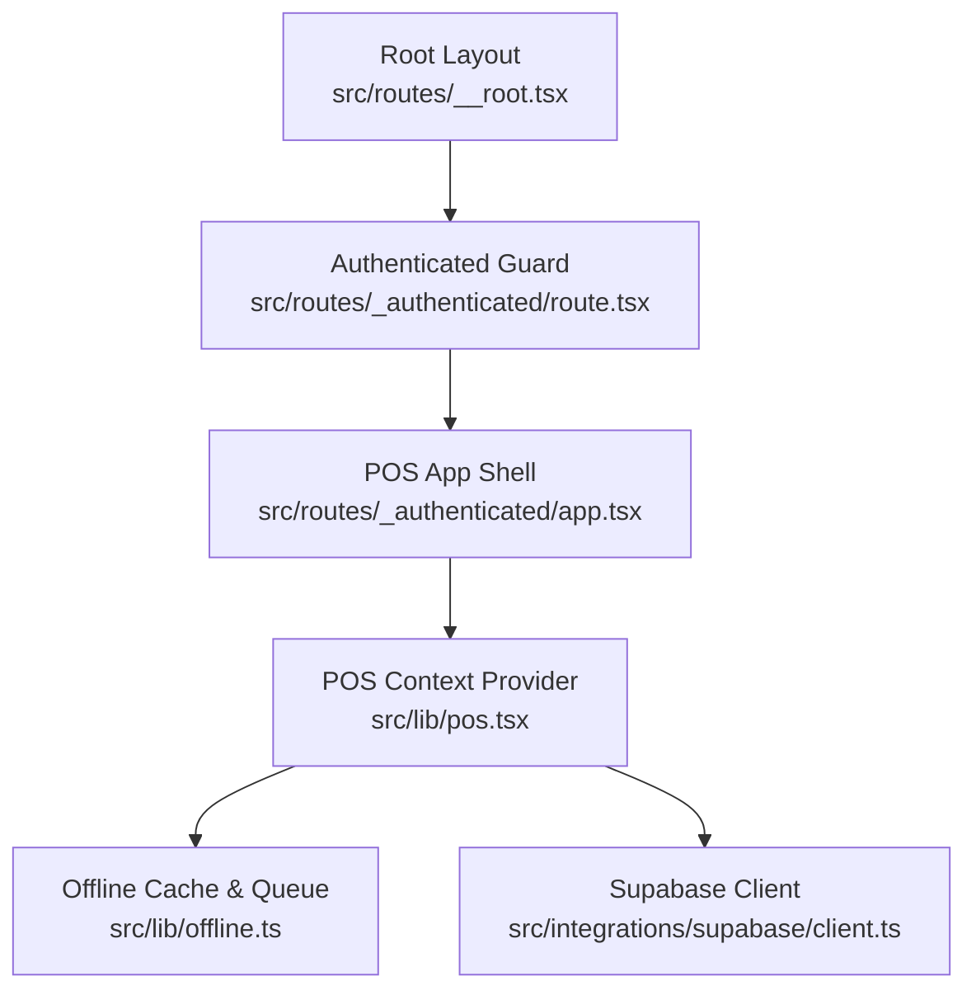
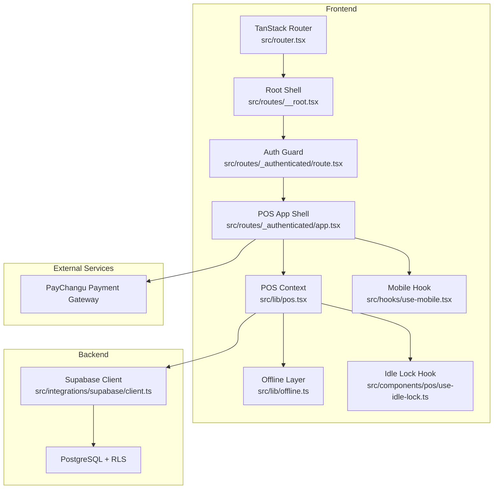
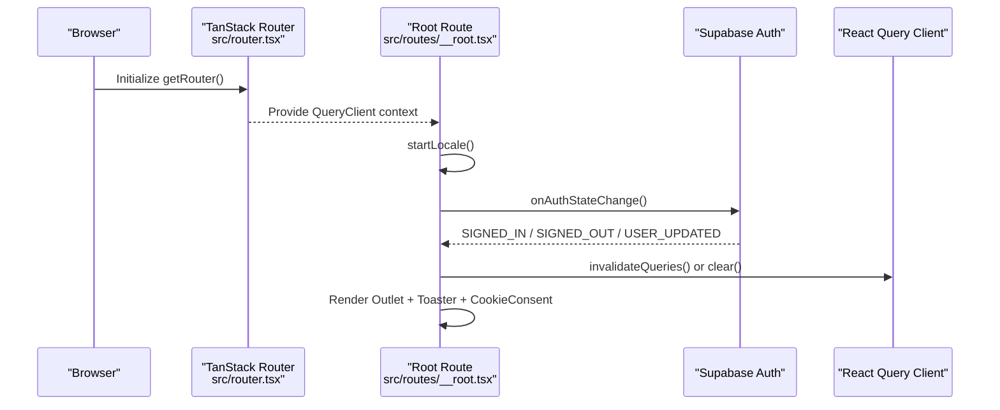
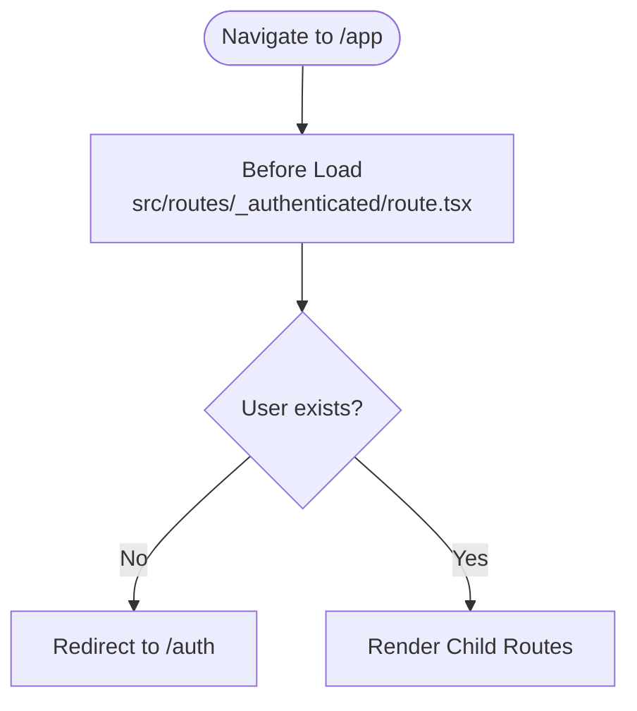
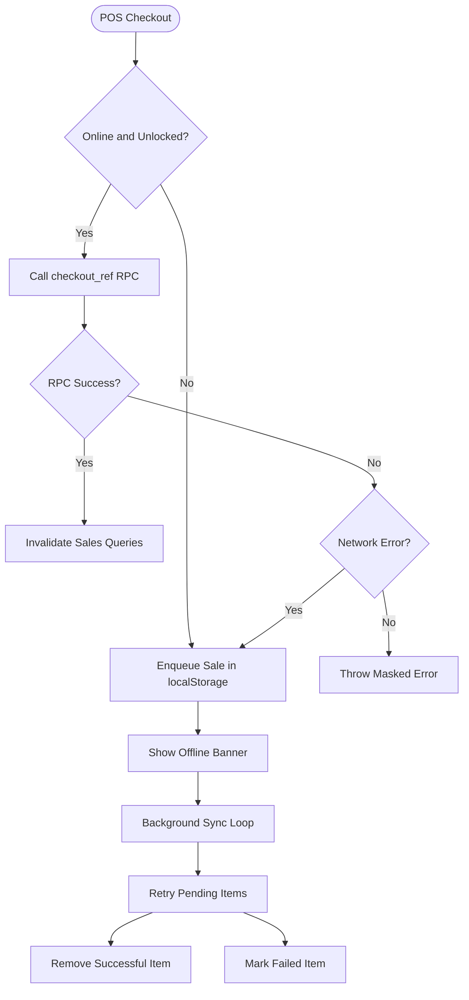
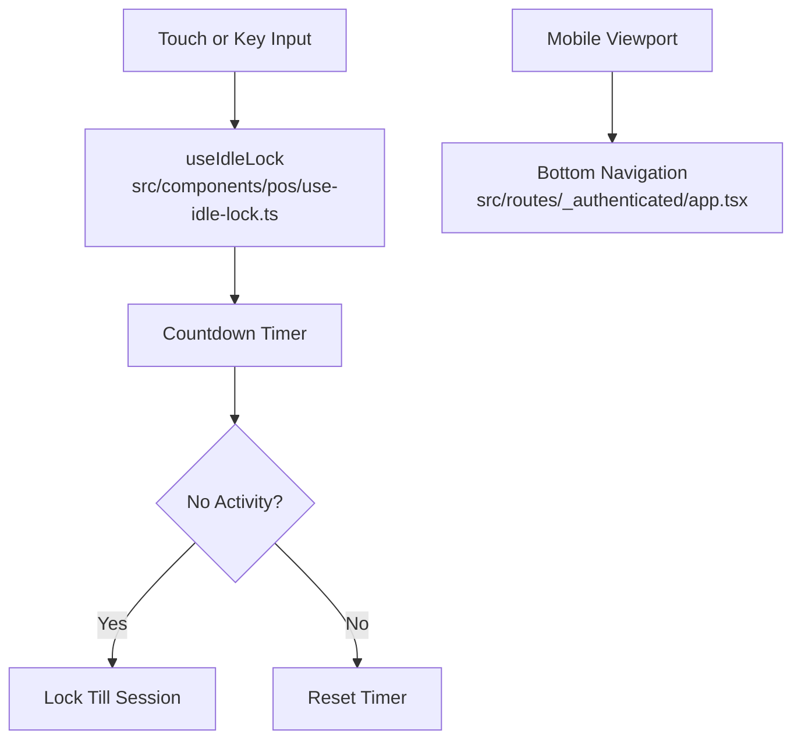
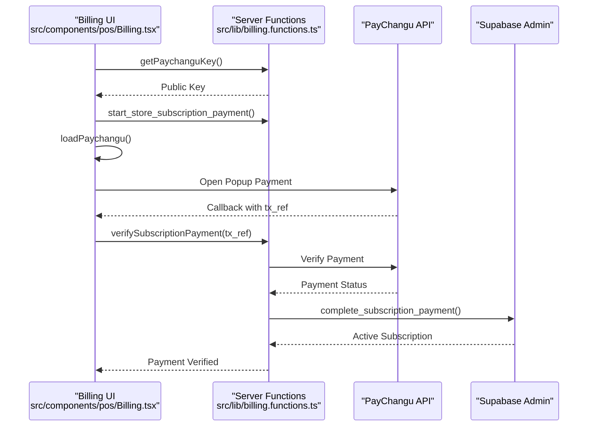
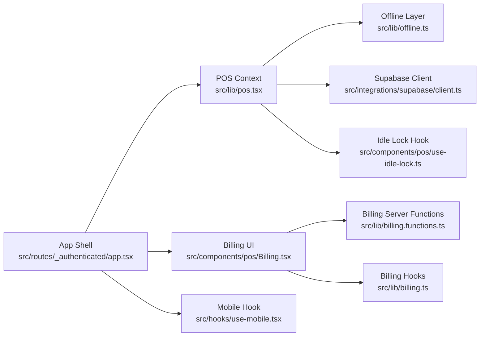

# System Design & Architecture Patterns

<cite>
**Referenced Files in This Document**
- [README.md](file://README.md)
- [router.tsx](file://src/router.tsx)
- [__root.tsx](file://src/routes/__root.tsx)
- [route.tsx](file://src/routes/_authenticated/route.tsx)
- [app.tsx](file://src/routes/_authenticated/app.tsx)
- [pos.tsx](file://src/lib/pos.tsx)
- [offline.ts](file://src/lib/offline.ts)
- [client.ts](file://src/integrations/supabase/client.ts)
- [use-mobile.tsx](file://src/hooks/use-mobile.tsx)
- [use-idle-lock.ts](file://src/components/pos/use-idle-lock.ts)
- [Billing.tsx](file://src/components/pos/Billing.tsx)
- [billing.functions.ts](file://src/lib/billing.functions.ts)
- [billing.ts](file://src/lib/billing.ts)
</cite>

## Table of Contents
1. [Introduction](#introduction)
2. [Project Structure](#project-structure)
3. [Core Components](#core-components)
4. [Architecture Overview](#architecture-overview)
5. [Detailed Component Analysis](#detailed-component-analysis)
6. [Dependency Analysis](#dependency-analysis)
7. [Performance Considerations](#performance-considerations)
8. [Troubleshooting Guide](#troubleshooting-guide)
9. [Conclusion](#conclusion)

## Introduction
Storq POS is a mobile-first retail point-of-sale application designed for single or multi-store environments, including direct sales and approval-based workflows. The system emphasizes fast register startup, reliable offline sales, PIN-secured staff sessions, and clear separation between frontend state, backend services, and external payment integrations.

The project’s README describes the business goals: shared email/password login with per-staff PINs, support for multiple stores, layby workflows, and two store modes (direct sale and approval-based). The UI should feel like a modern square POS interface suitable for touch devices.

**Section sources**
- [README.md:1-26](file://README.md#L1-L26)

## Project Structure
The application uses TanStack Start with file-based routing under `src/routes`. The root layout is `src/routes/__root.tsx`, authenticated routes live under `src/routes/_authenticated`, and generated route metadata is maintained by `src/routeTree.gen.ts`. The router configuration lives in `src/router.tsx`, which creates a TanStack Router instance with React Query settings tuned for a POS terminal.



**Diagram sources**
- [__root.tsx:59-139](file://src/routes/__root.tsx#L59-L139)
- [route.tsx:4-12](file://src/routes/_authenticated/route.tsx#L4-L12)
- [app.tsx:73-93](file://src/routes/_authenticated/app.tsx#L73-L93)
- [pos.tsx:115-117](file://src/lib/pos.tsx#L115-L117)
- [offline.ts:1-14](file://src/lib/offline.ts#L1-L14)
- [client.ts:57-84](file://src/integrations/supabase/client.ts#L57-L84)

**Section sources**
- [router.tsx:1-34](file://src/router.tsx#L1-L34)
- [__root.tsx:1-139](file://src/routes/__root.tsx#L1-L139)
- [route.tsx:1-13](file://src/routes/_authenticated/route.tsx#L1-L13)
- [app.tsx:1-93](file://src/routes/_authenticated/app.tsx#L1-L93)

## Core Components
This section documents the main architectural building blocks:

- **TanStack Router**: File-based routing with a root shell, query client context, and auth-aware navigation.
- **React Context Provider Pattern**: `PosProvider` centralizes business context, store selection, staff session management, money formatting, permissions, and offline checkout.
- **Supabase Backend Layer**: A generated client wraps environment-driven configuration, fetch interception, and authentication persistence.
- **Offline-First Storage**: Local cache hydration/persistence for reference data and a persistent queue for offline sales with background sync.
- **Mobile-First UX**: Touch-friendly PIN pad, idle lock, responsive sidebar, and bottom navigation for small screens.

**Section sources**
- [router.tsx:5-32](file://src/router.tsx#L5-L32)
- [pos.tsx:55-84](file://src/lib/pos.tsx#L55-L84)
- [client.ts:57-96](file://src/integrations/supabase/client.ts#L57-L96)
- [offline.ts:1-14](file://src/lib/offline.ts#L1-L14)
- [use-idle-lock.ts:1-39](file://src/components/pos/use-idle-lock.ts#L1-L39)

## Architecture Overview
At runtime, the app boots through the root route, sets up React Query, subscribes to Supabase auth events, and renders the authenticated POS shell. Inside the POS shell, `PosProvider` owns the business-wide state and exposes methods such as `unlock`, `lock`, `checkout`, and `syncQueue`. Data access goes through Supabase RPC calls and table queries, while offline operations persist locally and synchronize when connectivity returns.



**Diagram sources**
- [router.tsx:5-32](file://src/router.tsx#L5-L32)
- [__root.tsx:59-139](file://src/routes/__root.tsx#L59-L139)
- [route.tsx:4-12](file://src/routes/_authenticated/route.tsx#L4-L12)
- [app.tsx:73-93](file://src/routes/_authenticated/app.tsx#L73-L93)
- [pos.tsx:115-117](file://src/lib/pos.tsx#L115-L117)
- [offline.ts:1-14](file://src/lib/offline.ts#L1-L14)
- [client.ts:57-96](file://src/integrations/supabase/client.ts#L57-L96)
- [use-mobile.tsx:1-19](file://src/hooks/use-mobile.tsx#L1-L19)
- [use-idle-lock.ts:1-39](file://src/components/pos/use-idle-lock.ts#L1-L39)

## Detailed Component Analysis

### TanStack Router and Application Shell
The router config creates a React Query client with POS-specific defaults: longer stale times for reference data, disabled refetch on window focus, limited retries, and no mutation retries. The root route defines the HTML shell, SEO metadata, global error handling, i18n initialization, and Supabase auth event subscription that invalidates queries and clears device cache on sign-out.



**Diagram sources**
- [router.tsx:5-32](file://src/router.tsx#L5-L32)
- [__root.tsx:59-139](file://src/routes/__root.tsx#L59-L139)

**Section sources**
- [router.tsx:5-32](file://src/router.tsx#L5-L32)
- [__root.tsx:22-91](file://src/routes/__root.tsx#L22-L91)
- [__root.tsx:111-139](file://src/routes/__root.tsx#L111-L139)

### Authentication and Authenticated Routes
The `_authenticated` route guard ensures a logged-in user before rendering POS features. It redirects unauthenticated requests to `/auth` and attaches the current user to route context.



**Diagram sources**
- [route.tsx:4-12](file://src/routes/_authenticated/route.tsx#L4-L12)

**Section sources**
- [route.tsx:1-13](file://src/routes/_authenticated/route.tsx#L1-L13)

### POS Provider and Business Context
`PosProvider` is the central state container for the POS. It manages:

- Business and store metadata loading via Supabase.
- Staff session lifecycle: unlock with PIN, lock session, token expiry handling.
- Store selection and cashier-scoped store enforcement.
- Money formatting and currency symbol resolution.
- Permission checks using staff role.
- Offline checkout queuing and background synchronization.
- Idle lock integration for till hygiene.

```mermaid
classDiagram
class PosProvider {
+userId string
+business Business | null | undefined
+stores Store[]
+store Store | null
+staff StaffSession | null
+unlock(pin) Promise<void>
+lock() Promise<void>
+rpc(fn, args) Promise<unknown>
+money(n) string
+compactMoney(n) string
+currency string | null
+can(...roles) boolean
+refresh() void
+checkout(args, opts) Promise<CheckoutResult>
+online boolean
+queue QueuedSale[]
+syncQueue() Promise<void>
+autoLockMinutes number
+setAutoLockMinutes(n) void
}
class OfflineLayer {
+hydrateCache(qc, userId) void
+persistCache(qc, userId) () => void
+loadQueue(userId) QueuedSale[]
+saveQueue(userId, q) void
+isNetworkError(message) boolean
+newRef() string
}
class SupabaseClient {
+rpc(fn, args) Promise<{data,error}>
+from(table) QueryBuilder
+auth.onAuthStateChange(callback) Subscription
}
PosProvider --> OfflineLayer : "uses"
PosProvider --> SupabaseClient : "calls RPC and tables"
```

**Diagram sources**
- [pos.tsx:55-84](file://src/lib/pos.tsx#L55-L84)
- [pos.tsx:115-117](file://src/lib/pos.tsx#L115-L117)
- [pos.tsx:149-184](file://src/lib/pos.tsx#L149-L184)
- [pos.tsx:194-228](file://src/lib/pos.tsx#L194-L228)
- [pos.tsx:275-338](file://src/lib/pos.tsx#L275-L338)
- [offline.ts:15-27](file://src/lib/offline.ts#L15-L27)
- [offline.ts:29-55](file://src/lib/offline.ts#L29-L55)
- [offline.ts:62-92](file://src/lib/offline.ts#L62-L92)
- [client.ts:57-96](file://src/integrations/supabase/client.ts#L57-L96)

**Section sources**
- [pos.tsx:55-84](file://src/lib/pos.tsx#L55-L84)
- [pos.tsx:115-117](file://src/lib/pos.tsx#L115-L117)
- [pos.tsx:149-184](file://src/lib/pos.tsx#L149-L184)
- [pos.tsx:194-228](file://src/lib/pos.tsx#L194-L228)
- [pos.tsx:275-338](file://src/lib/pos.tsx#L275-L338)
- [pos.tsx:366-388](file://src/lib/pos.tsx#L366-L388)

### Offline-First Architecture and Background Sync
The offline layer provides:

- **Instant-start cache**: Hydrates reference data from localStorage so the register can open immediately, then refreshes in the background.
- **Persisted cache**: Watches React Query updates and persists allowed query keys to localStorage.
- **Sales queue**: Stores pending sales locally with unique references, retry logic, and error marking.
- **Background sync**: Periodically attempts to replay queued sales when online and unlocked; invalidates relevant queries after successful sync.



**Diagram sources**
- [pos.tsx:275-338](file://src/lib/pos.tsx#L275-L338)
- [offline.ts:62-92](file://src/lib/offline.ts#L62-L92)

**Section sources**
- [offline.ts:1-14](file://src/lib/offline.ts#L1-L14)
- [offline.ts:15-27](file://src/lib/offline.ts#L15-L27)
- [offline.ts:29-55](file://src/lib/offline.ts#L29-L55)
- [offline.ts:62-92](file://src/lib/offline.ts#L62-L92)
- [pos.tsx:242-247](file://src/lib/pos.tsx#L242-L247)
- [pos.tsx:249-273](file://src/lib/pos.tsx#L249-L273)
- [pos.tsx:309-345](file://src/lib/pos.tsx#L309-L345)

### Mobile-First Retail UX
The POS supports touch interactions and small-screen layouts:

- PIN pad with numeric input and keyboard support.
- Idle lock hook that listens to pointer/key events and auto-locks after inactivity.
- Responsive sidebar with collapsible navigation and bottom tab bar on mobile.
- Mobile breakpoint hook for conditional behavior.



**Diagram sources**
- [use-idle-lock.ts:1-39](file://src/components/pos/use-idle-lock.ts#L1-L39)
- [app.tsx:557-598](file://src/routes/_authenticated/app.tsx#L557-L598)

**Section sources**
- [use-idle-lock.ts:1-39](file://src/components/pos/use-idle-lock.ts#L1-L39)
- [use-mobile.tsx:1-19](file://src/hooks/use-mobile.tsx#L1-L19)
- [app.tsx:269-362](file://src/routes/_authenticated/app.tsx#L269-L362)
- [app.tsx:557-598](file://src/routes/_authenticated/app.tsx#L557-L598)

### External Payment Integration
Subscription billing integrates with PayChangu:

- Frontend loads the PayChangu popup script dynamically.
- Server function retrieves the public key securely.
- Server function verifies payment against PayChangu API and marks subscription active if amounts and currency match.
- Billing UI handles plan selection, currency, period, and payment callback via URL parameter.



**Diagram sources**
- [Billing.tsx:38-42](file://src/components/pos/Billing.tsx#L38-L42)
- [Billing.tsx:74-107](file://src/components/pos/Billing.tsx#L74-L107)
- [billing.functions.ts:4-53](file://src/lib/billing.functions.ts#L4-L53)
- [billing.ts:41-55](file://src/lib/billing.ts#L41-L55)

**Section sources**
- [Billing.tsx:38-42](file://src/components/pos/Billing.tsx#L38-L42)
- [Billing.tsx:74-107](file://src/components/pos/Billing.tsx#L74-L107)
- [billing.functions.ts:4-53](file://src/lib/billing.functions.ts#L4-L53)
- [billing.ts:41-55](file://src/lib/billing.ts#L41-L55)

## Dependency Analysis
The following diagram shows how components depend on each other and on backend services:



**Diagram sources**
- [app.tsx:73-93](file://src/routes/_authenticated/app.tsx#L73-L93)
- [pos.tsx:115-117](file://src/lib/pos.tsx#L115-L117)
- [offline.ts:1-14](file://src/lib/offline.ts#L1-L14)
- [client.ts:57-96](file://src/integrations/supabase/client.ts#L57-L96)
- [Billing.tsx:38-42](file://src/components/pos/Billing.tsx#L38-L42)
- [billing.functions.ts:4-53](file://src/lib/billing.functions.ts#L4-L53)
- [billing.ts:41-55](file://src/lib/billing.ts#L41-L55)
- [use-mobile.tsx:1-19](file://src/hooks/use-mobile.tsx#L1-L19)
- [use-idle-lock.ts:1-39](file://src/components/pos/use-idle-lock.ts#L1-L39)

**Section sources**
- [app.tsx:73-93](file://src/routes/_authenticated/app.tsx#L73-L93)
- [pos.tsx:115-117](file://src/lib/pos.tsx#L115-L117)
- [offline.ts:1-14](file://src/lib/offline.ts#L1-L14)
- [client.ts:57-96](file://src/integrations/supabase/client.ts#L57-L96)
- [Billing.tsx:38-42](file://src/components/pos/Billing.tsx#L38-L42)
- [billing.functions.ts:4-53](file://src/lib/billing.functions.ts#L4-L53)
- [billing.ts:41-55](file://src/lib/billing.ts#L41-L55)
- [use-mobile.tsx:1-19](file://src/hooks/use-mobile.tsx#L1-L19)
- [use-idle-lock.ts:1-39](file://src/components/pos/use-idle-lock.ts#L1-L39)

## Performance Considerations
- **Query Staleness**: Reference data such as business, stores, products, collections, and stock are cached with long stale times to avoid unnecessary database hits during a trading session.
- **Mutation Retries Disabled**: Mutations do not retry automatically to prevent duplicate writes; failures are surfaced to the UI or queued for later sync.
- **Window Focus Behavior Disabled**: Refetching on window focus is turned off because POS terminals should not re-hit the database just because the browser regains focus.
- **Local Cache Hydration**: Instant-start cache reduces perceived latency by showing last-known catalog and stock immediately.
- **Background Sync Interval**: Queued sales are retried periodically without blocking UI interaction.
- **Storage Safety**: Persisted cache and queue operations handle storage errors gracefully so the app continues working even if local storage is full or unavailable.

[No sources needed since this section provides general guidance]

## Troubleshooting Guide
Common issues and their handling patterns:

- **Raw Database Errors Masked**: RPC errors containing SQL internals are replaced with generic messages to avoid leaking schema details to the UI.
- **Staff Session Lockout**: If an RPC indicates the session is locked, the provider clears the local staff session and requires re-unlocking.
- **Offline Sales Failures**: Failed queued items show error messages with retry and discard options; network errors stop sync until connectivity improves.
- **Sign-Out Cleanup**: Sign-out clears local staff sessions, invalidates queries, clears device cache, and signs out from Supabase.
- **Subscription Payment Verification**: Payment verification validates amount and currency against stored records before activating the subscription.

**Section sources**
- [pos.tsx:88-104](file://src/lib/pos.tsx#L88-L104)
- [pos.tsx:220-228](file://src/lib/pos.tsx#L220-L228)
- [pos.tsx:309-338](file://src/lib/pos.tsx#L309-L338)
- [app.tsx:131-151](file://src/routes/_authenticated/app.tsx#L131-L151)
- [billing.functions.ts:10-53](file://src/lib/billing.functions.ts#L10-L53)

## Conclusion
Storq POS combines TanStack Router for predictable file-based navigation, React Context for centralized POS state, and Supabase for secure backend operations. Its offline-first design ensures reliable sales capture even without internet connectivity, while background synchronization reconciles data once connectivity returns. The architecture supports mobile-first retail environments through touch-friendly interfaces, idle locking, and responsive layouts. External payment integration is handled through server functions and a third-party gateway, keeping sensitive operations secure and auditable.

[No sources needed since this section summarizes without analyzing specific files]