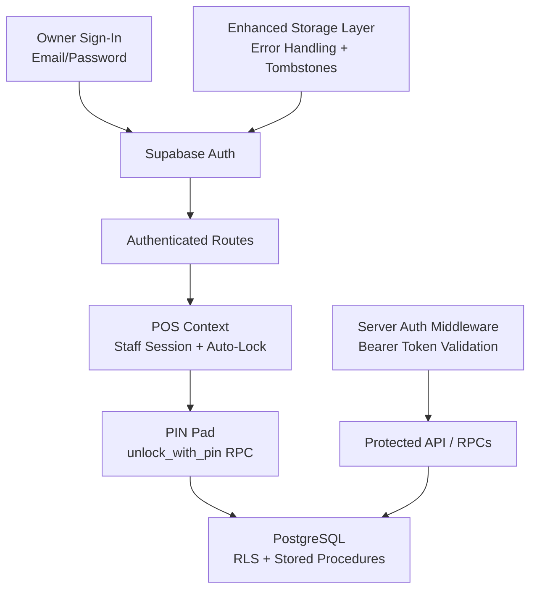
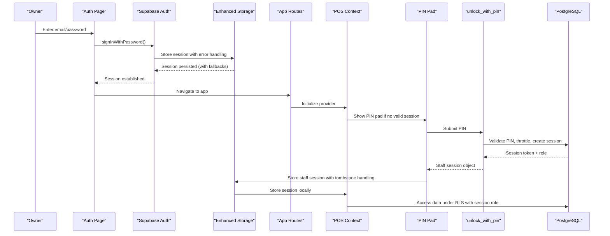
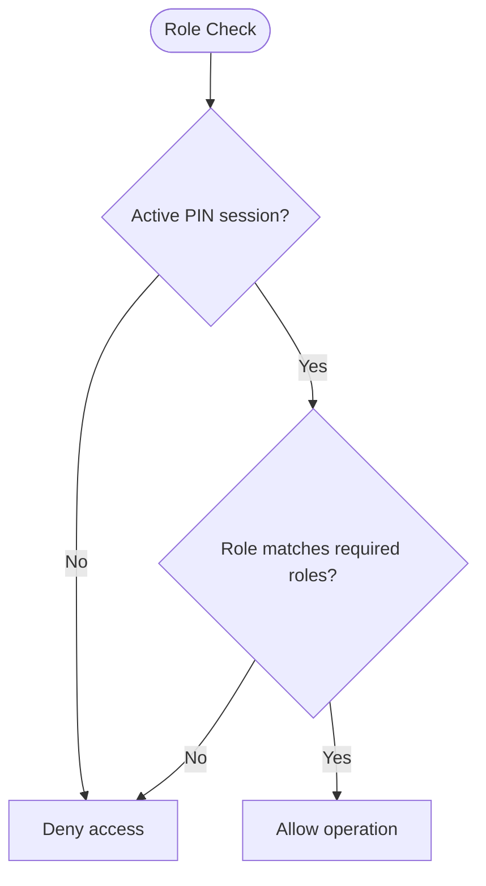
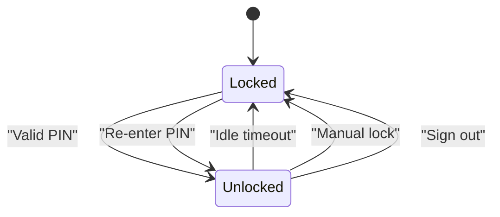
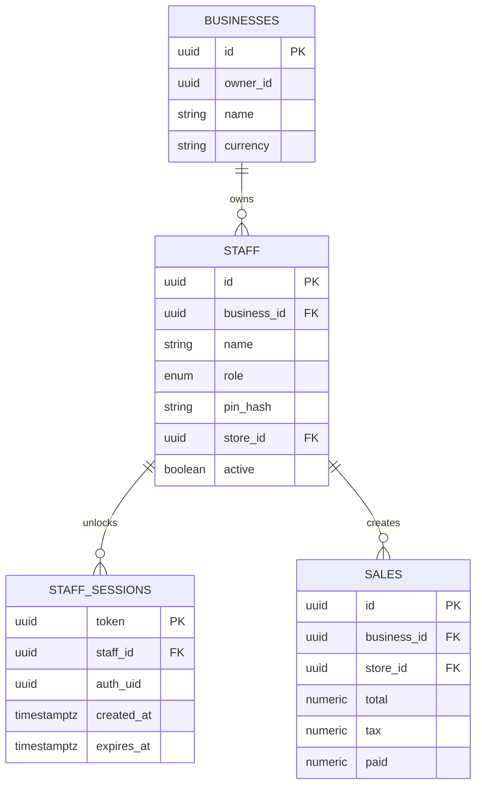
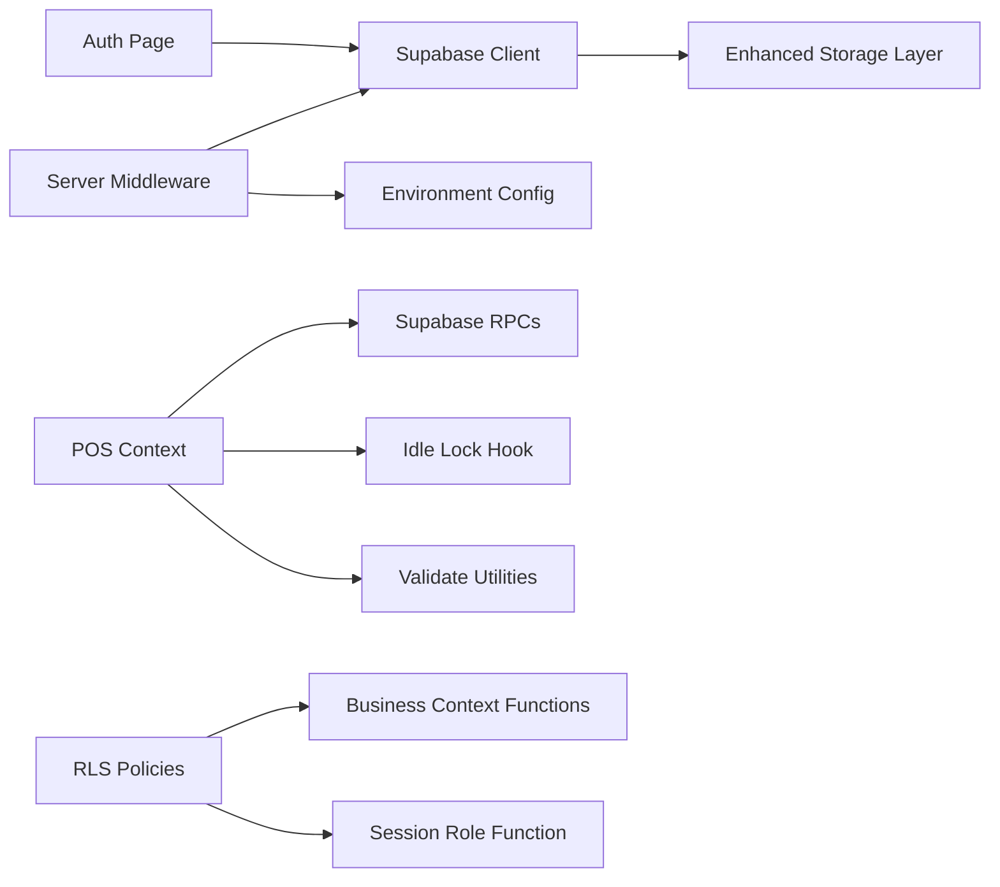

# Authentication & Security

<cite>
**Referenced Files in This Document**
- [auth-middleware.ts](file://src/integrations/supabase/auth-middleware.ts)
- [client.server.ts](file://src/integrations/supabase/client.server.ts)
- [previewAuthStorage.ts](file://src/integrations/supabase/previewAuthStorage.ts)
- [client.ts](file://src/integrations/supabase/client.ts)
- [auth.tsx](file://src/routes/auth.tsx)
- [pos.tsx](file://src/lib/pos.tsx)
- [use-idle-lock.ts](file://src/components/pos/use-idle-lock.ts)
- [app.staff.tsx](file://src/routes/_authenticated/app.staff.tsx)
- [validate.ts](file://src/lib/validate.ts)
- [workspace-navigation.ts](file://src/lib/workspace-navigation.ts)
- [20261008090000_security_hardening.sql](file://supabase/migrations/20261008090000_security_hardening.sql)
</cite>

## Update Summary
**Changes Made**
- Enhanced authentication storage with improved error handling for third-party storage blocking
- Improved logout tombstone handling for better session synchronization
- Added robust localStorage error handling throughout the authentication flow
- Updated preview storage broker to handle storage failures gracefully

## Table of Contents
1. [Introduction](#introduction)
2. [Project Structure](#project-structure)
3. [Core Components](#core-components)
4. [Architecture Overview](#architecture-overview)
5. [Detailed Component Analysis](#detailed-component-analysis)
6. [Dependency Analysis](#dependency-analysis)
7. [Performance Considerations](#performance-considerations)
8. [Troubleshooting Guide](#troubleshooting-guide)
9. [Conclusion](#conclusion)

## Introduction
This document explains the authentication and security system for the application. It covers:
- Dual-layer authentication: email/password for business owners and PIN-based access for staff members.
- Role-based access control with Admin, Manager, and Cashier roles and granular permissions.
- Session management including device-bound staff sessions, auto-lock, and sign-out behavior.
- Row-Level Security policies that isolate data by business and store.
- Implementation examples for authentication middleware, PIN validation, and permission checks.
- Security best practices such as secure PIN storage, session timeout handling, and audit logging.
- Integration with Supabase Auth and custom server-side authentication flows.
- Enhanced storage resilience with improved error handling for third-party storage blocking and better logout tombstone handling.

## Project Structure
The authentication and security logic spans client routes, shared POS context, server-side middleware, and PostgreSQL migrations:
- Client authentication UI and owner sign-in are implemented in the auth route.
- Staff PIN unlock, session state, idle lock, and role checks live in the POS context.
- Server-side Supabase middleware validates tokens for protected endpoints.
- Database security is enforced through RLS policies, stored procedures, and throttling tables.
- Enhanced storage layer handles third-party storage blocking and logout tombstones.

**Diagram sources**
- [auth.tsx:13-107](file://src/routes/auth.tsx#L13-L107)
- [pos.tsx:115-228](file://src/lib/pos.tsx#L115-L228)
- [auth-middleware.ts:34-105](file://src/integrations/supabase/auth-middleware.ts#L34-L105)
- [previewAuthStorage.ts:59-105](file://src/integrations/supabase/previewAuthStorage.ts#L59-L105)
- [20261008090000_security_hardening.sql:218-291](file://supabase/migrations/20261008090000_security_hardening.sql#L218-L291)

**Section sources**
- [auth.tsx:13-107](file://src/routes/auth.tsx#L13-L107)
- [pos.tsx:115-228](file://src/lib/pos.tsx#L115-L228)
- [auth-middleware.ts:34-105](file://src/integrations/supabase/auth-middleware.ts#L34-L105)
- [previewAuthStorage.ts:59-105](file://src/integrations/supabase/previewAuthStorage.ts#L59-L105)
- [20261008090000_security_hardening.sql:218-291](file://supabase/migrations/20261008090000_security_hardening.sql#L218-L291)

## Core Components
- Owner authentication: Email/password sign-in, sign-up, password reset, and recovery handled via Supabase Auth.
- Staff authentication: PIN pad unlocks a short-lived, device-bound session tied to the signed-in owner account.
- Role-based access control: Admin, Manager, and Cashier roles determine UI visibility and database access.
- Session management: Local staff session storage, server-side session binding, idle auto-lock, and sign-out cleanup.
- Row-Level Security: Policies enforce business isolation and require an active PIN session for sensitive reads.
- Server middleware: Validates Bearer tokens and injects user claims into request context.
- Enhanced storage layer: Handles third-party storage blocking and logout tombstones with improved error handling.

**Section sources**
- [auth.tsx:13-107](file://src/routes/auth.tsx#L13-L107)
- [pos.tsx:115-228](file://src/lib/pos.tsx#L115-L228)
- [20261008090000_security_hardening.sql:67-170](file://supabase/migrations/20261008090000_security_hardening.sql#L67-L170)
- [auth-middleware.ts:34-105](file://src/integrations/supabase/auth-middleware.ts#L34-L105)
- [previewAuthStorage.ts:59-105](file://src/integrations/supabase/previewAuthStorage.ts#L59-L105)

## Architecture Overview
The system uses two authentication layers:
1. Owner layer: Business owners authenticate with email/password using Supabase Auth.
2. Staff layer: Staff members unlock a temporary session using a PIN; this session is bound to the owner's authenticated device and expires after a set time.

Access control is enforced at multiple levels:
- Frontend role checks hide or disable features based on the current staff role.
- Database RLS policies restrict row access by business and require an active PIN session.
- Stored procedures validate inputs, enforce role requirements, and manage sessions securely.
- Enhanced storage layer provides resilient session persistence with error handling.

**Diagram sources**
- [auth.tsx:45-107](file://src/routes/auth.tsx#L45-L107)
- [pos.tsx:194-228](file://src/lib/pos.tsx#L194-L228)
- [previewAuthStorage.ts:59-105](file://src/integrations/supabase/previewAuthStorage.ts#L59-L105)
- [20261008090000_security_hardening.sql:218-291](file://supabase/migrations/20261008090000_security_hardening.sql#L218-L291)

## Detailed Component Analysis

### Owner Authentication (Email/Password)
- The auth page supports sign-in, sign-up, forgot password, and password recovery flows.
- It performs client-side validation for email and password before calling Supabase Auth.
- On success, it navigates to the authenticated app area.

Key behaviors:
- Email/password validation prevents invalid submissions early.
- Password reset sends a link back to the auth page.
- Recovery mode switches the UI to prompt for a new password.

**Section sources**
- [auth.tsx:13-107](file://src/routes/auth.tsx#L13-L107)

### Enhanced Authentication Storage
**Updated** Enhanced storage layer with improved error handling for third-party storage blocking and better logout tombstone handling.

The enhanced storage system provides:
- **Third-party storage blocking protection**: Graceful handling when localStorage is blocked by browser privacy settings or extensions.
- **Logout tombstone handling**: Special empty string ('') value indicates logout, ensuring local copies are cleared even if broker communication fails.
- **Resilient read operations**: Try-catch blocks around localStorage operations prevent storage errors from breaking the authentication flow.
- **Fallback mechanisms**: When brokered storage fails, falls back to direct localStorage usage.

Implementation highlights:
- `readLocal` function wraps localStorage.getItem in try-catch to handle storage blocking.
- Logout tombstone ('') triggers immediate removal of local session data.
- Seeding mechanism ensures new tabs stay signed in while respecting storage limitations.
- Error handling prevents storage full conditions from breaking the authentication experience.

**Section sources**
- [previewAuthStorage.ts:59-105](file://src/integrations/supabase/previewAuthStorage.ts#L59-L105)
- [client.ts:74-83](file://src/integrations/supabase/client.ts#L74-L83)

### Staff PIN Authentication
- After owner login, staff members use a PIN pad to unlock a session.
- The PIN is validated server-side via `unlock_with_pin`, which enforces throttling and creates a short-lived session.
- The resulting session includes a token, staff id, name, role, optional store assignment, and expiration.

Implementation highlights:
- Client calls `unlock_with_pin` with the entered PIN.
- Success stores the session in local storage and refreshes queries.
- Failure masks raw errors and surfaces user-friendly messages.

**Section sources**
- [pos.tsx:194-228](file://src/lib/pos.tsx#L194-L228)
- [20261008090000_security_hardening.sql:218-291](file://supabase/migrations/20261008090000_security_hardening.sql#L218-L291)

### PIN Validation and Storage
- Client-side PIN validation ensures the PIN meets length and format requirements.
- Server-side validation enforces stricter rules and rejects malformed input.
- PINs are never stored in plain text; they are hashed using bcrypt-style hashing via extensions.

Security measures:
- Input shape constraints prevent injection and ensure consistent formats.
- Hashing uses a strong salt and algorithm identifier.
- Throttling prevents brute-force attacks per business and device.

**Section sources**
- [validate.ts:84-89](file://src/lib/validate.ts#L84-L89)
- [20261008090000_security_hardening.sql:170-180](file://supabase/migrations/20261008090000_security_hardening.sql#L170-L180)
- [20261008090000_security_hardening.sql:218-291](file://supabase/migrations/20261008090000_security_hardening.sql#L218-L291)

### Role-Based Access Control
Roles:
- Admin: Full access to settings, staff management, and financial operations.
- Manager: Access to approvals, costs, refunds, stock movements, and billing.
- Cashier: Limited to sales, expenses, and store-specific operations when assigned.

Frontend enforcement:
- Navigation items are filtered by role.
- Pages like Staff management are restricted to admins.
- The POS context exposes a `can(...roles)` helper for runtime checks.

Database enforcement:
- RLS policies require an active PIN session and check the session role.
- Sensitive tables restrict reads/writes to specific roles.

**Diagram sources**
- [pos.tsx:386-386](file://src/lib/pos.tsx#L386-L386)
- [20261008090000_security_hardening.sql:67-170](file://supabase/migrations/20261008090000_security_hardening.sql#L67-L170)

**Section sources**
- [workspace-navigation.ts:106-151](file://src/lib/workspace-navigation.ts#L106-L151)
- [app.staff.tsx:72-75](file://src/routes/_authenticated/app.staff.tsx#L72-L75)
- [pos.tsx:386-386](file://src/lib/pos.tsx#L386-L386)
- [20261008090000_security_hardening.sql:67-170](file://supabase/migrations/20261008090000_security_hardening.sql#L67-L170)

### Session Management and Auto-Lock
- Staff sessions are stored locally with an expiration timestamp.
- Stale or expired sessions are rejected and require re-unlocking.
- Idle activity triggers auto-lock after a configurable number of minutes.
- Locking clears local state and optionally invalidates the server session.

Auto-lock implementation:
- Listens to keyboard, mouse, and touch events to reset the idle timer.
- Pauses during offline queue sync to avoid locking mid-operation.
- Calls the lock function to clear local state and optionally revoke the server session.

**Diagram sources**
- [pos.tsx:125-147](file://src/lib/pos.tsx#L125-L147)
- [use-idle-lock.ts:1-39](file://src/components/pos/use-idle-lock.ts#L1-L39)
- [20261008090000_security_hardening.sql:272-291](file://supabase/migrations/20261008090000_security_hardening.sql#L272-L291)

**Section sources**
- [pos.tsx:125-147](file://src/lib/pos.tsx#L125-L147)
- [pos.tsx:205-215](file://src/lib/pos.tsx#L205-L215)
- [use-idle-lock.ts:1-39](file://src/components/pos/use-idle-lock.ts#L1-L39)
- [20261008090000_security_hardening.sql:272-291](file://supabase/migrations/20261008090000_security_hardening.sql#L272-L291)

### Row-Level Security (RLS) Policies
RLS policies enforce:
- Business isolation: Rows belong to a specific business.
- Session requirement: Reads require an active PIN session.
- Role restrictions: Certain tables only allow Admin or Manager roles.

Examples:
- Products, stores, staff, sales, payments, stock, collections, expenses all require business ownership and an active session role.
- Cost-related tables are restricted to Admin and Manager roles.
- Refunds and stock movements are limited to Admin and Manager roles.

**Diagram sources**
- [20261008090000_security_hardening.sql:67-170](file://supabase/migrations/20261008090000_security_hardening.sql#L67-L170)
- [20261008090000_security_hardening.sql:218-291](file://supabase/migrations/20261008090000_security_hardening.sql#L218-L291)

**Section sources**
- [20261008090000_security_hardening.sql:67-170](file://supabase/migrations/20261008090000_security_hardening.sql#L67-L170)

### Authentication Middleware
The server middleware:
- Requires environment variables for Supabase URL and publishable key.
- Validates the Authorization header contains a Bearer token.
- Verifies the token structure and extracts claims.
- Creates a Supabase client configured to pass the token and bypass session persistence.

Use cases:
- Protecting server functions and routes that need authenticated user context.
- Injecting userId and claims into the request context for downstream processing.

**Section sources**
- [auth-middleware.ts:34-105](file://src/integrations/supabase/auth-middleware.ts#L34-L105)

### Admin Staff Management
The Staff page:
- Is restricted to Admin users.
- Allows adding/editing staff with name, role, store assignment, PIN, and active status.
- Integrates with the POS context to call `save_staff` RPC with validated inputs.

Best practices:
- Client-side validation for name and PIN before sending to the server.
- Sanitization of text fields to prevent injection.
- Clear error feedback via toast notifications.

**Section sources**
- [app.staff.tsx:54-147](file://src/routes/_authenticated/app.staff.tsx#L54-L147)
- [app.staff.tsx:149-271](file://src/routes/_authenticated/app.staff.tsx#L149-L271)

## Dependency Analysis
The authentication and security components depend on each other as follows:
- Auth page depends on Supabase Auth client for owner sign-in.
- POS context depends on validate utilities, idle lock hook, and Supabase RPCs.
- Server middleware depends on environment configuration and Supabase client.
- Database policies depend on session role resolution and business context functions.
- Enhanced storage layer provides resilient session persistence with error handling.

**Diagram sources**
- [auth.tsx:1-10](file://src/routes/auth.tsx#L1-L10)
- [pos.tsx:1-27](file://src/lib/pos.tsx#L1-L27)
- [auth-middleware.ts:1-10](file://src/integrations/supabase/auth-middleware.ts#L1-L10)
- [previewAuthStorage.ts:1-106](file://src/integrations/supabase/previewAuthStorage.ts#L1-L106)
- [20261008090000_security_hardening.sql:67-77](file://supabase/migrations/20261008090000_security_hardening.sql#L67-L77)

**Section sources**
- [auth.tsx:1-10](file://src/routes/auth.tsx#L1-L10)
- [pos.tsx:1-27](file://src/lib/pos.tsx#L1-L27)
- [auth-middleware.ts:1-10](file://src/integrations/supabase/auth-middleware.ts#L1-L10)
- [previewAuthStorage.ts:1-106](file://src/integrations/supabase/previewAuthStorage.ts#L1-L106)
- [20261008090000_security_hardening.sql:67-77](file://supabase/migrations/20261008090000_security_hardening.sql#L67-L77)

## Performance Considerations
- Caching: Business and store data are cached with long stale times to reduce repeated network calls.
- Offline support: Sales can be queued locally and synced when online, minimizing downtime impact.
- Query invalidation: Explicit cache invalidation ensures fresh data after mutations.
- Session expiry: Short-lived staff sessions reduce the risk of stale credentials being reused.
- Storage resilience: Enhanced storage layer prevents storage errors from impacting performance.

[No sources needed since this section provides general guidance]

## Troubleshooting Guide
Common issues and resolutions:
- Invalid token errors: Ensure the Authorization header contains a valid Bearer token and that environment variables are set.
- Wrong PIN or locked attempts: The server throttles repeated failures; wait for the lockout period to expire.
- No access to data: Verify that an active PIN session exists and that the role has permission to access the requested data.
- Stale staff session: If the session lacks an expiration or auth binding, re-enter the PIN to establish a proper session.
- Storage blocking issues: Enhanced storage layer automatically handles localStorage blocking with fallback mechanisms.
- Logout not syncing: Logout tombstones ensure local sessions are cleared even if broker communication fails.

**Section sources**
- [auth-middleware.ts:34-105](file://src/integrations/supabase/auth-middleware.ts#L34-L105)
- [20261008090000_security_hardening.sql:218-291](file://supabase/migrations/20261008090000_security_hardening.sql#L218-L291)
- [pos.tsx:125-147](file://src/lib/pos.tsx#L125-L147)
- [previewAuthStorage.ts:59-105](file://src/integrations/supabase/previewAuthStorage.ts#L59-L105)

## Conclusion
The authentication and security system combines owner-level email/password authentication with staff-level PIN authentication, enforcing strict role-based access control and row-level security. Sessions are short-lived and device-bound, with automatic locking to protect against unauthorized access. The architecture leverages Supabase Auth for identity, PostgreSQL RLS for data isolation, and server middleware for token validation. Enhanced storage resilience ensures reliable session persistence even when localStorage is blocked or unavailable. Following the documented best practices ensures secure, compliant, and maintainable operations.

[No sources needed since this section summarizes without analyzing specific files]