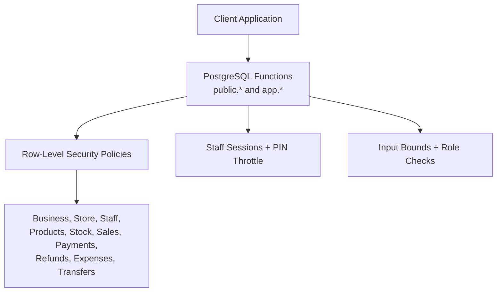
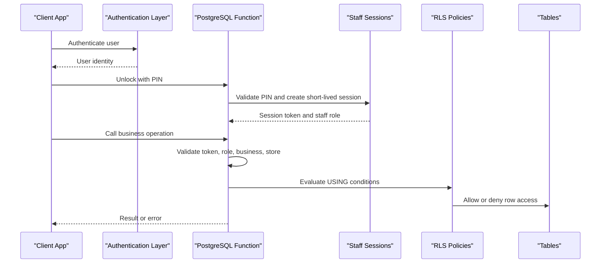
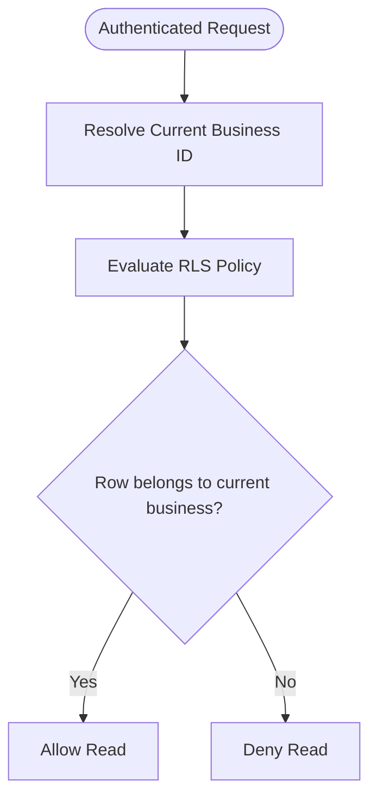
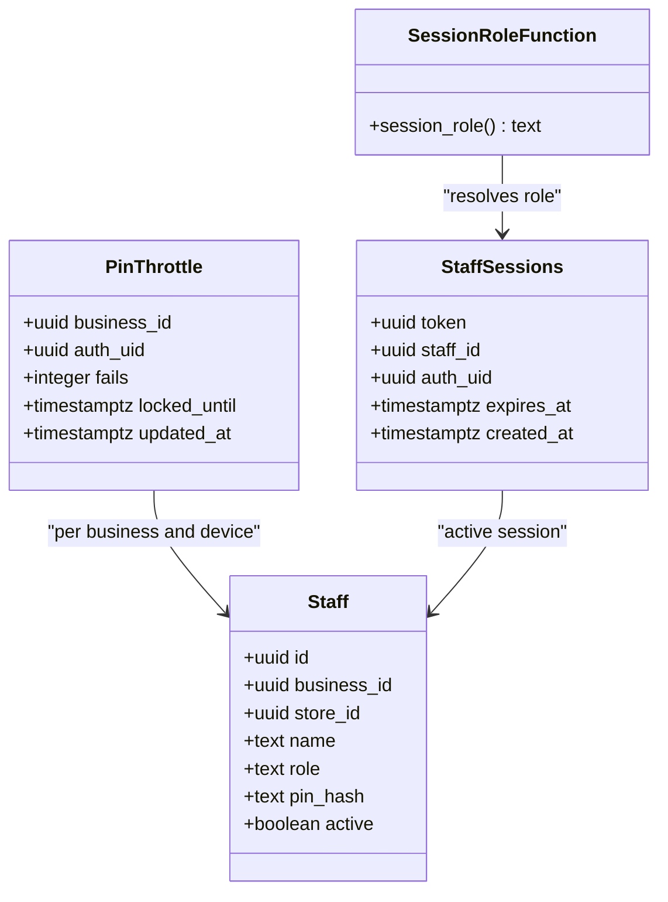
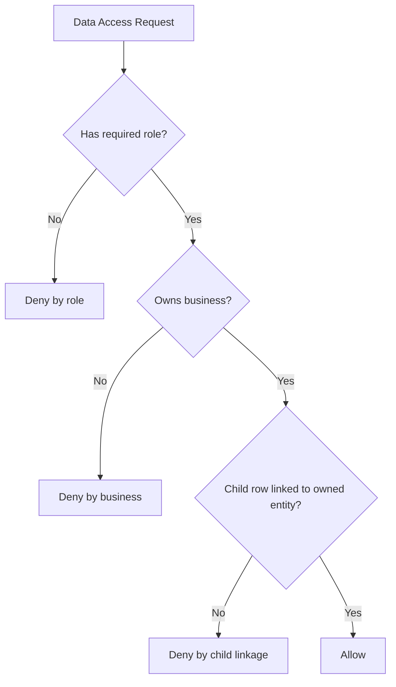
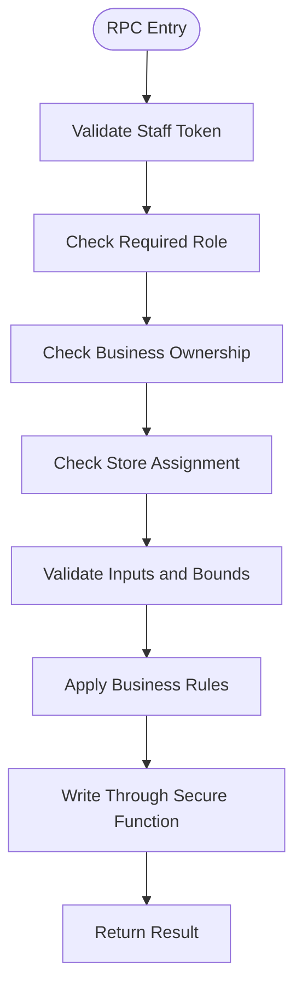
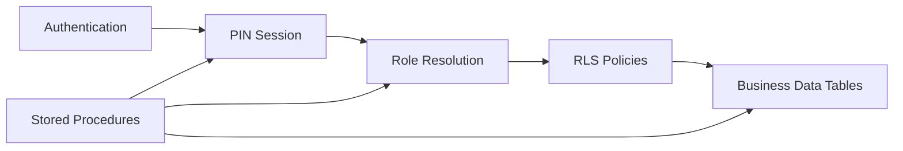

# Database Security & RLS Policies

<cite>
**Referenced Files in This Document**
- [20261007084733_2ed95314-f75e-4843-977b-23f9e6359a48.sql](file://supabase/migrations/20261007084733_2ed95314-f75e-4843-977b-23f9e6359a48.sql)
- [20261008090000_security_hardening.sql](file://supabase/migrations/20261008090000_security_hardening.sql)
- [20261009210500_retail_operations.sql](file://supabase/migrations/20261009210500_retail_operations.sql)
</cite>

## Table of Contents
1. [Introduction](#introduction)
2. [Project Structure](#project-structure)
3. [Core Components](#core-components)
4. [Architecture Overview](#architecture-overview)
5. [Detailed Component Analysis](#detailed-component-analysis)
6. [Dependency Analysis](#dependency-analysis)
7. [Performance Considerations](#performance-considerations)
8. [Troubleshooting Guide](#troubleshooting-guide)
9. [Migration Strategy](#migration-strategy)
10. [Testing Approaches for RLS Enforcement](#testing-approaches-for-rls-enforcement)
11. [Conclusion](#conclusion)

## Introduction
This document explains the database security model and Row-Level Security (RLS) implementation used to isolate data between businesses and stores. The system uses PostgreSQL RLS policies, role-based access control, PIN-bound staff sessions, and server-side stored procedures to enforce business ownership, store assignment, and sensitive-data restrictions.

The core idea is:
- Each authenticated user belongs to one business.
- Data rows are tagged with a business identifier.
- RLS policies restrict reads to the current business.
- Sensitive operations require a PIN session and a specific staff role.
- All writes go through secured stored procedures; direct table writes are disabled for normal users.

## Project Structure
Security-related logic lives in the Supabase migration files under `supabase/migrations`. The most important files are:

| File | Purpose |
|---|---|
| `20261007084733_2ed95314-f75e-4843-977b-23f9e6359a48.sql` | Initial schema, base RLS policies, business isolation helper, staff session helpers, and core retail RPCs. |
| `20261008090000_security_hardening.sql` | Security hardening: anonymous RPC lockdown, PIN throttle, device-bound sessions, cost segregation, role-aware RLS, input bounds, read-only tables, and function grants. |
| `20261009210500_retail_operations.sql` | Retail operations with manager-only transfer visibility, per-line discounts, split tenders, stock transfers, reorder points, and low-stock reporting. |

**Diagram sources**
- [20261007084733_2ed95314-f75e-4843-977b-23f9e6359a48.sql:106-132](file://supabase/migrations/20261007084733_2ed95314-f75e-4843-977b-23f9e6359a48.sql#L106-L132)
- [20261008090000_security_hardening.sql:67-168](file://supabase/migrations/20261008090000_security_hardening.sql#L67-L168)
- [20261008090000_security_hardening.sql:743-757](file://supabase/migrations/20261008090000_security_hardening.sql#L743-L757)

**Section sources**
- [20261007084733_2ed95314-f75e-4843-977b-23f9e6359a48.sql:1-132](file://supabase/migrations/20261007084733_2ed95314-f75e-4843-977b-23f9e6359a48.sql#L1-L132)
- [20261008090000_security_hardening.sql:1-78](file://supabase/migrations/20261008090000_security_hardening.sql#L1-L78)
- [20261009210500_retail_operations.sql:1-58](file://supabase/migrations/20261009210500_retail_operations.sql#L1-L58)

## Core Components
The security model is built around these components:

| Component | Responsibility |
|---|---|
| Business ownership helper | Resolves the current authenticated user’s business ID. |
| Staff session management | Validates PIN unlock, binds sessions to devices, enforces expiration, and tracks failed attempts. |
| Role resolution function | Returns the active staff role from the current PIN session. |
| RLS policies | Restrict row visibility by business and role. |
| Stored procedures | Validate inputs, enforce business/store ownership, check roles, and perform safe mutations. |
| Read-only table policy | Prevents direct client writes; all changes must use RPCs. |
| Audit context helpers | Record reasons and notes for stock movements and adjustments. |

Key responsibilities by file:

- **Initial security foundation**: business isolation, basic RLS, staff session creation, checkout, approvals, layby payments, stock takes.
- **Hardened security**: PIN throttling, device-bound sessions, role-aware RLS, cost segregation, strict input validation, function grants, and read-only tables.
- **Retail operations**: manager-only transfer visibility, discount overrides, split tender handling, stock transfer lifecycle, reorder points, and low-stock queries.

**Section sources**
- [20261007084733_2ed95314-f75e-4843-977b-23f9e6359a48.sql:118-180](file://supabase/migrations/20261007084733_2ed95314-f75e-4843-977b-23f9e6359a48.sql#L118-L180)
- [20261008090000_security_hardening.sql:26-78](file://supabase/migrations/20261008090000_security_hardening.sql#L26-L78)
- [20261009210500_retail_operations.sql:22-58](file://supabase/migrations/20261009210500_retail_operations.sql#L22-L58)

## Architecture Overview
The runtime flow combines authentication, PIN unlocking, role checks, RLS evaluation, and stored procedure execution.

**Diagram sources**
- [20261008090000_security_hardening.sql:218-256](file://supabase/migrations/20261008090000_security_hardening.sql#L218-L256)
- [20261008090000_security_hardening.sql:67-77](file://supabase/migrations/20261008090000_security_hardening.sql#L67-L77)
- [20261008090000_security_hardening.sql:79-168](file://supabase/migrations/20261008090000_security_hardening.sql#L79-L168)

## Detailed Component Analysis

### Business Isolation and Base RLS
The initial migration establishes the multi-business model and enables RLS on core tables. It also defines the business lookup helper and basic select policies.

Important behaviors:
- A business is owned by an authenticated user.
- Stores, staff, products, sales, payments, and related tables reference the business.
- RLS policies restrict reads to the current business.
- Some policies join related tables to ensure child rows belong to the same business.

**Diagram sources**
- [20261007084733_2ed95314-f75e-4843-977b-23f9e6359a48.sql:118-132](file://supabase/migrations/20261007084733_2ed95314-f75e-4843-977b-23f9e6359a48.sql#L118-L132)

**Section sources**
- [20261007084733_2ed95314-f75e-4843-977b-23f9e6359a48.sql:3-104](file://supabase/migrations/20261007084733_2ed95314-f75e-4843-977b-23f9e6359a48.sql#L3-L104)
- [20261007084733_2ed95314-f75e-4843-977b-23f9e6359a48.sql:106-132](file://supabase/migrations/20261007084733_2ed95314-f75e-4843-977b-23f9e6359a48.sql#L106-L132)

### PIN-Based Staff Sessions and Role-Aware Access
After hardening, reading business data requires both a valid PIN session and an allowed role. The system introduces:
- A PIN attempt throttle table.
- Device-bound staff sessions with expiration.
- A role resolution function that returns the active staff role.
- Updated RLS policies that require `app.session_role()` to be an allowed role.

**Diagram sources**
- [20261008090000_security_hardening.sql:26-47](file://supabase/migrations/20261008090000_security_hardening.sql#L26-L47)
- [20261008090000_security_hardening.sql:67-77](file://supabase/migrations/20261008090000_security_hardening.sql#L67-L77)

**Section sources**
- [20261008090000_security_hardening.sql:26-78](file://supabase/migrations/20261008090000_security_hardening.sql#L26-L78)
- [20261008090000_security_hardening.sql:218-291](file://supabase/migrations/20261008090000_security_hardening.sql#L218-L291)

### RLS Policy Categories
RLS policies enforce three main isolation dimensions:

| Dimension | Policy Pattern | Example Scope |
|---|---|---|
| Business ownership | Rows must match the current business. | Businesses, stores, expenses, collections, subscriptions. |
| Store linkage | Child rows must link to a store belonging to the current business. | Store stock, sale items, payments, stock movements, refund items. |
| Role restriction | Reads or writes require a specific staff role. | Products, sales, payments, stock takes, refunds, product costs, sale item costs, transfers. |

Examples of policy behavior:
- Basic business-scoped reads allow any authenticated user who owns the business.
- Money-sensitive reads require admin, manager, or cashier roles.
- Manager-only reads apply to buying costs, refunds, stock movements, and transfers.
- Some tables have no direct access policy because they should only be modified by internal functions.

**Diagram sources**
- [20261008090000_security_hardening.sql:79-168](file://supabase/migrations/20261008090000_security_hardening.sql#L79-L168)
- [20261009210500_retail_operations.sql:49-58](file://supabase/migrations/20261009210500_retail_operations.sql#L49-L58)

**Section sources**
- [20261008090000_security_hardening.sql:79-168](file://supabase/migrations/20261008090000_security_hardening.sql#L79-L168)
- [20261009210500_retail_operations.sql:49-58](file://supabase/migrations/20261009210500_retail_operations.sql#L49-L58)

### Stored Procedures That Enforce Security Rules
Stored procedures act as the single entry point for data modifications. They validate:
- Authentication and PIN session validity.
- Staff role permissions.
- Business and store ownership.
- Input format, length, and numeric bounds.
- Business rules such as stock availability, approval workflows, and refund limits.

Key procedures and their security responsibilities:

| Procedure | Security Behavior |
|---|---|
| `require_staff` / `require_staff_nosub` | Validates staff session, role, business, and sets audit context. |
| `unlock_with_pin` | Validates PIN, applies throttle, creates device-bound session. |
| `setup_business` | Creates business, store, and admin staff with validated inputs. |
| `save_staff` | Admin-only staff management with PIN uniqueness and plan limits. |
| `save_store` | Admin-only store management with subscription limits. |
| `save_product` | Admin/manager-only product updates; cost written to gated table. |
| `checkout` | Validates cart, prices, taxes, stock floor, payment methods, and tenders. |
| `review_invoice` | Manager-only approval with stock floor and tender validation. |
| `process_refund` | Manager-only refund processing with cost lookups and restock logic. |
| `adjust_stock_reason` | Admin/manager-only stock adjustment with reason and bounds. |
| `create_transfer` / `receive_transfer` / `cancel_transfer` | Manager-only inter-store transfers with ledger reasons. |

**Diagram sources**
- [20261008090000_security_hardening.sql:258-270](file://supabase/migrations/20261008090000_security_hardening.sql#L258-L270)
- [20261008090000_security_hardening.sql:395-425](file://supabase/migrations/20261008090000_security_hardening.sql#L395-L425)
- [20261008090000_security_hardening.sql:427-515](file://supabase/migrations/20261008090000_security_hardening.sql#L427-L515)
- [20261008090000_security_hardening.sql:547-605](file://supabase/migrations/20261008090000_security_hardening.sql#L547-L605)
- [20261009210500_retail_operations.sql:408-491](file://supabase/migrations/20261009210500_retail_operations.sql#L408-L491)

**Section sources**
- [20261007084733_2ed95314-f75e-4843-977b-23f9e6359a48.sql:134-379](file://supabase/migrations/20261007084733_2ed95314-f75e-4843-977b-23f9e6359a48.sql#L134-L379)
- [20261008090000_security_hardening.sql:218-626](file://supabase/migrations/20261008090000_security_hardening.sql#L218-L626)
- [20261009210500_retail_operations.sql:61-100](file://supabase/migrations/20261009210500_retail_operations.sql#L61-L100)
- [20261009210500_retail_operations.sql:108-320](file://supabase/migrations/20261009210500_retail_operations.sql#L108-L320)
- [20261009210500_retail_operations.sql:408-501](file://supabase/migrations/20261009210500_retail_operations.sql#L408-L501)

### Sensitive Data Segregation
Buying costs were moved out of broadly readable tables into gated tables:
- `product_costs`
- `sale_item_costs`

These tables are enabled for RLS and restricted to managers and admins. This prevents cashiers from seeing buying costs while still allowing them to sell products.

**Section sources**
- [20261008090000_security_hardening.sql:49-65](file://supabase/migrations/20261008090000_security_hardening.sql#L49-L65)
- [20261008090000_security_hardening.sql:142-151](file://supabase/migrations/20261008090000_security_hardening.sql#L142-L151)

### Manager-Only Transfer Visibility
Stock transfers introduce a new operational boundary:
- Only admins and managers can read transfers and transfer lines.
- Transfers are scoped to the current business.
- Transfer lines are visible only when linked to a transfer owned by the current business.

**Section sources**
- [20261009210500_retail_operations.sql:22-58](file://supabase/migrations/20261009210500_retail_operations.sql#L22-L58)

## Dependency Analysis
The security model has clear dependency layers:

**Diagram sources**
- [20261008090000_security_hardening.sql:67-77](file://supabase/migrations/20261008090000_security_hardening.sql#L67-L77)
- [20261008090000_security_hardening.sql:79-168](file://supabase/migrations/20261008090000_security_hardening.sql#L79-L168)
- [20261008090000_security_hardening.sql:218-291](file://supabase/migrations/20261008090000_security_hardening.sql#L218-L291)

Coupling and cohesion observations:
- RLS policies depend on `app.my_business_id()` and `app.session_role()`.
- Stored procedures depend on `require_staff` or `require_staff_nosub` for authorization.
- Business isolation depends on foreign keys and consistent `business_id` columns.
- Manager-only features depend on role checks inside both RLS policies and stored procedures.

Potential risks:
- If a new table is added without RLS, it may bypass business isolation.
- If a new RPC does not call `require_staff`, it may bypass role checks.
- If a policy relies on a missing index, performance may degrade.

**Section sources**
- [20261008090000_security_hardening.sql:79-168](file://supabase/migrations/20261008090000_security_hardening.sql#L79-L168)
- [20261008090000_security_hardening.sql:258-270](file://supabase/migrations/20261008090000_security_hardening.sql#L258-L270)

## Performance Considerations
The security design includes several performance-oriented choices:

| Area | Recommendation | Evidence in Codebase |
|---|---|---|
| RLS predicates | Keep policies simple and indexed where possible. | Policies use `business_id`, joins on primary keys, and existence checks. |
| Session lookups | Index frequently filtered session columns. | Session indexes exist for `auth_uid` and `expires_at`. |
| Transfer queries | Use indexes on business and store filters. | Transfer indexes exist on business, from store, to store, and status. |
| Cost segregation | Avoid exposing costly columns to broad roles. | Costs moved to manager-only tables. |
| Input validation | Fail fast at the RPC layer to avoid expensive invalid workloads. | Extensive JSON and numeric validation before writes. |

Best practices derived from the codebase:
- Always include `business_id` in query filters when writing custom SQL.
- Prefer existence checks over large subqueries in RLS policies.
- Add indexes for columns used in RLS `USING` clauses and common RPC filters.
- Keep PIN throttle and session cleanup queries efficient.

**Section sources**
- [20261008090000_security_hardening.sql:42-47](file://supabase/migrations/20261008090000_security_hardening.sql#L42-L47)
- [20261009210500_retail_operations.sql:44-47](file://supabase/migrations/20261009210500_retail_operations.sql#L44-L47)
- [20261008090000_security_hardening.sql:170-216](file://supabase/migrations/20261008090000_security_hardening.sql#L170-L216)

## Troubleshooting Guide
Common security issues and how to diagnose them:

| Symptom | Likely Cause | Diagnostic Action |
|---|---|---|
| User cannot see any business data | Missing PIN session or wrong role. | Verify PIN unlock and `app.session_role()`. |
| Query returns zero rows even though data exists | RLS policy denies access. | Check `business_id` and role requirements. |
| PIN unlock fails repeatedly | PIN throttle lockout. | Check `pin_throttle.locked_until`. |
| Manager-only report is empty | Role or business mismatch. | Confirm staff role and business ownership. |
| Checkout fails with stock error | Insufficient stock at target store. | Check `store_stock` and transfer state. |
| Refund fails with cost error | Missing or unauthorized cost data. | Check `sale_item_costs` and manager role. |
| Direct table write fails | Tables are read-only for clients. | Use the correct RPC instead of direct SQL. |

Recommended debugging steps:
1. Confirm the user is authenticated and has a business.
2. Confirm the PIN session is active and bound to the current device.
3. Confirm the staff role matches the required role.
4. Confirm the requested row belongs to the current business.
5. Confirm child rows link to parent entities owned by the current business.
6. Review RPC error messages for validation failures.

**Section sources**
- [20261008090000_security_hardening.sql:218-291](file://supabase/migrations/20261008090000_security_hardening.sql#L218-L291)
- [20261008090000_security_hardening.sql:743-757](file://supabase/migrations/20261008090000_security_hardening.sql#L743-L757)

## Migration Strategy
Security policy updates should follow a controlled migration strategy:

1. **Add or update RLS policies incrementally.**
   - Drop existing policies before recreating them to avoid conflicts.
   - Ensure new policies do not weaken existing isolation.

2. **Update stored procedures alongside schema changes.**
   - New tables must have corresponding RPCs if writes are needed.
   - Existing RPCs must continue to validate business and role constraints.

3. **Use explicit grants and revokes.**
   - Revoke unnecessary function execution privileges.
   - Grant only required functions to `authenticated` or `service_role`.

4. **Keep tables read-only for clients.**
   - Disable direct INSERT, UPDATE, DELETE, TRUNCATE for normal roles.
   - Route all mutations through secured RPCs.

5. **Reload schema after changes.**
   - Notify the API layer to reload schema definitions.

6. **Test before deploying.**
   - Test anonymous access denial.
   - Test authenticated but un-PIN’d access denial.
   - Test role-based access differences.
   - Test cross-business isolation.
   - Test child-row linkage isolation.

**Section sources**
- [20261008090000_security_hardening.sql:720-759](file://supabase/migrations/20261008090000_security_hardening.sql#L720-L759)

## Testing Approaches for RLS Enforcement
A robust testing approach should cover authentication, session, role, and data isolation scenarios.

### Recommended Test Matrix

| Scenario | Expected Result |
|---|---|
| Anonymous RPC call | Denied except explicitly allowed endpoints. |
| Authenticated user without PIN session | Cannot read sensitive business data. |
| Valid PIN session with cashier role | Can read cashier-accessible data. |
| Valid PIN session with manager role | Can read manager-accessible data. |
| Valid PIN session with admin role | Can read admin-accessible data. |
| User accesses another business’s data | Denied by RLS. |
| User accesses child rows linked to another business | Denied by RLS. |
| Cashier tries to view buying costs | Denied by role policy. |
| Cashier tries to approve invoice | Denied by RPC role check. |
| Manager reads transfers | Allowed if within business. |
| Cashier reads transfers | Denied by role policy. |
| Direct table write | Denied by read-only table policy. |

### Example Test Cases

1. **Business isolation test**
   - Create two businesses.
   - Log in as owner of business A.
   - Query business B’s stores, products, or sales.
   - Expect zero rows.

2. **Role isolation test**
   - Create admin, manager, and cashier staff.
   - Unlock each with a PIN.
   - Query manager-only tables.
   - Expect cashier to be denied.

3. **Child-row linkage test**
   - Create a sale in business A.
   - Query sale items and payments.
   - Expect results only when linked to business A.

4. **PIN throttle test**
   - Submit multiple wrong PINs.
   - Expect temporary lockout.
   - After successful PIN, expect throttle reset.

5. **Read-only table test**
   - Attempt direct INSERT/UPDATE/DELETE.
   - Expect permission denied.
   - Perform mutation through RPC.
   - Expect success with proper authorization.

6. **Transfer visibility test**
   - Create a transfer between two stores in the same business.
   - Query as manager: expect visible.
   - Query as cashier: expect denied.

**Section sources**
- [20261008090000_security_hardening.sql:7-20](file://supabase/migrations/20261008090000_security_hardening.sql#L7-L20)
- [20261008090000_security_hardening.sql:26-40](file://supabase/migrations/20261008090000_security_hardening.sql#L26-L40)
- [20261008090000_security_hardening.sql:79-168](file://supabase/migrations/20261008090000_security_hardening.sql#L79-L168)
- [20261009210500_retail_operations.sql:49-58](file://supabase/migrations/20261009210500_retail_operations.sql#L49-L58)
- [20261008090000_security_hardening.sql:743-757](file://supabase/migrations/20261008090000_security_hardening.sql#L743-L757)

## Conclusion
The database security model uses layered enforcement to protect multi-business data:

- **Authentication** identifies the user.
- **PIN sessions** bind operational authority to a device and time window.
- **Role checks** separate cashier, manager, and admin capabilities.
- **RLS policies** enforce business and store isolation at the row level.
- **Stored procedures** validate inputs, enforce business rules, and perform safe mutations.
- **Read-only tables** prevent direct client writes.
- **Cost segregation** protects sensitive financial data from lower roles.
- **Audit context and ledger reasons** support traceability for stock movements and transfers.

For future changes, always add RLS policies for new tables, route writes through secured RPCs, validate business and role ownership, and test across anonymous, authenticated, PIN-less, and role-differentiated scenarios.