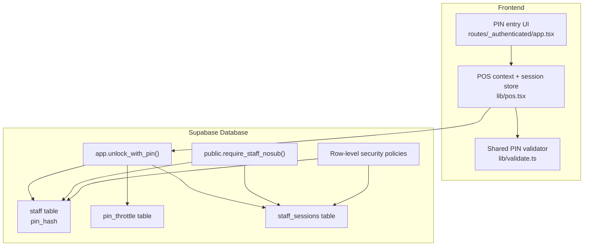
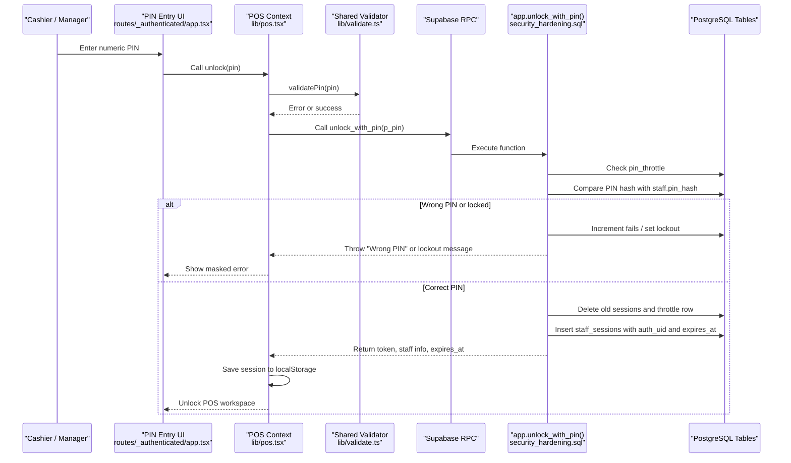
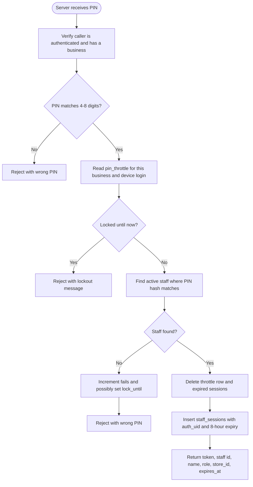
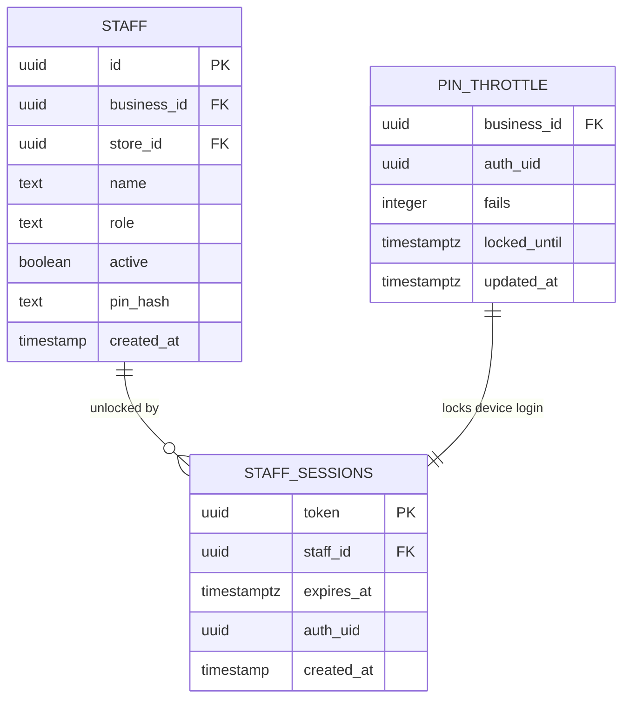
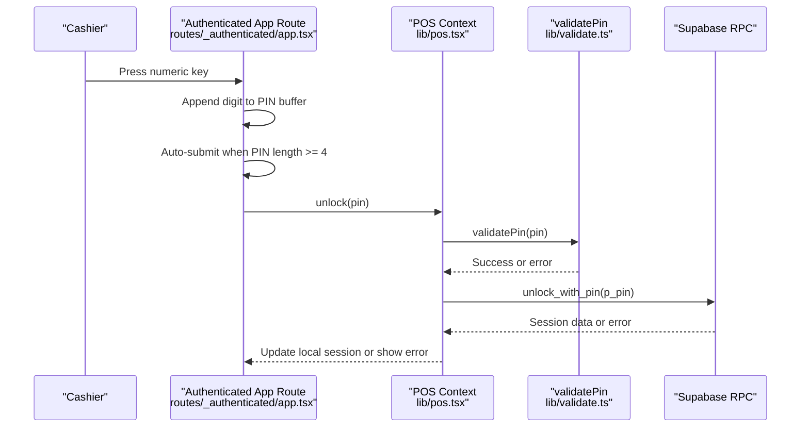
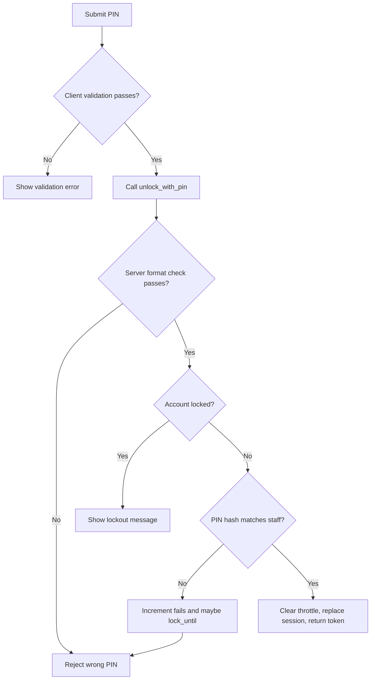
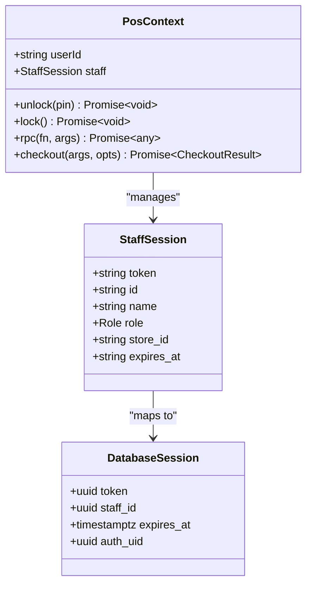
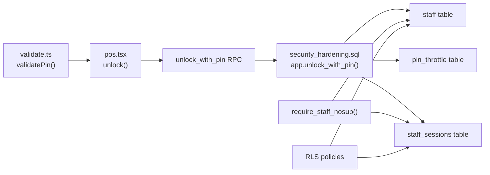

# PIN-Based Staff Authentication

<cite>
**Referenced Files in This Document**
- [security_hardening.sql](file://supabase/migrations/20261008090000_security_hardening.sql)
- [initial_schema.sql](file://supabase/migrations/20261007084733_2ed95314-f75e-4843-977b-23f9e6359a48.sql)
- [pos.tsx](file://src/lib/pos.tsx)
- [validate.ts](file://src/lib/validate.ts)
- [types.ts](file://src/integrations/supabase/types.ts)
- [app.staff.tsx](file://src/routes/_authenticated/app.staff.tsx)
- [app.tsx](file://src/routes/_authenticated/app.tsx)
</cite>

## Table of Contents
1. [Introduction](#introduction)
2. [Project Structure](#project-structure)
3. [Core Components](#core-components)
4. [Architecture Overview](#architecture-overview)
5. [Detailed Component Analysis](#detailed-component-analysis)
6. [Dependency Analysis](#dependency-analysis)
7. [Performance Considerations](#performance-considerations)
8. [Troubleshooting Guide](#troubleshooting-guide)
9. [Conclusion](#conclusion)

## Introduction
This document explains the PIN-based staff authentication system used by the point-of-sale application. Instead of passwords, staff members authenticate with a numeric PIN after they have already signed into the application as a business owner or manager. The PIN unlocks a short-lived, device-bound POS session that grants access to retail operations such as sales, stock adjustments, refunds, and reporting.

The system separates two authentication layers:
- **Business account authentication**: handled by the application’s main authentication flow (for example, email/password or another supported provider). This is not the same as the staff PIN.
- **Staff PIN unlock**: a second step that binds a staff identity to the current browser/device login for a limited time.

## Project Structure
PIN-related logic spans three areas:
- **Database layer**: tables, constraints, functions, and row-level security policies.
- **Client-side validation and UI**: PIN input, validation, error masking, and session persistence.
- **Type definitions**: generated TypeScript types describing database tables and RPCs.

**Diagram sources**
- [app.tsx:276-348](file://src/routes/_authenticated/app.tsx#L276-L348)
- [pos.tsx:194-228](file://src/lib/pos.tsx#L194-L228)
- [security_hardening.sql:218-291](file://supabase/migrations/20261008090000_security_hardening.sql#L218-L291)
- [initial_schema.sql:17-31](file://supabase/migrations/20261007084733_2ed95314-f75e-4843-977b-23f9e6359a48.sql#L17-L31)

**Section sources**
- [security_hardening.sql:1-5](file://supabase/migrations/20261008090000_security_hardening.sql#L1-L5)
- [pos.tsx:115-147](file://src/lib/pos.tsx#L115-L147)

## Core Components
The PIN authentication system consists of these core parts:

| Component | Responsibility | Key Implementation Details |
|---|---|---|
| PIN input interface | Collects a numeric PIN from the cashier or manager on the POS screen | Numeric keypad, keyboard support, visual dot indicators, automatic submission when the PIN reaches its minimum length |
| Client-side PIN validator | Prevents invalid or unsafe PIN values before calling the server | Enforces 4–8 digits using shared validation constants and regex |
| Server-side unlock function | Validates the PIN against stored hashes, enforces throttling, and creates a short-lived session | Uses `extensions.crypt`, checks `pin_throttle`, deletes old sessions, and inserts a new `staff_sessions` row |
| Session verification function | Confirms that a staff token belongs to the current device login and has an allowed role | Requires token, expiry, active staff, business ownership, and matching `auth_uid` |
| Row-level security policies | Restrict data access unless a valid PIN session exists | Many read policies require `app.session_role()` to return admin, manager, or cashier |
| Type definitions | Provide TypeScript models for staff, sessions, throttle state, and RPC signatures | Used by the client and generated Supabase client |

**Section sources**
- [validate.ts:22-34](file://src/lib/validate.ts#L22-L34)
- [validate.ts:84-89](file://src/lib/validate.ts#L84-L89)
- [security_hardening.sql:218-291](file://supabase/migrations/20261008090000_security_hardening.sql#L218-L291)
- [types.ts:307-338](file://src/integrations/supabase/types.ts#L307-L338)
- [types.ts:741-800](file://src/integrations/supabase/types.ts#L741-L800)

## Architecture Overview
The PIN unlock flow is intentionally split between the browser and the database. The browser handles user experience; the database handles security.

**Diagram sources**
- [app.tsx:276-348](file://src/routes/_authenticated/app.tsx#L276-L348)
- [pos.tsx:194-228](file://src/lib/pos.tsx#L194-L228)
- [security_hardening.sql:218-291](file://supabase/migrations/20261008090000_security_hardening.sql#L218-L291)

## Detailed Component Analysis

### PIN Validation Process
PIN validation happens twice: once in the browser for immediate feedback, and again in the database for security.

#### Client-Side Validation
The shared validator enforces:
- A PIN must be present.
- A PIN must contain only digits.
- A PIN must be between 4 and 8 characters.

If validation fails, the client throws an error before any network request is made.

**Section sources**
- [validate.ts:22-24](file://src/lib/validate.ts#L22-L24)
- [validate.ts:33-34](file://src/lib/validate.ts#L33-L34)
- [validate.ts:84-89](file://src/lib/validate.ts#L84-L89)

#### Server-Side Validation
The server-side unlock function performs additional checks:
- The caller must be authenticated.
- The caller must belong to a business.
- The PIN must match the 4–8 digit pattern.
- The PIN must match an active staff member’s stored hash.
- Failed attempts update the throttle counter.
- Successful attempts clear failed attempts and create a new session.

**Diagram sources**
- [security_hardening.sql:218-256](file://supabase/migrations/20261008090000_security_hardening.sql#L218-L256)

**Section sources**
- [security_hardening.sql:218-256](file://supabase/migrations/20261008090000_security_hardening.sql#L218-L256)

### PIN Hash Comparison and Security Measures
The system does not store plain PINs. It stores a bcrypt-style hash generated by the database extension. When a PIN is submitted, the server compares the submitted value against the stored hash using the same hashing mechanism.

Key security measures include:
- **Hash-only storage**: Only `pin_hash` is persisted in the `staff` table.
- **Pattern enforcement**: Both client and server enforce a numeric 4–8 digit format.
- **Brute-force protection**: A server-side throttle table tracks failed attempts per business and per signed-in device. After repeated failures, the account is temporarily locked.
- **Device binding**: The modern session includes `auth_uid`, so a PIN session can only be used from the device login that created it.
- **Short session lifetime**: The default session expiration is shortened to 8 hours.
- **Single active session per device**: A new unlock replaces any existing PIN session for the same device login.
- **Row-level security**: Most data reads require a valid PIN session role.

**Section sources**
- [initial_schema.sql:17-26](file://supabase/migrations/20261007084733_2ed95314-f75e-4843-977b-23f9e6359a48.sql#L17-L26)
- [security_hardening.sql:26-46](file://supabase/migrations/20261008090000_security_hardening.sql#L26-L46)
- [security_hardening.sql:179-180](file://supabase/migrations/20261008090000_security_hardening.sql#L179-L180)
- [security_hardening.sql:218-291](file://supabase/migrations/20261008090000_security_hardening.sql#L218-L291)

### Database Schema Relationships
The PIN system connects three primary tables:

| Table | Role in PIN Authentication | Important Columns |
|---|---|---|
| `staff` | Stores staff identity, role, assigned store, activity status, and PIN hash | `id`, `business_id`, `store_id`, `name`, `role`, `active`, `pin_hash` |
| `pin_throttle` | Tracks failed PIN attempts and temporary lockouts | `business_id`, `auth_uid`, `fails`, `locked_until`, `updated_at` |
| `staff_sessions` | Holds the short-lived, device-bound session token | `token`, `staff_id`, `expires_at`, `auth_uid`, `created_at` |

**Diagram sources**
- [initial_schema.sql:17-31](file://supabase/migrations/20261007084733_2ed95314-f75e-4843-977b-23f9e6359a48.sql#L17-L31)
- [security_hardening.sql:26-46](file://supabase/migrations/20261008090000_security_hardening.sql#L26-L46)
- [types.ts:307-338](file://src/integrations/supabase/types.ts#L307-L338)
- [types.ts:741-800](file://src/integrations/supabase/types.ts#L741-L800)

**Section sources**
- [initial_schema.sql:17-31](file://supabase/migrations/20261007084733_2ed95314-f75e-4843-977b-23f9e6359a48.sql#L17-L31)
- [security_hardening.sql:26-46](file://supabase/migrations/20261008090000_security_hardening.sql#L26-L46)
- [types.ts:307-338](file://src/integrations/supabase/types.ts#L307-L338)
- [types.ts:741-800](file://src/integrations/supabase/types.ts#L741-L800)

### PIN Entry Interface
The PIN entry interface is designed for touch-friendly POS use. It provides:
- A numeric keypad.
- Keyboard support for entering digits and backspace.
- Visual dot indicators showing how many digits have been entered.
- Automatic submission when the PIN reaches its minimum length.
- Error feedback for wrong PINs and lockouts.

The interface calls the POS context’s `unlock` function, which validates the PIN locally and then calls the `unlock_with_pin` RPC.

**Diagram sources**
- [app.tsx:276-348](file://src/routes/_authenticated/app.tsx#L276-L348)
- [pos.tsx:194-203](file://src/lib/pos.tsx#L194-L203)
- [validate.ts:84-89](file://src/lib/validate.ts#L84-L89)

**Section sources**
- [app.tsx:276-348](file://src/routes/_authenticated/app.tsx#L276-L348)
- [pos.tsx:194-203](file://src/lib/pos.tsx#L194-L203)

### Failed Attempt Handling
Failed PIN attempts are handled at multiple layers:

1. **Client validation failure**: If the PIN is empty or not 4–8 digits, the client throws an error immediately.
2. **Server format failure**: If the PIN does not match the expected numeric pattern, the server rejects it.
3. **Wrong PIN**: Each failed attempt increments the failure counter in `pin_throttle`.
4. **Temporary lockout**: After enough failures, the server sets a lockout window. The client displays a lockout message instead of a generic mismatch.
5. **Successful unlock**: Clears the throttle row and removes previous PIN sessions for the same device login.

**Diagram sources**
- [validate.ts:84-89](file://src/lib/validate.ts#L84-L89)
- [security_hardening.sql:218-256](file://supabase/migrations/20261008090000_security_hardening.sql#L218-L256)
- [app.tsx:276-291](file://src/routes/_authenticated/app.tsx#L276-L291)

**Section sources**
- [validate.ts:84-89](file://src/lib/validate.ts#L84-L89)
- [security_hardening.sql:218-256](file://supabase/migrations/20261008090000_security_hardening.sql#L218-L256)
- [app.tsx:276-291](file://src/routes/_authenticated/app.tsx#L276-L291)

### Integration with POS Session Management
The POS context manages the staff session lifecycle:

- **Unlock**: Calls `unlock_with_pin`, stores the returned session in `localStorage`, updates React state, and invalidates cached queries.
- **Lock**: Calls `lock_session` to invalidate the server-side token and clears local session state.
- **RPC wrapper**: Every protected RPC call sends the staff token. If the server returns a “Locked” error, the client clears the session automatically.
- **Idle lock**: The POS can auto-lock after a configurable period of inactivity.
- **Offline queue**: Sales can be queued offline and later synced when online, but they still require a valid staff session.

**Diagram sources**
- [pos.tsx:38-45](file://src/lib/pos.tsx#L38-L45)
- [pos.tsx:194-228](file://src/lib/pos.tsx#L194-L228)
- [types.ts:789-800](file://src/integrations/supabase/types.ts#L789-L800)

**Section sources**
- [pos.tsx:194-228](file://src/lib/pos.tsx#L194-L228)
- [pos.tsx:340-364](file://src/lib/pos.tsx#L340-L364)
- [security_hardening.sql:258-291](file://supabase/migrations/20261008090000_security_hardening.sql#L258-L291)

### How Staff PIN Authentication Differs from Business Owner Authentication
| Aspect | Business Owner Authentication | Staff PIN Authentication |
|---|---|---|
| Purpose | Signs the business owner or manager into the application | Unlocks POS operations for a specific staff member on the current device |
| Identity source | Application authentication provider (for example, email/password or other supported method) | Numeric PIN associated with a `staff` record |
| Stored secret | Not represented by `staff.pin_hash`; handled by the app’s authentication layer | Stored as `pin_hash` in the `staff` table |
| Session type | Application-level authentication session | Short-lived, device-bound POS session in `staff_sessions` |
| Typical trigger | Login page or initial sign-in | POS PIN entry screen after signing in as owner/manager |
| Access scope | Controls business ownership and administrative access | Controls cash register and operational access based on staff role |

The business setup flow also creates an initial admin staff record with a hashed PIN, but that is separate from the ongoing staff PIN unlock flow used at the POS.

**Section sources**
- [initial_schema.sql:152-163](file://supabase/migrations/20261007084733_2ed95314-f75e-4843-977b-23f9e6359a48.sql#L152-L163)
- [security_hardening.sql:374-393](file://supabase/migrations/20261008090000_security_hardening.sql#L374-L393)
- [pos.tsx:115-147](file://src/lib/pos.tsx#L115-L147)

### Staff PIN Creation and Management
Administrators create and manage staff accounts through the staff management route. The implementation:
- Requires an admin session.
- Validates staff name, role, store assignment, and PIN.
- Ensures PIN uniqueness within the business.
- Stores the PIN as a hash.
- Disallows demoting or deactivating the last active admin.
- Deactivates active PIN sessions when a staff member is deactivated.

The UI currently shows a 4-digit PIN input field, while the server supports 4–8 digits. Implementers should align the UI maximum length with the server policy if longer PINs are intended.

**Section sources**
- [security_hardening.sql:329-371](file://supabase/migrations/20261008090000_security_hardening.sql#L329-L371)
- [app.staff.tsx:231-271](file://src/routes/_authenticated/app.staff.tsx#L231-L271)

## Dependency Analysis
The PIN system depends on several tightly coupled components:

**Diagram sources**
- [validate.ts:84-89](file://src/lib/validate.ts#L84-L89)
- [pos.tsx:194-228](file://src/lib/pos.tsx#L194-L228)
- [security_hardening.sql:218-291](file://supabase/migrations/20261008090000_security_hardening.sql#L218-L291)

**Section sources**
- [validate.ts:84-89](file://src/lib/validate.ts#L84-L89)
- [pos.tsx:194-228](file://src/lib/pos.tsx#L194-L228)
- [security_hardening.sql:218-291](file://supabase/migrations/20261008090000_security_hardening.sql#L218-L291)

## Performance Considerations
- **Hash comparison cost**: Comparing PINs uses a cryptographic hash function. This is intentional for security but means brute-force attacks are computationally expensive for attackers.
- **Throttle table access**: Each unlock attempt reads and writes `pin_throttle`. The table is small and scoped by business and device login, so contention should be low under normal POS usage.
- **Session cleanup**: Expired sessions are deleted during unlock and lock operations. Long-running POS devices may accumulate stale rows if locks are not called; the 8-hour expiry limits exposure.
- **Client-side validation**: Early rejection of invalid PINs reduces unnecessary database calls.
- **Query invalidation**: After unlock, the POS context invalidates queries to ensure the next user sees only their own data.

[No sources needed since this section provides general guidance]

## Troubleshooting Guide

### Common Issues
| Symptom | Likely Cause | Recommended Action |
|---|---|---|
| PIN rejected immediately without network call | Client validation failed | Ensure the PIN contains only digits and is between 4 and 8 characters |
| “Wrong PIN” repeatedly | Incorrect PIN or inactive staff record | Verify the PIN and confirm the staff member is active |
| Lockout message appears | Too many failed attempts on the same device login | Wait for the lockout window to expire or sign out and sign in again |
| POS shows “Locked: enter your PIN again” | Staff session expired, token invalid, or role mismatch | Re-enter the PIN to create a fresh session |
| Data appears empty after unlocking | Old or incompatible session without `auth_uid` | The client rejects sessions missing `expires_at`; re-unlock to create a proper session |
| Cannot save staff PIN | PIN already used, invalid format, or plan limit reached | Use a unique PIN, follow the required format, and check subscription/staff limits |

### Debugging Steps
1. Check whether the client validation function returns an error before any RPC call.
2. Inspect the lockout message from the server; it indicates a throttle lock rather than a simple mismatch.
3. Confirm that the returned session includes `token`, `expires_at`, and `auth_uid`.
4. Verify that subsequent RPC calls send the staff token.
5. If data remains inaccessible, call the lock function to clear the session and force a fresh PIN unlock.

**Section sources**
- [pos.tsx:93-104](file://src/lib/pos.tsx#L93-L104)
- [pos.tsx:125-147](file://src/lib/pos.tsx#L125-L147)
- [pos.tsx:205-228](file://src/lib/pos.tsx#L205-L228)
- [security_hardening.sql:218-291](file://supabase/migrations/20261008090000_security_hardening.sql#L218-L291)

## Conclusion
The PIN-based staff authentication system adds a focused, secure second factor for POS operations. It avoids storing plain PINs, validates input on both client and server, protects against brute-force attempts, and binds successful unlocks to short-lived, device-specific sessions. Row-level security ensures that most data remains inaccessible until a valid PIN session exists.

For maintainers, the most important boundaries are:
- Keep PIN input restricted to numeric digits.
- Never expose `pin_hash` to the client.
- Treat lockout messages as security events.
- Always rely on the server’s session verification function for authorization.
- Align UI PIN length limits with the server policy to avoid confusing validation errors.

[No sources needed since this section summarizes without analyzing specific files]