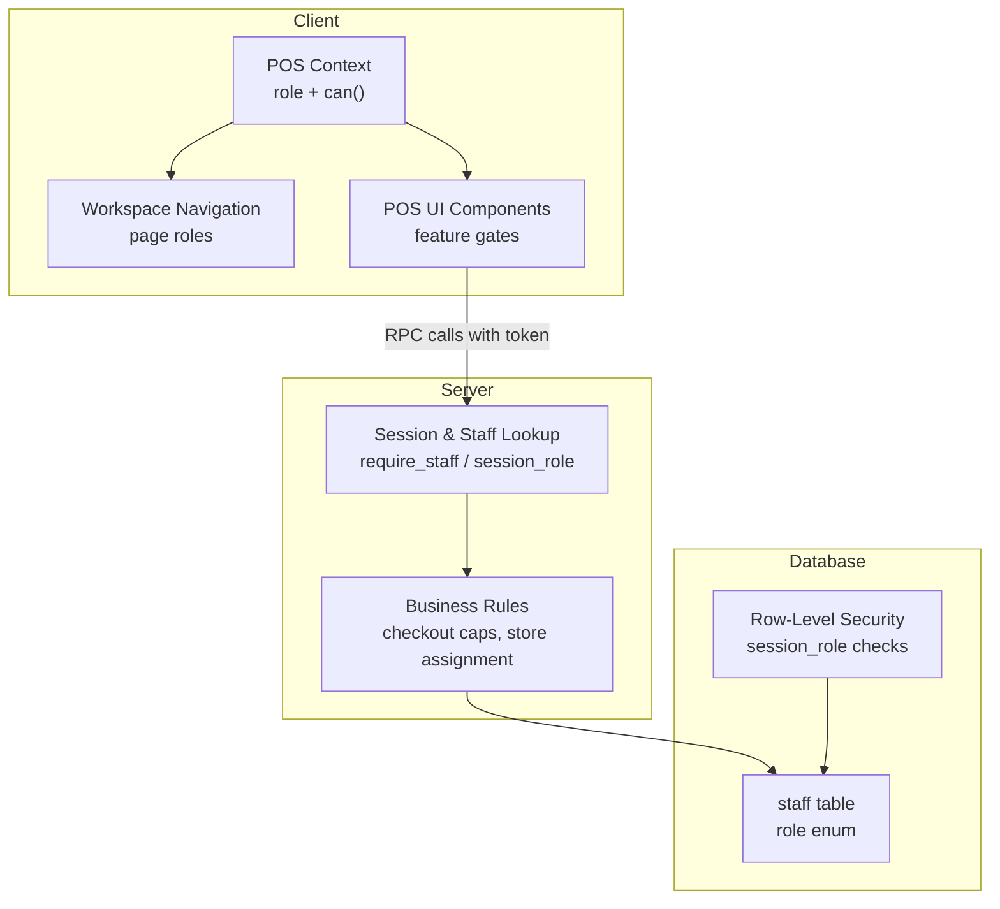
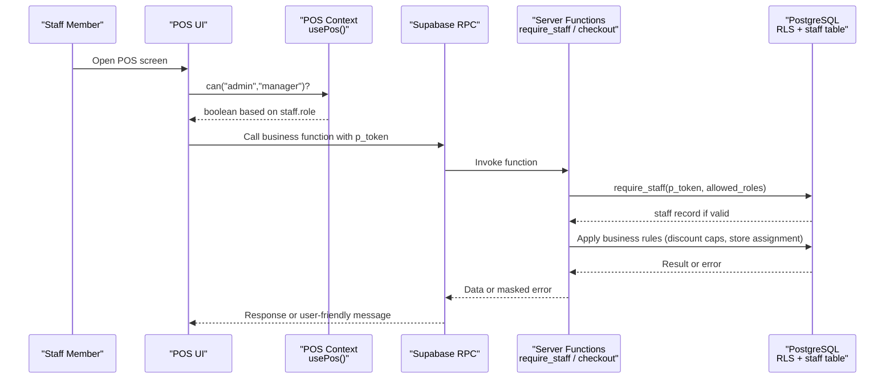
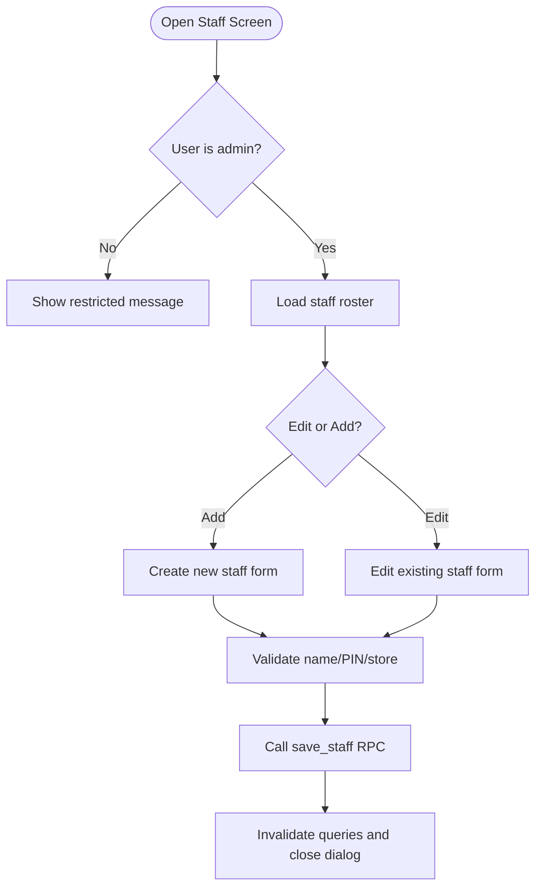
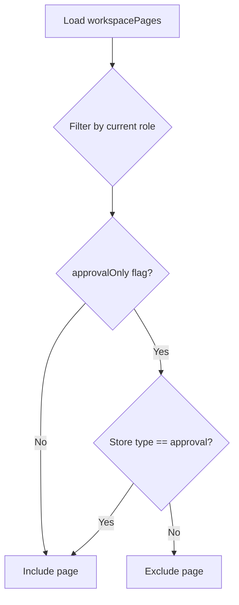
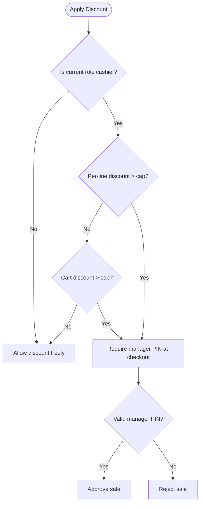
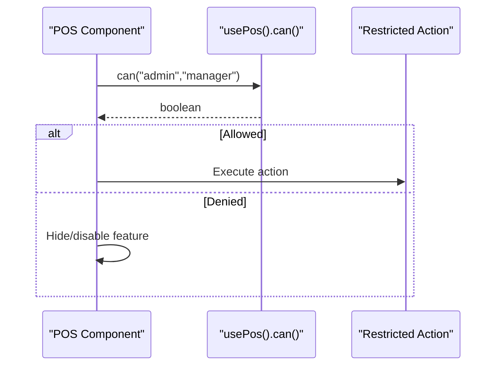
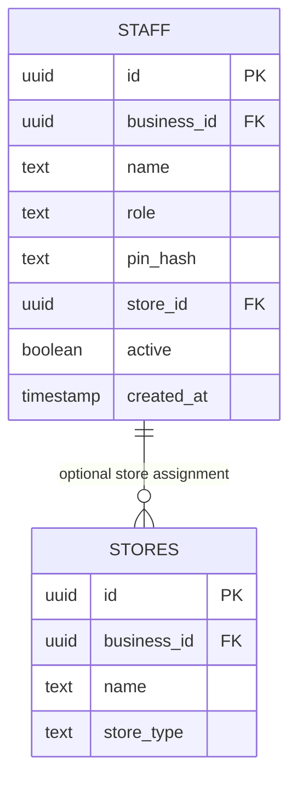
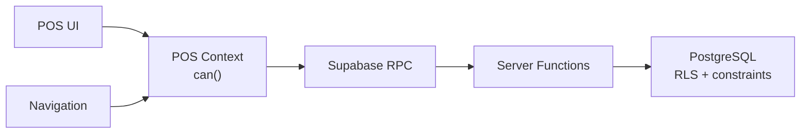

# Role-Based Access Control

<cite>
**Referenced Files in This Document**
- [pos.tsx](file://src/lib/pos.tsx)
- [workspace-navigation.ts](file://src/lib/workspace-navigation.ts)
- [app.staff.tsx](file://src/routes/_authenticated/app.staff.tsx)
- [DiscountDialog.tsx](file://src/components/pos/DiscountDialog.tsx)
- [products.ts](file://src/lib/products.ts)
- [Billing.tsx](file://src/components/pos/Billing.tsx)
- [QuickAddItem.tsx](file://src/components/pos/QuickAddItem.tsx)
- [20261007084733_2ed95314-f75e-4843-977b-23f9e6359a48.sql](file://supabase/migrations/20261007084733_2ed95314-f75e-4843-977b-23f9e6359a48.sql)
- [20261008090000_security_hardening.sql](file://supabase/migrations/20261008090000_security_hardening.sql)
- [20261011120000_fix_x_alias_collision.sql](file://supabase/migrations/20261011120000_fix_x_alias_collision.sql)
</cite>

## Table of Contents
1. [Introduction](#introduction)
2. [Project Structure](#project-structure)
3. [Core Components](#core-components)
4. [Architecture Overview](#architecture-overview)
5. [Detailed Component Analysis](#detailed-component-analysis)
6. [Dependency Analysis](#dependency-analysis)
7. [Performance Considerations](#performance-considerations)
8. [Troubleshooting Guide](#troubleshooting-guide)
9. [Conclusion](#conclusion)
10. [Appendices](#appendices)

## Introduction
This document explains the role-based access control (RBAC) system used by the application. It covers the three-tier role hierarchy, how roles are assigned to staff, how permissions are enforced both on the client and server, and how UI components hide or disable restricted features. It also documents discount approval limits for cashiers versus managers, the database schema for roles, and best practices for adding new roles and permissions.

## Project Structure
The RBAC implementation spans several layers:
- Client-side context and permission helper
- Navigation and page visibility rules
- Staff management UI
- POS feature gating
- Server-side session validation and business rule enforcement
- Database schema and row-level security



**Diagram sources**
- [pos.tsx:37-70](file://src/lib/pos.tsx#L37-L70)
- [workspace-navigation.ts:30-127](file://src/lib/workspace-navigation.ts#L30-L127)
- [DiscountDialog.tsx:40-43](file://src/components/pos/DiscountDialog.tsx#L40-L43)
- [20261007084733_2ed95314-f75e-4843-977b-23f9e6359a48.sql:22-22](file://supabase/migrations/20261007084733_2ed95314-f75e-4843-977b-23f9e6359a48.sql#L22-L22)
- [20261008090000_security_hardening.sql:82-118](file://supabase/migrations/20261008090000_security_hardening.sql#L82-L118)

**Section sources**
- [pos.tsx:37-70](file://src/lib/pos.tsx#L37-L70)
- [workspace-navigation.ts:30-127](file://src/lib/workspace-navigation.ts#L30-L127)
- [20261007084733_2ed95314-f75e-4843-977b-23f9e6359a48.sql:22-22](file://supabase/migrations/20261007084733_2ed95314-f75e-4843-977b-23f9e6359a48.sql#L22-L22)
- [20261008090000_security_hardening.sql:82-118](file://supabase/migrations/20261008090000_security_hardening.sql#L82-L118)

## Core Components
- Role model and runtime identity
  - The application defines a fixed set of roles: admin, manager, cashier.
  - Each authenticated staff member has a session containing their role and optional store assignment.
- Permission helper
  - A single `can(...roles)` function returns true when the current staff role is included in the allowed list.
- Navigation gating
  - Workspace pages declare which roles may see them; navigation filters pages accordingly.
- Staff management
  - Only admins can manage staff records and assign roles.
- Feature gating in POS
  - Components use `can()` to hide or disable restricted actions such as payment processing, inventory editing, and item registration.

**Section sources**
- [pos.tsx:37-45](file://src/lib/pos.tsx#L37-L45)
- [pos.tsx:386-386](file://src/lib/pos.tsx#L386-L386)
- [workspace-navigation.ts:30-127](file://src/lib/workspace-navigation.ts#L30-L127)
- [app.staff.tsx:72-75](file://src/routes/_authenticated/app.staff.tsx#L72-L75)
- [Billing.tsx:166-166](file://src/components/pos/Billing.tsx#L166-L166)
- [QuickAddItem.tsx:103-103](file://src/components/pos/QuickAddItem.tsx#L103-L103)

## Architecture Overview
The RBAC architecture combines client-side role checks with server-side enforcement:



**Diagram sources**
- [pos.tsx:194-228](file://src/lib/pos.tsx#L194-L228)
- [20261011120000_fix_x_alias_collision.sql:23-31](file://supabase/migrations/20261011120000_fix_x_alias_collision.sql#L23-L31)
- [20261011120000_fix_x_alias_collision.sql:86-100](file://supabase/migrations/20261011120000_fix_x_alias_collision.sql#L86-L100)

## Detailed Component Analysis

### Roles and Permissions Model
- Roles
  - Admin: full administrative capabilities, including staff and store management.
  - Manager: operational authority over inventory, reports, billing, and approvals; can override cashier discount caps.
  - Cashier: register operations, limited discounts, and store-scoped work where assigned.
- Runtime evaluation
  - `can(...roles)` compares the current staff role against the requested roles.
  - If no active staff session exists, `can` returns false.

```mermaid
classDiagram
class PosContext {
+string userId
+StaffSession staff
+boolean can(...roles)
+rpc(fn, args)
}
class StaffSession {
+string token
+string id
+string name
+Role role
+string store_id
}
class Role {
<<enumeration>>
"admin"
"manager"
"cashier"
}
PosContext --> StaffSession : "holds"
StaffSession --> Role : "has"
```

**Diagram sources**
- [pos.tsx:37-45](file://src/lib/pos.tsx#L37-L45)
- [pos.tsx:366-388](file://src/lib/pos.tsx#L366-L388)

**Section sources**
- [pos.tsx:37-45](file://src/lib/pos.tsx#L37-L45)
- [pos.tsx:386-386](file://src/lib/pos.tsx#L386-L386)

### Role Assignment and Staff Management
- Only admins can open the staff management screen.
- Admins can add or edit staff entries, assigning one of the supported roles and optionally linking a store.
- PIN handling and validation are enforced before saving.



**Diagram sources**
- [app.staff.tsx:72-75](file://src/routes/_authenticated/app.staff.tsx#L72-L75)
- [app.staff.tsx:149-188](file://src/routes/_authenticated/app.staff.tsx#L149-L188)

**Section sources**
- [app.staff.tsx:72-75](file://src/routes/_authenticated/app.staff.tsx#L72-L75)
- [app.staff.tsx:149-188](file://src/routes/_authenticated/app.staff.tsx#L149-L188)

### Navigation and Page Visibility
- Pages define allowed roles.
- Navigation renders only pages matching the current role.
- Some pages are visible but restricted to approval workflows depending on store type.



**Diagram sources**
- [workspace-navigation.ts:30-127](file://src/lib/workspace-navigation.ts#L30-L127)

**Section sources**
- [workspace-navigation.ts:30-127](file://src/lib/workspace-navigation.ts#L30-L127)

### Discount Approval Limits: Cashier vs Manager
- Cashier discount cap
  - Cashiers may apply up to a defined percentage per line and across the cart without additional approval.
  - The UI warns when a discount exceeds the cap and requires a manager PIN at checkout.
- Manager override
  - Managers and admins can bypass the cap without a PIN.
- Server enforcement
  - Checkout validates whether a cashier exceeded the cap and requires a valid manager PIN if so.



**Diagram sources**
- [DiscountDialog.tsx:40-43](file://src/components/pos/DiscountDialog.tsx#L40-L43)
- [DiscountDialog.tsx:62-64](file://src/components/pos/DiscountDialog.tsx#L62-L64)
- [DiscountDialog.tsx:161-167](file://src/components/pos/DiscountDialog.tsx#L161-L167)
- [products.ts:66-80](file://src/lib/products.ts#L66-L80)
- [20261011120000_fix_x_alias_collision.sql:86-100](file://supabase/migrations/20261011120000_fix_x_alias_collision.sql#L86-L100)

**Section sources**
- [DiscountDialog.tsx:40-43](file://src/components/pos/DiscountDialog.tsx#L40-L43)
- [DiscountDialog.tsx:62-64](file://src/components/pos/DiscountDialog.tsx#L62-L64)
- [DiscountDialog.tsx:161-167](file://src/components/pos/DiscountDialog.tsx#L161-L167)
- [products.ts:66-80](file://src/lib/products.ts#L66-L80)
- [20261011120000_fix_x_alias_collision.sql:86-100](file://supabase/migrations/20261011120000_fix_x_alias_collision.sql#L86-L100)

### Feature Gating in POS Components
- Payment processing is restricted to admins and managers.
- Inventory-related features (such as quick item registration) are restricted to admins and managers.
- These checks prevent unauthorized users from accessing sensitive functionality.



**Diagram sources**
- [Billing.tsx:166-166](file://src/components/pos/Billing.tsx#L166-L166)
- [QuickAddItem.tsx:103-103](file://src/components/pos/QuickAddItem.tsx#L103-L103)

**Section sources**
- [Billing.tsx:166-166](file://src/components/pos/Billing.tsx#L166-L166)
- [QuickAddItem.tsx:103-103](file://src/components/pos/QuickAddItem.tsx#L103-L103)

### Database Schema for Roles and Security
- Role definition
  - The staff table enforces a role column constrained to the allowed values: admin, manager, cashier.
- Session and RLS
  - Row-level security policies restrict data access based on the current session’s role.
  - Helper functions validate staff sessions and enforce role-based access in server functions.



**Diagram sources**
- [20261007084733_2ed95314-f75e-4843-977b-23f9e6359a48.sql:22-22](file://supabase/migrations/20261007084733_2ed95314-f75e-4843-977b-23f9e6359a48.sql#L22-L22)
- [20261008090000_security_hardening.sql:82-118](file://supabase/migrations/20261008090000_security_hardening.sql#L82-L118)

**Section sources**
- [20261007084733_2ed95314-f75e-4843-977b-23f9e6359a48.sql:22-22](file://supabase/migrations/20261007084733_2ed95314-f75e-4843-977b-23f9e6359a48.sql#L22-L22)
- [20261008090000_security_hardening.sql:82-118](file://supabase/migrations/20261008090000_security_hardening.sql#L82-L118)

## Dependency Analysis
- Client dependencies
  - `usePos` provides role and permission helpers consumed by UI components and navigation logic.
  - Navigation depends on role arrays declared per page.
- Server dependencies
  - Business functions call staff validation helpers and enforce role-specific business rules.
- Database dependencies
  - RLS policies depend on session role; staff role is constrained by a check constraint.



**Diagram sources**
- [pos.tsx:366-388](file://src/lib/pos.tsx#L366-L388)
- [workspace-navigation.ts:30-127](file://src/lib/workspace-navigation.ts#L30-L127)
- [20261011120000_fix_x_alias_collision.sql:23-31](file://supabase/migrations/20261011120000_fix_x_alias_collision.sql#L23-L31)

**Section sources**
- [pos.tsx:366-388](file://src/lib/pos.tsx#L366-L388)
- [workspace-navigation.ts:30-127](file://src/lib/workspace-navigation.ts#L30-L127)
- [20261011120000_fix_x_alias_collision.sql:23-31](file://supabase/migrations/20261011120000_fix_x_alias_collision.sql#L23-L31)

## Performance Considerations
- Client-side role checks are O(1) and inexpensive.
- Navigation filtering is O(n) over the small static page list.
- Server-side checks occur once per RPC call; they are lightweight compared to data operations.
- Avoid adding heavy authorization logic into hot paths like scanning or search; keep it in RPC entry points and UI gating.

[No sources needed since this section provides general guidance]

## Troubleshooting Guide
- “No access” errors
  - The client masks raw Postgres RLS errors into a generic “no access” message to avoid leaking internals.
- Locked sessions
  - RPC responses that indicate a locked session clear local staff state and prompt re-authentication.
- Discount cap failures
  - If a cashier exceeds the discount cap, checkout requires a valid manager PIN; otherwise the operation fails.

**Section sources**
- [pos.tsx:93-104](file://src/lib/pos.tsx#L93-L104)
- [pos.tsx:220-228](file://src/lib/pos.tsx#L220-L228)
- [20261011120000_fix_x_alias_collision.sql:86-100](file://supabase/migrations/20261011120000_fix_x_alias_collision.sql#L86-L100)

## Conclusion
The RBAC system uses a simple three-tier role model enforced consistently across the UI and server. Admins manage staff and settings, managers oversee operations and approvals, and cashiers perform register tasks within defined limits. Discounts illustrate the tiered approach: cashiers have caps, while managers can override them. Adding new roles should be done carefully by updating the role enum, extending navigation and UI gates, and ensuring server-side checks remain consistent.

[No sources needed since this section summarizes without analyzing specific files]

## Appendices

### Best Practices for Adding New Roles and Permissions
- Update the role enum
  - Extend the role type and any label mappings.
- Define page visibility
  - Add roles to the appropriate pages in the workspace configuration.
- Gate UI features
  - Use `can(...roles)` in components to hide or disable restricted actions.
- Enforce server-side rules
  - Ensure RPC functions validate roles via staff lookup helpers and apply business rules.
- Align database constraints
  - If introducing new role codes, update constraints and RLS policies accordingly.
- Test edge cases
  - Verify behavior for unauthenticated users, expired sessions, and cross-store restrictions.

**Section sources**
- [pos.tsx:37-45](file://src/lib/pos.tsx#L37-L45)
- [workspace-navigation.ts:30-127](file://src/lib/workspace-navigation.ts#L30-L127)
- [20261007084733_2ed95314-f75e-4843-977b-23f9e6359a48.sql:22-22](file://supabase/migrations/20261007084733_2ed95314-f75e-4843-977b-23f9e6359a48.sql#L22-L22)
- [20261008090000_security_hardening.sql:82-118](file://supabase/migrations/20261008090000_security_hardening.sql#L82-L118)