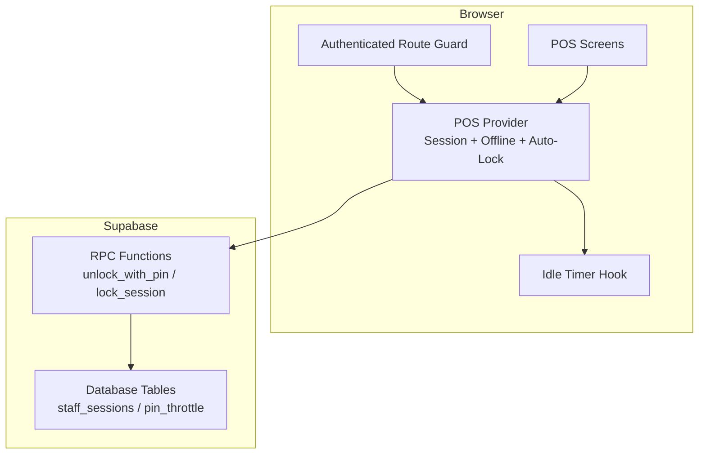
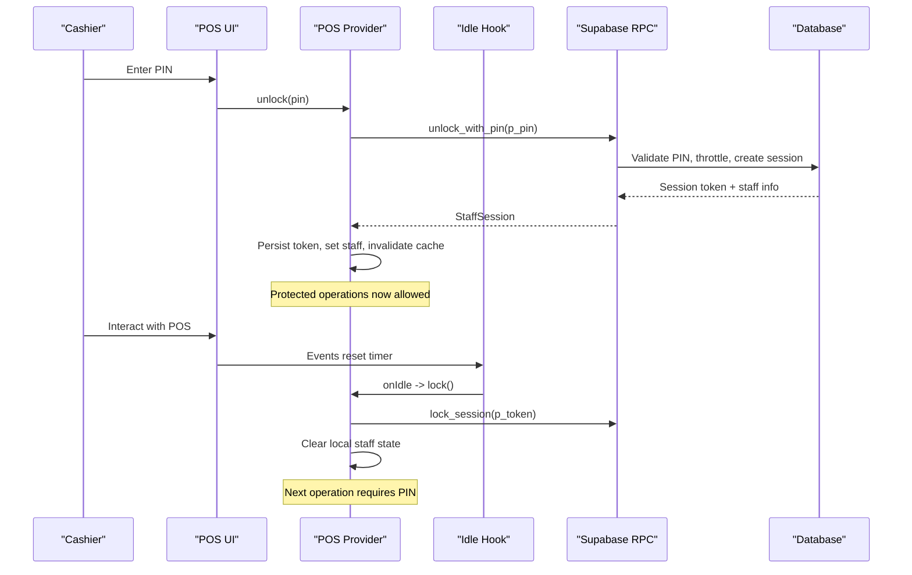
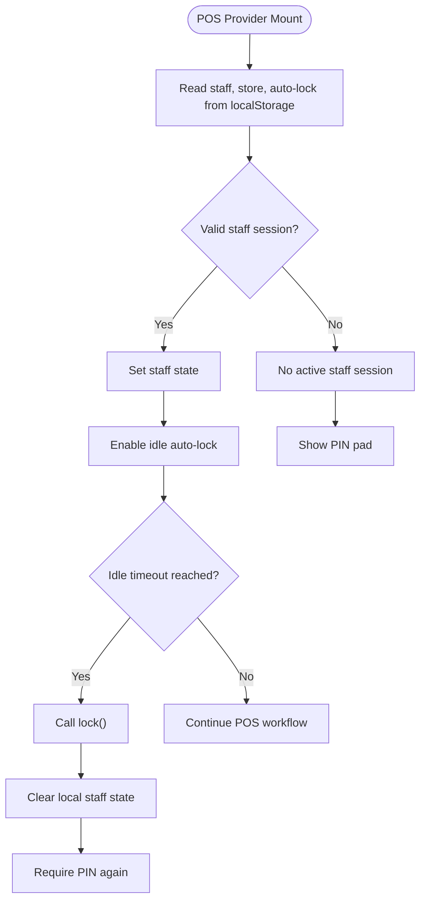
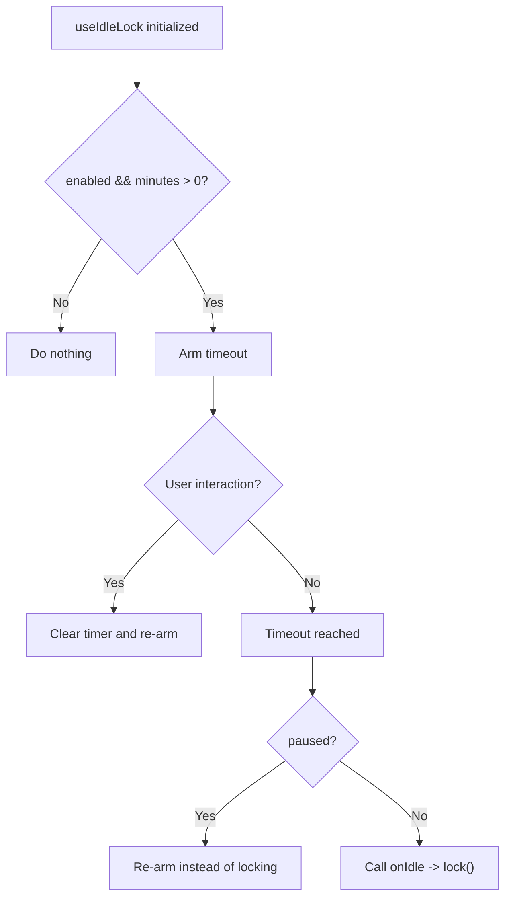
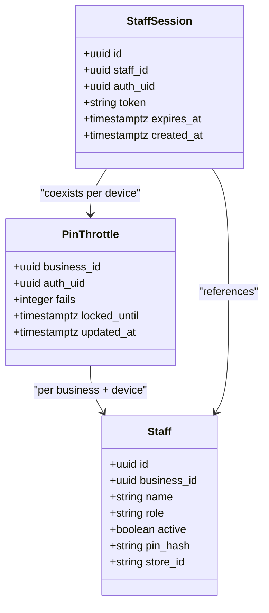
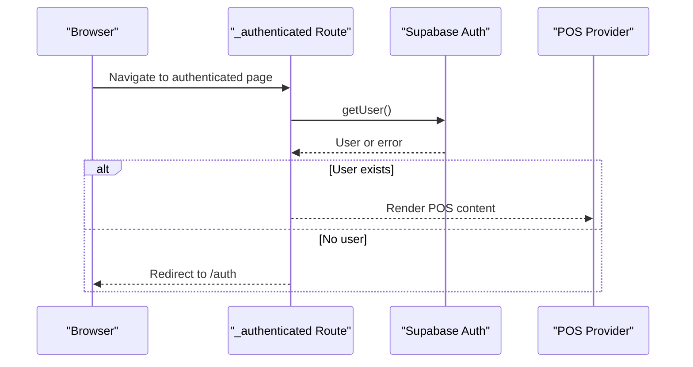
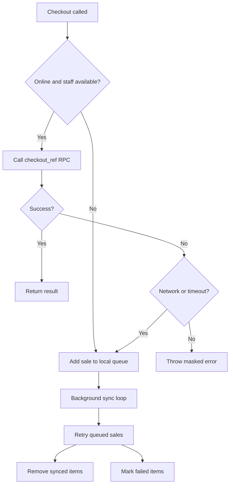
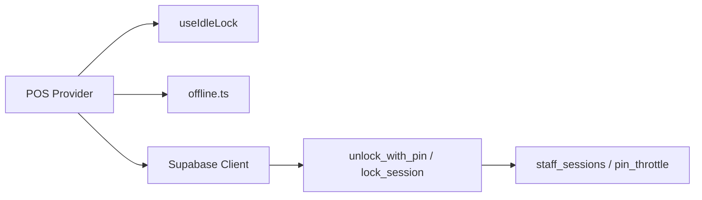

# Session Management & Auto-Lock

<cite>
**Referenced Files in This Document**
- [pos.tsx](file://src/lib/pos.tsx)
- [use-idle-lock.ts](file://src/components/pos/use-idle-lock.ts)
- [route.tsx](file://src/routes/_authenticated/route.tsx)
- [auth-middleware.ts](file://src/integrations/supabase/auth-middleware.ts)
- [offline.ts](file://src/lib/offline.ts)
- [20261008090000_security_hardening.sql](file://supabase/migrations/20261008090000_security_hardening.sql)
</cite>

## Table of Contents
1. [Introduction](#introduction)
2. [Project Structure](#project-structure)
3. [Core Components](#core-components)
4. [Architecture Overview](#architecture-overview)
5. [Detailed Component Analysis](#detailed-component-analysis)
6. [Dependency Analysis](#dependency-analysis)
7. [Performance Considerations](#performance-considerations)
8. [Troubleshooting Guide](#troubleshooting-guide)
9. [Conclusion](#conclusion)

## Introduction
This document explains how the POS application manages user sessions and enforces automatic locking for security compliance. It covers:

- How a staff session is created, validated, maintained, and terminated.
- The idle detection mechanism that locks the interface after configurable inactivity.
- Session timeout behavior, lock screen flow, and re-authentication requirements.
- Security controls including device binding, PIN throttling, concurrent session handling, and error masking.
- Audit-relevant behaviors such as session state persistence, offline queueing, and synchronization.
- How sessions interact with offline mode and data synchronization.

The implementation spans React components, a shared POS context, Supabase RPC functions, and database migrations.

## Project Structure
The session and auto-lock features are implemented across several layers:

- **Authentication layer**: Route-level authentication ensures only signed-in users access authenticated routes.
- **POS session layer**: A provider manages staff sessions, store selection, auto-lock configuration, checkout, and offline sync.
- **Idle detection hook**: A lightweight timer watches pointer and keyboard activity to trigger locking.
- **Server-side security**: Database functions enforce PIN validation, throttling, device binding, and session lifecycle.
- **Offline support**: Local cache and sales queue survive network outages and resume when connectivity returns.

**Diagram sources**
- [route.tsx:4-12](file://src/routes/_authenticated/route.tsx#L4-L12)
- [pos.tsx:115-440](file://src/lib/pos.tsx#L115-L440)
- [use-idle-lock.ts:9-39](file://src/components/pos/use-idle-lock.ts#L9-L39)
- [20261008090000_security_hardening.sql:218-291](file://supabase/migrations/20261008090000_security_hardening.sql#L218-L291)

**Section sources**
- [route.tsx:4-12](file://src/routes/_authenticated/route.tsx#L4-L12)
- [pos.tsx:115-440](file://src/lib/pos.tsx#L115-L440)
- [use-idle-lock.ts:9-39](file://src/components/pos/use-idle-lock.ts#L9-L39)
- [20261008090000_security_hardening.sql:218-291](file://supabase/migrations/20261008090000_security_hardening.sql#L218-L291)

## Core Components
The session management system is centered around these core pieces:

- **POS Provider**: Owns the staff session, store selection, auto-lock configuration, checkout, offline queue, and synchronization. It exposes `unlock`, `lock`, and `rpc` helpers used by all POS screens.
- **Idle Lock Hook**: Watches user interaction events and triggers an idle callback after a configured number of minutes. It can be paused during background operations such as offline queue replay.
- **Security Migrations**: Define server-side PIN throttling, staff session creation, device binding, session expiration, and explicit lock/logout helpers.
- **Offline Module**: Persists reference data and queued sales locally so the register remains usable without internet and resumes sync later.

Key responsibilities:

| Component | Responsibility |
|---|---|
| `PosProvider` | Staff session lifecycle, auto-lock configuration, checkout, offline queue, and RPC wrapper |
| `useIdleLock` | Inactivity timer with event listeners and pause support |
| `unlock_with_pin` | Validates PIN, applies throttling, creates a single active session per device |
| `lock_session` | Invalidates the current staff session on the server |
| `offline.ts` | Local cache and sales queue persistence and recovery |

**Section sources**
- [pos.tsx:38-84](file://src/lib/pos.tsx#L38-L84)
- [pos.tsx:115-440](file://src/lib/pos.tsx#L115-L440)
- [use-idle-lock.ts:9-39](file://src/components/pos/use-idle-lock.ts#L9-L39)
- [20261008090000_security_hardening.sql:218-291](file://supabase/migrations/20261008090000_security_hardening.sql#L218-L291)
- [offline.ts:1-92](file://src/lib/offline.ts#L1-L92)

## Architecture Overview
The session architecture combines client-side state with server-enforced security:

1. **App authentication**: The `_authenticated` route guard checks the global Supabase user before rendering POS content.
2. **Staff session creation**: A cashier enters a PIN through the POS UI. The client calls `unlock_with_pin`.
3. **Server validation**: The function validates the PIN, checks throttling, deletes any existing session for the same device login, and inserts a new staff session with an expiration time.
4. **Client state update**: The provider stores the staff token and metadata locally, invalidates cached queries, and enables protected operations.
5. **Auto-lock**: If no interaction occurs within the configured window, the idle hook invokes the provider’s `lock` function.
6. **Lock behavior**: The provider clears local staff state and optionally notifies the server to invalidate the session.
7. **Re-authentication**: Any subsequent protected operation detects a locked or missing session and requires PIN entry again.

**Diagram sources**
- [pos.tsx:194-218](file://src/lib/pos.tsx#L194-L218)
- [pos.tsx:347-364](file://src/lib/pos.tsx#L347-L364)
- [use-idle-lock.ts:19-33](file://src/components/pos/use-idle-lock.ts#L19-L33)
- [20261008090000_security_hardening.sql:218-291](file://supabase/migrations/20261008090000_security_hardening.sql#L218-L291)

## Detailed Component Analysis

### POS Provider: Session State, Auto-Lock, and Operations
The POS provider is the central coordinator for session state and POS workflow.

#### Key Responsibilities
- Load and validate persisted staff sessions from local storage.
- Manage store selection and role-based store scoping.
- Provide `unlock` and `lock` methods.
- Wrap RPC calls with session tokens and handle locked-state errors.
- Initialize offline cache and queue.
- Configure and drive the idle auto-lock timer.
- Expose business, store, money formatting, role checks, and checkout helpers.

#### Session Lifecycle
- **Initialization**: On mount, the provider reads `pos-staff-{userId}`, `pos-store-{userId}`, and `pos-autolock-{userId}` from local storage. Stale or malformed sessions are discarded.
- **Unlock**: Validates the PIN locally, calls `unlock_with_pin`, persists the returned staff session, updates React state, and invalidates queries.
- **Lock**: Calls `lock_session` if a staff token exists, then clears local staff state and invalidates queries.
- **Operation protection**: The `rpc` helper attaches the staff token and treats locked errors as a signal to clear the local session.

#### Auto-Lock Configuration
- Default idle timeout is five minutes.
- Configurable between zero and 240 minutes; zero disables auto-lock.
- Stored in local storage under a per-user key.
- The idle hook is enabled only when a staff session exists.
- The hook is paused while the offline queue is being replayed to avoid locking mid-sync.

**Diagram sources**
- [pos.tsx:125-147](file://src/lib/pos.tsx#L125-L147)
- [pos.tsx:186-218](file://src/lib/pos.tsx#L186-L218)
- [pos.tsx:347-364](file://src/lib/pos.tsx#L347-L364)

**Section sources**
- [pos.tsx:38-84](file://src/lib/pos.tsx#L38-L84)
- [pos.tsx:115-228](file://src/lib/pos.tsx#L115-L228)
- [pos.tsx:347-388](file://src/lib/pos.tsx#L347-L388)

### Idle Detection Hook
The idle hook provides a self-cleaning timer that fires once after a configured period of inactivity.

#### Behavior
- Listens to keydown, click, touchstart, and mousemove events.
- Arms a timeout based on the configured minutes.
- Resets the timer on every interaction.
- Supports a `paused` flag to prevent locking during background operations like offline queue replay.
- Cleans up timers and event listeners on unmount or dependency changes.

#### Integration with Auto-Lock
- The POS provider passes `enabled: !!staff`, `minutes: autoLockMinutes`, and `paused: syncing.current`.
- When idle, it calls the provider’s `lock` function via a ref to always invoke the latest implementation.

**Diagram sources**
- [use-idle-lock.ts:19-38](file://src/components/pos/use-idle-lock.ts#L19-L38)
- [pos.tsx:360-364](file://src/lib/pos.tsx#L360-L364)

**Section sources**
- [use-idle-lock.ts:1-39](file://src/components/pos/use-idle-lock.ts#L1-L39)
- [pos.tsx:360-364](file://src/lib/pos.tsx#L360-L364)

### Server-Side Security and Session Enforcement
The database migration introduces critical security controls for PIN entry and staff sessions.

#### PIN Throttling
- Tracks failed PIN attempts per business and per signed-in device.
- After repeated failures, it sets a temporary lockout window.
- Prevents brute-force attacks even if the client is bypassed.

#### Staff Sessions
- Each successful PIN unlock creates a staff session bound to the device login (`auth_uid`).
- Sessions have a default expiration of eight hours.
- Only one active PIN session is allowed per device login; unlocking again replaces the previous session.
- RPC functions require the staff token and verify that it belongs to the current device login.

#### Lock and Logout Helpers
- `lock_session` removes the specified staff session and associated throttle row.
- `lock_all_sessions` signs out all sessions for the device login.

**Diagram sources**
- [20261008090000_security_hardening.sql:27-45](file://supabase/migrations/20261008090000_security_hardening.sql#L27-L45)
- [20261008090000_security_hardening.sql:218-291](file://supabase/migrations/20261008090000_security_hardening.sql#L218-L291)

**Section sources**
- [20261008090000_security_hardening.sql:27-45](file://supabase/migrations/20261008090000_security_hardening.sql#L27-L45)
- [20261008090000_security_hardening.sql:218-291](file://supabase/migrations/20261008090000_security_hardening.sql#L218-L291)

### Authentication Layer and Request Middleware
Two distinct authentication mechanisms are present:

- **Route-level authentication**: Ensures the global Supabase user exists before allowing access to authenticated routes.
- **Server middleware**: Validates Bearer tokens for server-side requests and extracts claims.

For POS session management, the route guard is the primary gate for the web app, while the middleware protects server endpoints.

**Diagram sources**
- [route.tsx:4-12](file://src/routes/_authenticated/route.tsx#L4-L12)
- [auth-middleware.ts:34-105](file://src/integrations/supabase/auth-middleware.ts#L34-L105)

**Section sources**
- [route.tsx:4-12](file://src/routes/_authenticated/route.tsx#L4-L12)
- [auth-middleware.ts:34-105](file://src/integrations/supabase/auth-middleware.ts#L34-L105)

### Offline Mode and Data Synchronization
Offline support is tightly integrated with session state:

- **Reference cache**: Frequently used read-only data is hydrated from local storage for instant start.
- **Sales queue**: Sales made while offline are stored locally and retried when connectivity returns.
- **Sync behavior**: Sync runs when online and a staff session exists. It stops on network errors or locked-session errors.
- **Auto-lock pause**: Idle detection is paused while the queue is being replayed to avoid locking mid-synchronization.

**Diagram sources**
- [pos.tsx:249-345](file://src/lib/pos.tsx#L249-L345)
- [offline.ts:62-92](file://src/lib/offline.ts#L62-L92)

**Section sources**
- [pos.tsx:242-345](file://src/lib/pos.tsx#L242-L345)
- [offline.ts:1-92](file://src/lib/offline.ts#L1-L92)

## Dependency Analysis
The session system has clear boundaries and dependencies:

- `PosProvider` depends on:
  - Supabase client for RPC calls.
  - `validatePin` for local PIN validation.
  - `useIdleLock` for inactivity detection.
  - `offline.ts` for cache hydration, persistence, queue loading, saving, and network error detection.
  - React Query client for cache invalidation.
- `useIdleLock` depends only on React hooks and browser APIs.
- Server-side security depends on Supabase functions and RLS policies.

**Diagram sources**
- [pos.tsx:1-26](file://src/lib/pos.tsx#L1-L26)
- [pos.tsx:242-364](file://src/lib/pos.tsx#L242-L364)
- [use-idle-lock.ts:1-39](file://src/components/pos/use-idle-lock.ts#L1-L39)
- [offline.ts:1-92](file://src/lib/offline.ts#L1-L92)
- [20261008090000_security_hardening.sql:218-291](file://supabase/migrations/20261008090000_security_hardening.sql#L218-L291)

**Section sources**
- [pos.tsx:1-26](file://src/lib/pos.tsx#L1-L26)
- [pos.tsx:242-364](file://src/lib/pos.tsx#L242-L364)
- [use-idle-lock.ts:1-39](file://src/components/pos/use-idle-lock.ts#L1-L39)
- [offline.ts:1-92](file://src/lib/offline.ts#L1-L92)
- [20261008090000_security_hardening.sql:218-291](file://supabase/migrations/20261008090000_security_hardening.sql#L218-L291)

## Performance Considerations
- **Idle timer efficiency**: The idle hook uses passive event listeners and clears/re-arms timers rather than polling, minimizing main-thread impact.
- **Auto-lock bounds**: The auto-lock setting is clamped between zero and 240 minutes to prevent extreme timeouts.
- **Offline sync pacing**: Queue sync runs periodically and stops on locked or network errors to avoid busy loops.
- **Cache persistence**: Reference data persistence is debounced to reduce frequent writes to local storage.
- **Query invalidation**: Session changes and successful syncs invalidate relevant queries to keep UI consistent without excessive refetches.

[No sources needed since this section provides general guidance]

## Troubleshooting Guide

### Common Issues and Resolutions

| Symptom | Likely Cause | Resolution |
|---|---|---|
| POS immediately asks for PIN after reload | Stale or expired staff session in local storage | The provider discards invalid sessions; enter PIN again |
| Auto-lock triggers during offline sync | Idle hook not paused correctly | Ensure `paused` reflects queue sync state; the provider pauses while syncing |
| Locked error appears during RPC calls | Staff session expired or invalidated | Clear local state and re-enter PIN |
| Wrong PIN repeatedly blocked | PIN throttling triggered | Wait for the server-side lockout window to expire |
| Offline sales do not sync | No staff session or network error | Unlock the POS and ensure connectivity; retry failed items |
| Store selection ignored for cashiers | Cashier-scoped store logic | Cashier sessions include a store ID; use that instead of manual selection |

### Error Masking
The provider masks raw database or SQL errors to prevent leaking internal details to the UI. Errors containing policy violations, constraint names, or SQL syntax are replaced with generic messages.

**Section sources**
- [pos.tsx:93-104](file://src/lib/pos.tsx#L93-L104)
- [pos.tsx:220-228](file://src/lib/pos.tsx#L220-L228)
- [20261008090000_security_hardening.sql:218-291](file://supabase/migrations/20261008090000_security_hardening.sql#L218-L291)

## Conclusion
The POS session management system combines a robust client-side provider with server-enforced security controls. Staff sessions are created through PIN verification, bound to the device login, and limited in lifetime. Auto-lock prevents unauthorized access after inactivity, with pause support during critical background operations like offline queue replay. Offline mode preserves sales and reference data, resuming synchronization when possible. Together, these mechanisms provide secure, compliant, and resilient POS operations.

[No sources needed since this section summarizes without analyzing specific files]