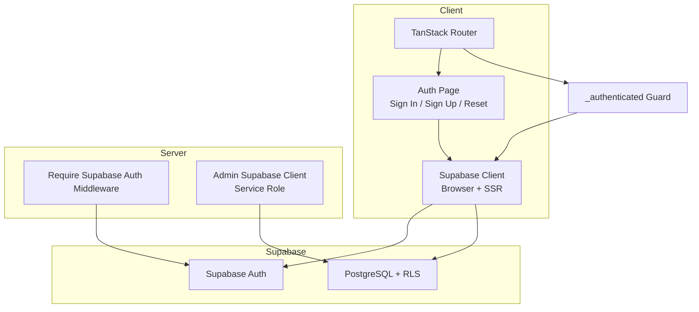
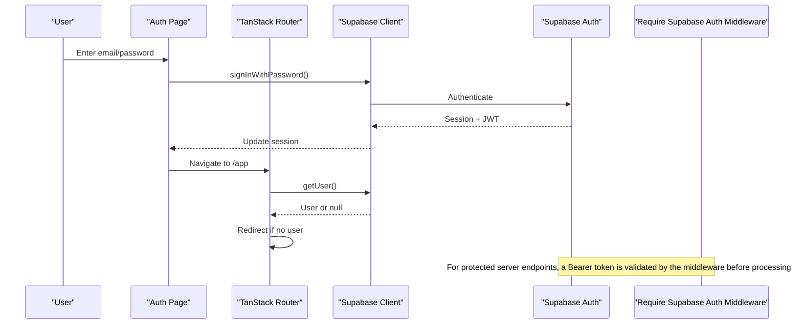
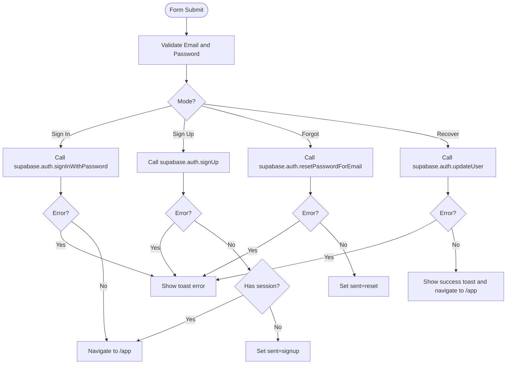
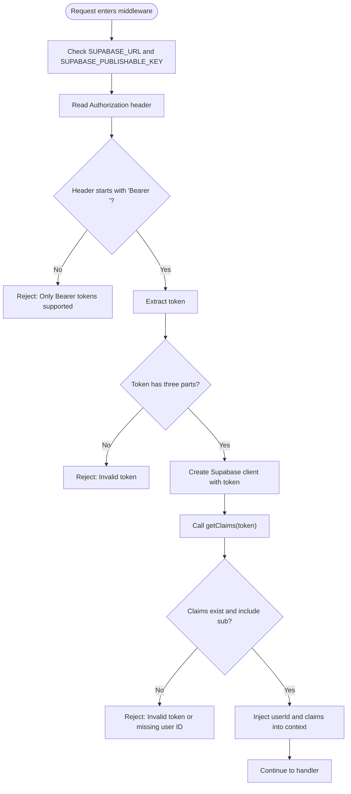
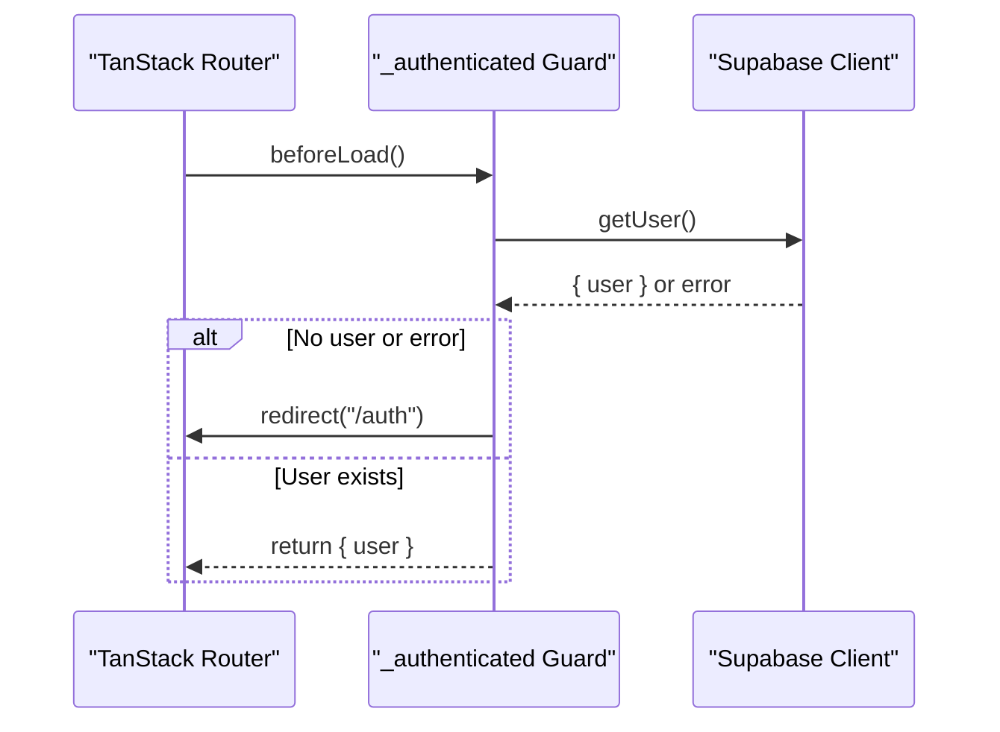
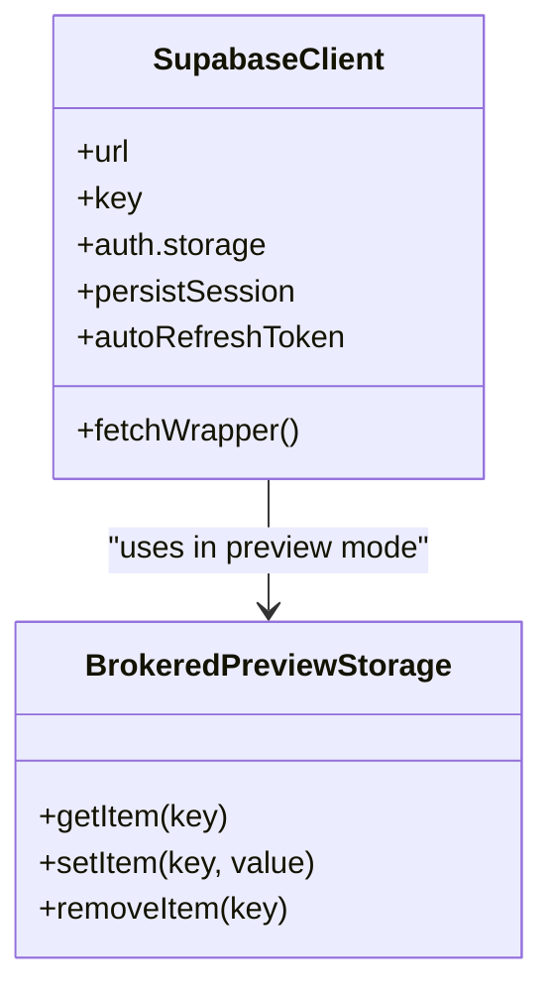
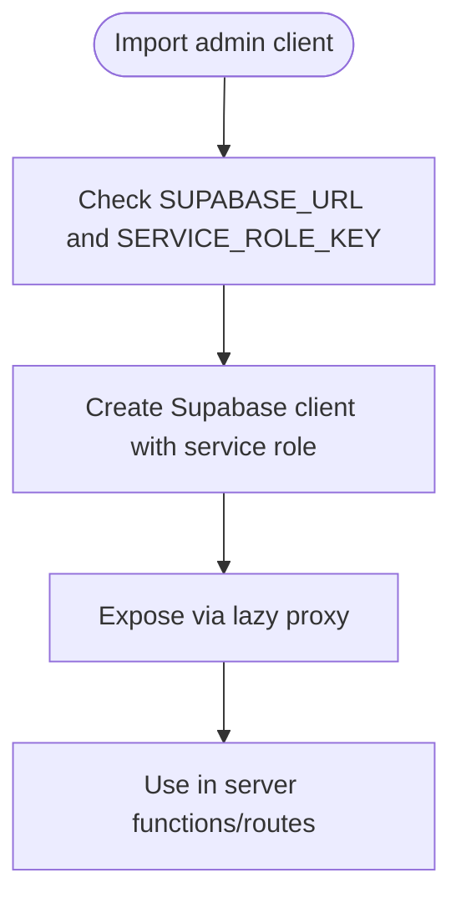
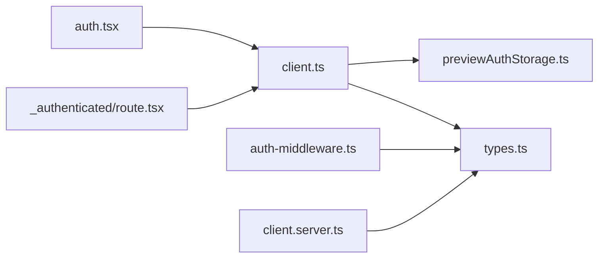

# User Authentication

<cite>
**Referenced Files in This Document**
- [auth-middleware.ts](file://src/integrations/supabase/auth-middleware.ts)
- [client.server.ts](file://src/integrations/supabase/client.server.ts)
- [client.ts](file://src/integrations/supabase/client.ts)
- [previewAuthStorage.ts](file://src/integrations/supabase/previewAuthStorage.ts)
- [types.ts](file://src/integrations/supabase/types.ts)
- [auth.tsx](file://src/routes/auth.tsx)
- [_authenticated/route.tsx](file://src/routes/_authenticated/route.tsx)
- [router.tsx](file://src/router.tsx)
</cite>

## Table of Contents
1. [Introduction](#introduction)
2. [Project Structure](#project-structure)
3. [Core Components](#core-components)
4. [Architecture Overview](#architecture-overview)
5. [Detailed Component Analysis](#detailed-component-analysis)
6. [Dependency Analysis](#dependency-analysis)
7. [Performance Considerations](#performance-considerations)
8. [Troubleshooting Guide](#troubleshooting-guide)
9. [Conclusion](#conclusion)

## Introduction
This document explains the user authentication system for the application. It covers:
- Email/password authentication with Supabase Auth, including registration, login, and password reset flows.
- Server-side middleware that validates Bearer tokens and extracts user claims.
- Integration between TanStack Router’s route-level authentication and Supabase authentication state.
- Protected routes, token validation, error handling, security considerations, and authentication state management.

The implementation uses:
- Client-side Supabase client for browser-based sign-in, sign-up, and password recovery.
- A server-side middleware for validating Bearer tokens on protected server endpoints.
- A TanStack Router group under `_authenticated` to guard client-side navigation.
- A preview-safe storage adapter for development previews.

## Project Structure
Authentication-related code is organized into integration modules and route guards:
- `src/integrations/supabase`: Supabase client configuration, server admin client, preview storage, and auth middleware.
- `src/routes/auth.tsx`: User-facing authentication UI and flows.
- `src/routes/_authenticated/route.tsx`: Route-level guard for authenticated pages.
- `src/router.tsx`: Application router setup.

**Diagram sources**
- [auth.tsx:1-266](file://src/routes/auth.tsx#L1-L266)
- [_authenticated/route.tsx:1-13](file://src/routes/_authenticated/route.tsx#L1-L13)
- [client.ts:1-96](file://src/integrations/supabase/client.ts#L1-L96)
- [auth-middleware.ts:1-106](file://src/integrations/supabase/auth-middleware.ts#L1-L106)
- [client.server.ts:1-73](file://src/integrations/supabase/client.server.ts#L1-L73)

**Section sources**
- [auth.tsx:1-266](file://src/routes/auth.tsx#L1-L266)
- [_authenticated/route.tsx:1-13](file://src/routes/_authenticated/route.tsx#L1-L13)
- [client.ts:1-96](file://src/integrations/supabase/client.ts#L1-L96)
- [auth-middleware.ts:1-106](file://src/integrations/supabase/auth-middleware.ts#L1-L106)
- [client.server.ts:1-73](file://src/integrations/supabase/client.server.ts#L1-L73)
- [router.tsx:1-34](file://src/router.tsx#L1-L34)

## Core Components
- Supabase client (browser/SSR): Provides session persistence, token refresh, and typed database access.
- Preview storage adapter: Shares sessions across editor frames during previews while keeping tokens safe.
- Server admin client: Service-role client for privileged server operations; bypasses Row-Level Security.
- Auth middleware: Validates Bearer tokens, verifies claims via Supabase, and injects user context.
- Auth page: Handles email/password sign-in, sign-up, forgot password, and password update flows.
- Authenticated route guard: Redirects unauthenticated users to `/auth`.

Key responsibilities:
- Client-side flows use `supabase.auth.*` methods and persist sessions automatically.
- Server-side flows validate incoming Bearer tokens and extract user identity.
- Route guards protect client-side navigation based on current session.

**Section sources**
- [client.ts:1-96](file://src/integrations/supabase/client.ts#L1-L96)
- [previewAuthStorage.ts:1-113](file://src/integrations/supabase/previewAuthStorage.ts#L1-L113)
- [client.server.ts:1-73](file://src/integrations/supabase/client.server.ts#L1-L73)
- [auth-middleware.ts:1-106](file://src/integrations/supabase/auth-middleware.ts#L1-L106)
- [auth.tsx:1-266](file://src/routes/auth.tsx#L1-L266)
- [_authenticated/route.tsx:1-13](file://src/routes/_authenticated/route.tsx#L1-L13)

## Architecture Overview
The authentication architecture combines client-side session management with server-side token validation:

**Diagram sources**
- [auth.tsx:45-107](file://src/routes/auth.tsx#L45-L107)
- [_authenticated/route.tsx:6-10](file://src/routes/_authenticated/route.tsx#L6-L10)
- [client.ts:57-84](file://src/integrations/supabase/client.ts#L57-L84)
- [auth-middleware.ts:34-105](file://src/integrations/supabase/auth-middleware.ts#L34-L105)

## Detailed Component Analysis

### Email/Password Authentication Flow
The authentication page supports four modes:
- Sign in: Validates email and password, calls Supabase sign-in, then navigates to `/app`.
- Sign up: Validates email and password, calls Supabase sign-up, optionally redirects if a session is created immediately.
- Forgot password: Sends a reset link to the provided email.
- Recover password: Listens for Supabase’s password recovery event and allows setting a new password.

Validation and UX:
- Client-side validation ensures email format and password strength before calling Supabase.
- Rate-limit errors are surfaced with user-friendly messages.
- After successful actions, the app navigates to the application area or shows confirmation alerts.

**Diagram sources**
- [auth.tsx:45-107](file://src/routes/auth.tsx#L45-L107)

**Section sources**
- [auth.tsx:24-107](file://src/routes/auth.tsx#L24-L107)

### Server-Side Bearer Token Validation Middleware
The middleware enforces secure access to server endpoints by validating Bearer tokens:
- Requires environment variables for Supabase URL and publishable key.
- Extracts the Authorization header and validates it starts with `Bearer `.
- Performs basic structural validation of the token (three-part JWT-like structure).
- Creates a Supabase client configured to call `getClaims(token)` using the provided token.
- Ensures the token contains a user ID (`sub`) claim.
- Injects `supabase`, `userId`, and `claims` into the request context for downstream handlers.

Security notes:
- The middleware does not perform local cryptographic verification; it delegates to Supabase’s `getClaims` endpoint.
- New Supabase API keys are handled specially to avoid sending them as Bearer tokens.

**Diagram sources**
- [auth-middleware.ts:34-105](file://src/integrations/supabase/auth-middleware.ts#L34-L105)

**Section sources**
- [auth-middleware.ts:1-106](file://src/integrations/supabase/auth-middleware.ts#L1-L106)

### TanStack Router Authenticated Route Guard
The `_authenticated` route group protects client-side navigation:
- Disables server-side rendering for this route group.
- Before loading, checks the current user via `supabase.auth.getUser()`.
- Redirects to `/auth` if no user is present.
- Passes the user object into the route context for child routes.

**Diagram sources**
- [_authenticated/route.tsx:4-12](file://src/routes/_authenticated/route.tsx#L4-L12)

**Section sources**
- [_authenticated/route.tsx:1-13](file://src/routes/_authenticated/route.tsx#L1-L13)

### Supabase Client Configuration and Storage
The client module configures Supabase for both browser and SSR environments:
- Uses environment variables for URL and publishable key.
- Wraps fetch to set the `apikey` header and handle new Supabase API key formats.
- Enables session persistence and automatic token refresh in the browser.
- Uses a brokered preview storage adapter during previews to share sessions safely.

**Diagram sources**
- [client.ts:23-84](file://src/integrations/supabase/client.ts#L23-L84)
- [previewAuthStorage.ts:5-111](file://src/integrations/supabase/previewAuthStorage.ts#L5-L111)

**Section sources**
- [client.ts:1-96](file://src/integrations/supabase/client.ts#L1-L96)
- [previewAuthStorage.ts:1-113](file://src/integrations/supabase/previewAuthStorage.ts#L1-L113)

### Server Admin Client
The server admin client provides a service-role Supabase client for privileged operations:
- Reads service role key from environment variables.
- Disables session persistence and token refresh since it runs server-side.
- Exposes a proxy to lazily instantiate the client.
- Should only be used for trusted server-side operations and never exposed to the client.

**Diagram sources**
- [client.server.ts:35-72](file://src/integrations/supabase/client.server.ts#L35-L72)

**Section sources**
- [client.server.ts:1-73](file://src/integrations/supabase/client.server.ts#L1-L73)

## Dependency Analysis
The authentication system depends on:
- Supabase JS SDK for authentication and database access.
- TanStack Router for routing and route guards.
- Environment variables for configuration.
- Preview storage adapter for development workflows.

**Diagram sources**
- [auth.tsx:1-10](file://src/routes/auth.tsx#L1-L10)
- [_authenticated/route.tsx:1-3](file://src/routes/_authenticated/route.tsx#L1-L3)
- [client.ts:1-5](file://src/integrations/supabase/client.ts#L1-L5)
- [auth-middleware.ts:1-5](file://src/integrations/supabase/auth-middleware.ts#L1-L5)
- [client.server.ts:1-6](file://src/integrations/supabase/client.server.ts#L1-L6)

**Section sources**
- [auth.tsx:1-10](file://src/routes/auth.tsx#L1-L10)
- [_authenticated/route.tsx:1-3](file://src/routes/_authenticated/route.tsx#L1-L3)
- [client.ts:1-5](file://src/integrations/supabase/client.ts#L1-L5)
- [auth-middleware.ts:1-5](file://src/integrations/supabase/auth-middleware.ts#L1-L5)
- [client.server.ts:1-6](file://src/integrations/supabase/client.server.ts#L1-L6)

## Performance Considerations
- Query freshness: The router config sets conservative defaults for query staleness and refetch behavior to reduce unnecessary database hits on POS terminals.
- Token refresh: The client enables automatic token refresh to keep sessions valid without extra logic.
- SSR disabled for authenticated routes: Prevents server-side rendering overhead for protected pages.
- Admin client lazy initialization: Avoids creating the service-role client unless needed.

[No sources needed since this section provides general guidance]

## Troubleshooting Guide
Common issues and resolutions:
- Missing environment variables:
  - Both client and server clients throw explicit errors when required environment variables are absent. Ensure `SUPABASE_URL` and either `SUPABASE_PUBLISHABLE_KEY` or `SUPABASE_SERVICE_ROLE_KEY` are configured.
- Unauthorized responses:
  - The middleware rejects requests without an Authorization header, non-Bearer headers, malformed tokens, or tokens lacking a user ID.
- Rate limiting:
  - The auth page surfaces rate-limit errors with friendly messages. If you see repeated failures, consider backoff or throttling user attempts.
- Preview session sharing:
  - During previews, the brokered storage synchronizes sessions with the editor frame. If sessions do not sync, verify origin validation and ensure the preview is embedded within the expected editor host.

**Section sources**
- [auth-middleware.ts:34-105](file://src/integrations/supabase/auth-middleware.ts#L34-L105)
- [client.ts:57-84](file://src/integrations/supabase/client.ts#L57-L84)
- [client.server.ts:35-58](file://src/integrations/supabase/client.server.ts#L35-L58)
- [auth.tsx:97-107](file://src/routes/auth.tsx#L97-L107)
- [previewAuthStorage.ts:5-111](file://src/integrations/supabase/previewAuthStorage.ts#L5-L111)

## Conclusion
The authentication system integrates Supabase Auth with TanStack Router to provide secure, user-friendly sign-in, sign-up, and password recovery flows. Client-side sessions are persisted and refreshed automatically, while server-side endpoints can enforce strict Bearer token validation through middleware. Route guards protect client-side navigation, ensuring only authenticated users access protected areas. Proper environment configuration and adherence to the documented flows will maintain security and reliability across client and server boundaries.

[No sources needed since this section summarizes without analyzing specific files]