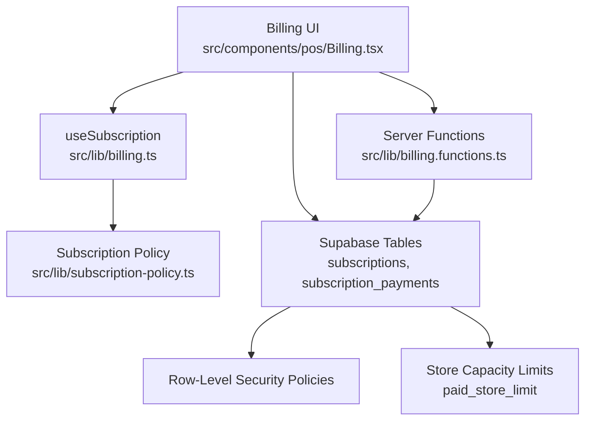
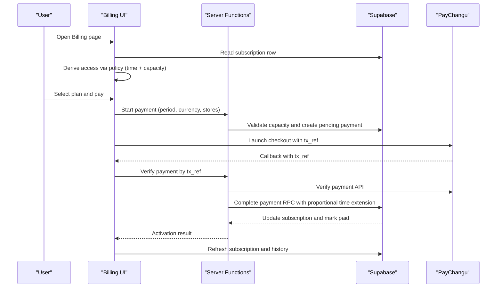
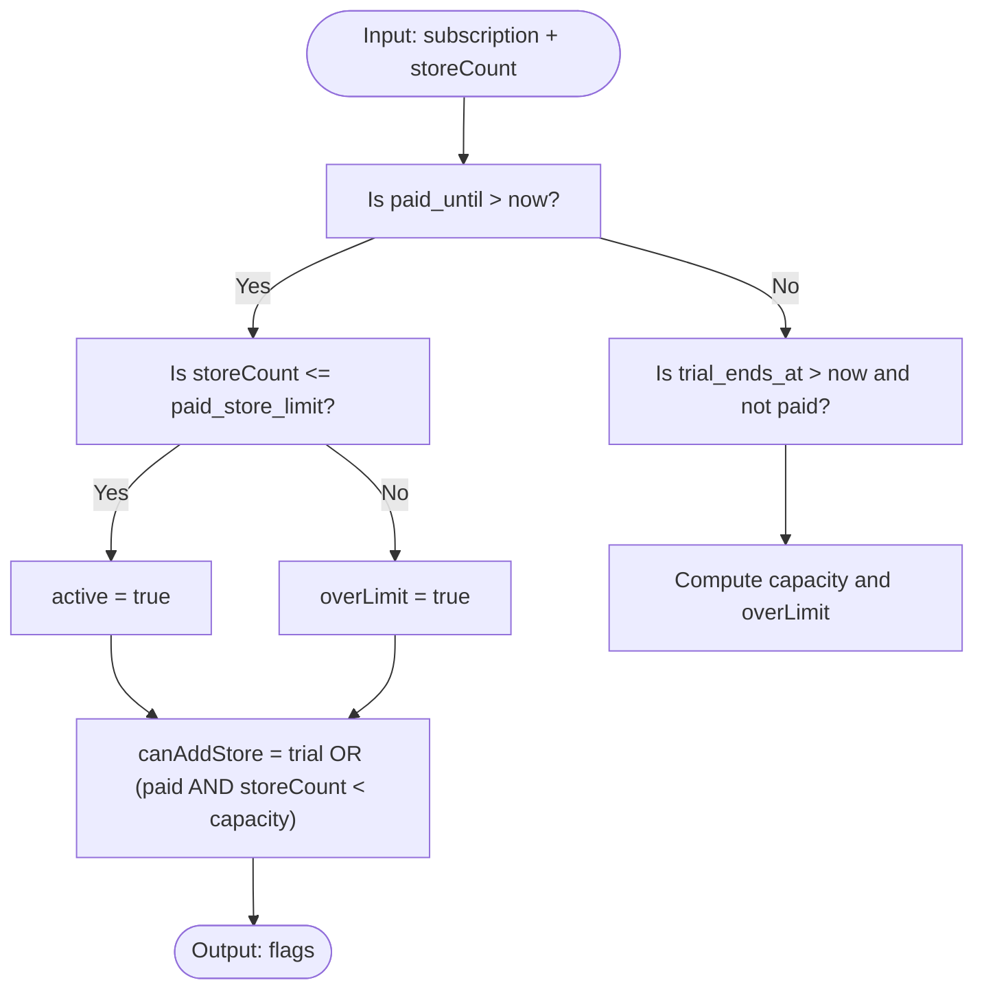
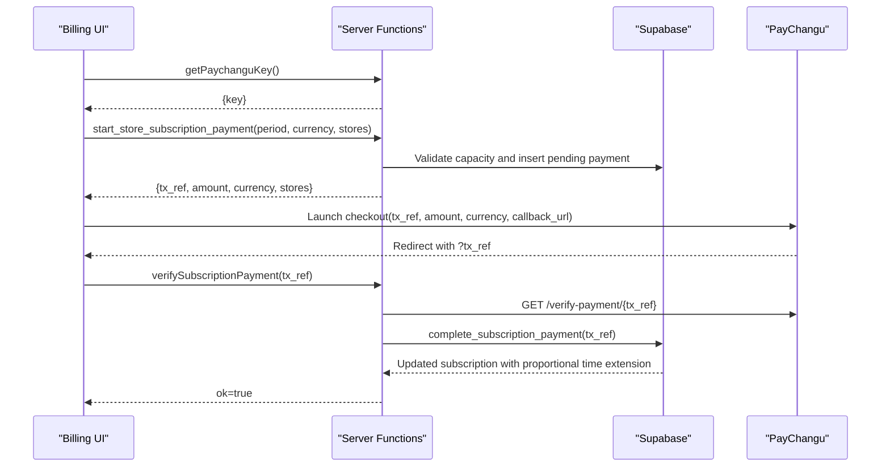
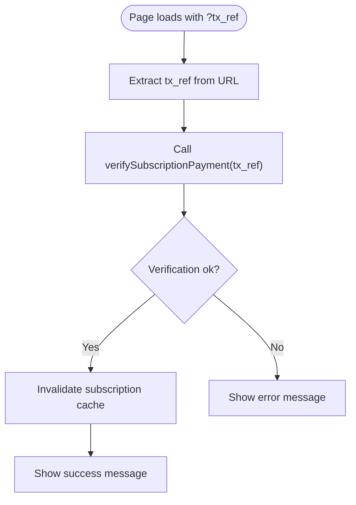
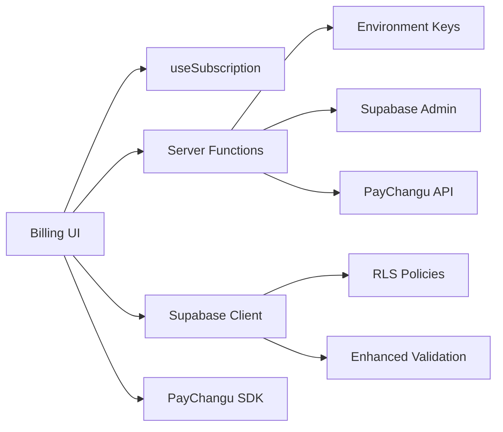

# Billing & Subscriptions

<cite>
**Referenced Files in This Document**
- [Billing.tsx](file://src/components/pos/Billing.tsx)
- [billing.ts](file://src/lib/billing.ts)
- [billing.functions.ts](file://src/lib/billing.functions.ts)
- [subscription-policy.ts](file://src/lib/subscription-policy.ts)
- [app.billing.tsx](file://src/routes/_authenticated/app.billing.tsx)
- [20261007100137_bfc24679-0e49-446b-b715-df35c6e8c994.sql](file://supabase/migrations/20261007100137_bfc24679-0e49-446b-b715-df35c6e8c994.sql)
- [20261007115041_3e857134-c53a-47c9-a33f-3db16cc13962.sql](file://supabase/migrations/20261007115041_3e857134-c53a-47c9-a33f-3db16cc13962.sql)
- [20261007115238_6662954d-34a5-47c9-a33f-3db16cc13962.sql](file://supabase/migrations/20261007115238_6662954d-34a5-47c9-a33f-3db16cc13962.sql)
</cite>

## Update Summary
**Changes Made**
- Updated subscription model to include paid store limits and capacity management
- Enhanced subscription checking logic with dual validation (time + capacity)
- Added advanced renewal logic with proportional time extension for prepaid credits
- Improved error handling and validation for subscription operations
- Updated database schema with new columns and enhanced stored procedures

## Table of Contents
1. [Introduction](#introduction)
2. [Project Structure](#project-structure)
3. [Core Components](#core-components)
4. [Architecture Overview](#architecture-overview)
5. [Detailed Component Analysis](#detailed-component-analysis)
6. [Dependency Analysis](#dependency-analysis)
7. [Performance Considerations](#performance-considerations)
8. [Troubleshooting Guide](#troubleshooting-guide)
9. [Conclusion](#conclusion)

## Introduction
This document explains the billing and subscription management system for the application. It covers:
- Multi-tier subscription plans with trial handling and automatic renewals
- Enhanced subscription checking logic with dual validation (time-based and capacity-based)
- Payment processing via PayChangu, including payment method support and error handling
- Invoice generation and PDF export
- Subscription policy enforcement and feature gating by tier
- Advanced renewal logic with proportional time extension for prepaid credits
- Examples of creating subscriptions, processing payments, and handling lifecycle events
- Integration with business logic for access control and feature availability
- Webhook-like callback handling for payment confirmations and subscription status changes

## Project Structure
The billing subsystem spans UI components, client-side hooks, server functions, and database migrations:
- UI and user flows: `src/components/pos/Billing.tsx`
- Client subscription state and PayChangu loader: `src/lib/billing.ts`
- Server-side payment verification and key retrieval: `src/lib/billing.functions.ts`
- Subscription policy and access derivation: `src/lib/subscription-policy.ts`
- Route entry point for the billing page: `src/routes/_authenticated/app.billing.tsx`
- Database schema, functions, and guards: `supabase/migrations/*.sql`

**Diagram sources**
- [Billing.tsx:1-674](file://src/components/pos/Billing.tsx#L1-L674)
- [billing.ts:10-55](file://src/lib/billing.ts#L10-L55)
- [billing.functions.ts:4-53](file://src/lib/billing.functions.ts#L4-L53)
- [subscription-policy.ts:1-23](file://src/lib/subscription-policy.ts#L1-L23)
- [20261007100137_bfc24679-0e49-446b-b715-df35c6e8c994.sql:1-63](file://supabase/migrations/20261007100137_bfc24679-0e49-446b-b715-df35c6e8c994.sql#L1-L63)

**Section sources**
- [Billing.tsx:1-674](file://src/components/pos/Billing.tsx#L1-L674)
- [billing.ts:10-55](file://src/lib/billing.ts#L10-L55)
- [billing.functions.ts:4-53](file://src/lib/billing.functions.ts#L4-L53)
- [subscription-policy.ts:1-23](file://src/lib/subscription-policy.ts#L1-L23)
- [app.billing.tsx:1-19](file://src/routes/_authenticated/app.billing.tsx#L1-L19)
- [20261007100137_bfc24679-0e49-446b-b715-df35c6e8c994.sql:1-63](file://supabase/migrations/20261007100137_bfc24679-0e49-446b-b715-df35c6e8c994.sql#L1-L63)

## Core Components
- Billing UI component orchestrates plan selection, payment initiation, invoice listing, and PDF export.
- useSubscription hook fetches the current subscription row and derives access flags (paid, trial, capacity, overLimit, active).
- Server functions provide a public-safe payment verification flow and expose the PayChangu public key.
- Subscription policy defines the data model and computes access from raw subscription data plus store count.
- Database migrations define tables, policies, and stored procedures that enforce pricing, capacity, and renewal rules.

Key responsibilities:
- Pricing and period math: monthly vs yearly with discount factor
- Store capacity limits and prepaid credit extension with proportional time calculation
- Trial window and paid expiration with dual validation
- Payment creation, verification, and completion with enhanced validation
- Invoice history and PDF download

**Updated** Enhanced with paid store limit tracking and advanced renewal logic that preserves remaining time proportionally when extending capacity.

**Section sources**
- [Billing.tsx:54-139](file://src/components/pos/Billing.tsx#L54-L139)
- [billing.ts:10-39](file://src/lib/billing.ts#L10-L39)
- [billing.functions.ts:4-53](file://src/lib/billing.functions.ts#L4-L53)
- [subscription-policy.ts:1-23](file://src/lib/subscription-policy.ts#L1-L23)
- [20261007100137_bfc24679-0e49-446b-b715-df35c6e8c994.sql:36-63](file://supabase/migrations/20261007100137_bfc24679-0e49-446b-b715-df35c6e8c994.sql#L36-L63)

## Architecture Overview
The system follows a layered architecture with enhanced subscription validation:
- Frontend UI initiates actions (plan selection, payment start, invoice download)
- Server functions validate inputs, interact with Supabase, and call PayChangu APIs
- Database enforces business rules through stored procedures and row-level security
- Access is derived on the client using subscription policy to gate features
- Dual validation ensures both time-based and capacity-based subscription validity

**Diagram sources**
- [Billing.tsx:94-139](file://src/components/pos/Billing.tsx#L94-L139)
- [billing.functions.ts:10-53](file://src/lib/billing.functions.ts#L10-L53)
- [20261007100137_bfc24679-0e49-446b-b715-df35c6e8c994.sql:36-63](file://supabase/migrations/20261007100137_bfc24679-0e49-446b-b715-df35c6e8c994.sql#L36-L63)

## Detailed Component Analysis

### Enhanced Subscription Model and Policy
**Updated** The subscription model now includes paid store limits and enhanced validation logic:

- Data model includes trial end date, paid expiration, plan type, and paid store limit
- Policy computes:
  - Paid and trial booleans based on timestamps
  - Capacity and over-limit checks against current store count
  - Active state combining trial or paid-within-capacity
  - Ability to add more stores based on trial or remaining capacity
- Enhanced validation ensures both time-based and capacity-based subscription validity

Complexity: O(1) per check; uses simple date comparisons and integer arithmetic.

**Diagram sources**
- [subscription-policy.ts:1-23](file://src/lib/subscription-policy.ts#L1-L23)

**Section sources**
- [subscription-policy.ts:1-23](file://src/lib/subscription-policy.ts#L1-L23)

### Billing UI and Plan Selection
Responsibilities:
- Display current plan, trial, and status badges
- Show usage progress and store capacity with visual indicators
- Allow selecting currency (MWK/USD), period (monthly/yearly), and number of store slots
- Initiate payment via PayChangu and handle callback
- List payment history and generate invoices as PDFs

Key behaviors:
- Minimum store slots enforced to cover existing stores and active paid capacity
- Yearly plan applies a discount factor
- Payment dialog shows supported methods and last payment summary
- Invoice download triggers PDF generation with structured sections and totals
- Enhanced validation prevents selecting fewer stores than currently paid for

Error handling:
- Toast notifications for configuration errors, gateway failures, and PDF errors
- Disabled controls when not authorized or during busy states

**Section sources**
- [Billing.tsx:54-139](file://src/components/pos/Billing.tsx#L54-L139)
- [Billing.tsx:141-169](file://src/components/pos/Billing.tsx#L141-L169)
- [Billing.tsx:439-565](file://src/components/pos/Billing.tsx#L439-L565)
- [Billing.tsx:635-673](file://src/components/pos/Billing.tsx#L635-L673)

### Payment Processing with PayChangu
Flow:
- Retrieve public key from environment via server function
- Start a payment session server-side, which validates capacity and creates a pending payment record
- Load PayChangu script and launch checkout with metadata and callback URL
- On return, verify payment server-side by calling PayChangu's verification endpoint
- Validate amount and currency match the recorded pending payment
- Call database RPC to complete the payment and update subscription with enhanced renewal logic

Security and validation:
- Input validated with schema constraints
- Secret keys never exposed to the client
- Idempotent completion via database procedure
- Enhanced validation ensures payment amounts match expected calculations

**Diagram sources**
- [Billing.tsx:94-139](file://src/components/pos/Billing.tsx#L94-L139)
- [billing.functions.ts:4-53](file://src/lib/billing.functions.ts#L4-L53)
- [20261007100137_bfc24679-0e49-446b-b715-df35c6e8c994.sql:36-63](file://supabase/migrations/20261007100137_bfc24679-0e49-446b-b715-df35c6e8c994.sql#L36-L63)

**Section sources**
- [billing.functions.ts:4-53](file://src/lib/billing.functions.ts#L4-L53)
- [billing.ts:41-55](file://src/lib/billing.ts#L41-L55)
- [Billing.tsx:94-139](file://src/components/pos/Billing.tsx#L94-L139)

### Invoice Generation and PDF Export
- The UI lists all paid invoices with date, amount, and transaction reference
- Users can download individual invoices or batch-download all paid invoices
- PDF generation composes title, subtitle, badge, meta fields, line items, totals, and footer note
- Errors during PDF generation are surfaced via toast notifications

Data used:
- Transaction reference, period, currency, amount, stores, created/paid timestamps

**Section sources**
- [Billing.tsx:306-436](file://src/components/pos/Billing.tsx#L306-L436)
- [Billing.tsx:635-673](file://src/components/pos/Billing.tsx#L635-L673)

### Enhanced Subscription Lifecycle and Renewal Logic
**Updated** The subscription lifecycle now includes advanced renewal logic:

- Trial: A default trial window is set on subscription creation; trial grants limited access until expiry
- Paid: When a payment completes, the paid_until timestamp advances by one month or one year depending on plan
- Prepaid credits: When increasing store capacity while already paid, the system preserves remaining time proportionally and extends capacity accordingly
- Automatic renewals: The UI supports renewing or extending plans; the backend calculates amounts and updates records accordingly
- Enhanced validation: All operations now validate both time-based and capacity-based subscription validity

Database enforcement:
- Stored procedures compute amounts, create payment records, and safely extend subscription periods
- Row-level security ensures users only access their own subscription and payment data
- Enhanced validation prevents unauthorized writes and ensures data integrity

**Updated** Proportional time extension algorithm:
- Calculates remaining time based on old capacity ratio
- Extends duration proportionally based on new capacity
- Ensures fair treatment of prepaid credits when upgrading store limits

**Section sources**
- [20261007100137_bfc24679-0e49-446b-b715-df35c6e8c994.sql:36-63](file://supabase/migrations/20261007100137_bfc24679-0e49-446b-b715-df35c6e8c994.sql#L36-L63)
- [20261007115041_3e857134-c53a-47c9-a33f-3db16cc13962.sql:36-82](file://supabase/migrations/20261007115041_3e857134-c53a-47c9-a33f-3db16cc13962.sql#L36-L82)

### Feature Gating and Business Logic Integration
- The billing page reads the current subscription and store count to derive access flags
- Over-limit conditions show an "over limit" status and restrict adding new stores
- Staff write operations are guarded by database functions that enforce subscription validity and capacity limits
- The UI disables premium actions when the user lacks required roles or when the subscription is inactive

Policy integration points:
- Client-side access flags drive UI visibility and disabled states
- Server-side guards prevent unauthorized writes even if the UI is bypassed
- Enhanced validation ensures both time-based and capacity-based restrictions are enforced

**Section sources**
- [subscription-policy.ts:1-23](file://src/lib/subscription-policy.ts#L1-L23)
- [billing.ts:10-39](file://src/lib/billing.ts#L10-L39)
- [Billing.tsx:159-169](file://src/components/pos/Billing.tsx#L159-L169)
- [20261007115041_3e857134-c53a-47c9-a33f-3db16cc13962.sql:17-34](file://supabase/migrations/20261007115041_3e857134-c53a-47c9-a33f-3db16cc13962.sql#L17-L34)

### Webhooks and Callback Handling
- The system uses PayChangu's callback URL to return to the billing page with a transaction reference
- On mount, the UI detects the query parameter and verifies the payment server-side
- Successful verification invalidates cached queries to refresh subscription and invoice history
- No separate webhook endpoint is implemented; the callback acts as a lightweight webhook mechanism

**Diagram sources**
- [Billing.tsx:74-92](file://src/components/pos/Billing.tsx#L74-L92)
- [billing.functions.ts:10-53](file://src/lib/billing.functions.ts#L10-L53)

**Section sources**
- [Billing.tsx:74-92](file://src/components/pos/Billing.tsx#L74-L92)

## Dependency Analysis
High-level dependencies:
- Billing UI depends on:
  - useSubscription for access state
  - Server functions for payment operations
  - Supabase client for reading subscription and payment history
  - PayChangu SDK loaded dynamically
- Server functions depend on:
  - Environment variables for PayChangu keys
  - Supabase admin client for secure operations
  - PayChangu REST API for verification
- Database layer provides:
  - Tables for subscriptions and payments
  - Functions for starting payments and completing them
  - Policies for row-level security
  - Enhanced validation for subscription operations

**Diagram sources**
- [Billing.tsx:1-674](file://src/components/pos/Billing.tsx#L1-L674)
- [billing.functions.ts:4-53](file://src/lib/billing.functions.ts#L4-L53)
- [20261007100137_bfc24679-0e49-446b-b715-df35c6e8c994.sql:1-63](file://supabase/migrations/20261007100137_bfc24679-0e49-446b-b715-df35c6e8c994.sql#L1-L63)

**Section sources**
- [Billing.tsx:1-674](file://src/components/pos/Billing.tsx#L1-L674)
- [billing.functions.ts:4-53](file://src/lib/billing.functions.ts#L4-L53)
- [20261007100137_bfc24679-0e49-446b-b715-df35c6e8c994.sql:1-63](file://supabase/migrations/20261007100137_bfc24679-0e49-446b-b715-df35c6e8c994.sql#L1-L63)

## Performance Considerations
- Subscription queries use staleTime and refetchInterval to reduce frequent database hits while keeping UI reasonably fresh
- Invoice history uses a longer staleTime since it is append-only and invalidated on payment completion
- PayChangu script loading is memoized to avoid repeated network requests
- Client-side access derivation avoids extra round-trips when store counts change
- Enhanced validation adds minimal overhead due to efficient SQL functions

Recommendations:
- Keep stale times aligned with expected update frequency
- Debounce heavy operations like PDF generation for large batches
- Monitor PayChangu script load failures and provide fallback messaging
- Leverage database-side validation to minimize client-side computation

[No sources needed since this section provides general guidance]

## Troubleshooting Guide
Common issues and resolutions:
- Payments not configured: Ensure PAYCHANGU_PUBLIC_KEY and PAYCHANGU_SECRET_KEY are set in environment variables
- PayChangu script failed to load: Check network connectivity and allowlist the PayChangu domain
- Payment amount mismatch: Verify that the selected plan, currency, and store count produce the expected amount
- Subscription not activated after payment: Confirm that the verification endpoint returned success and that the database RPC completed without errors
- Invoice PDF errors: Inspect browser console and ensure PDF generation utilities are available
- Store capacity errors: Ensure store count doesn't exceed paid store limit; upgrade plan to add more capacity

**Updated** New troubleshooting scenarios:
- Store limit exceeded: Upgrade subscription plan or remove stores to comply with paid store limit
- Invalid subscription payment: Verify payment amount matches expected calculation for selected stores and period
- Proportional time extension issues: Check that renewal logic correctly calculates remaining time based on capacity ratios

Operational tips:
- Use toast messages to surface user-facing errors
- Re-fetch subscription and history caches after successful verification
- Validate inputs early in server functions to fail fast
- Monitor subscription status changes and capacity utilization

**Section sources**
- [billing.functions.ts:10-53](file://src/lib/billing.functions.ts#L10-L53)
- [billing.ts:41-55](file://src/lib/billing.ts#L41-L55)
- [Billing.tsx:74-92](file://src/components/pos/Billing.tsx#L74-L92)
- [Billing.tsx:635-673](file://src/components/pos/Billing.tsx#L635-L673)

## Conclusion
The billing and subscription system combines a clear UI, robust server-side verification, and strict database enforcement to deliver a secure and user-friendly experience. With enhanced subscription checking logic, it now provides dual validation ensuring both time-based and capacity-based subscription validity. The system supports multi-tier plans, trials, automatic renewals, and advanced prepaid capacity extensions with proportional time preservation. PayChangu integration handles payment initiation and verification, while the subscription policy drives feature gating and access control. Invoices are easily generated and exported as PDFs, and callback-based verification ensures reliable subscription activation. The enhanced validation and renewal logic provide a fair and transparent approach to subscription management.

[No sources needed since this section summarizes without analyzing specific files]