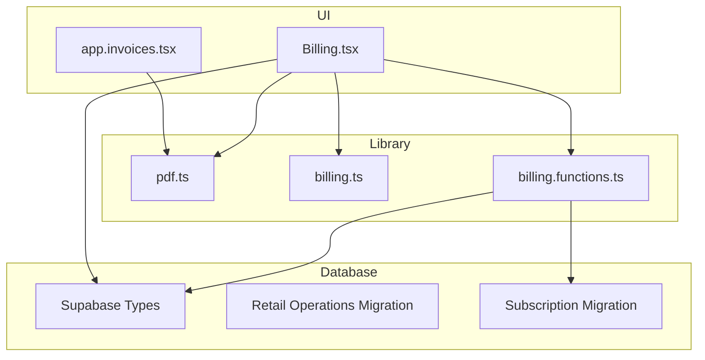
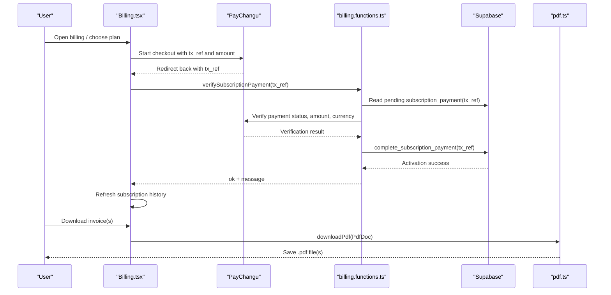
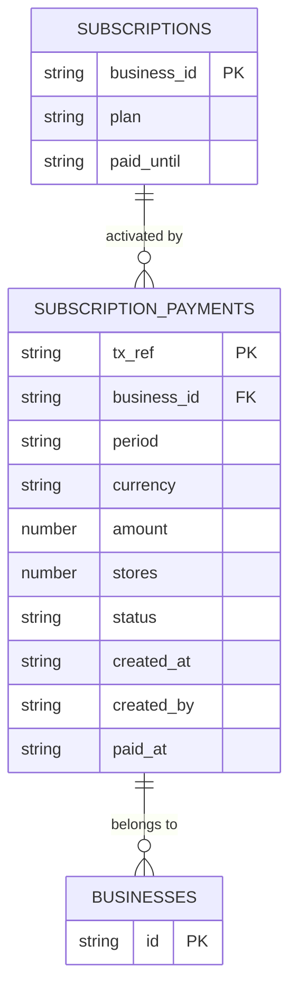
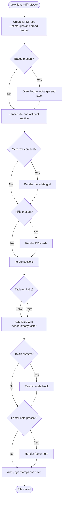
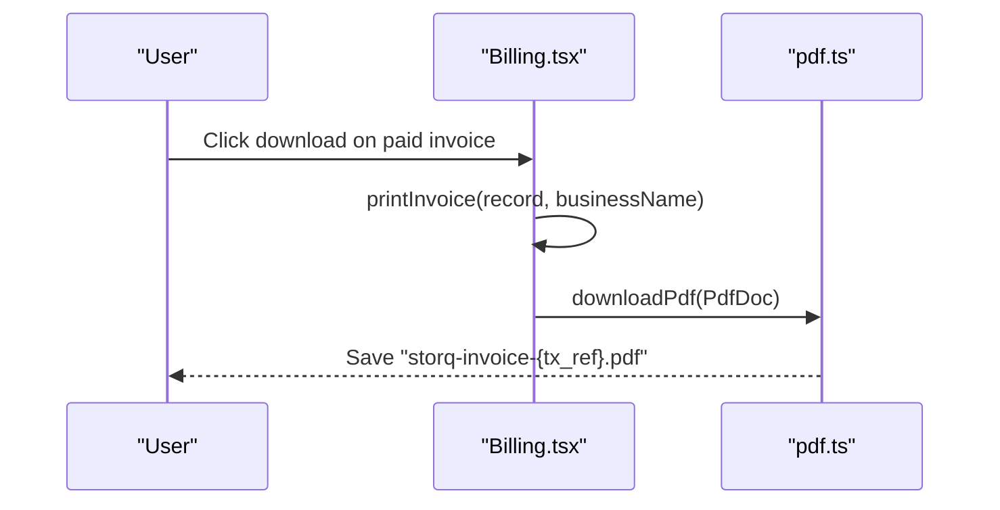
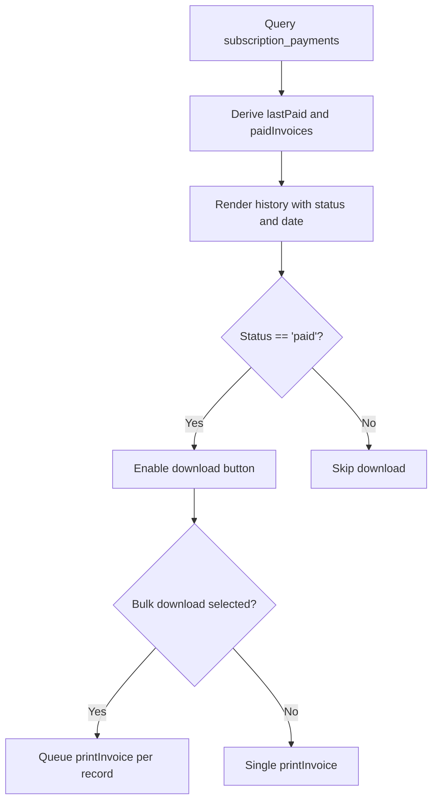
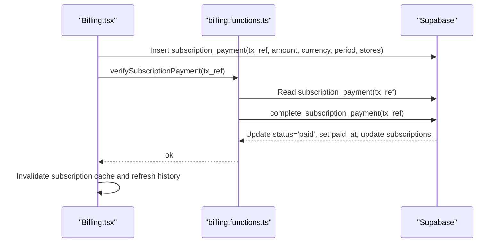
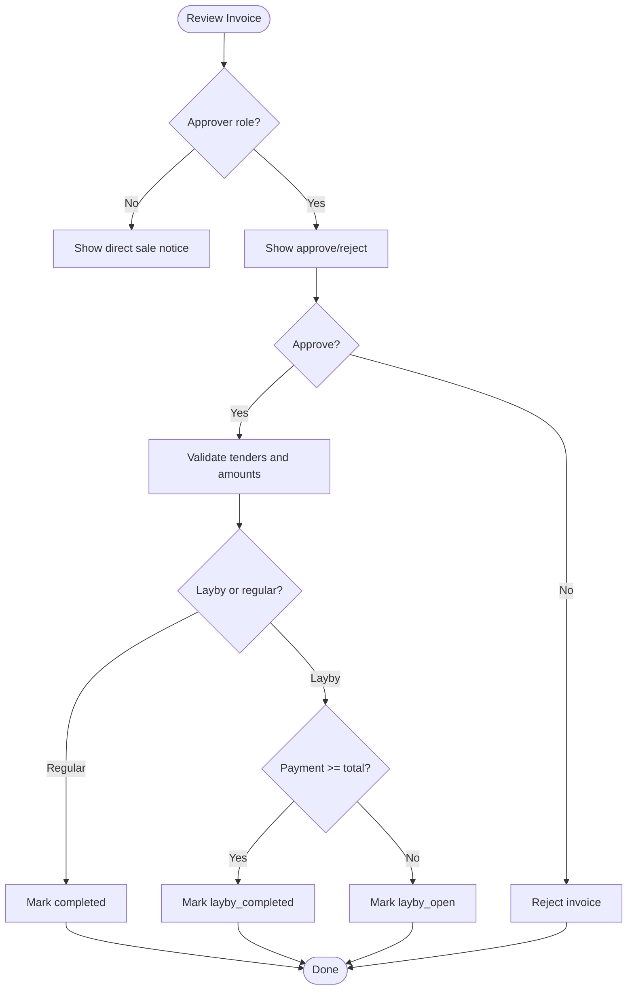
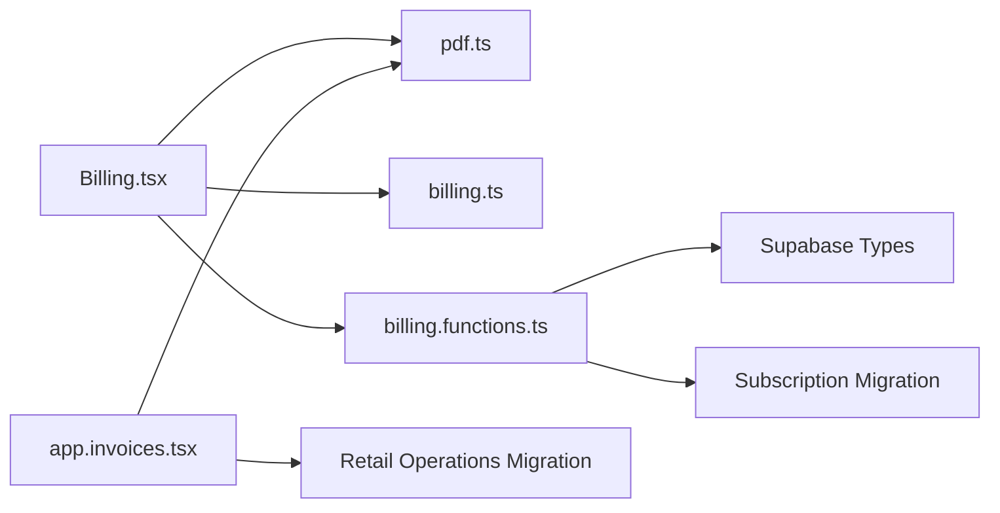

# Invoice Generation & Management

<cite>
**Referenced Files in This Document**
- [pdf.ts](file://src/lib/pdf.ts)
- [Billing.tsx](file://src/components/pos/Billing.tsx)
- [billing.ts](file://src/lib/billing.ts)
- [billing.functions.ts](file://src/lib/billing.functions.ts)
- [app.invoices.tsx](file://src/routes/_authenticated/app.invoices.tsx)
- [types.ts](file://src/integrations/supabase/types.ts)
- [retail_operations.sql](file://supabase/migrations/20261009210500_retail_operations.sql)
- [subscription_migration.sql](file://supabase/migrations/20261007100137_bfc24679-0e49-41d2-8a27-f70876506db1.sql)
</cite>

## Table of Contents
1. [Introduction](#introduction)
2. [Project Structure](#project-structure)
3. [Core Components](#core-components)
4. [Architecture Overview](#architecture-overview)
5. [Detailed Component Analysis](#detailed-component-analysis)
6. [Dependency Analysis](#dependency-analysis)
7. [Performance Considerations](#performance-considerations)
8. [Troubleshooting Guide](#troubleshooting-guide)
9. [Conclusion](#conclusion)

## Introduction
This document explains the invoice generation and management system used by the application. It covers:
- The invoice data model for subscription payments
- Client-side PDF generation, template structure, and customization options
- Downloading single or multiple invoices
- PrintInvoice behavior and metadata handling
- Invoice history tracking, paid invoice filtering, and bulk download
- Numbering, date formatting, business information inclusion
- The relationship between subscription payments and invoice generation, including status tracking and payment confirmation linkage

The system generates real vector PDFs client-side using jsPDF and jspdf-autotable, while subscription payment records are persisted in Supabase and linked to subscription activation.

## Project Structure
Invoice-related functionality is primarily implemented in:
- A shared PDF builder that renders branded documents and CSV exports
- A billing UI component that manages subscription payments, displays invoice history, and triggers PDF downloads
- Billing utilities for pricing, subscription state, and provider integration
- Server functions for secure payment verification
- Database types and migrations defining the subscription payment schema and activation logic

**Diagram sources**
- [Billing.tsx:27-673](file://src/components/pos/Billing.tsx#L27-L673)
- [pdf.ts:51-266](file://src/lib/pdf.ts#L51-L266)
- [billing.ts:10-39](file://src/lib/billing.ts#L10-L39)
- [billing.functions.ts:10-53](file://src/lib/billing.functions.ts#L10-L53)
- [types.ts:1055-1100](file://src/integrations/supabase/types.ts#L1055-L1100)
- [retail_operations.sql:353-374](file://supabase/migrations/20261009210500_retail_operations.sql#L353-L374)
- [subscription_migration.sql:46-63](file://supabase/migrations/20261007100137_bfc24679-0e49-41d2-8a27-f70876506db1.sql#L46-L63)

**Section sources**
- [Billing.tsx:27-673](file://src/components/pos/Billing.tsx#L27-L673)
- [pdf.ts:51-266](file://src/lib/pdf.ts#L51-L266)
- [billing.ts:10-39](file://src/lib/billing.ts#L10-L39)
- [billing.functions.ts:10-53](file://src/lib/billing.functions.ts#L10-L53)
- [types.ts:1055-1100](file://src/integrations/supabase/types.ts#L1055-L1100)
- [retail_operations.sql:353-374](file://supabase/migrations/20261009210500_retail_operations.sql#L353-L374)
- [subscription_migration.sql:46-63](file://supabase/migrations/20261007100137_bfc24679-0e49-41d2-8a27-f70876506db1.sql#L46-L63)

## Core Components
- PdfDoc and downloadPdf: Define the document model and render a branded PDF with header, badge, metadata grid, KPI cards, sections (table/pairs/text), totals, footer note, page stamps, and automatic pagination.
- Billing UI: Loads subscription history from Supabase, filters paid invoices, shows per-invoice download, supports bulk download, and constructs invoice PDFs via printInvoice.
- Billing utilities: Provide pricing constants, subscription query hook, and PayChangu script loader.
- Server verification function: Validates payment against the provider, checks amount/currency match, then activates the subscription through a database function.
- Database schema: Defines subscription_payments fields and a server-side function to mark payments paid and extend subscription validity.

Key responsibilities:
- Data model: subscription_payments row shape and lifecycle
- PDF generation: structured document composition and file download
- Payment flow: initiation, verification, activation, and history display
- Invoice export: single and bulk PDF downloads

**Section sources**
- [pdf.ts:7-32](file://src/lib/pdf.ts#L7-L32)
- [pdf.ts:51-266](file://src/lib/pdf.ts#L51-L266)
- [Billing.tsx:144-168](file://src/components/pos/Billing.tsx#L144-L168)
- [Billing.tsx:635-673](file://src/components/pos/Billing.tsx#L635-L673)
- [billing.ts:7-39](file://src/lib/billing.ts#L7-L39)
- [billing.functions.ts:10-53](file://src/lib/billing.functions.ts#L10-L53)
- [types.ts:1055-1100](file://src/integrations/supabase/types.ts#L1055-L1100)
- [subscription_migration.sql:46-63](file://supabase/migrations/20261007100137_bfc24679-0e49-41d2-8a27-f70876506db1.sql#L46-L63)

## Architecture Overview
The invoice workflow connects UI actions to client-side PDF rendering and server-side payment verification.

**Diagram sources**
- [Billing.tsx:94-139](file://src/components/pos/Billing.tsx#L94-L139)
- [Billing.tsx:144-168](file://src/components/pos/Billing.tsx#L144-L168)
- [Billing.tsx:635-673](file://src/components/pos/Billing.tsx#L635-L673)
- [billing.functions.ts:10-53](file://src/lib/billing.functions.ts#L10-L53)
- [subscription_migration.sql:46-63](file://supabase/migrations/20261007100137_bfc24679-0e49-41d2-8a27-f70876506db1.sql#L46-L63)
- [pdf.ts:51-266](file://src/lib/pdf.ts#L51-L266)

## Detailed Component Analysis

### Invoice Data Model
The subscription payment record is the source of truth for invoice generation. Its fields include transaction reference, business association, period type, currency, amount, store count, status, timestamps, and optional paid timestamp.

**Diagram sources**
- [types.ts:1055-1100](file://src/integrations/supabase/types.ts#L1055-L1100)
- [subscription_migration.sql:46-63](file://supabase/migrations/20261007100137_bfc24679-0e49-41d2-8a27-f70876506db1.sql#L46-L63)

**Section sources**
- [types.ts:1055-1100](file://src/integrations/supabase/types.ts#L1055-L1100)

### PDF Template and Metadata Handling
The PDF builder accepts a structured PdfDoc object:
- filename, title, business name, subtitle, badge
- meta key-value pairs rendered as a grid
- kpi cards for summary metrics
- sections supporting tables, pairs, and plain text
- totals section with highlighted final total
- footer note and page stamp with generated timestamp and page numbering

Customization points:
- Business branding via business name and badge
- Orientation control (portrait/landscape)
- Section alignment and column styles
- Totals styling and footer messaging

**Diagram sources**
- [pdf.ts:51-266](file://src/lib/pdf.ts#L51-L266)

**Section sources**
- [pdf.ts:7-32](file://src/lib/pdf.ts#L7-L32)
- [pdf.ts:51-266](file://src/lib/pdf.ts#L51-L266)

### printInvoice Function and Invoice Creation
printInvoice builds a PdfDoc from a subscription payment record and calls downloadPdf:
- Filename uses the transaction reference
- Title and subtitle include localized labels and reference
- Badge reflects paid status or current status
- Metadata includes billed-to business, invoice date, plan line, and currency
- Sections describe the line item with description, store count, and amount
- Totals show subtotal and total paid
- Footer contains a localized note

Example creation path:
- Single invoice: click the download icon next to a paid invoice row
- Bulk invoices: open the “Download all” dialog and confirm; invoices are queued sequentially

**Diagram sources**
- [Billing.tsx:635-673](file://src/components/pos/Billing.tsx#L635-L673)
- [pdf.ts:51-266](file://src/lib/pdf.ts#L51-L266)

**Section sources**
- [Billing.tsx:635-673](file://src/components/pos/Billing.tsx#L635-L673)
- [pdf.ts:51-266](file://src/lib/pdf.ts#L51-L266)

### Invoice History Tracking and Paid Invoice Filtering
The billing UI queries subscription_payments ordered by creation time and derives:
- Last paid record for display
- Filtered list of paid invoices for bulk operations
- Status badges and formatted dates per record

Paid invoice filtering:
- Records with status equal to “paid” are considered invoiced
- Date displayed uses paid_at if available, otherwise created_at

Bulk download:
- Iterates over paidInvoices and invokes printInvoice with staggered delays to avoid overlapping downloads

**Diagram sources**
- [Billing.tsx:144-168](file://src/components/pos/Billing.tsx#L144-L168)
- [Billing.tsx:312-368](file://src/components/pos/Billing.tsx#L312-L368)
- [Billing.tsx:386-436](file://src/components/pos/Billing.tsx#L386-L436)

**Section sources**
- [Billing.tsx:144-168](file://src/components/pos/Billing.tsx#L144-L168)
- [Billing.tsx:312-368](file://src/components/pos/Billing.tsx#L312-L368)
- [Billing.tsx:386-436](file://src/components/pos/Billing.tsx#L386-L436)

### Subscription Payments and Invoice Generation Linkage
The payment flow ensures invoices reflect verified transactions:
- start_store_subscription_payment creates a pending subscription_payment with tx_ref, amount, currency, period, and stores
- verifySubscriptionPayment validates the provider response and calls complete_subscription_payment
- complete_subscription_payment marks the payment as paid, sets paid_at, and updates subscriptions.paid_until and plan based on period

Status tracking:
- Pending payments remain non-paid until verification succeeds
- Once paid, invoices become downloadable and appear in the paid invoice list

**Diagram sources**
- [subscription_migration.sql:46-63](file://supabase/migrations/20261007100137_bfc24679-0e49-41d2-8a27-f70876506db1.sql#L46-L63)
- [billing.functions.ts:10-53](file://src/lib/billing.functions.ts#L10-L53)

**Section sources**
- [subscription_migration.sql:46-63](file://supabase/migrations/20261007100137_bfc24679-0e49-41d2-8a27-f70876506db1.sql#L46-L63)
- [billing.functions.ts:10-53](file://src/lib/billing.functions.ts#L10-L53)

### Invoice Numbering, Date Formatting, and Business Information
- Numbering: Invoices use the transaction reference (tx_ref) as part of the filename and subtitle. For retail sales invoices, numbers come from sale records and are displayed in the UI.
- Date formatting: Invoice dates are localized using en-ZA with long date style for PDFs and medium/long styles for UI display.
- Business information: The PDF header includes the business name (or default “Storq”), and metadata includes “Billed To” with the business name passed from the UI.

Examples:
- PDF filename: storq-invoice-{tx_ref}.pdf
- Subtitle includes tx_ref
- Metadata includes billed-to business, invoice date, plan line, and currency

**Section sources**
- [Billing.tsx:635-673](file://src/components/pos/Billing.tsx#L635-L673)
- [pdf.ts:51-266](file://src/lib/pdf.ts#L51-L266)

### Retail Invoice Approval and Status Flow
For retail operations, invoices can be reviewed and approved:
- Pending approvals are listed for approval-capable stores
- Approve action optionally records payment method and amount
- Database validation ensures tender methods and amounts are valid and consistent with invoice totals
- Layby invoices transition to layby_open or layby_completed depending on payment coverage

**Diagram sources**
- [app.invoices.tsx:39-57](file://src/routes/_authenticated/app.invoices.tsx#L39-L57)
- [retail_operations.sql:353-374](file://supabase/migrations/20261009210500_retail_operations.sql#L353-L374)

**Section sources**
- [app.invoices.tsx:39-57](file://src/routes/_authenticated/app.invoices.tsx#L39-L57)
- [retail_operations.sql:353-374](file://supabase/migrations/20261009210500_retail_operations.sql#L353-L374)

## Dependency Analysis
The following diagram maps core dependencies among components involved in invoice generation and management.

**Diagram sources**
- [Billing.tsx:27-673](file://src/components/pos/Billing.tsx#L27-L673)
- [pdf.ts:51-266](file://src/lib/pdf.ts#L51-L266)
- [billing.ts:10-39](file://src/lib/billing.ts#L10-L39)
- [billing.functions.ts:10-53](file://src/lib/billing.functions.ts#L10-L53)
- [types.ts:1055-1100](file://src/integrations/supabase/types.ts#L1055-L1100)
- [subscription_migration.sql:46-63](file://supabase/migrations/20261007100137_bfc24679-0e49-41d2-8a27-f70876506db1.sql#L46-L63)
- [app.invoices.tsx:39-57](file://src/routes/_authenticated/app.invoices.tsx#L39-L57)
- [retail_operations.sql:353-374](file://supabase/migrations/20261009210500_retail_operations.sql#L353-L374)

**Section sources**
- [Billing.tsx:27-673](file://src/components/pos/Billing.tsx#L27-L673)
- [pdf.ts:51-266](file://src/lib/pdf.ts#L51-L266)
- [billing.ts:10-39](file://src/lib/billing.ts#L10-L39)
- [billing.functions.ts:10-53](file://src/lib/billing.functions.ts#L10-L53)
- [types.ts:1055-1100](file://src/integrations/supabase/types.ts#L1055-L1100)
- [subscription_migration.sql:46-63](file://supabase/migrations/20261007100137_bfc24679-0e49-41d2-8a27-f70876506db1.sql#L46-L63)
- [app.invoices.tsx:39-57](file://src/routes/_authenticated/app.invoices.tsx#L39-L57)
- [retail_operations.sql:353-374](file://supabase/migrations/20261009210500_retail_operations.sql#L353-L374)

## Performance Considerations
- Lazy loading of jsPDF and jspdf-autotable prevents these libraries from entering the SSR bundle path, reducing initial load size.
- Staggered bulk downloads reduce simultaneous PDF generation pressure by spacing requests.
- Subscription history caching uses staleTime to avoid frequent refetches while still reflecting payment changes via invalidation.
- Vector-based PDF generation ensures crisp output without heavy image assets.

[No sources needed since this section provides general guidance]

## Troubleshooting Guide
Common issues and resolutions:
- Payment not configured: verify environment variables for provider keys; the server function returns a clear message when missing.
- Payment amount mismatch: ensure the recorded subscription_payment amount and currency match the provider’s response before marking paid.
- Subscription activation failure: check database function execution and permissions; errors are surfaced to the UI.
- PDF generation errors: catch blocks display user-friendly toast messages; verify browser support for Blob and URL APIs.

Operational tips:
- After successful payment, invalidate subscription queries to refresh history and enable invoice downloads.
- Confirm that paid_at is set only after provider verification succeeds.
- For retail invoices, validate tender methods and amounts to prevent inconsistent states.

**Section sources**
- [billing.functions.ts:10-53](file://src/lib/billing.functions.ts#L10-L53)
- [Billing.tsx:635-673](file://src/components/pos/Billing.tsx#L635-L673)
- [retail_operations.sql:353-374](file://supabase/migrations/20261009210500_retail_operations.sql#L353-L374)

## Conclusion
The invoice system combines a robust client-side PDF generator with a secure server-side payment verification flow. Subscription payments are persisted, validated, and activated in the database, enabling reliable invoice generation and download. The design supports single and bulk downloads, customizable PDF templates, and clear status tracking. Retail invoice approval adds an additional layer of control with strict validation rules. Together, these components provide a comprehensive solution for invoice generation, management, and reporting.

[No sources needed since this section summarizes without analyzing specific files]