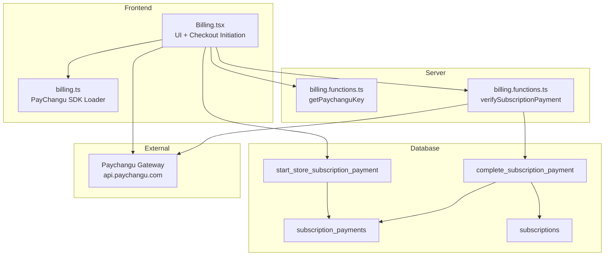
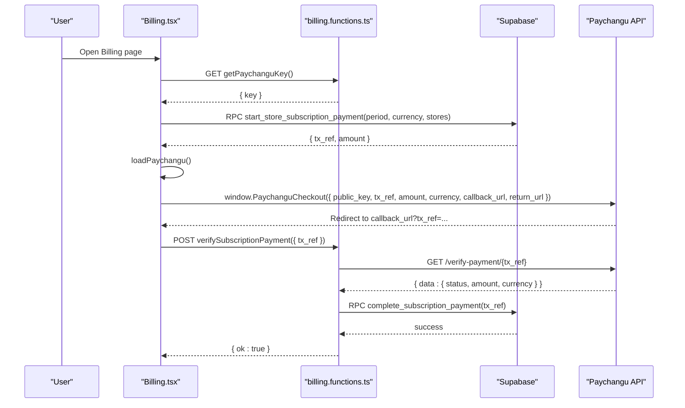
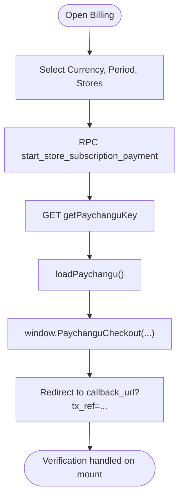
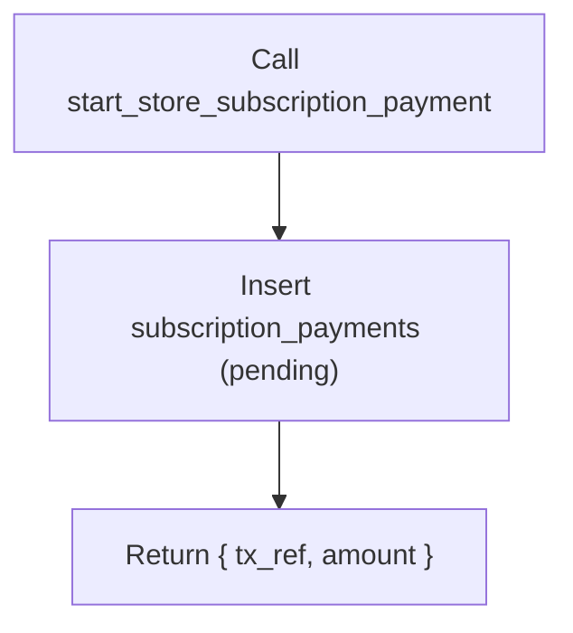
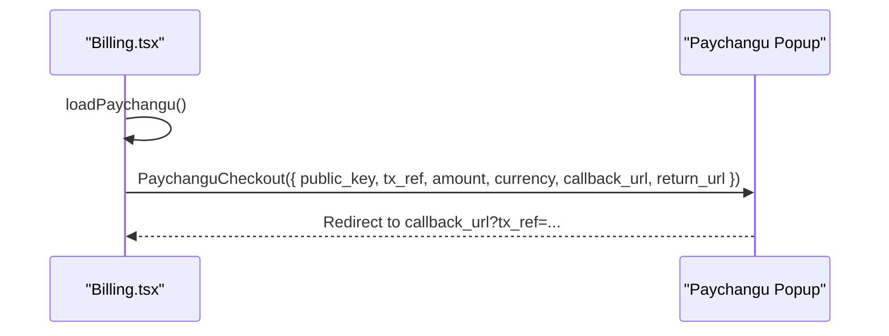
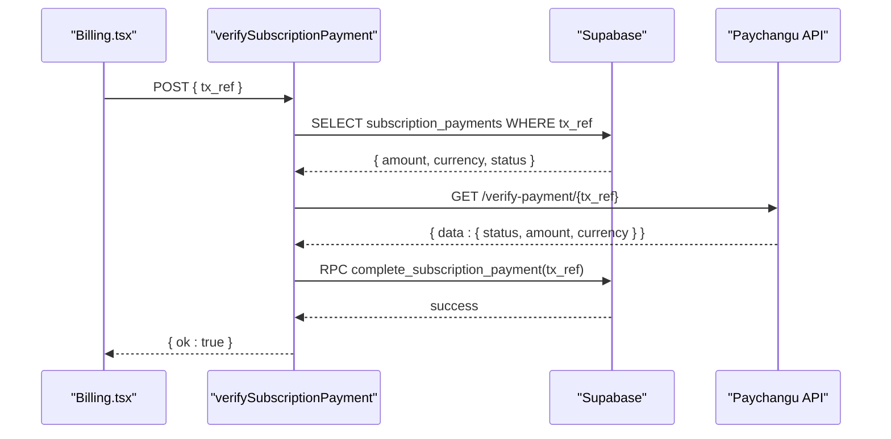
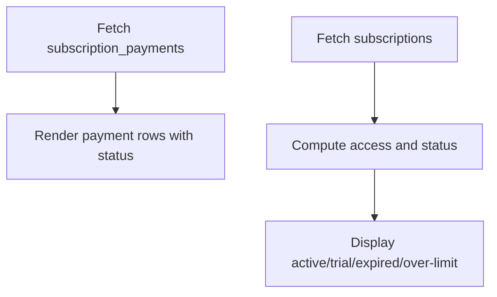
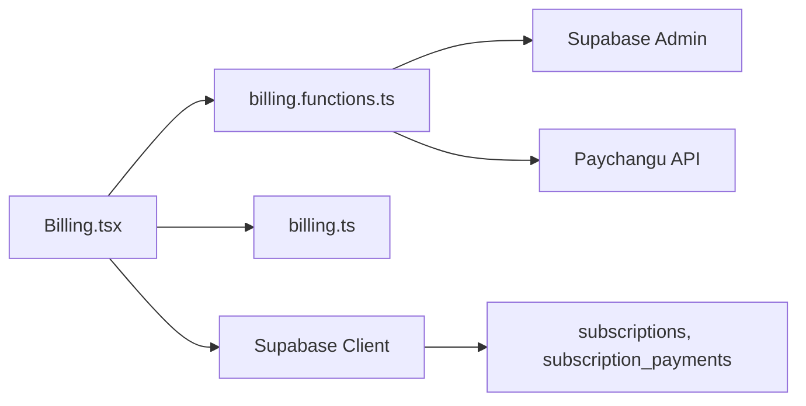

# Payment Processing Integration

<cite>
**Referenced Files in This Document**
- [Billing.tsx](file://src/components/pos/Billing.tsx)
- [billing.functions.ts](file://src/lib/billing.functions.ts)
- [billing.ts](file://src/lib/billing.ts)
- [20261007100137_bfc24679-0e49-446b-b715-df35c6e8c994.sql](file://supabase/migrations/20261007100137_bfc24679-0e49-446b-b715-df35c6e8c994.sql)
- [20261009193153_97dc4c9b-c64d-4f55-9cfe-e17b97fb71ec.sql](file://supabase/migrations/20261009193153_97dc4c9b-c64d-4f55-9cfe-e17b97fb71ec.sql)
- [types.ts](file://src/integrations/supabase/types.ts)
</cite>

## Table of Contents
1. [Introduction](#introduction)
2. [Project Structure](#project-structure)
3. [Core Components](#core-components)
4. [Architecture Overview](#architecture-overview)
5. [Detailed Component Analysis](#detailed-component-analysis)
6. [Dependency Analysis](#dependency-analysis)
7. [Performance Considerations](#performance-considerations)
8. [Troubleshooting Guide](#troubleshooting-guide)
9. [Conclusion](#conclusion)

## Introduction
This document explains the payment processing integration with the Paychangu gateway for subscription billing. It covers the end-to-end flow from initiating a payment to completing and verifying it, including transaction reference generation, public key retrieval, checkout initialization, callback handling, and server-side verification. It also documents error handling, status monitoring, security considerations, supported payment methods, and multi-currency support.

## Project Structure
The payment integration spans three main layers:
- Frontend UI and checkout orchestration
- Server functions for secure operations
- Database schema and stored procedures for state management

**Diagram sources**
- [Billing.tsx:54-139](file://src/components/pos/Billing.tsx#L54-L139)
- [billing.ts:41-55](file://src/lib/billing.ts#L41-L55)
- [billing.functions.ts:4-53](file://src/lib/billing.functions.ts#L4-L53)
- [20261007100137_bfc24679-0e49-446b-b715-df35c6e8c994.sql:13-63](file://supabase/migrations/20261007100137_bfc24679-0e49-446b-b715-df35c6e8c994.sql#L13-L63)

**Section sources**
- [Billing.tsx:54-139](file://src/components/pos/Billing.tsx#L54-L139)
- [billing.ts:41-55](file://src/lib/billing.ts#L41-L55)
- [billing.functions.ts:4-53](file://src/lib/billing.functions.ts#L4-L53)
- [20261007100137_bfc24679-0e49-446b-b715-df35c6e8c994.sql:13-63](file://supabase/migrations/20261007100137_bfc24679-0e49-446b-b715-df35c6e8c994.sql#L13-L63)

## Core Components
- Billing UI component: orchestrates plan selection, currency and period configuration, Paychangu checkout launch, and post-payment verification via URL callback.
- Server functions:
  - getPaychanguKey: returns the Paychangu public key securely from environment variables.
  - verifySubscriptionPayment: verifies a payment against Paychangu, validates amount and currency, and activates the subscription through a database function.
- Database layer:
  - subscription_payments: stores each payment attempt with metadata (amount, currency, period, stores, status).
  - subscriptions: tracks business subscription state (paid_until, plan, store capacity).
  - start_store_subscription_payment: creates a pending payment record and returns tx_ref and amount.
  - complete_subscription_payment: marks payment as paid and updates subscription entitlements.

**Section sources**
- [Billing.tsx:54-139](file://src/components/pos/Billing.tsx#L54-L139)
- [billing.functions.ts:4-53](file://src/lib/billing.functions.ts#L4-L53)
- [20261007100137_bfc24679-0e49-446b-b715-df35c6e8c994.sql:13-63](file://supabase/migrations/20261007100137_bfc24679-0e49-446b-b715-df35c6e8c994.sql#L13-L63)

## Architecture Overview
The system uses a client-server model where the frontend initiates payments through Paychangu’s popup SDK, while sensitive operations (key retrieval, verification, DB mutations) run on the server.

**Diagram sources**
- [Billing.tsx:74-139](file://src/components/pos/Billing.tsx#L74-L139)
- [billing.functions.ts:10-53](file://src/lib/billing.functions.ts#L10-L53)
- [20261007100137_bfc24679-0e49-446b-b715-df35c6e8c994.sql:46-63](file://supabase/migrations/20261007100137_bfc24679-0e49-446b-b715-df35c6e8c994.sql#L46-L63)

## Detailed Component Analysis

### Payment Initiation Flow
- The user selects plan details (currency MWK or USD, monthly or yearly), number of stores, and total price is computed.
- The UI calls the server function to create a pending payment and obtain a transaction reference and amount.
- The Paychangu SDK script is loaded, and the checkout popup is launched with required parameters including callback and return URLs.

**Diagram sources**
- [Billing.tsx:94-139](file://src/components/pos/Billing.tsx#L94-L139)
- [billing.ts:41-55](file://src/lib/billing.ts#L41-L55)

**Section sources**
- [Billing.tsx:94-139](file://src/components/pos/Billing.tsx#L94-L139)
- [billing.ts:41-55](file://src/lib/billing.ts#L41-L55)

### Transaction Reference Generation
- A unique transaction reference is created by the database function start_store_subscription_payment.
- The function inserts a row into subscription_payments with initial status pending and returns both tx_ref and amount to the frontend.

**Diagram sources**
- [20261007100137_bfc24679-0e49-446b-b715-df35c6e8c994.sql:46-49](file://supabase/migrations/20261007100137_bfc24679-0e49-446b-b715-df35c6e8c994.sql#L46-L49)

**Section sources**
- [20261007100137_bfc24679-0e49-446b-b715-df35c6e8c994.sql:46-49](file://supabase/migrations/20261007100137_bfc24679-0e49-446b-b715-df35c6e8c994.sql#L46-L49)

### PaychanguCheckout API Integration
- The frontend dynamically loads the Paychangu popup SDK from an external script.
- On successful load, the UI invokes window.PaychanguCheckout with:
  - public_key: retrieved securely from the server
  - tx_ref: generated by the backend
  - amount and currency: derived from plan and selected options
  - callback_url and return_url: set to the billing page so the app can handle the tx_ref query parameter
  - customer and customization metadata for display and tracking

**Diagram sources**
- [Billing.tsx:105-132](file://src/components/pos/Billing.tsx#L105-L132)
- [billing.ts:41-55](file://src/lib/billing.ts#L41-L55)

**Section sources**
- [Billing.tsx:105-132](file://src/components/pos/Billing.tsx#L105-L132)
- [billing.ts:41-55](file://src/lib/billing.ts#L41-L55)

### Callback URL Handling and Payment Verification
- On page load, if a tx_ref query parameter exists, the UI triggers verification.
- The verification server function:
  - Validates input tx_ref length
  - Checks that secret key is configured
  - Looks up the payment record by tx_ref
  - Calls Paychangu’s verify endpoint using the secret key
  - Confirms status is success and amount/currency match the recorded values
  - Invokes complete_subscription_payment to mark the payment as paid and update subscription entitlements

**Diagram sources**
- [Billing.tsx:74-92](file://src/components/pos/Billing.tsx#L74-L92)
- [billing.functions.ts:10-53](file://src/lib/billing.functions.ts#L10-L53)
- [20261007100137_bfc24679-0e49-446b-b715-df35c6e8c994.sql:51-63](file://supabase/migrations/20261007100137_bfc24679-0e49-446b-b715-df35c6e8c994.sql#L51-L63)

**Section sources**
- [Billing.tsx:74-92](file://src/components/pos/Billing.tsx#L74-L92)
- [billing.functions.ts:10-53](file://src/lib/billing.functions.ts#L10-L53)
- [20261007100137_bfc24679-0e49-446b-b715-df35c6e8c994.sql:51-63](file://supabase/migrations/20261007100137_bfc24679-0e49-446b-b715-df35c6e8c994.sql#L51-L63)

### Payment Status Monitoring
- The UI fetches subscription_payments history and displays statuses such as pending or paid.
- Subscription access and expiration are derived from the subscriptions table and displayed with status labels.

**Diagram sources**
- [Billing.tsx:144-169](file://src/components/pos/Billing.tsx#L144-L169)
- [billing.ts:10-39](file://src/lib/billing.ts#L10-L39)

**Section sources**
- [Billing.tsx:144-169](file://src/components/pos/Billing.tsx#L144-L169)
- [billing.ts:10-39](file://src/lib/billing.ts#L10-L39)

### Webhook Processing for Payment Confirmations
- The current implementation does not include a dedicated webhook endpoint.
- Payment confirmation relies on:
  - Client-side callback URL handling when the user returns to the app
  - Server-side verification against Paychangu’s verify endpoint before marking payments as paid
- If you need asynchronous confirmations without user redirection, consider adding a secure webhook handler that verifies signatures and performs idempotent updates.

[No sources needed since this section provides general guidance]

### Error Handling Strategies
- Missing public key: UI shows an error indicating payments are not configured.
- SDK load failure: UI shows an error indicating Paychangu could not open.
- Verification failures:
  - Secret key missing: server returns a message indicating payments are not configured.
  - Payment not found: server returns a message indicating the payment was not found.
  - Non-success status from Paychangu: server returns a message indicating payment not confirmed yet.
  - Amount or currency mismatch: server rejects activation due to mismatch.
  - Database activation error: server returns a message indicating activation failed.
- UI surfaces errors via toast notifications and prevents duplicate activations by checking existing paid status.

**Section sources**
- [Billing.tsx:107-139](file://src/components/pos/Billing.tsx#L107-L139)
- [billing.functions.ts:12-53](file://src/lib/billing.functions.ts#L12-L53)

### Security Considerations
- Public key exposure: Only the public key is exposed to the client; secret key remains server-only.
- Input validation: tx_ref is validated with minimum and maximum length constraints.
- Idempotency: Payments already marked as paid are skipped during verification.
- Secure DB access: Verification and completion use service role RPCs to enforce RLS policies.
- Amount and currency integrity: Verification ensures the gateway-reported amount and currency match the recorded values before activating the subscription.

**Section sources**
- [billing.functions.ts:4-53](file://src/lib/billing.functions.ts#L4-L53)
- [20261007100137_bfc24679-0e49-446b-b715-df35c6e8c994.sql:51-63](file://supabase/migrations/20261007100137_bfc24679-0e49-446b-b715-df35c6e8c994.sql#L51-L63)

### Payment Method Support
- The UI indicates support for mobile money and cards through Paychangu.
- Actual method availability depends on Paychangu’s configuration and region.

**Section sources**
- [Billing.tsx:568-618](file://src/components/pos/Billing.tsx#L568-L618)

### Multi-Currency Payment Processing
- Supported currencies: MWK and USD.
- Pricing constants define per-store monthly rates for each currency.
- Yearly plans apply a discount factor.
- The UI allows selecting currency and computes totals accordingly.

**Section sources**
- [billing.ts:7-8](file://src/lib/billing.ts#L7-L8)
- [Billing.tsx:44-72](file://src/components/pos/Billing.tsx#L44-L72)

## Dependency Analysis
The following diagram maps dependencies between components and external services.

**Diagram sources**
- [Billing.tsx:1-10](file://src/components/pos/Billing.tsx#L1-L10)
- [billing.functions.ts:1-53](file://src/lib/billing.functions.ts#L1-L53)
- [billing.ts:1-55](file://src/lib/billing.ts#L1-L55)

**Section sources**
- [Billing.tsx:1-10](file://src/components/pos/Billing.tsx#L1-L10)
- [billing.functions.ts:1-53](file://src/lib/billing.functions.ts#L1-L53)
- [billing.ts:1-55](file://src/lib/billing.ts#L1-L55)

## Performance Considerations
- SDK loading is memoized to avoid repeated network requests.
- Subscription queries use staleTime and refetchInterval to balance freshness and performance.
- Payment history uses a longer staleTime to reduce frequent refetches.
- Avoid unnecessary re-renders by deriving access state purely from cached data and live store count.

**Section sources**
- [billing.ts:10-39](file://src/lib/billing.ts#L10-L39)
- [Billing.tsx:144-169](file://src/components/pos/Billing.tsx#L144-L169)

## Troubleshooting Guide
- Payments not configured:
  - Ensure PAYCHANGU_PUBLIC_KEY and PAYCHANGU_SECRET_KEY are set in the server environment.
- Paychangu could not open:
  - Check network connectivity and ensure the Paychangu popup script loads successfully.
- Payment not found:
  - Verify that start_store_subscription_payment was called and returned a valid tx_ref.
- Payment not confirmed yet:
  - Reattempt verification after some time; ensure the Paychangu account has processed the payment.
- Payment amount does not match:
  - Confirm that the amount and currency sent to Paychangu match those recorded in subscription_payments.
- Could not activate subscription:
  - Inspect database RPC errors and ensure complete_subscription_payment executes successfully.

**Section sources**
- [billing.functions.ts:12-53](file://src/lib/billing.functions.ts#L12-L53)
- [Billing.tsx:107-139](file://src/components/pos/Billing.tsx#L107-L139)

## Conclusion
The integration leverages Paychangu’s checkout SDK for a seamless payment experience while keeping sensitive operations server-side. It generates transaction references, retrieves public keys securely, initializes checkout with appropriate metadata, handles callbacks, and verifies payments before updating subscription entitlements. The design emphasizes security, idempotency, and clear error handling, supporting multiple currencies and payment methods provided by Paychangu.